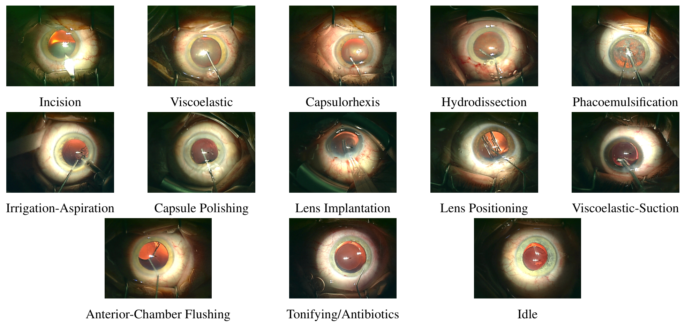
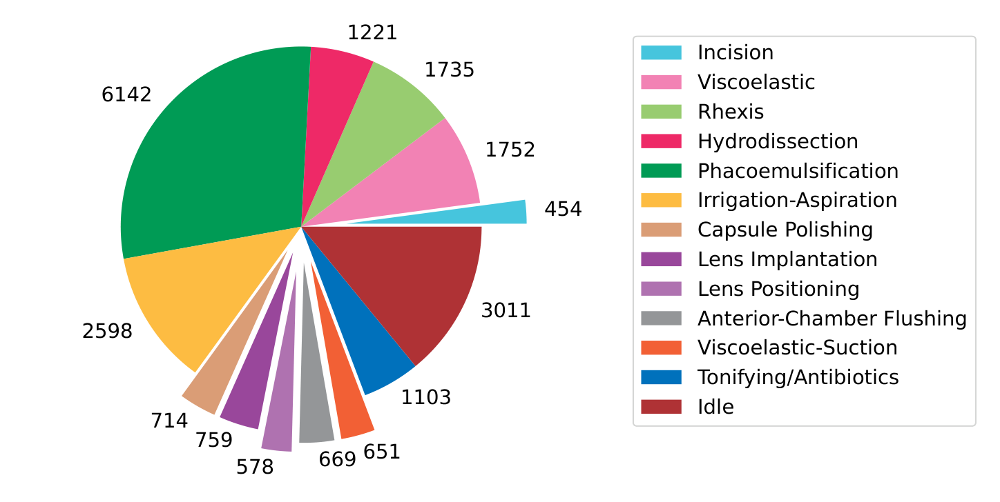
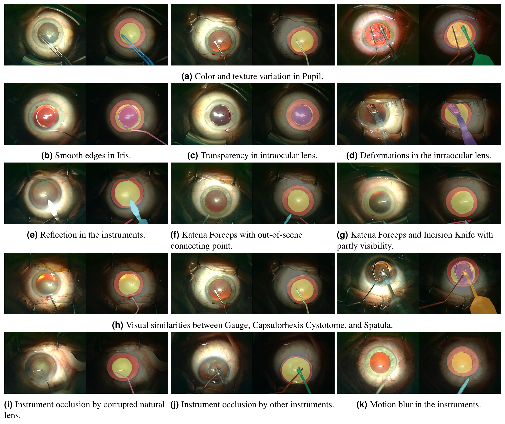
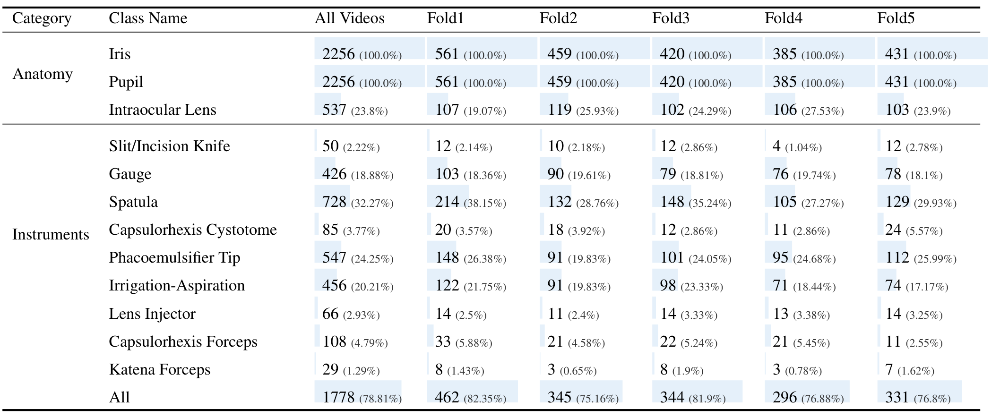
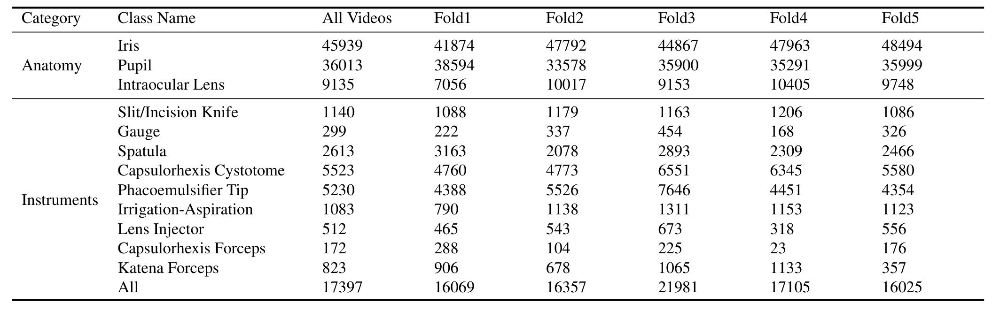
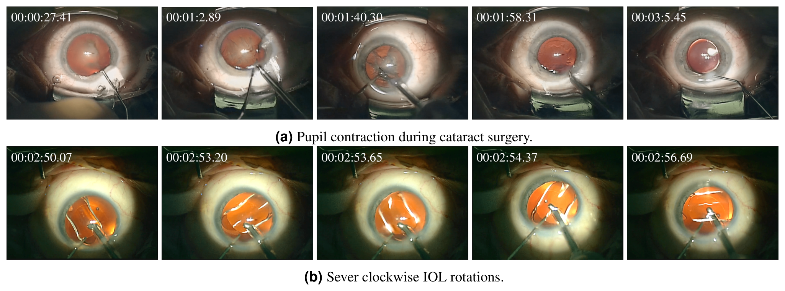
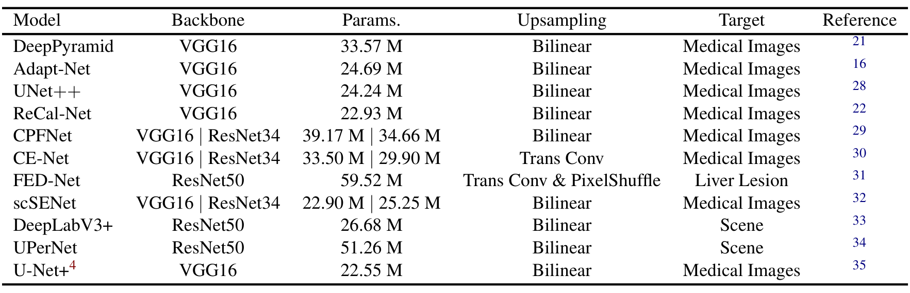
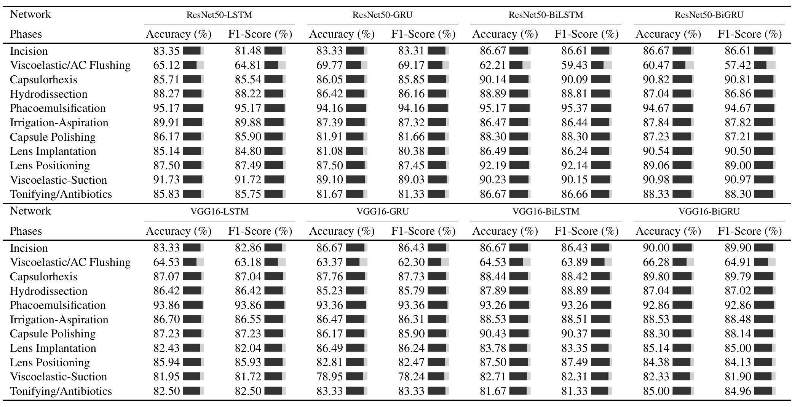
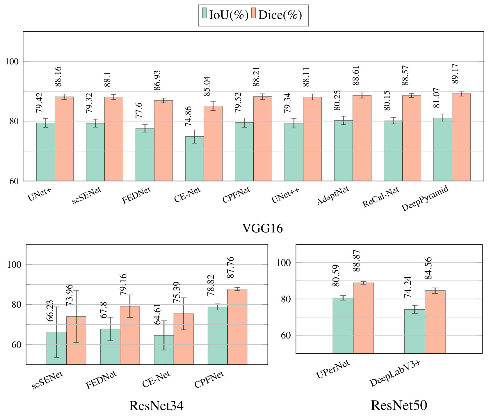
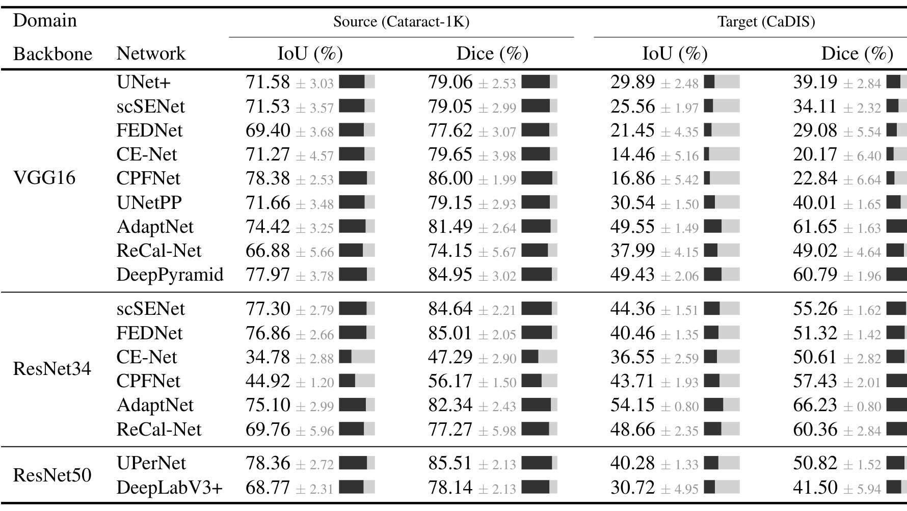

---
tags:
  - papers/手术数据集
aliases:
  - "Cataract-1K"
date: 2023-12-11
arxiv_id: 2312.06295
---

# Cataract-1K: Cataract Surgery Dataset for Scene Segmentation, Phase Recognition, and Irregularity Detection

## 核心信息

- 标题: Cataract-1K: Cataract Surgery Dataset for Scene Segmentation, Phase Recognition, and Irregularity Detection
- 标题翻译: Cataract-1K：面向场景分割、阶段识别和异常检测的白内障手术数据集
- 作者: Negin Ghamsarian, Yosuf El-Shabrawi, Sahar Nasirihaghighi, Doris Putzgruber-Adamitsch, Martin Zinkernagel, Sebastian Wolf, Klaus Schoeffmann, Raphael Sznitman
- 机构: 伯尔尼大学医学系人工智能医学中心(CAIM); 克拉根福大学信息技术系; 克拉根福诊所(Klinikum Klagenfurt)眼科; 伯尔尼因塞尔医院(Inselspital)眼科
- 发表时间: 2023-12-11
- 发表渠道: arXiv 预印本(cs.CV)
- arXiv: 2312.06295
- 论文链接: https://arxiv.org/abs/2312.06295
- 代码 / 项目: 论文称预处理代码在论文的 GitHub 仓库中,评审期通过 Figshare 访问,正文未给出链接
- 数据 / 资源: 论文接收后发布于 Synapse,评审期暂存 Figshare,许可为 CC BY
- 论文类型: 数据集论文(benchmark_or_dataset)

## 原文摘要翻译

近年来,深度学习彻底改变了计算机辅助介入和术后手术视频分析的面貌,在提升外科医生技能、手术室管理和整体手术结局方面带来了显著进步。然而,深度学习手术技术的发展高度依赖大规模数据集和标注。其中,手术场景理解和阶段识别是计算机辅助手术以及白内障手术视频术后评估的关键支柱。

在此背景下,我们发布了最大的白内障手术视频数据集,它能满足构建计算机化手术流程分析和检测白内障手术术后异常的多种需求。我们对若干最先进的神经网络架构做阶段识别和手术场景分割的基准测试,以此验证标注质量。此外,我们评估白内障手术视频中的跨域器械分割性能,由此开启白内障手术器械分割的域适应研究。数据集和标注将在论文被接收后公开。

## 创新点

1. 把阶段、像素级分割和异常检测放进同一批白内障手术视频。论文称此前的公开数据集要么只标注单一子任务(器械识别、场景与解剖结构分割),要么是针对个别问题的小型多任务集。这一点的价值在于同一批病例上可以联合研究流程和场景。
2. 规模。数据集包含 1000 个 2021 至 2023 年在 Klinikum Klagenfurt 录制的视频,其中 56 个有阶段标注,30 个视频的 2256 帧有像素级标注。只有一小部分视频带标注。论文没有给出与既有数据集的数字对比,“最大”是论文自己的说法。
3. 像素级标注覆盖 3 类解剖结构和 9 类器械,并按患者划分为五折,同时提供 Supervisely 与 COCO 两种格式,后者带边界框,可以直接用于定位任务。
4. 两个术中异常子集:瞳孔收缩和人工晶状体(IOL)旋转。它们对应术后视力和再手术风险,论文把它们作为后续研究的起点,正文没有给出规模。
5. 跨域实验。论文在 Cataract-1K 上训练二值器械分割网络,在 CaDIS 上测试,用这个结果说明域适应研究的必要性。

## 一句话总结

Cataract-1K 是一个来自单一诊所的白内障手术视频数据集,用 56 个视频的阶段标注、30 个视频 2256 帧的像素级标注和两个异常子集支持多任务研究,基线实验显示器械分割与跨数据集泛化仍然困难。

## 研究问题

手术视频分析的瓶颈在数据,不在网络。**白内障手术是最常见的眼科手术**,论文引用的预测是全球白内障致盲人数在 2025 年达到 40 million,手术视频的索引、归档和术后报告因此有现实需求。

这类分析依赖两个基础模块:阶段识别和场景分割。相关性检测、基于相关性的压缩、异常检测和手术结局预测都建立在它们之上。

**缺口是没有一个同时覆盖多种任务的大规模公开数据集。** 论文称现有公开数据集要么只标注单一子任务(器械识别、场景与解剖结构分割),要么是针对个别问题(例如人工晶状体异常检测)的小型多任务集。

论文要回答的问题因此是:能否提供视频数量大、标注类型多、并含术中异常子集的数据集,并用常见网络的基线结果说明这些标注可用。

### 核心观点速览

论文的答案是 Cataract-1K:单一诊所录制的 1000 个手术视频,三类标注各自只覆盖其中一小部分。

- 阶段:56 个视频,13 类(含 idle)。
- 像素级:30 个视频的 2256 帧,3 类解剖结构和 9 类器械,按患者分五折。
- 异常:瞳孔收缩和人工晶状体旋转两个小子集,只有示例。

基线实验给出三个结果。**阶段识别在粘弹剂/前房冲洗之外的阶段,Accuracy 在 78.95% 到 95.17% 之间;粘弹剂/前房冲洗最难,F1 在 57.42% 到 69.17% 之间。** 分割上解剖结构容易(瞳孔 Dice 最高 95.07%),器械困难(最好 IoU 63.91%)。换到 CaDIS 上测试时,Dice 平均从 77.50% 降到 46.49%。

**边界:** 标注质量只有基线成绩作间接证据;阶段识别是一对多二分类;异常子集没有规模和基线;“最大”没有数字对比;跨域实验没有使用任何域适应方法。

## 数据与任务定义

**视频有 1000 个,但真正带标注的只是一小部分。** 这一节先看视频本身,再看三个子集各自标了什么。

### 数据来源

数据集共 1000 个白内障手术视频,2021 至 2023 年录制于 Klinikum Klagenfurt 的眼科诊所。论文把手术统一限定为超声乳化白内障手术。除被标注的视频外,其余视频以 25 fps、512×324 编码。论文用外科医生累计完成的手术例数衡量其经验,范围从 1,000 到 40000 以上。

三个标注子集使用不同的视频,规格也不同:

| 子集 | 视频数 | 分辨率与帧率 | 患者年龄 | 医生经验(累计例数) |
|---|---|---|---|---|
| 阶段识别 | 56 | 1024×768,30 fps,平均 6.45 分钟(标准差 2.04) | 平均 75 岁,51 至 93 岁,标准差 8.69 | 平均 8929,标准差 6350 |
| 语义分割 | 30 | 1024×768 | 平均 74.5 岁,51 至 90 岁,标准差 8.43 | 平均 8033,标准差 3894 |

语义分割一行的医生经验在原文中被写成“阶段识别数据集中的视频”,与前后文不符,应是笔误。论文未说明 56 个视频与 30 个视频是否重叠,也未说明其余视频是否带有逐视频的医生经验或患者元数据。论文自己也把“存储视频缺少元数据”列为困难之一。

### 阶段识别子集

论文把常规白内障手术划分为 12 个动作阶段:切口、粘弹剂、撕囊、水分离、超声乳化、灌注抽吸、囊袋抛光、人工晶状体植入、晶状体定位、粘弹剂吸除、前房冲洗、封闭/抗生素。另有 idle 阶段,指阶段中间或阶段之间医生更换器械、画面里看不到器械的时段。这样共 13 个类别。标注形式是 CSV,给出每个视频中每个阶段的起止帧。

*论文原图编号：Figure 1。常规白内障手术各阶段的示例帧。放在这里是因为它直接定义了 13 个阶段类别,并显示不同阶段的器械外观很接近。*

论文列出的阶段识别困难有六条:不同阶段的器械相似,类间差异小;类别严重不均衡;手动调焦造成的离焦模糊;眼球无意移动和器械快速运动造成的运动模糊;视频缺少元数据;患者眼部外观差异导致视频间分布差异大。

*论文原图编号：Figure 2。56 个视频中各阶段标注时长之和(单位为秒)。放在这里是因为它给出类别不均衡的具体数字:超声乳化 6142 秒,切口 454 秒,idle 3011 秒。*

论文据此写道,最长的超声乳化阶段和最短的切口阶段分别占标注的 28.72% 和 2.1%。我的判断:不做类别平衡,切口这类短阶段会被淹没,论文在训练时把“其余”类下采样到与目标类等量,正是为此。

作为核对,各阶段秒数合计 21387 秒(本笔记自算),除以 56 个视频约 382 秒,即约 6.37 分钟,与文中平均 6.45 分钟接近但不相等,论文未解释差异。

> [!figure] Table 1 56 个视频的阶段时间线
> 建议位置：数据与任务定义
> 放置原因：这张表用颜色条展示每个视频内各阶段的先后与占比,能直观看出阶段顺序基本固定而时长差异很大。
> 当前状态：保留占位；自动视觉质量检查已拒绝该裁图，表体不完整，不能稳定还原。

### 语义分割子集

语义分割子集取自 30 个常规手术视频,每 5 秒抽取一帧,并剔除运动模糊严重或虹膜移出画面的帧,最后得到 2256 帧。标注类别共 12 类:3 类解剖结构(虹膜、瞳孔、人工晶状体)和 9 类器械(切口刀、量规、铲、撕囊针、超声乳化头、灌注抽吸头、晶状体注射器、撕囊镊、Katena 镊)。标注使用 Supervisely 平台的多边形,导出为 JSON。

*论文原图编号：Figure 3。像素级标注示例及对应的分割困难,(a) 到 (k) 分别展示瞳孔外观变化、虹膜边缘平滑、晶状体透明与形变、器械反光、部分可见、器械相似、遮挡和运动模糊。图中各类别的颜色对应关系写在原文图注里,不在这张裁图内。*

论文列出的分割困难包括:瞳孔的颜色、形状、大小和纹理变化;人工晶状体透明且会形变;虹膜边缘平滑、颜色多变;器械被遮挡、模糊、反光或只部分可见;多类别器械之间外观相似。

数据划分为五折,按患者隔离,每折包含 6 个不同视频的帧。

*论文原图编号：Table 3。各类别的实例数及其在各折帧中的出现比例。放在这里是因为它给出类别不均衡和五折划分的具体数字。*

虹膜和瞳孔出现在全部 2256 帧中。人工晶状体出现在 537 帧(23.8%)。器械里铲最常见,728 帧(32.27%),Katena 镊最少,29 帧(1.29%),切口刀 50 帧(2.22%)。表中 All 一行为 1778 帧(78.81%),应是至少含一类器械的帧,论文未明确定义。

*论文原图编号：Table 4。各类别每帧的平均像素数。放在这里是因为它给出各类别在画面中的面积量级。*

虹膜平均 45939 像素,瞳孔 36013,人工晶状体 9135;器械中超声乳化头 5230、撕囊针 5523,量规只有 299,撕囊镊 172。论文未说明这个平均是对所有帧取平均,还是只对该类别出现的帧取平均,也未说明统计时使用的分辨率。

### 异常检测子集

数据集还含两个小的术中异常子集。

瞳孔收缩发生在超声乳化阶段。这一阶段器械深入眼内,虹膜受到轻微损伤就可能引起瞳孔缩小,进而伤及眼内组织,并让人工晶状体的对位和居中变得困难,多焦点和散光矫正型晶状体尤其受影响。

人工晶状体旋转指晶状体在手术结束时已对齐居中,术后仍可能旋转或脱位,唯一的补救是再次手术。论文引用的观点是术中的晶状体旋转是术后错位的主要原因。Figure 4 的例子是晶状体展开时在不到七秒内快速顺时针旋转。

*论文原图编号：Figure 4。(a) 严重瞳孔收缩,(b) 严重顺时针晶状体旋转,每行给出带时间戳的 5 帧。放在这里是因为这是论文对两个异常子集仅有的具体展示。*

这两个子集的视频数量、标签形式(逐帧、逐视频还是时间段)、标注者以及检测任务的评测方式,论文都未说明。

### 评测任务

数据集支持阶段识别、解剖结构加器械分割、二值器械分割和多类器械分割。论文实际评测了其中三项:阶段识别(Table 5)、解剖结构加器械分割(Table 6,器械合并为一类)和二值器械分割的跨域泛化(Table 7)。多类器械分割和异常检测都没有基线结果。表中器械只有一列,应是合并为一类。

数据和任务就这些。下一节看标注怎么来,以及基线怎么训练,因为后面的数字能否直接比较取决于这些设置。

## 方法主线

**论文没有提出新方法,方法部分其实是标注流程加两套基线。** 标注流程交代数据怎么来;基线设置决定后面的数字能不能直接比较。

### 构建与标注流程

分工写在作者贡献声明里:

- 两位眼科医生(Yosuf El-Shabrawi 和 Doris Putzgruber-Adamitsch)提供手术阶段、解剖结构和器械的专业信息。
- 第一作者 Negin Ghamsarian 与通讯作者 Klaus Schoeffmann 组织标注。
- Negin Ghamsarian 和 Doris Putzgruber-Adamitsch 审阅并修正标注。
- 致谢中还感谢 Daniela Stefanics 协助标注。

此外:

- 研究经伦理委员会批准(EK 28/17)。
- 经费来自 Haag-Streit Foundation Switzerland 和奥地利 FWF 基金(P 32010-N38)。

标注者人数、培训方式、复核比例和标注一致性,论文未说明。

阶段标注以 CSV 记录起止帧,分割标注以 Supervisely JSON 与 COCO 两种格式发布。

论文称相应的预处理代码(从 CSV 切出阶段、从 JSON 生成训练掩码)在论文的 GitHub 仓库中。

### 机制流程

下面是阶段识别基线的数据流,它也是论文技术验证的核心协议。

1. 输入是 56 个视频的 CSV 起止帧。每个阶段的视频按 3 秒切片,相邻片段重叠 1 秒,输出每个阶段的片段集合。
2. 对每个目标阶段做一对多:目标阶段片段为一类,其余阶段片段为“其余”类。“其余”类随机抽取到与目标类片段数相等,再做离线增强,输出两类数量相同的训练集。
3. 训练时从每个片段的 90 帧中随机取 10 帧,缩放到 224×224,经 ImageNet 预训练的 `VGG16` 或 `ResNet50` 提取特征,送入循环层,输出两类的 softmax 概率。
4. 在剩余视频的不重叠片段上计算该阶段的 Accuracy 和 F1,汇总成 `Table 5`。

### 阶段识别基线设置

网络由卷积网络和循环网络组成:

- 卷积骨干为 `VGG16` 或 `ResNet50`,最后四层冻结。
- 循环层比较 `LSTM`、`GRU`、`BiLSTM`、`BiGRU` 四种,均为单层 64 单元。
- 后接 64 单元的全连接层和 2 单元的 softmax 层,循环层输出上使用 0.5 的 dropout。
- 训练用二元交叉熵损失、Adam 优化器、学习率 0.001、批大小 16。

增强包括:gamma 与对比度系数 0.5、sigma 为 10 的高斯模糊、最大 20 度的随机旋转、亮度范围 [−0.3, 0.3]、饱和度范围 [0.5, 1.5]。模型在 32 个视频上训练,在其余视频的不重叠片段上测试。评测时,粘弹剂与前房冲洗两个阶段因视觉特征相近而合并,idle 没有出现在 `Table 5` 中。

论文未说明测试集是否同样做了类别平衡、各阶段的测试片段数、随机种子和重复次数。

### 分割基线设置

论文选了面向通用图像、医学图像和手术视频的网络。Table 2 列出 11 个模型及其骨干、参数量和上采样方式,如下。

*论文原图编号：Table 2。所比较的分割网络的骨干、参数量、上采样方式和目标领域。放在这里是因为它定义了后面所有分割结果的比较对象。*

`Table 2` 把 FED-Net 的骨干写成 `ResNet50`。

而在 `Table 6` 和 `Table 7` 中,FEDNet 出现在 `VGG16` 和 `ResNet34` 之下,没有 `ResNet50` 配置。这一点论文未解释。

训练设置:骨干用 ImageNet 预训练初始化,批大小 8,初始学习率 0.001,按多项式衰减,输入 512×512。增强为裁剪、最大 30 度随机旋转、亮度/对比度/饱和度均为 0.7 的颜色抖动、高斯模糊和随机锐化。学习率衰减为

$$lr = lr_{init} \times \left(1 - \frac{iter}{total\_iter}\right)^{0.9}$$

损失函数是二元交叉熵与对数 Dice 项的加权和:

$$\mathcal{L} = \lambda \cdot \mathrm{BCE}\big(X_{true}(i,j), X_{pred}(i,j)\big) - (1-\lambda)\cdot \log\frac{2\sum X_{true}\odot X_{pred} + \sigma}{\sum X_{true} + \sum X_{pred} + \sigma}$$

其中 $X_{true}$ 是真值二值掩码,$X_{pred}$ 是预测掩码,取值在 0 到 1 之间;$\lambda = 0.8$;$\odot$ 是逐元素乘积;$\sigma = 1$ 是平滑项,用来避免分母为零和过拟合。

评测指标为平均 Dice 和平均 IoU,在五折上统计。损失的第二项是对数形式的 Dice 损失,Dice 越高该项越小。交叉熵项的权重为 λ,Dice 项的权重为 1−λ。

跨域实验用同样的网络在 Cataract-1K 的二值器械标注上训练,在 CaDIS 上直接测试。目标域的评测帧数、标注映射和是否做过微调,论文未说明。

设置交代完了,下一节看这些设置换来了什么结果。

## 关键结果

**基线要回答的问题是:这些标注能否训练出有区分度的模型。** 答案是能,但器械分割和跨数据集泛化仍然困难。

### 阶段识别基线表现

*论文原图编号：Table 5。八种 CNN-RNN 组合在 11 个阶段上的 Accuracy 和 F1。放在这里是因为它是阶段识别的全部结果。*

论文称各组合的阶段识别表现令人满意,双向循环层在所有配置下都提升了 Accuracy 与 F1,`ResNet50` 略优于 `VGG16`。下表是本笔记对 `Table 5` 中 11 个阶段的 Accuracy 做的简单平均(非论文报告值)。

| 骨干 | LSTM | GRU | BiLSTM | BiGRU |
|---|---|---|---|---|
| `ResNet50` | 85.81 | 84.40 | 86.68 | 86.70 |
| `VGG16` | 83.81 | 83.69 | 85.04 | 85.42 |

平均值支持论文的两条说法:双向层的增益在 0.9 到 2.3 个百分点之间,`ResNet50` 比 `VGG16` 高 0.7 到 2.0 个百分点。逐阶段看则不是处处成立:

- 粘弹剂/前房冲洗阶段,`ResNet50-LSTM` 的 Accuracy 为 65.12%,换成 `BiLSTM` 降到 62.21%;`ResNet50-GRU` 为 69.77%,换成 `BiGRU` 降到 60.47%。
- 灌注抽吸阶段,`ResNet50-LSTM` 为 89.91%,`BiLSTM` 为 86.47%。

论文用“更深的网络能提取更细的特征”解释 `ResNet50` 的优势,但没有做相应的对照实验。**所以 `Table 5` 更适合用来看哪些阶段难,而不是给骨干排名:阶段间的差异比骨干与循环层的差异大,又没有重复实验。**

F1 的口径(正类 F1 还是宏平均)论文未说明。

有三处 F1 高于 Accuracy:`VGG16-GRU` 与 `VGG16-BiLSTM` 的水分离阶段,以及 `ResNet50-BiLSTM` 的超声乳化阶段。这限制了对 F1 的解读。

超声乳化阶段最高:`ResNet50-LSTM` 的 Accuracy 和 F1 均为 95.17%,`ResNet50-BiLSTM` 的 F1 为 95.37%。论文归因于独特的超声乳化器械和瞳孔纹理。

粘弹剂/前房冲洗阶段最低:`ResNet50-BiGRU` 的 F1 只有 57.42%,`VGG16` 各组合的 Accuracy 在 63.37% 到 66.28% 之间。论文把它归因于与其他阶段外观相似。

### 解剖结构与器械分割基线表现

> [!figure] Table 6 解剖结构加器械分割的 IoU 与 Dice
> 建议位置：关键结果
> 放置原因：这张表给出各网络在虹膜、瞳孔、晶状体和器械上的完整 IoU 与 Dice,是分割基线的主结果。
> 当前状态：保留占位；自动裁出的图实为 `Table 5`，与 `Table 6` 不符，表体缺失，不能代表该表。

下表摘录 `Table 6` 中有代表性的行(IoU 与 Dice,单位为 %)。

| 骨干与网络 | 虹膜 | 瞳孔 | 晶状体 | 器械 |
|---|---|---|---|---|
| `VGG16` DeepPyramid | 86.10 / 92.52 | 90.61 / 95.07 | 83.72 / 91.11 | 63.91 / 77.98 |
| `VGG16` AdaptNet | 85.50 / 92.18 | 90.29 / 94.89 | 83.02 / 90.70 | 62.18 / 76.68 |
| `VGG16` ReCal-Net | 85.33 / 92.07 | 90.19 / 94.84 | 82.53 / 90.43 | 62.55 / 76.95 |
| `VGG16` UNet+ | 85.43 / 92.13 | 89.50 / 94.46 | 79.39 / 88.47 | 63.37 / 77.56 |
| `ResNet50` UPerNet | 85.15 / 91.97 | 90.03 / 94.75 | 83.72 / 91.11 | 63.48 / 77.65 |
| `ResNet34` scSENet | 84.77 / 91.74 | 87.72 / 93.42 | 65.31 / 76.02 | 27.11 / 34.64 |
| `ResNet34` CE-Net | 76.52 / 86.43 | 84.84 / 91.80 | 66.21 / 79.48 | 30.88 / 43.86 |

解剖结构明显比器械容易。瞳孔最好,Dice 最高 95.07%,论文归因于清晰的边界;晶状体因透明且出现率不均衡而较低;器械最难,最好的 IoU 为 63.91%,论文归因于运动模糊、反光和遮挡。

`VGG16` 的 DeepPyramid 在四类目标上都是最优,只在晶状体上与 `ResNet50` 的 UPerNet 打平(IoU 83.72,Dice 91.11,两个数字完全相同,论文未解释)。

`ResNet34` 的 scSENet 和 CE-Net 在晶状体上只有 65.31% 和 66.21% 的 IoU,在器械上更差,IoU 只有 27.11% 和 30.88%,论文没有讨论。

**所以同一个分割头换骨干,器械结果可以相差很大**:scSENet 在 `VGG16` 下的器械 IoU 为 63.53%,在 `ResNet34` 下为 27.11%。

*论文原图编号：Figure 5。各网络在“解剖结构加器械”任务上五折的平均与标准差。放在这里是因为它把 `Table 6` 汇总成一个数,并给出波动。*

论文据 Figure 5 称 DeepPyramid、AdaptNet 和 ReCal-Net 是最好的三个网络。

图中相关数字如下(IoU / Dice,单位为 %)。

| 网络 | IoU | Dice |
|---|---|---|
| DeepPyramid | 81.07 | 89.17 |
| UPerNet | 80.59 | 88.87 |
| AdaptNet | 80.25 | 88.61 |
| ReCal-Net | 80.15 | 88.57 |

按图中数字,第二名应是 `ResNet50` 的 UPerNet,论文的表述与自己的图不符。

核对 `Table 6` 可知,Figure 5 的数字与四类目标的简单平均几乎一致,例如 DeepPyramid 的 Dice 为 (92.52+95.07+91.11+77.98)/4 = 89.17。

四项里有三项是解剖结构,器械的低分被稀释。

### 跨域二值器械分割

*论文原图编号：Table 7。在 Cataract-1K 上训练的二值器械分割网络在源域和 CaDIS 目标域上的 IoU 与 Dice(含标准差)。放在这里是因为它是论文唯一的跨域结果。*

`Table 7` 的 ± 口径论文未说明。`Figure 5` 的图注写的是五折标准差,这里很可能同理,属于推断。

论文写道:Cataract-1K 内的平均 Dice 为 77%,换到 CaDIS 后降到约 67%(AdaptNet 为 66.23%),并据此认为需要半监督和域适应方法。

对 `Table 7` 的 17 个配置取简单平均(本笔记自算),源域 Dice 为 77.50%,目标域 Dice 只有 46.49%,下降约 31 个百分点。

66.23% 是 `ResNet34` AdaptNet 的值,也是所有配置中目标域的最高值,不是典型值。

其余较高的是 `VGG16` AdaptNet 的 61.65% 和 `VGG16` DeepPyramid 的 60.79%;最低的是 `VGG16` CE-Net,只有 20.17%。

**所以更稳妥的读法是:下降是真实的,但 17 个配置的平均值被失败配置放大。** 表现最好的两个配置,DeepPyramid 从 84.95% 降到 60.79%,AdaptNet 从 81.49% 降到 61.65%。

域内成绩好不代表跨域稳:`VGG16` CPFNet 的源域 Dice 为 86.00%,是源域最高,目标域却只有 22.84%。

另外 `ResNet34` 的 CE-Net 源域 Dice 为 47.29%、目标域为 50.61%,CPFNet 为 56.17% 与 57.43%,目标域不低于源域,这两个配置在源域上本身就训练失败,不能算作域偏移的证据。

结果到此为止。下一节回头问:这些数字到底说明了什么,又没有说明什么。

## 深度分析

**数据集论文要问的是它测到了什么、没测到什么。** 下面依次看测量对象、论文文字与表格的差异、域适应一词的用法、与既有数据集的关系和适用边界。

### 这个数据集实际测到什么

数据集对象是单一诊所、单一手术类型(超声乳化白内障手术)的常规手术视频。三个任务里,基线只证明了“用这些标注可以训练出有区分度的模型”。例如超声乳化阶段 Accuracy 达到 95.17%,瞳孔 Dice 最高 95.07%。这与论文所说的“验证标注质量”不是一回事:标注者人数、一致性和复核比例论文都未说明,基线成绩高并不能排除个别类别的标注噪声。

阶段识别的协议也决定了 `Table 5` 的含义。它是对每个阶段单独训练的二分类器,训练时把“其余”类下采样到与目标类等量。测试是否也平衡,论文未说明。这样得到的 Accuracy 回答的是“某个阶段能否与其他阶段区分”,不是 13 类逐帧连续识别的成绩,也不能直接与多类阶段识别论文的数字比较。idle 没有被评测,而 idle 是标注时长第二大的类别(3011 秒)。

分割任务里,器械是最弱的一项,最好的 IoU 为 63.91%。论文把原因归于运动模糊、反光和遮挡,但没有按这些因素拆分误差,所以这些归因目前只是解释,没有被实验验证。

### 论文文字与自身表格不一致的地方

核对结果如下,依据都在论文的表和图中。

- 论文称最好的三个网络是 DeepPyramid、AdaptNet 和 ReCal-Net。
  Figure 5 中 UPerNet 的 IoU 为 80.59,Dice 为 88.87,高于另外两个网络的 80.25 / 88.61 和 80.15 / 88.57。
- 论文称跨域后 Dice 约为 67%。Table 7 中 17 个配置的目标域 Dice 平均约 46.49%,66.23% 是最大值。
- 论文称双向循环层在所有配置下都提升了 Accuracy 与 F1。平均值层面成立,逐阶段则有反例,见关键结果一节。
- Table 2 把 FED-Net 的骨干写成 `ResNet50`,结果表里却是 `VGG16` 和 `ResNet34`。
- Table 6 中 UPerNet 与 DeepPyramid 的晶状体 IoU、Dice 数字完全相同。这可能是巧合,也可能是抄录错误,论文未说明。

这些不一致不推翻数据集本身,但提示读论文结论时应直接看表。

### 关于“域适应”

摘要说论文“开启了域适应研究”,但正文只有一个零适应的跨域评测:在 Cataract-1K 上训练,在 CaDIS 上测试,没有用到任何域适应方法或目标域无标签数据。因此它是跨数据集泛化的基线,不是域适应基线。`ResNet34` 的 CE-Net 和 CPFNet 在目标域不低于源域,说明这两个配置的低分来自训练失败,把它们计入平均会夸大域偏移。

### 论文定位

论文只用定性方式区分自己与既有公开数据集,没有给出对方的规模或类别数,也没有数字对比。

| 既有工作 | 论文对它的描述 | Cataract-1K 的差别(笔记归纳) |
|---|---|---|
| CATARACTS | 器械识别 | 增加阶段与解剖结构标注 |
| CaDIS | 场景与解剖结构分割 | 增加阶段与异常子集;分割类别共 12 类 |
| LensID | 小型多任务集,针对人工晶状体异常检测 | 异常子集同样很小,规模论文未说明 |

我的判断:新意在于同一批手术里同时有阶段和像素级标注,而不是任何单项的规模。至于标注视频数和标注帧数是否超过 CaDIS 与 CATARACTS,论文未说明。

### 适用边界

- 规模声明“最大”没有数字支撑。论文没有给出既有数据集的视频数、时长或标注量,无法核实。
- 只有 56 个视频有阶段标注,30 个视频有像素级标注,其余视频(论文没有给出具体数量)没有这两类标注,并且以更低的 512×324 分辨率编码。
- 患者年龄和医生经验只给了子集的均值与范围,论文未说明是否按视频发布。
- 异常检测只有示例,没有规模和基线,目前不能当作异常检测基准使用。

### 复现注意点

- 阶段识别需要自行补充测试集划分:32 个视频训练,其余视频测试,具体哪些视频未说明。
- 一对多的类别平衡、片段长度和重叠(3 秒与 1 秒)、每片段随机取 10 帧,这些设置会影响指标,复现时要对齐。
- 分割用五折按患者划分,指标是五折平均,不要用随机帧划分。
- 跨域评测需要自己确定 CaDIS 的器械二值化方式和测试帧。

以上是论文说清楚的部分。没说清楚的部分,下一节集中整理成局限。

## 局限

- 论文没有提供标注质量的直接证据:标注者数量、培训、一致性和复核比例都未说明,只用基线性能间接支持。
- 异常子集的规模、标签形式和评测任务都未说明,标题中的“异常检测”目前只有两个定性例子。
- 数据来自同一家诊所,跨中心泛化只有 CaDIS 一个外部数据集的测试,而且 CaDIS 的使用方式未说明。
- F1 的口径和 `Table 7` 中 ± 的含义论文未说明。
- 阶段识别没有重复实验、标准差或显著性检验,1 到 3 个百分点的差异无法判断是否可靠。分割结果有五折标准差,阶段识别没有。
- 阶段识别采用一对多二分类并合并了两个阶段,idle 未评测,不是完整的 13 类识别。
- 论文发表时数据尚未公开,仅通过匿名 Figshare 提供评审。
- 本笔记自身的限制:Table 1 和 `Table 6` 的原图没有成功插入,Figure 3 的颜色图例只在原文图注里。

这些局限决定了这篇论文该怎么用。下一节记下可复用的点和仍需追问的问题。

## 我的笔记

可复用的点:

- 用 `Table 3` 的出现率提前判断哪些类别需要加权或过采样,Katena 镊(29 帧)、切口刀(50 帧)和撕囊针(85 帧)会被淹没。
- 想做阶段识别,先用 Figure 2 的时长比例设计采样,再决定是否按论文做一对多;连续识别需要用 CSV 起止帧重新构造序列。
- 想做跨域评测,把 Cataract-1K 到 CaDIS 当作零样本迁移基线,并剔除在源域就失败的配置。

后续问题:

- 56 个阶段视频与 30 个分割视频是否重叠,重叠比例是多少?
- 异常子集有多少视频,标签是逐帧、逐视频还是时间段?
- 阶段识别的测试集是否经过类别平衡,各阶段测试片段有多少?
- 在同一批视频上训练多任务模型,阶段与分割能否互相提升?

## 引用

- Grammatikopoulou et al. (2021). CaDIS: Cataract dataset for surgical RGB-image segmentation. Medical Image Analysis 71, 102053.
- Al Hajj et al. (2019). CATARACTS: Challenge on automatic tool annotation for cataract surgery. Medical Image Analysis 52, 24-41.
- Ghamsarian et al. (2022). DeepPyramid: Enabling pyramid view and deformable pyramid reception for semantic segmentation in cataract surgery videos. MICCAI.
- Ghamsarian et al. (2021). ReCal-Net: Joint region-channel-wise calibrated network for semantic segmentation in cataract surgery videos. Neural Information Processing.
- Ghamsarian et al. (2021). LensID: A CNN-RNN-based framework towards lens irregularity detection in cataract surgery videos. MICCAI.
- Sokolova et al. (2021). Automatic detection of pupil reactions in cataract surgery videos. PLOS ONE 16, e0258390.
- Burton et al. (2021). The Lancet Global Health Commission on Global Eye Health: vision beyond 2020. The Lancet Global Health 9, e489-e551.
- Ghamsarian et al. (2023). Domain adaptation for medical image segmentation using transformation-invariant self-training. MICCAI.
