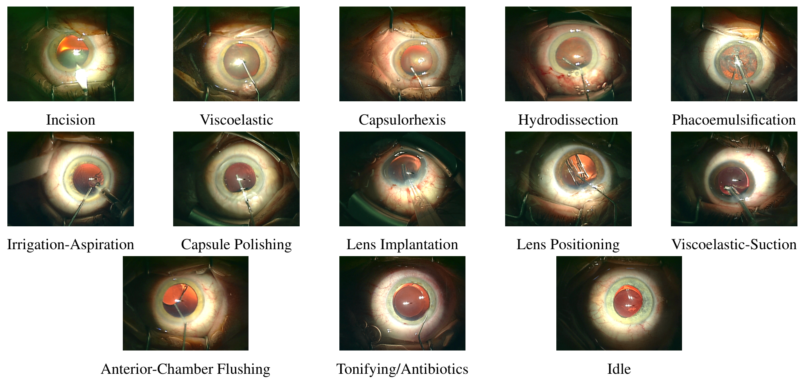
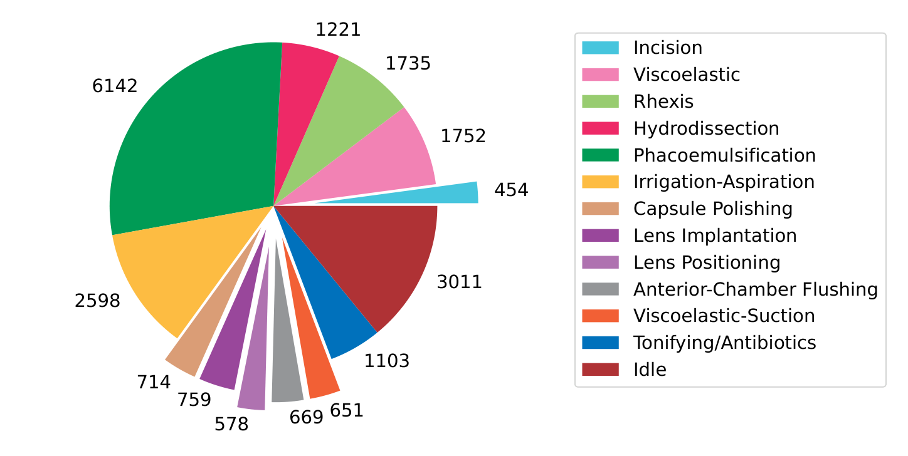
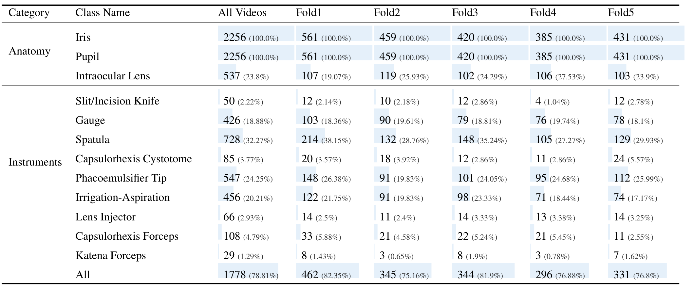
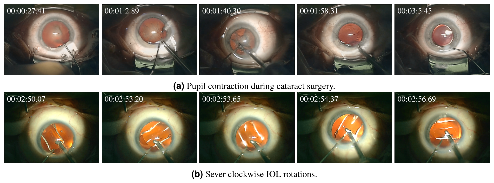
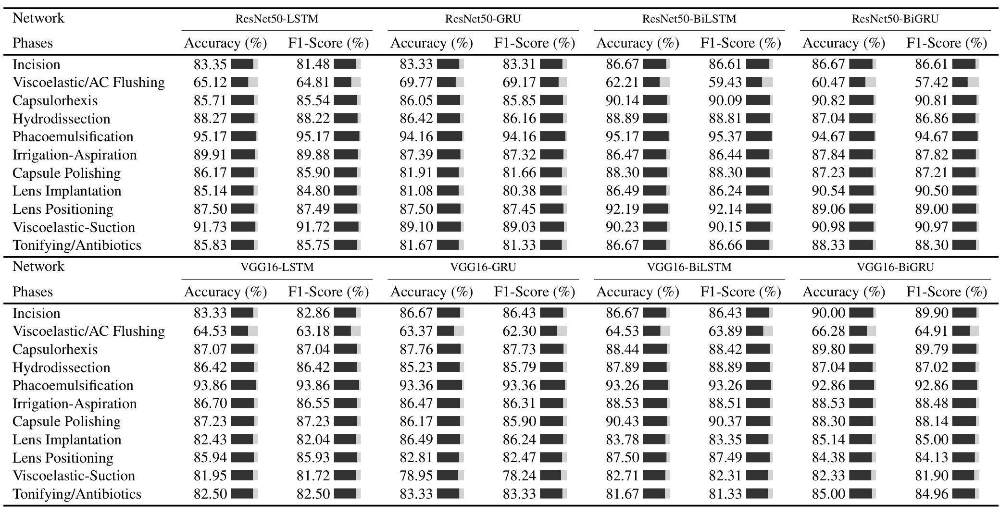
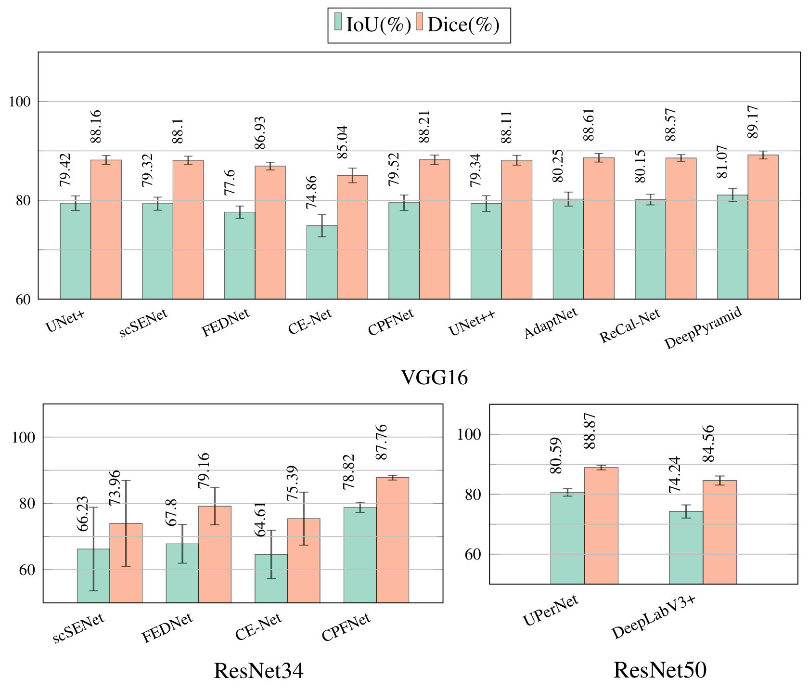
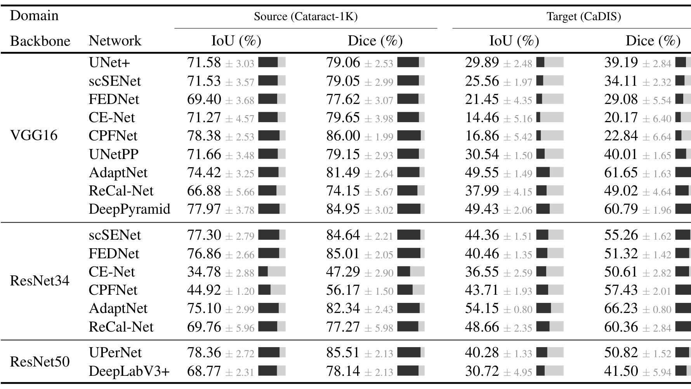

## 1. 背景与动机

**手术视频分析的瓶颈在数据。** 白内障手术是最常见的眼科手术,论文引用的预测是全球白内障致盲人数在 2025 年达到 40 million。手术视频的索引、归档和术后报告因此有现实需求。

这些应用都要先做阶段识别和场景分割。论文称现有公开数据集要么只标一个子任务,要么是针对个别问题的小型多任务集,所以研究者缺一个能同时训练阶段、分割和异常检测的大数据集。

:::highlights
- 缺口:没有同时覆盖阶段、分割和异常的大规模公开数据集
- 论文的回答:Cataract-1K,1000 个视频
:::

## 2. 核心观点速览

论文的答案是 Cataract-1K:2021 至 2023 年录制于 Klinikum Klagenfurt 的 1000 个手术视频。**真正带标注的只是一小部分**:56 个视频有阶段标注,30 个视频的 2256 帧有像素级标注,另有两个只展示了例子的异常子集。

基线给出三个结果。阶段识别里粘弹剂/前房冲洗最难;分割里解剖结构容易、器械困难;换到 CaDIS 测试时,Dice 平均从 77.50% 降到 46.49%。

**边界很清楚:** 标注质量只有基线成绩作间接证据,阶段识别是一对多二分类,异常子集没有规模,“最大”没有数字对比。

:::data
- 1000 个视频,56 个阶段标注视频,30 个分割视频
- 2256 帧,3 类解剖结构 + 9 类器械
- 超声乳化占 28.72%,切口占 2.1%
:::

## 3. 数据:1000 个视频,三类标注

**问题是:数据到底有多少,标了什么?** 未标注的视频以 25 fps、512×324 编码。阶段子集的 56 个视频是 1024×768、30 fps,平均 6.45 分钟;分割子集的 30 个视频同为 1024×768,每 5 秒取一帧,剔除严重模糊或虹膜出镜的帧。

阶段有 12 个动作阶段加 idle,共 13 类;idle 指医生换器械、画面里看不到器械的时段。

*论文原图编号：Figure 1。常规白内障手术各阶段的示例帧。*

类别严重不均衡。超声乳化最长,切口最短,idle 是第二长的类别。

*论文原图编号：Figure 2。56 个视频中各阶段标注时长之和(秒)。*

分割标注覆盖虹膜、瞳孔、人工晶状体和 9 类器械,用多边形标注,按患者分五折,每折 6 个视频。器械中铲最常见(728 帧),Katena 镊最少(29 帧)。

*论文原图编号：Table 3。各类别实例数及其在各折帧中的出现比例。*

**所以类别不均衡是这个数据集的第一个特点**:阶段上有 6142 秒对 454 秒的差距,器械上有 728 帧对 29 帧的差距。下一节看异常子集,它是三类标注里证据最少的一类。

:::highlights
- 56 与 30 个视频是否重叠,论文未说明
- 患者年龄和医生经验只给子集的均值与范围
:::

:::data
- 阶段子集:6.45 分钟,患者平均 75 岁
- 分割子集:患者平均 74.5 岁
- 虹膜与瞳孔出现在全部 2256 帧
:::

## 4. 异常子集:只有示例

两个术中异常是瞳孔收缩和人工晶状体旋转。前者发生在超声乳化阶段,让晶状体居中困难;后者是术后错位的主要原因之一,Figure 4 的旋转在不到七秒内完成。

*论文原图编号：Figure 4。(a) 严重瞳孔收缩,(b) 严重顺时针晶状体旋转。*

**论文没有给出这两个子集的视频数、标签形式、标注者和评测方式,也没有基线。** 所以标题里的“异常检测”目前只能理解为数据准备,不能当基准用。

:::highlights
- 异常子集规模、标签与评测:论文未说明
:::

## 5. 基线怎么训练

**基线设置决定后面的数字能不能直接比较。** 阶段识别是 CNN 加 RNN:`VGG16` 或 `ResNet50` 提特征,`LSTM`、`GRU` 及其双向版本整合 10 帧。

训练用一对多:每个阶段单独训练一个二分类器,把“其余”类下采样到与目标类等量。片段长 3 秒,重叠 1 秒,模型在 32 个视频上训练,在其余视频的不重叠片段上测试。

分割比较 11 个网络,损失是 0.8 倍的二元交叉熵加 0.2 倍的负对数 Dice,输入 512×512,指标是五折平均的 Dice 与 IoU。

**所以 Table 5 回答的是“某个阶段能否与其他阶段区分”,不是 13 类连续识别。** 测试集是否平衡、测试片段数和随机种子,论文未说明。

:::highlights
- 一对多二分类,idle 未评测,粘弹剂与前房冲洗合并
- 分割按患者分五折,按五折平均报告
:::

## 6. 阶段识别结果

**问题是:骨干和循环层谁更重要?** 论文说双向层在所有配置下都提升了 Accuracy 与 F1,`ResNet50` 略优于 `VGG16`。

*论文原图编号：Table 5。八种 CNN-RNN 组合在 11 个阶段上的 Accuracy 和 F1。*

对 11 个阶段取简单平均(笔记自算),`ResNet50` 的四个数分别是 85.81、84.40、86.68 和 86.70,`VGG16` 的是 83.81、83.69、85.04 和 85.42。平均值支持论文的说法。

但逐阶段并非处处成立:粘弹剂/前房冲洗阶段,`ResNet50-LSTM` 的 Accuracy 为 65.12%,换成 `BiLSTM` 降到 62.21%。**阶段间的差异比骨干与循环层的差异大**,超声乳化最高(95.17%),粘弹剂/前房冲洗最低(`ResNet50-BiGRU` 的 F1 为 57.42%)。

**所以 Table 5 更适合用来看哪些阶段难,而不是给骨干排名。** F1 的口径论文未说明,也没有重复实验。

:::highlights
- 超声乳化最高,Accuracy 与 F1 均为 95.17%
- 粘弹剂/前房冲洗最低,F1 最低 57.42%
:::

## 7. 分割结果

**问题是:哪类目标难?** 解剖结构容易,器械困难。瞳孔最好,Dice 最高 95.07%;晶状体因透明较低;器械最好的 IoU 只有 63.91%。

| 骨干与网络 | 虹膜 | 瞳孔 | 晶状体 | 器械 |
|---|---|---|---|---|
| `VGG16` DeepPyramid | 86.10 / 92.52 | 90.61 / 95.07 | 83.72 / 91.11 | 63.91 / 77.98 |
| `ResNet50` UPerNet | 85.15 / 91.97 | 90.03 / 94.75 | 83.72 / 91.11 | 63.48 / 77.65 |
| `ResNet34` scSENet | 84.77 / 91.74 | 87.72 / 93.42 | 65.31 / 76.02 | 27.11 / 34.64 |

每格是 IoU / Dice,单位为 %。DeepPyramid 在四类目标上都是最优,晶状体上与 UPerNet 打平,两组数字完全相同,论文未解释。

*论文原图编号：Figure 5。各网络在“解剖结构加器械”任务上五折的平均与标准差。*

**Figure 5 的数字与 Table 6 四类目标的简单平均几乎一致**,所以三个解剖结构的高分把器械的低分稀释了。`ResNet34` 的 scSENet 在器械上只有 27.11% 的 IoU,论文没有讨论。

:::highlights
- 器械是最难的一类
- DeepPyramid 四类目标最优,晶状体与 UPerNet 打平
:::

:::data
- 瞳孔 Dice 最高 95.07%
- 器械最好 IoU 63.91%
:::

## 8. 跨数据集结果

**问题是:换一个数据集,性能掉多少?** 在 Cataract-1K 上训练二值器械分割网络,在 CaDIS 上测试。论文写的是 77% 降到约 67%,并以 AdaptNet 的 66.23% 举例。

*论文原图编号：Table 7。Cataract-1K 与 CaDIS 上的二值器械分割 IoU 与 Dice。*

对 17 个配置取简单平均(笔记自算),源域 Dice 为 77.50%,目标域只有 46.49%。66.23% 是目标域的最高值,不是典型值。

另外 `ResNet34` 的 CE-Net 和 CPFNet 在源域就只有 47.29% 和 56.17%,目标域不低于源域。**所以下降是真实的,但平均值被失败配置放大。** 最好的两个配置,DeepPyramid 从 84.95% 降到 60.79%,AdaptNet 从 81.49% 降到 61.65%。

这个实验没有使用任何域适应方法,它是零适应的跨数据集测试。

:::highlights
- 目标域最高 Dice 为 66.23%
- 域内最好的 CPFNet 到 CaDIS 只有 22.84%
:::

## 9. 论文文字与表格对不上的地方

**读结论之前,先对一遍表。** 下面几处论文文字与自己的表或图不一致,依据都在原文的图表里。

- 论文称最好的三个网络是 DeepPyramid、AdaptNet 和 ReCal-Net。Figure 5 中 UPerNet 的 IoU 为 80.59,Dice 为 88.87,高于 AdaptNet 的 80.25 / 88.61 和 ReCal-Net 的 80.15 / 88.57。
- 论文称跨域后 Dice 约为 67%。Table 7 的 17 个配置平均只有 46.49%。
- Table 2 把 FED-Net 的骨干写成 `ResNet50`,结果表里却是 `VGG16` 和 `ResNet34`。
- 作为核对,Figure 2 各段合计 21387 秒,除以 56 个视频约 6.37 分钟,与文中的 6.45 分钟接近但不相等,论文未解释。

这些不一致不推翻数据集本身,但提示读结论时应直接看表。

## 10. 结果没有说明什么

**论文没有提供标注质量的直接证据。** 标注者人数、一致性和复核比例论文都未说明,基线成绩高只能间接支持。

**“最大”没有数字对比。** 论文只定性地区分了既有数据集:CATARACTS 做器械识别,CaDIS 做分割,LensID 是小型的人工晶状体异常多任务集。标注视频数和标注帧数是否超过它们,论文未说明。我的判断:新意在于同一批手术里同时有阶段和像素级标注。

**“域适应”一词用得宽。** 摘要说开启了域适应研究,正文只有零适应的跨数据集评测,CaDIS 的二值化方式和测试帧论文未说明。

阶段识别采用一对多二分类并合并了两个阶段,idle 未评测,也没有重复实验或标准差,几个百分点的差异无法判断是否可靠。

## 11. 复现要注意什么

- 阶段识别需要自己补测试划分:32 个视频训练,其余测试,具体哪些视频未说明。
- 对齐一对多的类别平衡、3 秒片段与 1 秒重叠、每片段随机取 10 帧。
- 分割要按患者五折划分,报告五折平均,不要用随机帧划分。
- 跨域评测要自己确定 CaDIS 的器械二值化方式和测试帧。
- 论文发表时数据只通过匿名 Figshare 提供评审,接收后发布在 Synapse,许可为 CC BY。

## @takeaways
- 这是一个单中心、多任务但每项标注量都有限的数据集,适合做阶段识别和解剖结构分割的起点。
- 器械分割和跨数据集泛化仍然困难,骨干的选择对器械结果影响很大。
- 读结论时直接看表,论文文字有三处与图表不符。

## @strengths
- 同一批手术里同时有阶段标注和像素级标注。
- 分割标注覆盖 12 类,有五折按患者划分,并提供两种格式。
- 训练设置、损失函数和增强参数写得清楚,便于复现。

## @weaknesses
- 没有标注者一致性或复核证据。
- 异常子集没有规模、标签和基线。
- 阶段识别没有重复实验,也没有说明测试集是否平衡。
- 部分文字结论与自己的表、图不一致。

## @questions
- 56 个阶段视频与 30 个分割视频是否重叠?
- 异常子集有多少视频,标签是逐帧、逐视频还是时间段?
- CaDIS 上是怎么二值化和划分测试帧的?
- 在同一批视频上训练多任务模型,阶段与分割能否互相提升?
