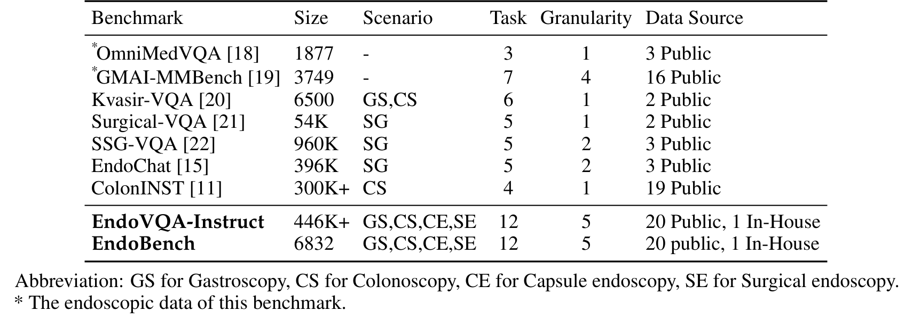
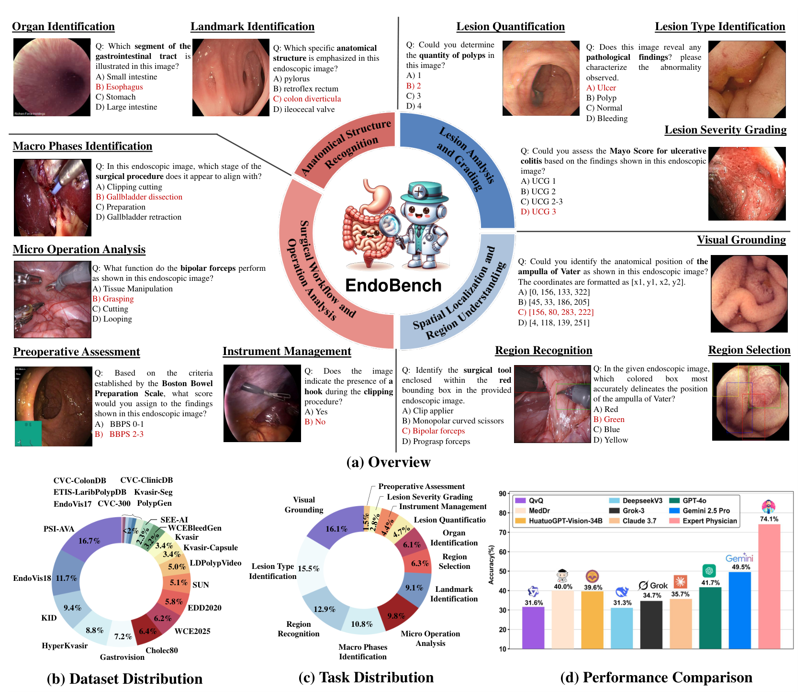
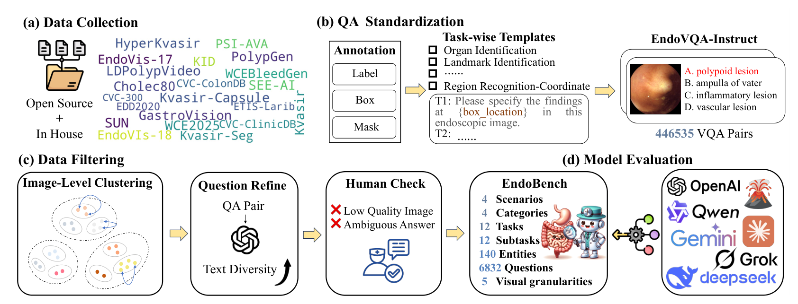
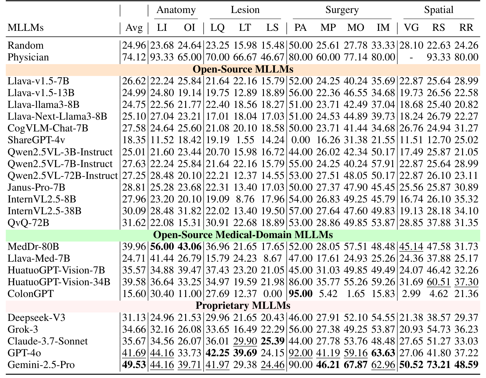
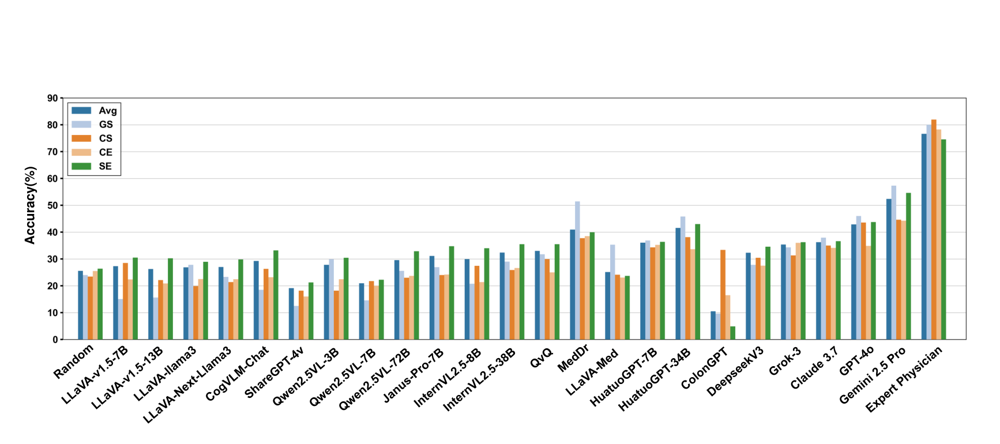
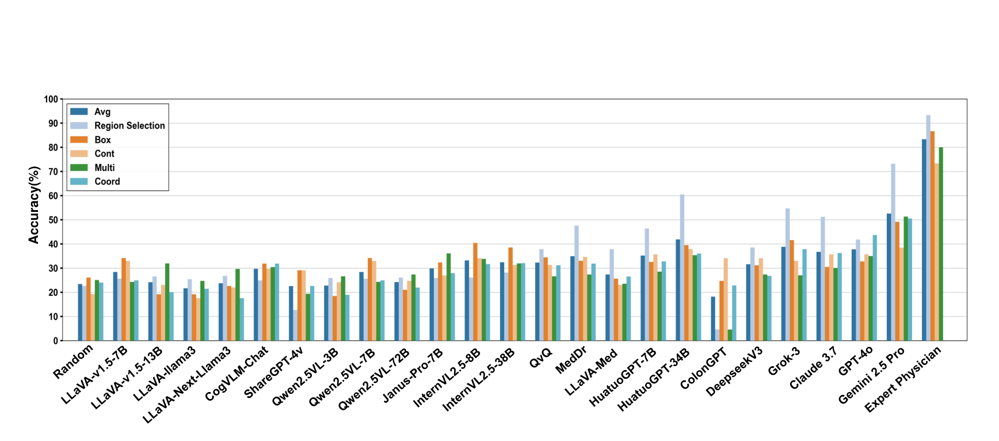
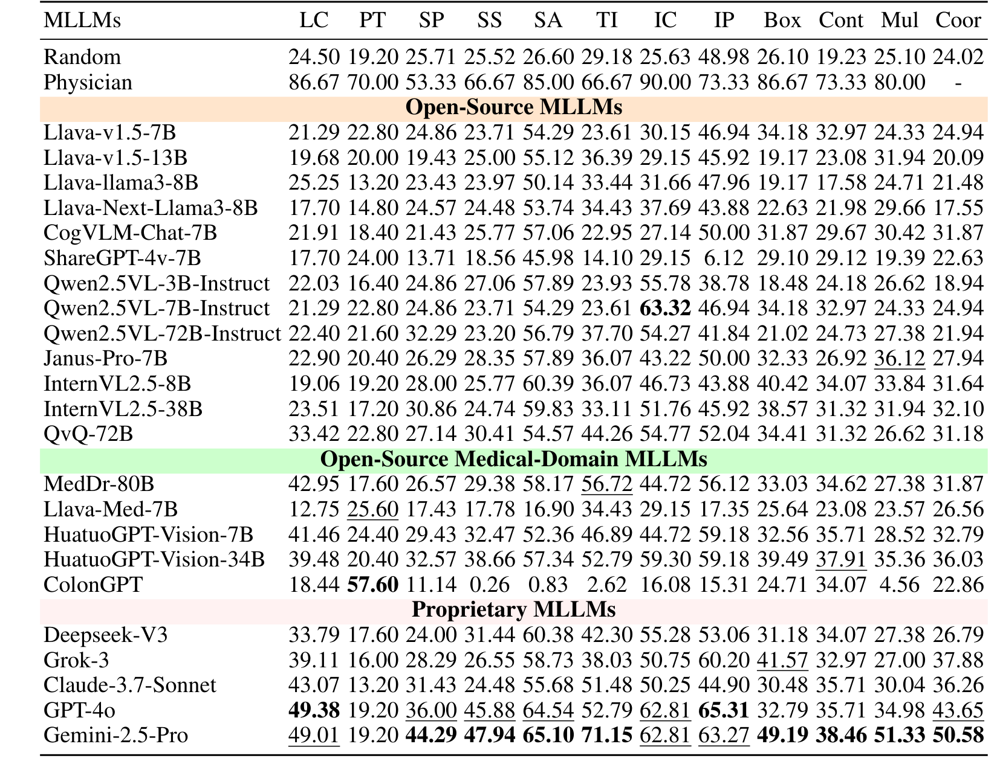
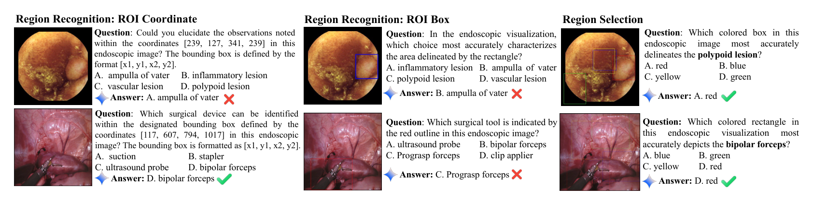

---
tags:
  - papers/手术数据集
aliases:
  - EndoBench
  - 内镜多模态大模型评测基准
date: 2025-05-29
arxiv_id: "2505.23601"
---

# EndoBench: A Comprehensive Evaluation of Multi-Modal Large Language Models for Endoscopy Analysis

## 核心信息

- 标题：EndoBench: A Comprehensive Evaluation of Multi-Modal Large Language Models for Endoscopy Analysis
- 标题翻译：EndoBench：面向内镜分析的多模态大语言模型综合评测
- 作者：Shengyuan Liu, Boyun Zheng, Wenting Chen, Zhihao Peng, Zhenfei Yin, Jing Shao, Jiancong Hu, Yixuan Yuan
- 机构：香港中文大学；香港城市大学；牛津大学；上海人工智能实验室；中山大学附属第六医院
- 发表时间：2025-05-29（arXiv v1），v2 标注日期为 2025-09-24
- 发表渠道：NeurIPS 2025 Datasets and Benchmarks Track
- arXiv：2505.23601
- 论文链接：https://arxiv.org/abs/2505.23601
- 论文类型：基准与数据集

## 原文摘要翻译

内镜检查对诊断和治疗体内疾病至关重要，多模态大语言模型（MLLM）正越来越多地用于辅助内镜分析。
然而，现有基准存在局限：它们通常只覆盖特定的内镜场景和少量临床任务，无法反映真实世界内镜场景的多样性，也无法覆盖临床工作流所需的全部技能。

为解决这些问题，作者提出 EndoBench，称其为首个专门设计的综合基准，用多维能力评估 MLLM 在内镜实践全谱上的表现。
EndoBench 包含 4 种不同的内镜场景、12 项专门的临床任务及 12 个二级子任务、5 种视觉提示粒度，共有来自 21 个不同数据集、经严格验证的 6,832 个 VQA 对。
其多维评测框架对应临床工作流，涵盖解剖识别、病灶分析、空间定位和手术操作，以全面衡量 MLLM 在真实场景中的感知与诊断能力。

作者对 23 个最先进的模型做了基准测试，包括通用、医学专用和专有 MLLM，并以人类临床医师的表现作为参考标准。
大量实验显示：（1）专有 MLLM 总体上优于开源和医学专用模型，但仍落后于人类专家；（2）医学领域的监督微调显著提升任务特定的准确率；（3）模型表现仍对提示格式和临床任务复杂度敏感。

EndoBench 为评估和推进内镜领域的 MLLM 建立了新标准，凸显了进展，也凸显了当前模型与专家临床推理之间持续存在的差距。
作者公开发布基准和代码。

## 创新点

1. 提出覆盖 4 类内镜场景（胃镜、结肠镜、胶囊内镜、手术内镜）的统一基准。此前的基准多停在单一场景，跨场景比较因此做不了。
2. 把 12 项任务按临床流程分成解剖识别、病灶分析、空间定位、手术流程四大类，再加 5 种视觉提示粒度。同一模型的分数因此可以按能力和提示形式拆开看。
3. 先把公开数据集改造成 446,535 对的 EndoVQA-Instruct，再经类内均衡、聚类抽样、问题改写和两名医师复核，压缩为 6,832 题。规模来自公开数据，题目质量由人工把关。
4. 评测 23 个模型，并加入 2 名医师的成绩作参照，模型分数因此有了人类水平可比。

## 一句话总结

EndoBench 把 21 个内镜数据集改造成 6,832 道选择题，覆盖四类场景、十二项任务和五种视觉提示，评测显示最强的 Gemini-2.5-Pro 平均 49.53%，仍明显低于医师的 74.12%。

## 研究问题

内镜检查是发现胃肠道和泌尿系统疾病的重要手段，癌症常到晚期才被确诊，所以早发现很关键。
多模态大语言模型已被用于器械识别、病灶检测和图像描述，但这些模型在临床上到底靠不靠谱，缺少一把统一的尺。

现有基准有两个缺口。
第一是场景单一：Surgical-VQA 和 SSG-VQA 主要评估手术场景，ColonINST 只关注结肠镜；通用医学基准 OmniMedVQA 和 GMAI-MMBench 里内镜样本少、任务窄。

第二是任务窄：Kvasir-VQA 以基础识别为主，ColonINST 强调病灶分类。
真实内镜流程却要求识别器官与解剖标志、检测并分级病灶、定量、精确定位、术前评估和实施干预。

所以论文要回答的是：在同一个基准里覆盖四类内镜场景、十二项临床任务和五种视觉提示粒度，现有模型表现如何，与临床医师差多少。

*论文原图编号：Table 1。EndoBench 与既有内镜多模态基准的对比，列出规模、场景、任务数、粒度数和数据源。*

对照表 1，EndoBench 相对已有工作新在三处，也有一处不占优：

- 对单场景基准：Surgical-VQA、SSG-VQA、EndoChat 面向手术，ColonINST 面向结肠镜，Kvasir-VQA 含胃镜和结肠镜。
- EndoBench 把场景扩到 GS、CS、CE、SE 四类。
- 对通用医学基准 OmniMedVQA 与 GMAI-MMBench：二者只含部分内镜数据，任务数分别为 3 和 7，粒度数分别为 1 和 4；EndoBench 为 12 项和 5 种。
- 数据源：EndoBench 用 20 个公开数据集加 1 个院内数据集，其余基准为 2 到 19 个公开数据集。
- 题量上不占优：表 1 中 Surgical-VQA 为 54K，EndoChat 为 396K，SSG-VQA 为 960K，ColonINST 为 300K+，论文的优势在覆盖面而不在题量。

论文称 EndoVQA-Instruct 是目前最大的内镜指令微调集合，而表 1 里 SSG-VQA 标为 960K。这一说法的限定条件论文未说明，所以"最大"只能理解为论文自己的口径。

### 核心观点速览

**EndoBench 用 6,832 道选择题量出多模态大模型离临床医师还有多远，答案是：最强的 Gemini-2.5-Pro 平均 49.53%，医师 74.12%。**
论文靠四步得到这个结论：

1. 铺面：覆盖胃镜、结肠镜、胶囊内镜、手术内镜四类场景，十二项任务，五种视觉提示粒度。
2. 造题：20 个公开数据集加 1 个院内数据集，生成 446,535 对问答，再经聚类抽样、改写和医师复核得到 6,832 题。
3. 评测：23 个模型零样本作答，精确匹配记分，另让 2 名医师作答作参照。
4. 发现：专有模型整体领先但仍落后医师；医学专用模型在个别任务上很强；表现随视觉提示形式和任务而变。

**结果的边界**：医师参照只有 2 人、255 题，且不含坐标任务；"医学微调有效"和"瓶颈在医学知识或病灶识别"这几条因果解读，论文的实验没有把替代解释分开；正文与表之间还有几处数字对不上。
这些边界在深度分析中逐条展开。

## 数据与任务定义

这个基准具体考什么、考多少？这一节先回答题从哪来、分几类，再说怎么考，造题的过程留到下一节。

### 数据来源与规模

EndoBench 共 6,832 个 VQA 对，来自 21 个数据集：20 个公开数据集，加 1 个来自合作医院的院内胶囊内镜数据集 WCE2025。
公开数据集包括：

Kvasir, HyperKvasir, Kvasir-Capsule, GastroVision, KID, WCEBleedGen, SEE-AI, Kvasir-Seg, CVC-ColonDB, ETIS-Larib, CVC-ClinicDB, CVC-300, EDD2020, SUN-Database, LDPolypVideo, PolypGen, Cholec80, EndoVis-17, EndoVis-18, PSI-AVA

其中 KID 与 SUN-Database 为受限访问，其余为开放访问（表 4）。
WCE2025 经去标识化处理，共 23,447 个样本，用于三类任务：解剖标志识别 1,665 个，病灶类型识别 19,881 个，器官识别 1,901 个。

四类场景的题目数量如下：

| Scenario | Samples | Share |
|---|---|---|
| GS | 583 | 8.53% |
| CS | 1,848 | 27.05% |
| CE | 1,678 | 24.56% |
| SE | 2,723 | 39.86% |

所以手术内镜占近四成，胃镜只占不到一成。
后文凡是比较"场景"的结论，都要记得各场景的题量并不均衡。

手术内镜子集含四种术式：猪腹腔手术 30.77%（EndoVis17 与 EndoVis18）、人胆囊切除腹腔镜手术 16.05%（Cholec80）、人前列腺根治术 41.98%（PSI-AVA）、内镜黏膜切除 11.20%（Kvasir 等）。
这组比例出现在 EndoVQA-Instruct 的附录说明中，论文未说明它描述的是该集合还是最终的 EndoBench，所以不能直接当作 SE 子集的构成。

*论文原图编号：Figure 1。EndoBench 总览：十二项任务的示例题、数据集分布、任务分布和模型性能对比。*

### 四大类十二任务

题目要覆盖一次内镜检查的完整流程，所以论文按临床顺序把任务分成四大类。
下表给出论文的英文任务名和缩写，后文表格沿用这些缩写。

| Abbr | Task | Category |
|---|---|---|
| LI | Landmark Identification | Anatomy |
| OI | Organ Identification | Anatomy |
| LQ | Lesion Quantification | Lesion |
| LT | Lesion Type Identification | Lesion |
| LS | Lesion Severity Grading | Lesion |
| PA | Preoperative Assessment | Surgery |
| MP | Macro Phases Identification | Surgery |
| MO | Micro Operation Analysis | Surgery |
| IM | Instrument Management | Surgery |
| VG | Visual Grounding | Spatial |
| RS | Region Selection | Spatial |
| RR | Region Recognition | Spatial |

各任务的含义如下：

- 解剖标志识别（LI）：识别幽门、贲门、回盲瓣等导航参照点。
- 器官识别（OI）：识别食管、胃、小肠、大肠等器官或肠段。
- 病灶定量（LQ）：数息肉个数。
- 病灶类型识别（LT）：含病灶分类（糜烂、溃疡、食管炎、血管扩张等）和息肉类型分类（腺瘤性、增生性、锯齿状）两个子任务。
- 病灶严重度分级（LS）：用 Mayo 评分给溃疡性结肠炎分级，0、1、2、3 四级外加 0-1、1-2、2-3 三个中间档。
- 术前评估（PA）：按波士顿肠道准备量表，只保留 BBPS 0-1 与 BBPS 2-3 两类，排除粪块嵌塞类，因此是二分类。
- 宏观阶段识别（MP）：含手术阶段识别和手术步骤识别。
- 微观操作分析（MO）：含手术动作识别和治疗干预识别。
- 器械管理（IM）：含器械种类计数和器械在场判断，后者是是非题。
- 视觉定位（VG）：在四个候选坐标中选出目标位置，坐标格式为 [x1, y1, x2, y2]。
- 区域选择（RS）：在四个不同颜色的候选框中选出对应目标的框。
- 区域识别（RR）：识别被框、轮廓、多区域标记或坐标指定的区域是什么。

任务的选项数不同，随机基线也不同：PA 是二分类，随机为 50.00%，其余多为四选一。
这意味着 PA 上"高于随机"的门槛比别的任务高得多。

### 视觉提示粒度

同一个区域可以用不同方式指给模型看，这是论文想考的第二个维度。
论文列出 5 种视觉提示粒度：图像级、框级、轮廓级、多框、多轮廓，其中框和轮廓来自原始分割掩码。

可是表 3 和表 5 的视觉提示列只有四列：Box、Cont、Mul、Coor。
Coor 是把坐标写进问题文字的形式，它与五种粒度如何对应，论文未说明。
这限制了我们把表中的列直接当作五种粒度来读。

### 题目构造与医师研究

每项任务设计 5 到 8 个问题模板。
实体标签天然可转成问答，错误选项从同类属性名词中随机选取。
空间任务的干扰框与真实框尺寸相近，并限制与真实框的重叠度低于设定阈值，具体阈值论文未说明。
Random 行给出随机选择的参照值，总体为 24.96%。

人类参照研究从 EndoBench 中随机抽取 255 题，覆盖除坐标类任务以外的所有子任务，每个子任务含 5、10 或 15 个样本。
两名有内镜专长的持证医师独立作答，分数按任务取平均。
所以医师行是小样本，单格数字波动会很大，读的时候只看大趋势。

下一节说明这些题是怎样从 21 个数据集里造出来、筛下来的。

## 方法主线

446,535 对问答怎样变成 6,832 道题，题又怎样打分？EndoBench 是基准论文，没有提出新模型，主线就是数据构建流程和评测协议。

### 构建流程

*论文原图编号：Figure 2。EndoBench 的构建流程：数据收集、QA 标准化、数据过滤和模型评测。*

构建分三步，最后做模型评测。
第一步是数据收集：汇集 20 个公开数据集和 1 个院内数据集的标注，包括标签、框和掩码。

第二步是 QA 标准化。
论文与医师合作定义 12 项任务，把各数据集的属性映射到任务上，为每项任务写 5 到 8 个问题模板，再给每个问答补上错误选项，变成选择题，共得到 446,535 个图文对，即 EndoVQA-Instruct。

第三步是数据过滤，目的是得到均衡、有代表性的评测子集。
先均衡实体分布，再用 DINO-V2 提取同一实体内的图像特征，用 K-center 聚类在每个类别里挑代表图，保持类别均衡并去除噪声。

随后用 GPT-4o-mini 改写问题，只改表达和句式、不改语义，以检验模型对不同语言表述的适应性。
最后由两名医师审查问题与答案，剔除低质量图像以及错误或有歧义的答案，得到 6,832 个 VQA 对。

### 机制流程

1. 标注对齐：输入各数据集的标签、框和掩码，按医师定义的 12 项任务对齐属性，输出统一格式的实体标注。
2. 题目生成：输入任务模板和实体标签，从同类属性名词中随机选错误选项，空间任务另生成尺寸相近的干扰框，得到 446,535 对选择题。
3. 过滤抽样：输入 EndoVQA-Instruct，用 DINO-V2 提取图像特征并聚类抽样，再经问题改写和医师复核，得到 6,832 题。
4. 评测打分：输入图像、问题与选项，模型零样本输出选项，用精确匹配计准确率；格式不合规时，先由 Qwen2.5VL-72B 抽取答案再比对。

这条流程的关键取舍是用规则造题而非人工写题：规模大、可复现，代价是错误选项随机抽取，可能比临床上易混淆的鉴别项更好排除。
论文没有评估这一点。

### 评测协议

评测在零样本下进行，不提供任务特定训练数据，也不提供上下文示例。
所有模型权重取自 Hugging Face 的官方仓库。
每道题是封闭集选择题，预测与标准答案精确匹配，报告任务级和总体准确率。

论文解释选择题形式的理由是：医学诊断常需区分高度相似的概念，开放式生成可能给出看似合理却不准确的回答，难以精确评估。

部分医学专用模型常不按要求输出选项字母。
论文因此用 Qwen2.5VL-72B 作辅助评判，在回答含糊或缺失时抽取最可能的答案；若抽不出有效答案，该题记为错误。
评判提示要求只回答 Yes 或 No，表示抽取出的答案是否与标准答案完全一致。

被测模型共 23 个，分三组：

- 开源通用模型 13 个，参数量 3B 到 72B，来自以下家族：
  - LLaVA、LLaVA-Next、CogVLM、ShareGPT-4v。
  - Qwen2.5-VL、Janus-Pro、InternVL2.5 和 QvQ。
- 医学专用模型 5 个：MedDr-80B、LLaVA-Med-7B、HuatuoGPT-Vision-7B、HuatuoGPT-Vision-34B，以及结肠镜专用的 ColonGPT。
- 专有模型 5 个：Deepseek-V3、Claude-3.7-Sonnet、Gemini-2.5-Pro、GPT-4o 和 Grok-3。

论文未说明各专有模型的具体版本号、调用日期、采样温度和最大输出长度，因此结果的可复现性受限。
Deepseek-V3 被称为带视觉输入的专有模型，其视觉输入如何实现，论文未说明。

题造好了、分也定了，接下来看各模型实际考了多少。

## 关键结果

先看总成绩，再按场景和提示形式拆开，最后看子任务和思维链。每组数字之后都标明它能说明什么、不能说明什么。

### 十二项任务上的总体表现（Table 2）

*论文原图编号：Table 2。23 个模型在 12 项临床任务上的准确率，含 Random 与 Physician 参照行。*

下表摘录表 2 中有代表性的行，单位为准确率（%），Avg 为论文报告的平均值，Physician 的 VG 列论文用短横线表示未测。

| Model | Avg | LI | OI | LQ | LT | LS | PA | MP | MO | IM | VG | RS | RR |
|---|---|---|---|---|---|---|---|---|---|---|---|---|---|
| Random | 24.96 | 23.68 | 24.64 | 23.25 | 15.98 | 15.48 | 50.00 | 25.61 | 27.78 | 33.33 | 28.10 | 22.63 | 24.26 |
| Physician | 74.12 | 93.33 | 65.00 | 70.00 | 66.67 | 46.67 | 80.00 | 60.00 | 77.14 | 80.00 | - | 93.33 | 80.00 |
| Gemini-2.5-Pro | 49.53 | 44.16 | 39.71 | 41.97 | 29.38 | 24.46 | 90.00 | 46.21 | 67.87 | 62.96 | 50.52 | 73.21 | 48.59 |
| GPT-4o | 41.69 | 44.16 | 33.73 | 42.25 | 39.69 | 24.15 | 92.00 | 41.19 | 59.16 | 63.63 | 27.06 | 41.80 | 37.22 |
| Claude-3.7-Sonnet | 35.67 | 34.56 | 26.07 | 36.01 | 29.90 | 25.39 | 44.00 | 27.78 | 53.76 | 48.48 | 27.65 | 51.27 | 33.03 |
| Grok-3 | 34.66 | 32.16 | 26.08 | 33.65 | 16.49 | 22.29 | 56.00 | 27.38 | 49.25 | 53.87 | 20.93 | 54.73 | 36.23 |
| Deepseek-V3 | 31.13 | 24.96 | 21.53 | 29.96 | 21.65 | 20.43 | 46.00 | 27.91 | 52.10 | 54.55 | 21.38 | 38.57 | 29.37 |
| MedDr-80B | 39.96 | 56.00 | 43.06 | 36.96 | 21.65 | 17.65 | 52.00 | 28.05 | 57.51 | 48.48 | 45.14 | 47.58 | 31.73 |
| HuatuoGPT-Vision-34B | 39.58 | 36.64 | 33.25 | 34.97 | 19.59 | 21.98 | 86.00 | 35.77 | 55.26 | 59.26 | 31.69 | 60.51 | 37.30 |
| HuatuoGPT-Vision-7B | 35.57 | 34.88 | 39.47 | 37.43 | 23.20 | 21.05 | 45.00 | 31.03 | 49.85 | 49.49 | 24.07 | 46.42 | 32.26 |
| Llava-Med-7B | 24.71 | 41.44 | 26.79 | 15.79 | 24.23 | 8.67 | 47.00 | 17.61 | 24.93 | 25.26 | 24.36 | 37.88 | 25.17 |
| ColonGPT | 15.60 | 30.40 | 11.00 | 27.69 | 12.37 | 0.00 | 95.00 | 5.42 | 1.65 | 15.83 | 2.99 | 4.62 | 21.36 |
| QvQ-72B | 31.62 | 22.08 | 15.31 | 30.91 | 22.68 | 18.89 | 53.00 | 28.86 | 49.85 | 53.87 | 28.85 | 37.88 | 31.35 |
| InternVL2.5-38B | 30.09 | 28.48 | 31.82 | 22.02 | 13.40 | 19.50 | 57.00 | 27.64 | 47.60 | 49.83 | 19.13 | 28.18 | 34.10 |
| Llava-v1.5-7B | 26.62 | 22.24 | 25.84 | 21.64 | 22.16 | 15.79 | 52.00 | 24.25 | 40.24 | 35.69 | 22.87 | 25.64 | 28.99 |

主要读数：

- **最强模型与医师差约 25%**：Gemini-2.5-Pro 平均 49.53%，GPT-4o 为 41.69%，医师为 74.12%（差距口径取论文原话 roughly 25%）。
- **开源组最强的是医学专用的 MedDr-80B**：平均 39.96%，LI 和 OI 分别达 56.00% 和 43.06%，高于所有专有模型。开源通用模型里 QvQ-72B 为 31.62%，InternVL2.5-38B 为 30.09%，其余多在 Random 的 24.96% 附近。
- **病灶类任务最难**：所有模型在 LS 列都不超过 25.39%，在 LT 列最高为 39.69%。
- **ColonGPT 极端偏科**：PA 为 95.00%，高于医师的 80.00%，但 MP、MO、IM 分别只有 5.42%、1.65%、15.83%，LS 为 0.00%。
- **PA 上不止 ColonGPT 超过医师**：GPT-4o 92.00%、Gemini-2.5-Pro 90.00%、HuatuoGPT-Vision-34B 86.00% 也高于 80.00%，论文正文只提了 ColonGPT。

所以呢：模型整体离医师还很远，但差距不均匀。
PA 上多个模型超过医师，MO 上 Gemini-2.5-Pro 的 67.87% 与医师的 77.14% 相对接近，LI、RS、RR 上差距仍然很大。
医师每个子任务只有 5、10 或 15 题，这个对比只能当方向，不能当精确差距。

图 3 汇总了四大类的表现，论文据此说多数模型在手术相关任务上最高、在病灶相关任务上最低。

> [!figure] Figure 3 四大类能力对比柱状图
> 建议位置：关键结果
> 放置原因：该图把 23 个模型和医师按四大类并排比较，是表 2 的汇总视图。
> 当前状态：占位保留。裁剪图的下缘混入图注文字，重裁一次后仍未去净。

### 场景与视觉提示维度（Table 3）

换个切法，模型强弱会变吗？表 3 按四类场景和四种视觉提示列出准确率。
自动质量门判定其裁剪图不合格，因此保留占位，并把数字抄录到下表。

表中前五列为总体与四类场景，后五列为视觉提示的平均与 Box、Cont、Mul、Coor 四种形式，列的归属由表 5 与图 7 的数值互相对照得到。

> [!figure] Table 3 场景与视觉提示结果表
> 建议位置：关键结果
> 放置原因：该表给出四类场景和四种视觉提示下各模型的准确率。
> 当前状态：占位保留。自动质量门判定裁剪图不合格（reject_visual_quality），数据在正文中以表格重述。

| Model | Avg | GS | CS | CE | SE | VP Avg | Box | Cont | Mul | Coor |
|---|---|---|---|---|---|---|---|---|---|---|
| Random | 25.58 | 24.01 | 23.41 | 25.48 | 26.35 | 23.61 | 26.10 | 19.23 | 25.10 | 24.02 |
| Physician | 76.64 | 80.00 | 81.94 | 78.26 | 74.59 | 80.00 | 86.67 | 73.33 | 80.00 | - |
| Gemini-2.5-Pro | 52.39 | 57.29 | 44.60 | 44.22 | 54.60 | 47.39 | 49.19 | 38.46 | 51.33 | 50.58 |
| GPT-4o | 42.87 | 45.97 | 43.54 | 34.86 | 43.72 | 36.78 | 32.79 | 35.71 | 34.98 | 43.65 |
| Claude-3.7-Sonnet | 36.26 | 37.91 | 35.01 | 34.15 | 36.60 | 33.12 | 30.48 | 35.71 | 30.04 | 36.26 |
| Grok-3 | 35.37 | 34.31 | 31.30 | 36.00 | 36.27 | 34.86 | 41.57 | 32.97 | 27.00 | 37.88 |
| MedDr-80B | 40.92 | 51.46 | 37.76 | 38.50 | 39.92 | 31.73 | 33.03 | 34.62 | 27.38 | 31.87 |
| HuatuoGPT-Vision-34B | 41.55 | 45.80 | 38.14 | 33.61 | 42.97 | 37.20 | 39.49 | 37.91 | 35.36 | 36.03 |
| ColonGPT | 10.47 | 9.61 | 33.37 | 16.51 | 4.85 | 21.55 | 24.71 | 34.07 | 4.56 | 22.86 |
| QvQ-72B | 33.01 | 31.73 | 29.93 | 25.03 | 35.48 | 30.88 | 34.41 | 31.32 | 26.62 | 31.18 |
| InternVL2.5-38B | 32.36 | 28.99 | 25.85 | 26.64 | 35.48 | 33.48 | 38.57 | 31.32 | 31.94 | 32.10 |

读数要点：

- Gemini-2.5-Pro 总体 52.39%，GPT-4o 为 42.87%，医师为 76.64%。
- 医师在四类场景上分别为 80.00%、81.94%、78.26%、74.59%，Gemini-2.5-Pro 与医师的差距在 SE 上最小，为 54.60% 对 74.59%。
- MedDr-80B 在 GS 上达 51.46%，高于 GPT-4o 的 45.97%。
- 但它在 CS、CE、SE 三类场景上都不及 Gemini-2.5-Pro。
- ColonGPT 在 CS 上 33.37%，在 SE 上只有 4.85%，落差明显。论文未解释原因；该模型本为结肠镜设计（附录 B.1），这与 CS 上相对较好的表现方向一致。

所以呢：模型排名在场景间基本稳定，Gemini-2.5-Pro 在四类场景都居首。
但专用模型的强项很窄，ColonGPT 一离开结肠镜就崩，这提醒我们总分会掩盖分布外的失败。
不同场景的题量差别大，这里的比较不含置信区间。

*论文原图编号：Figure 7。四类内镜场景下各模型与医师的准确率对比。*

*论文原图编号：Figure 8。五种视觉提示粒度下各模型与医师的准确率对比。*

附录的结论是：开源通用模型在手术图像上相对更好，而在所有场景和视觉提示上，所有被评测模型都与医师存在稳定差距。

### 子任务结果（Table 5）

十二项任务内部还有子任务，哪些子任务最拉开差距？表 5 给出答案。

*论文原图编号：Table 5。12 个子任务及四种视觉提示形式上的准确率。*

下表摘录表 5 的 8 个子任务列，缩写含义如下：

- LC：病灶分类；PT：息肉类型分类。
- SP：手术阶段；SS：手术步骤。
- SA：手术动作；TI：治疗干预。
- IC：器械计数；IP：器械在场。

| Model | LC | PT | SP | SS | SA | TI | IC | IP |
|---|---|---|---|---|---|---|---|---|
| Random | 24.50 | 19.20 | 25.71 | 25.52 | 26.60 | 29.18 | 25.63 | 48.98 |
| Physician | 86.67 | 70.00 | 53.33 | 66.67 | 85.00 | 66.67 | 90.00 | 73.33 |
| Gemini-2.5-Pro | 49.01 | 19.20 | 44.29 | 47.94 | 65.10 | 71.15 | 62.81 | 63.27 |
| GPT-4o | 49.38 | 19.20 | 36.00 | 45.88 | 64.54 | 52.79 | 62.81 | 65.31 |
| Claude-3.7-Sonnet | 43.07 | 13.20 | 31.43 | 24.48 | 55.68 | 51.48 | 50.25 | 44.90 |
| MedDr-80B | 42.95 | 17.60 | 26.57 | 29.38 | 58.17 | 56.72 | 44.72 | 56.12 |
| HuatuoGPT-Vision-34B | 39.48 | 20.40 | 32.57 | 38.66 | 57.34 | 52.79 | 59.30 | 59.18 |
| ColonGPT | 18.44 | 57.60 | 11.14 | 0.26 | 0.83 | 2.62 | 16.08 | 15.31 |
| Qwen2.5VL-7B-Instruct | 21.29 | 22.80 | 24.86 | 23.71 | 54.29 | 23.61 | 63.32 | 46.94 |
| Llava-v1.5-7B | 21.29 | 22.80 | 24.86 | 23.71 | 54.29 | 23.61 | 30.15 | 46.94 |

- ColonGPT 在 PT 上为 57.60%，是所有模型中最高，其余模型多在随机水平 19.20% 附近；论文把原因归为其他模型缺乏该领域知识。
- Gemini-2.5-Pro 在 TI 上为 71.15%，是该列最高。
- 这两个 7B 模型在表 5 中仅 IC 一列不同，其余 7 个子任务列与四种视觉提示列取值完全相同。
- 在表 2 中这两行也有 10 列相同。这两个模型是 Qwen2.5VL-7B-Instruct 与 Llava-v1.5-7B，论文未说明这是否为录入重复。

所以呢：息肉类型分类是个"专才"项，只有专为结肠镜设计的 ColonGPT 能做，通用模型都接近随机；PT 这一列说明基准能测出领域知识。
那两行的重复则意味着开源组的名次要打问号，在作者澄清前，不宜用这两个模型做细粒度比较。

### 零样本思维链（Table 6）

让模型先写推理过程能不能提分？附录的扩展实验比较了直接推理与零样本思维链提示，数值为总体准确率（%）。

> [!figure] Table 6 直接推理对零样本思维链
> 建议位置：关键结果
> 放置原因：该表是论文唯一的提示策略对比，支撑改进方向的讨论。
> 当前状态：占位保留。未提取到该表的图像候选，数据在正文中以表格重述。

| Setting | Qwen2.5-VL-7B | HuatuoGPT-Vision-7B | HuatuoGPT-Vision-34B | GPT-4o | Gemini-2.5-Pro |
|---|---|---|---|---|---|
| Direct inference | 27.63 | 35.57 | 39.58 | 41.69 | 49.53 |
| Zero-shot CoT | 32.35 | 28.53 | 32.14 | 42.11 | 61.67 |

- 思维链使 Gemini-2.5-Pro 从 49.53% 升到 61.67%，使 Qwen2.5-VL-7B 从 27.63% 升到 32.35%，使 GPT-4o 仅从 41.69% 升到 42.11%。
- 两个 HuatuoGPT-Vision 模型反而下降，7B 从 35.57% 降到 28.53%，34B 从 39.58% 降到 32.14%。
- 论文正文称思维链提升了 GPT-4o 与 Gemini-2.5-Pro、损害了 HuatuoGPT-Vision，没有提到 Qwen2.5-VL-7B 也提升了。
- 思维链提示的具体措辞、样本数和是否重复多次，论文未说明。

所以呢：思维链的效果因模型而异，Gemini-2.5-Pro 的 61.67% 已更接近医师的 74.12%，但这个数字来自单个附录表，没有说明样本和重复次数，不宜当作稳定提升。
论文由此推测"推理路径在知识不扎实时会增加幻觉"，这只是假设，没有被验证。

结果之后的问题是：这些数字到底支撑论文的哪些结论，不支撑哪些。这是下一节的内容。

## 深度分析

论文在讨论部分归纳了四条结论，此外基准本身还有"最全面"这一前提。
下面对每条依次写出论文展示了什么、有哪些替代解释、证据能不能把它们分开，最后给出结论强度。

### 前提：EndoBench 是否最全面

**论文展示的**：表 1 中 EndoBench 的场景、任务数、粒度数和数据源数并列最多。

这说明覆盖面最广，但覆盖面是分类计数，不等于题目好。
论文没有给出区分度、信度或与其他基准的排名一致性分析，也没有用同一批模型在其他基准上对照，所以"最全面"和"题目质量高"是两回事。

**结论强度**：覆盖面部分有表格支持，质量部分论文未说明。

### 结论一：内镜对模型仍然很难

**论文展示的**：Gemini-2.5-Pro 平均 49.53%，医师 74.12%；专有模型总体高于开源模型；开源模型在手术场景比随机基线高出一截，在地标和器官识别上与随机无异。

数字支持这一点。表 3 中 InternVL2.5-38B 与 QvQ-72B 在 SE 上均为 35.48%，Random 为 26.35%；表 2 中开源通用模型的 LI 多在 22% 到 28% 之间，Random 为 23.68%。

**作者的解读**是开源模型能利用结构化上下文，但在知识密集任务上失败。
**我的判断**：手术图像里器械、组织等视觉线索较显眼，而器官与地标识别要求医学先验，这个解释合理，但论文没有实验把两者分开。
还要注意，开源模型的"手术优势"是相对随机而言，并不优于专有模型，Gemini-2.5-Pro 在 SE 上为 54.60%。

**结论强度**：较强。差距大、方向一致，只是医师参照样本小。

### 结论二：医学领域监督微调显著提升表现

**论文展示的**：MedDr-80B 与 HuatuoGPT-Vision-34B 在地标、器官识别等任务上高于所有专有模型。

这不是对微调的受控检验。比较对象的底座、参数量和训练数据都不同，论文没有给出同一底座微调前后的对照。
论文自己的表还给出反例：Llava-Med-7B 是 LLaVA 的生物医学适配，平均 24.71%，低于 Llava-v1.5-7B 的 26.62%。

另一个替代解释是训练数据与测试数据重叠。EndoBench 全部来自公开数据集，医学模型的训练集是否包含这些数据，论文未检查，这会让医学模型的分数偏高。
作者还提到部分医学模型指令遵循差、过拟合，这在正文中没有对应的量化证据。

**结论强度**：弱。更准确的说法是：若干医学专用模型在部分任务上突出，原因是否为监督微调，论文未说明。

### 结论三：视觉提示形式影响表现

**论文展示的**：多数模型尤其是专有模型在 Region Selection 上表现好，而在区域内病灶分类上差，如 Gemini-2.5-Pro 的 RS 为 73.21%、RR 为 48.59%。
作者据此把主要错误来源归为医学知识不足，而非视觉处理。

*论文原图编号：Figure 4。同一图像在 ROI 坐标、ROI 框和区域选择三种形式下的模型回答案例。*

**我的判断**：这个推论没有被隔离出来。区域选择题的问题里已经给出目标名称（如 polypoid lesion），模型只需在四个彩色框里选位置。
区域识别题则要在选项里给出被标记区域的类别名称。两类题的选项形式和先验难度不同，差距不能只归因于医学知识。

图 4 展示了一个模型（图注和正文都未写明模型名称）的案例：区域选择两例答对，ROI 框两例答错，ROI 坐标一对一错。
案例数量很少，只能说明现象，不能当统计证据。论文也未说明该实验用了多少张相同图像。

**结论强度**：中等偏弱。现象存在，但"医学知识是主因"没有被检验。

### 结论四：息肉计数暴露了病灶识别和数值推理的双重困难

**论文展示的**：初测时没有模型超过 30%，加框后所有模型显著提高，Gemini-2.5-Pro 由 24.46% 升到 92.57%（图 5）。
作者据此判断瓶颈在病灶识别，而不在计算或空间推理。

这里有两处问题。第一，数字对不上。
表 2 的 LQ 一列中，GPT-4o 为 42.25%，Gemini-2.5-Pro 为 41.97%，Claude-3.7-Sonnet 为 36.01%，都超过 30%；24.46% 恰是 Gemini-2.5-Pro 在 LS 一列的值。论文未说明正文数字的来源。

第二，替代解释未排除。加框后，数框本身就能得到答案，题目不再需要识别病灶，所以高分更像是任务被简化，而不是证明识别是瓶颈。
要分离两者，需要"给出框位置但不暗示个数"的对照，论文没有做，加框实验的样本量和逐模型结果也没有表。

**结论强度**：弱。现象（加框后分数大涨）成立，归因没有被证据支持。

### 评测设计带来的不确定性

- **平均值的算法**：表 2 与表 3 的总体平均不一致，如 Gemini-2.5-Pro 为 49.53% 对 52.39%，Qwen2.5VL-7B-Instruct 为 27.63% 对 20.95%。对 Gemini-2.5-Pro 的 12 列做简单平均也不等于 49.53%，推测按题量加权，论文未说明。
- **答案抽取**：Qwen2.5VL-72B 既是被测模型，又充当抽取答案的评判，抽不出答案即判错。这会把格式失败计入医学专用模型的错误，论文自己也承认这不一定反映知识缺乏。选这一模型作评判的理由，论文未说明。
- **题目改写**：GPT-4o-mini 改写问题后只有医师复核，改写对分数的影响没有做消融，论文未说明。
- **错误选项**：干扰项从同类属性名词随机抽取，可能比临床上易混淆的鉴别项更容易排除，这会使分数偏高。这是我的判断，论文未讨论。
- **医师参照**：2 名医师、255 题，每个子任务仅 5、10 或 15 题，且不含坐标任务。论文中没有医师间一致性或置信区间。
- **数据重复**：Qwen2.5VL-7B-Instruct 与 Llava-v1.5-7B 在两张表里有大量相同的取值，若为录入错误，会影响开源组的排名解读。

### 错误类型

附录案例把错误分为四类：感知错误（如漏看红斑区域、没发现黏膜被染成蓝色）、知识缺乏（看到红点却判为血管、看到亮红区域却没判为出血）、无关回答（LLaVA-Med 复述问题，ColonGPT 给出选项之外的词）、拒答（GPT-4o 拒绝给出坐标，Grok-3 拒绝数器械）。
这些案例都是单个例子，论文没有给出四类错误的占比。

综合来看，论文最稳的贡献是基准本身和模型与医师的整体差距；因果性的归因多数还需要受控实验。下一节列出这些边界对使用者意味着什么。

## 局限

先看论文自己承认的，再看从表格和协议里读出来的，最后列出论文未说明的缺口及其影响。

论文自述的局限：

- 基准只含静态二维图像，无法体现深度关系（如息肉形态判断）和时间动态（如出血点定位），论文主张未来转向三维内镜视频。
- 含糊病例需要专家判断，现有系统无法完全复现；论文提出需要多中心临床试验、覆盖诊断准确度与工作流价值的标准化基准，以及数据隐私、算法偏倚和医患协作的伦理框架。
- 论文还列出潜在负面影响：去标识化丢失人口学信息可能放大不平等；对胶囊内镜等先进设备的侧重可能忽视资源匮乏的机构；评测基准对对抗输入的防护不足；部署涉及隐私、透明度和责任归属。

从表格和协议中读出的局限：

- 题型是选择题加精确匹配，不检验开放式诊断描述或报告生成。
- 医师参照只有 2 人、255 题，不含坐标任务，不宜当作人类上限的稳健估计。
- 医学专用模型的格式失败按错误计，分数混合了知识和指令遵循两种因素。
- 基准和代码称已公开发布，但正文没有给出链接，获取方式论文未说明。
- 表 2 与表 3 的总体平均不一致，正文引用的息肉计数数字与表不符，两个模型的行存在大量重复取值。

论文未说明的缺口，以及它们限制了什么：

| 缺口 | 限制的结论 |
|---|---|
| 平均值的算法 | 无法复算总体分数，表 2 与表 3 无法互相核对 |
| 表 3 的列与五种粒度的对应 | 无法把视觉提示结果直接对应到五种粒度 |
| 干扰框的重叠阈值 | 空间任务难度无法复现 |
| 加框计数实验的样本量与逐模型结果 | 结论四的归因无法检验 |
| 思维链提示的措辞与重复次数 | 表 6 的提升幅度不宜外推 |
| 专有模型版本与调用设置 | 结果无法逐字复现 |
| 基准和代码的获取链接 | 复现入口不明，正文只称已公开发布 |
| 医师间一致性 | 人类参照线的稳定性不明 |

## 我的笔记

这篇论文最值得带走的是它的分类方式和报告方式，而不是某个具体名次。

可复用的做法：

- 把能力按临床流程拆成四大类十二项，再叠加场景和视觉提示三个切面报分，比单一总分更能定位问题。
- 用同一批图像在多种视觉提示下出题，便于隔离提示形式的影响，不过需要先让题目难度可比。
- 引用医师参照时，写明样本量与排除的任务。

使用前应检查：

- 表 2、3、5 中重复的行是否为录入错误。
- 平均值是按任务简单平均还是按题量加权。
- 加框计数实验是否真的有表可查。

应避免的做法：把"Gemini-2.5-Pro 的 92.57%"或"医学模型更强"当作已被证实的因果结论。

后续可以追问的问题：

- 同一底座在医学微调前后的受控对比，能否分离领域知识的作用？
- 加框计数实验换成只给框位置、不暗示个数的对照，结果如何？
- 把干扰项换成临床上易混淆的鉴别项，模型排名会不会改变？
- 医师间一致性如何，增加医师和题量后参照线会移动多少？

## 引用

[1] Liu, S., Zheng, B., Chen, W., et al. EndoBench: A Comprehensive Evaluation of Multi-Modal Large Language Models for Endoscopy Analysis. NeurIPS 2025 Datasets and Benchmarks Track. arXiv:2505.23601, 2025.
[2] Ji, G.-P., Liu, J., Xu, P., et al. Frontiers in intelligent colonoscopy. arXiv:2410.17241, 2024.
[3] Wang, G., Bai, L., Wang, J., et al. Endochat: Grounded multimodal large language model for endoscopic surgery. arXiv:2501.11347, 2025.
[4] Hu, Y., Li, T., Lu, Q., et al. Omnimedvqa: A new large-scale comprehensive evaluation benchmark for medical lvlm. CVPR 2024.
[5] Ye, J., Wang, G., Li, Y., et al. Gmai-mmbench: A comprehensive multimodal evaluation benchmark towards general medical ai. NeurIPS 2024.
[6] Gautam, S., Storås, A. M., Midoglu, C., et al. Kvasir-vqa: A text-image pair gi tract dataset. 2024.
[7] Seenivasan, L., Islam, M., Krishna, A. K., et al. Surgical-vqa: Visual question answering in surgical scenes using transformer. MICCAI 2022.
[8] Yuan, K., Kattel, M., Lavanchy, J. L., et al. Advancing surgical vqa with scene graph knowledge. International Journal of Computer Assisted Radiology and Surgery, 2024.
[9] Oquab, M., Darcet, T., Moutakanni, T., et al. Dinov2: Learning robust visual features without supervision. TMLR, 2024.
[10] Bai, S., Chen, K., Liu, X., et al. Qwen2.5-vl technical report. arXiv:2502.13923, 2025.
