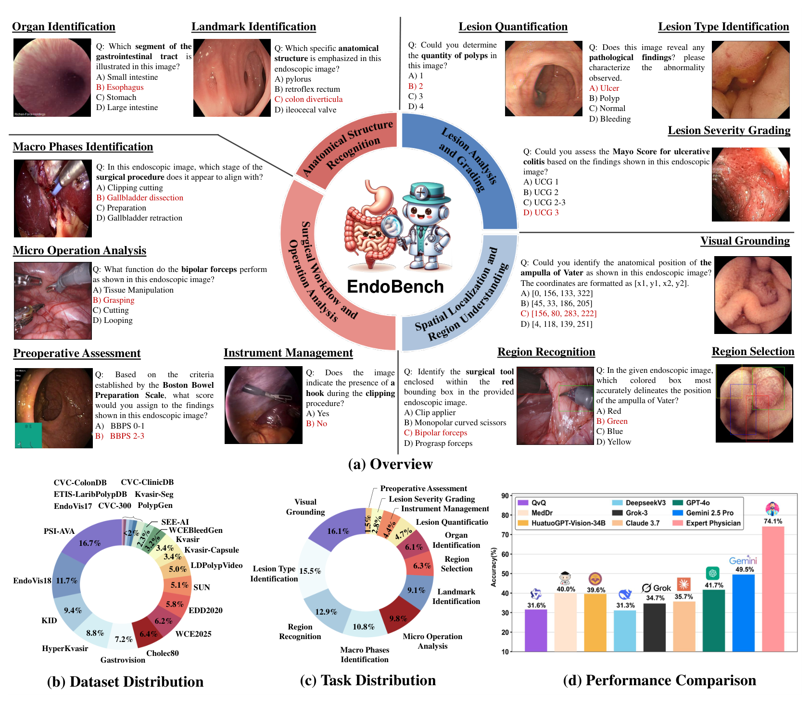
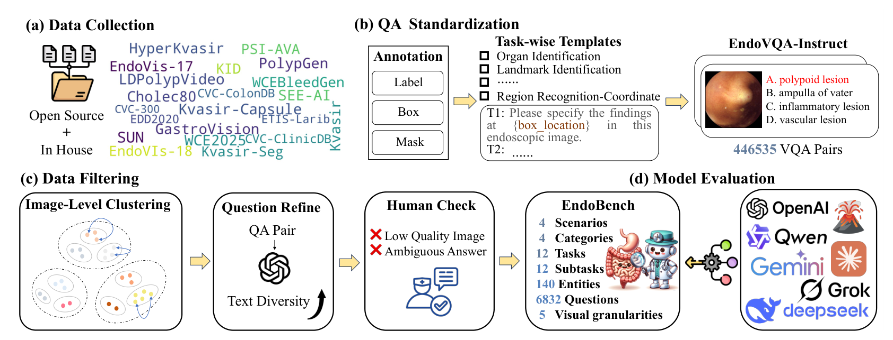
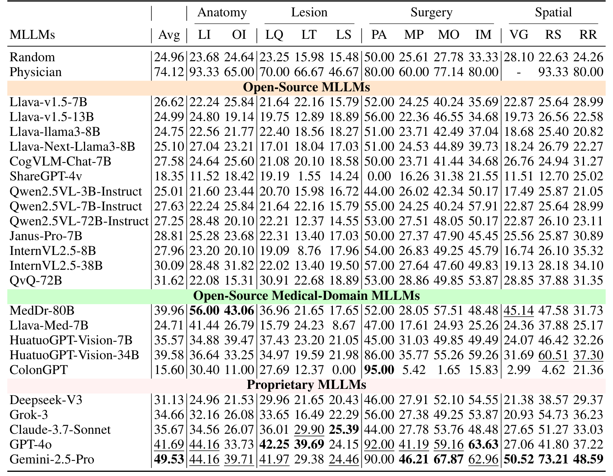
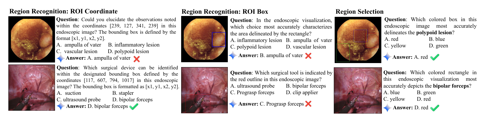

## 1. 背景与动机

内镜检查是发现胃肠道和泌尿系统疾病的重要手段，癌症常到晚期才被确诊，所以早发现很关键。多模态大语言模型已被用于器械识别、病灶检测和图像描述，但它们在临床上靠不靠谱，缺少一把统一的尺。

现有基准有两个缺口。**场景单一**：Surgical-VQA 和 SSG-VQA 主要评估手术，ColonINST 只关注结肠镜。**任务窄**：Kvasir-VQA 以基础识别为主，而真实内镜流程要从识别器官、分级病灶一直做到精确定位和术前评估。

所以论文要回答的是：在同一个基准里覆盖多种场景、多项任务和多种提示形式，现有模型表现如何，与医师差多少。

:::highlights
- 现有基准或只覆盖单一场景，或任务窄
- EndoBench 同时覆盖 4 类场景、12 项任务、5 种视觉提示粒度
:::

## 2. 核心观点速览

**EndoBench 用 6,832 道选择题量出模型与医师的差距：Gemini-2.5-Pro 平均 49.53%，医师 74.12%。**

论文靠四步做到这一点：铺开四类场景和十二项任务；用 20 个公开数据集加 1 个院内数据集生成 446,535 对问答，再抽样、改写、医师复核成 6,832 题；让 23 个模型零样本作答；另请 2 名医师作答作参照。

**边界**：医师参照只有 2 人、255 题且不含坐标任务；"医学微调有效"和"瓶颈在医学知识或病灶识别"这些解读，论文的实验没有把替代解释分开；正文与表之间有数字对不上。

:::highlights
- 专有模型整体领先但仍落后医师
- 医学专用模型只在个别任务上很强
- 因果解读证据偏弱，数字有内部矛盾
:::

:::data
- 6,832 题，来自 21 个数据集
- 23 个被测模型，另有 2 名医师
- 最强模型 49.53% 对医师 74.12%
:::

## 3. 题从哪来：数据与四类场景

题目来自 20 个公开数据集和 1 个院内胶囊内镜数据集 WCE2025。四类场景的题量并不均衡：手术内镜 2,723 题占 39.86%，结肠镜 1,848 题占 27.05%，胶囊内镜 1,678 题占 24.56%，胃镜只有 583 题占 8.53%。

所以凡是比较场景的结论，都要记得手术内镜占近四成而胃镜不到一成。

*论文原图编号：Figure 1。EndoBench 总览：十二项任务的示例题、数据集分布、任务分布和模型性能对比。*

这些数据怎样被造成题，是第 5 节的内容。先看考什么。

:::highlights
- 20 个公开数据集加 1 个院内数据集
- 手术内镜占近四成，胃镜不到一成
:::

:::data
- GS 583、CS 1,848、CE 1,678、SE 2,723
- WCE2025 共 23,447 个样本
:::

## 4. 考什么：十二项任务与视觉提示

论文按一次内镜检查的顺序把任务分成四大类：解剖识别（标志、器官）、病灶分析（定量、类型、严重度）、空间定位（视觉定位、区域选择、区域识别）、手术流程（术前评估、宏观阶段、微观操作、器械管理）。

任务的选项数不同，随机基线也不同。术前评估只有两类，随机为 50.00%，其余多为四选一，总体随机为 24.96%。所以在术前评估上"高于随机"的门槛要高得多。

论文还设了五种视觉提示粒度：图像级、框级、轮廓级、多框、多轮廓。可是结果表只有 Box、Cont、Mul、Coor 四列，与五种粒度如何对应，论文未说明。

:::highlights
- 四大类十二任务按临床流程排列
- 术前评估是二分类，随机基线 50.00%
:::

:::data
- 4 类场景、12 项任务、5 种视觉提示粒度
- 随机总体 24.96%
:::

## 5. 题怎么造、怎么打分

446,535 对问答怎样变成 6,832 道题？论文分三步。先把各数据集的标签、框和掩码对齐到 12 项任务，每项任务写 5 到 8 个问题模板，并补上错误选项，得到 446,535 对。再均衡实体分布，用 DINO-V2 提特征、K-center 聚类挑代表图。最后用 GPT-4o-mini 改写问题，由两名医师剔除低质量图像和有歧义的答案。

打分是零样本、封闭集选择题加精确匹配。部分医学专用模型不按格式输出选项字母，论文就用 Qwen2.5VL-72B 从回答里抽取答案，抽不出算错。

**取舍**：规则造题规模大、可复现，代价是错误选项随机抽取，可能比临床上易混淆的鉴别项更好排除；论文没有评估这一点。

*论文原图编号：Figure 2。EndoBench 的构建流程：数据收集、QA 标准化、数据过滤和模型评测。*

题造好、分定好，下一步是看成绩。

:::highlights
- 规则造题加聚类抽样加医师复核
- 抽取答案的评判模型本身也是被测模型
:::

:::data
- 446,535 对问答压缩为 6,832 题
- 每项任务 5 到 8 个问题模板
:::

## 6. 结果说了什么

先看总成绩。Gemini-2.5-Pro 平均 49.53%，GPT-4o 为 41.69%，医师为 74.12%，最强模型与医师差约 25%。开源组最强的是医学专用的 MedDr-80B，平均 39.96%，在解剖标志和器官识别上分别达 56.00% 和 43.06%，高于所有专有模型。

*论文原图编号：Table 2。23 个模型在 12 项临床任务上的准确率，含 Random 与 Physician 参照行。*

**所以呢**：模型整体离医师很远，但差距不均匀。术前评估上多个模型超过医师，微观操作上 Gemini-2.5-Pro 的 67.87% 与医师的 77.14% 相对接近，而解剖标志、区域选择和区域识别上差距仍大。

病灶类任务最难：所有模型在严重度分级上都不超过 25.39%，在病灶类型识别上最高 39.69%。

再按场景拆开，Gemini-2.5-Pro 总体 52.39%，在四类场景都居首，医师总体 76.64%。ColonGPT 在结肠镜上有 33.37%，在手术内镜上只有 4.85%，总分会掩盖这类分布外的失败。

:::highlights
- 差距不均匀：术前评估已有模型超过医师
- 专用模型强项很窄，ColonGPT 一离开结肠镜就崩
:::

:::data
- Gemini-2.5-Pro 49.53%，GPT-4o 41.69%，医师 74.12%
- 场景总体：Gemini-2.5-Pro 52.39%，医师 76.64%
- 息肉类型分类：ColonGPT 57.60%，其余多近 19.20% 的随机水平
:::

## 7. 思维链能不能提分

附录让模型先写推理过程再作答。Gemini-2.5-Pro 从 49.53% 升到 61.67%，Qwen2.5-VL-7B 从 27.63% 升到 32.35%，GPT-4o 只从 41.69% 升到 42.11%。两个 HuatuoGPT-Vision 模型反而下降，7B 从 35.57% 降到 28.53%，34B 从 39.58% 降到 32.14%。

**所以呢**：效果因模型而异。论文推测推理路径在知识不扎实时会增加幻觉，这只是假设。提示措辞、样本数和重复次数论文未说明，61.67% 不宜当作稳定提升。

:::highlights
- 思维链对强模型有益，对医学专用模型有害
- 论文正文漏提 Qwen2.5-VL-7B 也提升了
:::

:::data
- Gemini-2.5-Pro：49.53% 到 61.67%
- HuatuoGPT-Vision-34B：39.58% 到 32.14%
:::

## 8. 为什么这样，证据有多硬

论文归纳了四条结论。逐条看，证据强度并不一样。

**专有模型领先、仍落后医师**：较强。差距大、方向一致，只是医师参照样本小。

**医学监督微调显著提升表现**：弱。MedDr-80B 与 HuatuoGPT-Vision-34B 确实在地标和器官识别上突出，但它们与对比模型的底座、参数量、训练数据都不同，没有同底座前后对照。论文自己的表里，Llava-Med-7B 的 24.71% 反而低于 Llava-v1.5-7B 的 26.62%。训练数据是否与这些公开测试数据重叠，论文未检查。

**提示形式影响表现，短板是医学知识**：中等偏弱。区域选择题已给出目标名称，只需选位置；区域识别题要在选项中给出类别名。两类题难度本就不同，差距不能只归因于医学知识。

*论文原图编号：Figure 4。同一图像在 ROI 坐标、ROI 框和区域选择三种形式下的模型回答案例。*

**息肉计数的瓶颈是病灶识别**：弱。论文说初测没有模型超过 30%，加框后 Gemini-2.5-Pro 从 24.46% 升到 92.57%。可是表 2 的计数列里 GPT-4o 为 42.25%，Gemini-2.5-Pro 为 41.97%，都超过 30%，而 24.46% 恰是 Gemini-2.5-Pro 在严重度分级列的值。加框后数框就能得到答案，高分更像任务被简化。

:::highlights
- 第一条结论证据较强，后三条归因偏弱
- 加框计数的数字与表 2 对不上
:::

:::data
- Llava-Med-7B 24.71% 对 Llava-v1.5-7B 26.62%
- 计数列：GPT-4o 42.25%，Gemini-2.5-Pro 41.97%
:::

## 9. 结果没说什么

下面几件事，论文的数字不能证明。

- 它不能证明题目质量高：覆盖面是分类计数，论文没有给出区分度或与其他基准的一致性分析。
- 它不能给出精确的人类上限：医师 2 人、255 题，每个子任务只有 5、10 或 15 题，也没有医师间一致性。
- 它不能分离"知识缺乏"和"格式失败"：医学专用模型抽不出答案就记错，论文自己也承认这不一定反映知识缺乏。
- 它不能支持五种粒度的逐一结论：结果表的四列与五种粒度如何对应，论文未说明。

另外有几处内部数字不一致。表 2 与表 3 的总体平均对不上，如 Gemini-2.5-Pro 为 49.53% 对 52.39%，Qwen2.5VL-7B-Instruct 为 27.63% 对 20.95%。表 5 中 Qwen2.5VL-7B-Instruct 与 Llava-v1.5-7B 只有器械计数一列不同，其余各列取值完全相同，论文未说明这是否为录入重复。

:::highlights
- 总体平均的算法论文未说明
- 两个 7B 模型的行大量重复，开源组名次存疑
:::

:::data
- 255 题、2 名医师，每个子任务 5、10 或 15 题
- 表 5 中两个 7B 模型仅一列不同
:::

## 10. 复现与使用要注意什么

用这个基准之前，先核对三件事：表 2、3、5 中重复的行是否为录入错误；总体平均是按任务简单平均还是按题量加权；加框计数实验是否真有表可查。

复现的入口也不清楚：摘要称公开发布基准和代码，正文没有给出链接，专有模型的版本、调用日期和采样设置论文也未说明。

可以直接借用的是报告方式：把能力按临床流程拆成四大类，再叠加场景和视觉提示两个切面，比单一总分更能定位问题。引用医师参照时，要写明样本量和被排除的坐标任务。

:::highlights
- 借用分类与多切面报分的方式
- 不要把加框计数或医学模型更强当作已证实的因果结论
:::

## @takeaways
- EndoBench 的价值在覆盖面：4 类场景、12 项任务、5 种视觉提示粒度
- 最强模型 Gemini-2.5-Pro 平均 49.53%，医师 74.12%，差距约 25%
- 医学专用模型只在个别任务上很强，ColonGPT 一离开结肠镜就崩
- 四条结论里，只有"专有模型领先但落后医师"证据较强

## @strengths
- 场景、任务、提示形式三个切面报分，能定位短板
- 构建流程有聚类抽样和两名医师复核
- 附录给出任务定义、模板和错误类型的案例，信息较完整

## @weaknesses
- 医师参照样本小，且不含坐标任务
- 平均值算法、粒度对应、阈值等多处论文未说明
- 正文与表之间有数字不一致，两个模型的行大量重复
- 错误选项随机抽取，可能偏易

## @questions
- 同一底座医学微调前后的受控对比能否分离领域知识的作用？
- 给出框位置但不暗示个数的计数对照，结果如何？
- 换成临床上易混淆的干扰项，模型排名会不会改变？
- 医师间一致性如何，增加医师和题量后参照线会移动多少？
