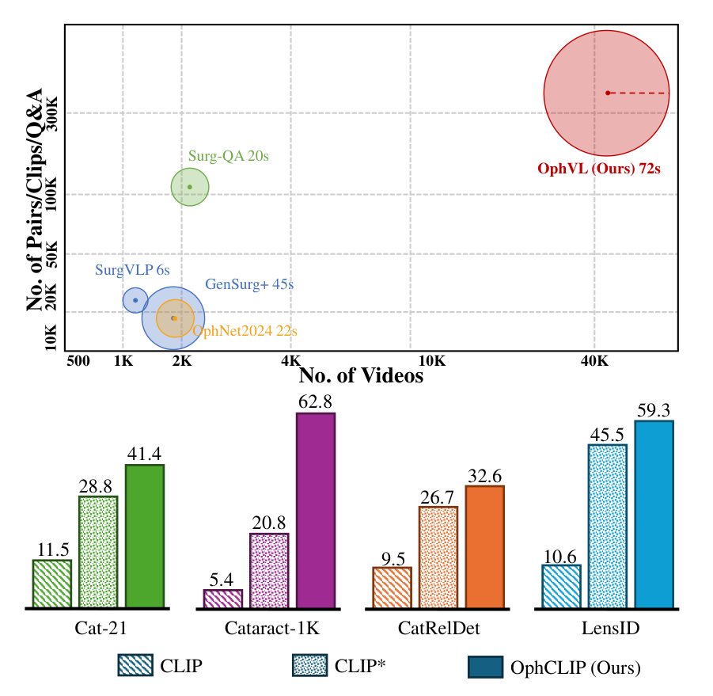
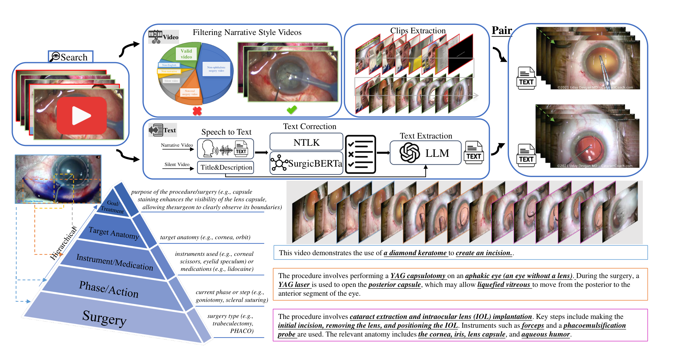
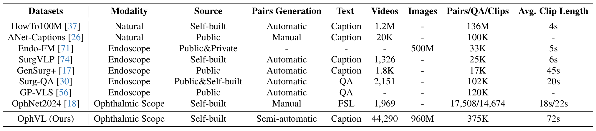
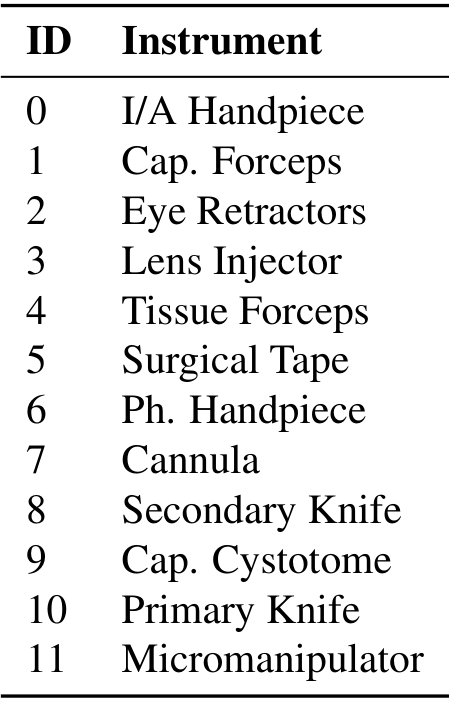
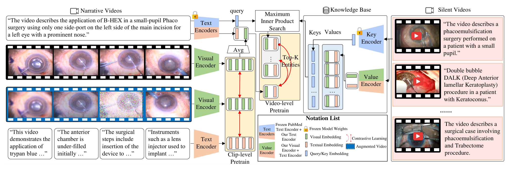
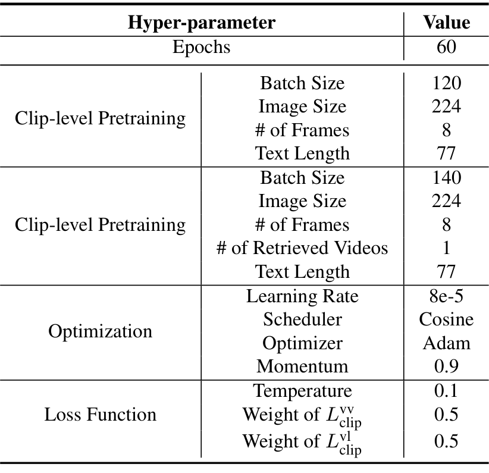
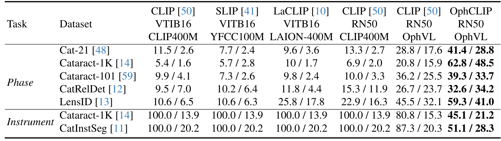
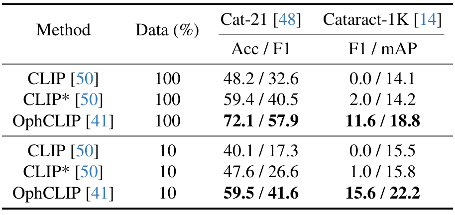
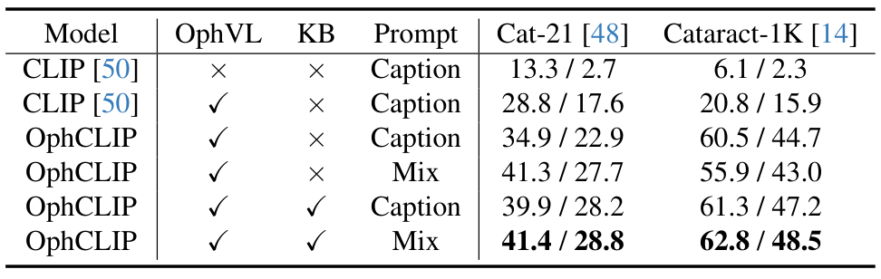
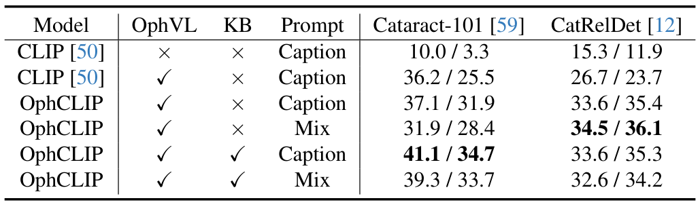

---
tags:
  - papers/multimodal
  - papers/medical
aliases:
  - "OphCLIP"
  - "OphVL"
date: 2024-11-26
arxiv_id: 2411.15421
---

# OphCLIP：面向眼科手术视频-语言预训练的层级检索增强学习

## 核心信息

- 标题: OphCLIP: Hierarchical Retrieval-Augmented Learning for Ophthalmic Surgical Video-Language Pretraining
- 标题翻译: OphCLIP：面向眼科手术视频-语言预训练的层级检索增强学习
- 作者: Ming Hu, Kun Yuan, Yaling Shen, Feilong Tang, Xiaohao Xu, Lin Zhou, Wei Li, Ying Chen, Zhongxing Xu, Zelin Peng, Siyuan Yan, Vinkle Srivastav, Diping Song, Tianbin Li, Danli Shi, Jin Ye, Nicolas Padoy, Nassir Navab, Junjun He, Zongyuan Ge
- 机构: Shanghai AI Laboratory; Monash University; University of Strasbourg; Technische Universität München; University of Michigan, Ann Arbor; The Hong Kong Polytechnic University; Shanghai Jiao Tong University; Xiamen University
- 发表时间: 2024-11-26
- 发表渠道: arXiv 预印本（cs.CV）
- arXiv: 2411.15421
- 论文链接: https://arxiv.org/abs/2411.15421
- 代码 / 项目: https://github.com/minghu0830/OphCLIP
- 论文类型: AI_method

## 原文摘要翻译

手术实践涉及复杂的视觉判读、操作技能和高级医学知识，再加上带标注数据有限，使得手术视觉-语言预训练（VLP）格外困难。为弥补这一缺口，我们提出 OphCLIP，一个专为眼科手术工作流理解设计的层级检索增强视觉-语言预训练框架。

OphCLIP 使用我们构建的 OphVL 数据集。该数据集包含超过 375K 个层级结构化的视频-文本对，覆盖数以万计种不同的属性组合（手术、阶段/操作/动作、器械、药物，以及眼病成因、手术目的和术后恢复建议等更高层的方面）。这种层级式的视频-文本对应使 OphCLIP 能同时学到细粒度和长时程的视觉表示：把短视频片段与详细的叙述性描述对齐，把完整视频与结构化标题对齐，分别捕捉细致的手术细节和高层的流程洞察。

OphCLIP 还设计了检索增强的预训练框架，用来利用尚未被充分探索的大规模无解说手术视频，自动检索语义相关的内容，以增强对叙述性视频的表示学习。
在 11 个数据集上对阶段识别和多器械识别的评测显示，OphCLIP 具有稳健的泛化能力和更优的性能。

## 创新点

1. 构建 `OphVL` 数据集。它是论文所称首个大规模眼科手术视频-语言预训练数据集，含 375K 个片段-文本对，总时长 7.5K 小时，论文称其规模是现有最大手术 VLP 数据集的 15 倍。它解决的是眼科手术缺少成规模配对数据的问题。
2. 层级视频-文本对应。叙述文本对应短片段，标题摘要对应整段视频，让同一个编码器同时学到短时细节和长时流程信息。
3. 把无解说的沉默视频当作知识库。用叙述视频的标题去检索语义相近的沉默视频，把它们的视觉和文本嵌入作为额外正样本，解决沉默视频无法直接参与对比学习的问题。
4. 零样本评测协议覆盖阶段识别和多器械识别两类任务共 11 个数据集（子数据集），并配有线性探测和消融。

## 一句话总结

`OphCLIP` 用 YouTube 眼科手术视频构建了 `OphVL`，再用片段级加视频级的两层对比学习和沉默视频检索来预训练，零样本阶段识别准确率在 `Cat-21` 上达到 41.4%，在 `Cataract-1K` 上达到 62.8%，而原版 `CLIP` 只有 11.5% 和 5.4%。
但绝对水平仍不高，表 3 与正文之间也有不一致。

## 研究问题

**眼科手术视频很多，但能教模型看懂手术的配对数据很少。**
手术数据科学在阶段识别、器械分割、病灶检测等单模态任务上已有进展，多模态表示学习却仍很少被探索。
作者列出四个障碍：专业医学术语、可用数据有限、需要专家标注，以及手术视频常长达数小时且视野固定在狭小范围内。
图 1 上半部分展示了通用视觉数据集与手术数据集之间的规模差距。

眼科更缺数据。表 1 里眼科显微镜一栏除了本文的 `OphVL`，只有人工标注的 `OphNet2024`。
另一方面，网上还有大量没有解说的手术视频，以往的视频-文本数据集大多只用有解说的视频，沉默视频被忽略了。

作者的出发点来自医生的学习方式：先看有解说的视频学具体技术，再把学到的表示迁移到相似的沉默视频上。
于是问题变成：如何用大规模叙述视频同时学到细粒度细节和长时程流程语义，并让沉默视频也参与训练。

*论文原图编号：Fig. 1。上半部分比较 OphVL 与已有手术数据集的规模，下半部分给出 CLIP、CLIP* 与 OphCLIP 在四个阶段识别数据集上的准确率。这里插入是因为它概括了全文的动机和核心结论。*

### 核心观点速览

**论文的答案是：先造数据，再用两层对比学习加沉默视频检索预训练，零样本能力因此提升；但提升主要来自领域数据（我的判断），方法增量并不稳定。**

- 数据：`OphVL` 含 375,198 个片段-文本对，来自 13,654 个叙述视频和 30,636 个沉默视频。
- 层级：片段与解说对齐学细节，整段视频与标题对齐学流程，两层共用一套编码器。
- 检索：用叙述视频的标题检索沉默视频，把其嵌入当作额外正样本，训练时只取 1 个。
- 结果：零样本阶段识别在 `Cat-21` 达到 41.4%，在 `Cataract-1K` 达到 62.8%，原版 `CLIP` 只有 11.5% 和 5.4%。
- 边界：在 `OphNet` 上操作识别只有 7.1%，`CaDIS` 上器械误报率并未降低，知识库的收益在不同数据集上忽大忽小。

读完这一屏已经可以判断这篇论文的价值，后面的章节依次回答数据怎么来、模型怎么训、结果能信到什么程度。

## 数据与任务定义

要训练眼科的视觉-语言模型，先要有对齐干净的视频-文本对。
这一节回答两个问题：`OphVL` 的数据怎么来，以及用什么任务检验模型。

### 数据来源与过滤

`OphVL` 的构建分五步：收集眼科手术频道和视频，按“叙述风格”过滤，用多种模型和工具提取并去噪视频片段与解说文本，用大语言模型改写解说使其聚焦手术概念，最后从片段抽帧构成视频-文本对。

收集阶段，作者与三位执业眼科医生合作，从文献综述整理出超过 3K 个眼科手术相关术语，包括手术名称、操作步骤、器械用法、药物和术后并发症。他们用这些词在 YouTube 上手动搜索频道，因为按频道搜索比按单个关键词搜索得到的视频更集中、质量更高。论文写的是“确定了 410 个眼科手术视频的 YouTube 频道 ID”，按上下文疑为 410 个频道，视频数的说法与随后约 100K 个视频不符。下载时优先取最高分辨率，过滤掉短于 30 秒或分辨率低于 224p 的视频，剩下约 100K 个视频。

叙述风格过滤有两个判据。第一，视频是否为真实眼科手术：用 `PySceneDetect` 抽关键帧，训练 `ResNet50` 分类器判断关键帧是否是眼科手术显微镜画面，超过 80% 的关键帧被判为眼科显微镜画面则标为有效视频。第二，是否有丰富的解说：检测视频中人声比例，阈值设为 0.2，低于阈值的视频视为沉默或解说不足，只收集其标题和片段元数据放进知识库。

### 文本提取与对齐

语音转文字用 `Whisper Large-V3` 直接转写完整语音段。去噪与质量控制有四步：用 `Rake` 关键词抽取（短语至多四个词）并去停用词；用在手术文本上预训练的 `SurgicBERTa` 校验并修正每个条目；用带示例提示的大语言模型按句子上下文纠正拼写；最后提示大语言模型给出结构化摘要，覆盖手术类型、阶段/动作、器械、药物、解剖目标和手术目的。

Whisper 的句子常在时间戳处被切断，作者设计了启发式算法，依据标点和连接词合并时间戳，让语义保持连续，以改善 `GPT-4o` 的摘要。片段按字幕时间戳切分。沉默视频由前述分类器按 1 FPS 采样来抽取手术片段，标题和元数据用来建知识库。所有片段-文本对再按 0.5 FPS 抽帧用于预训练。

*论文原图编号：Fig. 2。OphVL 构建流程：检索视频、过滤叙述风格、语音转文字、文本纠正与结构化提取，再与片段配对，右侧金字塔是文本概念的层级。这里插入是因为它直观展示了从视频到配对数据的整条数据链路。*

### 数据规模

最终 `OphVL` 含 375,198 个片段-文本对，来自 13,654 个叙述视频和 30,636 个沉默视频，共 9363 小时。片段平均时长 72 秒，平均分辨率 1500×912，超过 65% 的视频分辨率不低于 1280×720。表 1 把 `OphVL` 与已有数据集并列。

*论文原图编号：Table 1。对比 OphVL 与自然视频、内镜手术和眼科数据集的模态、来源、配对生成方式、视频数、配对数和平均片段长度。这里插入是因为它支撑“规模是现有最大手术 VLP 数据集 15 倍”的说法。*

这里有两处数字需要注意。引言和贡献部分写“7.5K 小时”，而 3.4 节写总计 9363 小时，两者口径是否相同论文未说明。其次，375K 除以 15 约为 25K，与表 1 中 `SurgVLP` 的 25K 对相符，而 `Surg-QA`（102K）与 `GP-VLS`（120K）是问答数据，不属于 VLP 数据集。

### 下游任务与数据集

评测包含两个任务。阶段识别使用 `Cat-21`（11 类）、`Cataract-1K`（12 类）、`Cataract-101`（10 类）、`CatRelDet`（5 类）、`OphNet`（96 个阶段、232 个操作）和 `LensID`（3 类，即植入前、植入、植入后）。
多器械识别使用 `Cataract-1K`（9 类）、`CatInstSeg`（11 类）和 `CaDIS`（12 类与 35 类）。
论文 5.1 节写“12 个数据集（或子数据集）”，摘要写 11 个，按 `OphNet` 拆成 O/P 两个子集、`CaDIS` 拆成 F/C 两个子集来数，表格里实际出现的是 11 个。5.1 节还写“五个数据集”而列了六个，写“四个数据集”做器械识别而只列出三个名字。

评测只做帧级分类，不做时序建模，目的是聚焦多模态表示。零样本时冻结视觉和文本编码器，把类别名写成句子提示。阶段识别的提示分三种：关键词式（阶段、器械、药物、目标）、大语言模型生成的描述式（Caption），以及两者合并的 `Mix`。器械识别是多标签任务，对图像与各器械提示的余弦相似度做 sigmoid，得到各器械的独立概率。
阶段识别报 Accuracy/F1，器械识别报假阳性率（FPR，越低越好）和 mAP。

*论文原图编号：Table 19。CaDIS 数据集粗粒度（CaDIS-C）的 12 类器械标签。这里插入是因为它展示了多器械识别任务的标签空间。*

## 方法主线

数据备好之后的问题是：怎样让一套编码器既学到几十秒的手术细节，又学到整台手术的流程，还能用上没有解说的视频？
论文的做法是两层对比学习加一个检索增强的知识库。

### 机制流程

`OphCLIP` 用一套视觉编码器 $f_v$ 和一套文本编码器 $f_t$（两个预训练阶段共用），训练分为片段级和视频级，沉默视频只在视频级出现。

1. 片段级对齐。输入是叙述视频的短片段 $v_{ij}$ 及其解说 $n_{ij}$。操作是分别编码后做 `InfoNCE` 对比，同批其他样本作负样本，并额外对同一片段的两个增强视图做 `SimSiam` 式自监督。输出是更新后的 $f_v$ 与 $f_t$，学到短时细粒度对应。
2. 视频级对齐。输入是整段叙述视频的片段特征和它的标题摘要 $T_i$。操作是把片段特征平均池化成视频特征 $f_v(V_i)$，与标题的文本特征做对比，其他视频的标题作负样本。输出是长时程的视频表示。
3. 检索沉默视频。输入是叙述视频的标题。操作是用冻结的 `PubMedBERT` 编码成查询向量，在记忆库的标题键上做最大内积搜索，取最相关的 top-K 条沉默视频。输出是这些沉默视频的视觉与文本嵌入。
4. 增强视频级对比。输入是第 3 步取回的嵌入。操作是把它们当作该叙述视频的额外正样本，加入视频级对比损失。输出是总的视频级损失 $L_{video}$。训练时交替优化片段级损失若干批和视频级损失若干批，并循环。

*论文原图编号：Fig. 3。OphCLIP 的预训练框架：左侧是叙述视频的片段级与视频级预训练，右侧是沉默视频组成的知识库与最大内积搜索。这里插入是因为它把上述四步的数据流画在了一张图里。*

### 训练目标

片段级损失由视觉-语言项和视觉-视觉项组成。设 $B$ 为批大小，写成标准 `InfoNCE` 形式为

$$L_{clip}^{vl} = -\frac{1}{B}\sum_{i=1}^{B}\log\frac{\exp\left(f_v(v_{ij})^{\top} f_t(n_{ij})\right)}{\sum_{k=1}^{B}\exp\left(f_v(v_{ij})^{\top} f_t(n_{kj})\right)}$$

这对应代码里图像-文本相似度矩阵上的交叉熵，对角线为正样本。论文原式省略了负号，也没有写温度，表 6 给出温度为 0.1。
视觉-视觉项对同一片段的随机增强视图做同样的对比。
总的片段级损失为 $L_{clip}=L_{clip}^{vl}+L_{clip}^{vv}$。
表 6 中两项的权重都是 0.5。

视频级的叙述损失把整段视频特征与标题特征对齐，论文式 3 的形式为

$$L_{video}^{narrative} = -\frac{1}{B}\sum_{i=1}^{B}\log\frac{\exp\left(f_v(V_i)^{\top} f_t(T_i)\right)}{\sum_{k=1}^{B}\exp\left(f_v(V_i)^{\top} f_t(T_k)\right)}$$

其中 $f_v(V_i)$ 是片段特征 $f_v(v_{ij})$ 的平均池化。论文印出的式 3 分子写成 $f_v(T_i)$、分母写成 $f_t(T_k)$，符号前后不一致；式 2 的分子也写成了文本特征而不是增强视图的视觉特征。上面的式子按正文描述作了统一。

沉默视频项把取回的 $K$ 个沉默视频的视觉嵌入 $f_v(\hat V)$ 与文本嵌入 $f_t(\hat T)$ 都当作正样本，论文式 7 的形式为

$$L_{video}^{silent} = -\frac{1}{K}\sum_{j=1}^{K}\log\frac{\exp\left(f_v(V_i)^{\top} f_v(\hat V_{k_j})\right)+\exp\left(f_v(V_i)^{\top} f_t(\hat T_{k_j})\right)}{\sum_{m=1}^{K}\left[\exp\left(f_v(V_i)^{\top} f_v(\hat V_{k_m})\right)+\exp\left(f_v(V_i)^{\top} f_t(\hat T_{k_m})\right)\right]}$$

最终视频级损失为 $L_{video}=L_{video}^{narrative}+L_{video}^{silent}$。这里同样补了负号，原式没有。
按式 7 的字面写法，分母只对同一批取回的 $K$ 个样本求和，没有出现批内其他视频的负样本，而 $K$ 在表 6 中是 1。若字面成立，$K=1$ 时分子等于分母，这一项恒为常数。实际代码是否把批内其他样本放进分母，论文未说明。

### 沉默视频知识库

查询编码用 `PubMedBERT` 把叙述视频的标题编码为 $q$。作者的理由是在文本模态内检索，可以避开 `CLIP` 对眼科视频视觉理解不足造成的误检。记忆库的键是沉默视频标题经查询编码器得到的嵌入，值是该视频的文本嵌入与视觉嵌入对。论文说记忆库中的表示会动态更新，但更新的触发时机和频率论文未说明。检索按内积取最高的 top-K 个索引，$K$ 在表 6 中为 1。

作者宣称该检索可扩展到百万级数据，但论文没有给出检索耗时或索引结构的数据。

### 关键实现细节

视觉编码器是 ImageNet 初始化的 `ResNet-50`，文本编码器是在临床笔记上预训练的 `BioClinicalBert`。视觉特征做平均池化，文本取 `[CLS]` 后接线性投影，嵌入维度 768。硬件是 8 张 24 GB 的 `RTX-4090`，训练 2 天。
先做 40 个 epoch 的片段级预训练，再进入层级训练：交替 3 个 epoch 的片段级数据和 2 个 epoch 的视频级数据。批大小分别为 120 和 140。这样交替训练的目的，据作者说，是兼顾短时与长时特征并避免灾难性遗忘。

*论文原图编号：Table 6。超参数表。这里插入是因为它给出了复现所需的批大小、学习率、温度和损失权重。*

表 6 中总 epoch 为 60，与正文“40 个 epoch 加交替训练”的拆分如何对应，论文未说明。表 6 的第二个分组标题仍写为 `Clip-level Pretraining`，从批大小 140 和“检索视频数”一栏看应是视频级，属于排版笔误。

## 关键结果

### 主结果与强基线

**主要问题是：在眼科数据上预训练到底带来多少提升，提升又来自哪里。**
表 2 比较了原版 `CLIP`、`SLIP` 和 `LaCLIP`。
另外两列是在 `OphVL` 上预训练的 `CLIP`（记为 `CLIP*`）和 `OphCLIP`。
前三个基线用 `ViT-B/16`，后三列用 `RN50`。格式为阶段识别 Accuracy/F1（%），器械识别 FPR/mAP（%）。

| Task | Dataset | CLIP ViT-B/16 | SLIP ViT-B/16 | LaCLIP ViT-B/16 | CLIP RN50 | CLIP* RN50 | OphCLIP RN50 |
|---|---|---|---|---|---|---|---|
| Phase | `Cat-21` | 11.5 / 2.6 | 7.7 / 2.4 | 9.6 / 3.6 | 13.3 / 2.7 | 28.8 / 17.6 | 41.4 / 28.8 |
| Phase | `Cataract-1K` | 5.4 / 1.6 | 5.7 / 2.8 | 10 / 1.7 | 6.9 / 2.0 | 20.8 / 15.9 | 62.8 / 48.5 |
| Phase | `Cataract-101` | 9.9 / 4.1 | 7.3 / 2.6 | 9.8 / 2.4 | 10.0 / 3.3 | 36.2 / 25.5 | 39.3 / 33.7 |
| Phase | `CatRelDet` | 9.5 / 7.0 | 10.2 / 6.4 | 11.8 / 4.4 | 15.3 / 11.9 | 26.7 / 23.7 | 32.6 / 34.2 |
| Phase | `LensID` | 10.6 / 6.5 | 10.6 / 6.3 | 25.8 / 17.8 | 22.9 / 16.3 | 45.5 / 32.1 | 59.3 / 41.0 |
| Instr. | `Cataract-1K` | 100.0 / 13.9 | 100.0 / 13.9 | 100.0 / 13.9 | 100.0 / 13.9 | 80.8 / 15.3 | 45.1 / 21.2 |
| Instr. | `CatInstSeg` | 100.0 / 20.2 | 100.0 / 20.2 | 100.0 / 20.2 | 100.0 / 20.2 | 87.3 / 20.3 | 51.1 / 28.3 |

*论文原图编号：Table 2。零样本阶段识别与器械识别的主结果对比。这里插入是因为它是全文最核心的结果表。*

读法有三点。第一，从原版 `CLIP` 到 `CLIP*`，所有阶段数据集都大幅上升，例如 `Cataract-1K` 从 6.9 / 2.0 到 20.8 / 15.9，数据集本身贡献了很大一部分增益。
第二，从 `CLIP*` 到 `OphCLIP` 的增益在不同数据集上差别很大：`Cataract-1K` 从 20.8 到 62.8，而 `Cataract-101` 只从 36.2 到 39.3。
第三，把通用预训练数据换成 `YFCC100M` 或 `LAION-400M` 并没有稳定的帮助，`SLIP` 在 `Cat-21` 上（7.7 / 2.4）还低于 `CLIP`（11.5 / 2.6）。
**这说明主要变量是领域数据，而不是通用预训练数据的种类。**

器械识别里，所有未在 `OphVL` 上预训练的基线 FPR 都是 100.0%，即对每一帧每个类别都判为阳性。补充材料表 8 也佐证了这一点：十个器械类别的召回率全是 100.0，宏平均精确率为 13.9。表 8 的标题写的是 `Cat-21`，但所列标签是 `Cataract-1K` 的器械，标题应有误。
**因此 100.0 的 FPR 反映的是基线几乎没有区分能力，不是它们学错了某几类。**

> [!figure] Table 8 基线器械识别的分类别结果
> 建议位置：关键结果
> 放置原因：它显示基线在所有器械类别上召回率均为 100.0，是解释 FPR 为 100.0% 的直接证据。
> 当前状态：保留占位；未找到高置信度整图（asset_candidate_missing）。

> [!figure] Table 7 Cataract-1K 的器械文本提示
> 建议位置：关键结果
> 放置原因：它说明器械识别零样本评测使用的提示句式，影响对结果的解读。
> 当前状态：保留占位；未找到高置信度整图（asset_candidate_missing）。

### 细粒度与粗粒度识别

表 3 在 `OphNet` 的操作（O，232 类）与阶段（P，96 类）以及 `CaDIS` 的细粒度（F，35 类）与粗粒度（C，12 类）上比较。数值格式同上。

| Method | OphNet-O Acc / F1 | OphNet-P Acc / F1 | CaDIS-F FPR / mAP | CaDIS-C FPR / mAP |
|---|---|---|---|---|
| CLIP | 0.7 / 0.4 | 3.2 / 0.7 | 13.0 / 8.9 | 28.1 / 22.5 |
| LaCLIP | 1.0 / 0.3 | 3.2 / 0.7 | 13.0 / 8.9 | 30.1 / 22.6 |
| CLIP* | 2.5 / 0.8 | 5.0 / 1.6 | 13.1 / 9.3 | 28.5 / 22.6 |
| OphCLIP | 7.1 / 2.3 | 18.2 / 4.8 | 14.7 / 10.6 | 28.7 / 23.5 |

> [!figure] Table 3 细粒度与粗粒度识别
> 建议位置：关键结果
> 放置原因：它是论文唯一一张按识别粒度拆分的结果表，上面的 Markdown 表即据此转录。
> 当前状态：保留占位；提取到的候选图内容属于线性探测表，视觉复核判定为 visual_defect（identity_mismatch），未插入。

三处与论文文字不一致或值得警惕。第一，正文写“`OphNet-O`（细粒度）和 `OphNet-P`（粗粒度），`OphCLIP` 达到 18.2% / 4.8% 和 7.1% / 2.3%”，次序与表中 O = 7.1 / 2.3、P = 18.2 / 4.8 相反。
第二，`CaDIS-F` 与 `CaDIS-C` 上 `OphCLIP` 的 FPR（14.7 与 28.7）都比 `CLIP` 的 13.0 和 28.1 更高，正文却称“更低的假阳性”，表中也把这两个更差的 FPR 加了粗。
第三，`OphNet` 上绝对水平极低，操作识别准确率只有 7.1%，阶段识别也只有 18.2%。
**所以“在不同粒度上稳健”只能理解为相对基线更好，不能理解为已经可用。**

### 线性探测

表 4 冻结视觉编码器，训练线性分类器（线性核 `SVM`），在 `Cat-21` 与 `Cataract-1K` 上用 10% 和 100% 的训练数据。10% 是对训练集视频采样，且各类别样本数保持均衡。

| Data | Method | Cat-21 Acc / F1 | Cataract-1K F1 / mAP |
|---|---|---|---|
| 100% | CLIP | 48.2 / 32.6 | 0.0 / 14.1 |
| 100% | CLIP* | 59.4 / 40.5 | 2.0 / 14.2 |
| 100% | OphCLIP | 72.1 / 57.9 | 11.6 / 18.8 |
| 10% | CLIP | 40.1 / 17.3 | 0.0 / 15.5 |
| 10% | CLIP* | 47.6 / 26.6 | 1.0 / 15.8 |
| 10% | OphCLIP | 59.5 / 41.6 | 15.6 / 22.2 |

*论文原图编号：Table 4。10% 与 100% 数据下的线性探测。这里插入是因为它是评估视觉编码器本身的唯一结果。*

`Cat-21` 上 `OphCLIP` 明显最好。
`Cataract-1K` 的器械 F1 在 `CLIP` 上是 0.0，在 `OphCLIP` 上也只有 11.6，且 10% 数据下的 F1（15.6）反而高于 100% 数据下的（11.6），论文没有解释。
表中 `OphCLIP` 的引用标号写成 [41]，这是 `SLIP` 的编号，应为引用笔误。
**这说明预训练出的视觉编码器在 `Cat-21` 上确实更好用，而 `Cataract-1K` 的器械线性探测结果还很弱。**

### 消融到底说明了什么

表 5 在 `Cat-21` 与 `Cataract-1K` 上做阶段识别消融，三个因素是 `OphVL` 预训练、知识库（KB）和提示（`Caption` 对 `Mix`）。

| Model | OphVL | KB | Prompt | Cat-21 Acc / F1 | Cataract-1K Acc / F1 |
|---|---|---|---|---|---|
| CLIP | × | × | Caption | 13.3 / 2.7 | 6.1 / 2.3 |
| CLIP | ✓ | × | Caption | 28.8 / 17.6 | 20.8 / 15.9 |
| OphCLIP | ✓ | × | Caption | 34.9 / 22.9 | 60.5 / 44.7 |
| OphCLIP | ✓ | × | Mix | 41.3 / 27.7 | 55.9 / 43.0 |
| OphCLIP | ✓ | ✓ | Caption | 39.9 / 28.2 | 61.3 / 47.2 |
| OphCLIP | ✓ | ✓ | Mix | 41.4 / 28.8 | 62.8 / 48.5 |

*论文原图编号：Table 5。OphCLIP 各组件的消融。这里插入是因为它是支持知识库和提示设计有效的主要证据。*

读这张表，需要把“层级训练本身”和“知识库”分开。第三行（不带知识库的 `OphCLIP`）已经让 `Cataract-1K` 从 20.8 / 15.9 跳到 60.5 / 44.7，说明层级训练贡献了最大的增益。
知识库在 `Caption` 提示下把 `Cataract-1K` 的 F1 从 44.7 提到 47.2，在 `Mix` 提示下从 43.0 提到 48.5，而 `Cat-21` 在 `Mix` 提示下准确率仅从 41.3 到 41.4。
补充表 9（`Cataract-101` 与 `CatRelDet`）更不稳定。

| Model | OphVL | KB | Prompt | Cataract-101 Acc / F1 | CatRelDet Acc / F1 |
|---|---|---|---|---|---|
| CLIP | × | × | Caption | 10.0 / 3.3 | 15.3 / 11.9 |
| CLIP | ✓ | × | Caption | 36.2 / 25.5 | 26.7 / 23.7 |
| OphCLIP | ✓ | × | Caption | 37.1 / 31.9 | 33.6 / 35.4 |
| OphCLIP | ✓ | × | Mix | 31.9 / 28.4 | 34.5 / 36.1 |
| OphCLIP | ✓ | ✓ | Caption | 41.1 / 34.7 | 33.6 / 35.3 |
| OphCLIP | ✓ | ✓ | Mix | 39.3 / 33.7 | 32.6 / 34.2 |

*论文原图编号：Table 9。在 Cataract-101 与 CatRelDet 上的补充消融。这里插入是因为它显示知识库与提示的收益并不稳定。*

在 `Cataract-101` 上知识库有明显收益（`Mix`：31.9 到 39.3），但在 `CatRelDet` 上，`Mix` 提示加知识库（32.6 / 34.2）比不加（34.5 / 36.1）更差，`Caption` 提示下基本持平。
`Mix` 提示也并不总是优于 `Caption`：不带知识库时，`Cataract-1K` 与 `Cataract-101` 上 `Mix` 都更差。
加了知识库后，`Cataract-101` 上 `Caption`（41.1 / 34.7）仍高于 `Mix`（39.3 / 33.7）。
所以正文“`Mix` 提示优于 `Caption` 提示”只在 `Cat-21`、`Cataract-1K` 的完整模型上成立。
表 5 中原版 `CLIP` 在 `Cataract-1K` 为 6.1 / 2.3，与表 2 中同一 `RN50` 模型的 6.9 / 2.0 不一致，论文没有说明原因。
**结论是：层级训练的作用最稳，知识库和 `Mix` 提示的作用要看数据集。**
下面把这些数字放回机制里，看哪些结论站得住。

### 定性结果

图 4 用注意力图比较 `CLIP`、`CLIP*` 和 `OphCLIP`。论文称 `OphCLIP` 在阶段识别中聚焦于器械和解剖结构，在器械识别中 `CLIP*` 与 `OphCLIP` 都稳定关注晶状体注入器等专用器械。这是有选择的少数样例，不提供统计意义上的证据。

## 深度分析

这一节回答三个问题：增益从哪来，哪些结论经不起追问，复现时要核对什么。
以下判断是我对论文数字的推断，不是作者的结论。

### 为什么有效

按表中数字，最大的增益来自把模型放到眼科领域数据上：`CLIP` 到 `CLIP*`，`Cat-21` 从 13.3 / 2.7 升到 28.8 / 17.6。**我的判断是，“有效”的主要部分是领域匹配加上文本与评测提示的分布对齐。**
论文也提到用描述式提示来减小预训练与下游语料的文本域差距。层级训练和知识库是在这个基础上继续加分，且加分幅度因数据集而异。

机制与结果的对应可以这样梳理。层级的视频-标题对齐加平均池化，让视觉特征带上整台手术的语义，对应表 5 中不带知识库的 `OphCLIP` 在 `Cataract-1K` 上的大幅提升。沉默视频检索对应知识库一栏的提升，但收益不稳定。`Mix` 提示在关键词里加入器械、药物、目标，与 `OphVL` 的文本结构一致，对应 `Cat-21` 上的提升。

### 哪些地方容易被误读

第一，零样本绝对数字并不高。阶段识别最好的是 `Cataract-1K` 的 62.8%，`Cataract-101` 仅 39.3%，`OphNet` 只有 7.1% 和 18.2%。
第二，器械识别的“显著降低假阳性”需要放在基线全部判阳性的背景下理解：基线 FPR 是 100.0%，`OphCLIP` 仍有 45.1% 和 51.1%，并且在 `CaDIS` 两个子任务上并不比 `CLIP` 低。第三，各表没有给出多次随机种子的方差，也没有显著性检验，小幅差异（如 `Cat-21` 的 41.3 与 41.4）不应当作为结论。

### 挑战检验

对三个核心论断，各设一个怀疑者会提的替代解释。

1. **层级与检索带来超出数据集的增益。**
替代解释是增益主要来自 `OphVL` 的领域文本，`OphCLIP` 与 `CLIP*` 的差异可能来自训练设置。
需要的证据是同预算下只去掉层级或检索的对照，论文只给了知识库的消融。结论：部分成立。
2. **沉默视频知识库有效。**
替代解释是多出的正样本起到正则作用，与沉默视频的内容无关。
需要用随机或不相关沉默视频替换检索结果的对照，论文没有。结论：未能区分，且收益在 `CatRelDet` 上为负。
3. **`OphCLIP` 降低器械假阳性。**
在 `Cataract-1K` 与 `CatInstSeg` 上成立，但基线全判阳性使对比偏宽松，`CaDIS` 上 FPR 没有降低。结论：部分成立。

### 复现注意点

复现需要整套 `OphVL` 的构建，涉及 YouTube 视频下载、`Whisper Large-V3` 转写、`SurgicBERTa` 校验和大语言模型改写，论文给出了项目主页，但数据是否公开、如何获取，论文未说明。训练开销相对较小：8 张 `RTX-4090`，2 天。检索只取 1 个沉默视频，沉默视频项的损失写法有歧义（见训练目标），复现时需要对照代码确认分母中是否包含批内负样本。

### 竞争路线

与 `SurgVLP`（25K 对）和 `GenSurg+`（17K 对）相比，`OphVL` 规模更大且面向眼科。与 `OphNet2024` 的人工标注相比，`OphVL` 是半自动构造，规模大但文本带有 ASR 和大语言模型改写的噪声，论文没有给出人工质检的比例或准确率。
与通用的 `CLIP`、`SLIP`、`LaCLIP` 相比，更换通用预训练数据几乎没有帮助（`LaCLIP` 仅在 `LensID` 上达到 25.8 / 17.8），领域数据才是关键。

## 局限

读结果前先看边界：论文自己承认了什么，没有承认但数据显示了什么。

论文自述的局限有三点。其一，开源视频带来偏差，包括地区实践差异和术语不统一，部分视频含字幕、水印或额外视频窗口。其二，验证主要集中在白内障手术，无法验证青光眼和角膜手术。其三，下游任务多样性有限，难以评估异常检测、病灶识别等更复杂的任务；`Cataract-1K` 虽有晶状体旋转和瞳孔反应两类异常标注，但没有帧级标注。

补充来看，评测全部是帧级，不包含时序建模，因此“理解手术流程”的结论没有被直接检验。
消融没有单独拆开层级对应、自监督项 $L_{clip}^{vv}$ 和检索的各自贡献，检索数量 $K$ 只给了 1。

论文未说明的事项及其影响如下。

- 式 7 的分母是否含批内负样本：影响对检索损失的理解与复现。
- 记忆库的更新时机与频率：影响知识库是否过时。
- 表 6 的 60 个 epoch 与正文的对应：影响训练预算的比较。
- 7.5K 与 9363 小时的口径：影响规模对比的准确性。
- 多次种子的方差与显著性检验：影响小幅差异能否当作结论。
- 文本的人工质检比例：影响 `OphVL` 标签噪声的判断。

## 我的笔记

- 这篇论文最扎实的贡献是数据集和“领域预训练有效”的证据，方法部分的增量（层级加检索）收益不稳定，表 3 与表 9 里有反例。
- 可复用的做法：用文本标题做检索键，把无解说视频作为额外正样本；零样本提示与预训练文本分布对齐。
- 有待核实：式 7 的负样本、记忆库的更新方式、表 6 的 epoch 与正文的对应、7.5K 与 9363 小时。
- 后续问题：$K$ 增大到多少时收益饱和；去掉 $L_{clip}^{vv}$ 会怎样；沉默视频的标题质量如何影响检索。

## 引用

- Radford et al. (2021). Learning transferable visual models from natural language supervision.
- Chen and He (2021). Exploring simple siamese representation learning.
- Yuan et al. (2023). Learning multi-modal representations by watching hundreds of surgical video lectures.
- Hu et al. (2024). OphNet: A large-scale video benchmark for ophthalmic surgical workflow understanding.
- Ghamsarian et al. (2024). Cataract-1K dataset for deep-learning-assisted analysis of cataract surgery videos.
- Fan et al. (2024). Improving CLIP training with language rewrites.
- Mu et al. (2022). SLIP: Self-supervision meets language-image pre-training.

