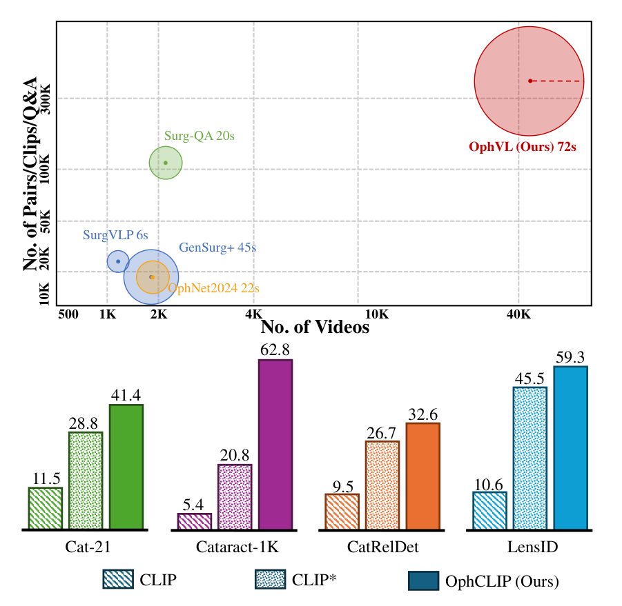
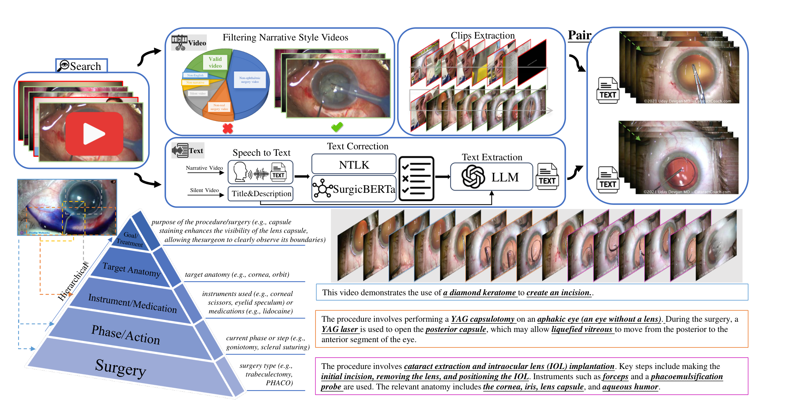
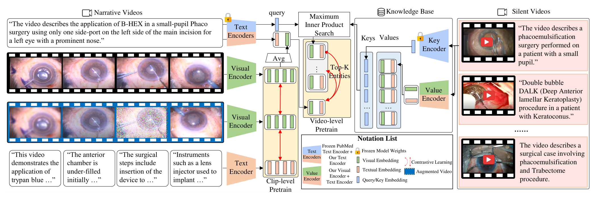
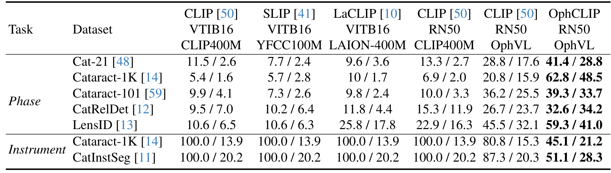
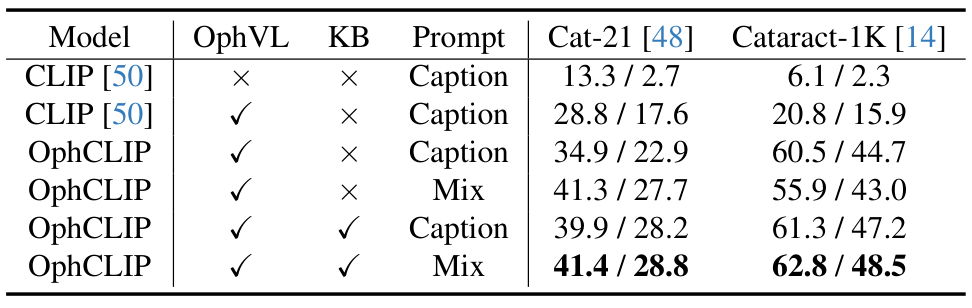
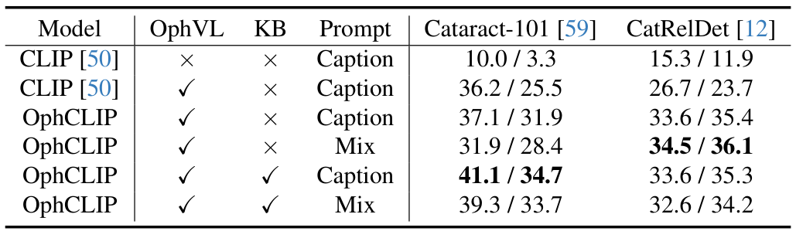

## 1. 背景与动机

**眼科手术视频很多，但能教模型看懂手术的配对数据很少。**
单模态任务如阶段识别、器械分割已有进展，多模态表示学习仍少有人做。
作者指出障碍有专业术语、数据有限、需要专家标注，以及手术视频常长达数小时。

表 1 里眼科显微镜一栏只有本文的 OphVL 和人工标注的 OphNet2024。
网上还有大量没有解说的沉默视频，以往的数据集多半只用有解说的视频。

*论文原图编号：Fig. 1。上半部分比较 OphVL 与已有手术数据集的规模，下半部分是四个阶段识别数据集上的准确率。*

:::highlights
- 先有数据，才谈得上手术领域的视觉-语言预训练。
- 沉默视频是被忽略的资源。
:::

:::data
- OphVL：375,198 个片段-文本对
- 视频：13,654 个叙述视频，30,636 个沉默视频
:::

## 2. 核心观点速览

**答案分三步：造数据，做两层对比学习，用标题检索沉默视频。**
片段与解说对齐学细节，整段视频与标题对齐学流程，检索到的沉默视频嵌入作额外正样本。

**头条结果是零样本阶段识别：Cat-21 达到 41.4%，Cataract-1K 达到 62.8%。**
原版 CLIP 在两者上只有 11.5% 和 5.4%。

边界同样要记住：OphNet 的操作识别只有 7.1%，CaDIS 上器械误报率没有降低，知识库收益因数据集而异。

:::highlights
- 提升主要来自领域数据，这是我的判断。
- 方法部分的增量并不稳定。
:::

:::data
- Cat-21：41.4 / 28.8
- Cataract-1K：62.8 / 48.5
- OphNet-O：7.1 / 2.3
:::

## 3. 数据：OphVL 怎么造出来

**要点是用专家词表找频道，再用音频和画面把视频筛成有解说的真实手术。**
作者与三位执业眼科医生整理出超过 3K 个术语，按频道搜索 YouTube，过滤后剩下约 100K 个视频。

画面过滤用 ResNet50 判断关键帧是否为眼科显微镜画面，超过 80% 即为有效视频。
音频过滤看人声占比，阈值 0.2，低于阈值的视频成为沉默视频，只保留标题和元数据。

文本用 Whisper Large-V3 转写，再经 Rake、SurgicBERTa 和大语言模型去噪，最后摘要成手术类型、阶段、器械、药物、解剖和目的。

*论文原图编号：Fig. 2。OphVL 构建流程：检索、过滤叙述风格、语音转文字、文本纠正与结构化提取，再与片段配对。*

:::highlights
- 文本被改写成围绕手术概念的结构化描述。
- 沉默视频只用标题，不用解说。
:::

:::data
- 术语：超过 3K 个
- 平均片段 72 秒
- 总时长 9363 小时
:::

数据有了，下一节看模型怎样使用它。

## 4. 方法：两层对比加沉默视频检索

**核心设计是一套编码器、两层对比学习、一个检索知识库。**
片段级用 InfoNCE 对齐片段与解说，并加一项自监督。
视频级把片段特征平均池化后与标题对齐。

检索用 PubMedBERT 编码标题，在记忆库的标题键上做最大内积搜索，训练时只取 1 个沉默视频。
取回的视觉和文本嵌入作为额外正样本，加入视频级损失。

*论文原图编号：Fig. 3。OphCLIP 的预训练框架：左侧叙述视频的片段级与视频级预训练，右侧沉默视频知识库。*

:::highlights
- 训练时交替优化片段级与视频级损失。
- 在文本模态内检索，避开 CLIP 对眼科视频的误检。
:::

:::data
- 批大小：120 和 140
- 嵌入维度：768
- 8 张 RTX-4090，训练 2 天
:::

## 5. 评测协议

**所有评测都是帧级分类，不含时序建模。**
零样本时冻结编码器，把类别名写成句子提示，用相似度分类。
阶段识别报 Accuracy 和 F1，器械识别报假阳性率 FPR（越低越好）和 mAP。

阶段识别提示有三种：关键词式、描述式（Caption）和两者合并的 Mix。
线性探测则冻结视觉编码器，训练线性 SVM，使用 10% 和 100% 的训练数据。

:::highlights
- 阶段识别共五个数据集，另有 OphNet 的操作与阶段。
- 器械识别用 Cataract-1K、CatInstSeg 和 CaDIS。
:::

:::data
- Cat-21：11 类
- Cataract-1K：12 类阶段，9 类器械
- OphNet：96 个阶段，232 个操作
:::

## 6. 结果说了什么

**第一，领域数据本身就带来大幅提升。**
Cataract-1K 上，原版 CLIP（RN50）为 6.9 / 2.0，在 OphVL 上预训练的 CLIP* 为 20.8 / 15.9。

**第二，OphCLIP 在 CLIP* 之上继续提升，但幅度因数据集而异。**
Cataract-1K 从 20.8 到 62.8，Cataract-101 只从 36.2 到 39.3。

*论文原图编号：Table 2。零样本阶段识别与器械识别的主结果对比。*

**第三，器械识别里基线 FPR 全是 100.0%，OphCLIP 降到 45.1% 和 51.1%。**
补充表 8 显示基线各类召回率均为 100.0，即全部判为阳性。

线性探测中，Cat-21 上 OphCLIP 为 72.1 / 57.9，CLIP* 为 59.4 / 40.5。
Cataract-1K 的器械 F1 在 100% 数据下只有 11.6。

:::highlights
- 通用预训练数据换成别的并无稳定帮助。
- 基线几乎没有区分器械的能力。
:::

:::data
- Cataract-1K 器械 FPR：45.1
- CatInstSeg 器械 FPR：51.1
- Cat-21 线性探测：72.1 / 57.9
:::

## 7. 为什么有效

**我的判断：主要原因是领域匹配加文本分布对齐。**
CLIP 到 CLIP* 的跳升最大，Cat-21 从 13.3 / 2.7 到 28.8 / 17.6。
论文自己也说要用描述式提示减小预训练与下游语料的文本差距。

层级训练在此基础上继续加分：不带知识库的 OphCLIP 在 Cataract-1K 上已到 60.5 / 44.7。
知识库再把 Caption 提示下的 F1 从 44.7 提到 47.2，Mix 提示下从 43.0 提到 48.5。

*论文原图编号：Table 5。OphCLIP 各组件的消融。*

:::highlights
- 层级训练的作用最稳。
- Mix 提示只在部分数据集上优于 Caption。
:::

:::data
- Cataract-1K 无知识库：60.5 / 44.7
- Cataract-1K 完整模型：62.8 / 48.5
:::

## 8. 结果没说明什么

**第一，表 3 与正文自相矛盾。**
正文把 OphNet-O 与 P 的数字对调。
CaDIS 上 OphCLIP 的 FPR 为 14.7 和 28.7，高于 CLIP 的 13.0 和 28.1，正文却说假阳性更低。

**第二，知识库收益不稳定。**
CatRelDet 上 Mix 提示加知识库为 32.6 / 34.2，低于不加的 34.5 / 36.1。

**第三，没有证据表明模型理解了手术流程，**因为评测只用帧级分类。
也没有多次种子的方差和显著性检验，小差异不应当作结论。

*论文原图编号：Table 9。Cataract-101 与 CatRelDet 上的补充消融。*

:::highlights
- OphNet 绝对水平很低。
- 论文自述验证以白内障手术为主。
:::

:::data
- OphNet-O：7.1 / 2.3
- OphNet-P：18.2 / 4.8
:::

## 9. 怎么确认不是巧合

对三个核心论断，各问一次怀疑者会怎么说。

**层级与检索是否超出数据集本身？**部分成立。论文缺少同预算下只去掉层级或检索的对照。

**沉默视频内容是否真的有用？**未能区分。多出的正样本可能只是正则，论文没有随机替换检索结果的对照。

**降低器械假阳性是否可靠？**部分成立。Cataract-1K 与 CatInstSeg 上成立，CaDIS 上没有降低。

:::highlights
- 最缺的是沉默视频内容的对照实验。
:::

:::data
- 检索数量 K：1
:::

## 10. 复现要注意什么

**先核对式 7：印出的分母只含取回的 K 个样本，K 又是 1。**
若字面成立，这一项恒为常数，实际是否含批内负样本论文未说明。

训练设置：ResNet-50 和 BioClinicalBert，学习率 8e-5，温度 0.1，两项权重都是 0.5。
表 6 总 epoch 为 60，正文是 40 个 epoch 加交替训练，两者如何对应论文未说明。

数据的公开方式论文未说明，只给出项目主页。
规模口径也要核对：引言写 7.5K 小时，3.4 节写 9363 小时。

:::highlights
- 记忆库的更新时机与频率论文未说明。
- 文本的人工质检比例论文未说明。
:::

:::data
- 学习率：8e-5
- 温度：0.1
- 嵌入维度：768
:::

## @takeaways
- 领域数据是最大的增益来源，先做数据再谈方法。
- 用标题做检索键，把沉默视频当作额外正样本，是低成本利用无解说视频的思路。
- 零样本提示要与预训练文本分布对齐。

## @strengths
- 构建了规模较大的眼科手术视频-文本数据集，并给出详细的构建流程。
- 同时报告了零样本、线性探测和两组消融，数字完整。

## @weaknesses
- 表 3 与正文矛盾，CaDIS 上的结论不成立。
- 知识库收益不稳定，缺少关键对照。
- 评测只做帧级，没有方差与显著性检验。

## @questions
- 检索数量 K 增大后收益何时饱和？
- 去掉自监督项会怎样？
- 沉默视频的标题质量如何影响检索？
