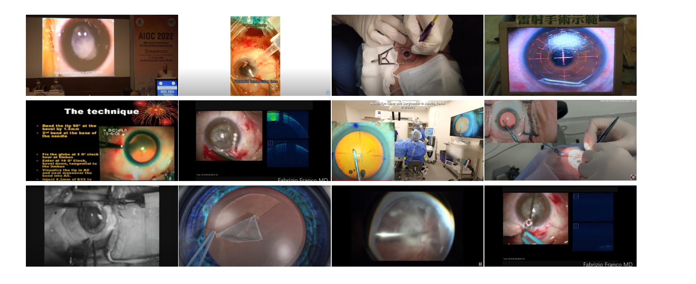
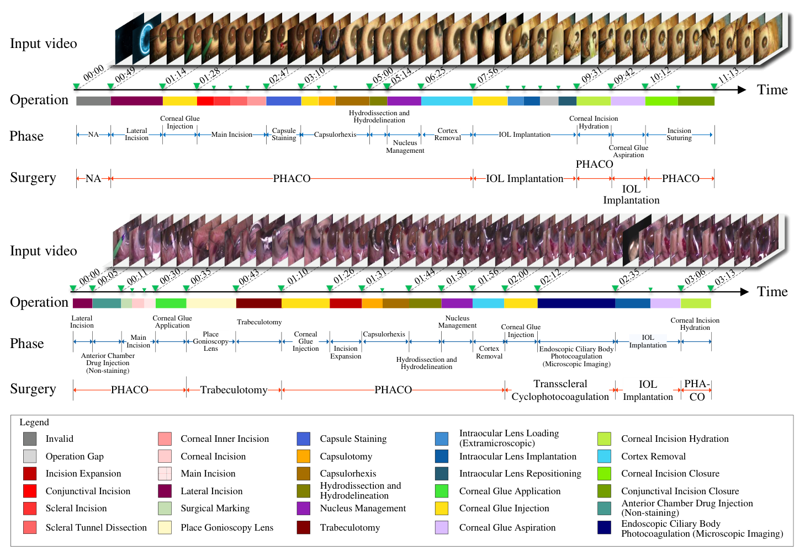
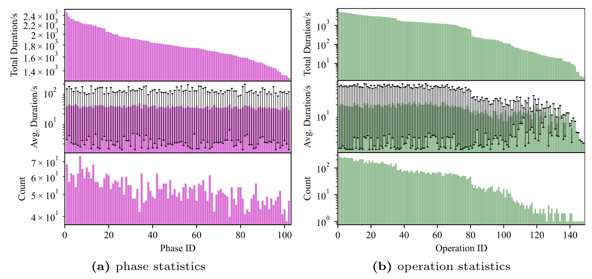
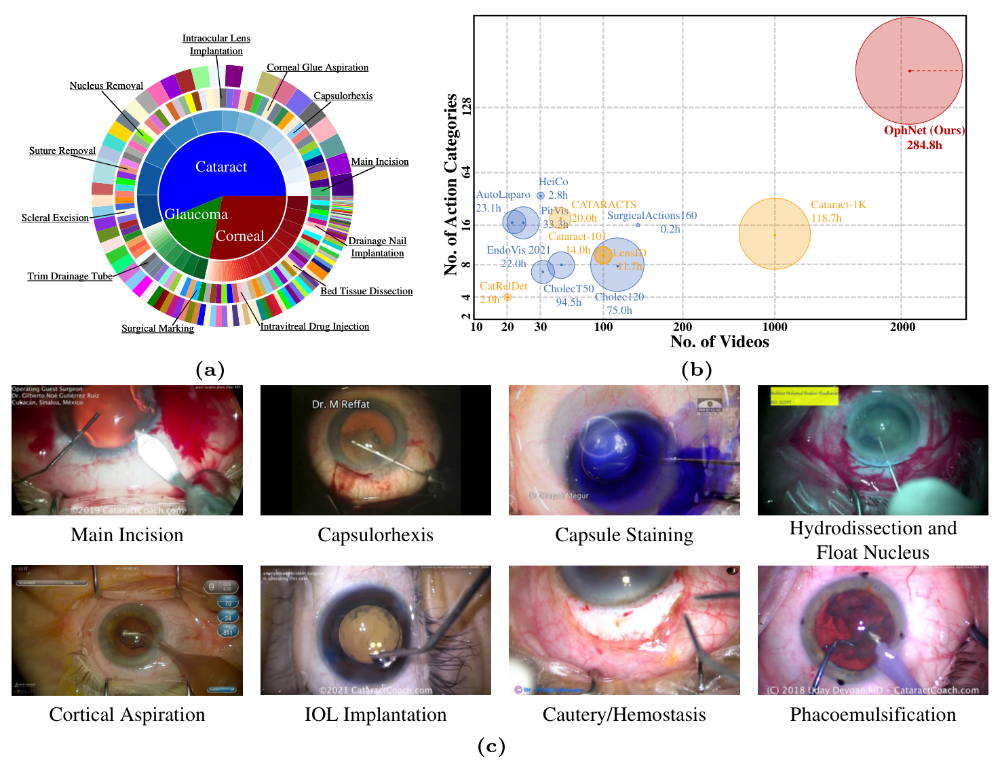
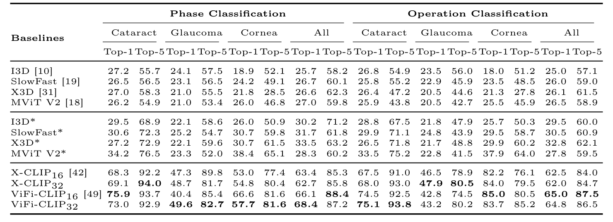
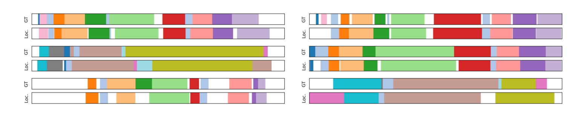
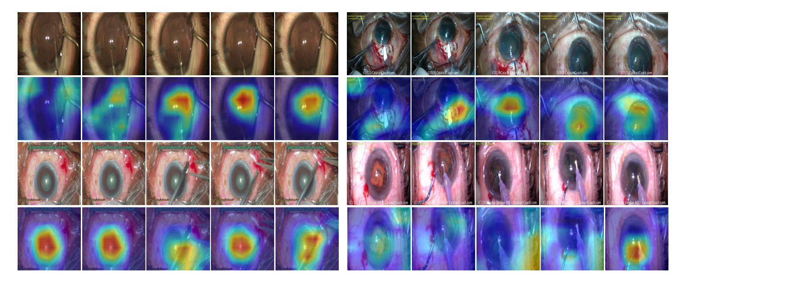

## 1. 背景与动机：瓶颈在数据

让系统看懂手术视频，要回答两个问题：手术进行到哪个阶段，正在做什么操作。这是手术记录、教学和机器人自动化的基础。

**问题是现有的眼科视频数据太小太单一。** 论文列出五个短板：规模小、类别少、动作定义粗、只标指定阶段、画质统一。例子很具体：`CATARACTS` 只有 50 个视频，`CatRelDet` 只有 21 个视频和 4 种阶段标签。

模型想学得好，需要足够多的视频。论文引用的研究显示，`I3D` 用 100 个视频训练时准确率已超过 80%，样本超过 700 后仍在提升。数据不够，后面的一切都无从谈起，所以论文先去造数据。下一节先把它的答案摆出来。

:::highlights
- 现有眼科视频数据集的短板是规模、类别、标注粒度和来源单一
- 论文没有提出新模型，价值取决于数据质量和基线是否可信
:::

:::data
- CATARACTS 的 50 个视频
- CatRelDet 的 21 个视频、4 种阶段标签
:::

## 2. 核心观点速览

**答案。** OphNet 收集 2,278 个 YouTube 眼科手术视频，共 284.8 小时，分成白内障、青光眼、角膜三大类 66 种手术，其中 523 个视频带有手术、阶段、操作三级时间边界。

**头条结果。** 手术存在识别全部 Top-1（预测第一名恰为正确类别的比例）最高为 58.9%，阶段分类最高为 68.4%，操作分类最高为 65.0%，都来自语言图像模型。阶段定位最好的平均精度均值为 50.4%，阶段预测最好为 48.2%。

**边界。** 20 倍的比较口径、手术存在识别划分少了 200 个视频、划分是否按来源隔离、平均精度均值的算法，论文都未说明。所有基线只有单次结果。

:::highlights
- 做法四步：YouTube 检索与筛选、主手术与次要手术分类、三级时间标注、四项任务基线
- 语言图像模型远高于视频模型，但原因没有被拆开
:::

:::data
- 2,278 个视频，284.8 小时，66 种手术
- 102 个阶段，150 个操作，523 个视频有定位标注
:::

## 3. 数据从哪里来，怎样筛

医疗视频涉及隐私，不好批量拿到。论文选了 YouTube，理由是能绕开隐私和伦理顾虑，也能快速得到大量待筛视频。检索靠手术名称的标题搜索，并加入同义词和缩写。

筛选分两层：正文去掉低分辨率、黑白、动画和非人眼视频；附录再去掉没有显微视角、字幕或水印占大块画面、含断层扫描窗口的视频。初筛 5 人，复核 6 名主治医师。

*论文原图编号：Fig. 6。被过滤掉的视频示例，包括会议幻灯片、含 OCT 窗口的画面、灰度画面等。*

**筛掉了多少、最初检索到多少，论文未说明**，所以没法评估筛选带来的偏差有多大。视频筛好之后，下一步是标注。

:::highlights
- 来源是 YouTube，理由是隐私与速度
- 保留少量文字和水印；双目视频只留左眼
:::

:::data
- 初筛 5 人，复核 6 名主治医师
- 超过 77% 的视频不低于 1280×720
:::

## 4. 三级标注怎么做

一台手术常同时处理几种疾病，单标签不够用。论文因此分两步标。第一步，8 名眼科医师给每个视频标一个主手术和若干次要手术。第二步，15 名眼科医师在手术、阶段、操作三个粒度上标出起止时间。

多名标注者的边界不会完全一致，论文用完全连接聚类合并：把距离合起来看最远成员，只保留获得多方认同的边界。

*论文原图编号：Fig. 1。两个合并手术视频的三级标注示例：手术、阶段、操作三层色带对齐在同一条时间轴上。*

**质量如何，论文没有给数。** 标注者间一致性和抽检错误率论文未说明；带定位标注的 523 个视频怎么选出的，只写“精心选取”。标注做完，接着看最终规模。

:::highlights
- 分类标注区分主手术与次要手术，表达多种疾病同台手术
- 边界用完全连接聚类合并
:::

:::data
- 分类标注 8 名医师，定位标注 15 名医师
:::

## 5. 最终有多大

标注完成后的规模决定数据集能支撑多少训练和评测。

**有定位标注的只是一部分。** 2,278 个视频里，523 个有阶段和操作边界，裁剪后得到 7,320 个阶段实例和 9,795 个操作实例，共 51.2 小时。操作的样本数分布明显长尾。

*论文原图编号：Fig. 3。裁剪后视频在阶段和操作两个层级上的数量、平均时长和总时长统计，操作一侧样本数的下降最明显。*

表 1 把 OphNet 与 12 个现有数据集比较：眼科里最大的 `Cataract-1K` 有 1,000 个视频、118.7 小时，OphNet 的视频数约为其 2.3 倍，时长约为 2.4 倍。

*论文原图编号：Fig. 2。构成环形图、与其他数据集在视频数和动作类别数上的气泡对比，以及八个阶段示例。*

**这支持“最大”，却支持不了摘要里的 20 倍。** 20 倍的比较对象论文未说明。有了数据，就要用任务来检验它。

:::highlights
- 规模优势成立，但倍数约为 2 倍多，不是 20 倍
- 只有 523 个视频带阶段与操作边界
:::

:::data
- 7,320 个阶段实例，9,795 个操作实例，共 51.2 小时
- 裁剪后平均 32 秒，未裁剪平均 337 秒
:::

## 6. 四项任务与基线怎么设

数据集要证明自己有用，就得跑任务。论文设了四项。

- 手术存在识别：整段视频只用视频级标签，判断主手术，属于弱监督。
- 阶段与操作识别：对裁剪片段分类。
- 阶段定位：在整段视频里找每个阶段的起止。
- 阶段预测：只看前一部分，预测后续阶段。输出形式论文未说明。

基线分三类：从头训练的视频模型，`Kinetics-400` 预训练的视频模型，以及语言图像模型 `X-CLIP` 与 `ViFi-CLIP`。视频模型训练 150 或 200 轮，定位模型训练 30 或 20 轮，全部实验用 4 张显卡。**两个语言图像模型的训练配置论文未说明。**

手术存在识别的划分是 70%、10%、20%，对应 1,449、205、424 个视频。基线跑完，接下来看结果。

:::highlights
- 三类基线可以看出预训练的作用，但没有拆开架构与数据
- 阶段预测的输入输出细节论文未说明
:::

:::data
- 划分：1,449 训练、205 验证、424 测试
- 定位特征 2048 维，100 个定长特征
:::

## 7. 结果说了什么

先看四项任务各自最好的数字（全部手术列）。其中 Top-1 是预测第一名恰为正确类别的比例，mAP 是平均精度均值。

| 任务 | 最好结果 | 来自 |
|---|---|---|
| 手术存在识别，Top-1 | 58.9% | X-CLIP32 与 ViFi-CLIP16 并列 |
| 阶段分类，Top-1 | 68.4% | ViFi-CLIP32 |
| 操作分类，Top-1 | 65.0% | ViFi-CLIP16 |
| 阶段定位，平均 mAP | 50.4% | TriDet 加 SwinViviT |
| 阶段预测，平均 Top-1 | 48.2% | MViT V2* |

**识别任务上差距最大。** 四个视频模型的阶段分类全部 Top-1 只有 25.7% 到 27.0%，预训练后为 28.3% 到 33.5%，语言图像模型则达到 62.7% 到 68.4%。所以这个基准能把两类模型拉开，但拉开的原因是预训练还是架构，要靠对照实验回答，论文没有做。

*论文原图编号：Table 3。阶段分类与操作分类的 Top-1 和 Top-5 准确率，带星号的是 Kinetics-400 预训练，加粗为每列最优。*

定位任务上，重叠门槛越严精度越低：最好组合从阈值 0.1 的 61.0% 降到阈值 0.7 的 33.1%。这说明模型能大致找到阶段，边界还不够准。

*论文原图编号：Fig. 5。TriDet 阶段定位可视化，GT 为真值，Loc. 为模型预测，大块区域基本对应，边界处有偏移。*

预测任务上，六个模型的平均 Top-1 都在 47.2% 到 48.2% 之间，差距太小，不足以说明预训练有效。数字好看不等于结论成立，下一节看结果没有证明什么。

:::highlights
- 语言图像模型在识别上远高于视频模型
- 定位在严格重叠门槛下明显下降
- 预测任务各模型差距很小
:::

:::data
- 阶段分类：视频模型 25.7% 到 27.0%，语言图像模型 62.7% 到 68.4%
- 定位：阈值 0.1 为 61.0%，阈值 0.7 为 33.1%
:::

## 8. 结果没说什么

**热图只能算示意。** 论文用 `ViFi-CLIP` 的注意力热图说明模型关注器械和手术眼区。四个样例里，多数落在瞳孔和器械附近，右下一例较分散。热图怎么生成论文未说明，也没有量化评估。

*论文原图编号：Fig. 4。ViFi-CLIP 在测试集四个样例上的注意力热图，上行为原图，下行为热图。*

下面三件事，结果都没有证明：

- 语言图像模型领先是因为预训练还是架构：没有对照。
- 优势能否推广到新来源的视频：划分是否按来源隔离论文未说明。
- 模型差异是否真实：没有方差，也没有多次运行。

除了这些缺口，论文自己的数字也有出入，下一节逐条列出。

:::highlights
- 热图只有四个样例，没有量化
- 领先原因、泛化、显著性三点都没有证据
:::

## 9. 论文自己对不上的数字

阅读时发现下列出入，论文都没有解释。

1. 手术存在识别的划分 1,449、205、424 相加为 2,078，比总数 2,278 少 200 个。
2. 表 4 的平均值高于四个阈值列的简单平均：最好组合四列平均约 49.6，表中为 50.4。
3. 论文说 `ViFi-CLIP` 在所有操作类别上最优，表 3 里青光眼的两项最优值属于 `X-CLIP32`。
4. 图 2 标 `CholecT50` 为 94.5 小时，表 1 为 44.7 小时。
5. 284.8 小时除以 2,278 个视频约 450 秒，文中未裁剪视频平均 337 秒。
6. 特征提取所用 `I3D` 的预训练来源，正文写 `ImageNet`，附录写 `Kinetics-400`。

**我的判断：** 这些更像整理疏漏，未必改变结论方向，但在复核前不应引用 20 倍和平均 mAP。数字有出入，所以要逐个检验核心说法。

:::highlights
- 划分之和、平均值、文字与表格、图与表之间都有出入
:::

:::data
- 划分之和 2,078，比总数少 200
- 四列平均约 49.6，表中为 50.4
:::

## 10. 核心说法站得住吗

对每个核心说法找最强的另一种解释，看论文有没有证据把两者分开。

| 说法 | 另一种解释 | 论文有证据吗 | 判断 |
|---|---|---|---|
| 最大、最丰富 | 总数被没有时间标注的视频撑大 | 表 1 支持规模，倍数不是 20 倍 | 部分成立 |
| 专家标注保证质量 | 合并掩盖了分歧 | 没有一致性数字 | 未被区分 |
| 语言图像模型最强 | 预训练规模或频道风格泄漏 | 没有对照和按来源划分 | 未被区分 |
| 模型关注器械与眼区 | 热图集中在画面中心 | 没有量化 | 未被区分 |
| TriDet 加 SwinViviT 最好 | 单次运行的波动 | 没有方差 | 部分成立 |

**读法：** 数据集的存在和规模是确定的，对质量与基线含义的结论都要打折。最后看复现和使用时怎么用。

## 11. 复现与使用要注意什么

**可以直接复用：** 视频模型和两个定位模型的轮数、批大小、学习率论文都给了；三级层级加多手术共存的标注设计值得借鉴。

**使用前要检查：**

- 划分是否让同一视频或同一频道同时出现在训练和测试中。
- 平均 mAP 能否按各阈值复算。
- 表 1 的规模对比是否换成自己的口径。

**需要补齐，论文未说明：** 两个语言图像模型的训练配置、划分文件、各列的类别数、标注者间一致性、523 个视频的选取标准、数据许可。

**要避免：** 直接引用 20 倍和 50.4% 而不复核。

## @takeaways
- OphNet 的确是眼科里规模最大的三级标注视频基准，但倍数约为 2 倍多，不是 20 倍。
- 只有 523 个视频带阶段和操作边界，使用时要区分总数和可用标注数。
- 语言图像模型领先很多，原因没有被拆开。
- 划分之和、平均 mAP、文字与表格之间有出入，引用前要复核。

## @strengths
- 三级层级标注和主手术、次要手术的设计贴近真实手术。
- 来源多样，附录交代了筛选标准和保留边界。
- 四项任务各有基线，训练超参数大多给出。

## @weaknesses
- 没有标注者间一致性或质量数字。
- 划分是否按来源隔离论文未说明，存在捷径风险。
- 所有基线只有单次结果，多处数字对不上。

## @questions
- 按频道划分后，语言图像模型的优势还在吗？
- 表 4 的平均 mAP 到底怎么算？
- 少掉的 200 个视频去了哪里？

