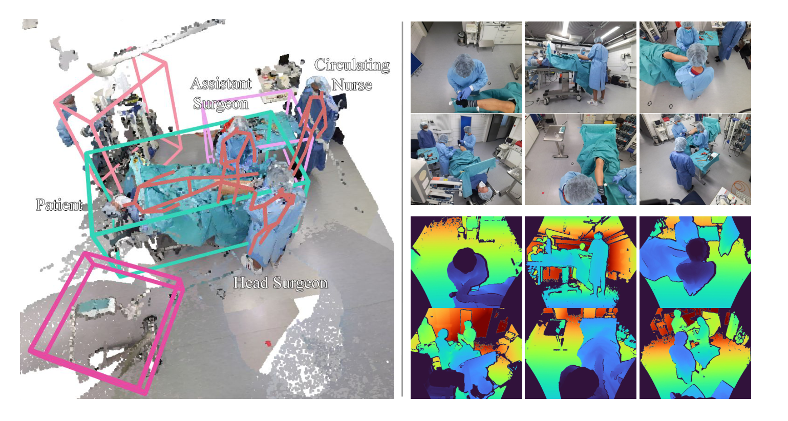
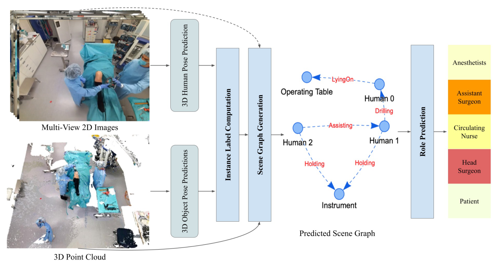
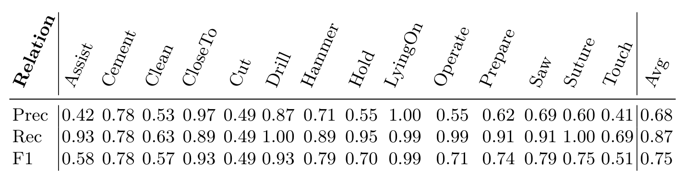
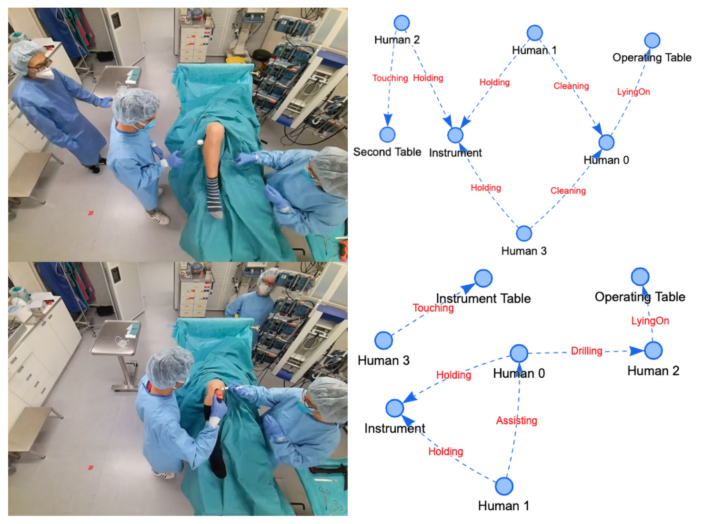
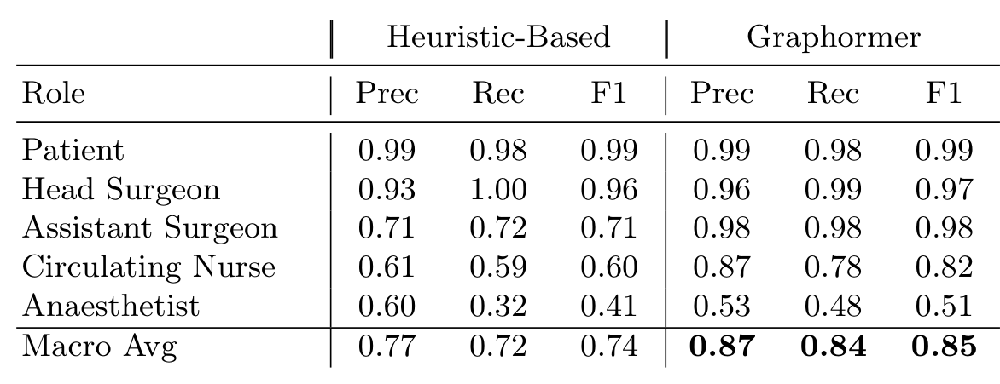

---
tags:
  - papers/手术数据集
aliases:
  - "4D-OR"
  - "4D-OR 手术室语义场景图"
date: 2022-03-22
arxiv_id: 2203.11937
---

# 4D-OR: Semantic Scene Graphs for OR Domain Modeling

## 核心信息

- 标题: 4D-OR: Semantic Scene Graphs for OR Domain Modeling
- 标题翻译: 4D-OR：用于手术室领域建模的语义场景图
- 作者: Ege Özsoy, Evin Pınar Örnek, Ulrich Eck, Tobias Czempiel, Federico Tombari, Nassir Navab
- 机构: 慕尼黑工业大学计算机辅助医疗程序组; Google; 约翰斯·霍普金斯大学计算机辅助医疗程序组
- 发表时间: 2022-03-22（arXiv v1）
- 发表渠道: arXiv 预印本（cs.CV），正式版收录于 MICCAI 2022
- arXiv: 2203.11937
- 论文链接: https://arxiv.org/abs/2203.11937
- 代码 / 项目: https://github.com/egeozsoy/4D-OR
- 数据 / 资源: 同上 GitHub 仓库；arXiv v1 原文写的是录用后公开代码与数据
- 论文类型: 数据集论文（benchmark_or_dataset），附场景图生成基线

## 原文摘要翻译

外科手术在高度复杂的手术室中进行，室内有不同的人员、设备和交互。到目前为止，只有受过医学训练的专家才能理解这种环境中的全部联系与交互。本文希望让社区向自动、整体、语义化地理解和建模手术室领域更进一步。

为此，我们首次提出用语义场景图来描述和概括手术场景。场景图的节点表示室内不同的人员和物体，如医护人员、患者和医疗设备，边表示它们之间的关系。为了验证这种表示的可能性，我们构建了第一个公开的 4D 手术语义场景图数据集 4D-OR：它包含在逼真的手术室模拟中心用六个 RGB-D 传感器录制的十台模拟全膝关节置换手术，共 6734 帧，并带有丰富的场景图、人体与物体位姿以及临床角色标注。

我们提出一个端到端的、基于神经网络的场景图生成管线，宏平均 F1 达到 0.75，确实能够在手术室中进行语义推理。我们还把场景图用于临床角色预测，以展示其表示能力，在该任务上达到 0.85 的宏平均 F1。代码和数据集将在录用后公开。

## 创新点

1. 把语义场景图引入手术室建模。此前手术数据科学大多做阶段识别、器械识别或人体位姿这类单一感知任务，场景图把人、设备和它们之间的交互放进同一个结构，作者称这是首次。
2. 发布第一个公开的 4D 手术室场景图数据集。10 台模拟全膝关节置换、6 路天花板 RGB-D、1 帧每秒、6734 帧，带关系、人体位姿、物体 3D 框和临床角色四类标注。此前公开的 MVOR 只有人体位姿，没有语义关系。
3. 针对手术室改造 3DSSG。点云拍不清小器械和反光物体，作者拼接 EfficientNet-B5 图像特征；为模拟衣着、光照和体型差异加入点云增强和 crop-to-hand 增强；再引入虚拟节点 instrument 表示看不见的小器械。
4. 用下游任务检验场景图的信息量。把生成的场景图送入 Graphormer 预测每个人的临床角色，宏平均 F1 0.85，高于只数关系频次的启发式方法 0.74。

## 一句话总结

这个数据集用 6 路天花板 RGB-D 相机录了 10 台模拟膝关节置换（6734 帧），逐帧标注人与设备之间的 14 类关系、位姿和临床角色；在其上改造的 3DSSG 基线达到 0.75 宏平均 F1，但切割、触碰这两类关系只有 0.49 和 0.51。

## 研究问题

手术室里同时有主刀、助手、巡回护士、麻醉师和患者，还有手术台、器械台、麻醉机等设备，多条动作线并行发生。要让医疗机器人、影像设备或用户界面根据现场自动调整，系统需要知道谁在对谁做什么。

现有手术数据科学的研究大多停留在单一感知任务：阶段识别、器械识别、人体位姿估计。即使把阶段和器械联合起来，也没有把整个手术室当作一个相互交织的系统来建模。

场景图正好是这种表示：节点是人和物，边是关系，例如"人在切割患者"。但已有的场景图数据集来自日常场景，交互比手术室简单得多。手术室方面，Sharghi 等人用两路 ToF 相机录了机器人手术，只做阶段识别且数据不公开；MVOR 有真实手术的多视角帧，但只标了人体位姿。

论文要回答的问题是：能否构建一个可以监督手术室场景图生成的公开数据集，并证明在其上训练的模型能生成可用的场景图，且这些场景图对下游任务有用。

### 核心观点速览

- **想法：把手术室当成一张图来描述。** 人和设备是节点，"主刀钻孔患者""患者躺在手术台上"这类交互是边，阶段、器械、位姿都可以从这张图里读出来。
- **数据：4D-OR。** 10 台模拟全膝关节置换，6 路天花板 RGB-D，1 帧每秒，6734 帧；每帧标注 14 类关系，另有人体位姿、物体 3D 框和临床角色。
- **基线：改造 3DSSG。** 先检测人和物，再把点云按实例切开，用点云加图像特征预测每对节点的关系；关键改造是图像分支、点云增强和一个代表小器械的虚拟节点。
- **结果：宏平均 F1 0.75，角色预测 0.85。** 静态关系如躺在手术台上接近满分，切割、触碰只有 0.49 和 0.51；**这些数字来自模拟环境、一种术式、只有 2 台手术的测试集，论文未说明方差**，不能当作真实手术室的表现。

下面先看数据本身由什么构成，再看基线怎样从数据生成场景图。

## 数据与任务定义

这一节回答：数据从哪里来、标了什么、怎样划分。规模和标注决定了后面所有数字能说明多少。

### 数据来源

- 10 台模拟全膝关节置换手术，在医学模拟中心录制，按典型手术流程进行并由医学专家指导。作者选这一术式是因为它是有代表性的骨科手术，步骤和交互多样。
- 6 台标定好的 Azure Kinect RGB-D 相机装在天花板，1 帧每秒，同步输出 RGB 和深度。
- 总计 6734 个场景（帧），并提供整场的融合点云序列。

*论文原图编号：Fig 2。一个 4D-OR 场景：左为融合点云与检测到的物体 3D 框、人体骨架和临床角色，右为 6 路 RGB 与深度。放在这里是因为它展示了每帧数据的全部组成。*

### 标注内容

- 场景图：每个手术步骤的关系三元组。表 1 列出 14 类关系：协助、打骨水泥、清洁、靠近、切割、钻孔、锤击、握持、躺在上面、操作、准备、锯、缝合、触碰（英文类名见下文表 1 的重排表）。
- 人体 6D 位姿：自动标注。
- 物体 3D 框：手术室设备，如手术台、器械台、麻醉机。
- 临床角色：患者、主刀、助手、巡回护士、麻醉师。

物体类别数和每帧三元组数，正文只说详见补充材料，论文未说明；场景图标注是人工还是自动、一致性如何，论文也未说明。**这意味着读者无法从正文判断标签噪声，也无法估计长尾关系的样本量。**

### 任务拆分

- 划分为 6 个训练 take、2 个验证 take、2 个测试 take，每个 take 是一台手术。
- 任务一：从无标签点云和图像生成场景图，评测关系预测。
- 任务二：人体位姿与物体检测，作为场景图管线的前置。
- 任务三：临床角色预测，作为场景图的下游应用。

**测试集只有 2 台手术**，后文所有 0.01 到 0.02 量级的差异都要放在这个背景下看。参演人数和单台时长论文未说明，所以也无法换算成每台手术多少分钟。数据讲清之后，下一节看基线怎样把这些数据变成场景图。

## 方法主线

这一节回答：从原始的图像和点云，到一张场景图，再到每个人的角色，中间经过哪几步。论文的基线不是本目录的重点，但它定义了这个数据集的评测协议。

### 机制流程

*论文原图编号：Fig 1。场景图生成管线总览：从多视角图像预测 3D 人体位姿，从点云预测物体 3D 框，为每个点分配实例标签，再用融合点云、实例标签和图像预测节点之间的关系。放在这里是因为它就是下面四步的整体图。*

1. 位姿与检测。输入是 6 路图像和融合点云。VoxelPose 从多视角图像估计 3D 人体位姿，Group-Free 从点云检测物体 3D 框。输出是每个人和每个设备的几何位置。
2. 实例标签计算。输入是点云和上一步的位姿与框。作者的算法给点云中每个点分配一个实例标签，并额外加入虚拟节点 instrument，代表点云里看不清的小器械。输出是带实例标签的点云和节点集合。
3. 关系预测。输入是带标签的点云和图像。改造后的 3DSSG 用 ObjPointNet 编码单个物体的点云，用 RelPointNet 编码物体对点云的并集，再拼接 EfficientNet-B5 的图像全局特征；图卷积网络在节点和边之间传播信息，最后由多层感知机预测物体和关系类别，用交叉熵训练。输出是整帧的场景图。
4. 角色预测。输入是逐帧场景图。先用匈牙利匹配把各帧的人连成轨迹，再对每条轨迹预测角色概率，最后做唯一角色分配。输出是每个人的临床角色。

场景图的形式定义如下，节点集合 $N$ 是人和设备，边集合 $E$ 中每条边带一个关系类型：

$$G=(N,E),\quad E \subseteq N \times R \times N$$

### 3DSSG 的手术室改造

- 使用图像：手术室物体大小悬殊，剪刀、柳叶刀等小物体在点云里很难表示，反光或透明物体又常因深度传感器硬件限制而缺失。作者提取 EfficientNet-B5 的全局图像特征，与 PointNet 特征拼接。
- 增强：训练时对点云做随机尺度、位置、朝向、亮度和色调变化；关系点云中的两个物体分别增强，以模拟物体之间不同的大小和相对位置。
- crop-to-hand：对涉及手的关系，随机把点云裁到手附近，让网络关注器械，用来区分切割、钻孔和锯这类动作。

### 角色预测协议

- 轨迹打分：对每条轨迹，把该人在各帧场景图中的节点改名为 TARGET，送入 Graphormer，对 TARGET 节点嵌入取平均后用线性层预测角色分数，交叉熵训练。
- 启发式基线：只按关系频次给角色加分，例如每出现一次 Saw 给主刀加分，每出现一次 LyingOn 给患者加分。
- 唯一分配：对每帧中的人，按轨迹角色概率做双射匹配，保证每人分到不同角色。

### 评测协议

- 人体位姿用 PCP3D，物体检测用 IoU 阈值下的 AP。
- 关系与角色用逐类精确率、召回率、F1，以及不加权的宏平均。作者强调宏平均与样本量无关，稀有关系如 Cut、Drill 与常见关系同权。
- 关系判定：只有当两个实体都在场景中且关系预测正确，才算正确。

### 关键实现细节

- VoxelPose 使用 14 个关节，训练 20 轮，对患者位姿加权损失。
- Group-Free 训练 180 轮。
- 场景图网络用 PointNet++ 提特征，用平衡损失处理稀有关系，学习率 3e-5，每个物体 4000 点，每个关系 8000 点。
- PyTorch 实现，单卡训练，推理 2.2 FPS。

数据采样是 1 帧每秒，2.2 FPS 的推理速度意味着这条管线可以跟上采样率，但离视频帧率的实时还很远。有了管线和协议，下一节看它在测试集上的表现。

## 关键结果

这一节回答：前置的位姿与检测有多准，场景图里哪些关系容易、哪些难，场景图能不能支撑角色预测，以及两项改造各贡献多少。

### 位姿与检测

- 人体位姿：测试集 PCP3D 71.23。
- 物体检测：AP 在 IoU@25 为 0.9893，在 IoU@50 为 0.9345。

物体检测接近饱和，人体位姿还有较大改进空间。**这两个数字是后面场景图的输入质量**，也是"真值位姿只带来很小提升"这一结论成立的前提。

### 场景图生成

*论文原图编号：Table 1。测试集上 14 类关系的精确率、召回率和 F1，配置为图像、增强、线性损失加权和 PointNet++。放在这里是因为它是场景图生成的主结果表。*

| 关系 | 精确率 | 召回率 | F1 |
|---|---|---|---|
| LyingOn | 1.00 | 0.99 | 0.99 |
| CloseTo | 0.97 | 0.89 | 0.93 |
| Drill | 0.87 | 1.00 | 0.93 |
| Hammer | 0.71 | 0.89 | 0.79 |
| Saw | 0.69 | 0.91 | 0.79 |
| Cement | 0.78 | 0.78 | 0.78 |
| Suture | 0.60 | 1.00 | 0.75 |
| Prepare | 0.62 | 0.91 | 0.74 |
| Operate | 0.55 | 0.99 | 0.71 |
| Hold | 0.55 | 0.95 | 0.70 |
| Assist | 0.42 | 0.93 | 0.58 |
| Clean | 0.53 | 0.63 | 0.57 |
| Touch | 0.41 | 0.69 | 0.51 |
| Cut | 0.49 | 0.49 | 0.49 |
| 宏平均 | 0.68 | 0.87 | 0.75 |

- 宏平均 F1 0.75。
- 静态或空间关系最好：LyingOn 0.99，CloseTo 0.93。
- Cut 0.49 最差，Touch 0.51、Clean 0.57、Assist 0.58 也偏低。
- 宏平均精确率 0.68 远低于召回率 0.87，召回率不低于 0.91 的 8 类关系中，有 5 类精确率不超过 0.62，模型倾向于多报关系。
- 作者在定性分析中指出，钻和锯等外观相似但器械不同的场景，在器械被遮挡时会预测错。

**宏平均 0.75 主要被动作类关系拉低。** 能从几何关系直接读出的关系（躺在上面、靠近）几乎不出错，需要识别手中器械或手部动作的关系（切割、触碰、清洁）最难。这正是图像分支和 crop-to-hand 增强想解决的问题，而它们还没解决。

*论文原图编号：Fig 3。两个样例场景的场景图生成结果，左为一个相机视角，右为从 3D 点云生成的场景图。放在这里是因为它让读者看到输出的场景图长什么样。*

### 临床角色预测

*论文原图编号：Table 2。测试集上启发式打分与 Graphormer 打分的角色预测结果。放在这里是因为它是场景图下游应用的唯一定量证据。*

| 角色 | 启发式 F1 | Graphormer 精确率 | Graphormer 召回率 | Graphormer F1 |
|---|---|---|---|---|
| 患者 | 0.99 | 0.99 | 0.98 | 0.99 |
| 主刀 | 0.96 | 0.96 | 0.99 | 0.97 |
| 助手 | 0.71 | 0.98 | 0.98 | 0.98 |
| 巡回护士 | 0.60 | 0.87 | 0.78 | 0.82 |
| 麻醉师 | 0.41 | 0.53 | 0.48 | 0.51 |
| 宏平均 | 0.74 | 0.87 | 0.84 | 0.85 |

- Graphormer 宏平均 F1 0.85，启发式 0.74。
- 差距主要来自助手（0.98 对 0.71）和巡回护士（0.82 对 0.60）。
- 麻醉师两种方法都差，Graphormer 只有 0.51，作者归因于麻醉师经常被部分遮挡。
- 作者认为启发式透明，Graphormer 更容易迁移到新角色或新术式，因为不需要手调规则。

这说明场景图序列里确实带有角色信息，但论文没有设置不用场景图、直接从位姿或图像预测角色的对照，**所以不能说明场景图这一中间表示是必要的**。

### 消融

> [!figure] Table 3 场景图生成消融
> 建议位置：关键结果
> 放置原因：它是图像和增强两项改造有效性的唯一证据，也检验了对预测位姿的依赖。
> 当前状态：保留占位；自动裁剪得到的图其实是表 2，下方 Markdown 表格按第 8 页原表完整重排了全部数值。

| 实验 | 图像 | 增强 | 真值位姿 | F1 |
|---|---|---|---|---|
| (a) | 否 | 否 | 否 | 0.65 |
| (b) | 是 | 否 | 否 | 0.66 |
| (c) | 否 | 是 | 否 | 0.70 |
| (d) | 是 | 是 | 否 | 0.76 |
| (e) | 是 | 是 | 是 | 0.78 |

- (a) 即原始 3DSSG，宏平均 F1 0.65。
- 只加增强到 0.70，只加图像到 0.66，两者都加到 0.76。
- 换成真值位姿只到 0.78，作者据此认为方法可以依赖现成的位姿预测。

**只加图像几乎没有收益（0.65 到 0.66），先加增强再加图像才明显（0.70 到 0.76）。** 论文正文把两者都描述为显著提升，这和表中只加图像的一行不一致。真值位姿的结论则依赖前面那组接近饱和的检测精度。这两点留到深度分析展开。

## 深度分析

这一节回答：这个数据集真正测的是什么能力，基线结果中哪些结论可靠、哪些还没分开其他解释。

### benchmark 真正测到了什么

4D-OR 测的是：在一个固定的模拟手术室、一种术式、1 帧每秒的采样下，模型能否从多视角 RGB-D 中识别 14 类人与人、人与物之间的关系。它不测时序推理，每帧独立预测；也不测器械本身的识别，小器械被合并成一个虚拟节点 instrument。

这意味着握持、切割、钻孔等关系的判断，靠的是手附近的局部几何和图像全局特征，而不是对具体器械的检测。切割只有 0.49，说明这种设计对外观差异小的动作区分能力有限。

### 图像收益依赖增强

论文正文说图像和增强都显著提升了结果，但表 3 里只加图像的一行几乎没有变化，先加增强、再加图像时才有明显提升。我的判断：没有增强时，模型可能已经在只有 6 个训练 take 的小数据上过拟合，图像特征没有带来新信息；增强缓解过拟合后，图像特征对小器械的补充才显现。论文没有给出验证这一解释的实验。

### 真值位姿结论的前提

真值位姿只比预测位姿高 0.02，作者据此说方法可以用现成检测器。但这里物体检测 AP@50 已有 0.9345，模拟手术室布局固定、光照稳定。**在检测更差的真实手术室里，实例标签的错误会直接传到关系预测**，这一结论是否还成立，论文没有实验能回答。

### 角色预测是否需要场景图

角色预测 0.85 说明场景图序列里带有角色信息，但患者和主刀即使只看站位和姿态也很好区分。论文没有直接从位姿轨迹预测角色的对照，因此无法区分"场景图提供了关键信息"与"位姿已经足够"两种解释。

### 精确率低于召回率

几乎所有动作类关系都是召回率高、精确率低，例如 Assist 召回率 0.93、精确率 0.42。这符合平衡损失的预期：给稀有关系加权会让模型更倾向于预测它们。对下游应用而言，过报意味着系统会把旁边站着的人误判为在协助。

### 相对已有数据集新在哪里

| 对象 | 它有什么 | 4D-OR 新增 | 4D-OR 没有超过的地方 |
|---|---|---|---|
| MVOR | 真实手术多视角 RGB-D、人体位姿 | 语义关系、物体 3D 框、临床角色、时间序列 | MVOR 来自真实手术，本数据集是模拟 |
| Sharghi 等人 | 机器人手术、两路 ToF、阶段识别 | 公开、6 路、关系级标注 | 论文未比较规模 |
| 通用场景图数据集 | 大规模日常场景关系 | 手术室领域、多人复杂交互 | 规模远小，只有 10 台手术 |
| 3DSSG | 室内 3D 场景图方法 | 图像分支、增强、虚拟器械节点 | 方法主体沿用 3DSSG |

### 适用边界

- 适合：手术室场景图、多视角 3D 位姿、角色识别等方法的开发与初步对比。
- 不适合：直接推断真实手术室表现，或评估对其他术式的泛化。
- 测试只有 2 个 take，0.01 到 0.02 量级的差距不足以下结论。

这些边界在下面的局限里逐条列出。

## 局限

- 模拟手术，只有全膝关节置换一种术式；参演人数与单台时长论文未说明，无法估计人员多样性。
- 测试集只有 2 个 take，多次运行的方差论文未说明，小差距的稳定性无法判断。
- 物体类别与三元组统计在补充材料；标注方式与一致性论文未说明，标签噪声无法估计。
- 关系"正确"要求实体在场景中且关系正确，但预测实体与真值实体如何匹配，论文未说明，这会影响不同方法之间结果是否可比。
- 表 1 报告宏平均 F1 0.75，而表 3 中同为图像加增强加预测位姿的 (d) 行是 0.76；表 1 标题写线性损失加权，正文写平衡损失，两处口径未统一。
- 角色唯一分配假设每个角色在场景中最多一人。
- 作者承认数据隐私使真实医院数据的获取、存储和使用困难，这正是 4D-OR 选择模拟的原因，也限制了向临床的迁移。

## 我的笔记

- 复用本数据集时按宏平均 F1 报告并附逐类结果，否则躺在上面、靠近这类高频关系会掩盖切割、触碰的短板。
- 加图像分支时同时加增强，单独加图像在这里几乎没有收益。
- 结论里 0.01 到 0.02 的差异需要多次运行验证，测试集太小。
- 想做时序建模的可以利用 take 的连续帧，基线本身是逐帧独立预测。
- 要证明场景图对下游任务必要，应补一个不用场景图的角色预测对照。
- 应避免：在 4D-OR 上调参后直接宣称真实手术室有效；论文中真值与预测位姿的接近只在模拟环境中成立。
- 后续值得问：补充材料中物体类别和三元组统计是多少；预测实体如何与真值对齐；真实手术室中位姿退化后场景图性能下降多少。

## 引用

- Özsoy, E., Örnek, E. P., Eck, U., Czempiel, T., Tombari, F., & Navab, N. 4D-OR: Semantic Scene Graphs for OR Domain Modeling. MICCAI 2022. arXiv:2203.11937.
- arXiv: https://arxiv.org/abs/2203.11937
- 代码与数据: https://github.com/egeozsoy/4D-OR
