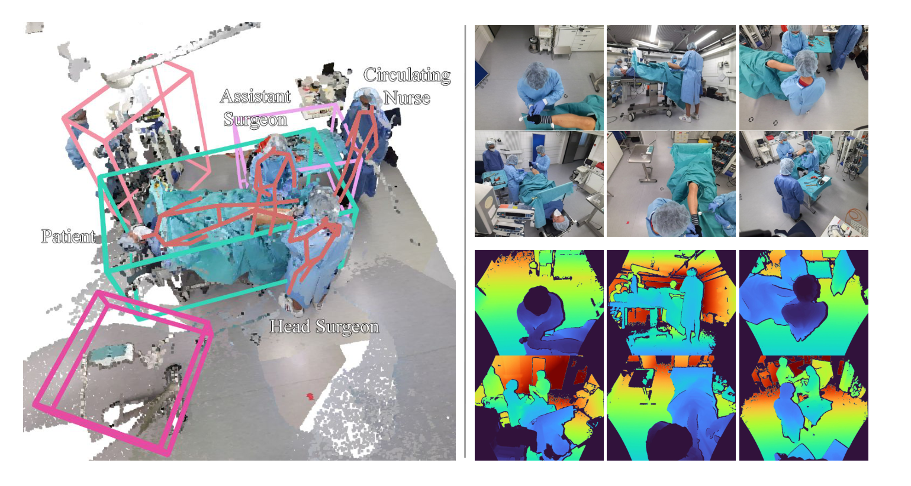
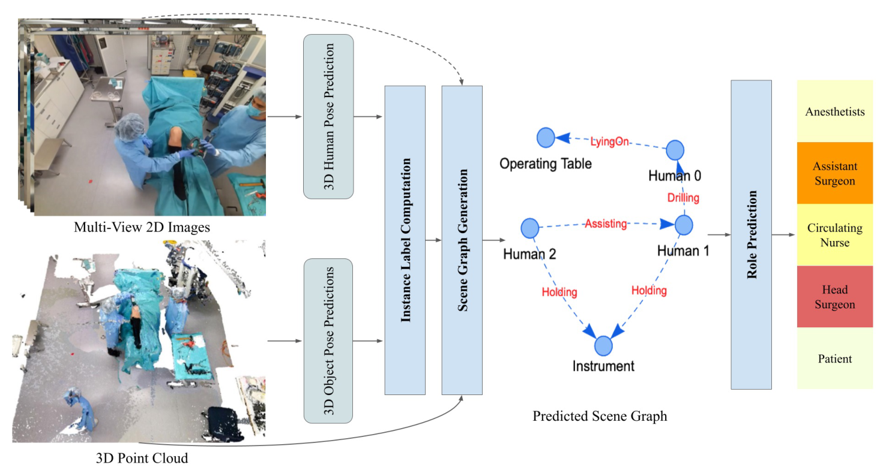
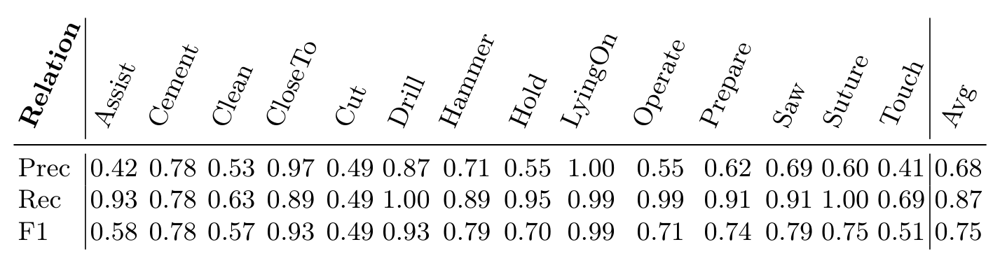
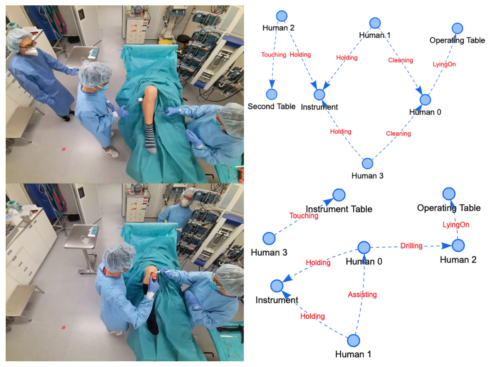
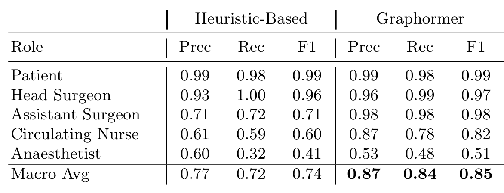

## 1. 背景与动机

**手术室里有多条并行的动作线，现有方法一次只看一条。** 阶段识别、器械识别、人体位姿估计各管一块，没有人回答"谁在对谁做什么"。

计算机视觉里有现成的表示：场景图。节点是人和物，边是关系，例如"主刀钻孔患者"。但已有场景图数据集都来自日常场景，交互简单。手术室这边，MVOR 只标了人体位姿，Sharghi 等人的数据只做阶段识别且不公开。

**缺的是一个能监督手术室场景图生成的公开数据集。** 这就是 4D-OR 要补的。

:::highlights
- 缺口：手术室没有公开的语义关系标注数据
- 回答：用场景图描述整个手术室，并发布配套数据集
:::

## 2. 核心观点速览

论文的答案分三步：在模拟中心录 10 台全膝关节置换并逐帧标注场景图；在 3DSSG 上加图像分支、点云增强和一个代表小器械的虚拟节点，做出场景图生成基线；再把生成的场景图送进 Graphormer 预测每个人的临床角色。

**头条结果：** 场景图宏平均 F1 0.75，角色预测 0.85。**边界：** 只有一种术式、模拟环境、2 台手术做测试，论文未说明方差。

:::data
- 10 台手术，6 路 RGB-D，1 帧每秒，6734 帧
- 14 类关系，6/2/2 个 take 划分
- 场景图宏平均 F1 0.75，角色预测 0.85
:::

## 3. 数据从哪里来

**这一节回答：录了什么，标了什么。** 10 台模拟全膝关节置换在医学模拟中心按典型流程录制，有医学专家指导。作者选这一术式，是因为它是有代表性的骨科手术，步骤和交互多样。

6 台标定好的 Azure Kinect 装在天花板，1 帧每秒同步输出 RGB 和深度，合计 6734 帧，并提供整场的融合点云。

*论文原图编号：Fig 2。左为融合点云与物体 3D 框、人体骨架和角色标签，右为 6 路 RGB 与深度。*

标注有四类：每个手术步骤的场景图关系；自动标注的人体 6D 位姿；设备的 3D 框；每个人的临床角色（患者、主刀、助手、巡回护士、麻醉师）。

**正文缺的细节不少。** 物体类别数、每帧三元组数都放在补充材料；场景图标注方式与一致性论文未说明，所以无法估计标签噪声和长尾关系的样本量。参演人数与单台时长论文也未说明。

:::highlights
- 4D 指 3D 点云加时间维度
- 位姿是自动标注，场景图标注方式论文未说明
:::

## 4. 基线怎样生成场景图

**这一节回答：从图像和点云到一张场景图要经过哪几步。** 基线定义了这个数据集的评测协议，所以值得看清。

*论文原图编号：Fig 1。场景图生成管线：位姿预测、实例标签计算、场景图生成、角色预测。*

1. 位姿与检测：VoxelPose 从多视角图像估计 3D 人体位姿，Group-Free 从点云检测物体 3D 框。
2. 实例标签：按位姿和框给点云中每个点标上属于哪个实例，再加一个虚拟节点 instrument 代表看不清的小器械。
3. 关系预测：改造后的 3DSSG 分别编码单个物体点云和物体对点云的并集，拼接 EfficientNet-B5 图像全局特征，经图卷积传播后分类关系。
4. 角色预测：把各帧中的人连成轨迹，用 Graphormer 给轨迹打分，再做唯一角色分配。

三处改造各有针对：图像补点云里缺失的小器械和反光物体；随机尺度、位置、朝向、亮度、色调增强模拟衣着和体型差异；crop-to-hand 把点云裁到手附近，用来区分切割、钻孔和锯。

:::data
- PointNet++ 特征，学习率 3e-5，物体 4000 点，关系 8000 点
- 单卡推理 2.2 FPS，高于 1 帧每秒的采样率
:::

## 5. 评测协议

**这一节回答：分数怎么算。** 关系和角色都用逐类精确率、召回率、F1，再做不加权的宏平均。作者强调宏平均让切割、钻孔这类稀有关系与常见关系同权。

一条关系算正确，要求两个实体都在场景中且关系预测正确。预测实体与真值实体如何匹配，论文未说明，这会影响不同方法之间结果是否可比。

人体位姿用 PCP3D，物体检测用 IoU 阈值下的 AP。

## 6. 结果说了什么

**前置检测已接近饱和。** 人体位姿 PCP3D 71.23，物体检测 AP 在 IoU@25 为 0.9893，在 IoU@50 为 0.9345。这组数字是后面"真值位姿帮助不大"的前提。

*论文原图编号：Table 1。测试集上 14 类关系的精确率、召回率和 F1。*

**宏平均 F1 0.75，被动作类关系拉低。** 能从几何关系读出的关系最好：躺在手术台上 0.99，靠近 0.93。需要识别手中器械或手部动作的最差：切割 0.49，触碰 0.51，清洁 0.57。

**模型倾向于多报。** 宏平均精确率 0.68，召回率 0.87；协助的召回率 0.93 而精确率只有 0.42。平衡损失给稀有关系加权，会推高这类过报。

*论文原图编号：Fig 3。两个样例场景与对应的预测场景图。*

*论文原图编号：Table 2。启发式与 Graphormer 两种轨迹打分的角色预测结果。*

**场景图里带有角色信息。** Graphormer 宏平均 F1 0.85，只数关系频次的启发式 0.74；差距主要在助手（0.98 对 0.71）和巡回护士（0.82 对 0.60）。麻醉师两种方法都差，Graphormer 只有 0.51，作者归因于遮挡。

:::data
- 关系 F1：躺在手术台上 0.99，切割 0.49
- 精确率 0.68，召回率 0.87
- 角色：Graphormer 0.85，启发式 0.74，麻醉师 0.51
:::

## 7. 消融：两项改造各贡献多少

**这一节回答：图像和增强谁在起作用。** 表 3 自动裁剪失败，这里按原表重排。

| 实验 | 图像 | 增强 | 真值位姿 | F1 |
|---|---|---|---|---|
| (a) | 否 | 否 | 否 | 0.65 |
| (b) | 是 | 否 | 否 | 0.66 |
| (c) | 否 | 是 | 否 | 0.70 |
| (d) | 是 | 是 | 否 | 0.76 |
| (e) | 是 | 是 | 是 | 0.78 |

**只加图像几乎没用，先加增强再加图像才明显。** (a) 到 (b) 只高 0.01，(c) 到 (d) 高 0.06。论文正文说两者都显著提升，这和 (b) 行不一致。我的判断：只有 6 个训练 take 时，不加增强的模型可能已经过拟合，图像特征带不来新信息。论文没有验证这一解释。

真值位姿 (e) 只比预测位姿 (d) 高 0.02，作者据此说方法可以用现成检测器。

另有一处数字不一致：表 1 报告 0.75，而同一配置的 (d) 是 0.76；表 1 标题写线性损失加权，正文写平衡损失。论文没有解释。

## 8. 结果没说什么

**真值位姿的结论依赖模拟环境。** 物体检测 AP@50 已有 0.9345，手术室布局固定、光照稳定。在检测更差的真实手术室里，实例标签的错误会直接传到关系预测，论文没有实验能回答这时差距多大。

**角色预测没有证明场景图是必要的。** 患者和主刀只看站位和姿态也容易区分。论文没有直接从位姿轨迹预测角色的对照，所以分不开"场景图提供了关键信息"与"位姿已经足够"。

**单一术式与 2 台测试手术限制了外推。** 模型可能学会这一流程的固定站位和顺序；0.01 到 0.02 量级的差异，在没有方差的情况下不能下结论。

**它不测时序推理，也不测器械识别。** 基线逐帧独立预测，小器械被合并成一个虚拟节点。

## 9. 相对已有数据集新在哪里

| 对象 | 它有什么 | 4D-OR 新增 | 没有超过的地方 |
|---|---|---|---|
| MVOR | 真实手术多视角 RGB-D、人体位姿 | 语义关系、物体 3D 框、临床角色、时间序列 | MVOR 来自真实手术 |
| Sharghi 等人 | 机器人手术、两路 ToF、阶段识别 | 公开、6 路、关系级标注 | 论文未比较规模 |
| 通用场景图数据集 | 大规模日常场景关系 | 手术室、多人复杂交互 | 规模小得多 |
| 3DSSG | 室内 3D 场景图方法 | 图像分支、增强、虚拟器械节点 | 方法主体沿用 3DSSG |

**它的位置是手术室场景图这条路线的起点：** 新增的是语义关系层，代价是放弃了真实手术数据。

## 10. 复现与比较前要核对什么

- 去补充材料确认物体类别与三元组统计，正文没有。
- 自己写清实体匹配规则，否则和别人的数字不可比。
- 报告宏平均的同时给逐类 F1，多次运行给方差。
- 只用 1 帧每秒的帧，不要假设有连续视频帧率的数据。
- arXiv v1 写的是录用后公开，数据以 GitHub 仓库为准。

## @takeaways
- 4D-OR 是第一个公开的手术室语义场景图数据集，10 台模拟膝关节置换，6734 帧
- 基线宏平均 F1 0.75，几何关系容易，手部动作类关系难
- 图像分支只有和增强合用才见效
- 场景图带有角色信息，但必要性没有被证明

## @strengths
- 把手术室整体建模成场景图，问题定义清楚，后续工作可直接沿用
- 多视角 RGB-D、点云、位姿、角色和关系标注齐全
- 用宏平均评测，暴露稀有关系的短板

## @weaknesses
- 模拟环境、单一术式、测试只有 2 台手术，无方差
- 标注方式、一致性、物体类别等关键信息不在正文
- 表 1 与表 3 数字不一致，正文对图像收益的描述与表格不符
- 角色预测缺少不用场景图的对照

## @questions
- 在真实手术室数据上，预测位姿退化后场景图性能下降多少？
- 直接从位姿轨迹预测角色能达到多少？
- 加入时序建模能否改善切割、触碰这类动作关系？
