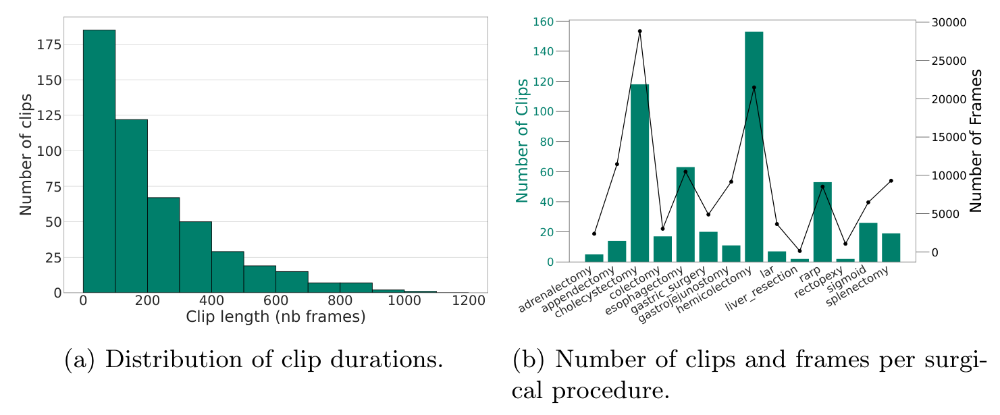
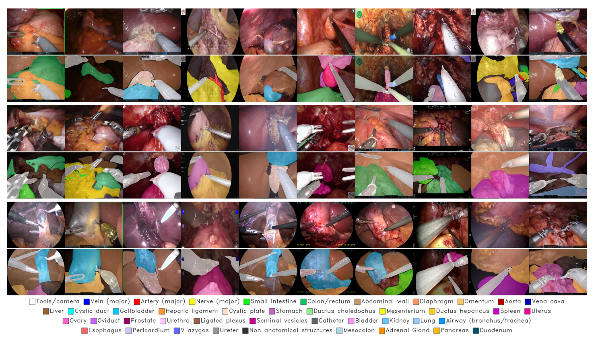
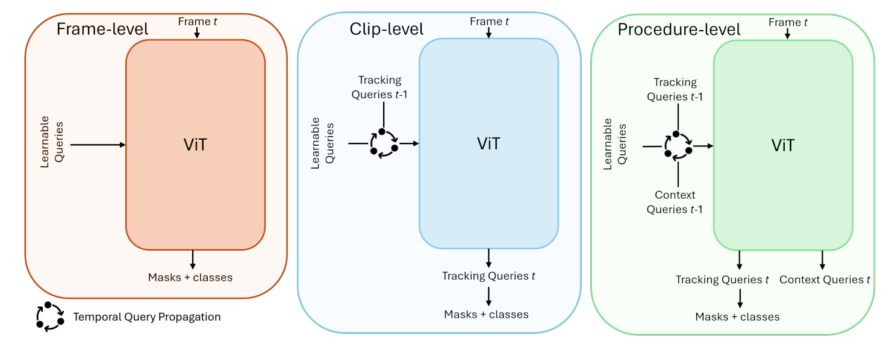
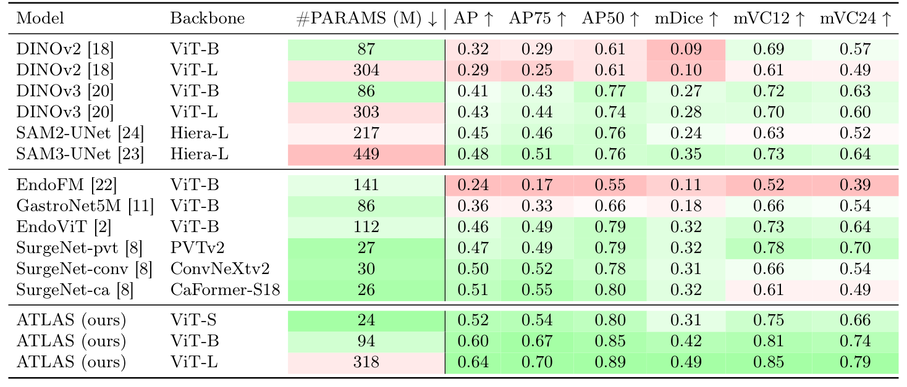

## 1. 背景与动机

微创手术里，外科医生只能从有限视角看解剖，又没有触觉反馈。认错一根血管或胆管就可能造成严重损伤，所以实时解剖识别是术中引导的基础。

难点有两处。**现有解剖数据集都只覆盖 1 种术式**：Endoscapes-Seg50 只有 493 帧，CholecSeg8k 来自 17 个胆囊切除视频，DSAD 多为单器官孤立分割。方法上，通用视频分割只追踪目标，不用外科医生依赖的术式和阶段信息。

:::highlights
- 解剖识别比器械分割、阶段识别研究得少，缺多术式整场景数据
- 外科医生认解剖靠术式与阶段先验，通用模型没有这类输入
:::

## 2. 核心观点速览

- **数据**：从 GSViT 视频库取 100 个视频、14 种术式、502 个片段，标出 121,018 帧、42 类，含腹腔镜与机器人手术。
- **标注**：只精标每个片段首帧，追踪模型传播，人工纠错，外科医生审核首帧。
- **模型**：在 EoMT 的单编码器查询框架里加 1 个术式查询和 4 个阶段查询，参数从 315M 增到 318M。
- **结果**：ViT-L 版 AP 0.64、mDice 0.49、mVC24 0.79，单张 H100 每秒 64 帧。
- **边界**：对照协议不对等，标注质量没有统计，结果是单次运行。

:::data
- 121,018 帧，100 个视频，14 种术式
- 42 类，训练合并为 30 类
- 70/10/20 视频患者级划分
:::

## 3. 数据从哪来

视频来自 GSViT 公开手术视频库，统一降到 15 fps，分辨率从 480×640 到 1080×1920。多数片段短于 400 帧，也就是不到 30 秒。

**术式分布是长尾**：胆囊切除和半结肠切除占大头，肝切除和直肠固定只有约 2 个片段。所以总体分数主要反映高频术式。

*论文原图编号：Fig 3。(a) 片段长度分布；(b) 各术式的片段数与帧数。*

## 4. 12 万帧怎么标出来

流程分四步：首帧精标、追踪模型传播、人工纠错并在约 10k、25k、50k 帧时微调追踪器、外科医生审核首帧。人工集中在 502 个首帧和纠错上，这是能做到 12 万帧的原因。

代价是**测试真值大部分也是传播出来的**。传播帧的抽查误差和标注者间一致性论文未说明，所以无法判断真值本身有多准。

*论文原图编号：Fig 2。各术式的示例帧与整场景标注，底部为类别图例。*

:::highlights
- 首帧精标加传播，把人工量压到片段数量级
- 外科医生只审核首帧
:::

## 5. ATLAS 模型怎么用上下文

EoMT 把可学习查询直接拼进视觉编码器，每个查询输出一个类别和一张掩码。VidEoMT 把上一帧输出查询传到下一帧作短期记忆。ATLAS 再加两类上下文查询：

- 术式查询：经多层感知机预测术式，用交叉熵监督。
- 阶段查询：用 InfoNCE 对比损失训练，时间相邻帧为正样本；没有阶段标签。

所有查询与图像块在同一编码器做全局注意力，所以分割查询能直接读到术式信息。查询传播公式为 $Q_t = \mathrm{Linear}(\hat Q_{t-1}) + Q_0$。

*论文原图编号：Fig 1。逐帧模型、加追踪查询的片段级模型、加上下文查询的术式级模型。*

## 6. 结果说了什么

| 模型 | AP | mDice | mVC24 |
|---|---|---|---|
| DINOv3 ViT-L 线性头 | 0.43 | 0.28 | 0.60 |
| SAM3-UNet | 0.48 | 0.35 | 0.64 |
| SurgeNet-ca | 0.51 | 0.32 | 0.49 |
| ATLAS ViT-S | 0.52 | 0.31 | 0.66 |
| ATLAS ViT-L | 0.64 | 0.49 | 0.79 |

ATLAS ViT-L 六项指标全部最高。**24M 参数的 ViT-S 版 AP 已高于 449M 的 SAM3-UNet**，说明手术域预训练比通用分割预训练更重要。最好的 mDice 也只有 0.49，作者归因于 30 类的长尾。

*论文原图编号：Table 2。15 个模型按预训练域分组的完整对比。*

## 7. 消融拆开看

| 配置 | AP | mDice | mVC24 |
|---|---|---|---|
| EoMT ViT-L 基线 | 0.53 | 0.35 | 0.68 |
| 加域内预训练 | 0.57 | 0.43 | 0.74 |
| 加查询传播 | 0.59 | 0.36 | 0.71 |
| 加上下文查询 | 0.64 | 0.49 | 0.79 |

- 上下文查询一步把 mDice 从 0.36 拉到 0.49，是最大增益。
- **查询传播让 mDice 从 0.43 掉到 0.36**，原因论文未说明。
- 相对"加域内预训练"那一行，最终 mDice 只净增 0.06。

:::data
- AP 相对基线提升约 21%，参数增加不到 1%
- 预训练消融：DINOv2 的 mDice 0.45 高于 DINOv3 的 0.42
:::

## 8. 结果没说什么

- 上下文查询的增益没有与"多出 5 个查询"的影响分开：没有单独去掉术式或阶段查询，也没有用打乱的术式标签做对照。
- 阶段查询学到的是外科阶段还是片段身份，论文没有验证。
- 推理时术式标签从哪来，论文未说明。
- 按术式的分数和多次运行方差论文未说明，0.01 到 0.02 的差距不宜当作排名依据。

## 9. 复现要注意什么

原始视频要自己用脚本从 YouTube 下载，属年龄限制内容，需要登录 cookie；掩码在 HuggingFace 上门控发布，许可为 CC BY-NC-SA 4.0。引入外部骨干前，要先查它的预训练数据是否含 GSViT 视频，否则会测试泄漏。

## @takeaways
- ATLAS-120k 是目前少见的多术式整场景解剖分割数据，适合测跨术式泛化
- 术式上下文是值得做的方向，但证据只有单次消融
- 评测时同时看 AP、mDice 和 mVC，并按术式拆开报告

## @strengths
- 14 种术式、两种手术模态，覆盖面远超已有解剖数据集
- 标注流程可放大，并公开了标注平台和下载工具
- 模型增加的参数不到 1%，可实时运行

## @weaknesses
- 标注质量没有量化，测试真值多为传播帧
- 表 2 的对照协议与 ATLAS 不一致
- 查询传播导致 mDice 下降却未解释

## @questions
- 传播帧相对人工复标的误差有多大
- 给术式查询喂错误标签，分割会退化多少
- 长尾术式在测试集中有多少片段，能否单独评测
