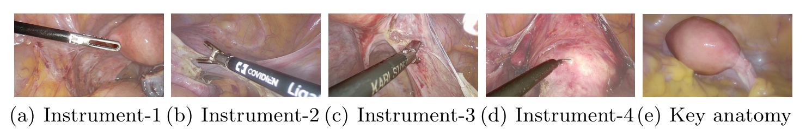
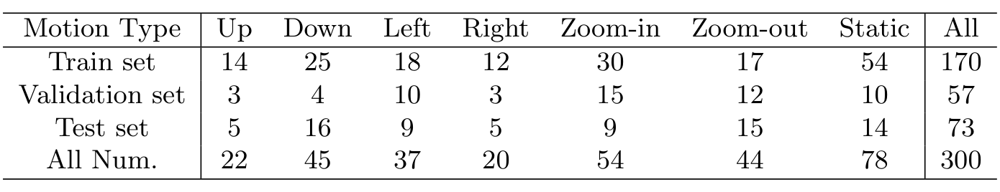

---
tags:
  - papers/手术数据集
aliases:
  - "AutoLaparo"
date: 2022-08-03
arxiv_id: "2208.02049"
---

# AutoLaparo: A New Dataset of Integrated Multi-tasks for Image-guided Surgical Automation in Laparoscopic Hysterectomy

## 核心信息

- 标题: AutoLaparo: A New Dataset of Integrated Multi-tasks for Image-guided Surgical Automation in Laparoscopic Hysterectomy
- 标题翻译: AutoLaparo：面向腹腔镜子宫切除术图像引导手术自动化的集成多任务新数据集
- 作者: Ziyi Wang, Bo Lu, Yonghao Long, Fangxun Zhong, Tak-Hong Cheung, Qi Dou, Yunhui Liu
- 机构: 香港中文大学机械与自动化工程学系、香港中文大学天石机器人研究所、苏州大学机电工程学院机器人与微系统研究中心、香港中文大学计算机科学与工程学系、威尔士亲王医院妇产科（香港中文大学）
- 发表时间: 2022-08-03
- 发表渠道: arXiv 预印本（cs.CV），本笔记依据第 1 版；正式发表渠道论文未说明
- arXiv: 2208.02049
- 论文链接: https://arxiv.org/abs/2208.02049
- 代码 / 项目: https://autolaparo.github.io
- 数据 / 资源: 数据集见项目主页，许可与申请方式论文未说明
- 论文类型: benchmark_or_dataset

## 原文摘要翻译

计算机辅助微创手术在惠及现代手术室方面潜力巨大。内窥镜传出的视频数据信息丰富，可为下一代智能手术系统提供情境感知能力。要在手术过程中实现准确感知和自动操作，基于学习的技术是一条有前景的途径，近年来它使高级图像分析和场景理解成为可能。

然而，训练这类模型高度依赖大规模、高质量、多任务标注的数据。这是该方向目前的瓶颈，因为计算机辅助介入领域可用的公开数据集仍极为有限。

本文提出并发布首个集成多项图像感知任务的数据集（名为 AutoLaparo），以促进子宫切除术中基于学习的自动化。

AutoLaparo 基于完整子宫切除术全过程的视频构建。具体而言，数据集中设计了三项不同但高度相关的任务：手术工作流识别、腹腔镜运动预测，以及器械与关键解剖结构分割。此外，我们给出了最先进模型的实验结果，作为在该数据集上进一步开发和评估模型的参考基准。数据集见 https://autolaparo.github.io。

## 创新点

1. **同一批手术视频上的三层嵌套标注。** 21 个完整子宫切除术视频在视频级标 7 个阶段，从阶段 2 到 4 中选 300 个片段标镜头运动，再从这些片段中取 1800 帧做像素级分割。三项任务的数据在时间上一层套一层，这是论文所说“集成多任务”的具体含义。
2. **把镜头运动做成一个可学习的任务。** 每个片段 10 秒，以第 5 秒的运动开始时刻为界：前 5 秒是输入，后 5 秒作为“最优视野”参考。这为基于视觉的腹腔镜视野自动控制提供了公开的监督数据，论文称此前很少有面向自动化的手术数据集。
3. **器械按把手和杆部分开标注。** 四种器械各分为把手（manipulator）和杆部（shaft），加上子宫共 9 类，共 5936 个掩码，沿用了器械部件分割的设置。
4. **面向子宫切除术的首个工作流数据集。** 论文称这是首个专门用于该手术工作流分析的数据集，此前妇科数据集只覆盖子宫内膜异位症诊断、动作识别或小规模分割。
5. **三项任务都给了基线。** 工作流识别 4 个模型、运动预测 2 个模型、分割 3 个模型，作为后续比较的起点。

## 一句话总结

AutoLaparo 用一家医院的 21 例腹腔镜子宫切除术视频，构建了阶段、镜头运动、器械与子宫分割三层嵌套标注，并给出各任务的单任务基线；运动预测准确率不到 30%，而论文强调的多任务关联没有做任何实验验证。

## 研究问题

### 背景与动机

手术机器人和计算机辅助介入的目标之一，是让系统能看懂手术现场，进而半自动或全自动地完成部分操作。腹腔镜手术的视频直接记录了术者看到的画面，是训练这类系统的天然素材。深度学习模型需要大量数据，而手术类型不同，画面、流程和器械都不同，一种手术的数据很难直接用于另一种。

论文指出现有腹腔镜数据集有三个不足：

- 有些数据不是来自真实手术，或规模不足以训练可用的模型。
- 规模较大的数据集大多只为一项任务设计和标注。
- 面向自动化任务的数据集很少，而腹腔镜视野自动控制可以把扶镜助手从繁琐操作中解放出来。

具体到子宫切除术，这是子宫腺肌症、子宫肌瘤或癌症患者常做的妇科手术。论文提到的已有数据与本文的区别如下（论文只做定性比较，没有给出对方的规模数字）：

| 已有数据 | 任务 | 论文指出的不足 | AutoLaparo 新增的部分 |
|---|---|---|---|
| `JIGSAWS`、`EndoNet` 等腹腔镜数据 | 动作识别、工作流识别 | 部分不是真实手术，或只为单一任务设计 | 同一批真实手术视频上的三种标注 |
| `EndoVis` 器械分割挑战 | 器械与部件分割 | 单一任务 | 增加子宫这一关键解剖结构，并与运动片段对齐 |
| `GLENDA` | 子宫内膜异位症诊断 | 病例或标注规模小 | 完整子宫切除术视频与阶段标注 |
| `LapGyn4` | 妇科腹腔镜动作识别等 | 病例或标注规模小 | 面向自动化的镜头运动标注 |
| `SurgAI` | 妇科解剖结构与器械分割 | 病例或标注规模小 | 分割帧带有时间上下文 |

**所以缺的不是模型，而是一套在同一台手术上同时标了“在哪个阶段、镜头怎么动、画面里有什么”的数据。** 论文要回答的是：能否在同一批真实子宫切除术视频上提供这三种相互关联的标注，并为每项任务给出可参考的基线。论文没有提出新方法，价值取决于数据规模、标注可信度和任务定义是否合理。

### 核心观点速览

- **想法：** 用一套三层嵌套的标注，把阶段识别、镜头运动预测和分割放在同一批视频上，让三项任务可以互相提供信息。
- **做法一：** 21 个完整手术视频按 7 个阶段逐帧标注（任务 1）。
- **做法二：** 从阶段 2 到 4 选 300 个 10 秒片段，把镜头运动开始时刻对齐到第 5 秒，用前 5 秒预测 7 类运动（任务 2）。
- **做法三：** 每个片段前 5 秒取 6 帧，标注器械把手、杆部和子宫共 9 类掩码（任务 3）。
- **结果：** 工作流识别测试准确率 75.62 到 78.29，分割 mask AP 51.70 到 54.09，运动预测测试准确率只有 26.03 与 27.40。
- **边界：** 全部基线都是单任务，多任务的价值没有实验；运动预测只比多数类略好；单中心 21 例，划分依据、标注一致性论文未说明。

下面先看数据怎样来、怎样标，再看评测协议和结果。

## 数据与任务定义

### 数据来源

- 21 个腹腔镜子宫切除术视频，来自香港威尔士亲王医院，手术时间为 2018 年 10 月到 12 月，使用 Olympus 影像平台。
- 使用获香港中文大学与新界东联网临床研究伦理委员会批准，数据不含个人信息。
- 视频为 25 fps、1920×1080。原始时长 27 到 112 分钟，差异来自手术难度。
- 更换器械或清洁镜头时腹腔镜会移出腹腔，这些片段无法做视觉分析，被删除。处理后平均 66 分钟，总计 1388 分钟。

### 三项任务

| 任务 | 输入 | 输出 | 数据规模 |
|---|---|---|---|
| 任务 1 工作流识别 | 完整视频的帧序列 | 每帧所属阶段（7 类） | 21 个视频 |
| 任务 2 腹腔镜运动预测 | 运动开始前 5 秒的片段 | 第 5 秒的运动类型（7 类） | 300 个片段 |
| 任务 3 器械与关键解剖分割 | 单帧图像 | 9 类实例掩码 | 1800 帧，5936 个掩码 |

七个阶段为：准备、离断韧带与腹膜、离断子宫血管与韧带、横断阴道、取出标本、缝合、冲洗。阶段 2 和 3 在子宫左右两侧对称进行（记为 A 和 B），顺序取决于术者习惯：有人逐阶段进行，有人先处理完一侧再处理另一侧。

七类运动为静止，以及上、下、左、右、推近、拉远六种非静止运动。

四种器械为：器械 1 抓钳、器械 2 `LigaSure`、器械 3 分离抓钳、器械 4 电钩，关键解剖结构为子宫。

*论文原图编号：Fig. 2。四种器械与关键解剖结构（子宫）示例，背景经过模糊处理。放在这里是因为它让 9 类分割目标有直观对应。*

### 标注协议

标注由一位有三十年以上临床经验的资深妇科医生和一位有三年子宫切除术经验的专科医生完成，结果经过校对和交叉核查。论文称这是“三层标注流程”：

- **视频级：工作流。** 依据临床经验和领域知识，把 21 个视频人工分为 7 个阶段。
- **片段级：镜头运动。** 人工镜头运动通常不到 1 秒，因此用运动开始时刻 $T$ 代表一次运动。从阶段 2 到 4 中选 300 个片段，每段 10 秒，$T$ 固定在第 5 秒。$0$ 到 $T$ 称为“非最优视野”，是模型输入；$T$ 之后称为“最优视野”，只作为参考。
- **帧级：分割。** 在每个片段的前 5 秒以 1 fps 取 6 帧，即 $t=0,1,2,3,4,5$ 秒，对应帧号 1、25、50、75、100、125。用开源工具 `LabelMe` 标注，器械的把手和杆部分开标。

两位标注者之间的一致性、两人如何分工、分歧怎样裁决，论文未说明。

### 统计与划分

工作流任务按视频划分：训练 10 个、验证 4 个、测试 7 个。

运动片段的类别分布见表 1：

*论文原图编号：Table 1。各类镜头运动片段在训练、验证、测试集中的数量。放在这里是因为它决定了任务 2 结果该怎样解读。*

静止类 78 个，是最大的一类；上、右两类最少，训练集分别只有 14 和 12 个。训练、验证、测试为 170、57、73 个片段。

分割子集的统计见表 2（逐行转录）：

| 类别 | 出现片段数 | 出现帧数 | 平均像素 | 标注总数 | 训练 | 验证 | 测试 |
|---|---|---|---|---|---|---|---|
| 子宫 | 164 | 941 | 253968 | 1016 | 663 | 214 | 139 |
| 器械 1 把手 | 121 | 575 | 57042 | 577 | 371 | 107 | 99 |
| 器械 1 杆部 | 102 | 439 | 92545 | 442 | 291 | 89 | 62 |
| 器械 2 把手 | 261 | 1476 | 113569 | 1481 | 842 | 283 | 356 |
| 器械 2 杆部 | 228 | 1071 | 137380 | 1074 | 630 | 206 | 238 |
| 器械 3 把手 | 109 | 518 | 59341 | 538 | 287 | 92 | 159 |
| 器械 3 杆部 | 85 | 365 | 94417 | 373 | 189 | 81 | 103 |
| 器械 4 把手 | 39 | 200 | 7042 | 202 | 104 | 50 | 48 |
| 器械 4 杆部 | 40 | 233 | 179904 | 233 | 124 | 55 | 54 |
| 合计 | 300 | 1800 | 2073600 | 5936 | 3501 | 1127 | 1258 |

> [!figure] Table 2 分割子集各类统计
> 建议位置：数据与任务定义
> 放置原因：它给出 9 类目标的出现频次、平均面积和划分，上面的 Markdown 表已逐行转录。
> 当前状态：保留占位；自动裁剪得到的图与表 1 的裁图字节相同，身份不符，未通过视觉检查。

器械 2（`LigaSure`）是主要器械，出现得最多，把手出现在 1476 帧中；子宫出现在 941 帧，超过一半。器械 4 把手的平均面积只有 7042 像素，是最小的目标。合计行的“平均像素” 2073600 就是 1920×1080 整帧的像素数，不是某类的平均值。

**表 2 有一处对不上。** 验证集一列各类之和是 1177，合计行写的是 1127；训练 3501、测试 1258 加上 1177 才等于 5936。合计行的 1127 应是笔误。

分割子集和运动子集的训练、验证、测试划分依据，以及是否与工作流的 10/4/7 视频划分一致，论文未说明。这决定了同一片段的相似帧会不会同时进入训练和测试。

数据和标注清楚后，下一节说明它们是按什么顺序搭起来的。

## 方法主线

这是数据集论文，方法主线是数据怎样构建、怎样评测，而不是模型结构。

### 机制流程

1. **视频预处理。** 输入为 21 个 25 fps、1920×1080 的原始手术视频；操作是删除镜头移出腹腔的片段；输出为总长 1388 分钟的连续视频，进入阶段标注。
2. **视频级阶段标注。** 输入为预处理后的视频；操作是两位医生按 7 个阶段逐帧划分，阶段 2、3 记录左右侧顺序；输出为任务 1 的标签，并作为下一层采样的范围。
3. **片段级运动标注。** 输入为阶段 2 到 4 的视频；操作是挑出含典型镜头运动的 10 秒片段，把运动开始时刻对齐到第 5 秒并标注 7 类运动；输出为任务 2 的 300 个片段。
4. **帧级分割标注。** 输入为每个片段前 5 秒；操作是以 1 fps 取 6 帧，用 `LabelMe` 逐像素标注器械把手、杆部和子宫；输出为任务 3 的 1800 帧、5936 个掩码。

> [!figure] Fig. 1 AutoLaparo 三层任务总览
> 建议位置：机制流程
> 放置原因：它把七阶段流程条带、一个推近运动片段的时间轴和六帧分割掩码画在一起，是理解三层嵌套标注最直接的图。
> 当前状态：保留占位；首次裁剪混入页眉，唯一一次重裁去掉了页眉，但左侧面板字母 (b)(c) 被裁掉一半，未通过视觉检查。

### 评测协议

**任务 1。** 按视频划分 10/4/7，用四个指标评测。准确率（AC）是整段视频中分类正确的帧所占比例。精确率（PR）、召回率（RE）和 Jaccard（JA，交集除以并集，比准确率更苛刻）定义为：

$$\mathrm{PR}=\frac{|GT\cap P|}{|P|},\quad \mathrm{RE}=\frac{|GT\cap P|}{|GT|},\quad \mathrm{JA}=\frac{|GT\cap P|}{|GT\cup P|}$$

其中 $GT$ 是真值集合，$P$ 是预测集合。PR、RE、JA 是先按阶段算再平均还是按视频平均，以及是否容忍阶段边界附近的误差，论文未说明，因此表 3 的数字不一定能和其他论文直接比较。

**任务 2。** 指标是准确率，即正确分类的片段占比。运动开始时刻 $T$ 之后的画面不能作为输入。只用视觉单模态输入：取 $T$ 之前的 5 秒子片段，从 25 fps 降采样到 3 fps，得到 16 帧（含首末帧）输入模型。

**任务 3。** 用标准 COCO 指标。交并比（IoU）是预测与真值重叠部分除以两者并集；在 0.5 到 0.95（步长 0.05）的 10 个交并比阈值上取平均，分别得到框精度和掩码精度（即 box AP 与 mask AP）。结果只在测试集上报告，验证集上的分割结果论文未说明。

### Baseline 设置

- **任务 1：** `SV-RCNet` 把视觉和时序依赖整合进端到端结构；`TMRNet` 用长程记忆库和非局部算子关联多尺度时序模式；`TeCNO` 用更高时间分辨率和大感受野做时序建模；`Trans-SVNet` 用 Transformer 融合空间和时间嵌入。
- **任务 2：** 作者自己提出两个模型。第一个用 `ResNet-50` 提取每帧特征，对 16 帧取平均后接全连接层分类。第二个在 `ResNet-50` 后接 LSTM，利用帧间时序信息，再由全连接层输出。
- **任务 3：** `Mask R-CNN` 是两阶段方法；`YOLACT` 是首个实时实例分割方法，速度约 30 fps；`YolactEdge` 在实时方法上进一步加速。三者统一用 `ResNet-50` 骨干。

训练超参数（学习率、轮数、批大小、输入分辨率、数据增强）和是否用了预训练权重，论文未说明，复现只能依赖各方法官方代码的默认配置。

协议定好后，下面看三项任务的基线分别达到了什么水平。

## 关键结果

### 基线表现

**任务 1：工作流识别（表 3）。**

验证集：

| 方法 | AC | PR | RE | JA |
|---|---|---|---|---|
| SV-RCNet | 77.22 | 72.28 | 65.73 | 51.64 |
| TMRNet | 80.96 | 79.11 | 67.36 | 54.95 |
| TeCNO | 81.42 | 66.64 | 68.76 | 55.24 |
| Trans-SVNet | 82.01 | 66.22 | 68.48 | 55.56 |

测试集：

| 方法 | AC | PR | RE | JA |
|---|---|---|---|---|
| SV-RCNet | 75.62 | 64.02 | 59.70 | 47.15 |
| TMRNet | 78.20 | 66.02 | 61.47 | 49.59 |
| TeCNO | 77.27 | 66.92 | 64.60 | 50.67 |
| Trans-SVNet | 78.29 | 64.21 | 62.11 | 50.65 |

> [!figure] Table 3 工作流识别结果
> 建议位置：关键结果
> 放置原因：它是任务 1 的主结果表，上面的 Markdown 表已转录全部数值。
> 当前状态：保留占位；没有提取到该表的图像候选。

四个模型的准确率在验证和测试集上都超过 75%，论文据此称结果“令人满意”。但测试集 JA 只有 47.15 到 50.67，召回率不到 65。

四个模型的测试准确率相差不到 3 个点，排名还随指标变化。测试准确率最高的是 `Trans-SVNet`，测试 JA 和召回率最高的是 `TeCNO`，验证精确率最高的是 `TMRNet`。测试集只有 7 个视频、每个模型只跑一次，方差论文未说明，这些差距能否区分模型无法判断。

**任务 2：腹腔镜运动预测（表 4）。**

| 方法 | 验证集 | 测试集 |
|---|---|---|
| ResNet-50 | 28.07 | 26.03 |
| ResNet-50+LSTM | 29.82 | 27.40 |

> [!figure] Table 4 运动预测结果
> 建议位置：关键结果
> 放置原因：它是任务 2 的主结果表，上面的 Markdown 表已转录全部数值。
> 当前状态：保留占位；自动裁剪只截到页眉和页码，没有表体，未通过视觉检查。

加 LSTM 后两个集合都更高，论文把原因归为模型同时学习了空间表示和时间运动模式。但测试集只有 73 个片段，26.03% 与 27.40% 分别对应 19 个和 20 个片段，相差 1 个片段。

**任务 3：器械与子宫分割（表 5，测试集）。**

| 方法 | 骨干 | box AP | mask AP |
|---|---|---|---|
| Mask R-CNN | ResNet-50 | 52.10 | 51.70 |
| YOLACT | ResNet-50 | 48.16 | 54.09 |
| YolactEdge | ResNet-50 | 47.04 | 52.58 |

> [!figure] Table 5 分割结果
> 建议位置：关键结果
> 放置原因：它是任务 3 的主结果表，上面的 Markdown 表已转录全部数值。
> 当前状态：保留占位；没有提取到该表的图像候选。

`Mask R-CNN` 的框精度最高，`YOLACT` 的掩码精度最高，两个指标给出的排名不同。三者 mask AP 都在 51.70 到 54.09 之间。逐类结果论文未说明，器械 4 把手这类小目标的表现未知。

### 难度分布

三项任务的难度差别很大。分割和工作流识别已经有中等水平的结果，运动预测则接近不可用。

**运动预测的 26% 到 30% 要和类别分布一起看。** 多数类基线指总是预测出现最多的类别，论文未说明这一基线，这里按表 1 推算：

| 集合 | 片段数 | 最多的类别 | 多数类准确率 | ResNet-50 | ResNet-50+LSTM |
|---|---|---|---|---|---|
| 验证 | 57 | 推近，15 个 | 26.3% | 28.07%（16 个） | 29.82%（17 个） |
| 测试 | 73 | 下，16 个 | 21.9% | 26.03%（19 个） | 27.40%（20 个） |

验证集上两个基线只比“总是预测推近”多对 1 到 2 个片段，测试集上比“总是预测下”多 3 到 4 个。**我的判断：两个基线学到的运动规律只比类别先验略多，任务 2 目前更像一个开放问题，而不是一个已有基线的基准。**

论文自己的判断是：结果有待提高，可以结合多模态数据设计更先进的方法。

### 覆盖与偏差

- 运动和分割数据都来自阶段 2 到 4，准备、取标本、缝合、冲洗阶段没有运动和分割标注。
- 运动类别不平衡：静止 78 个，右 20 个。
- 分割目标面积差异大：器械 4 把手平均 7042 像素，子宫 253968 像素。
- 全部数据来自一家医院、一种影像平台、三个月内的手术。

数字本身看完了，下一节讨论这些数字能说明什么、不能说明什么。

## 深度分析

### 数据集真正测到了什么

**任务 1 测的是一种手术内的阶段识别。** 21 个视频来自同一家医院和同一影像平台，测试集只有 7 个视频。它能检验模型在子宫切除术这一流程上的表现，但跨中心、跨设备的泛化不在测量范围内。阶段 2 和 3 左右交替的顺序差异，是这套数据相对胆囊切除术等数据集最特别的地方，但模型在这两个阶段上的单独表现论文未说明。

**任务 2 测的是“镜头即将怎样动”，而不是“镜头应该怎样动”。** 标签来自扶镜助手的实际动作。助手的动作包含个人习惯，也可能并非最优。论文把运动之后的画面称为“最优视野”，这是一个设定，不是经过评估的结论。此外，片段是人工挑出的“含典型运动”的片段，运动时刻固定在第 5 秒，真实场景中模型还要先判断“现在是否该动”，这一步任务 2 没有覆盖。

**任务 3 测的是阶段 2 到 4 内的器械部件分割。** 采样帧都在运动开始前的 5 秒内，彼此间隔 1 秒，同一片段的 6 帧高度相似。如果训练和测试按帧或按片段随机划分，相似帧会同时出现在两边，结果会偏乐观。论文没有说明划分粒度，这是复用时首先要核对的点。

### 多任务关联为何还只是设计

论文最主要的卖点是三项任务“高度相关”，可支持多任务和多模态学习。数据结构确实支持这一点：每个分割帧都能追溯到所属片段和阶段，每个运动片段都知道所在阶段。

但论文的全部 9 个基线都是单任务、单模态。没有一个实验把阶段标签或分割掩码作为运动预测的输入，也没有联合训练。所以“关联能带来收益”只是作者的假设。任务 2 准确率很低，正好是最需要验证这一假设的地方，论文把它留给了后续工作。

### 几个核心说法站得住吗

| 论文说法 | 证据 | 能证明 | 不能证明 |
|---|---|---|---|
| 首个面向子宫切除术的集成多任务大规模数据集 | 引言与第 2 节 | 三项任务共享同一批视频，已有妇科数据集都是单任务 | 没有与其他数据集的定量规模对比；21 例算不算大规模，论文没有给参照 |
| 三项任务高度相关，支持多任务学习 | 第 2.4 节 | 标注在时间上嵌套 | 没有任何多任务实验 |
| 工作流识别结果令人满意 | 表 3 | 测试 AC 超过 75% | 测试 JA 约 50，没有逐阶段结果和方差 |
| 加 LSTM 能提升运动预测 | 表 4 | 两个集合上都更高 | 验证、测试都只多对 1 个片段，可能是噪声 |
| 分割结果显示应用潜力 | 表 5 | mask AP 在 51.70 到 54.09 | 没有逐类结果和速度测量 |

### 适用边界

- 适合作为子宫切除术阶段识别和器械部件分割的小规模基准，以及镜头运动预测的起点数据。
- 不适合直接用来评估跨中心泛化，也不适合评估完整的自动扶镜系统，因为任务 2 没有“何时动”的判断，也没有闭环评估。
- 运动预测的数值应和多数类基线一起报告，否则 26% 到 30% 看不出有没有学到东西。

### 复现注意点

- 训练超参数论文完全没有给出，复现基线只能依赖各方法的官方代码默认配置。
- 先确认分割与运动子集的划分是否按视频隔离，再比较数字。
- 表 2 验证集合计 1127 与各类之和 1177 不一致，以各类数值为准。
- 运动预测的输入是 $T$ 之前 5 秒按 3 fps 取的 16 帧，不能使用 $T$ 之后的帧，否则就泄露了答案。

## 局限

论文自述的剩余挑战有两点：用单模态数据提升每项任务的表现，以及结合多种模态实现多任务学习。作者计划扩充图像和视频数量，并定义更多面向视觉应用的任务。

论文没有讨论、但会影响使用的问题：

- **样本少且来源单一。** 21 例手术、一家医院、一种影像平台、三个月，术者人数和手术难度分布论文未说明。
- **标注质量没有量化。** 只说明两位医生标注并交叉核查，没有标注者间一致性。
- **划分不透明。** 运动和分割子集的划分依据论文未说明。
- **基线只跑一次。** 所有结果都没有方差，任务 1 和任务 2 中模型间的小差距无法判断是否显著。
- **运动标签的主观性。** 标签是助手的实际操作，不等于最优操作，论文也没有评估“最优视野”是否真的更好。
- **多任务价值未验证。** 数据集的核心卖点没有实验支撑。
- **数据获取方式。** 许可和申请流程论文未说明。

## 我的笔记

- 这套数据最有价值的是任务 2 的设计：用运动开始时刻对齐片段，把“扶镜动作”变成一个可监督的分类问题，并在同一片段上配了分割帧。这个对齐方式可以照搬到其他腹腔镜手术。
- 用它做运动预测时，第一件事是补上多数类基线和逐类准确率；第二件事是把阶段标签、分割掩码作为输入，检验论文的多任务假设。
- 用它做分割时，先确认同一片段的 6 帧没有跨越训练和测试。
- 我的判断：数据规模和基线深度都偏薄，更像一个任务定义的起点，而不是成熟的基准。表 2 的合计笔误不影响结论，但说明统计表没有经过仔细核对。

## 引用

- Ziyi Wang 等（2022）. AutoLaparo: A New Dataset of Integrated Multi-tasks for Image-guided Surgical Automation in Laparoscopic Hysterectomy. arXiv:2208.02049.
- Jin 等（2017）. SV-RCNet: Workflow recognition from surgical videos using recurrent convolutional network. IEEE TMI.
- Jin 等（2021）. Temporal memory relation network for workflow recognition from surgical video. IEEE TMI.
- Czempiel 等（2020）. TeCNO: Surgical phase recognition with multi-stage temporal convolutional networks. MICCAI.
- Gao 等（2021）. Trans-SVNet: Accurate phase recognition from surgical videos via hybrid embedding aggregation transformer. MICCAI.
- He 等（2017）. Mask R-CNN. ICCV.
- Bolya 等（2019）. YOLACT: Real-time instance segmentation. ICCV.
- Liu 等（2020）. YolactEdge: Real-time instance segmentation on the edge. arXiv:2012.12259.
- Li 等（2022）. Learning laparoscope actions via video features for proactive robotic field-of-view control. IEEE RA-L.
- Allan 等（2019）. 2017 robotic instrument segmentation challenge. arXiv:1902.06426.
- Twinanda 等（2016）. EndoNet: A deep architecture for recognition tasks on laparoscopic videos. IEEE TMI.
