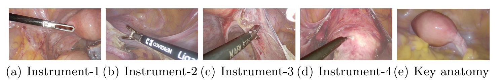
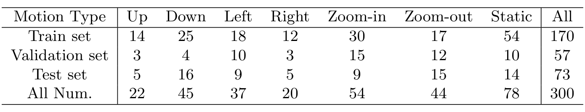

## 1. 背景与动机：缺的是“同一台手术上的多种标注”

手术机器人要自己动起来，先得看懂现场：手术到了哪一步，画面里有哪些器械和器官，镜头该往哪里移。腹腔镜视频正好记录了术者看到的画面。

**问题在数据。** 论文指出，已有腹腔镜数据集要么不是真实手术，要么规模小，规模大的又大多只为一项任务标注。面向自动化的数据更少，而腹腔镜视野自动控制正是一个能直接减轻扶镜助手负担的方向。

子宫切除术是常见的妇科手术，已有的妇科数据集只覆盖子宫内膜异位症诊断、动作识别或小规模分割。下一节先给出论文的答案。

:::highlights
- 已有数据集多为单任务，面向自动化的数据很少
- 论文没有提出新模型，价值取决于数据和任务设计
:::

## 2. 核心观点速览

**一句话：在同一批手术视频上，把“在哪个阶段、镜头怎么动、画面里有什么”三种标注一层套一层地标出来。**

- 任务 1：21 个完整视频，逐帧标 7 个阶段。
- 任务 2：从阶段 2 到 4 选 300 个 10 秒片段，用运动开始前 5 秒预测 7 类镜头运动。
- 任务 3：每个片段前 5 秒取 6 帧，共 1800 帧、5936 个掩码，9 类目标。

结果呈现出三种难度：工作流识别和分割已有中等水平，运动预测几乎没学到东西。后面几节依次展开。

:::data
- 21 个视频，总长 1388 分钟
- 300 个运动片段，1800 帧分割，5936 个掩码
:::

## 3. 数据从哪里来

视频来自香港威尔士亲王医院，2018 年 10 月到 12 月的 21 例手术，Olympus 影像平台，经伦理委员会批准。视频为 25 fps、1920×1080，原始时长 27 到 112 分钟。

镜头移出腹腔（换器械、擦镜头）的片段被删掉，处理后平均 66 分钟。**单中心、单平台、三个月，这决定了它测不了跨中心泛化。**

标注由一位三十年以上经验的资深妇科医生和一位三年经验的专科医生完成，并交叉核查。两人之间的一致性论文未说明，所以标注质量无法量化。

## 4. 三层嵌套标注怎样搭起来

这一节回答：三项任务的数据是怎样关联起来的？

*论文原图编号：Fig. 2。四种器械与关键解剖结构（子宫）示例，背景经过模糊处理。*

1. **视频级：** 按准备、离断韧带与腹膜、离断子宫血管与韧带、横断阴道、取出标本、缝合、冲洗分为 7 个阶段。阶段 2 和 3 在子宫左右两侧对称进行，先后顺序取决于术者习惯。
2. **片段级：** 镜头运动通常不到 1 秒，用运动开始时刻 $T$ 代表一次运动。每个片段 10 秒，$T$ 固定在第 5 秒，前 5 秒是输入，后 5 秒作为参考。运动分为静止和上、下、左、右、推近、拉远。
3. **帧级：** 在 $t=0,1,2,3,4,5$ 秒取 6 帧，用 `LabelMe` 标注四种器械的把手、杆部和子宫。

**嵌套的好处是每个分割帧都知道自己处在哪个阶段、镜头马上要怎么动。** 代价是运动和分割数据只覆盖阶段 2 到 4。

:::highlights
- 三层标注在时间上逐层嵌套
- 运动和分割只覆盖阶段 2 到 4
:::

## 5. 类别分布与一处统计笔误

*论文原图编号：Table 1。各类镜头运动片段在训练、验证、测试集中的数量。*

静止 78 个，是最大的一类；训练集中上只有 14 个、右只有 12 个。**类别少又不平衡，是理解任务 2 结果的前提。**

分割子集里，器械 2（`LigaSure`）最常见，把手出现在 1476 帧中；子宫出现在 941 帧。器械 4 把手平均只有 7042 像素，是最小的目标。

**表 2 有一处对不上：** 验证集各类之和是 1177，合计行写作 1127；3501、1177、1258 三者相加才等于 5936。合计行应是笔误。

运动和分割子集按什么划分训练与测试，论文未说明。下一节看评测协议。

## 6. 评测协议与基线

- **任务 1：** 按视频划分 10/4/7。指标为准确率、精确率、召回率和 Jaccard（交集除以并集）。基线为 `SV-RCNet`、`TMRNet`、`TeCNO`、`Trans-SVNet`。
- **任务 2：** 前 5 秒从 25 fps 降到 3 fps，取 16 帧。作者提出 `ResNet-50` 帧特征平均、`ResNet-50` 接 LSTM 两个模型，指标为准确率。
- **任务 3：** COCO 平均精度，在 10 个交并比阈值上平均。基线为 `Mask R-CNN`、`YOLACT`、`YolactEdge`，统一用 `ResNet-50` 骨干，只报告测试集。

训练超参数和预训练设置论文未说明，复现只能依赖各方法官方代码。

## 7. 结果说了什么

**任务 1，测试集：**

| 方法 | AC | PR | RE | JA |
|---|---|---|---|---|
| SV-RCNet | 75.62 | 64.02 | 59.70 | 47.15 |
| TMRNet | 78.20 | 66.02 | 61.47 | 49.59 |
| TeCNO | 77.27 | 66.92 | 64.60 | 50.67 |
| Trans-SVNet | 78.29 | 64.21 | 62.11 | 50.65 |

准确率都超过 75%，但 Jaccard 只有 47 到 51。**四个模型相差不到 3 个点，排名随指标变化，7 个测试视频、无方差，无法分出高下。**

**任务 3，测试集：** `Mask R-CNN` 的 box AP 最高（52.10），`YOLACT` 的 mask AP 最高（54.09），`YolactEdge` 为 47.04 与 52.58。两个指标排名不同，逐类结果论文未说明。

**任务 2：** `ResNet-50` 为 28.07% 与 26.03%，加 LSTM 后为 29.82% 与 27.40%（验证与测试）。下一节解释为什么这组数字要格外小心。

:::data
- 任务 1 测试准确率 75.62 到 78.29
- 任务 3 mask AP 51.70 到 54.09
- 任务 2 测试准确率 26.03 与 27.40
:::

## 8. 运动预测：只比猜最多的类略好

**多数类基线**指总是预测出现最多的类别。论文没有报告它，按表 1 推算：

| 集合 | 最多的类别 | 多数类准确率 | 帧平均 | 加 LSTM |
|---|---|---|---|---|
| 验证（57 个） | 推近，15 个 | 26.3% | 16 个正确 | 17 个正确 |
| 测试（73 个） | 下，16 个 | 21.9% | 19 个正确 | 20 个正确 |

**加 LSTM 在两个集合上都只多对 1 个片段。** 论文把提升归因于学到了时序模式，但这个差距也可能是随机波动，论文没有方差来区分。

我的判断：任务 2 目前是一个开放问题，而不是已有可靠基线的基准。作者自己也说结果有待提高。

## 9. 结果没说什么

- **多任务的价值：** 全部 9 个基线都是单任务。没有实验把阶段标签或分割掩码交给运动预测，“三项任务高度相关、能互相促进”还只是设计意图。
- **大规模：** 论文没有和其他数据集做定量规模对比，21 例是否算大规模没有参照。
- **最优视野：** 运动标签来自助手的实际操作，它是否最优，论文没有评估。
- **何时该动：** 片段是人工挑出的含运动片段，真实系统还要判断“现在要不要动”，任务 2 不覆盖这一步。

:::highlights
- 多任务、大规模、最优视野三个说法都缺直接证据
:::

## 10. 复用前要核对什么

- 确认运动和分割子集是否按视频划分；同一片段的 6 帧相隔 1 秒、高度相似，跨集合会让分割结果偏乐观。
- 报告运动预测时同时给出多数类基线和逐类准确率。
- 运动预测只能用 $T$ 之前的帧，否则泄露答案。
- 表 2 验证集合计以各类之和 1177 为准。

## @takeaways
- 最值得照搬的是任务 2 的对齐方式：以运动开始时刻对齐片段，再在同一片段上取分割帧
- 工作流识别和分割可作小规模基准，运动预测仍是开放问题
- 多任务价值需要自己做实验验证

## @strengths
- 同一批真实手术视频上的三层嵌套标注，时间关系清楚
- 首个公开的子宫切除术镜头运动监督数据
- 器械把手与杆部分开标注，并包含子宫

## @weaknesses
- 单中心 21 例，标注一致性、划分依据、训练超参数论文未说明
- 所有基线只跑一次，无方差
- 运动预测基线只比多数类略好，论文未报告多数类基线
- 主打的多任务关联没有任何实验

## @questions
- 运动预测准确率能否明显超过多数类基线
- 分割子集是按视频还是按片段划分
- 加入阶段标签或分割掩码后，运动预测能提升多少
