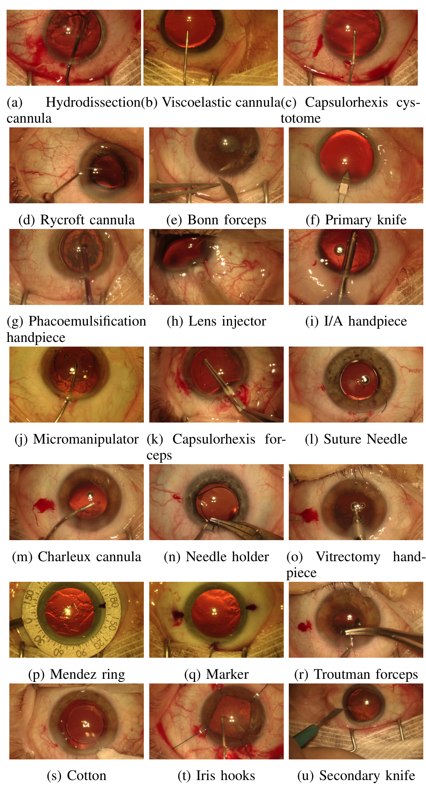
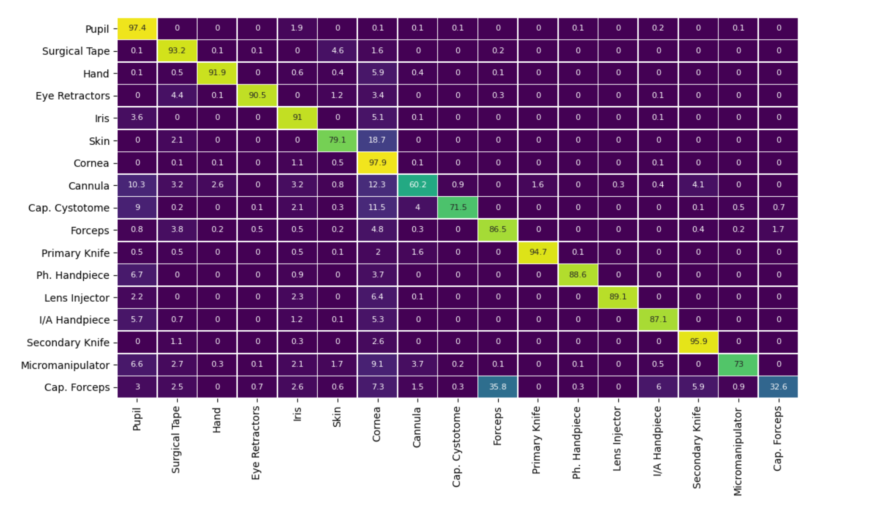
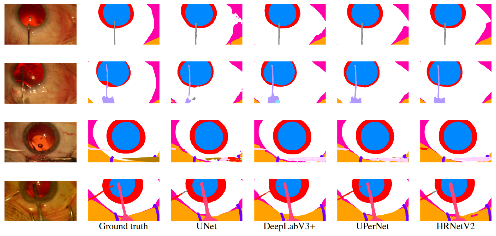

## 1. 背景与动机

**白内障手术视频不少,但缺一份同时标出眼睛和器械的像素级数据。** 计算机辅助介入要先知道画面里哪里是解剖结构、哪里是器械,这需要语义分割,而分割模型依赖带标签的数据。

已有数据集都差一步。EndoVis 2017 和 2019 只标机器人器械;EndoVis 2018 有整场景标签,但来自内镜下的机器人肾切除;CATARACTS 有 50 个白内障显微手术视频,只给帧级的器械存在和阶段标签。

论文用临床数字说明动机:2010 年记录的白内障病例超过 20 million 例,住院医生的后囊破裂率为 0.8%−8.9%。这些数字只是背景,论文没有把分割结果和临床指标联系起来。

:::highlights
- 缺口:白内障显微手术没有公开的整场景像素级标注
- 论文的回答:CaDIS,在 CATARACTS 视频上补标
:::

## 2. 核心观点速览

论文的答案是 CaDIS:从 CATARACTS 训练集的 25 个视频中抽 4670 帧,标 36 类,再按 8、17、25 类三种粒度训练四个分割网络。

**结果的形状很清楚:** 解剖结构的交并比在三个任务中都在 85 左右,器械类从任务一的 73.8 到 77 降到任务三的 52 到 63。类别越细,网络之间的差距越大。

**边界同样清楚:** 每个结果只训练一次,验证和测试各只有 3 个视频,标注一致性没有数字。网络间 1 到 2 个点的差距不能当作结论。

:::data
- 4670 帧,36 类(29 器械 + 4 解剖 + 3 其他)
- 训练 3550 / 验证 534 / 测试 586 帧
- 测试 mIoU:任务一 82.6 到 84.9,任务三 59.2 到 66.8
:::

## 3. 数据从哪里来

数据集能外推多远,取决于视频的来源。全部视频来自 Brest 大学医院 2015 年的手术,由三名医生完成(专家、中级、实习各一名),病人平均 61 岁,每个视频对应一位病人。

**这是单中心数据。** 设备、术式和病人构成都固定,跨医院的表现没有证据。

抽帧依据 CATARACTS 已有的器械和阶段真值:每个阶段随机选 10 到 20 帧,帧间至少隔 3 秒,图像从 1920 × 1080 缩小到 960 × 540。按阶段抽帧保证每个阶段都有样本,但不反映真实时长比例,对类别分布的影响论文未说明。

*论文原图编号：Fig 2。数据集中全部 21 种器械的示例。几种套管外观非常接近,这是器械分类难的直接原因。*

## 4. 标签与不均衡

36 类中,解剖类几乎出现在每一帧。按表 II,角膜每帧平均 253631 像素,粘弹剂套管只有 3697 像素,前者约为后者的 69 倍(本报告自算)。

多数器械只在少数视频出现,持针器只出现在 1 个视频的 12 帧。**这种不均衡是后面器械交并比偏低的背景。** 论文称 17 类器械出现在不到一半的视频中,按表 II 核对是 15 类,两者不一致。

标注由四名描线师完成,每帧一人标注、一人复核,分歧由医学官员裁决,另有程序化轮廓检查。**标注者间一致性论文未说明**,所以标签噪声对低分类别的贡献无法估计。

:::highlights
- 解剖类面积大、出现频繁,器械类稀少
- 标注质量只有流程描述,没有一致性数字
:::

## 5. 三个任务怎样切分难度

36 类里很多器械样本太少,直接训练意义不大。论文在同一批帧上用三种合并方式定义任务:

| 任务 | 类别数 | 器械怎样处理 |
|---|---|---|
| 任务一 | 8 | 全部器械合成 1 类 |
| 任务二 | 17 | 相似器械合并,尖端与把手合并,忽略 7 类 |
| 任务三 | 25 | 尖端与把手分开,忽略 11 类 |

被忽略的类别在计算指标时也不计入。**这个设计让人能在同一批帧上看到类别粒度怎样影响难度。** 划分按视频进行,避免相邻帧泄漏,代价是验证和测试各只有 3 个视频。

下一节看四个网络在这三套标签上的表现。

## 6. 结果说了什么

测试集 mIoU(表 IV、VI、VIII):

| 模型 | 任务一 | 任务二 | 任务三 |
|---|---|---|---|
| UNet | 83.7 | 70.6 | 59.2 |
| DeepLabV3+ | 82.6 | 72.3 | 63.2 |
| UPerNet | 84 | 73.8 | 66.8 |
| HRNetV2 | 84.9 | 76.1 | 66.6 |

模型间差距从任务一的 2.3 个点扩大到任务三的 7.6 个点。拆开看,解剖类三个任务都在 84 到 86 之间,**下降几乎全部来自器械**。像素准确率一直在 93.5 到 94.6 之间,被解剖类主导,不能用来比较器械分割。

最难的类别:任务二中撕囊镊交并比只有 22.9 到 28.9;任务三中晶状体推注器把手四个模型全为 0。

*论文原图编号：Fig 6。HRNetV2 在任务二测试集上的混淆矩阵。撕囊镊有 35.8 被判为组织镊,只有 32.6 判对。*

:::data
- 任务三器械 mIoU:UNet 52,UPerNet 63
- 任务三验证比测试高 5.4 到 7.4 个点
:::

## 7. 为什么器械难

论文的解释是类别不均衡。混淆矩阵显示两种错误:细小器械的边界像素被判成瞳孔或角膜,以及撕囊镊与组织镊互判。

**两种错误的原因不同。** 前者与像素少有关;后者更像外观相似,因为撕囊镊在 12 个视频中出现、有 129 帧,并不是最稀少的类。论文没有做加权损失或重采样的对照,两个原因各占多少无法区分。

*论文原图编号：Fig 4。任务二的示例帧、真值与四个模型的预测。第三行可见撕囊镊在各模型中被预测成组织镊的颜色。*

## 8. 结果没说什么

- **哪个架构更好。** 论文说 UPerNet 和 HRNetV2 感受野更大、更能分割细节。但 HRNetV2 有 66M 参数并用 ImageNet 预训练,UNet 只有 14M 且初始化未说明,比较的是整套配置。
- **差距是否可靠。** 每个结果只训练一次,没有种子或方差。验证与测试的稳定差距被归因于测试视频的类别分布,论文没有给出分布对比。
- **视频上的表现。** 数据是静态帧,模型在整段视频上的表现和时间一致性没有评估。

## 9. 复现与比较前要核对什么

评测口径有三处需要先对齐:

- 逐类准确率的公式按预测归一,实际是精确率的平均,实现口径论文未说明。
- 任务三的器械 mIoU(UNet 为 52)按 17 个器械类平均,没有计入 0 分的晶状体推注器把手;全类 mIoU 却计入了它。
- 批大小、UNet 初始化和模型选择规则论文未说明,数据许可条款也未说明。

**和其他论文比较前,先确认忽略类和汇总口径一致。**

## @takeaways
- CaDIS 是白内障显微手术的整场景像素级数据集,4670 帧、36 类,来自单中心 25 个视频
- 有区分度的是任务二、任务三的器械 mIoU,任务一和像素准确率基本饱和
- 器械低分混合了样本少和外观相似两个原因,论文没有把它们分开
- 网络比较混杂了参数量和预训练来源,单次训练的小差距不可靠

## @strengths
- 整场景标注,解剖、器械和其他物体都有类别,尖端与把手分开
- 三种类别粒度在同一批帧上定义,能直接看到难度梯度
- 按视频划分,避免相邻帧泄漏;表 II 给出完整的逐类统计

## @weaknesses
- 没有标注者间一致性或重复标注
- 单次训练,验证和测试各只有 3 个视频
- 四个基线的参数量和预训练来源不同,训练细节不全
- 汇总指标的类别集合不一致,正文与表 II 有一处数字不符

## @questions
- 标注者间一致性是多少,复核改动了多少帧?
- 加权损失或按类重采样能把把手类交并比提高多少?
- 撕囊镊与组织镊合并后,任务二器械 mIoU 会提高多少?
