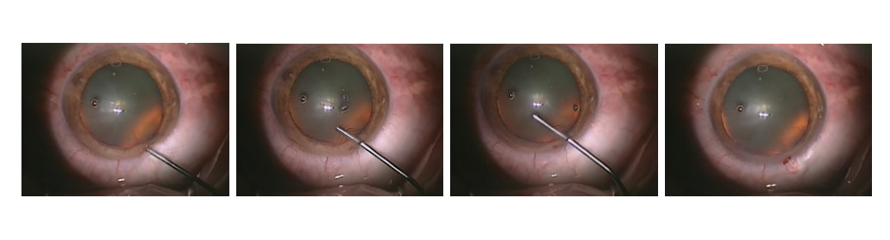
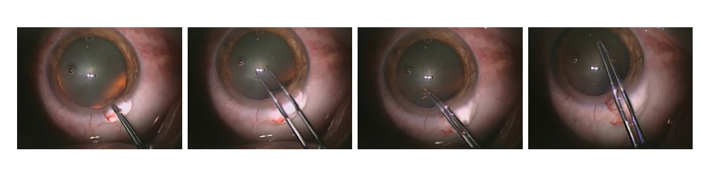
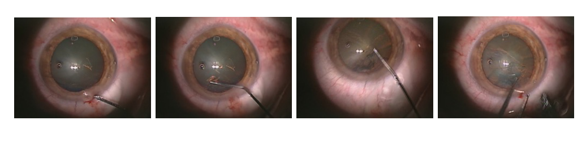
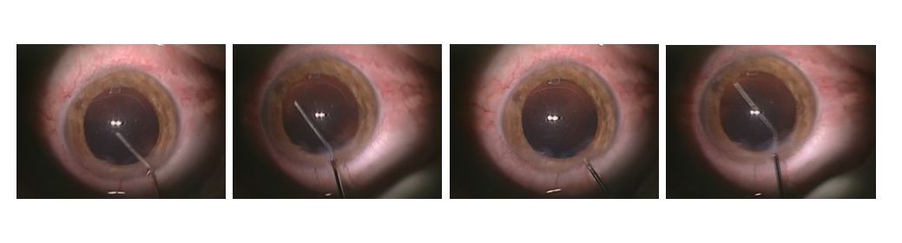
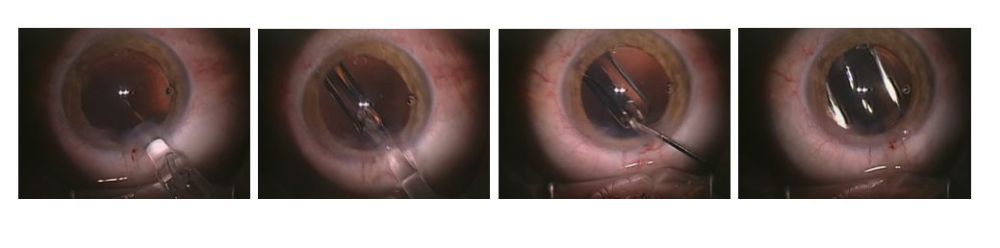
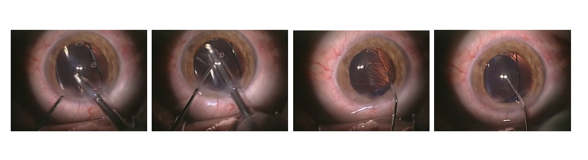

---
tags:
  - papers/手术数据集
aliases:
  - "Cataract-101"
  - "白内障手术 101 例视频数据集"
date: 2018-06-12
doi: 10.1145/3204949.3208137
---

# Cataract-101 – Video Dataset of 101 Cataract Surgeries

## 核心信息

- 标题: Cataract-101 – Video Dataset of 101 Cataract Surgeries
- 标题翻译: Cataract-101：101 例白内障手术视频数据集
- 作者: Klaus Schoeffmann, Mario Taschwer, Stephanie Sarny, Bernd Münzer, Manfred Jürgen Primus, Doris Putzgruber
- 机构: 克拉根福大学信息技术研究所; 克拉根福医院眼科与视光科; 格拉茨医科大学
- 发表时间: 2018-06(MMSys'18,6 月 12 日至 15 日,阿姆斯特丹)
- 发表渠道: MMSys'18: 9th ACM Multimedia Systems Conference(数据集论文,5 页)
- DOI: 10.1145/3204949.3208137
- 论文链接: https://doi.org/10.1145/3204949.3208137
- 代码 / 项目: 论文未提供代码
- 数据 / 资源: https://doi.org/10.5281/zenodo.1220951
- 论文类型: 数据集论文(benchmark_or_dataset)

## 原文摘要翻译

白内障手术是眼科最常做的显微手术之一。这类手术的目的是用人工晶状体替换人眼晶状体,这种干预通常因衰老而需要。整台手术都在显微镜下完成,但同轴安装的摄像机可以录制并存档手术过程。目前,这些录像在术后用于记录和培训。

录制白内障手术视频的另一个好处是,它们使视频分析(即人工和/或自动的视频内容分析)成为可能,从而研究有医学意义的问题(例如并发症的成因)。然而,这需要一个在已有数据上训练和评估过的医学多媒体信息系统,而这样的数据目前并不公开。

本文提供一个公开的视频数据集,包含 101 台白内障手术,由四名不同的医生在 9 个月内完成。这些医生分为中等经验和高经验两组(助理医生与主任医生),为基于经验的视频分析提供了基础。所有视频都由一名资深眼科医生标注了准标准化的手术阶段。

## 创新点

1. **公开了白内障手术的完整视频。** 论文写作时,作者认为没有公开的白内障手术视频数据。Cataract-101 提供 101 台整场手术的录像,总长 14 小时 2 分 5 秒,可通过 Zenodo 直接下载,让不同方法有了可以共用的数据源。
2. **给出十个阶段的逐段时间标注。** 一名资深眼科医生按克拉根福医院的十阶段流程标注每段的起始帧,共 1266 条。只要把起始帧展开,就得到逐帧的阶段标签,可直接用于阶段识别和分段。
3. **记录了术者身份和经验等级。** 每个视频都标明术者编号和经验等级(1 为助理医生,2 为主任医生),这让"经验如何影响手术"可以用数据来问。
4. **给出按经验分组的初步统计。** 表 1 和两张箱线图显示助理医生的手术更长、阶段时长方差更大、重复阶段更多,说明这个字段确实带有可分析的信号。

## 一句话总结

Cataract-101 公开了克拉根福医院 4 名医生在 9 个月内完成的 101 台无并发症白内障手术录像(720x540、25 fps,共 1263116 帧),由一名资深医生按十个阶段标注起始帧,并附术者经验等级;论文只给描述统计,没有基线模型和数据划分。

## 研究问题

**眼科显微手术很难"旁观学习",录像几乎是唯一能让多人反复看清手术细节的途径。** 腔镜手术的画面投在大屏上,一群学员可以同时观看;眼科医生却通过显微镜操作,显微镜只允许多一名学员从附加目镜跟看。眼科手术对精细动作要求很高,教学因此受限。

录像不仅能用于教学,还能做术后研究。作者举的例子是:某种并发症是否和器械的特定动作有关,器械在眼内停留多久,不同人工晶状体展开需要多长时间,某些手术动作是否和术后黄斑水肿相关。这些问题都要求一个能自动分析视频内容的系统,而系统需要公开数据来训练和评估。

已有工作不缺方法。Lalys 等用颜色、纹理、形状特征加支持向量机分类,再用隐马尔可夫模型和动态时间规整对齐;Charriere 等用贝叶斯网络加两个条件随机场;Quellec 等把手术分为十个阶段,每个阶段再分为动作期和空闲期。**缺的是一份大家都能拿到的数据。** 这些方法各用各的数据,无法直接比较。

论文要回答的问题是:能否公开一份白内障手术视频数据集,带阶段标注和术者经验信息,并说明它能支持哪些分析。

### 核心观点速览

论文的答案是 Cataract-101:把一家医院的日常白内障手术录像整理成带阶段标注的公开数据集。

- 数据:101 台无并发症手术,4 名医生,9 个月;主任医生 2 人共 56 台,助理医生 2 人共 45 台。
- 标注:一名资深眼科医生按十个阶段标出每段的起始帧,共 1266 条,存成三个分号分隔的 CSV 文件。
- 分析:按术者统计,助理医生的平均手术时长和阶段时长约为主任医生的两倍,方差也更大。
- 边界:单中心、单人标注、没有划分和基线,经验结论只有每组 2 人的描述统计;表 1 的平均时长列与总帧数换算不一致,复用时要自己重算。

**它是一份"可用的原始材料",不是一个定好协议的基准。** 下一节先看这些视频从哪里来,十个阶段怎么定义。

## 数据与任务定义

### 数据来源

数据集能外推到哪里,取决于视频来自哪里、由谁做手术。

- 地点:克拉根福医院眼科与视光科,作者称其为克拉根福最大的公立医院(奥地利)。
- 时间:9 个月内采集,具体起止月份论文未说明。
- 病例:101 台常规白内障手术,即没有并发症的手术;术式是现代超声乳化。
- 术者:4 名医生,按手术总量和职位分为两级。等级 1 为中等经验的助理医生(术者 1 和 4),等级 2 为高经验的主任医生(术者 2 和 3)。
- 录制:显微镜上加装的摄像机,视角与目镜不同。相机和显微镜型号论文未说明。

**这是单中心、四名医生、只含顺利手术的数据。** 病人年龄、晶状体硬度、人工晶状体型号等信息论文都没有给出,也没有说明伦理审批和知情同意。

### 视频规格

| 项目 | 数值 |
|---|---|
| 视频数 | 101 |
| 总时长 | 14 小时 2 分 5 秒 |
| 总帧数 | 1,263,116 |
| 分辨率 | 720x540(论文称 PAL 分辨率) |
| 帧率 | 25 fps |
| 编码 | MP4 容器,H.264/AVC 编码(High 档次),码率约 1.25 MBit/s |
| 总存储 | 8.4 GiB |

8.4 GiB 对一般实验室不构成存储负担,下载和全量训练的门槛都很低。分辨率偏低也意味着细小器械尖端的像素很少,做器械检测时要注意。

### 十个手术阶段

论文按克拉根福医院使用的流程定义十个阶段。作者强调白内障手术是"准标准化"的:步骤顺序基本固定,但各医院对阶段的划分可能不同。

| 编号 | 阶段 | 论文给出的操作要点 |
|---|---|---|
| 1 | 切口 | 用刀片穿过角膜开口;先做侧切口,再做宽度小于 3 mm 的透明角膜切口,能放入超声乳化手柄 |
| 2 | 粘弹剂注入 | 注入粘弹剂撑开前房,保护角膜内皮和眼内结构 |
| 3 | 撕囊 | 打开晶状体前囊:先做中央放射状切口,夹住翻起的瓣环形撕开 |
| 4 | 水分离 | 在撕囊口下注入电解质溶液和肾上腺素,使皮质与囊膜分离,便于核转动 |
| 5 | 超声乳化 | 超声能量乳化核;先刻深沟把核劈成两半,再旋转、切碎、乳化,全程保持后囊完整 |
| 6 | 灌注抽吸 | 吸除残余皮质 |
| 7 | 抛光后囊 | 抛光后囊,防止后囊混浊 |
| 8 | 植入人工晶状体 | 推入折叠的人工晶状体,待其缓慢展开并推入囊袋 |
| 9 | 吸除粘弹剂 | 从前房和囊袋中吸除粘弹剂 |
| 10 | 角膜水密与抗生素 | 向切口注水使基质暂时肿胀闭合切口,注入抗生素;只有渗漏时才缝合 |

**阶段 2 在一台手术中出现两次,但共用同一个编号。** 粘弹剂注入通常在阶段 8 之前再做一次,作者认为两次在画面上无法区分,所以不加区分。这一规则直接影响后面的统计:每台手术至少有 11 段,而不是 10 段。

下面是成功裁出的六个阶段示例,每张图是同一阶段内的四个时刻。切口、超声乳化、灌注抽吸、角膜水密与抗生素四个阶段的示例图未能裁出,保留占位。

> [!figure] Figure 1 切口阶段的四个时刻
> 建议位置：数据与任务定义
> 放置原因：展示阶段 1 的画面,可与其他阶段对比器械入路。
> 当前状态：保留占位；自动提取没有找到这张图的独立裁图候选。

*论文原图编号：Figure 2。粘弹剂注入阶段的四个时刻。放在这里是因为可以看到细长套管从切口伸入前房,器械外观与后面的阶段 9 很像。*

*论文原图编号：Figure 3。撕囊阶段的四个时刻。放在这里是因为撕囊镊的双叉形状和环形撕开的动作在画面上很有辨识度。*

*论文原图编号：Figure 4。水分离阶段的四个时刻。放在这里是因为它与粘弹剂注入都用细套管,只看单帧容易混淆。*

> [!figure] Figure 5 超声乳化阶段的四个时刻
> 建议位置：数据与任务定义
> 放置原因：超声乳化是最长、方差最大的阶段,示例图有助于理解其画面特征。
> 当前状态：保留占位；自动提取没有找到这张图的独立裁图候选。

> [!figure] Figure 6 灌注抽吸阶段的四个时刻
> 建议位置：数据与任务定义
> 放置原因：展示阶段 6 的抽吸手柄,可与阶段 7 和阶段 9 对比。
> 当前状态：保留占位；自动提取没有找到这张图的独立裁图候选。

*论文原图编号：Figure 7。抛光后囊阶段的四个时刻。放在这里是因为器械和瞳孔外观与灌注抽吸阶段相近,阶段边界主要靠操作意图区分。*

*论文原图编号：Figure 8。人工晶状体植入阶段的四个时刻。放在这里是因为推注器和展开中的晶状体是全流程最独特的画面。*

*论文原图编号：Figure 9。吸除粘弹剂阶段的四个时刻。放在这里是因为它与阶段 6 都用抽吸器械,需要结合时间位置判断。*

> [!figure] Figure 10 角膜水密与抗生素阶段的四个时刻
> 建议位置：数据与任务定义
> 放置原因：展示收尾阶段的注水针头。
> 当前状态：保留占位；自动提取没有找到这张图的独立裁图候选。

### 标注格式

标注是三个分号分隔的 CSV 文件:

- `annotations.csv`:共 1266 条阶段标注,每条给出视频编号、该阶段的起始帧号和阶段编号。视频文件名包含同一视频编号。
- `phases.csv`:阶段编号到阶段名称的映射。
- `videos.csv`:每个视频的帧数(即手术时长)、帧率、术者编号和经验等级(1 低于 2)。

**标注只有起始帧,没有结束帧。** 一个阶段默认持续到下一条标注开始;最后一段持续到视频结束。按这个规则展开,每一帧都有且只有一个阶段标签,阶段之间没有"空白"。Quellec 等区分的空闲期(器械移出视野、准备下一步)在这里被并入相邻阶段,这一点论文没有明说,是由格式推出的。

### 任务定义

论文没有定义正式任务,只列出它能支持的用途:

- 阶段识别与视频分段:由起始帧展开逐帧标签,训练帧级或序列级分类器。
- 手术动作分类器的训练数据。
- 经验分析:比较不同经验术者的动作、平滑程度和阶段时长。

训练、验证、测试划分和评测指标论文都没有给出。

## 方法主线

这是数据集论文,"方法"就是数据怎么来、怎么标。论文对这一部分写得很简短,下面按流程整理,并标出每一步没说清的地方。

### 机制流程

1. **录制。** 输入:克拉根福医院 9 个月内的常规白内障手术。操作:用显微镜上加装的摄像机录下整台手术,导出为 720x540、25 fps 的 H.264 视频。输出:送往病例筛选。
2. **筛选。** 输入:原始录像。操作:只保留没有并发症的常规手术,记录术者编号和经验等级。输出:101 个视频及 `videos.csv`。筛选标准(例如是否剔除录像不完整的病例)和被剔除的数量论文未说明。
3. **阶段标注。** 输入:101 个视频和十阶段定义。操作:一名资深眼科医生逐个视频标出每个阶段的起始帧,阶段 2 的两次出现用同一编号。输出:1266 条标注,写入 `annotations.csv`。标注工具、耗时、是否复核论文未说明。
4. **统计与发布。** 输入:标注和视频元数据。操作:按术者汇总手术数、帧数、时长和阶段数,画出两个经验组的阶段时长箱线图。输出:表 1、图 11、图 12,以及 Zenodo 上的公开数据。

### 评测协议

论文没有评测协议。没有划分、没有指标、没有基线模型。作者引用的同组工作(Primus 等,MMM 2018)用单帧 CNN 做阶段分类,但本文没有报告它在 Cataract-101 上的结果。

**这意味着后续论文在 Cataract-101 上的数字需要逐篇核对划分方式。** 不同论文可能按视频随机划分,也可能按术者划分,两者难度差别很大。

### 和已有路线的关系

论文把已有的白内障阶段识别分成两类:

| 路线 | 代表工作 | 做法 | 作者的评价 |
|---|---|---|---|
| 依赖顺序 | Lalys 等 | 颜色纹理形状特征加支持向量机,再用隐马尔可夫模型和动态时间规整对齐到已标注录像 | 利用手术流程的固定顺序检测阶段切换 |
| 依赖顺序 | Charriere 等 | 贝叶斯网络加两个条件随机场 | 同上 |
| 依赖顺序 | Quellec 等 | 十阶段,每段再分动作期与空闲期,条件随机场对齐新视频 | 同上 |
| 单帧分类 | Primus 等(本组) | 卷积神经网络对单帧分类 | 更灵活,容易加入可选阶段、乱序阶段或并发症类别 |

Cataract-101 本身不偏向哪条路线,起始帧加阶段编号的格式对两类方法都适用。**但两类方法对"阶段"的定义不同**:Quellec 等单独区分空闲期,这里的空闲时间被并入相邻阶段,跨论文比较结果时要先对齐口径。

下一节看论文唯一的定量分析:术者经验和手术时长的关系。

## 关键结果

### 基线表现

论文没有训练任何模型,所以没有基线表现。关键结果只有按术者的描述统计,用来说明经验字段是有信息量的。

### 按术者的统计(表 1)

| 术者 | 1 | 2 | 3 | 4 |
|---|---|---|---|---|
| 经验等级 | 1 | 2 | 2 | 1 |
| 手术数 | 25 | 24 | 32 | 20 |
| 总帧数 | 465193 | 212250 | 252278 | 333395 |
| 平均时长/台(表中标注为秒) | 310 | 147 | 131 | 277 |
| 阶段总数 | 304 | 270 | 360 | 239 |
| 平均阶段数/台 | 12.16 | 11.25 | 11.25 | 11.95 |

主任医生(术者 2、3)做了 56 台,助理医生(术者 1、4)做了 45 台,两组样本量接近。

**助理医生的平均时长约为主任医生的两倍。** 表中 310 和 277 对 147 和 131,作者据此说时长与经验"明显相关"。这只是两组各 2 人的对比,没有统计检验。

**助理医生的平均阶段数更多。** 12.16 和 11.95 高于两位主任医生的 11.25。因为阶段 2 每台手术必然出现两次,11 是下限;主任医生平均只多出约 0.25 段,助理医生多出约 1 段。作者把这解释为经验不足的医生更常重复阶段。差距不到一段,论文也没有给出每台手术阶段数的分布和被重复的阶段。论文未说明这些信息,所以无法排除少数手术拉高均值,或标注者对不同术者切分粗细不同。

### 表内数字的一致性

我核对了表 1 的数字,发现两处论文未解释的出入:

- **平均时长一列不是秒。** 四名术者的总帧数之和为 1263116,与正文的总帧数一致,按 25 fps 换算正好是 14 小时 2 分 5 秒。但用总帧数除以手术数再除以 25,四人的平均时长约为 744、354、315、667 秒,都是表中数值的 2.4 倍。表中数值恰好等于"每台帧数除以 60"。我的判断:这一列的单位或换算有误,真实平均时长约 12 分钟(助理医生)和 5 到 6 分钟(主任医生)。两组的倍数关系不受影响,仍约为 2.1 倍。
- **阶段总数之和是 1173,而 `annotations.csv` 有 1266 条。** 差 93 条。表内的平均阶段数与阶段总数除以手术数完全一致,所以表格本身是自洽的,差额来源论文未说明。可能是表 1 统计口径与发布文件不同,复用时应以 CSV 文件为准重新统计。

### 阶段时长分布(图 11、图 12)

图 11 和图 12 分别给出主任医生和助理医生十个阶段的时长箱线图,单位是帧。从图上读,两组的共同点是阶段 5(超声乳化)最长;不同点是助理医生几乎每个阶段的中位数都更高、箱体更宽,阶段 5 的离群值更远。

> [!figure] Figure 11 主任医生各阶段时长箱线图
> 建议位置：关键结果
> 放置原因：与图 12 并排对比,直接显示经验组之间的阶段时长差异。
> 当前状态：保留占位；自动视觉质量检查拒绝了该裁图。

> [!figure] Figure 12 助理医生各阶段时长箱线图
> 建议位置：关键结果
> 放置原因：与图 11 对比,显示助理医生阶段时长更长、方差更大。
> 当前状态：保留占位；自动视觉质量检查拒绝了该裁图。

作者的结论是:**经验较少的医生每个阶段一贯需要大约两倍的时间,同一阶段的时长方差也一贯更大。** 箱线图支持"更长、更分散"的方向,但没有给出各阶段的中位数或检验结果,"两倍"是对图的目测概括。

### 覆盖与偏差

- 术者分布:术者 3 贡献 32 台,术者 4 只有 20 台;按视频随机划分时,模型可能更多学到术者 3 的习惯。
- 病例分布:只有无并发症手术,阶段顺序基本固定,对依赖顺序的方法较友好。
- 阶段分布:超声乳化时长最长,切口、粘弹剂注入等阶段较短;逐帧训练会存在类别不平衡,论文没有给出各阶段的帧数比例。

这些统计说明经验字段带有信号。下一节讨论这份数据集真正适合测什么。

## 深度分析

### 这个数据集真正测到了什么

**Cataract-101 最适合测"顺利手术中的阶段识别"。** 视频完整、阶段顺序固定、标注到帧,这三点使它很适合做逐帧分类和在线阶段识别。

它也能支持经验相关的研究,例如用阶段时长或器械运动预测术者等级。但这类研究只有 4 名术者,模型很可能学到的是"识别这个人"而不是"识别经验水平"。要证明经验信号,至少需要按术者留一法:用三个人训练、在第四个人上测,而每个等级只有两个人,这样的实验仍然很弱。

**"约慢一倍"有一个论文没有排除的替代解释。** 每组只有 2 人,差异可能来自个人习惯,也可能来自病例分配:如果难度较高的病例更多交给主任医生,真实的经验差距还会被低估;反之会被高估。区分这些解释需要更多术者、按病例难度分层,或同一术者随时间变化的录像,论文中都没有。因此我只把这个结论读作"该字段与时长相关",不读作"经验导致时长差异"。

### 它不能代表什么

- **并发症。** 论文明确只收常规手术,因此不能用来训练或评估并发症检测,尽管引言把"研究并发症成因"作为动机。
- **器械与解剖的空间信息。** 没有器械框、分割掩码或器械存在标签。做器械检测或分割需要 CaDIS、CATARACTS 等数据集。
- **跨中心泛化。** 单家医院、同一套录制设备,模型在其他医院的表现没有证据。
- **空闲期。** 起始帧格式把器械不在视野内的准备时间并入相邻阶段,和 Quellec 等的动作期与空闲期定义不同,两类方法的结果不能直接对比。

### 为什么阶段 2 的处理值得注意

作者因为"视觉上不可区分"而把两次粘弹剂注入合并为一个编号。这对逐帧分类器很合理,但带来两个后果。第一,阶段编号不再是单调的时间顺序,依赖"阶段只前进不后退"假设的序列模型需要特殊处理。第二,第二次注入发生在阶段 8 之前,如果模型利用时间上下文,它其实可以区分两次注入;合并标签反而丢掉了这部分信息。

### 适用边界

复用时应自行做三件事:固定并公开划分文件(建议按视频划分,并报告是否跨术者);以 CSV 重新统计阶段数和时长,不要直接引用表 1 的时长列;在报告结果时说明阶段 2 是否合并。

### 相关工作中的定位

与同期公开数据相比,Cataract-101 的优势是完整视频加术者经验字段,劣势是没有空间标注、没有并发症病例、没有官方划分。作者对"当时没有公开数据"的判断只停留在引言中的一句陈述,没有与其他数据集逐项比较,读者需要自己核对同期数据。

下一节把这些边界整理成清单。

## 局限

1. **单中心、四名术者。** 全部数据来自克拉根福医院,经验分组每组只有两人,经验效应和个人习惯无法分开。
2. **只有无并发症手术。** 不能用于并发症检测,而这是引言中最强的医学动机。阶段顺序也因此异常规整,对依赖顺序的模型偏友好。
3. **单人标注,没有一致性评估。** 阶段边界由一名资深医生给出,是否复核论文未说明。阶段边界本身有多模糊因此未知,模型在边界附近的错误无法判断是模型问题还是标签问题。
4. **没有划分、指标和基线。** 划分方式论文未说明,也没有任何模型结果。不同论文自行划分,结果不可直接比较,数据集的难度也没有被量化。
5. **经验结论只是描述统计。** "约两倍"来自表 1 平均值和箱线图目测,没有检验、置信区间或对病例难度的控制。
6. **表 1 的口径问题。** 平均时长列与总帧数换算不一致(相差 2.4 倍),阶段总数 1173 与 1266 条标注不一致,论文未说明原因。
7. **元数据不足。** 病人信息、设备型号、伦理审批、筛选标准、标注工具都论文未说明。这限制了偏差分析,例如无法检查病人年龄或晶状体硬度是否在两个经验组之间平衡。
8. **许可与访问条件。** 论文只给出 Zenodo 地址,数据的使用许可论文未说明,商业或再分发用途需要另行确认。

这些边界并不否定数据集的价值,但决定了它应被当作阶段识别的训练材料,而不是经验评估的证据。

## 我的笔记

- **定位。** 它是白内障阶段识别的"老牌公共数据"之一,价值在于完整视频和经验字段,而不是精细标注。读后续论文时,看到 Cataract-101 上的高准确率,要先问划分方式。
- **可以照搬的做法。** 在视频元数据里记录术者编号和经验等级,成本很低,却为后续经验分析留下了可能。标注只存起始帧加阶段编号,格式简单,容易转换。
- **需要检查的地方。** 用前先用 CSV 重算每台手术的时长和阶段数,确认与表 1 的差异;确认 Zenodo 当前版本是否仍是 101 个视频和 1266 条标注。
- **应避免的做法。** 不要直接引用表 1 的平均时长作为秒数;不要把两人对两人的对比当成经验效应的证据;不要把阶段 2 当成单次事件。
- **后续问题。** 空闲期是否需要单独标注;阶段 2 拆成两类后,时序模型能否区分;按术者留一法下阶段识别准确率会下降多少。

## 引用

- Klaus Schoeffmann, Mario Taschwer, Stephanie Sarny, Bernd Münzer, Manfred Jürgen Primus, Doris Putzgruber. Cataract-101 – Video Dataset of 101 Cataract Surgeries. MMSys'18: 9th ACM Multimedia Systems Conference, 2018, pp. 421-425. DOI: [10.1145/3204949.3208137](https://doi.org/10.1145/3204949.3208137)
- 数据: [Zenodo 10.5281/zenodo.1220951](https://doi.org/10.5281/zenodo.1220951)
- 作者主页 PDF: [cat101-mmsys-2018.pdf](https://www.itec.aau.at/~mt/wp/wp-content/uploads/2018/04/cat101-mmsys-2018.pdf)
- 文中相关工作: Primus 等, Frame-Based Classification of Operation Phases in Cataract Surgery Videos, MMM 2018; Quellec 等, Real-time recognition of surgical tasks in eye surgery videos, Medical Image Analysis 2014; Charrière 等, Real-time analysis of cataract surgery videos using statistical models, Multimedia Tools and Applications 2017; Lalys 和 Jannin, Surgical process modelling: a review, IJCARS 2014
