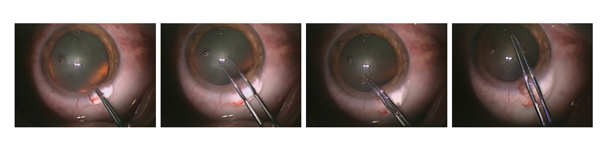
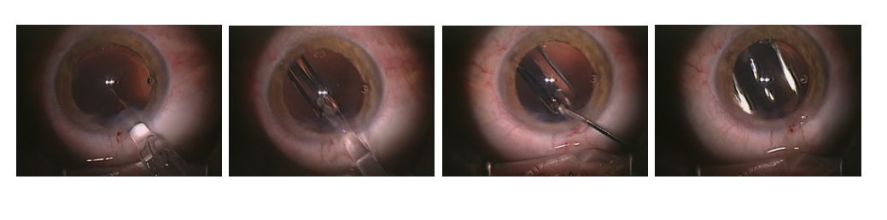
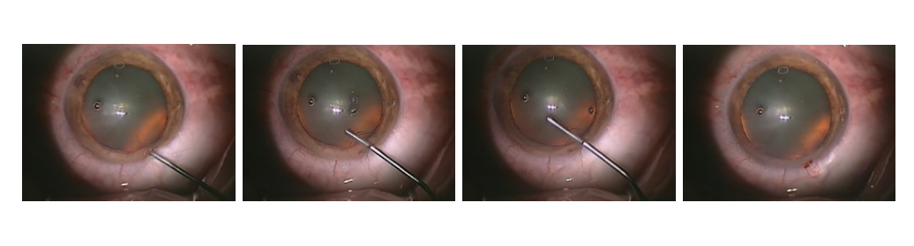
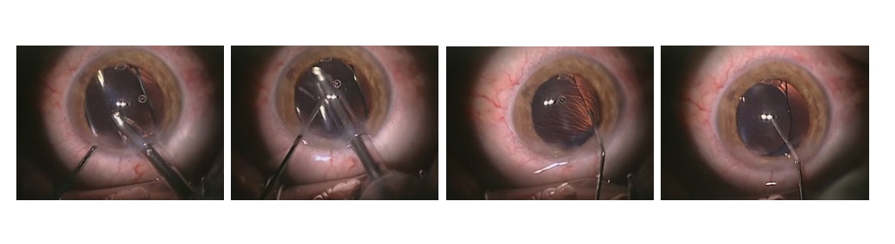

## 1. 背景与动机

**眼科手术很难"围观学习"。** 腔镜手术的画面投在大屏上,一群学员可以同时看;眼科医生通过显微镜操作,显微镜只允许多一名学员从附加目镜跟看。白内障手术又要求很精细的动作,教学因此受限。

显微镜上加装的摄像机可以录下整台手术。录像除了教学,还能做术后研究:某种并发症是否和器械动作有关,器械在眼内停留多久,不同人工晶状体展开要多长时间。这些问题需要能自动分析视频的系统,系统需要公开数据来训练和评估。

已有方法不少,Lalys 等、Charriere 等、Quellec 等都做过白内障阶段识别,但各用各的数据。**论文要补的是一份大家都能拿到的数据。**

:::highlights
- 显微镜只允许一名旁观者,录像是多人学习和术后分析的主要途径
- 作者认为当时没有公开的白内障手术视频数据
:::

下一节先给出这份数据的全貌。

## 2. 核心观点速览

Cataract-101 把一家医院的日常白内障手术录像整理成带阶段标注的公开数据集。

- **数据**:克拉根福医院 9 个月内的 101 台无并发症手术,4 名医生;2 名主任医生共 56 台,2 名助理医生共 45 台。
- **标注**:一名资深眼科医生按十个阶段标出起始帧,共 1266 条,存为三个 CSV 文件。
- **分析**:助理医生的手术和各阶段时长约为主任医生的两倍,方差更大,重复阶段更多。
- **边界**:单中心、单人标注、没有划分和基线;经验结论只是两人对两人的描述统计。

**它是一份可用的原始材料,而不是一个定好协议的基准。**

:::data
- 101 台手术,14 小时 2 分 5 秒,1,263,116 帧
- 720x540,25 fps,8.4 GiB
- 1266 条阶段标注,10 个阶段
:::

## 3. 视频从哪里来

数据能外推到哪里,取决于来源。全部视频来自奥地利克拉根福医院眼科,只收常规手术,即没有并发症的超声乳化手术。四名术者按手术总量和职位分级:术者 1 和 4 为等级 1(助理医生),术者 2 和 3 为等级 2(主任医生)。

| 项目 | 数值 |
|---|---|
| 视频数 | 101 |
| 总时长 | 14 小时 2 分 5 秒 |
| 总帧数 | 1,263,116 |
| 分辨率与帧率 | 720x540,25 fps |
| 编码 | H.264/AVC,码率约 1.25 MBit/s |
| 总存储 | 8.4 GiB |

**8.4 GiB 的体量让下载和全量训练的门槛都很低。** 代价是分辨率不高,细小器械尖端的像素很少。病人信息、设备型号、伦理审批和筛选标准论文未说明,这限制了偏差分析。

下一节看十个阶段怎么定义。

## 4. 十个阶段与一个特殊规则

论文按克拉根福医院的流程定义十个阶段:切口、粘弹剂注入、撕囊、水分离、超声乳化、灌注抽吸、抛光后囊、植入人工晶状体、吸除粘弹剂、角膜水密与抗生素。作者称这是"准标准化"流程:顺序基本固定,但各医院划分可能不同。

*论文原图编号：Figure 3。撕囊阶段的四个时刻,撕囊镊夹住前囊瓣做环形撕开。*

*论文原图编号：Figure 8。植入人工晶状体阶段的四个时刻,推注器把折叠晶状体送入囊袋。*

**阶段 2 在每台手术中出现两次,但共用同一个编号。** 粘弹剂注入在阶段 8 之前要再做一次,作者认为两次在画面上无法区分。后果有两个:每台手术至少 11 段;阶段编号不再单调递增,假设"阶段只前进"的序列模型需要特殊处理。

*论文原图编号：Figure 2。粘弹剂注入阶段的四个时刻,细套管从切口伸入前房。*

*论文原图编号：Figure 9。吸除粘弹剂阶段的四个时刻,和灌注抽吸用相近的抽吸器械。*

Figure 2 和 Figure 9 放在一起看,能看出只靠单帧很难区分细套管类阶段,时间位置是重要线索。

:::highlights
- 阶段 2 两次出现共用编号,阶段序列不是单调的
- 超声乳化、灌注抽吸、吸除粘弹剂器械相近,单帧易混
:::

## 5. 标注是怎么存的

标注由三个分号分隔的 CSV 组成:

- `annotations.csv`:1266 条,每条是视频编号、阶段起始帧、阶段编号。
- `phases.csv`:阶段编号到名称的映射。
- `videos.csv`:每个视频的帧数、帧率、术者编号和经验等级。

**只有起始帧,没有结束帧。** 一个阶段持续到下一条标注开始,最后一段持续到视频结束,展开后每一帧恰好一个标签。这也意味着器械移出视野的准备时间被并入相邻阶段,和 Quellec 等单独标注空闲期的做法不同,跨论文比较要先对齐口径。

标注只由一名资深医生完成,是否复核、一致性多高论文未说明。模型在阶段边界附近的错误,因此无法判断是模型问题还是标签问题。

下一节看论文唯一的定量分析。

## 6. 结果说了什么

论文没有训练模型,关键结果是按术者的统计。

| 术者 | 1 | 2 | 3 | 4 |
|---|---|---|---|---|
| 经验等级 | 1 | 2 | 2 | 1 |
| 手术数 | 25 | 24 | 32 | 20 |
| 平均时长/台(表中标为秒) | 310 | 147 | 131 | 277 |
| 平均阶段数/台 | 12.16 | 11.25 | 11.25 | 11.95 |

**助理医生的平均时长约为主任医生的两倍。** 图 11 和图 12 的箱线图也显示,助理医生几乎每个阶段时长都更长、更分散,超声乳化最为明显。

**助理医生的平均阶段数更多。** 因为 11 是下限,主任医生平均只多出约 0.25 段,助理医生多出约 1 段。差距不到一段,每台手术的分布和被重复的阶段论文未说明,无法排除少数手术拉高均值。

:::data
- 主任医生 56 台,助理医生 45 台
- 平均阶段数 12.16 与 11.95 对 11.25
:::

## 7. 表 1 的两处出入

我按正文数字核对了表 1,发现两处论文没有解释的出入。

**平均时长一列不是秒。** 四人总帧数之和等于正文的 1,263,116 帧,按 25 fps 正好是 14 小时 2 分 5 秒。但每台帧数除以 25 得到约 744、354、315、667 秒,都是表中数值的 2.4 倍;表中数值恰好等于每台帧数除以 60。我的判断:单位或换算有误,真实平均时长约 12 分钟(助理医生)和 5 到 6 分钟(主任医生)。两组之比约 2.1,不影响"约两倍"的结论。

**阶段总数之和是 1173,而发布文件有 1266 条。** 差 93 条。表内平均阶段数与阶段总数除以手术数一致,表格自洽,差额来源论文未说明。复用时应以 CSV 重新统计。

:::highlights
- 表 1 时长列比按帧率换算的真实秒数小 2.4 倍
- 表 1 阶段总数与发布标注差 93 条
:::

下一节讨论这些数字能证明什么。

## 8. 结果没说什么

**"经验导致时长翻倍"没有被证明。** 每组只有 2 人,差异可能来自个人习惯,也可能来自病例分配。区分这些解释需要更多术者、按病例难度分层,或同一术者随时间变化的录像,论文都没有。我只把它读作"经验字段与时长相关"。

**数据集适合阶段识别,但难度没有被量化。** 论文没有划分、指标和基线。只有顺利手术、顺序固定,而且按视频随机划分时同一术者会同时出现在训练和测试中,高准确率可能部分来自顺序先验和术者泄漏。

**它不能用于并发症检测、器械定位和跨中心泛化。** 只收无并发症病例,没有空间标注,只有一家医院一套设备。

## 9. 复现要注意什么

- 自己固定划分并公开划分文件,报告是否跨术者。
- 用 CSV 重算时长和阶段数,不要直接引用表 1 的时长列。
- 说明阶段 2 是否合并,以及空闲期如何处理。
- 数据许可论文未说明,商业或再分发用途需另行确认。

## @takeaways
- Cataract-101 是 101 台顺利白内障手术的完整录像加十阶段起始帧标注,附术者经验等级
- 阶段 2 两次出现共用编号,每台手术至少 11 段
- 表 1 时长列与帧率换算差 2.4 倍,阶段总数与 1266 条标注差 93 条
- 经验结论是每组 2 人的描述统计,只能读作相关

## @strengths
- 完整手术视频,标注到帧,格式简单
- 记录术者编号和经验等级,为经验研究留下接口
- 体量小、可直接下载,上手门槛低

## @weaknesses
- 单中心、四名术者、只含无并发症手术
- 单人标注,无一致性评估
- 无划分、无指标、无基线
- 表 1 存在口径问题且未解释

## @questions
- 表 1 时长列的真实口径是什么
- 1266 与 1173 的差额来自哪里
- 拆分阶段 2 的两次出现后,时序模型能否区分
- 按术者留一划分下,阶段识别准确率会下降多少
