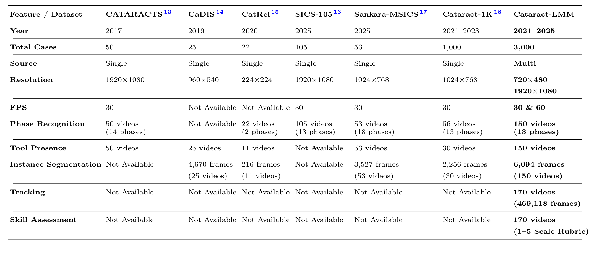
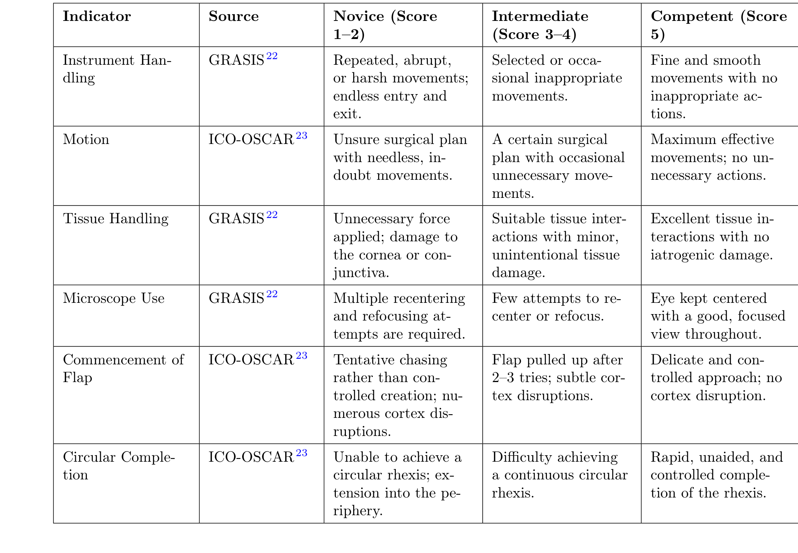
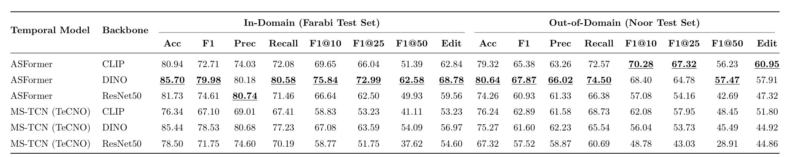

## 1. 背景与动机

**白内障手术是全球最常见的眼科手术，但公开数据集几乎都来自单一医院。** 模型在一家医院训练，学到的可能是那家医院的光照和显微镜色调，换一家就不灵。

已有的白内障数据集各有侧重。CATARACTS 有 50 个视频的阶段与器械存在；CaDIS 在其中 25 个视频上加了像素级分割；Cataract-1K 发布了 1,000 个视频，其中 56 个有阶段标注。它们都是单中心。

论文还指出另一个缺口：没有数据集把器械运动轨迹和盲评的技能分数连在一起，而这是用运动学评估手术熟练度的前提。

:::highlights
- 缺口一：没有多中心的白内障手术数据
- 缺口二：没有跟踪轨迹与技能分数的配对标注
:::

## 2. 核心观点速览

论文的答案是 Cataract-LMM：3,000 个视频，来自 Farabi（2,930 个）和 Noor（70 个）两家医院，相机分别为 720×480 和 1920×1080。

在子集上叠了四层标注：150 个视频的 13 类阶段，6,094 帧的 12 类实例分割，170 段撕囊片段的逐帧跟踪，同样 170 段的六指标技能评分。

**最有信息量的结果是跨中心下降。** 视频级阶段识别最好的 DINO-ASFormer，F1 从 79.98 降到 67.87；分割在 Noor 训练、Farabi 测试时，mAP 从 61.99 降到 47.12。

**边界同样清楚：** 所有结果只跑一次，域外阶段测试只有 21 个视频，路径长度与技能的关系没有控制时长。

:::data
- 3,000 个视频，1,134.2 小时
- 阶段 150 视频，分割 6,094 帧，跟踪与技能 170 段
- 一致性：Kappa 0.924，mIoU 0.874，HOTA 90.2，ICC 0.87
:::

## 3. 数据从哪里来

数据集能外推多远，取决于来源。两家医院都在德黑兰，采集时间为 2021 年 12 月到 2025 年 3 月，术者从住院医师到主治专家都有。

**两个站点的规模相差约 42 倍。** 所谓跨中心，本质是在大站点上训练、在一个小站点上测试。阶段子集里 Noor 只有 21 个视频，全部被用作域外测试，所以阶段识别只能做单向迁移。

标注子集不是纯随机抽样：基础病例随机抽取，再在资深医生监督下补充难例、反光遮挡帧和不同熟练度的病例。补充比例论文未说明，所以子集上的分数不能直接代表全量视频。

*论文原图编号：Table 1。与公开白内障数据集的对比。Cataract-LMM 是唯一一个多中心、同时有跟踪与技能标注的。*

## 4. 四层标注怎样做出来

**每层都给了一致性数字，这在手术数据集论文中不常见。**

| 标注层 | 规模 | 标注者 | 一致性 |
|---|---|---|---|
| 阶段 | 150 视频，13 类 | 3 名住院医师 | Fleiss Kappa 0.924 |
| 实例分割 | 6,094 帧，12 类 | 8 名住院医师 | 校准集 mIoU 0.874 |
| 跟踪 | 170 段，469,118 帧 | 模型预标注加 8 名住院医师修正 | HOTA 90.2 |
| 技能 | 170 段，6 指标 | 3 名眼科医生双盲 | ICC 0.87 |

跟踪是半自动的：在分割子集上微调的 YOLO11-L 先出掩码，BoT-SORT 维持身份，尖端由最小二乘直线拟合求出，再由人工修正。DetA 82.7 低于 AssA 98.4，说明误差主要在掩码边界，身份关联基本不出错。

技能量表从 GRASIS 和 ICO-OSCAR 改编六个可从视频判断的指标，每项 1 到 5 分。分歧超过 1 分时由资深顾问裁决，总分取六项平均。

*论文原图编号：Table 3。六指标技能量表及三档锚点，定义了技能分数到底测的是什么。*

下一节看这些标注怎样被拿来验证。

## 5. 验证协议

**划分方式决定了结果能说明什么。** 阶段识别按医院划分：训练 80、验证 26 个视频全部来自 Farabi，测试 23 个 Farabi 视频为域内、21 个 Noor 视频为域外。

阶段模型分两类。片段级看 10 帧窗口，模拟术中实时；视频级看整场手术，用于术后索引。视频级比较了冻结的 DINO、CLIP 特征和微调的 ResNet50 特征。

实例分割按视频 70/20/10 划分，比较 YOLO 系列、Mask R-CNN，以及用真值框提示的 SAM 与 SAM2。**真值框给了 SAM 理想定位，所以它的分数是上界。**

技能分类用 K 均值把总分切成两组（63 段对 107 段），7 个视频模型做二分类。运动学分析用累计尖端路径长度：

$$L=\sum_{t=1}^{T-1}\lVert P_{t+1}-P_t\rVert_2$$

$L$ 随可见帧数 $T$ 增长，是否对时长归一化，论文未说明。

## 6. 结果说了什么

**换医院后，所有阶段识别模型都下降，但下降幅度差别很大。**

| 模型 | 域内 F1 | 域外 F1 |
|---|---|---|
| MViT-B（片段级） | 77.1 | 57.6 |
| DINO-ASFormer（视频级） | 79.98 | 67.87 |
| CLIP-ASFormer（视频级） | 72.71 | 65.38 |
| CLIP-MS-TCN（视频级） | 67.10 | 62.89 |
| ResNet50-ASFormer（视频级） | 74.61 | 60.93 |

CLIP 特征域内不强，但域外最稳。论文由此认为，在一家医院上微调卷积网络会过拟合站点外观。

*论文原图编号：Table 9。视频级模型的域内与域外结果，冻结特征与微调特征可在同一时序模型下直接比较。*

**分割上，器械是主要难点。** YOLOv11-L 的 12 类 mAP 为 73.9，SAM 为 56.0；瞳孔 90.5，套管针只有 58.4。跨中心时，Farabi 训练到 Noor 测试从 70.45 降到 61.19，反向从 61.99 降到 47.12。

技能二分类中，TimeSformer 的 F1 为 83.90，R3D-18 为 83.58，两者几乎相同。路径长度对分数的回归斜率为 -5,803.8，低技能组平均 13,724.6 像素，高技能组 7,124.7 像素。

:::data
- 阶段：DINO-ASFormer 域内 F1 79.98，域外 67.87
- 分割：YOLOv11-L mAP 73.9，SAM 56.0
- 技能：TimeSformer F1 83.90，CNN-GRU 68.57
:::

## 7. 结果没说什么

**冻结特征更鲁棒，只在 CLIP 上稳定成立。** DINO 配 MS-TCN 时，F1 从 78.53 降到 61.60，降幅比微调 ResNet50 配 MS-TCN 还大。每个配置只跑一次，域外只有 21 个视频，几个点的差异可能是随机波动。

**监督模型优于 SAM，说明的是领域微调有用，不是标注好坏。** 标注质量的真正证据是一致性数字，不是模型分数。

**路径长度可能只是时长的代理。** 分数最低的区间平均 137.77 秒，最高区间 26.30 秒，片段越长路径越长。论文没有给相关系数、显著性或时长归一化后的结果，所以目前只能说两者同向变化。

**反向迁移降得更多，未必只是器械外观不同。** Noor 训练帧来自较少视频，且目标在低分辨率的 Farabi 画面里更小，论文没有做实验分离这两个因素。

:::highlights
- 跨中心下降是可信的，具体模型排序不可信
- 路径长度与技能的关系没有排除时长混杂
:::

## 8. 相对已有数据集新在哪里

| 对比对象 | Cataract-LMM 新增 | 没有超过的地方 |
|---|---|---|
| CATARACTS | 第二站点，实例分割、跟踪、技能 | 主站点 720×480 低于其 1920×1080 |
| CaDIS | 实例级掩码，两站点，三种粒度 | 分割帧数只多约 30% |
| Cataract-1K | 视频数三倍，新增跟踪与技能 | 同样只覆盖一个国家 |

**真正独有的是站点留出评测，以及同一批撕囊片段上跟踪与技能的配对。** 其余是规模增加。

## 9. 复现要注意什么

- 文件名里的 S1、S2 标出医院，跨中心划分可直接构造。
- 引用 SAM 分数时写明是真值框提示的上界。
- Table 12 与 Table 13 的 12 类结果不一致（73.9 对 73.19），论文未说明原因。
- 技能测试集约 26 段，一段分错就影响约 4 个百分点；比较模型时应做多次划分。
- 运动学量是像素单位，两站点分辨率不同，用之前先做尺度和时长归一化。
- 论文未说明：术者级别在各子集中的分布、跟踪修正者与评分者是否重叠、K 均值分组与 3.7 分阈值的关系。

## @takeaways
- Cataract-LMM 的独特价值是两站点留出评测和撕囊跟踪与技能的配对
- 带标注的只有 150 到 170 个视频，3,000 个原始视频适合自监督预训练
- 跨中心下降真实存在，冻结特征的优势只在 CLIP 上稳定
- 路径长度结论需要先控制时长

## @strengths
- 四层标注都报告了一致性数字
- 发布结构清楚，原始视频全部公开，许可为 CC-BY 4.0
- 协议细节和超参数完整，基线代码公开

## @weaknesses
- 两站点规模悬殊，且同在一座城市
- 所有基线单次运行，没有方差
- 技能分组阈值由数据决定，路径长度分析未控制时长
- 跟踪子集没有跟踪模型基线

## @questions
- 控制时长后，路径长度是否仍与技能分数相关？
- 增加 Noor 训练视频后，反向迁移的下降会缩小多少？
- Mask R-CNN 组织类异常高、器械类异常低的原因是什么？
