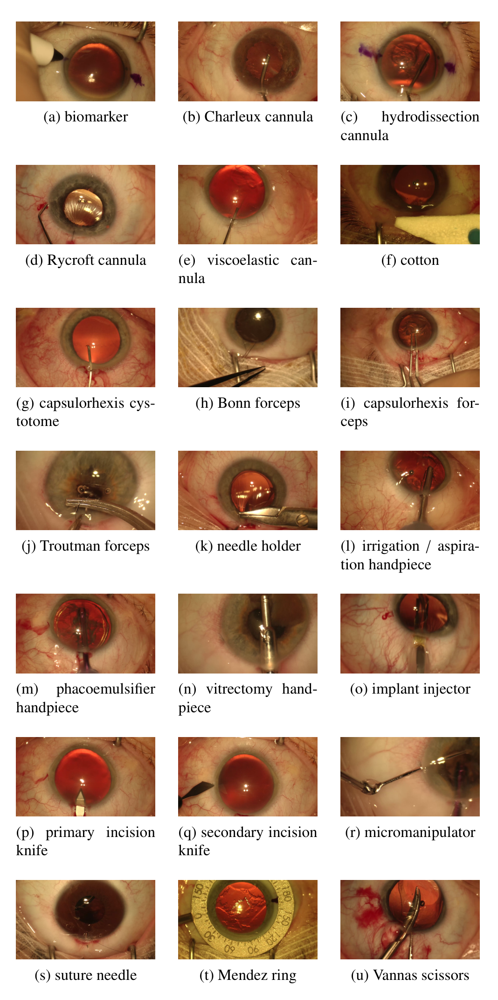
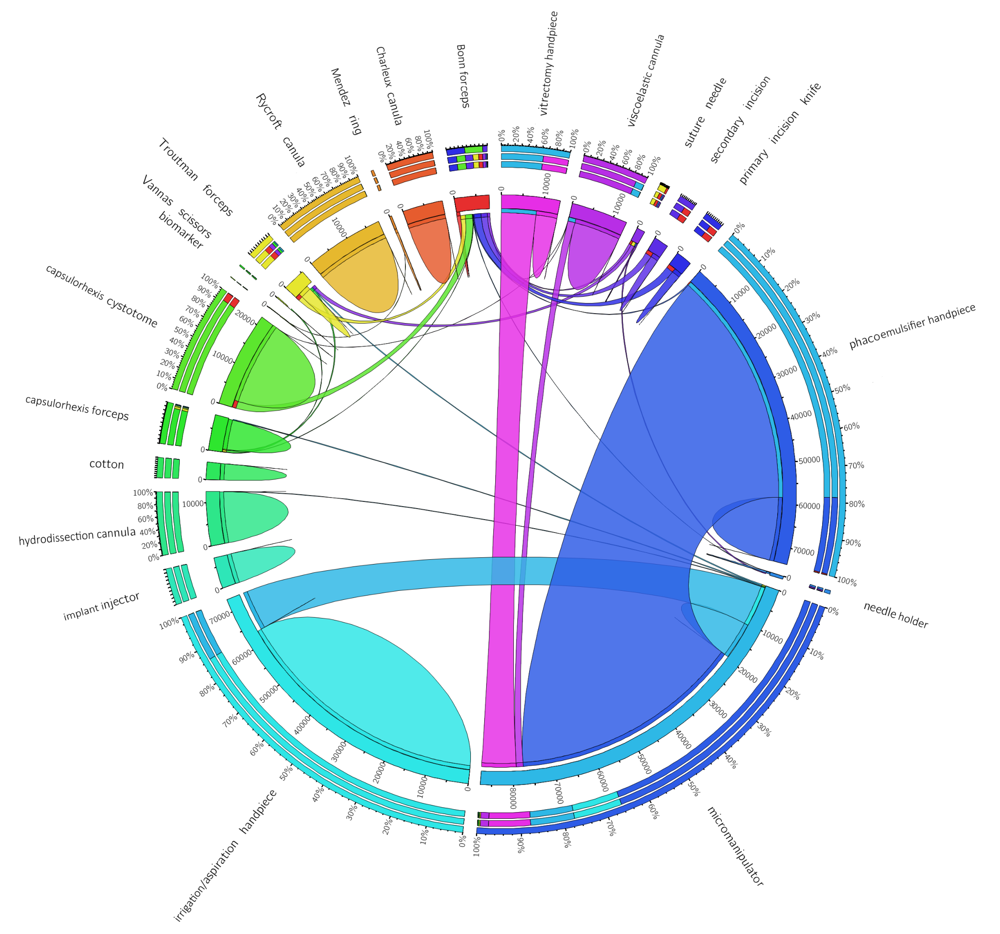
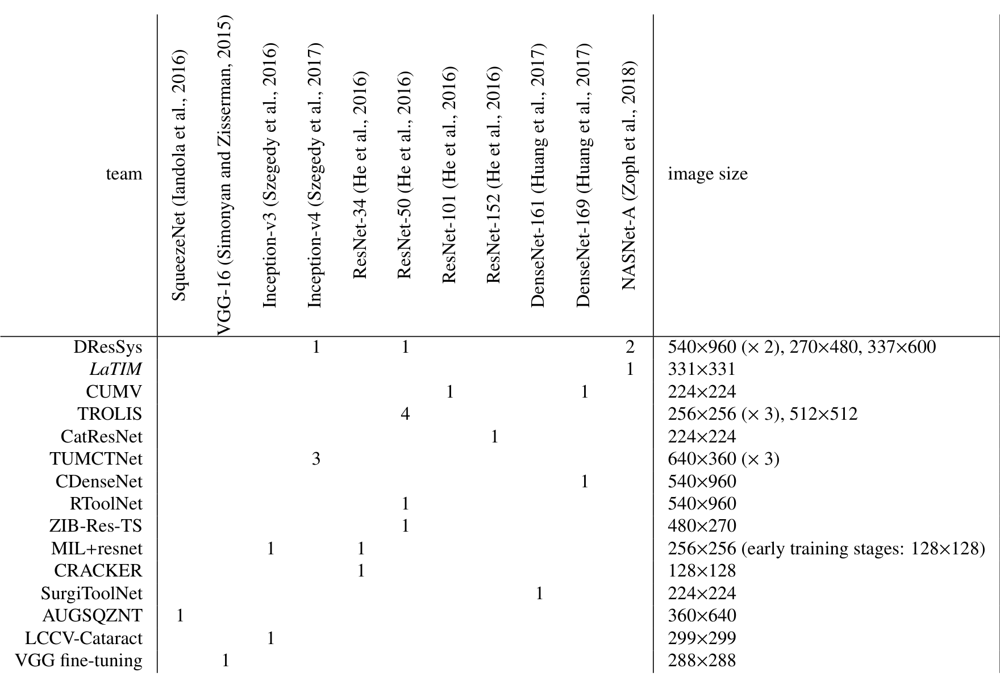
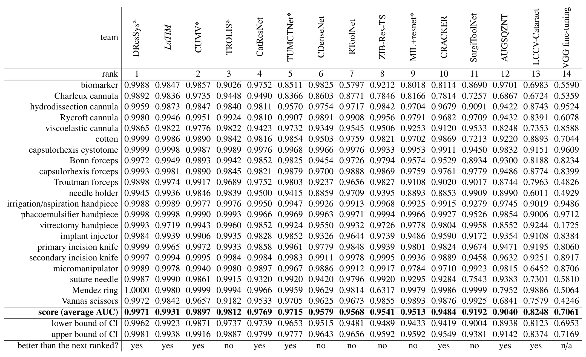
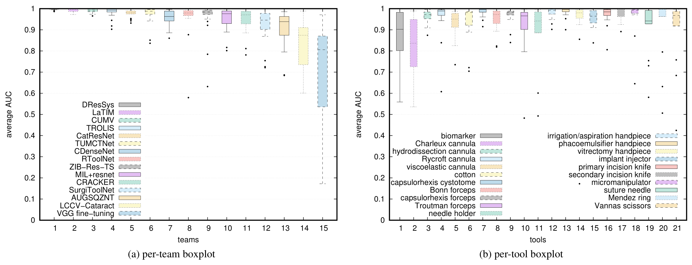
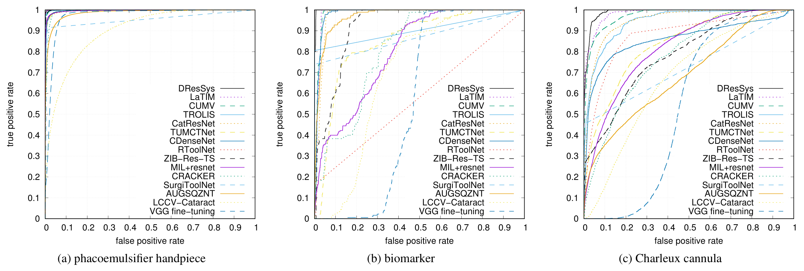
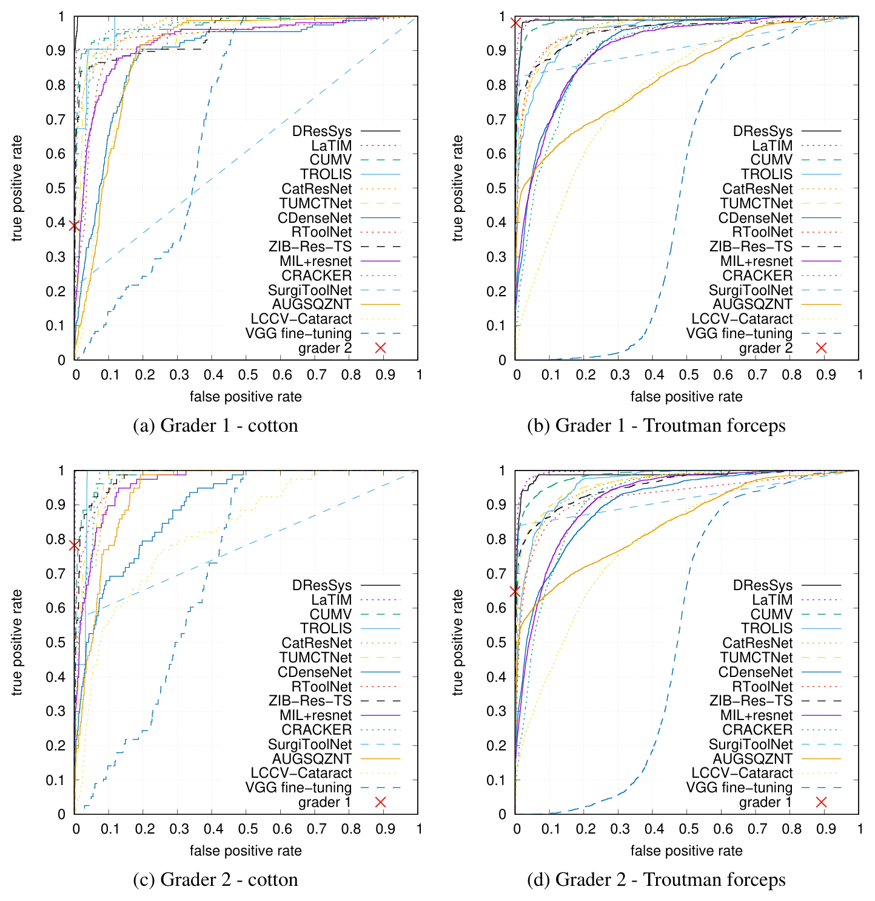
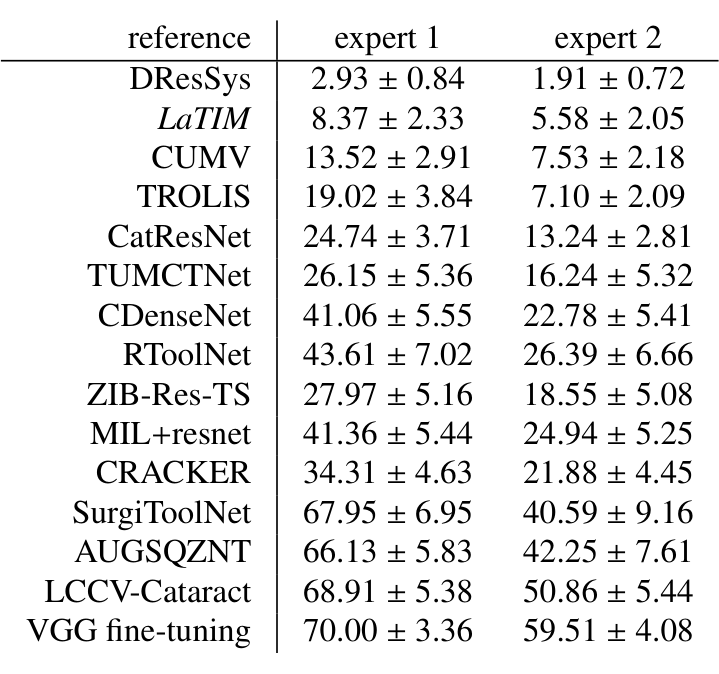
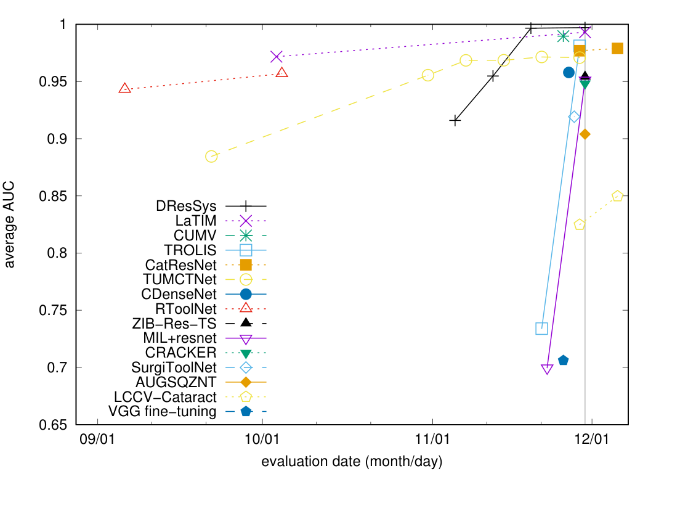

---
tags:
  - papers/手术数据集
aliases:
  - "CATARACTS"
  - "CATARACTS 器械使用标注挑战"
date: 2019
doi: 10.1016/j.media.2018.11.008
---

# CATARACTS: Challenge on Automatic Tool Annotation for cataRACT Surgery

## 核心信息

- 标题: CATARACTS: Challenge on Automatic Tool Annotation for cataRACT Surgery
- 标题翻译: CATARACTS：白内障手术器械自动标注挑战赛
- 作者: Hassan Al Hajj, Mathieu Lamard, Pierre-Henri Conze 等 38 位作者，通讯作者 Gwenolé Quellec
- 机构: 组织方为 Inserm UMR 1101（LaTIM）、西布列塔尼大学、IMT Atlantique 与布雷斯特大学医院；参赛者来自 D-Wave、香港中文大学、慕尼黑工业大学、伦敦大学学院等机构
- 发表时间: 2019（预印本日期 2018-11-13）
- 发表渠道: Medical Image Analysis（期刊论文；本笔记依据作者存档的接收稿）
- DOI: 10.1016/j.media.2018.11.008
- 论文链接: https://discovery.ucl.ac.uk/10068008/1/CATARACTS.pdf
- 代码 / 项目: https://cataracts.grand-challenge.org
- 数据 / 资源: 挑战官网发布 50 个视频与训练集标注，评测脚本在比赛开始时公开；许可条款论文未说明
- 论文类型: 挑战赛与数据集论文（benchmark_or_dataset）

## 原文摘要翻译

手术器械检测正受到医学图像分析界越来越多的关注。其目标通常不是精确定位图像中的器械，而是指出医生在每一时刻正在使用哪些器械。标注器械使用的主要动机是设计高效的手术流程分析方案，潜在应用包括报告生成、手术培训，乃至实时决策支持。

现有的大多数器械标注算法都针对腹腔镜手术。然而，白内障手术每年约有 1900 万例，是世界上最常见的手术。CATARACTS 挑战赛于 2017 年组织，用于在白内障手术这一特定场景下评测器械标注算法。它基于 50 台白内障手术、超过九小时的视频，其中 21 种手术器械的出现由两名专家人工标注。

共有 14 支队伍参赛，这一挑战可以视为成功。不出所料，提交的方案都基于深度学习。本文全面评估了这些方案，特别是将它们的标注质量与人类判读进行了比较。随后讨论了对这些方案做差异分析得到的经验。我们期望这些经验能指导近期高效手术监测工具的设计。

## 创新点

1. 第一个眼科手术视频分析挑战。此前的手术视频挑战（M2CAI 2016、EndoVis 2015 与 2017）都针对机器人辅助的消化道手术，器械集合标准化；白内障是手工显微手术，医生可以从多家厂商的器械中挑选，因此要区分 21 种器械。
2. 以“接触眼球”定义器械使用，而不是“画面中可见”。这让标签更接近医生的操作意图，也使问题变成判断哪把器械正在起作用。
3. 概率参考标准：两名专家独立标注，只裁决器械身份分歧，不裁决接触时刻，于是每帧每种器械得到 0、0.5 或 1 三个值；评测时忽略 0.5 帧。这把时间边界上的不确定性显式地留在标签里。
4. 允许八个月内多次提交，但要求每次提交实质不同、附技术报告，并设一周冷却期。论文借此能追踪各队逐次改进的效果。
5. 对 15 个方案做横向拆解（训练帧选择、数据增广、骨干网络、后处理、类别不均衡策略五张表），并把算法与另一名人类专家在同一参考下比较，给出“与专家差多少”的量化答案。

## 一句话总结

CATARACTS 用 50 个白内障手术视频和 21 种器械的帧级接触标注办了一次为期八个月的挑战赛；冠军 DResSys 平均 AUC 达 0.9971，在同等敏感度下比人类专家只低 2.93 和 1.91 个百分点的特异度，但这些结论来自单中心数据和忽略专家分歧帧的指标。

## 研究问题

白内障是全球致盲的首要原因，手术是唯一治疗；论文引用的数字是每年约 1900 万例。因为量大，它也是眼科医生最先要掌握的手术。分析医生的手术流程可以帮助新手自评、帮助找出最佳做法，术中还可能在流程异常时自动提醒。

器械是“医生此刻在做什么”的最直接信号。作者选择标注器械使用而不是直接标流程，理由是白内障手术用的器械与其他手术相近，器械使用识别算法更容易迁移。

问题在于已有的器械检测评测都在腹腔镜。M2CAI 2016 有器械检测子任务，EndoVis 两届有器械分割子任务，它们面对的是机器人臂上的标准器械。白内障显微手术里同类器械外形接近，种类多，而且最多三把同时在用。没有公开数据，就无法比较方法，也无法知道深度学习在这个场景到底做到了什么程度。

论文要回答的是：在白内障手术视频上，自动器械使用标注能做到多好，哪些设计真正有用，离人类专家还有多远。

### 核心观点速览

- **数据**：50 个视频按视频对半分成训练 25、测试 25，21 种器械，每帧每器械一个 0、0.5、1 的标签，标签含义是器械是否接触眼球。
- **评测**：每种器械算一条 ROC 曲线的面积，忽略专家分歧帧，再对 21 种器械取平均。指标只看连续分数的排序。
- **结果**：14 支队伍全部用深度学习；DResSys 平均 AUC 0.9971 排名第一，组织者的 LaTIM 为 0.9931（不计入排名），末位 VGG 微调为 0.7061。
- **经验**：靠前的方案大多同时做到五件事，即整视频验证、数据增广、新而深的骨干、多模型集成、时间平滑；但这是 15 个方案之间的相关，没有受控消融。
- **边界**：算法仍低于人类专家；数据只来自一家医院一套设备；作者“任务几乎已解决”的说法没有在新中心验证。
- **与相邻条目的区别**：同一批视频后来被 CaDIS 补了像素级分割；本条目只是帧级的器械使用标注，没有位置信息。

下一节先看数据本身，因为后面所有结论都依赖这套标签的定义方式。

## 数据与任务定义

这一节回答 CATARACTS 里有什么、标签怎么定义、哪些地方会让评测失真。

### 数据来源

数据是 50 例超声乳化白内障手术视频，2015 年 1 月 22 日到 9 月 10 日在布雷斯特大学医院采集。患者平均 61 岁（23 到 83 岁），38 女 12 男，手术原因包括老年性白内障、外伤性白内障和屈光不正。手术由三名医生完成：一位资深专家做了 48 例，一位有一年经验的医生和一位住院医各做 1 例。

设备是蔡司 OPMI Lumera T 显微镜、东芝 180I 相机和 MediCap USB200 记录仪。画面为 1920x1080，约每秒 30 帧。视频平均 10 分 56 秒，最短 6 分 23 秒，最长 40 分 34 秒，总计超过九小时。

**这意味着数据几乎就是一位专家、一套设备的手术风格。** 跨医生和跨设备的泛化在这套数据里无法检验，作者在讨论中也承认这一点。

### 划分

训练 25 个视频、测试 25 个视频，划分时保证每种器械在两侧出现的视频数相差不超过一。官方不提供验证集，由参赛者自己从训练集中切；为何这样设计，论文未说明。后文会看到，各队怎么切直接影响了排名。

### 标注协议

外科医生先列出显微镜画面中出现过的全部器械，得到 21 种。随后两名非临床专家独立逐帧标注，标注工具是连接数据库的网页界面。

- **使用的定义**：器械接触眼球即为在用，标注员记录每次接触开始和结束的时刻。
- **同时使用**：最多三把，医生双手各一把，有时助手再加一把。
- **裁决**：两人对器械身份有分歧时（一人标 A，另一人标 B），一起看视频确定；但接触的精确时刻不裁决。
- **参考标准**：两人都认为未用记 0，都认为在用记 1，意见不一记 0.5。

*论文原图编号：Figure 1。21 种标注器械的示例帧。放在这里是因为子图 b 与 d 两种套管、子图 h 与 j 两种镊子外形非常接近，这正是后文难器械的来源。*

### 一致性与长尾

Table 1 给出两人的 Cohen kappa（衡量两人一致程度、扣除偶然一致的系数，1 为完全一致）和训练帧中的使用占比。下表摘取差别最大的几行。

| 器械 | 裁决前 kappa | 裁决后 kappa | 训练帧使用占比 |
|---|---|---|---|
| 标记笔（biomarker） | 0.835 | 0.835 | 0.0168 % |
| 水分离套管 | 0.868 | 0.982 | 2.43 % |
| Rycroft 套管 | 0.882 | 0.919 | 3.18 % |
| 粘弹剂套管 | 0.860 | 0.975 | 2.54 % |
| Troutman 镊 | 0.764 | 0.764 | 0.258 % |
| 持针器 | 0.630 | 0.630 | 0.0817 % |
| 超声乳化手柄 | 0.996 | 0.997 | 15.3 % |
| 劈核钩（micromanipulator） | 0.990 | 0.995 | 17.6 % |
| Vannas 剪 | 0.823 | 0.823 | 0.0443 % |

这张表说明两件事。

第一，**人与人之间并不总是一致**。持针器 kappa 只有 0.630，Troutman 镊 0.764，裁决前后不变。裁决只修正器械身份，由此推断这两种器械的分歧主要在接触时刻，论文没有单独统计。套管类在裁决后升幅最大，说明它们的主要分歧是认错了套管。

第二，**分布是极端长尾**。最常用的劈核钩占 17.6% 的训练帧，最少的标记笔只占 0.0168%，相差约千倍。按帧训练的模型会被少数几种器械主导。

*论文原图编号：Figure 2。训练帧中器械共现的弦图。放在这里是因为它显示同时使用很常见：超声乳化手柄在 74,000 帧中使用，其中 78,5% 的帧同时在用劈核钩。*

共现的普遍性决定了任务必须是多标签分类：一帧可以有零到三个正标签。后文 LCCV-Cataract 的失败就来自忽略了这一点。

## 方法主线

这是挑战赛论文，“方法”指评测协议、比赛规则和参赛方案的共同做法，不是单个模型。

### 评测协议

参赛者为测试集每帧每种器械提交一个置信度。对每种器械，在测试帧上扫描阈值得到 ROC 曲线并计算曲线下面积，参考标准为 0.5 的帧不参与计算。全局指标是 21 种器械的平均：

$$\text{score} = \frac{1}{21}\sum_{T} \mathrm{AUC}(T)$$

置信区间先用 DeLong 法算每种器械 AUC 的区间，再假设器械相互独立，用平方和的均方根合成平均 AUC 的区间半径。每个区间只用于一次比较：某名次是否显著优于下一名。

这个指标有三个后果。它只看分数排序，不看阈值，因此二值输出会吃亏。它等权平均 21 种器械，稀有器械的少量帧对总分的影响和常见器械一样大。它排除专家分歧帧，而这些帧集中在接触开始和结束处；分歧帧在测试集中占多少，论文未说明，所以无法估计排名对时间边界有多不敏感。

### 比赛规则

训练视频与标注、测试视频（无标注）于 2017 年 4 月 1 日发布，提交开放到 11 月 30 日，共八个月。允许多次提交，但有两条限制：

1. 每次提交必须与之前实质不同，例如从单个 CNN 到 CNN 集成再到加时序模型；只改超参数不算。每次都要交技术报告供组织者核查。
2. 成绩和报告立即公开，之后一周内不再评测该队的新提交，以平衡多次提交与只交一次的队伍。

排名取每队最好的一次。有两次提交因冷却期落在截止日之后，不计入排名但在文中讨论。组织者 LaTIM 的方案同样不计入排名。

### 参赛方案的共同流水线

论文把大多数队伍的训练归纳为七步：

1. 从训练视频中选帧。
2. 下采样。
3. 数据增广。
4. 选一个或多个 ImageNet 预训练 CNN。
5. 用多标签损失微调。
6. 可选：训练多模型聚合。
7. 可选：训练时间序列模型。

推理时依次缩放测试帧、可选测试时增广、逐个 CNN 推理、可选聚合、可选时间滤波。**没有一支队伍设计专门的 CNN**，所有方案都用文献中已有的骨干，只改最后几层。

### 机制流程

以冠军 DResSys 为例，把这条流水线落到具体输入输出：

1. **选帧**：输入训练视频，按器械频率提取帧；含稀有器械（如标记笔、Vannas 剪）的视频取全部帧，常见器械段每秒取 6 帧，另从无器械帧中随机取 40,000 帧；输出约 100,000 张训练图。
2. **帧级集成**：输入训练图，分别训练 ResNet-50、Inception-v4（540x960 输入）与两个 NASNet-A（270x480 和 337x600），用 Adam 和 sigmoid 交叉熵，最多 13 轮、批大小 4；输出每帧 21 维概率，再用验证集网格搜索的权重做加权几何平均，融合成一个帧级分数。
3. **时间平滑**：输入整段视频的帧级分数 $s_t$，对每种器械建链式马尔可夫随机场，能量为

$$E(\mathbf{y};\mathbf{x}) = \sum_{t=1}^{T} a(s_t)\,y_t + \frac{w}{2}\sum_{t=1}^{T}\sum_{n\in N(t)} y_t y_n$$

其中第一项的偏置由帧级分数 $s_t$ 经平移和缩放得到。

邻域取当前帧前后 19 帧以内、间隔为 2 的帧，提供长程连接；耦合系数 $w$ 控制相邻帧标签一致的强度。这三个参数由网格搜索确定，在 21 种器械间共享。

输出是用平均场近似计算的每帧边缘概率。
4. **提交**：视频按约 20,000 帧一段处理，边缘概率作为最终置信度提交，进入每器械 AUC 计算。

### 其他有代表性的设计

| 方案 | 与众不同之处 | 名次 |
|---|---|---|
| LaTIM（组织者） | CNN 集成后接 RNN 集成，用 boosting 顺序训练；第二次提交用单个 NASNet-A 加三个单向 LSTM，可在线分析 | 不计入 |
| CUMV | ResNet-101 与 DenseNet-169 集成，用门函数合并 | 2 |
| TROLIS | 常规器械与六种稀有器械分开训练；标记笔用检测黑白斑块的传统视觉算法；用 1,200 帧测试集图像做负样本 | 3 |
| CRACKER | ResNet-34 加基于手术顺序的规则，例如推注器不可能出现在灌注抽吸或玻切手柄之前 | 10 |
| MIL+resnet | 先用多示例学习判断帧里有无器械，再对有器械的帧做 21 类分类 | 9 |
| LCCV-Cataract | 22 类互斥的多类分类，训练时丢掉多器械帧 | 13 |
| CDenseNet | 唯一不用 ImageNet 预训练的方案 | 6 |

TROLIS 用了测试帧作负样本，这在规则内但值得注意，它让模型接触了测试分布。

*论文原图编号：Table 4。各方案使用的 CNN 与输入尺寸。放在这里是因为它显示前两名都用了 NASNet-A，而末三名用的是 SqueezeNet、Inception-v3 和 VGG-16。*

> [!figure] Table 5 各方案的后处理技术
> 建议位置：方法主线
> 放置原因：这张表列出哪些方案用了中值滤波、移动平均、马尔可夫随机场或 LSTM，对应“时间平滑有用”这条经验。
> 当前状态：保留占位；PDF 中没有提取出这张表的图像，正文用文字说明其内容。

协议和方案已经交代清楚，下一节看它们在同一测试集上的结果。

## 关键结果

这一节回答：在同一测试集上，方案之间差多少，差在哪些器械，离人类有多远。

### 主结果与置信区间

27 次提交来自 14 支队伍，组织者另交 2 次。Table 7 是每队最好一次的结果，下表摘取部分列。

| 名次 | 方案 | 平均 AUC | 95% 置信区间 | 显著优于下一名 |
|---|---|---|---|---|
| 1 | DResSys | 0.9971 | 0.9962 到 0.9981 | 是 |
| 不计入 | LaTIM | 0.9931 | 0.9923 到 0.9938 | 是 |
| 2 | CUMV | 0.9897 | 0.9871 到 0.9916 | 是 |
| 3 | TROLIS | 0.9812 | 0.9737 到 0.9887 | 否 |
| 4 | CatResNet | 0.9769 | 0.9739 到 0.9799 | 是 |
| 9 | MIL+resnet | 0.9513 | 0.9433 到 0.9592 | 否 |
| 13 | LCCV-Cataract | 0.8248 | 0.8123 到 0.8374 | 是 |
| 14 | VGG 微调 | 0.7061 | 0.6953 到 0.7169 | 无 |

**DResSys、LaTIM、CUMV 依次显著优于下一名，第 6 到第 9 名都不显著优于各自的下一名。** 这说明平均 AUC 在 0.95 一带已经挤在一起，中段名次不应过度解读。

*论文原图编号：Table 7。每队最佳方案的每器械 AUC、平均 AUC 与置信区间，星号表示 CNN 集成。放在这里是因为它是全文排名的唯一依据，也能看到各方案在单个器械上的崩溃点。*

### 难器械与易器械

*论文原图编号：Figure 4。按队伍和按器械分组的 AUC 箱线图。放在这里是因为右图中前两种器械的箱子最长。*

Figure 4 显示，Charleux 套管、标记笔、缝合针、持针器和粘弹剂套管最难，超声乳化手柄和撕囊截囊针对所有方案都容易。原因可以分成两类：

- **样本太少**：标记笔只占 0.0168% 的训练帧。RToolNet 在它上面的 AUC 只有 0.5797，接近随机。
- **外观太像**：Charleux 套管与 Rycroft 套管形状和功能相近。即便是 DResSys，Charleux 套管也只有 0.9892，是它 21 种器械中的最低值之一。

*论文原图编号：Figure 5。超声乳化手柄、标记笔和 Charleux 套管三种器械的 ROC 曲线。放在这里是因为 (b) 中 TROLIS 的曲线从高真阳性率起步后几乎是直线，正是二值输出的形状。*

> [!figure] Table 6 各方案的类别不均衡策略
> 建议位置：关键结果
> 放置原因：这张表对比重采样、加权损失、稀有器械专用检测器、共现分析等策略的使用情况。
> 当前状态：保留占位；PDF 中没有提取出这张表的图像。

单个器械上的崩溃也会拖垮平均：VGG 微调在玻切手柄上只有 0.1725，ZIB-Res-TS 在 Mendez 环上只有 0.6317。

### 与人类专家比较

作者把其中一名专家裁决前的标注当参考，检查算法能否追上另一名专家。

*论文原图编号：Figure 7。以单个专家裁决前标注为参考的 ROC 曲线，红叉为另一名专家的工作点。放在这里是因为它是人机比较的直接证据：(c) 以专家 2 为参考的棉签子图中，DResSys 曲线略高于专家 1 的红叉，其余子图红叉都在所有曲线之上。*

结论是另一名专家几乎总优于所有方案，唯一例外是 DResSys 在棉签上略好于专家 1。为了量化差距，作者在专家的敏感度处计算算法特异度的相对下降。

| 方案 | 相对专家 1 | 相对专家 2 |
|---|---|---|
| DResSys | 2.93 ± 0.84 | 1.91 ± 0.72 |
| LaTIM | 8.37 ± 2.33 | 5.58 ± 2.05 |
| CUMV | 13.52 ± 2.91 | 7.53 ± 2.18 |
| TROLIS | 19.02 ± 3.84 | 7.10 ± 2.09 |
| VGG 微调 | 70.00 ± 3.36 | 59.51 ± 4.08 |

*论文原图编号：Table 8。同等敏感度下算法相对专家的特异度下降，21 种器械取平均并给出标准误。放在这里是因为它把“接近专家”换成了可比较的数字。*

**只有冠军把差距压到几个百分点以内，LaTIM、CUMV、TROLIS 已经差到 5 到 19。** 这比平均 AUC 的差距（0.9971 对 0.9897）直观得多：AUC 接近 1 时，小差异对应的是实际可观的误报差别。

需要注意，Table 8 只给 21 种器械的平均和标准误，没有逐器械的值；Figure 7 也只展示两种器械。难器械上的人机差距有多大，从这两处读不出来。

### 提交时间线

*论文原图编号：Figure 3。各方案每次提交的评测日期与平均 AUC，灰色竖线为截止日。放在这里是因为它显示连续提交几乎都在提升，大部分改进集中在最后三个月。*

约一半队伍在最后三个月多次提交。连续提交几乎总是带来提升，唯一例外是 TUMCTNet 最后一次，且降幅很小。DResSys 的几次提交依次改了训练帧选择并加入时序模型、增加 CNN 并把中值滤波换成马尔可夫随机场、再增加 CNN 并改损失函数；论文没有拆分每一步各自带来多少提升。

结果说完，下一节问：这些差别到底由什么造成，又有哪些不能从这些表里读出。

## 深度分析

### 五条正面经验到底有多可靠

15 个方案的分数都摆在面前，问题是哪些设计真正带来了名次。

作者逐一对照表 2 到表 6，认为以下因素与名次正相关：

1. 保留整段视频做验证，而不是随机抽帧。
2. 使用数据增广。
3. 使用新一代、更深的 CNN，尤其是 NASNet-A。
4. 使用多个 CNN 或 RNN。
5. 使用时间平滑。

DResSys 五条全占。第 1 条有清楚的机制：相邻帧几乎相同，随机抽帧做验证会让验证集与训练集高度相关，模型选择会偏向过拟合。第 5 条也有机制：器械使用在相邻帧间很少变化，视频撕裂伪影又按固定间隔出现，平滑能补掉短暂的漏检和误报。

**但这五条是 15 个方案之间的观察性相关。** 各队同时改了骨干、输入尺寸、选帧、损失和后处理，组织者没有做受控消融。前两名都用了 NASNet-A，但它们也都用了集成和时序模型，无法单独归功于骨干。

另一种解释同样成立：投入更多、提交更多的队伍自然会同时做齐这五件事。要区分两者，需要同一队伍只改一个因素的前后对比；论文列出了各次提交改了什么，却没有逐项的分数拆分。

作者同样列出看起来不影响名次的因素：训练帧数量、增广类型（随机裁剪对比随机仿射）、输入尺寸（默认尺寸对比更大尺寸）、测试时增广。这些“无影响”的判断同样来自 15 个点的粗略比较，统计功效很低。

> [!figure] Figure 6 典型的时间预测信号
> 建议位置：深度分析
> 放置原因：这张图展示几个方案在测试视频 6 和 13 上的逐帧预测，能看出谁做了时间平滑，以及误报在各方案间高度相关。
> 当前状态：保留占位；自动视觉质量检查拒绝了裁图。

### 哪些做法明确失败

正面经验不够干净，反面例子反而更有说服力。

失败的证据比成功的证据更干净，因为它们对应清楚的机制：

- **多类建模**：LCCV-Cataract 把任务当成每帧只有一个标签，丢掉了多器械帧。Figure 2 显示多器械同时使用很常见，这个假设与数据冲突，名次第 13。
- **二值输出**：SurgiToolNet 在网络末端加了阈值层，TROLIS 的标记笔检测器也输出二值。AUC 依赖连续分数排序，二值输出把整条 ROC 曲线压成一个点再连线，必然失分。这对部署无害，对这个指标有害。
- **时序模型遇上可互换器械**：所有镊子都可能用来夹缝合针，不只是持针器。TROLIS 发现去掉循环网络后反而提升，说明学到的器械顺序在这里会误导。
- **复杂不等于好**：MIL+resnet 设计了两阶段多示例学习，只排第 9。

这些失败都与具体机制相连。下面换个角度：排名本身是否可信。

### 挑战设计本身的问题

多次提交是这次挑战的新做法，也带来一个作者自己承认的偏差：有几支队伍（具体是哪几支，论文未说明）在看到测试集上的每器械 AUC 后，发现某些器械没有出现在自己的训练子集里，于是重新划分验证集。作者认为这一方面纠正了本可以靠计数避免的疏忽，另一方面可以视为在测试集上训练。这些提交因含有方法改进而被接受。

**我的判断**：这意味着排名后段的部分提升不完全是方法进步。冷却期能减少反复调参，但公开每器械成绩本身就是测试集信息。复用这套数据时，应当只用训练集交叉验证选模型，并只在最后测一次。

### 这套数据真正测到了什么

排除了设计偏差后，还要问这个分数衡量的是什么能力。

它测的是：给定单中心、单套设备、以一位专家为主的白内障视频，帧级分类器能否把“接触眼球的器械”排在“未接触”之前。它不测：

- 器械位置，标签没有框也没有掩码；
- 接触时刻的精度，分歧帧被排除在 AUC 之外；
- 实时性能，没有统一硬件下的计时；
- 跨医院、跨显微镜的泛化。

### 与其他数据集的定位

最后把它放回手术器械数据集的谱系里。

| 数据集 | 手术与场景 | 器械标签 | 与 CATARACTS 的关系 |
|---|---|---|---|
| M2CAI 2016 器械检测 | 消化道手术 | 帧级存在，标准器械 | 场景不同，器械集合更小 |
| EndoVis 2015 / 2017 | 机器人消化道手术 | 器械分割 | 标注更细，但器械标准化 |
| CATARACTS | 手工白内障显微手术 | 21 种器械帧级接触 | 本文 |

同一批视频后来被 CaDIS 补了像素级分割标注，与本条目是不同的标注层；本笔记只涉及帧级器械使用标注。这些边界汇总在下一节。

## 局限

- **只比分类性能**：作者明确说这是主要局限。AUGSQZNT 有意设计能在有限硬件上实时运行的轻量方案，排名因此偏低。各队自报每秒可处理数帧，对称时间滤波带来的延迟通常不到一秒，但这些都不是统一条件下的测量。
- **单中心单设备**：50 个视频来自一家医院、一套显微镜和相机，48 例出自同一位专家。作者建议用不同显微镜、相机和记录仪采集的新数据检验泛化，但论文没有做。
- **分歧帧被排除**：0.5 帧不计入 AUC，这些帧集中在接触开始和结束处，因此排名对时间边界的精度不敏感。
- **人机比较的覆盖**：Figure 7 只展示棉签和 Troutman 镊两种器械；Table 8 是 21 种器械的平均，没有逐器械给出。
- **“几乎已解决”是作者判断**：结论段称这一任务在白内障视频上“几乎已经解决”。证据是单中心测试集上的平均 AUC 和平均特异度下降；对难器械、新中心和下游流程分析的效果，论文未说明。
- **测试集接触**：多次提交与公开每器械成绩，使部分队伍按测试反馈调整了验证划分。

## 我的笔记

- **复用这套数据时报告什么**：每器械 AUC 加平均 AUC 和 DeLong 置信区间；至少单列 Charleux 套管、标记笔、持针器、缝合针这几种难器械。
- **验证划分**：按整视频切，并先计数确认 21 种器械都出现在训练子集里。
- **输出**：提交连续置信度；二值化留到部署时再定阈值。
- **时序模型**：先用中值滤波或移动平均做基线，再考虑 MRF 或 RNN；注意可互换器械会让顺序先验出错。
- **稀有器械**：重采样、加权损失和专用检测器在前排方案中都出现过，但论文没有受控比较哪种最有效。

值得追问的问题：

1. 把专家分歧帧按 0.5 软标签计入评测后，前排名次是否改变？
2. 在其他医院或设备采集的白内障视频上，DResSys 这类方案的 AUC 下降多少？
3. 统一硬件下各方案的每帧耗时是多少，精度与速度的折中曲线长什么样？

## 引用

- Al Hajj, H. et al. (2019). CATARACTS: Challenge on automatic tool annotation for cataRACT surgery. Medical Image Analysis. DOI: 10.1016/j.media.2018.11.008
- Al Hajj, H. et al. (2018). Monitoring tool usage in surgery videos using boosted convolutional and recurrent neural networks. Medical Image Analysis.
- Twinanda, A. P. et al. (2017). EndoNet: A deep architecture for recognition tasks on laparoscopic videos. IEEE TMI.
- Sahu, M. et al. (2017). Addressing multi-label imbalance problem of surgical tool detection using CNN. IJCARS.
- Bouget, D. et al. (2017). Vision-based and marker-less surgical tool detection and tracking: a review of the literature. Medical Image Analysis 35, 633-654.
- DeLong, E. R. et al. (1988). Comparing the areas under two or more correlated receiver operating characteristic curves. Biometrics.

