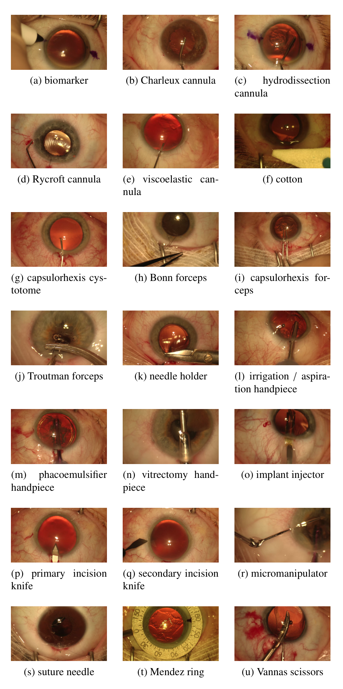
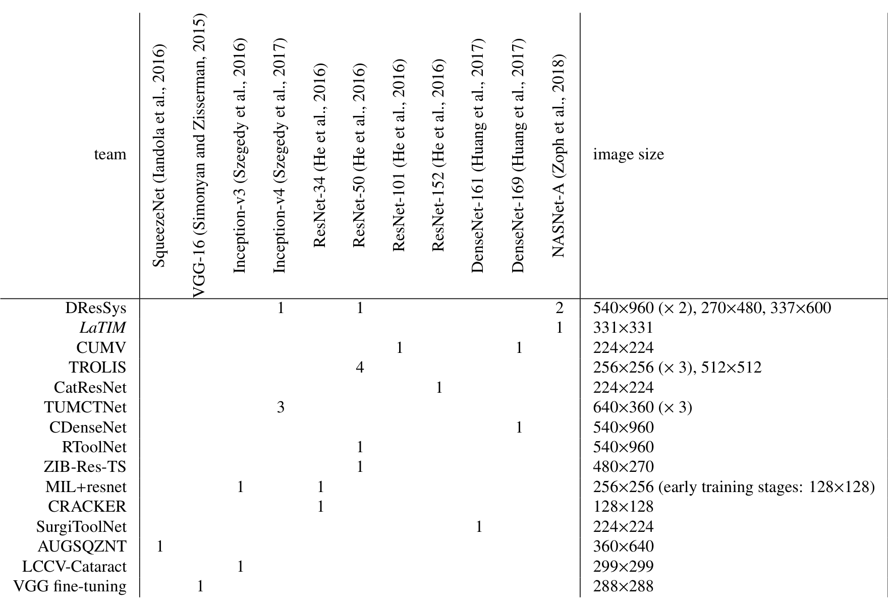
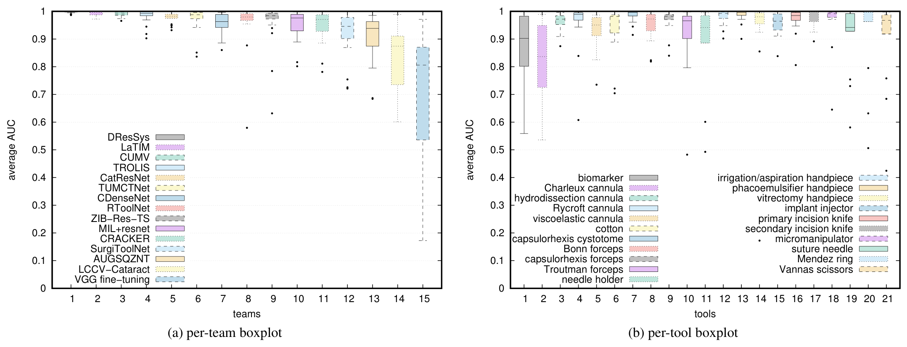
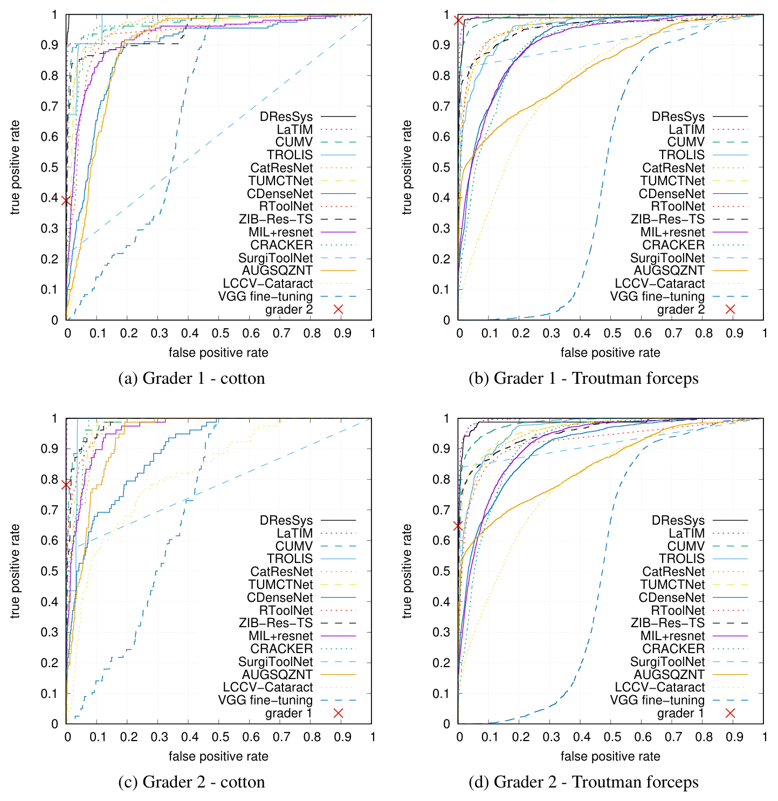

## 1. 背景与动机

**白内障是最常见的手术，却没有公开的器械识别评测。** 论文引用的数字是每年约 1900 万例。器械是“医生此刻在做什么”的最直接信号，识别器械使用可以支撑流程分析、培训自评和术中提醒。

已有挑战都在腹腔镜。M2CAI 2016 有器械检测，EndoVis 两届有器械分割，它们面对的是机器人臂上的标准器械。白内障是手工显微手术，医生可以从多家厂商的器械里挑选，同类器械外形接近，最多三把同时在用。

论文要回答：在白内障视频上，自动器械使用标注能做到多好，哪些设计有用，离人类专家多远。

:::highlights
- 缺口：眼科手术视频没有公开挑战
- 难点：21 种器械、外观相近、多把同时使用
:::

## 2. 核心观点速览

论文的答案分三层。数据是 50 个视频、21 种器械、按“接触眼球”定义的帧级标签；评测是每器械 AUC 再取平均；结果是 14 支队伍全部用深度学习，冠军 DResSys 平均 AUC 0.9971。

**作者归纳出五条与名次相关的经验**：整视频验证、数据增广、新而深的骨干、多模型集成、时间平滑。但这是 15 个方案之间的相关，没有受控消融。

**边界同样清楚**：算法仍低于人类专家；数据来自一家医院一套设备；同一批视频后来被 CaDIS 补了像素级分割，本条目只是帧级使用标注，没有位置。

:::data
- 50 个视频，训练 25、测试 25，21 种器械
- 冠军 0.9971，组织者 LaTIM 0.9931，末位 0.7061
:::

## 3. 数据从哪里来，标签怎么定义

视频在 2015 年采集于布雷斯特大学医院，画面 1920x1080、约每秒 30 帧，平均 10 分 56 秒，总计超过九小时。**50 例中 48 例出自同一位资深专家**，设备是一套蔡司显微镜和东芝相机。

标签的关键是定义：器械接触眼球才算在用。两名非临床专家独立标注接触的起止时刻；只对器械身份的分歧做联合裁决，时刻不裁决。于是每帧每器械得到 0、0.5、1 三个值，0.5 表示两人意见不一。

*论文原图编号：Figure 1。21 种器械的示例帧。几种套管和几种镊子外形非常接近。*

一致性并不完美。持针器的 Cohen kappa（扣除偶然一致后的一致程度）只有 0.630，Troutman 镊 0.764。分布极端长尾：劈核钩占 17.6% 的训练帧，标记笔只占 0.0168%。

:::highlights
- 使用 = 接触眼球，不是可见
- 0.5 帧在评测时被忽略
:::

## 4. 评测协议与比赛规则

每种器械按置信度排序算一条 ROC 曲线下面积，再对 21 种器械等权平均。置信区间用 DeLong 法逐器械计算后合成。

这个协议有三个后果。二值输出会失分，因为 AUC 只看排序。稀有器械与常见器械权重相同。**专家分歧帧被排除，而它们集中在接触起止处**；分歧帧占多少，论文未说明。

比赛开放八个月，允许多次提交，但每次必须实质不同、附技术报告，并有一周冷却期。官方不提供验证集，为何这样设计，论文未说明。

## 5. 参赛方案长什么样

大多数队伍走同一条路：选帧、下采样、增广、微调 ImageNet 预训练 CNN、可选集成、可选时间平滑。**没有一支队伍设计专门的 CNN。**

冠军 DResSys 的做法可以当范本。它按器械频率选出约 100,000 张训练图，集成 ResNet-50、Inception-v4 和两个 NASNet-A，再对每种器械用链式马尔可夫随机场做时间平滑，邻域覆盖前后 19 帧。

*论文原图编号：Table 4。各方案的骨干与输入尺寸。前两名都用了 NASNet-A。*

:::data
- DResSys：约 100,000 张训练图，四个 CNN 集成
- 平滑邻域：前后 19 帧
:::

## 6. 结果说了什么

| 名次 | 方案 | 平均 AUC | 显著优于下一名 |
|---|---|---|---|
| 1 | DResSys | 0.9971 | 是 |
| 不计入 | LaTIM | 0.9931 | 是 |
| 2 | CUMV | 0.9897 | 是 |
| 3 | TROLIS | 0.9812 | 否 |
| 13 | LCCV-Cataract | 0.8248 | 是 |
| 14 | VGG 微调 | 0.7061 | 无 |

**前几名可分，中段挤在一起。** 第 6 到第 9 名都不显著优于下一名，名次不应过度解读。

*论文原图编号：Figure 4。按队伍和按器械的 AUC 箱线图。最难的是 Charleux 套管和标记笔。*

难器械有两类原因：样本太少（标记笔，RToolNet 只有 0.5797）和外观太像（Charleux 套管与 Rycroft 套管）。

## 7. 离人类专家多远

以一名专家裁决前的标注为参考，另一名专家的工作点几乎总在所有 ROC 曲线之上，唯一例外是 DResSys 在棉签上。

*论文原图编号：Figure 7。单专家参考下的 ROC 曲线，红叉为另一名专家。*

在专家的敏感度处，DResSys 的特异度相对下降 2.93 和 1.91，LaTIM 已到 8.37 和 5.58，VGG 微调为 70.00 和 59.51。**平均 AUC 只差千分之几，误报却差出数倍。** 但 Table 8 只给平均，没有逐器械值，难器械上的人机差距读不出来。

:::data
- DResSys 特异度下降 2.93 ± 0.84 与 1.91 ± 0.72
:::

## 8. 哪些经验可信，哪些不可信

失败的例子机制清楚，因而更可信。LCCV-Cataract 按单标签多类建模、丢掉多器械帧，排第 13。SurgiToolNet 输出二值，AUC 失分。TROLIS 去掉循环网络后反而提升，因为所有镊子都可能夹缝合针，器械顺序先验会误导。

五条正面经验则只是相关。投入更多的队伍会同时做齐五件事，要区分需要同队单因素对比，论文没有逐项分数拆分。

**挑战设计本身也有泄漏**：有几支队伍看到测试集每器械 AUC 后改了验证划分，作者承认这可以视为在测试集上训练；是哪几支，论文未说明。

## 9. 结果没说什么

- 器械位置和接触时刻精度，标签不含位置，分歧帧被排除。
- 统一硬件下的速度，只有各队自报每秒数帧。
- 跨医院和跨设备的泛化，作者建议但没有做。
- “任务几乎已解决”是作者判断，证据只是单中心测试集上的平均指标。

## 10. 复用前要核对什么

报告每器械 AUC 和置信区间，单列难器械。验证集按整视频切，先确认 21 种器械都在训练子集出现。输出连续置信度。只在最后测一次测试集。数据许可条款，论文未说明，需要到挑战官网核对。

## @takeaways
- 标签是“接触眼球”，不是“可见”
- 评测排除专家分歧帧，等权平均 21 种器械
- 冠军 0.9971，但中段名次统计上不可分
- 失败例子比成功经验更可信

## @strengths
- 首个眼科手术视频挑战，21 种器械，双人标注加裁决
- 公开评测脚本、置信区间和显著性检验
- 与人类专家的量化比较

## @weaknesses
- 单中心单设备，48 例出自同一位专家
- 成功因素没有受控消融
- 多次提交带来测试集信息泄漏

## @questions
- 分歧帧按 0.5 软标签计入后，名次会变吗？
- 换一家医院的视频，前排方案下降多少？
- 统一硬件下的精度与速度折中是什么样？
