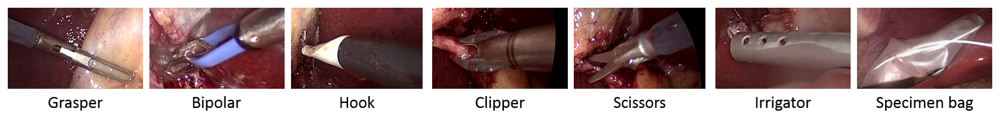
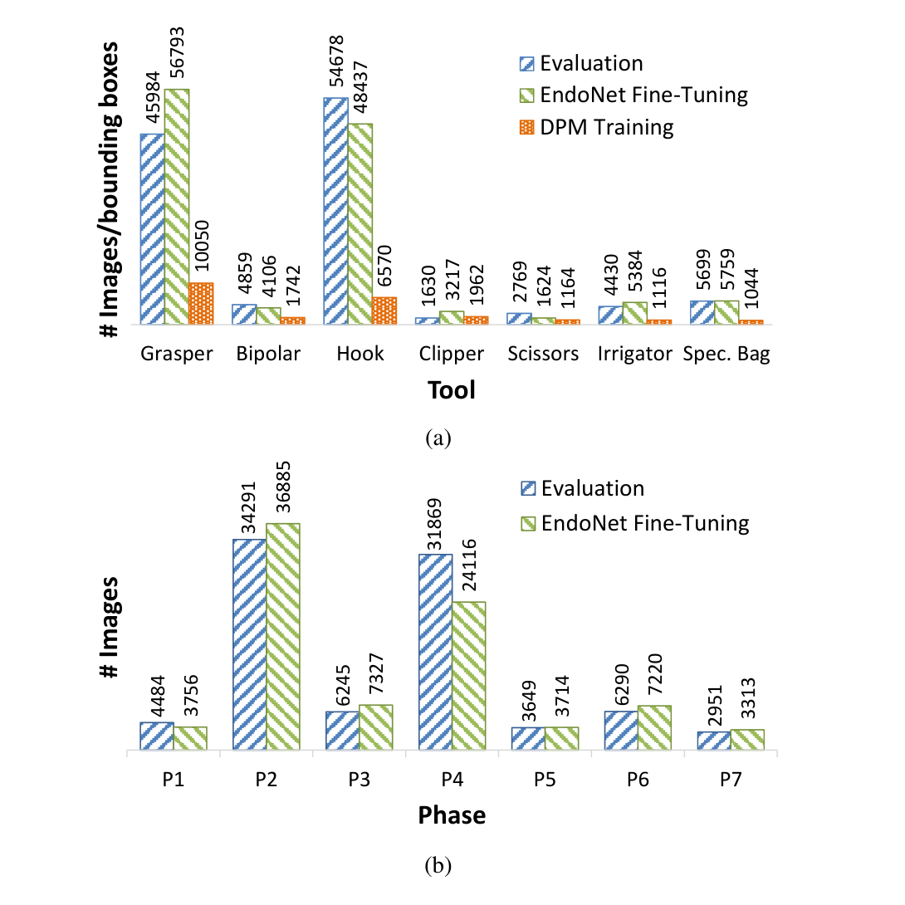
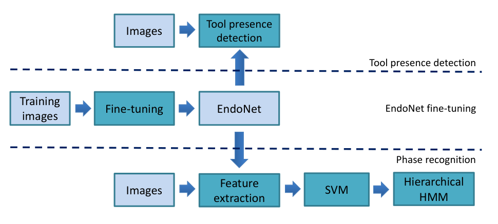
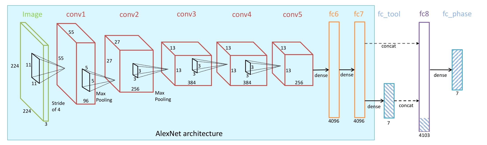
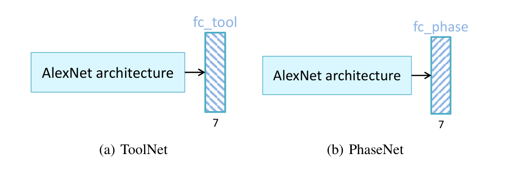
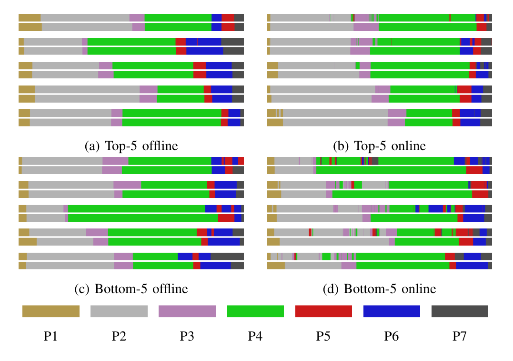
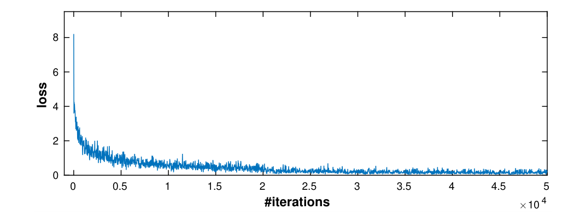

---
tags:
  - papers/手术数据集
aliases:
  - "EndoNet"
  - "Cholec80"
date: 2016
arxiv_id: "1602.03012"
---

# EndoNet: A Deep Architecture for Recognition Tasks on Laparoscopic Videos

## 核心信息

- 标题: EndoNet: A Deep Architecture for Recognition Tasks on Laparoscopic Videos
- 标题翻译: EndoNet：面向腹腔镜视频识别任务的深度网络结构
- 作者: Andru P. Twinanda, Sherif Shehata, Didier Mutter, Jacques Marescaux, Michel de Mathelin, Nicolas Padoy
- 机构: 斯特拉斯堡大学 ICube 实验室（CNRS、IHU Strasbourg）；斯特拉斯堡大学医院、IRCAD、IHU Strasbourg
- 发表时间: 2016（arXiv 第 2 版，2016-05-23）
- 发表渠道: arXiv 预印本（cs.CV）
- arXiv: 1602.03012
- 论文链接: https://arxiv.org/abs/1602.03012
- 数据 / 资源: Cholec80（80 个胆囊切除术视频）；论文称发表后公开完整标注数据和训练好的网络，正文未给出下载地址
- 论文类型: AI_method

## 原文摘要翻译

手术工作流识别有许多潜在的医学应用，例如手术视频数据库的自动索引、手术室实时排程的优化等。因此，阶段识别已经在白内障、神经外科、腹腔镜等多种手术中得到研究。

文献中通常使用两类特征完成这一任务：视觉特征和器械使用信号。然而，所用的视觉特征大多是手工设计的；器械使用信号通常通过人工标注或额外设备获得。

本文提出一种新的阶段识别方法，用卷积神经网络（`CNN`）从胆囊切除术视频中自动学习特征，并且只依赖视觉信息。以往研究表明，器械使用信号能为阶段识别提供有价值的信息。因此，我们提出一种名为 `EndoNet` 的新 `CNN` 结构，以多任务方式同时完成阶段识别和器械存在检测。据我们所知，这是第一项用 `CNN` 在腹腔镜视频上完成多个识别任务的工作。与其他方法的大量实验比较表明，`EndoNet` 在两项任务上都取得了当时最好的结果。

## 创新点

1. **只用视觉输入学特征。** 论文称这是首次用 `CNN` 为腹腔镜视频识别任务提取视觉特征，替代以往的手工特征和需要人工标注或额外设备的器械信号。意义在于测试时不再需要任何人工输入。
2. **多任务结构。** `EndoNet` 在 `AlexNet` 主干后同时接器械存在检测和阶段识别两个输出，并把 7 维器械置信度拼进阶段识别的特征。意义在于让器械信息以自动方式进入阶段识别。
3. **Cholec80 数据集。** 80 个胆囊切除术视频、13 名外科医生、全量阶段与器械存在标注。论文指出此前胆囊切除术数据集不超过 20 台手术，称这是该任务第一项大规模研究，并承诺发表后公开数据与网络。
4. **系统的特征对比。** 在同一 `SVM` 加分层隐马尔可夫模型（`HHMM`）流程下，比较二值器械信号、手工特征、手工特征加 `CCA`、`ImageNet` 预训练 `AlexNet`、单任务微调网络和 `EndoNet`，并同时报告离线和在线结果。
5. **面向应用的评估。** 给出阶段边界的时间误差统计和双极电凝、施夹钳出现块的检测延迟，把识别精度换算成视频索引和术中提示能用的指标。

## 一句话总结

论文在 80 个胆囊切除术视频组成的 Cholec80 上，用一个同时做器械存在检测和阶段识别的 `AlexNet` 扩展网络学习视觉特征，再接 `SVM` 与 `HHMM`，离线阶段识别准确率达到 `92.0%`，器械存在检测平均 `AP` 为 `81.0`，均优于手工特征和单任务网络。

## 研究问题

手术工作流识别是计算机辅助介入领域的基础问题，可用于监控手术进程、优化手术室与人员排程、自动索引手术视频库，长远看还可能提前提示并发症。论文关注其中的阶段识别。

论文指出以往两类特征各有短板。第一类是器械使用信号或"器械、解剖结构、动作"三元组，效果好，但通常靠人工标注或额外设备获取，测试时几乎无法人工提供，自动获取是否可靠仍是开放问题。第二类是视觉特征，例如像素值与梯度、时空特征、颜色纹理形状的组合，这些都是手工设计的，可能丢掉有用信息。腹腔镜视频本身也难：镜头移动带来运动模糊和场景变化，镜头常被血液沾染而模糊或完全遮挡。

相关工作中，Blum 等用器械信号做 `CCA` 降维手工特征，准确率 `76%`，但只在 10 个视频上测试；Lalys 等在白内障手术上达到 `91%`，但白内障镜头静止、器械不带关节、手术更短；Klank 等用遗传编程学特征，受限于预定义算子，有时不如手工特征。

论文要回答两个问题：只用视频画面、自动学习的特征能否在胆囊切除术上取得更好的阶段识别；把器械存在检测作为第二个任务一起训练，能否得到更有区分力的阶段识别特征。

### 核心观点速览

**论文的答案是：用多任务微调的 CNN 当特征提取器，再接 SVM 和时序模型，只看画面就能做好阶段识别和器械存在检测。** 支撑这个答案的有四步。

1. **建数据。** Cholec80 有 80 个胆囊切除术视频，逐帧标注 7 个阶段和 7 种器械，前 40 个用于微调，后 40 个用于评估。
2. **一个网络两项任务。** 在 `AlexNet` 后接 7 维器械输出，再把它拼进阶段识别特征。
3. **时序平滑。** 逐帧 `SVM` 置信度送入两级 `HHMM`，离线用 Viterbi，在线用前向算法。
4. **全面对比。** 与人工器械信号、手工特征、未微调和单任务微调的网络比较，并在另一数据集 `EndoVis` 上验证。

主结果是离线阶段识别准确率 `92.0%`、在线 `81.7%`，器械平均 `AP` 为 `81.0`。**边界要同时记住：收益的大头来自在手术数据上微调和时序模型，多任务本身只多出约 2 到 3 个百分点，且没有显著性检验；全部数据来自一家医院。** 下面先看数据，因为后面每个数字都依赖它的划分方式。

## 数据与任务定义

这一节回答一个问题：阶段识别和器械检测的结果，到底是在什么数据、什么标注规则下测出来的。

### 数据来源

Cholec80 包含 80 个胆囊切除术视频，由斯特拉斯堡大学医院的 13 名外科医生完成。视频以 `25 fps` 录制，处理时降采样到 `1 fps`。全部视频都有阶段和器械存在标注；阶段由合作医院的一名资深外科医生定义。

第二个数据集是 `MICCAI 2015` 工作流挑战赛公开的 `EndoVis` 数据，包含慕尼黑一家医院的 7 个胆囊切除术视频，录制与处理帧率和 Cholec80 相同。

由于器械种类和外观不同，论文只在 `EndoVis` 上做阶段识别。

### 任务定义

器械存在检测：判断一帧中出现了哪些器械，不要求定位。7 种器械为抓钳、双极电凝、电钩、施夹钳、剪刀、冲洗器和标本袋。由于器械有时很难看清，论文规定至少一半器械尖端可见才算存在。

*论文原图编号：Fig. 3。Cholec80 定义的七种手术器械示例。放在这里是因为它直接给出器械存在检测任务的类别。*

阶段识别：对每帧给出 7 个阶段之一。Cholec80 的阶段与平均时长如下（表 I-a，单位秒，均值±标准差）。

| 编号 | 阶段 | 时长（秒） |
|---|---|---|
| P1 | 准备 | 125±95 |
| P2 | Calot 三角分离 | 954±538 |
| P3 | 夹闭与切断 | 168±152 |
| P4 | 胆囊剥离 | 857±551 |
| P5 | 胆囊装袋 | 98±53 |
| P6 | 清洁与凝血 | 178±166 |
| P7 | 胆囊取出 | 83±56 |

`EndoVis` 的阶段定义有三处不同。

- 多了"放置套管针"阶段 P0，它在腹腔镜画面中不一定可见，正确标注需要外部视频等额外信息。
- 准备阶段包含了 Calot 三角分离，所以记作 P12。
- 夹闭与切断阶段更长（390±194 秒）：Cholec80 中该阶段通常在 Calot 三角充分暴露后才开始，而另一数据集把额外的分离步骤也算了进去。

### 划分与标注统计

Cholec80 被分成两半，各 40 个视频。前 40 个是微调子集，约 86K 张标注图像；其中 10 个视频额外标了器械边界框，用于训练可变形部件模型（`DPM`），抓钳和电钩出现频繁，只用 3 个视频的框就已足够。后 40 个是评估子集，两项任务都在这里测试。

*论文原图编号：Fig. 4。Cholec80 标注分布：上图为各器械在评估子集、微调子集和部件模型训练中的图像或框数，下图为各阶段在评估子集和微调子集中的图像数。放在这里是因为它显示了类别极不均衡。*

从图 4 读出的分布很不均衡。器械方面，评估子集中抓钳 45984 张、电钩 54678 张，而施夹钳只有 1630 张、剪刀 2769 张。阶段方面，P2 和 P4 在评估子集中分别有 34291 和 31869 张，P7 只有 2951 张。

**这种不均衡直接决定了后面的失败模式：样本最少的剪刀和施夹钳检测最弱，时长最短的几个阶段最难识别。** 准确率按帧计算，P2 与 P4 两个长阶段占了大部分帧，所以整体准确率高不代表短阶段识别得好。

标注质量方面，阶段由一名资深外科医生定义；标注者人数、标注一致性和标注工具论文未说明，这限制了对标签噪声的估计。

> [!figure] Fig. 5 EndoVis 阶段分布
> 建议位置：数据与任务定义
> 放置原因：它显示 EndoVis 各阶段的图像数，是理解迁移实验数据规模的依据。
> 当前状态：保留占位；自动裁剪混入相邻 Fig. 4 的标题和左栏正文，图体在裁剪中占比过小。

## 方法主线

有了数据，问题变成：怎样只从画面里得到能区分阶段的特征，又怎样让逐帧判断符合手术顺序。论文的回答是一个两分支网络加一个时序模型。

### 机制流程

*论文原图编号：Fig. 1。整体流程：用训练图像微调 EndoNet，之后网络一路直接给出器械存在检测，另一路作为特征提取器，接 SVM 和分层 HMM 完成阶段识别。放在这里是因为它就是下面四步流程的总图。*

1. **微调。** 输入是微调子集的 40 个视频的图像及其器械、阶段标签；操作是从 `ImageNet` 预训练的 `AlexNet` 出发，用两个损失之和做随机梯度下降；输出是训练好的 `EndoNet`。
2. **器械存在检测。** 输入是待测图像；操作是前向计算到 `fc_tool`，7 个节点的置信度直接作为每种器械的存在得分；输出是器械检测结果，用于表 II 的 `AP`。
3. **特征提取与逐帧分类。** 输入是待测图像；操作是取 `fc8` 的 4103 维输出作为特征（4096 维主干特征加 7 维器械置信度），送入一对多线性 `SVM`；输出是每帧的 7 维阶段置信度向量。
4. **时序平滑。** 输入是整段视频的 $\mathbf{v}_p$ 序列；操作是作为观测送入两级 `HHMM`，离线用 Viterbi 算法求最可能路径，在线用前向算法；输出是每帧最终阶段。

### 模型结构

*论文原图编号：Fig. 2。EndoNet 结构：青色框内与 AlexNet 相同，含五个卷积层和两个全连接层；其后接出 7 维器械输出，与主干特征拼接成 4103 维特征，再接 7 维阶段输出。放在这里是因为它给出了全部层的尺寸。*

主干与 `AlexNet` 相同：输入层、五个卷积层（`conv1` 到 `conv5`）和两个全连接层（`fc6`、`fc7`）。

`fc7` 之后有两条分支。一条接 7 节点的器械层 `fc_tool`，每个节点表示一种器械存在的置信度。

另一条把 `fc7` 输出与器械层输出拼接为 `fc8`，再接 7 节点的阶段层 `fc_phase`，每个节点表示属于某个阶段的置信度。

论文给出两个设计假设：用多任务方式微调能学到对阶段识别更有区分力的特征；既然器械信号已被证明对阶段识别有用，把自动生成的器械检测信号放进最终特征能提升识别。

单任务对照网络是 `ToolNet`（`AlexNet` 后只接 `fc_tool`）和 `PhaseNet`（`AlexNet` 后只接 `fc_phase`），同样通过迁移学习训练。

*论文原图编号：Fig. 8。单任务对照网络：左为 ToolNet，右为 PhaseNet，主干与 EndoNet 相同。放在这里是因为它说明消融对照只去掉了另一个任务的输出层。*

### 训练目标

器械存在检测被写成 $N_t = 7$ 个二分类，每个用交叉熵：

$$
\mathcal{L}_T = \frac{-1}{N_i}\sum_{t=1}^{N_t}\sum_{i=1}^{N_i}\Big[k_t^i \log\big(\sigma(v_t^i)\big) + (1-k_t^i)\log\big(1-\sigma(v_t^i)\big)\Big]
$$

其中 $k_t^i$ 取 0 或 1，是第 $i$ 张图第 $t$ 种器械的真值，$v_t^i$ 是器械层输出，$\sigma$ 是 sigmoid 函数。

阶段识别是 7 类多分类，用 softmax 交叉熵：

$$
\mathcal{L}_P = \frac{-1}{N_i}\sum_{i=1}^{N_i}\sum_{p=1}^{N_p} l_p^i \log\big(\varphi(w_p^i)\big)
$$

总损失是两者的加权和：

$$
\mathcal{L} = a\cdot\mathcal{L}_T + b\cdot\mathcal{L}_P
$$

论文把两个系数都取 1，理由是初步实验中调整它们没有带来提升。器械损失系数取 0 等价于 `PhaseNet`，阶段损失系数取 0 等价于 `ToolNet`。

### 关键实现细节

- 初始化：`ImageNet` 预训练的 `AlexNet`，`fc_tool` 和 `fc_phase` 随机初始化。
- 优化：50K 次迭代，批大小 $N_i = 50$；学习率除两个新层为 $10^{-2}$ 外均为 $10^{-3}$，每 20K 次迭代降为十分之一；框架为 `Caffe`。
- 算力：一张 `Titan X` 显卡，每 100 次迭代约 80 秒，每个网络约 11 小时；特征提取约 0.2 秒每张图。
- 后端耗时：`SVM` 训练按特征维度从 0.1 到 90 秒不等；`HHMM` 训练约 15 秒（`MATLAB` 实现）。
- `SVM`：一对多线性 `SVM`；手工特征先经过直方图交叉核；对其他特征试过非线性核，没有提升。
- `HHMM`：顶层状态数为 7，底层状态数由数据决定；每个特征用 5 个高斯的混合建模 `SVM` 输出，二值器械信号用 1 个高斯，对角协方差。

论文没有给出调权重时试过的具体数值，所以系数对结果的敏感度论文未说明。

论文解释了为什么不直接用 `fc_phase`：初步实验中 `fc_phase` 与 `SVM` 输出在 `HHMM` 前后只有很小差别；加 `SVM` 是为了与其他特征公平比较，也为了在阶段定义不同的数据集（如 `EndoVis`）上评估特征。

> [!figure] Fig. 7 两级 HHMM 结构图
> 建议位置：方法主线
> 放置原因：它画出顶层 7 个阶段状态之间允许的转移，其中 P5、P6、P7 之间不是单向顺序，这是后文 P5 与 P6 来回跳变的原因。
> 当前状态：保留占位；自动裁剪混入 Fig. 6 标题和右栏正文，图体占比过小。

### 评测协议

器械存在检测用平均精度（`AP`），即精确率-召回率曲线下面积。阶段识别用精确率、召回率和准确率：召回率和精确率分别是正确检测数除以真值长度和除以检测总长度，按阶段计算后取平均；准确率是整台手术中正确帧的比例。Cholec80 评估子集上做 4 折交叉验证，`EndoVis` 上做全交叉验证；由于流程含随机初始化，报告结果是 5 次运行的平均。阶段识别同时报告 `HHMM` 前后的结果。

阶段识别比较的特征如下。

- 人工标注的二值器械向量：Cholec80 为 7 维，另一数据集为 10 维。
- 手工特征：`SIFT` 词袋、`HOG`、颜色直方图。
- 手工特征加 `CCA`。
- 未微调 `AlexNet` 的 `fc7` 输出。
- `PhaseNet` 的 `fc7` 输出。
- `EndoNet` 的 `fc8` 输出。
- `EndoNet-GTbin`：`EndoNet` 主干特征拼接真值二值器械向量，用来检验自动器械置信度是否已经足够。

器械检测的对照是部件模型 `DPM`（默认参数、每种器械 3 个部件、`HOG` 特征）和 `ToolNet`。

## 关键结果

结果部分要回答三件事：学到的特征是否比旧特征强，多任务是否比单任务强，时序模型贡献了多少。顺序是先看器械检测，再看阶段识别的逐帧结果和平滑后结果。

### 器械存在检测（表 II）

评估子集 40 个视频上的 `AP`：

| 器械 | DPM | ToolNet | EndoNet |
|---|---|---|---|
| 双极电凝 | 60.6 | 85.9 | 86.9 |
| 施夹钳 | 68.4 | 79.8 | 80.1 |
| 抓钳 | 82.3 | 84.7 | 84.8 |
| 电钩 | 93.4 | 95.5 | 95.6 |
| 冲洗器 | 40.5 | 73.0 | 74.4 |
| 剪刀 | 23.4 | 60.9 | 58.6 |
| 标本袋 | 40.0 | 86.3 | 86.8 |
| 平均 | 58.4 | 80.9 | 81.0 |

两个网络都远好于部件模型。为排除数据量差异，论文只用训练部件模型的 10 个视频训练网络，平均 `AP` 仍为 65.9（`ToolNet`）和 62.0（`EndoNet`），高于部件模型的 58.4；而且网络只用存在与否的二值标签，部件模型用的是边界框。

两个网络基本持平，论文据此说多任务训练没有损害器械检测。剪刀是所有方法最差的类别，论文归因于训练样本最少且外观与抓钳相似。

### 阶段识别：HHMM 之前（表 III）

| 特征 | Cholec80 平均精确率 | Cholec80 平均召回率 | Cholec80 准确率 | EndoVis 准确率 |
|---|---|---|---|---|
| 二值器械 | 42.8±33.9 | 41.1±32.3 | 48.2±2.7 | 49.0±9.7 |
| 手工特征 | 22.7±28.8 | 17.9±28.9 | 44.0±1.8 | 36.1±2.6 |
| 手工特征+CCA | 21.9±14.1 | 18.7±23.3 | 39.0±0.6 | 32.6±5.3 |
| AlexNet | 50.4±12.0 | 44.0±22.5 | 59.2±2.4 | 56.9±4.1 |
| PhaseNet | 67.0±9.3 | 63.4±11.8 | 73.0±1.6 | 62.6±4.9 |
| EndoNet | 70.0±8.4 | 66.0±12.0 | 75.2±0.9 | 65.9±4.7 |
| EndoNet-GTbin | 70.1±9.1 | 66.7±11.1 | 75.3±1.1 | — |

只看逐帧分类：未在手术数据上训练过的 `AlexNet` 特征已经超过手工特征和人工器械信号；微调后的 `PhaseNet` 再提高一截；`EndoNet` 继续略高。**这说明问题首先出在手工特征的表达力上，其次才是有没有用多任务。**`EndoNet-GTbin` 只比 `EndoNet` 高约 0.1 个百分点，论文据此认为真值器械信号没有带来额外信息。

### 阶段识别：HHMM 之后（表 IV）

| 特征 | Cholec80 离线准确率 | Cholec80 在线准确率 | EndoVis 离线准确率 | EndoVis 在线准确率 |
|---|---|---|---|---|
| 二值器械 | 69.2±8.0 | 47.5±2.6 | 73.0±21.5 | 69.8±21.7 |
| 手工特征 | 36.7±7.8 | 32.6±6.4 | 46.5±24.6 | 43.4±21.6 |
| 手工特征+CCA | 61.3±8.3 | 38.2±5.1 | 61.1±17.3 | 44.0±22.3 |
| AlexNet | 76.2±6.3 | 67.2±5.3 | 79.5±11.0 | 70.6±12.3 |
| PhaseNet | 89.1±5.4 | 78.8±4.7 | 79.7±12.2 | 71.0±9.2 |
| EndoNet | 92.0±1.4 | 81.7±4.2 | 86.0±6.3 | 76.3±5.1 |
| EndoNet-GTbin | 92.2±3.5 | 81.9±4.4 | — | — |

`HHMM` 对所有特征都有提升，离线优于在线，但特征之间的排序在两种模式下一致。**对 `EndoNet` 来说，时序平滑把准确率从逐帧 75.2 拉到离线 92.0，这一步的提升远大于多任务带来的差异。** 在线比离线低约 10 个百分点，说明只能看过去帧时阶段判断明显更难，术中应用要看在线这一列。Cholec80 上 `EndoNet` 离线平均精确率 84.8±9.1、平均召回率 88.3±5.5，在线分别为 73.7±16.1 和 79.6±7.9。

*论文原图编号：Fig. 9。随机选取的一次运行中准确率最高和最低各 5 个视频的识别色带，每对色带上为预测、下为真值；上排为离线与在线前 5 名，下排为离线与在线后 5 名。放在这里是因为它直观展示了误差集中在哪些阶段。*

离线前 5 个视频准确率超过 `98%`；离线后 5 个视频的主要错误是 P5 与 P6 之间来回跳。在线模式跳变更频繁，因为看不到未来帧，但前 5 个视频准确率仍高于 `92%`。

### 逐阶段结果（表 V）

| 阶段 | 离线精确率 | 离线召回率 | 在线精确率 | 在线召回率 |
|---|---|---|---|---|
| P1 准备 | 83.5±9.6 | 90.9±5.7 | 90.0±5.6 | 85.5±3.9 |
| P2 Calot 三角分离 | 97.1±2.0 | 80.8±4.3 | 96.4±2.0 | 81.1±8.9 |
| P3 夹闭与切断 | 81.0±7.7 | 88.1±7.4 | 69.8±10.7 | 71.2±9.7 |
| P4 胆囊剥离 | 97.3±2.1 | 94.7±1.0 | 82.8±6.2 | 86.5±4.3 |
| P5 胆囊装袋 | 73.1±8.0 | 83.7±5.6 | 55.5±11.9 | 75.5±3.8 |
| P6 清洁与凝血 | 79.7±10.4 | 79.6±8.8 | 63.9±10.5 | 68.7±9.1 |
| P7 胆囊取出 | 81.9±11.8 | 86.7±11.8 | 57.5±11.0 | 88.9±7.5 |

P5 和 P6 最弱，论文的解释是这两个阶段之间不是顺序转移，边界不清楚，有些帧甚至没有任何操作。在线模式下 P5 精确率只有 55.5，P7 精确率也只有 57.5。

### 微调数据量的影响（图 10）

> [!figure] Fig. 10 微调子集大小与性能
> 建议位置：关键结果
> 放置原因：它给出 10、20、30、40 个视频微调时器械检测平均 AP 和阶段识别准确率的变化，是多任务优势随数据量变化的唯一证据。
> 当前状态：保留占位；没有提取到这张图的独立图像候选，数值已转录到下表。

| 微调视频数 | ToolNet 平均 AP | EndoNet 平均 AP | PhaseNet 准确率 | EndoNet 准确率 |
|---|---|---|---|---|
| 10 | 65.9 | 62 | 65.8 | 65.9 |
| 20 | 70.9 | 67.5 | 68.2 | 70.8 |
| 30 | 73.6 | 77.5 | 72.1 | 72.5 |
| 40 | 80.9 | 81 | 73 | 75.2 |

性能随微调视频数增加而上升。阶段识别上多任务网络在各个规模都不低于单任务网络；器械检测上 10 和 20 个视频时多任务网络较低，30 个视频后反超。论文据此说 `EndoNet` 更能利用大数据集。**反过来读，小数据下多任务对器械检测是负担；“更能利用大数据”只有四个点、一次曲线支撑，图上没有误差条。**

论文没有说明图中准确率是时序平滑前还是后的结果；40 个视频处的 75.2 和 73 与表 III 的逐帧结果一致，因此应是平滑之前的值。

### EndoVis 迁移

在 `EndoVis` 上，两个微调网络相对未微调 `AlexNet` 的提升小于 Cholec80，论文认为这是因为网络在 Cholec80 上微调。但 `EndoNet` 在所有设置中都最好，离线准确率 86.0±6.3。

该数据集的器械与 Cholec80 不同，`fc8` 里的 7 维器械置信度在这里只能看作 7 个附加标量特征，论文认为它们仍有帮助。

### 两个应用

视频索引（离线，表 VI）：在 40 个评估视频中，`89%` 的阶段边界误差在 30 秒以内，只有 `6%` 超过 2 分钟。P1 和 P5 的 40 个边界全部在 30 秒内；P6 只有 35 次出现，因为不是每台手术都有清洁与凝血阶段。

器械出现块检测（表 VII）：把同一器械连续出现的帧定义为一个块，真值中间隔小于 15 秒的块合并；块中只要有一帧检出就算识别，同时统计首帧延迟。阈值按高精确率选取。

| 延迟 | 双极电凝 | 施夹钳 |
|---|---|---|
| 小于 5 秒 | 114 | 49 |
| 6 到 29 秒 | 9 | 10 |
| 30 到 59 秒 | 1 | 0 |
| 60 秒及以上 | 0 | 1 |
| 漏检 | 0 | 1 |
| 误报率 | 3.8% | 8.3% |

双极电凝的块全部检出，`90%` 以上在 5 秒内，论文归功于它的蓝色杆身；施夹钳误报率更高，但 `80%` 和 `97%` 的块分别在 5 秒和 30 秒内检出。

## 深度分析

前面的数字已经给出排序，这一节讨论排序背后的原因，以及哪些说法超出了证据。

### 为什么有效

证据链分三层。

第一层是"学到的特征比手工特征强"：时序平滑前，未微调 `AlexNet` 特征准确率 59.2，已高于手工特征 44.0 和人工器械信号 48.2，说明问题主要出在手工特征的表达力上。

第二层是"在手术数据上微调很关键"：`PhaseNet` 把准确率推到 73.0，时序平滑后离线 89.1，这一步贡献最大。

第三层才是"多任务"：`EndoNet` 相对 `PhaseNet` 在时序平滑前高 2.2 个百分点，离线后高约 3 个百分点，在另一数据集上离线高约 6 个百分点。

`EndoNet-GTbin` 的对照最有信息量。把真值器械信号拼进主干特征，逐帧准确率只高约 0.1 个百分点，说明 `fc8` 中自动器械置信度已经覆盖了器械信号能提供的大部分阶段线索。同时，人工器械信号单独使用时离线准确率只有 69.2，远低于 `EndoNet` 的 92.0，论文据此认为画面中除了器械存在外还有大量对阶段有用的信息。

`HHMM` 的作用不能被低估。`EndoNet` 从逐帧 75.2 升到离线 92.0，提升约 17 个百分点，大于多任务带来的差异。手工特征加 `CCA` 在 `HHMM` 前比手工特征差，`HHMM` 后反而好很多，说明不同特征的 `SVM` 输出在时序模型下的表现很不一样，单看逐帧结果会误判。

### 多任务收益到底被证明到什么程度

阶段识别上的收益在 Cholec80 和 `EndoVis` 都出现，方向一致，但幅度只有 2 到 3 个百分点，且论文没有做显著性检验。表 III 中 `EndoNet` 与 `PhaseNet` 的平均精确率之差（70.0 对 67.0）小于它们各自的标准差，精确率和召回率的标准差是跨阶段计算的，不能直接当作运行间波动。

器械检测上多任务没有优势：平均 `AP` 81.0 对 80.9；剪刀上 `EndoNet` 更差；小数据（10、20 个视频）时 `EndoNet` 明显低于 `ToolNet`。因此"多任务得到更好的网络"只对阶段识别特征成立，并且只在约 40 个视频的微调规模上成立。

论文没有分离两个因素：多任务损失对主干表征的改变，和 `fc8` 中额外拼入的 7 维器械置信度。多任务网络用的是拼接后的特征，单任务对照用的是拼接前的特征，两者的差异混合了这两个因素。

只用多任务网络拼接前的特征做阶段识别，就能把两者分开，但论文没有做这个实验，所以“多任务改善了表征”这一点论文未说明。

泛化结论也要收窄。`EndoVis` 上分类器和时序模型都在目标数据上重新训练，证明的是特征可迁移，不是整个系统能直接用到别的医院。

### 失败模式

错误集中在 P5（装袋）和 P6（清洁与凝血）。图 7 的 `HHMM` 结构里这几个阶段之间可以来回转移，模型因此会在两者间跳；这两个阶段持续时间短（98±53 秒和 178±166 秒），图像中还常有无操作的空镜头。在线模式没有未来帧来纠正，P5 精确率降到 55.5，P7 降到 57.5。剪刀和施夹钳的检测弱，与它们在数据中样本少、出现时间短一致。

### 作为数据集论文的价值

Cholec80 有 80 个视频，而论文称此前的胆囊切除术数据集都不足 20 台手术；它覆盖 13 名外科医生，阶段时长标准差很大（P2 为 954±538 秒），能体现手术执行差异。标注规则简单可复用：`1 fps`、帧级阶段标签、帧级二值器械标签、半个尖端可见算存在。

它的偏差也很明确：单一医院、单一术式；评估子集与微调子集来自同一机构，论文自己承认可能过拟合；阶段定义来自一名资深外科医生，论文未说明标注者人数、标注一致性和标注工具；器械只区分 7 类，不含套管针等画面外器械。

*论文原图编号：Fig. 6。EndoNet 微调过程中总损失随迭代次数的变化。放在这里是因为它是判断 50K 次迭代是否训练充分的唯一证据。*

### 复现注意点

- 4 折交叉验证的具体视频分组论文未说明，复现时分组不同会带来波动。
- 阶段标注的一致性论文未说明，无法估计标签噪声对上限的影响。
- `HHMM` 的底层状态数由数据决定，具体如何确定只引用了作者的前作 [31]，论文未说明细节。
- 器械检测的 `AP` 是在全部 40 个评估视频上计算的，网络只在微调子集上训练；阶段识别的 `SVM` 和 `HHMM` 则在评估子集内交叉验证训练。两项任务的训练数据范围不同，复现时要分开处理。
- 应用实验（表 VI、表 VII、图 9）来自单次随机运行，不是 5 次平均。

## 局限

论文自述的局限有三条。第一，Cholec80 全部来自一家医院，数据复杂度受限于同一机构外科医生的操作差异，用它训练可能过拟合并降低泛化，需要其他机构的数据。第二，阶段识别仍依赖 `HHMM` 施加时序约束，`EndoNet` 特征本身不含时间信息。第三，`HHMM` 与 `EndoNet` 分开训练，特征没有针对整个阶段识别任务优化；论文认为有更多训练数据后可用 `LSTM` 解决。

这三条都指向同一个方向：特征学习和时序建模是分开的两段，后续工作要把它们合起来训练。

从实验设计看还有几处边界。

- `EndoVis` 只有 7 个视频，且分类器与时序模型在该数据上重新训练，只能说明特征可迁移，不能说明整个系统无需目标域标注。
- 多任务收益没有显著性检验，也没有拆开多任务损失与 `fc8` 拼接两个因素。
- 所有网络都基于 `AlexNet`，结论能否推广到更深的主干，论文未说明。
- 手工特征只选了一组组合，`CCA` 的具体维度等细节论文未说明。

## 我的笔记

- 这篇论文今天的主要价值是 Cholec80，而不是 `EndoNet` 结构本身。用这个基准时要记住原始协议：后 40 个视频评估、4 折交叉验证、5 次平均、离线与在线分开报。
- 多任务带来的阶段识别收益只有 2 到 3 个百分点，最大的提升来自在手术数据上微调和 `HHMM` 时序平滑。引用"多任务有效"时应说明这一点。
- `EndoNet-GTbin` 这种"把辅助任务的真值替换进去"的对照值得复用，它能直接判断辅助分支是否已学到足够信息。
- P5、P6 的跳变说明逐帧分类加顺序模型在非顺序阶段上有天然弱点，这正是后续端到端时序模型的切入点。

## 引用

- Twinanda 等（2016）. EndoNet: A Deep Architecture for Recognition Tasks on Laparoscopic Videos. arXiv:1602.03012.
- Krizhevsky 等（2012）. ImageNet classification with deep convolutional neural networks. NIPS.
- Girshick 等（2014）. Rich feature hierarchies for accurate object detection and semantic segmentation. CVPR.
- Padoy 等（2012）. Statistical modeling and recognition of surgical workflow. Medical Image Analysis.
- Blum 等（2010）. Modeling and segmentation of surgical workflow from laparoscopic video. MICCAI.
- Padoy 等（2009）. Workflow monitoring based on 3D motion features. ICCV Workshops.
- Felzenszwalb 等（2010）. Object detection with discriminatively trained part based models. TPAMI.
