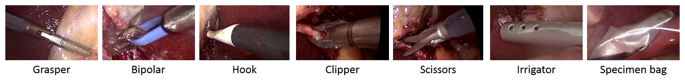
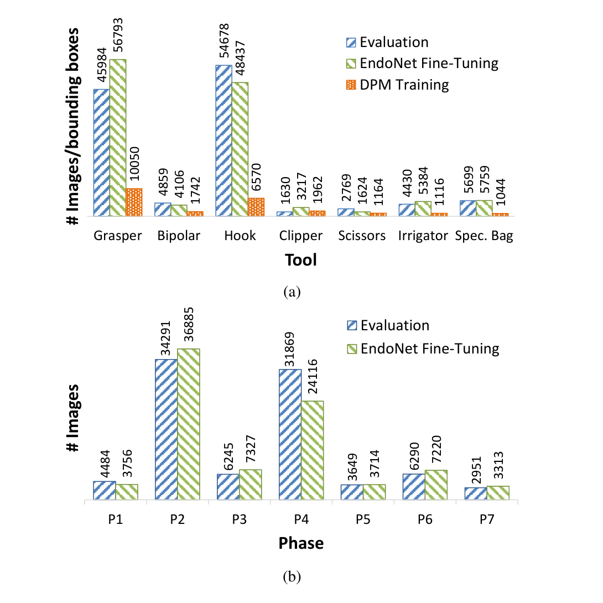
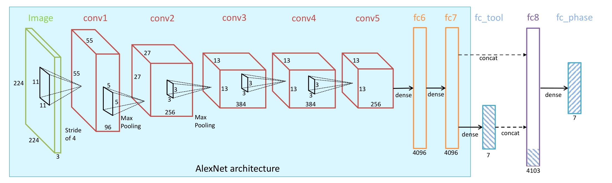
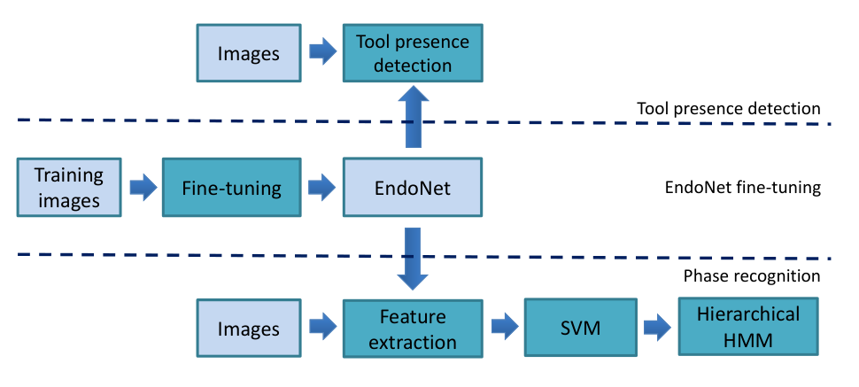
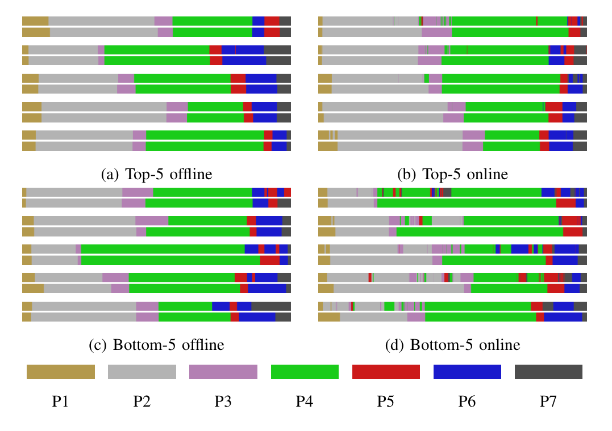

## 1. 背景与动机

**手术阶段识别需要知道"现在做到哪一步了"，但以往方法要么靠人工输入，要么靠手工特征。** 器械使用信号对识别很有用，可它通常来自人工标注或额外设备，测试时拿不到。视觉特征则多是像素、梯度、颜色纹理这类手工设计，可能丢掉关键信息。

腹腔镜视频本身也难。镜头一直在动，画面模糊、场景变化大；镜头还常被血液沾染。论文引用的前作中，Blum 等用 `CCA` 降维手工特征得到 `76%` 准确率，但只测了 10 个视频；Lalys 等在白内障手术上达到 `91%`，可白内障镜头静止、器械不带关节。

所以论文要回答：只看画面、自动学出来的特征能不能做好胆囊切除术的阶段识别？把器械检测当作第二个任务一起训练，能不能让特征更好？下一节先给出答案的全貌。

## 2. 核心观点速览

**论文的答案是：用多任务微调的卷积网络做特征提取，再接分类器和时序模型，只看画面就能做好两项任务。** 它分四步实现。

1. **建数据。** Cholec80 有 80 个视频、13 名外科医生，逐帧标 7 个阶段和 7 种器械。
2. **一个网络两项任务。** 在 `AlexNet` 后接 7 维器械输出，再把它拼进阶段识别的特征。
3. **时序平滑。** 逐帧 `SVM` 置信度送入两级分层隐马尔可夫模型（`HHMM`）。
4. **全面对比。** 与人工器械信号、手工特征、未微调网络、单任务网络比较，并在另一数据集 `EndoVis` 上检验。

主结果：离线阶段识别准确率 `92.0%`，在线 `81.7%`，器械平均 `AP` 为 `81.0`。**但收益的大头来自在手术数据上微调和时序模型，多任务本身只多出约 2 到 3 个百分点，没有显著性检验。** 下面从数据讲起，因为每个数字都依赖它的划分。

:::highlights
- 只用画面输入，测试时不需要任何人工器械标注
- 器械置信度被拼进阶段特征，是"多任务"的具体落点
- 时序模型对准确率的贡献大于多任务
:::

:::data
- 离线阶段识别准确率 92.0%，在线 81.7%
- 器械存在检测平均 AP 81.0
:::

## 3. Cholec80：数据从哪里来、怎么标

**这一节回答：结果是在什么数据、什么规则下测出来的。** Cholec80 来自斯特拉斯堡大学医院，80 个胆囊切除术视频，`25 fps` 录制、降到 `1 fps` 处理。阶段由一名资深外科医生定义；至少一半器械尖端可见才算器械存在。

*论文原图编号：Fig. 3。Cholec80 定义的七种器械：抓钳、双极电凝、电钩、施夹钳、剪刀、冲洗器、标本袋。*

数据分成两半。前 40 个视频是微调子集，约 86K 张图，其中 10 个视频另标了器械框，供部件模型 `DPM` 训练；后 40 个视频是评估子集。7 个阶段时长差异很大：Calot 三角分离 954±538 秒，胆囊取出只有 83±56 秒。

*论文原图编号：Fig. 4。上图为各器械的图像或框数，下图为各阶段的图像数，分评估子集和微调子集。*

**类别极不均衡，这直接决定了后面的失败模式。** 评估子集中电钩有 54678 张，施夹钳只有 1630 张。准确率按帧计算，两个长阶段占了大部分帧，整体准确率高不代表短阶段识别得好。标注者人数和标注一致性论文未说明，因此无法估计标签噪声。

`EndoVis` 是另一家医院的 7 个视频，阶段定义不同：多了放置套管针阶段，准备阶段并入了 Calot 三角分离。论文只在它上面做阶段识别。数据清楚了，接下来看网络怎么从画面里取特征。

:::data
- 80 个视频，13 名外科医生，40/40 划分
- 微调子集约 86K 张图
- EndoVis 只有 7 个视频
:::

## 4. EndoNet：一个网络做两件事

**问题是：怎样让器械信息进入阶段识别，又不需要人工标注？** 论文的做法是让网络自己先检测器械，再把检测结果当特征用。

*论文原图编号：Fig. 2。EndoNet 结构：青色框内与 AlexNet 相同；fc7 接出 7 维器械层，再与 fc7 拼接成 4103 维的 fc8，最后接 7 维阶段层。*

主干就是 `AlexNet` 的五个卷积层和两个全连接层。`fc7` 后分两路：一路接 7 节点的器械层，每个节点是一种器械的存在置信度；另一路把 `fc7` 的 4096 维和器械层的 7 维拼成 `fc8`，再接 7 节点的阶段层。

训练用两个交叉熵损失之和。器械检测是 7 个二分类，阶段识别是 7 类多分类：

$$
\mathcal{L} = a\cdot\mathcal{L}_T + b\cdot\mathcal{L}_P
$$

论文取两个系数都为 1，理由是调整它们没有带来提升，但试过哪些值论文未说明。系数取 0 就退化成单任务的 `ToolNet` 或 `PhaseNet`，这两个网络是后面的对照组。

微调设置：从 `ImageNet` 预训练权重出发，50K 次迭代，每批 50 张图；新层学习率 $10^{-2}$，其余 $10^{-3}$，每 20K 次迭代降十倍。单个网络在一张 `Titan X` 上训练约 11 小时。网络只给出逐帧判断，下一步要处理时间顺序。

## 5. 时序模型：让逐帧判断符合手术流程

**逐帧分类不知道前后帧，会在阶段之间乱跳。** 论文用 `fc8` 特征训练一对多线性 `SVM`，得到每帧 7 维置信度，再送入两级 `HHMM`：顶层状态是阶段，底层状态刻画阶段内部变化。

*论文原图编号：Fig. 1。整体流程：微调 EndoNet 后，一路直接做器械检测，一路提取特征，经 SVM 和分层 HMM 得到阶段。*

离线模式能看整段视频，用 Viterbi 求最可能路径；在线模式只能看到当前帧为止，用前向算法。为什么不直接用阶段层输出？论文说两者差别很小，接 `SVM` 是为了让所有特征走同一流程，并能在阶段定义不同的 `EndoVis` 上评估。

`HHMM` 底层状态数由数据决定，具体做法只引用了作者前作，论文未说明细节。流程搭好后，关键是看对比实验能证明什么。

## 6. 结果说了什么

**结论先行：学到的特征远好于旧特征，微调和时序平滑贡献最大，多任务锦上添花。** 器械检测上，两个网络平均 `AP` 都在 81 左右，远高于部件模型的 58.4。

| 器械 | DPM | ToolNet | EndoNet |
|---|---|---|---|
| 双极电凝 | 60.6 | 85.9 | 86.9 |
| 剪刀 | 23.4 | 60.9 | 58.6 |
| 平均 | 58.4 | 80.9 | 81.0 |

为排除数据量差异，网络只用部件模型的 10 个训练视频时，平均 `AP` 仍为 65.9 和 62.0，高于 58.4。**这说明只用"有或没有"的二值标签就足以训练器械检测。** 剪刀最差，样本少且外形像抓钳。

阶段识别的对比是全文核心（Cholec80 评估子集，准确率）：

| 特征 | 逐帧 | 离线平滑 | 在线平滑 |
|---|---|---|---|
| 人工器械信号 | 48.2 | 69.2 | 47.5 |
| 手工特征 | 44.0 | 36.7 | 32.6 |
| 未微调 AlexNet | 59.2 | 76.2 | 67.2 |
| PhaseNet | 73.0 | 89.1 | 78.8 |
| EndoNet | 75.2 | 92.0 | 81.7 |

**未微调的网络已经超过人工器械信号，说明问题首先出在旧特征的表达力上。** 微调把逐帧准确率从 59.2 推到 73.0，时序平滑再把 `EndoNet` 从 75.2 推到 92.0，多任务只在这之间多出约 2 个百分点。

*论文原图编号：Fig. 9。一次运行中最好和最差各 5 个视频的识别色带，每对上为预测、下为真值。*

离线最好的 5 个视频准确率超过 `98%`；最差视频的错误集中在胆囊装袋与清洁凝血两阶段之间来回跳。在线模式没有未来帧纠错，跳变更多，前 5 个视频仍高于 `92%`。

:::data
- 器械平均 AP：DPM 58.4，ToolNet 80.9，EndoNet 81.0
- 逐帧准确率：PhaseNet 73.0，EndoNet 75.2
- 离线准确率：PhaseNet 89.1，EndoNet 92.0
:::

## 7. 两个对照：真值器械信号和数据量

**如果把自动器械置信度换成真值，会更好吗？** `EndoNet-GTbin` 把真值器械标签拼进主干特征，离线准确率 92.2，只比 `EndoNet` 高约 0.1 到 0.2 个百分点。**自动检测的器械信号已经提供了器械能提供的大部分阶段线索。**

数据量实验（图 10）微调 10、20、30、40 个视频。阶段识别上 `EndoNet` 每档都不低于 `PhaseNet`；器械检测上 10 和 20 个视频时 `EndoNet` 反而较低（62 对 65.9），30 个视频后才反超。论文据此说多任务更能利用大数据，但这只是四个点的一条曲线，没有误差条。

图 10 的准确率是平滑前还是后，论文未说明；40 个视频处的 75.2 和表 III 一致，应是平滑前。

:::highlights
- 真值器械信号几乎不带来额外收益
- 小数据下多任务对器械检测是负担
:::

## 8. 迁移到 EndoVis 与两个应用

**特征换一家医院还管用吗？** 在 `EndoVis` 的 7 个视频上，`EndoNet` 特征在所有设置中最好，离线准确率 86.0，高于 `PhaseNet` 的 79.7。但分类器和时序模型都在该数据上重新训练，**证明的是特征可迁移，不是整个系统可以直接搬过去。**

视频索引应用中，`89%` 的阶段边界误差在 30 秒以内，只有 `6%` 超过 2 分钟。器械出现块检测中，双极电凝的块全部检出，其中 114 个在 5 秒内，误报率 3.8%；施夹钳误报率 8.3%，`80%` 的块在 5 秒内检出。这些来自单次运行，不是多次平均。

## 9. 结果没说什么

第一，**多任务是否真的改善了表征，论文没有分清。** `EndoNet` 用 `fc8`，`PhaseNet` 用 `fc7`，差异混合了多任务损失和多拼的 7 维器械置信度。用 `EndoNet` 的 `fc7` 单独测试就能分开，论文未报告。

第二，多任务收益没有显著性检验。逐帧平均精确率 70.0 对 67.0 的差距，小于两者各自的标准差（8.4 和 9.3）。

第三，数据全部来自一家医院，论文自己承认可能过拟合；4 折交叉验证的视频分组论文未说明。第四，特征学习与时序模型分开训练，网络特征不含时间信息，论文把端到端时序模型留作未来工作。

## 10. 复现要注意什么

- 协议：后 40 个视频评估，4 折交叉验证，5 次运行平均，离线和在线分开报。
- 两项任务的训练范围不同：器械检测只用微调子集训练网络；阶段识别的分类器和时序模型在评估子集内交叉验证训练。
- 时序模型细节：顶层 7 个状态，每个特征用 5 个高斯混合建模，对角协方差；底层状态数怎么定要查作者前作。
- 应用实验和色带图来自单次随机运行。

## @takeaways
- Cholec80 的价值大于 EndoNet 结构本身：80 个视频、逐帧阶段与器械标注、40/40 划分。
- 收益排序是：在手术数据上微调 > 时序平滑 > 多任务。
- 只用二值存在标签就能训练出平均 AP 81.0 的器械检测。
- 引用"多任务有效"时要说明幅度只有约 2 到 3 个百分点，且未分离 fc8 拼接的作用。

## @strengths
- 在同一流程下系统比较六类特征，离线与在线都报。
- EndoNet-GTbin 对照设计巧妙，直接检验了自动器械信号是否够用。
- 用边界时间误差和器械块延迟把精度翻译成应用指标。
- 承诺在发表后公开完整标注数据和训练好的网络。

## @weaknesses
- 单一医院、单一术式，泛化只在 7 个视频上验证。
- 多任务收益小且无显著性检验，两个因素未分离。
- 标注者人数、一致性和交叉验证分组论文未说明。
- 特征与时序模型分开训练，非端到端。

## @questions
- 去掉 fc8 中 7 维器械置信度后，EndoNet 相对 PhaseNet 还剩多少优势？
- 在多中心数据上冻结整个系统，准确率会下降多少？
- 端到端时序模型能否消除胆囊装袋与清洁凝血之间的跳变？
