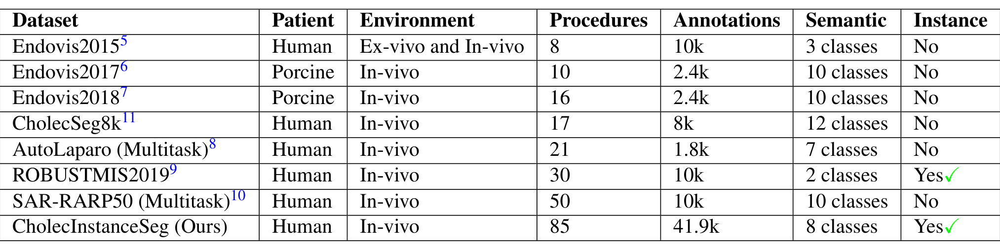
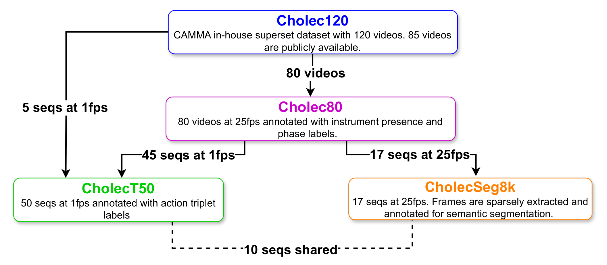
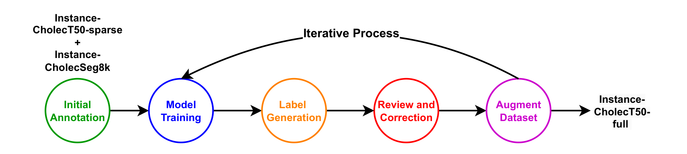
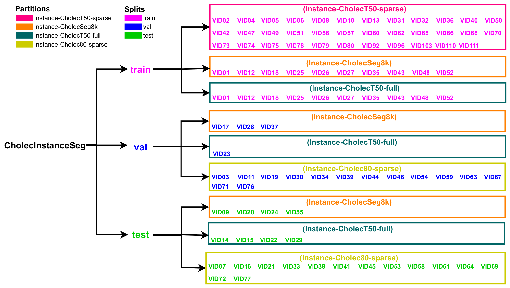
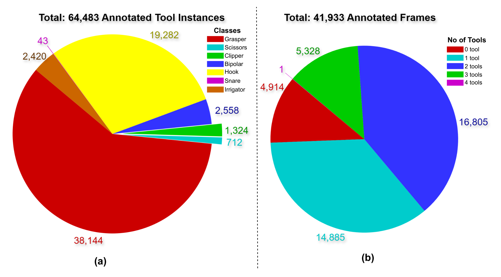

## 1. 背景与动机

微创手术只能通过内镜看画面，辅助系统需要知道画面里有哪些器械、各在哪里。这要求实例分割：不仅分出器械像素，还要给同类的不同个体不同编号。

已有数据卡在四个地方：多来自猪手术；多任务数据集里器械部分很少；有的只有单类二值实例；大多没有实例编号。**论文要补的缺口是人体常规手术、多类器械、带实例编号、规模足够训练。**

*论文原图编号：Table 1。常用器械分割数据集对比，是"最大开放实例分割数据集"这一说法的依据。*

表 1 里带实例信息的只有 ROBUST-MIS2019（两类）和本文。同期的 PhaKIR 因未完全公开没有纳入比较，所以"最大"是在表中范围内成立。

:::highlights
- 没有新采视频，而是在 Cholec80 家族已有视频上加标注
:::

## 2. 核心观点速览

**这是一份数据发布论文，贡献是标注本身和生产标注的流程。**

- **数据：** 四个分区共 41,933 帧、64,483 个实例，七类器械。
- **生产：** 语义标签转实例、SAM 点提示人工标注、检测模型生成候选再人工修正。
- **评测：** 按视频划分，指标为 COCO mAP 加按序列计算的 smAP。
- **结果：** Mask2Former 为 61.47 mAP，Mask R-CNN 为 41.70；圈套器无结果，剪刀波动最大。
- **边界：** 单一医院、单一术式；一致性子集规模和基线训练设置论文未说明。

:::data
- 85 个序列，41,933 帧，64,483 个实例
- 训练 26,830 帧，验证 4,284 帧，测试 10,819 帧
:::

## 3. 85 个序列从哪里来

所有帧来自 CAMMA 团队的内部数据集 Cholec120 的三个公开子集。理解它们的重叠关系，是读懂后面划分的前提。

*论文原图编号：Figure 1。Cholec120 与三个公开子集的关系，其中 CholecT50 与 CholecSeg8k 共享 10 个序列。*

| 分区 | 序列 | 采样 | 帧数 | 实例数 |
|---|---|---|---|---|
| Instance-CholecSeg8k | 17 | 沿用全部帧 | 8,080 | 10,523 |
| Instance-CholecT50-sparse | 35 | 每 30 帧取 1 帧 | 2,681 | 4,098 |
| Instance-CholecT50-full | 15 | 全部 1 fps 帧 | 28,317 | 45,221 |
| Instance-Cholec80-sparse | 28 | 每 30 帧取 1 帧 | 2,855 | 4,641 |

**全序列分区一个就占了约三分之二的帧和七成的实例。** 这意味着规模主要来自 15 段视频的连续帧，独立场景数远少于帧数暗示的那样多。

## 4. 标什么、怎么标

七类器械为抓钳、双极钳、电钩、施夹器、剪刀、冲洗吸引器和圈套器；圈套器是作者在 Cholec80 六类之外新增的。夹子、缝针、缝线、标本袋、纱布不标；有器械伸出时，套管算作器械的一部分。

协议列出 12 种困难情形，如烟雾、反光、器械在液体中，并要求查看相邻帧、按预期形状推断。表 1 写 8 个语义类别，与七类器械差一类，论文未说明差的是什么。

三条生产路线：

- **语义转实例：** 对 CholecSeg8k 按类做连通域分析；遮挡造成的碎片合并、同类重叠重标、标签噪声清理，共处理 892 个问题帧。
- **人工标注：** 两个稀疏分区用改造过的 Segment Anything Annotator，以点提示为主，困难情形手工描边。
- **模型辅助：** 全序列分区，见下一节。

## 5. 半自动标注流程

*论文原图编号：Figure 3。半自动标注的迭代流程，从种子标注到全序列分区。*

1. 种子：CholecSeg8k 分区与 CholecT50 稀疏分区，补标新增类别。
2. 用种子训练 RTMDet-Ins-l，对未标注帧生成候选。
3. 人工修正：小错用 LabelMe 改，大错用 SAM 重标。
4. 再训练：第一轮约 11k 张训练、生成约 10k、修正 5k；第二轮 21k 张训练、生成约 17k、修正 4k。

**多数生成帧没有被修改，它们是逐帧审核过还是只抽查，论文未说明。** 这直接决定全序列分区的质量下限。

## 6. 划分与指标

*论文原图编号：Figure 7。推荐划分及每部分包含的视频编号。*

共享的 10 个视频全部放进训练集，验证和测试只用各分区独有的视频，所以评测反映的是对新手术的泛化。

smAP 先在每个序列内算某类平均精度，再对序列取平均，最后对类别取平均：

$$smAP=\frac{1}{C}\sum_{j=1}^{C}sAP_j$$

它让每段视频等权，抵消全序列分区的权重。某类在某段视频缺席时如何处理，论文未说明，这会左右稀有类的结果。

## 7. 结果说了什么

| 方法 | 抓钳 | 电钩 | 冲洗吸引器 | 施夹器 | 双极钳 | 剪刀 | mAP | smAP |
|---|---|---|---|---|---|---|---|---|
| Mask R-CNN | 37.25 | 61.84 | 43.04 | 58.73 | 28.42 | 20.91 | 41.70 | 50.18 |
| Mask2Former | 61.10 | 82.16 | 68.38 | 81.30 | 48.02 | 27.89 | 61.47 | 74.92 |

圈套器两项都是空值，汇总指标是其余六类的平均。**Mask2Former 每类都更高，说明数据对模型有区分度。** 但两者都是默认超参、单次训练，主干和分辨率论文未说明，不能当强基线。

*论文原图编号：Figure 5。各类实例数与每帧器械数，抓钳和电钩合计约占九成实例。*

正文说约 5,328 帧没有器械，图 5(b) 中这个数是 3 个器械的帧，无器械帧为 4,914。图中五项相加等于总帧数，所以应以图为准。

## 8. 结果没说什么

**作者把电钩最好归因于频次高，但数字不支持。** 抓钳实例约为电钩两倍，两个模型上都低 20 多个点；施夹器实例少，却高于抓钳。我的判断：末端形状是否固定更可能是原因，论文没有做混淆分析。

剪刀全局精度最低，序列精度却高，标准差达 33.20。作者解读为跨序列差异大；另一种解释是剪刀只出现在少数测试序列，平均的是少数几个数。每类覆盖几个测试序列，论文未说明，两种解释分不开。

**质控给出的是"修了多少"，不是"还剩多少错"。** 两项一致性分别为 91.2 和 95.7，子集大小都未说明。半自动与人工一致，也可能是修正者被候选锚定。

:::highlights
- 频次解释不了类别间的差距
- 95.7 的一致性无法排除锚定
:::

## 9. 质控做了什么

| 检查 | 结果 |
|---|---|
| 超过 3 个器械的帧全部复查 | 修正 26 帧 |
| 对照 Cholec80 器械存在标签找漏标 | 发现 267 个错误帧，作者称成功率约 48% |
| 器械间重叠超过 0.1 IoU 的帧复查 | 调整 247 帧 |

三项规则都针对特定错误；边界精度这类规则覆盖不到的误差没有量化，作者也承认允许边界有小瑕疵。

## 10. 复现要注意什么

- 原图要从 CAMMA 和 Kaggle 下载后用作者脚本对齐；测试集标注需申请。
- 共享的 10 个视频在训练集出现两次，训练时权重偏高。
- 三个序列为 1920×1080，具体是哪三个论文未说明，预处理需统一尺寸。
- 七类评测要单独说明圈套器的处理，并同时报告 mAP、smAP 和每类覆盖的序列数。

## @takeaways
- 这是目前可公开获取、带七类器械实例编号的胆囊切除术数据，可与 Cholec80 阶段标签、CholecT50 动作三元组对齐
- 规模主要来自全序列分区的 15 段视频，独立场景少于帧数所暗示的
- 两个基线只是可训练性的证明，不是强基线
- 语义转实例和模型辅助迭代标注的流程可以直接复用

## @strengths
- 按视频隔离的划分，避免同一手术泄漏到评测
- 公开了连通域转换中三类失败的处理方式和各阶段工时
- 用父数据集的器械存在标签交叉检查漏标，思路可迁移
- smAP 和序列标准差暴露了跨手术的波动

## @weaknesses
- 单一医院、单一术式，没有跨中心验证
- 一致性子集规模、半自动帧审核方式、基线训练设置都未说明
- 圈套器仅 43 个实例，基线无结果
- 正文与图表有多处不一致：无器械帧数、图 6 标题、表 1 类别数

## @questions
- 两项一致性评估各用了多少帧，是否包含困难情形？
- 测试集中有没有圈套器，剪刀分布在几个测试序列中？
- 不看候选的独立人工标注与半自动结果相比，一致性会降多少？
- 在其他医院的胆囊切除术视频上，用本数据训练的模型会掉多少？
