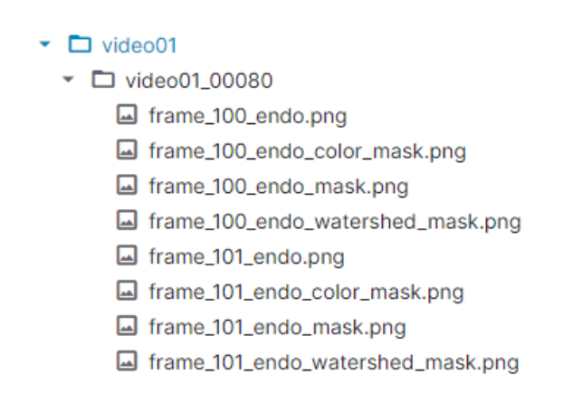
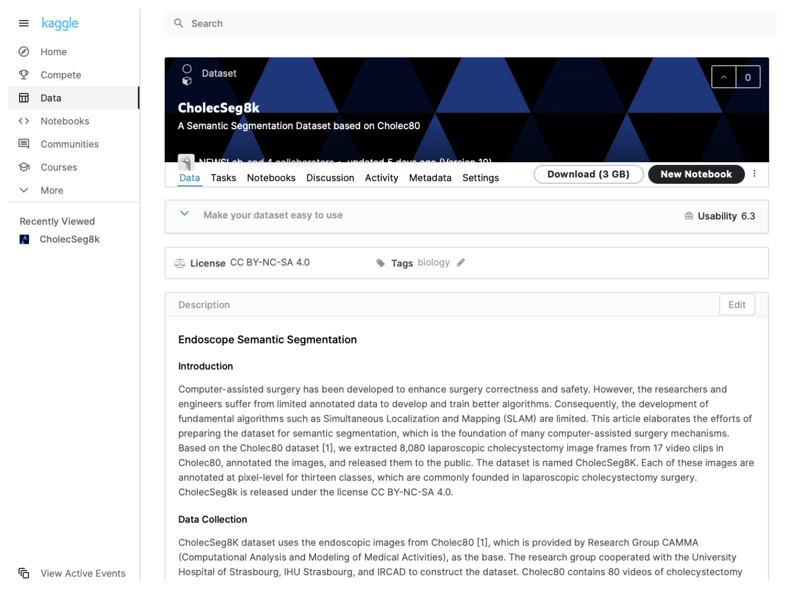
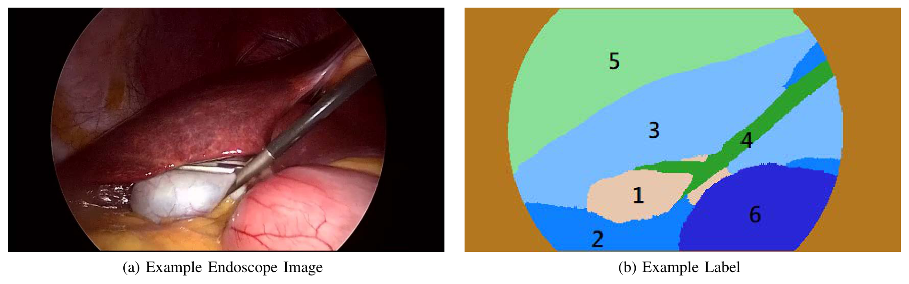
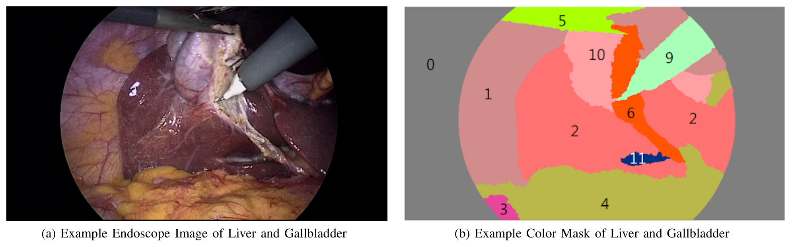
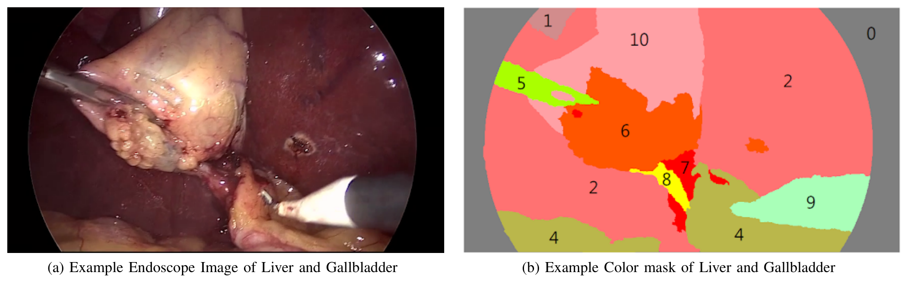

---
tags:
  - papers/手术数据集
aliases:
  - "CholecSeg8k"
date: 2020-12-23
arxiv_id: "2012.12453"
---

# CholecSeg8k: A Semantic Segmentation Dataset for Laparoscopic Cholecystectomy Based on Cholec80

## 核心信息

- 标题: CholecSeg8k: A Semantic Segmentation Dataset for Laparoscopic Cholecystectomy Based on Cholec80
- 标题翻译: CholecSeg8k：基于 Cholec80 的腹腔镜胆囊切除术语义分割数据集
- 作者: W.-Y. Hong, C.-L. Kao, Y.-H. Kuo, J.-R. Wang, W.-L. Chang, C.-S. Shih
- 机构: 台湾大学资讯网络与多媒体研究所、资讯工程学系
- 发表时间: 2020-12-23
- 发表渠道: arXiv 预印本（cs.CV），本笔记依据第 1 版
- arXiv: 2012.12453
- 论文链接: https://arxiv.org/abs/2012.12453
- 数据 / 资源: https://www.kaggle.com/newslab/cholecseg8k ，许可 CC BY-NC-SA 4.0
- 论文类型: benchmark_or_dataset

## 原文摘要翻译

计算机辅助手术的发展是为了提高手术的准确性和安全性。然而，研究人员和工程师受限于标注数据不足，难以开发和训练更好的算法，因此同时定位与建图（`SLAM`）等基础算法的发展也受到限制。本文介绍为语义分割准备数据集的工作，语义分割是许多计算机辅助手术机制的基础。我们以 `Cholec80` 数据集为基础，从其中的 17 个视频片段中抽取了 8,080 帧腹腔镜胆囊切除术图像并进行标注。该数据集命名为 `CholecSeg8K`，总大小为 3GB。每张图像都在像素级别标注了 13 个类别，这些类别在腹腔镜胆囊切除术中很常见。`CholecSeg8k` 以 CC BY-NC-SA 4.0 许可发布。

## 创新点

1. **在 Cholec80 帧上补充像素级标注。** `Cholec80` 原本只有器械和手术阶段标注，本文从其中 17 个视频片段抽取 8,080 帧，逐像素标注 13 个类别，给胆囊切除术场景提供了公开的语义分割训练数据。
2. **面向胆囊切除术的类别设计。** 类别以肝脏和胆囊为中心，同时覆盖腹壁、脂肪、结缔组织、血液、胆囊管、肝静脉以及抓钳和电钩两种器械；胃肠道和肝韧带两个类别有意合并了多种解剖结构，以控制类别数量。
3. **三种掩码并存的发布格式。** 每帧附带颜色掩码、标注工具掩码和分水岭掩码，分水岭掩码三个通道都存类别 ID，便于直接读成标签图。
4. **公开像素占比统计。** 论文给出 12 个类别的像素占比，提前提示使用者类别极不平衡。

## 一句话总结

CholecSeg8k 从 Cholec80 的 17 个视频中取出 101 段、每段 80 帧连续画面，共 8,080 帧，并标注 13 类像素标签，是一份没有划分、没有基线的纯数据发布说明。

## 研究问题

论文的出发点是内镜导航。内镜手术的效果依赖操作者的熟练度，手抖和器官运动都会影响图像分析和操作。已有的计算机辅助系统多用磁或射频外部传感器估计内镜位置，但误差大，难以达到亚厘米精度；论文举例说 Hu 等人的系统需要 16 个传感器才能达到 5.6 mm 的定位精度。

作者认为基于图像的 `SLAM` 是更好的路线：它不需要额外基础设施，可以把实时感知与事先采集的参考数据比对来定位相机。论文用自动驾驶类比：先用 256 线激光雷达和差分定位采集高精地图，运行时用 16 线激光雷达即可定位到 5 厘米精度。在户外可以用卫星定位选出要比对的参考数据，内镜里做不到，作者设想先识别画面中的器官，再用识别结果去检索参考数据。

识别器官可以用语义分割或目标检测，但两者都需要大量标注好的内镜图像，而这类数据并不普及。论文要补的就是这个数据缺口：提供一个公开的腹腔镜胆囊切除术语义分割数据集，让研究者可以直接训练 `FCN`、`PSPNet`、`U-Net`、`DeepLab` 等模型。

### 核心观点速览

**这是一份数据发布说明，没有模型、没有划分、没有基线。** 它的答案只有一个：在 `Cholec80` 已有的视频上补一层像素级标注。

- **数据从哪来：** `Cholec80` 的 17 个视频，取 101 段、每段 80 帧连续画面，共 8,080 帧，分辨率 854×480。
- **标了什么：** 13 个类别，以肝脏和胆囊为中心；胃肠道和肝韧带是有意合并的宽类。
- **怎么发布：** 每帧一张原图加三种 PNG 掩码，3GB，在 Kaggle 以非商业许可发布。
- **要注意什么：** 类别极不平衡，胆囊管和肝静脉都不到千分之一的像素；视频选择标准、标注者和一致性，论文未说明。

下面先看数据怎么组织，再看构建流程，最后看论文唯一的统计——像素占比——能说明什么。

## 数据与任务定义

### 数据来源

第一个问题是图像从哪来、补的是哪一层信息。数据集的图像全部来自 `Cholec80`。该数据集由 `CAMMA`（医疗活动计算分析与建模）研究组与斯特拉斯堡大学医院、斯特拉斯堡 `IHU` 和 `IRCAD` 合作构建，包含 13 名外科医生完成的 80 台胆囊切除术视频，帧率 25 fps，带器械和手术阶段标注。本文从中选出一部分“高度相关”的视频，在抽出的帧上标注语义分割掩码。

论文说明准备阶段和结束阶段没有标注，理由是跳过与语义分割无关的操作。具体选了哪 17 个视频、按什么标准判定“高度相关”、每段 80 帧的起点如何选择，论文未说明。

### 任务定义与样本组织

使用者首先要知道一个样本长什么样。任务是逐像素分类：输入一帧 854×480 的内镜图像，输出每个像素属于 13 个类别中的哪一个。论文没有定义评测指标，也没有给出训练、验证、测试划分。

数据按两级目录组织。第一级以 `Cholec80` 视频文件名命名，例如 `video01`、`video09`；第二级以“视频名_起始帧号”命名，每个目录存 80 帧。例如 `video12_15750` 存的是 `video12` 第 15750 帧到第 15829 帧。全集共 101 个第二级目录、8,080 帧，总大小 3GB。**这意味着 8,080 帧并不是 8,080 个独立样本，而是 101 段短片段**，划分时必须以目录或视频为单位。101 个目录在 17 个视频间如何分布，论文未说明。

> [!figure] Fig. 2 目录树示例
> 建议位置：数据与任务定义
> 放置原因：图中 `video12` 下的目录起始帧号依次相差 80，能直接看出每个目录是一段连续帧。
> 当前状态：保留占位；自动提取得到的裁剪是右栏正文段落，不是目录树截图。

### 类别定义

类别表决定了这份数据能回答什么问题。

| 类别 ID | 中文名 | 原文名 |
|---|---|---|
| 0 | 黑色背景 | `Black Background` |
| 1 | 腹壁 | `Abdominal Wall` |
| 2 | 肝脏 | `Liver` |
| 3 | 胃肠道 | `Gastrointestinal Tract` |
| 4 | 脂肪 | `Fat` |
| 5 | 抓钳 | `Grasper` |
| 6 | 结缔组织 | `Connective Tissue` |
| 7 | 血液 | `Blood` |
| 8 | 胆囊管 | `Cystic Duct` |
| 9 | 电钩 | `L-hook Electrocautery` |
| 10 | 胆囊 | `Gallbladder` |
| 11 | 肝静脉 | `Hepatic Vein` |
| 12 | 肝韧带 | `Liver Ligament` |

类别以识别肝脏和胆囊为目标，其他类别是为了扩大覆盖。两个类别特意做得很宽：胃肠道类包括胃、小肠和附近组织；肝韧带类包括冠状韧带、三角韧带、镰状韧带、肝圆韧带、静脉韧带和小网膜。图 5 中的 12 号区域就是肝圆韧带，作者明确说不区分不同的肝韧带。**所以这份数据适合识别“肝脏、胆囊、器械在哪”，不适合区分具体是哪段肠或哪条韧带。**

### 文件格式

每帧对应四个 PNG 文件：原图、颜色掩码、标注工具掩码和分水岭掩码。颜色掩码用于可视化；分水岭掩码用于编程，每个标注像素的三个颜色通道都等于类别 ID。三种掩码都由开源工具 `PixelAnnotationTool` 生成。

*论文原图编号：Figure 4。`video01_00080` 目录下的文件示例，每帧有原图和三种掩码。放在这里是因为它说明了读取数据时要找的文件名。*

### 获取方式

数据集发布在 Kaggle，许可为 CC BY-NC-SA 4.0，使用说明在数据集页面上，论文本身不含加载代码。

*论文原图编号：Figure 8。Kaggle 数据集页面截图，可见许可和 3 GB 的下载大小。放在这里是因为它是论文给出的唯一获取入口。*

## 方法主线

本文没有模型，方法主线就是数据构建流程。问题在于每一步论文都只写了做了什么，没写怎么选。

### 构建流程

1. 从 `Cholec80` 的 80 个视频中挑出 17 个，跳过准备阶段和结束阶段；挑选标准论文未说明。
2. 在选中视频中截取 101 段、每段 80 帧的连续画面，按两级目录存放，共 8,080 帧；起始帧怎么选论文未说明。
3. 用 `PixelAnnotationTool` 对每帧做 13 类像素标注，导出颜色掩码、工具掩码和分水岭掩码三种 PNG。
4. 统计 12 个类别的像素占比，打包为 3GB 的数据集，在 Kaggle 以 CC BY-NC-SA 4.0 发布。

### 标注原则

论文只给出一条标注取舍规则：视野边缘光线暗，人工也难以判断边界，例如图 6 中抓钳的上边缘，这类模糊情况保持原样，因为数据集的目标是分割人体器官。由此可以推断，器械边界的精度不是这份标注的优先目标。

标注由谁完成、是否有外科医生参与或复核、是否评估过标注者之间的一致性、每帧标注耗时多少，论文未说明。

### 评测协议与基线

论文没有评测协议，没有训练测试划分，没有任何基线模型结果。这是它与通常的 benchmark 论文最大的不同：它只是数据说明，无法从论文本身判断这些标注训练出的模型能达到什么水平。

在定位上，论文只和 `Cholec80` 本身对比：`Cholec80` 有器械和阶段标注，本文补上像素级标注。论文没有与任何其他手术或内镜分割数据集比较，因此“新在哪里”只能相对 `Cholec80` 来说。没有基线，下一节能报告的只有数据统计。

## 关键结果

本文没有实验结果，可报告的只有数据统计和示例。核心问题是：类别不平衡到什么程度？

### 像素占比

图 3 把类别分成两组展示像素占比。正文说图 3 展示 13 个类别，但图中只有 12 个，黑色背景类不在其中，论文也没有说明占比的分母是否排除了背景。

| 类别 | 像素占比 | 所在分组 |
|---|---|---|
| 腹壁 | 29.46% | 图 3(a) |
| 肝脏 | 29.393% | 图 3(a) |
| 脂肪 | 20.23% | 图 3(a) |
| 胆囊 | 8.893% | 图 3(a) |
| 结缔组织 | 3.125% | 图 3(a) |
| 胃肠道 | 2.557% | 图 3(a) |
| 抓钳 | 3.317% | 图 3(b) |
| 电钩 | 1.824% | 图 3(b) |
| 血液 | 0.573% | 图 3(b) |
| 肝韧带 | 0.561% | 图 3(b) |
| 胆囊管 | 0.05% | 图 3(b) |
| 肝静脉 | 0.018% | 图 3(b) |

腹壁、肝脏和脂肪三类占了大部分像素，胆囊管和肝静脉不到千分之一。**含义是：只看平均指标会掩盖稀有类上的失败。** 论文据此提醒类别不平衡会影响训练，但没有给出每类出现的帧数，也没有做任何实验验证这一影响。

> [!figure] Fig. 3 各类别像素占比
> 建议位置：关键结果
> 放置原因：这是论文唯一的定量统计，直接显示类别不平衡的程度。
> 当前状态：保留占位；没有找到能把两个子图连同坐标轴完整裁出的整图，数值已整理为上表。

### 正文与图中数字不一致

既然像素占比是论文唯一的定量结果，就要核对它是否自洽。正文说图 3(b) 是像素占比低于 1% 的类别，并特别说抓钳和电钩“占比低于 1%”，但图中这两类分别是 3.317% 和 1.824%。正文把肝脏和腹壁都写成“近 30%”、胆囊写成 10%，图中分别是 29.393%、29.46% 和 8.893%。图 3(a) 的标题是“占比较大的组”，却包含 2.557% 的胃肠道，低于图 3(b) 中的抓钳。可见两组不是按 1% 阈值划分的，划分依据论文未说明。使用者应以图中数字为准，或用分水岭掩码自己重算。

### 标注示例

*论文原图编号：Figure 1。内镜原图与对应标签。放在这里是因为它是论文给出的第一个标注样例；从图上看，区域编号与表 I 的类别 ID 对不上，配色也和图 5 到图 7 不同，论文没有解释。*

*论文原图编号：Figure 6。肝脏居中、胆囊在上方、两种器械同时出现的复杂样例。放在这里是因为它展示了多类别共存的标注效果。*

*论文原图编号：Figure 7。从另一角度看肝脏和胆囊，并含胆囊管和血液区域。放在这里是因为它是少见类别（7 号血液、8 号胆囊管）的例子。*

示例图回答的是标注长什么样。论文用图 5、图 6、图 7 作为三个代表性示例。图 5 是简单场景，含胆囊、肝韧带、脂肪和部分肝脏。正文称图 6 和图 7 各含 11 个类别。图 6 的描述把电钩写成 class ID 10，而表 I 中电钩是 9、10 是胆囊；图 6 掩码里器械区域标的是 9，所以正文是笔误。图 1 的区域编号是否对应类别 ID，论文未说明。这些示例说明了标注的形态，但不能说明标注质量。

> [!figure] Fig. 5 胆囊简单示例
> 建议位置：关键结果
> 放置原因：它展示了肝韧带合并类（12 号）的标注样子。
> 当前状态：保留占位；自动匹配到的裁剪是图 3(b) 柱状图，图号与内容不符。

## 深度分析

### 数据集真正测到了什么

上面的统计和示例引出一个问题：在这份数据上得到的分数到底代表什么？在这份数据上训练和评测，测量的是“单帧内镜图像的 13 类像素分类”能力，场景限定在胆囊切除术的中间阶段。它不能直接衡量论文动机中的 `SLAM` 定位或参考数据检索，因为论文没有建立分割结果与定位精度之间的任何联系。基于特征点或深度估计的 `SLAM` 也许不需要器官语义，论文没有做任何实验区分这两条路线。

### 连续帧带来的划分风险

每个目录是 80 帧连续画面。按 25 fps 计算，一个目录只覆盖约 3.2 秒，相邻帧几乎相同。如果按帧随机划分训练集和测试集，测试帧会和训练帧高度相似，结果会被抬高。可靠的做法是至少按目录划分，更稳妥的是按视频划分；但 17 个视频的数量很少，按视频划分后测试集只能有几个视频，方差会很大。我的判断：由于片段内帧高度冗余，有效的独立样本远少于 8,080，这个规模更接近一百段左右的场景，而不是八千张独立图像。

### 宽类合并的取舍

把胃、小肠和附近组织合为一类，把六种韧带和网膜合为一类，降低了标注难度和类别数，但也意味着这份数据不能用于细粒度解剖识别。胆囊切除术中最关键的结构之一是胆囊管，它只占 0.05% 的像素、肝静脉只占 0.018%，模型很可能在这些类上表现很差，平均指标会被大类掩盖。

### 复现注意点

- 读取标签用分水岭掩码，三个通道都是类别 ID；颜色掩码只用于可视化。
- 报告结果时应给出每类交并比，并单独报告胆囊管、肝静脉、血液等稀有类。
- 由于抓钳边缘等模糊区域“保持原样”，器械边界上的误差部分来自标注本身。
- 许可是非商业、相同方式共享，商业用途不可直接使用。
- 不要按帧随机划分训练集和测试集，也不要把颜色掩码当标签读取。
- 先按图中数字或自行重算的占比设计类别权重，不要沿用正文里取整后的数字。

## 局限

- 没有训练、验证、测试划分，没有评测指标和基线，不同论文在这份数据上的结果很难直接比较。
- 视频选择标准、每段起始帧的选择方式、标注者身份、是否有医生复核、标注一致性，论文都未说明。
- 只覆盖 `Cholec80` 的 17 个视频，准备和结束阶段不在数据中；101 个目录在 17 个视频间如何分布，论文未说明。
- 像素占比的分母是否计入黑色背景，论文未说明。
- 文中数字与图表多处不一致：抓钳和电钩的占比被写成低于 1%，电钩的类别 ID 被写成 10，肝脏、腹壁和胆囊的占比被取整成 30% 和 10%。
- 图 1 的区域编号和配色与类别表不一致，论文未解释。
- 论文的动机是内镜 `SLAM`，但没有任何实验把分割与定位联系起来。

## 我的笔记

这篇论文的价值在数据本身，而不在论文。正文篇幅很短，信息主要是目录结构和类别表。使用前需要自己补三件事：按视频固定一套划分并公开；用分水岭掩码统计每类出现的帧数；对稀有类单独评测。

值得追问的问题：

- 17 个视频具体是哪些，与 `Cholec80` 官方的训练测试划分有没有重叠？
- 80 帧片段的起点是按什么规则选的，是否偏向某些手术阶段？
- 正文与图 3 的数字差异，是图表来自不同版本的统计，还是正文写作时的估算？

## 引用

- Hong W.-Y., Kao C.-L., Kuo Y.-H., Wang J.-R., Chang W.-L., Shih C.-S. CholecSeg8k: A Semantic Segmentation Dataset for Laparoscopic Cholecystectomy Based on Cholec80. arXiv:2012.12453, 2020. https://arxiv.org/abs/2012.12453
- Twinanda A. P. et al. EndoNet: A Deep Architecture for Recognition Tasks on Laparoscopic Videos. IEEE Transactions on Medical Imaging, 36, 2016. DOI: 10.1109/TMI.2016.2593957
- Bréhéret A. Pixel Annotation Tool. https://github.com/abreheret/PixelAnnotationTool
