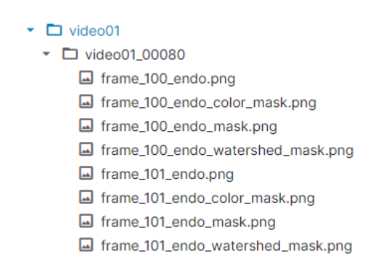
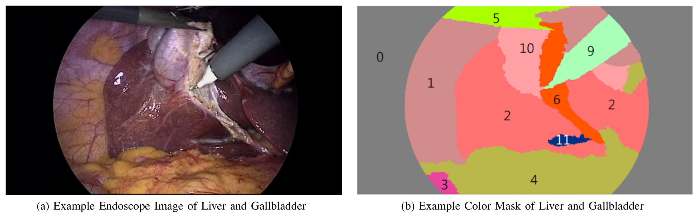
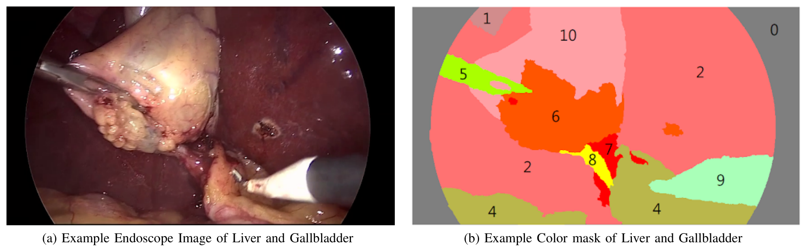
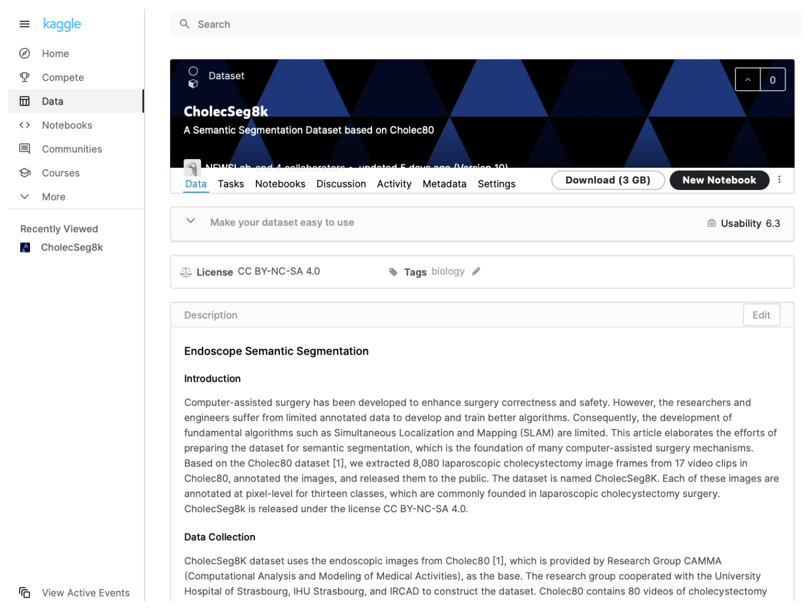

## 1. 背景与动机

**内镜手术需要知道镜头在哪，现有外部传感器做不到足够准。** 论文举例说，Hu 等人的磁定位系统要用 16 个传感器才达到 5.6 mm 的精度，亚厘米级定位并不现实。

作者设想用基于图像的 `SLAM`（同时定位与建图）代替外部传感器：把实时画面和事先采集的参考数据比对来定位。户外可以靠卫星定位挑出要比对的参考数据，体内不行，于是作者提出先识别画面里的器官，再用识别结果去检索参考数据。

识别器官要靠语义分割（给每个像素分配类别）或目标检测，两者都需要大量标注好的内镜图像，而这类公开数据很少。这就是论文要补的缺口。

## 2. 核心观点速览

**这是一份数据发布说明：没有模型、没有划分、没有基线。** 它只做一件事，在 `Cholec80` 已有视频上补像素级标注。

- 来源：`Cholec80` 的 17 个视频，取 101 段、每段 80 帧连续画面，共 8,080 帧，分辨率 854×480。
- 标注：13 个类别，以肝脏和胆囊为中心；胃肠道和肝韧带是有意合并的宽类。
- 发布：每帧一张原图加三种 PNG 掩码，总计 3GB，Kaggle 上以 CC BY-NC-SA 4.0 发布。
- 风险：类别极不平衡，视频选择标准、标注者与一致性，论文未说明。

:::highlights
- 8,080 帧来自 101 段连续片段，不是 8,080 个独立样本
- 论文没有任何训练测试划分和基线结果
:::

:::data
- 8,080 帧 / 17 个视频 / 101 个目录
- 13 个类别，854×480，3GB
:::

接下来按“数据怎么组织、怎么构建、统计说明了什么”的顺序展开。

## 3. 数据从哪来，补了哪一层

`Cholec80` 是 `CAMMA` 研究组与斯特拉斯堡大学医院等机构合作发布的数据，含 13 名外科医生完成的 80 台胆囊切除术视频，帧率 25 fps，只有器械和手术阶段标注。

本文从中选出“高度相关”的 17 个视频，跳过准备阶段和结束阶段，在抽出的帧上做像素标注。**具体选了哪些视频、按什么标准选，论文未说明**，这让使用者无法判断数据偏向哪些术者或哪些手术难度。

论文没有与其他手术分割数据集作比较，新意只能相对 `Cholec80` 来说：同一批视频，从阶段级标注细化到像素级。

## 4. 一个样本长什么样

数据按两级目录存放。第一级以视频命名，例如 `video12`；第二级以“视频名_起始帧号”命名，每个目录存 80 帧连续画面，例如 `video12_15750` 存第 15750 到 15829 帧。

**连续 80 帧意味着目录内画面几乎相同。** 按 25 fps 推算，一个目录只覆盖约 3.2 秒。每帧有四个 PNG：原图、颜色掩码、标注工具掩码和分水岭掩码；读标签要用分水岭掩码，它三个通道都存类别 ID。

*论文原图编号：Figure 4。`video01_00080` 目录下的文件，每帧对应原图和三种掩码。*

每段起始帧怎么选，101 个目录在 17 个视频间如何分布，论文都未说明。

## 5. 13 个类别能回答什么问题

类别包括黑色背景、腹壁、肝脏、胃肠道、脂肪、抓钳、结缔组织、血液、胆囊管、电钩、胆囊、肝静脉和肝韧带，ID 依次为 0 到 12。

两个类别有意做宽：胃肠道类包括胃、小肠和附近组织；肝韧带类包括冠状韧带、三角韧带、镰状韧带、肝圆韧带、静脉韧带和小网膜。**所以这份数据适合回答“肝脏、胆囊、器械在哪”，不适合细粒度解剖识别。**

唯一写明的标注规则是：视野边缘光线暗、人也难判断的区域保持原样，因为目标是分割器官。器械边界的误差因此部分来自标注本身。标注者是谁、有无医生复核、一致性如何，论文未说明。

*论文原图编号：Figure 6。肝脏居中、胆囊在上方、两种器械同时出现的复杂样例。*

## 6. 像素占比说明了什么

论文唯一的定量结果是图 3 的像素占比。腹壁 29.46%、肝脏 29.393%、脂肪 20.23% 三类占了大部分像素；胆囊 8.893%；稀有类中胆囊管只有 0.05%，肝静脉只有 0.018%。

**含义是平均指标会掩盖稀有类的失败。** 胆囊管是手术中最需要辨认的结构之一，却几乎没有像素。论文提醒了不平衡，但没有给出每类出现的帧数，也没有实验验证其影响。

图中只有 12 类，黑色背景不在其中，分母是否排除背景论文未说明。

:::data
- 腹壁 29.46%，肝脏 29.393%，脂肪 20.23%
- 胆囊管 0.05%，肝静脉 0.018%
:::

## 7. 论文数字自洽吗

正文与图表有几处对不上：

- 正文说图 3(b) 是占比低于 1% 的类，并说抓钳和电钩低于 1%，但图中分别是 3.317% 和 1.824%。
- 图 3(a) 含胃肠道 2.557%，比图 3(b) 的抓钳还低，两组划分依据论文未说明。
- 正文把肝脏和腹壁写成约 30%、胆囊写成 10%，是取整后的数。
- 图 6 的描述把电钩写成 class ID 10，表 I 中电钩是 9，掩码上也标的是 9。

**使用者应以图表或自行重算为准。** 图 1 的区域编号和配色与类别表对不上，论文没有解释。

*论文原图编号：Figure 7。含 7 号血液和 8 号胆囊管的样例，类别 ID 与表 I 一致。*

## 8. 结果没说什么

- **没说这些标注够训练出好模型。** 没有基线，就无法知道 8,080 帧能支撑什么精度。
- **没说分割对定位有用。** 论文的动机是 `SLAM`，但没有任何定位实验；基于特征点的 `SLAM` 也许不需要器官语义，论文没有区分。
- **没说不平衡是主要瓶颈。** 加权损失或重采样也许足以缓解，论文没有对比。

我的判断：由于片段内帧高度冗余，有效的独立样本远少于 8,080，规模更接近一百段左右的场景。

## 9. 复现要注意什么

- 按视频或至少按目录划分，不要按帧随机划分。
- 用分水岭掩码读类别 ID，不要把颜色掩码当标签。
- 报告每类交并比，单独看胆囊管、肝静脉和血液。
- 类别权重按图中数字或自行重算，不要用正文取整的数字。
- 许可是非商业、相同方式共享，商业用途不可直接使用。

*论文原图编号：Figure 8。Kaggle 数据集页面，可见许可和下载大小。*

## @takeaways
- 这是数据说明，不是 benchmark：没有划分、指标和基线
- 8,080 帧来自 101 段连续片段，划分必须以视频或目录为单位
- 稀有类（胆囊管、肝静脉）像素极少，必须单独评测

## @strengths
- 在常用的 `Cholec80` 上补了公开的像素级标注，可直接下载
- 类别表、目录结构和文件格式写得清楚，分水岭掩码便于编程读取
- 公开了像素占比，提前提示类别不平衡

## @weaknesses
- 视频选择、起始帧、标注者和一致性都未说明
- 正文与图 3、图 6 的数字和类别 ID 不一致
- 动机中的 `SLAM` 与数据集之间没有实验连接

## @questions
- 17 个视频与 `Cholec80` 官方的训练测试划分是否重叠？
- 80 帧片段是否偏向某些手术阶段？
- 有医生复核时，器械和稀有类的边界标注会差多少？
