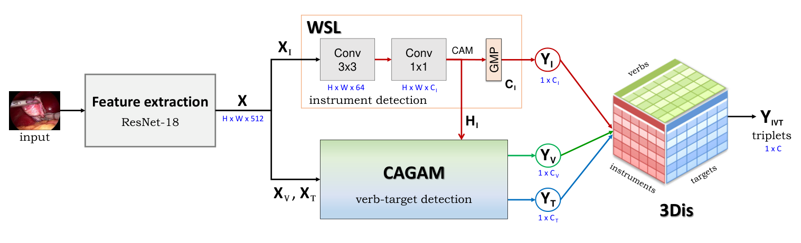
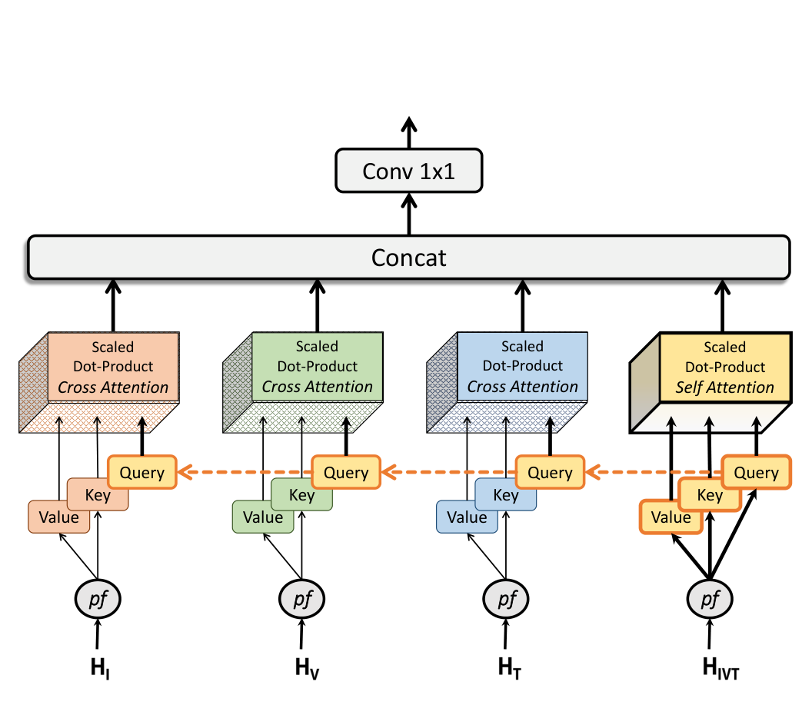
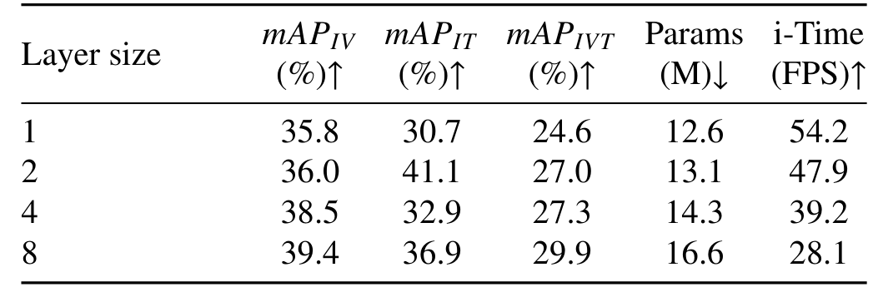
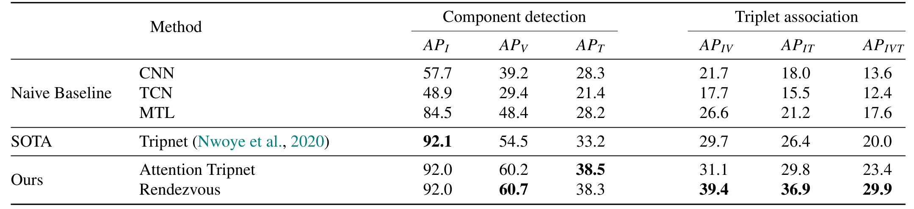
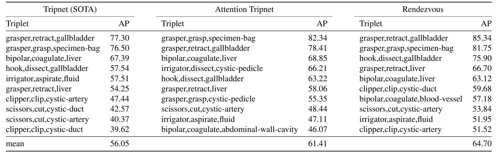
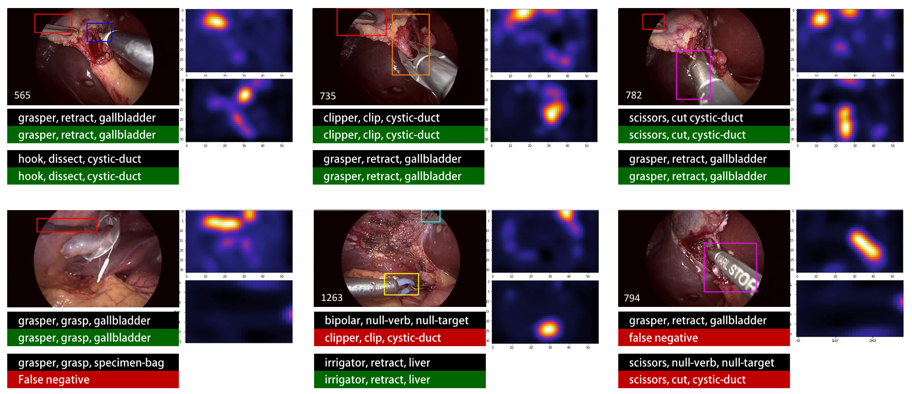
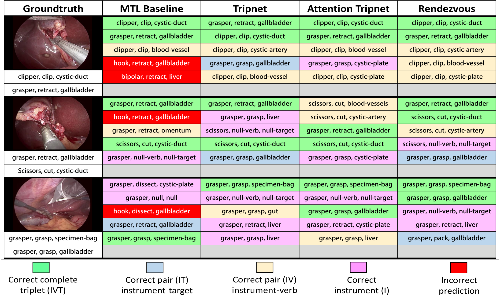

---
tags:
  - papers/手术数据集
aliases:
  - "Rendezvous"
  - "CholecT50"
date: 2021
doi: 10.1016/j.media.2022.102433
arxiv_id: "2109.03223"
---

# Rendezvous: Attention Mechanisms for the Recognition of Surgical Action Triplets in Endoscopic Videos

## 核心信息

- 标题: Rendezvous: Attention Mechanisms for the Recognition of Surgical Action Triplets in Endoscopic Videos
- 标题翻译: Rendezvous：用于内镜视频中手术动作三元组识别的注意力机制
- 作者: Chinedu Innocent Nwoye, Tong Yu, Cristians Gonzalez, Barbara Seeliger, Pietro Mascagni, Didier Mutter, Jacques Marescaux, Nicolas Padoy
- 机构: 斯特拉斯堡大学 ICube（CNRS）、IHU Strasbourg、斯特拉斯堡大学医院、罗马 Gemelli 医院、IRCAD France
- 发表时间: 2021（arXiv 首版）；本笔记依据 arXiv v2（2022-03-03）
- 发表渠道: Medical Image Analysis（2022）102433
- DOI: 10.1016/j.media.2022.102433
- arXiv: 2109.03223
- 论文链接: https://arxiv.org/abs/2109.03223
- 代码 / 项目: https://github.com/CAMMA-public/rendezvous
- 数据 / 资源: CholecT50，论文称将在 http://camma.u-strasbg.fr/datasets 公开，并用于 2021 年 EndoVis 挑战赛
- 论文类型: AI_method

## 原文摘要翻译

在内镜视频手术工作流分析的现有框架中，动作三元组识别是唯一一个旨在提供真正细粒度、全面的手术活动信息的框架。这类信息以 ⟨器械, 动作, 目标⟩ 组合的形式呈现，准确识别它们极具挑战。三元组的各个分量单独识别就可能很难；而这项任务不仅要求同时识别三个分量，还要正确建立它们之间的数据关联。

为完成这项任务，我们提出新模型 Rendezvous（RDV），它通过在两个不同层次上利用注意力，直接从手术视频中识别三元组。我们首先提出一种新的空间注意力，用来捕捉场景中各个动作三元组分量，称为类激活引导注意力机制（CAGAM）。该技术利用器械产生的激活来识别动作和目标。

为解决关联问题，RDV 模型加入一种受 Transformer 网络启发的新语义注意力，称为混合注意力多头（MHMA）。该技术使用多个交叉注意力和自注意力，有效捕捉器械、动作和目标之间的关系。

我们还提出 CholecT50：一个包含 50 个内镜视频的数据集，其中每一帧都标注了来自 100 个三元组类别的标签。在该数据集上，我们提出的 RDV 模型使三元组预测的平均 AP 比现有最优方法提高 9% 以上。

## 创新点

1. **CholecT50 数据集。** 50 个腹腔镜胆囊切除术视频，逐帧标注 100 类 ⟨器械, 动作, 目标⟩ 三元组，共 161K 个实例。它在 CholecT40 上增加 10 个视频，并经临床专家归并、评分、仲裁后统一了类别。这是本文面向数据的贡献，也是后续三元组研究的基准。
2. **类激活引导注意力。** 用器械的类激活图作为已知上下文，引导动作和目标特征。动作走通道注意力，注意力矩阵为 6×6；目标走位置注意力，矩阵为 1792×1792。它把旧模型中简单拼接的引导模块换成注意力，不需要任何空间框标注。
3. **混合注意力多头解码。** 解码器有 4 个注意力头：三元组特征的自注意力 1 个，以三元组特征为查询、分别看器械、动作、目标类别图的交叉注意力 3 个。序列单位是“类别图”而不是图像块。
4. **整体模型与消融模型。** `RDV` 把编码器与 8 层解码器串起来；`Attention Tripnet` 只替换旧模型 `Tripnet` 的引导模块，用来单独衡量编码器注意力的贡献。
5. **评测协议。** 同时报告分量 AP、组合 AP、Top-N 准确率和逐视频平均的 mAP，并用符号秩检验对比 `Tripnet`。

## 一句话总结

论文发布了逐帧标注 100 类手术动作三元组的 CholecT50，并提出用器械激活图引导注意力、再用自注意力加交叉注意力解码分量关联的 `Rendezvous`，在 10 个测试视频上把三元组 mAP 从 20.0 提到 29.9。

## 研究问题

### 背景与动机

腹腔镜胆囊切除术是全球最常见的手术之一。术者借助间接视野和长柄器械操作，难度更高，这推动了能理解术中场景、给出自动提醒的上下文感知系统。要做到这一点，系统必须回答“画面里此刻正在发生什么”。

已有工作给出的答案都太粗。相位识别只能告诉你处于“夹闭与切断”阶段，说不出抓钳在牵拉什么、施夹钳夹的是胆囊管还是胆囊动脉。

更细的尝试也只做了一半。`EndoVis 2019` 的动作识别只识别 4 个动词（切、抓、持、夹），既不管器械，也不管被作用的解剖结构。`SARAS-ESAD` 有 21 类动作标签，但标签是“动作加组织”的形式，同样不区分器械。

⟨器械, 动作, 目标⟩ 三元组是最细的表述，但识别它有三重难点：

- **以器械为中心。** 肝脏几乎一直在画面里，但只有被器械作用时才算目标；没有器械就没有动作。
- **细微的空间差异。** 同一把抓钳对胆囊做牵拉、抓持还是分离，连有经验的外科医生也要盯着钳尖周围看。
- **一对多和多对一。** 分离可由双极、抓钳、电钩、冲洗器、剪刀完成；同一目标也可能同时被两件器械作用，例如抓钳牵拉胆囊管、电钩分离胆囊管。一帧里有多个三元组时，把分量正确配对就是一个三部图数据关联问题。

作者此前的 `Tripnet`（MICCAI 2020）是唯一直接从视频识别三元组的工作。它用类激活引导模块（CAG）把器械激活特征与动作、目标特征拼接，再用 3D 交互空间（3Dis）对三个分量做外积。

论文认为这两步都有缺陷：拼接没有显式的空间聚焦；外积枚举了大量不可能的组合，难以训练。

所以本文要回答两个问题。第一，能否在没有空间框标注的情况下，借器械的位置和类型更准地识别动作和目标。第二，能否用比外积更有效的方式学习三个分量之间的关联。同时，论文把数据从 CholecT40 扩展为 CholecT50，为这一任务提供基准。

### 核心观点速览

- CholecT50 含 50 个视频、100 类三元组，由 6 种器械、10 种动作、15 种目标组合而成；1fps 下共 100.86K 帧、161K 个实例。
- 动作主要受器械**类型**影响，目标主要受器械**位置**影响。据此，编码器给动作配通道注意力、给目标配位置注意力。Table 4 中双注意力使动作 AP 从 48.4 到 61.1、目标 AP 从 28.2 到 40.2。
- 解码时让三元组特征去“查询”三个分量的类别图（交叉注意力），比只做自注意力更好：AP_IVT 为 29.9 对 26.1。
- `RDV` 的三元组 mAP 为 29.9，`Tripnet` 为 20.0。器械检测已饱和（约 92），提升全部来自动作、目标和关联。
- 绝对水平仍低。29.9 的 mAP 说明这个任务远未解决，而模型只看单帧，标签也没有空间框和实例数。

## 数据与任务定义

### 数据来源与标注协议

要判断一个数据集能否用，先看它从哪来、谁标的、类别怎么定。

CholecT50 共 50 个腹腔镜胆囊切除术视频：45 个来自公开的 Cholec80，5 个来自同一术式的院内数据。它是 CholecT40 的扩展，增加 10 个视频，并统一了类别。

标注由两名外科医生完成，工具是 B-com 研究所的标注软件。标注者在时间轴上标出每个动作的起止，再指定器械、动作、目标类别。器械离开画面，或动作、目标变化时，一个动作结束。画面外的动作不标，体外画面置零。

类别筛选分两步：

1. **语义归并。** 把语义相同的三元组合并成超类。例如冲洗器吸引胆汁、液体、血液统一为“冲洗器吸引液体”；十二指肠、结肠统一为“肠”；胆囊底、颈、体统一为“胆囊”。
2. **临床相关性评分。** 三名临床医生按“在该术式中是否可能、是否有用”给每个组合打 1 到 5 分，再结合出现次数排序，取最相关的类别。第三名医生在标注分歧时做仲裁。

理论上的组合有 900 种，数据中实际出现约 300 种，其中很多是虚假组合。最终保留 100 类。**类别表因此是临床专家筛过的，不是数据中自然出现的全部组合**，用它训练的模型不会认识被筛掉的组合。

> [!figure] Table 1 三元组分量标签统计
> 建议位置：数据与任务定义
> 放置原因：它给出 6 种器械、10 种动作、15 种目标各自的实例数，是理解类别不平衡的依据。
> 当前状态：保留占位；图表规划未选中此表，未生成可审查的裁剪，下面用文字转录关键数字。

### 规模与分布

类别定好之后，下一个问题是各类有多少样本。

分量层面（Table 1）的不平衡很严重：

| 分量 | 最多的类别 | 最少的类别 |
|---|---|---|
| 器械 | grasper 90969，hook 52820 | scissors 2135 |
| 动作 | retract 70795，dissect 49247 | pack 328，irrigate 572 |
| 目标 | gallbladder 87808 | cystic-pedicle 299 |

无动作、无目标的空类各有 10841 个，对应器械可见但没有作用对象的情况。

三元组层面（Table 2）同样是长尾：

| 三元组 | 实例数 |
|---|---|
| grasper, retract, gallbladder | 48628 |
| hook, dissect, gallbladder | 29292 |
| clipper, clip, cystic-duct | 1856 |
| scissors, cut, cystic-artery | 613 |
| bipolar, grasp, cystic-plate | 8 |

对安全监控最关键的施夹和剪切动作只有几百到一千多个实例，最少的类只有 8 个。这意味着 mAP 会被大量稀有类拉低，也解释了作者为什么坚持逐类 AP。器械与目标、器械与动作的共现统计放在附录的两张共现表中。

> [!figure] Table 2 三元组逐类出现次数
> 建议位置：数据与任务定义
> 放置原因：100 类三元组的完整长尾分布，是解释稀有类 AP 低的直接证据。
> 当前状态：保留占位；图表规划未选中此表，未生成可审查的裁剪。

### 划分与任务定义

视频下采样到 1fps，按视频划分。每个划分中两名标注医生的视频比例相同：

| 划分 | 视频 | 帧 | 标签 |
|---|---|---|---|
| 训练 | 35 | 72815 | 113884 |
| 验证 | 5 | 6797 | 10267 |
| 测试 | 10 | 21251 | 36854 |
| 合计 | 50 | 100863 | 161005 |

> [!figure] Table 3 数据集划分统计
> 建议位置：数据与任务定义
> 放置原因：它是训练、验证、测试规模的来源，上表已完整转录。
> 当前状态：保留占位；图表规划未选中此表，未生成可审查的裁剪。

任务是**帧级多标签分类**：输入一帧图像，输出 100 个三元组各自的存在概率。标签是二值存在标签，没有空间框，也不记录同一类三元组在一帧中出现几次。

分量标签是长度分别为 6、10、15 的二值向量，由三元组标签映射得到，作为辅助任务。帧分辨率在 480×854 到 1080×1920 之间，统一缩放到 256×448。

### 这个数据集能拿来做什么

CholecT50 适合做胆囊切除术中的帧级三元组识别，以及以此为基础的弱监督器械定位。它不适合直接做三元组检测或计数，因为没有框也没有实例数。使用前还要知道几处论文未说明的信息：

- 两名标注医生之间的一致性指标，论文未说明。这限制了对“标签噪声上限”的判断。
- 临床评分的具体分数和截断标准，论文未说明。别人无法复现同样的 100 类选择。
- 数据许可和下载条件，论文未说明，只说将在 CAMMA 网站公开并用于 2021 年 EndoVis 挑战赛。

数据讲清楚之后，下一节看模型怎样利用“器械为中心”这一特点。

## 方法主线

方法要解决研究问题中的两个难点：分量识别要借器械的位置和类型；分量配对要比外积更省。`RDV` 因此分为四段：特征提取骨干、编码器、解码器、分类器。编码器负责“检测分量”，解码器负责“把分量配对”。

### 机制流程

1. **特征提取。** 输入一帧 256×448 图像，送入预训练的 `ResNet-18` 提取特征；最后两个残差块的步长改为 1，输出 32×56×512 的特征图，复制成器械、动作、目标三份，另从第一个残差块取出低层特征。
2. **分量编码。** 器械分支经 3×3 卷积和 1×1 卷积得到 6 通道器械激活图，最大池化后输出器械概率；引导注意力以该激活图为引导，输出 10 通道动作类别图和 15 通道目标类别图；瓶颈层把低层特征投影成 100 通道的三元组上下文特征。
3. **交互解码。** 四路特征输入 8 层解码器；每层以三元组特征生成查询，对三个分量类别图各做一次交叉注意力，对三元组特征做一次自注意力，4 个头拼接后经 1×1 卷积融合，再经前馈层和残差归一化，输出精化后的三元组特征送入下一层。
4. **三元组分类。** 对第 8 层输出做全局池化，送入 100 个神经元的全连接层，得到三元组概率，与编码器的三个辅助输出端到端联合训练。

*论文原图编号：Fig. 7。Attention Tripnet 的结构：骨干、器械分支与动作目标分支，以及 3D 交互空间。放在这里是因为它展示了与 RDV 编码器相同的分量检测结构，以及被新解码器取代的外积交互空间。*

> [!figure] Fig 2 Rendezvous 整体结构
> 建议位置：机制流程
> 放置原因：RDV 四段结构的总图，最适合建立整体数据流印象。
> 当前状态：保留占位；自动裁剪混入了相邻的 Fig. 3 和正文，视觉质量检查未通过。

### 编码器：用器械激活引导动作与目标

难点在于动作和目标都依附于器械，但只有帧级标签，没有框告诉模型器械在哪。**CAGAM 的做法是先学器械的激活图，再用它去引导另外两个分量。**

这一模块称为 CAGAM，改编自 Ji 等人（2019）和 Yao 与 Gong（2020）的显著性引导注意力。差别有三点：

- 引导图是同一网络里可学习的器械激活图，不依赖外部显著性网络。
- 动作和目标分别用通道注意力和位置注意力。
- 注意力从器械域“交叉”到动作、目标域，而不是在同一域内自注意。

以动作分支为例。动作特征先映射成 6 通道的上下文特征，经两个 1×1 卷积和重排得到查询和键，尺寸都是“像素数 × 6”。非判别亲和图为

$$P_\varnothing = Q^\top K \in \mathbb{R}^{C_I\times C_I}$$

对器械激活图做同样处理，得到判别亲和图。两者逐元素相乘、按一个缩放因子缩放后过 softmax 得到注意力矩阵，再加权值特征并加回原特征：

$$E = \beta (V A) + X_Z$$

其中 $\beta$ 是可学习温度。增强特征经 1×1 卷积得到 10 通道的动作类别图，全局平均池化得到动作概率。

目标分支把乘法顺序换成 $QK^\top$，注意力尺寸变为“像素数 × 像素数”。因此它关注的是器械所在的位置，而不是器械的类别，输出 15 通道的目标类别图。特征图为 32×56，位置注意力是 1792×1792 的矩阵。

### 解码器：混合注意力多头

分量检测好以后，还要回答“哪件器械配哪个动作和目标”。旧方法用外积枚举全部组合；**新解码器让 100 类三元组特征去查询三个分量的类别图，只在有效类别上建模关联。**

投影函数为每个上下文特征生成查询、键、值：

$$pf(H)=\begin{cases}Q: \mathrm{FC}(\mathrm{Dropout}(\mathrm{GAP}(H)))\\ K: \mathrm{FC}(\mathrm{GAP}(H))\\ V: \mathrm{Conv}(H)\end{cases}$$

查询只来自三元组特征，长度为 100，并以 0.3 的比例随机遮蔽，避免 8 层重复同一查询。键的长度按来源分别为 6、10、15、100。值由卷积得到，保留空间结构。每个头的注意力为

$$\mathrm{Att}(Q,K,V)=V\cdot\sigma\!\left(\frac{KQ^\top}{\sqrt{d_K}}\right)$$

4 个头拼接后用卷积融合：器械、动作、目标三个交叉注意力头，加一个三元组自注意力头。

论文强调它不像视觉 Transformer 那样把特征切成图像块，而是把各类别图作为“语义序列”。附录的表 B.18 显示，6 层的图像块序列 AP_IVT 为 24.1，2 层的类别图映射已达 27.0，8 层类别图映射为 29.9。层数不同，这个比较对图像块序列不利的程度反而更小，因此方向可信。

*论文原图编号：Fig. 5。混合注意力多头的结构：三个分量类别图经投影得到键和值，三元组特征提供共享查询，3 个交叉注意力头和 1 个自注意力头拼接后经 1×1 卷积。放在这里是因为它直接对应上面的公式。*

### 训练目标与设置

三个分量都是多标签分类，各用加权 sigmoid 交叉熵：

$$L=\sum_{c} W_c\left[y_c\log\sigma(\hat y_c)+(1-y_c)\log(1-\sigma(\hat y_c))\right]$$

三个分量损失按 Kendall 等人（2018）的不确定性方法自动加权：

$$L_{comp}=\frac{1}{e^{w_I}}L_I+\frac{1}{e^{w_V}}L_V+\frac{1}{e^{w_T}}L_T+w_I+w_V+w_T$$

总损失为

$$L_{total}=L_{comp}+\rho L_{assoc}+\lambda L_2$$

其中 $\rho$ 是预热参数，前 18 个 epoch 只学分量；权重衰减系数为 1e-5。

| 项目 | 设置 |
|---|---|
| 优化器 | 带动量的随机梯度下降，动量 0.95 |
| 学习率 | 0.001，每 50 个 epoch 乘 0.1 |
| 批大小与轮数 | 8，200 个 epoch |
| 数据增强 | 随机缩放 [0.5, 1.5]，亮度与对比度偏移 0.2 |
| 模型选择 | 验证损失饱和时的权重；超参数在 5 个验证视频上最多做 74 次网格搜索 |
| 实现 | TensorFlow |
| 训练耗时 | 单张 GTX 1080 Ti 约 118-180 小时 |
| 参数量 | MTL 14.94M，Tripnet 14.95M，Attention Tripnet 11.81M，8 层 RDV 16.61M |

### 评测协议

- **分量 AP。** 分别统计器械、动作、目标。只输出三元组的模型，按同一分量类别取所有三元组概率的最大值作为分量概率。
- **组合 AP。** 器械-动作、器械-目标、完整三元组，只有关注的分量都正确才算正确。完整三元组的 AP_IVT 是主指标。
- **Top-N 准确率。** 正确标签是否落在前 5、10、20 个最高置信预测内。
- **mAP。** 每个视频内逐类计算 AP，再对视频取平均。
- **显著性检验。** 随机抽 30 批、每批 100 个连续帧，对 `Tripnet` 做符号秩检验。检验单位是帧批次而不是视频，批次是否来自不同视频论文未说明。

有了这些协议，下一节按“编码器、解码器、整体”的顺序看结果。

## 关键结果

### 编码器注意力类型（Table 4）

结果先回答编码器的设计是否成立。这张表回答“动作和目标各该用哪种注意力”：

| 引导方式 | AP_V | AP_T |
|---|---|---|
| 无（MTL 基线） | 48.4 | 28.2 |
| 仅激活图（Tripnet 的引导模块） | 51.3 | 32.1 |
| 激活图 + 通道注意力 | 59.0 | 31.5 |
| 激活图 + 位置注意力 | 51.2 | 35.1 |
| 激活图 + 双注意力 | 61.1 | 40.2 |

按论文正文的说法，通道注意力让动作提升 10.6、目标只提升 3.5；位置注意力反过来，动作 2.8、目标 6.9；两者各用其所长时提升最均衡，动作 12.4、目标 12.0。按表中数字直接相减，目标在通道注意力下的提升是 3.3，动作在双注意力下的提升是 12.7，与正文略有出入，论文未说明原因。这个交叉模式，是“动作看器械类型、目标看器械位置”这一假设唯一的定量证据。论文还在 Fig. 11 中画了目标分支的位置注意力图，但只是几个随机点的定性展示。

> [!figure] Table 4 编码器注意力类型消融
> 建议位置：关键结果
> 放置原因：它是编码器设计选择的直接依据，上表已完整转录。
> 当前状态：保留占位；没有找到可独立审查的高置信度表格裁剪。

### 解码器注意力类型与层数（Table 5、6）

| 解码器 | AP_IV | AP_IT | AP_IVT |
|---|---|---|---|
| 单一自注意力（输入为骨干特征） | 29.8 | 23.3 | 18.8 |
| 多重自注意力（四路都做自注意力） | 35.7 | 32.8 | 26.1 |
| 自注意力 + 交叉注意力（RDV） | 39.4 | 36.9 | 29.9 |

> [!figure] Table 5 解码器注意力类型消融
> 建议位置：关键结果
> 放置原因：它是交叉注意力有效性的直接证据，上表已完整转录。
> 当前状态：保留占位；没有找到可独立审查的高置信度表格裁剪。

把四路输入都用上（多重自注意力）已经比单一来源提升 7.3 个 AP_IVT，再换成交叉注意力又提升 3.8。前一步说明分量类别图本身是有用的输入，后一步才是交叉注意力的贡献。

*论文原图编号：Table 6。解码层数为 1、2、4、8 时的组合 mAP、参数量与 GTX 1080 Ti 上的推理帧率。放在这里是因为它给出精度和速度的取舍。*

层数从 1 加到 8，AP_IVT 从 24.6 升到 29.9，参数从 12.6M 升到 16.6M，帧率从 54.2 降到 28.1 FPS。但并非每列都单调：表 6 中 2 层的 AP_IT 为 41.1，高于 8 层的 36.9。附录表 B.18 中同为 2 层的类别图模型，AP_IV 和 AP_IVT 与表 6 相同（36.0、27.0），AP_IT 却是 34.1，因此 41.1 很可能是排版错误，论文未说明。作者选 8 层为默认，并称大于 25 FPS 可实时用于手术室。

### 与基线和 Tripnet 的主对比（Table 7）

*论文原图编号：Table 7。朴素基线（CNN、TCN、MTL）、Tripnet 与本文两个模型在分量检测和三元组关联上的 AP。放在这里是因为它是全文的主结果表。*

几个要点：

- **朴素基线不够用。** 直接把 100 类当独立标签分类的 CNN，AP_IVT 只有 13.6；加时序卷积网络精化后反而降到 12.4。作者解释为 CNN 特征本身不够好，时序精化无从发挥。
- **分量多任务是第一步。** MTL 把器械 AP 提到 84.5，AP_IVT 到 17.6；`Tripnet` 再提到 20.0。
- **编码器注意力改善分量。** `Attention Tripnet` 相对 `Tripnet` 动作提升 5.7、目标提升 5.3，AP_IVT 提高 3.4，达到 23.4。
- **解码器改善关联。** `RDV` 的分量 AP 与 `Attention Tripnet` 几乎相同（动作 60.7 对 60.2，目标 38.3 对 38.5），但 AP_IV 提升 9.7、AP_IT 提升 10.5，AP_IVT 达 29.9，相对 `Tripnet` 提升 9.9。摘要里的“提高 9% 以上”指的就是这 9.9 个百分点的绝对提升，相对提升接近一半。
- **器械已饱和。** `Tripnet` 与本文两个模型的器械 AP 都在 92 左右。

### Top-N 准确率（Table 8）

| 方法 | Top-5 | Top-10 | Top-20 |
|---|---|---|---|
| CNN | 67.0 | 80.0 | 90.2 |
| TCN | 54.5 | 69.4 | 84.3 |
| MTL | 70.2 | 80.2 | 89.5 |
| Tripnet | 70.5 | 81.9 | 91.4 |
| Attention Tripnet | 75.3 | 86.0 | 93.8 |
| RDV | 76.3 | 88.7 | 95.9 |

> [!figure] Table 8 Top-N 准确率
> 建议位置：关键结果
> 放置原因：上表已完整转录；它说明正确三元组大多排在前 20 名之内。
> 当前状态：保留占位；自动裁剪截到的是表 7 的右半部分，与表 8 身份不符，视觉检查判定失败。

`RDV` 前 20 个预测中包含正确三元组的比例为 95.9%。Top-5 与 Top-20 相差约 20 个点，说明很多三元组彼此高度相似：模型能把正确答案排进前列，却难以排在第一。

### 逐类结果与显著性（Table 9、10）

*论文原图编号：Table 9。Tripnet、Attention Tripnet、RDV 各自 AP_IVT 最高的 10 个三元组及均值。放在这里是因为它展示了哪些临床关键动作被识别得更好。*

`RDV` 的前 10 类 AP 全部高于 50%，均值 64.70，`Tripnet` 为 56.05。对安全监控关键的两类提升明显：

| 三元组 | Tripnet | RDV |
|---|---|---|
| clipper, clip, cystic-duct | 39.62 | 59.68 |
| scissors, cut, cystic-artery | 40.37 | 53.84 |
| bipolar, coagulate, blood-vessel | 未进前 10 | 57.18 |

最后一类只有 251 个实例，却进入 `RDV` 前 10。“抓钳抓持标本袋”只有约 6K 个实例，却在三个模型中都排前 2。作者推测，这是因为它总出现在手术末尾，且标本袋外观容易辨认。

论文的 Fig. 8 箱线图显示，在全部 100 类上，两个新模型的中位数、上四分位数和上须都高于基线。不过正文和表格都没有给出全部 100 类的逐类数字。

符号秩检验结果：

| 指标 | Attention Tripnet | RDV |
|---|---|---|
| AP_I | p≈0.327 | p≈0.374 |
| AP_V | p≪0.001 | p≈0.003 |
| AP_T | p≪0.001 | p≪0.001 |
| AP_IVT | p<0.005 | p≪0.001 |

器械检测的提升不显著，其余都显著。**这和表 7 一致：器械已饱和，增益来自动作、目标和关联。**

> [!figure] Table 10 符号秩检验 p 值
> 建议位置：关键结果
> 放置原因：主要 p 值已在上表转录；它是显著性主张的依据。
> 当前状态：保留占位；自动裁剪截到的是表 9 的右半部分，与表 10 身份不符，视觉检查判定失败。

### 定性结果（Fig 9、10）

*论文原图编号：Fig. 9。RDV 在测试帧上的三元组预测与热图，边框来自弱监督定位模块；黑色为真值，绿色为正确，红色为错误或漏检。放在这里是因为它同时展示了弱监督定位的效果和典型错误。*

图中能看到典型错误：真值为“双极、无动作、无目标”时，被预测为“施夹钳夹闭胆囊管”；“抓钳抓持标本袋”和“抓钳牵拉胆囊”各漏检一次；剪刀在画面里却没有作用时，被误判为“剪刀切断胆囊管”。这说明“器械可见但无动作”仍是难点。结果看完，下一节分析增益到底来自哪个部件、哪些结论还站不稳。

*论文原图编号：Fig. 10。三帧上 MTL、Tripnet、Attention Tripnet、RDV 的前 5 个预测，颜色区分完全正确、器械-目标正确、器械-动作正确、仅器械正确和错误。放在这里是因为它说明新模型的前 5 个预测更集中在相关动作周围。*

## 深度分析

### 为什么有效：机制与数字的对应

把各项消融放在一起，能大致看出 `RDV` 的 9.9 个 AP_IVT 提升来自哪里：

| 机制 | 证据 | 效果 |
|---|---|---|
| 编码器双注意力 | 表 7：Tripnet 到 Attention Tripnet | AP_IVT 提升 3.4 |
| 分量辅助损失 | 表 B.19：去掉与保留 | AP_IVT 从 21.2 到 29.9 |
| 四路分量输入 | 表 5：单一到多重自注意力 | AP_IVT 提升 7.3 |
| 交叉注意力 | 表 5：多重自注意力到 RDV | AP_IVT 提升 3.8 |
| 类别图序列 | 表 B.18：6 层图像块到 2 层类别图 | AP_IVT 从 24.1 到 27.0 |

这些消融不是在同一基准上逐项叠加的，不能直接相加，但方向一致。最大的单项因素是“让解码器同时看到三个分量的类别图”和“用分量标签做辅助监督”，交叉注意力本身的增量（3.8）相对温和，但它有表 5 中“同样四路输入、只换注意力方式”的对照支撑，是几项结论中最干净的一项。

这符合直觉。三元组标签稀疏且长尾，分量标签更密。先把分量学好再学组合，相当于把 100 类的问题拆成 6、10、15 类三个更容易学的问题。

编码器的通道与位置分工值得记住。通道注意力在 6×6 的器械类别维度上运算，只携带“是哪种器械”的信息，对应动作主要由器械类型决定。位置注意力在像素维度上运算，携带“器械在哪”的信息，对应目标是器械尖端附近的组织。

表 4 的交叉模式支持这一解释，但论文没有用注意力图做定量检验。Fig. 11 只是在几个随机点上做可视化。

### 评测协议需要留意的地方

以上解释都建立在一次划分、作者自己实现的基线之上，这些前提决定了结论能推多远：

- **单一划分。** 所有数字都来自一次 35/5/10 划分，测试集只有 10 个视频，多次运行的方差论文未说明。
- **显著性检验的抽样单位。** 检验用的是 30 批连续帧，批次可能来自同一视频，彼此并不独立。我的判断是 p 值可能偏乐观，以视频为单位的检验论文没有做。
- **基线全部由作者实现。** CNN、TCN、MTL、`Tripnet` 都在同一管线里训练，没有外部团队的结果作对照。
- **超参数在 5 个验证视频上调了最多 74 组。** 验证集很小，有过拟合验证集的可能，论文未讨论。
- **附录数字的拼接。** 表 B.19 中“有辅助损失”一行的 AP_IV 36.0、AP_IT 34.1 与 2 层模型相同，AP_IVT 29.9 却与 8 层模型相同，这一行对应哪个层数论文未说明，辅助损失的增益幅度因此不能精确读出。
- **Top-N 的口径。** 正文把前 20 名的结果说成“AP 约 95%”，但表 8 的指标是 Top-N 准确率，不是 AP。

### 与其他路线的比较

- **对比 3D 交互空间。** 旧方法对三个分量做外积，显式建模 6×10×15 个组合，其中大量组合不可能出现；新解码器只在 100 个有效类别上做注意力，参数与计算都更集中。
- **对比视觉 Transformer 的图像块序列。** 视觉 Transformer 把图像切块成序列；`RDV` 把每个类别图当作一个“词”，保留了类别语义和空间网格。附录消融支持这一选择。
- **对比人物交互检测。** HICO-DET 一类方法依赖人和物体的边界框；本文只用帧级二值标签，靠弱监督获得器械位置，代价是目标无法定位。

### 复现注意点

- 代码与数据由作者团队发布，但本文用 TensorFlow 实现，单张 1080 Ti 上训练需要 118-180 小时。
- 损失里的类别权重如何计算，论文未说明；它会直接影响稀有类。
- 编码器注意力公式中缩放因子的取值，论文未说明。
- 评测必须按“逐视频、逐类计算 AP 再取平均”；把全部帧混在一起算出的 AP 不同，无法与论文直接对比。

## 局限

局限分两类：作者自己承认的，和论文没交代的。作者在结论中承认三点：

- **目标无法弱监督定位。** 弱监督定位对器械有效，对目标无效。原因是目标标签不只取决于是否可见，还取决于是否被作用。
- **同一类三元组的多实例无法区分。** 二值存在标签不记录数量，两把抓钳同时抓持胆囊只算一个。数据集中只有抓钳会出现这种情况。这不影响识别，但会限制后续的三元组检测。
- **没有时序建模。** 模型逐帧独立预测。作者认为部分动词需要靠时间动态识别，留作未来工作。

此外还有几处论文没有交代：

- 标注一致性、临床评分截断标准、数据许可，论文未说明（见“这个数据集能拿来做什么”）。
- 类别权重的计算方式和编码器缩放因子的取值，论文未说明，影响复现。
- 数据只来自胆囊切除术，跨术式、跨中心的泛化论文未验证。
- 稀有动作的 AP 很低：`RDV` 在冲洗、装袋、无动作三类上只有 17.4、30.5、21.0，长尾问题没有专门处理。

## 我的笔记

- **这篇论文的真正遗产是 CholecT50。** 模型部分只是三元组识别的一个起点，而 100 类三元组的定义、类别归并规则和逐视频 mAP 协议可以长期复用；论文称数据会随 2021 年 EndoVis 挑战赛发布。
- **可直接借鉴的设计。** 一是“分量辅助任务加组合主任务”的多任务结构；二是用一个已学好的分量（器械）的激活图去引导另一个分量，在没有框的条件下获得空间先验；三是把类别图而不是图像块作为注意力序列。
- **使用这个数据集时要核对的事。** 划分是否与论文一致；mAP 是逐视频还是全局；是否过滤了空类；稀有类的 AP 是否单独报告。
- **我想追问的问题。** 标注一致性有多高；多次划分下 `RDV` 的方差多大；加时序模型后抓持、牵拉、分离这类易混动作能改善多少；怎样把二值标签扩展为可检测的实例标签。

## 引用

- Nwoye et al. (2022). Rendezvous: Attention Mechanisms for the Recognition of Surgical Action Triplets in Endoscopic Videos. Medical Image Analysis. DOI: 10.1016/j.media.2022.102433；arXiv: 2109.03223
- Nwoye et al. (2020). Recognition of instrument-tissue interactions in endoscopic videos via action triplets. MICCAI 2020.
- Twinanda et al. (2017). EndoNet: A deep architecture for recognition tasks on laparoscopic videos. IEEE Transactions on Medical Imaging.
- Vaswani et al. (2017). Attention is all you need.
- Dosovitskiy et al. (2020). An image is worth 16x16 words: Transformers for image recognition at scale.
- Yao and Gong (2020). Saliency guided self-attention network for weakly and semi-supervised semantic segmentation. IEEE Access.
- Kendall et al. (2018). Multi-task learning using uncertainty to weigh losses for scene geometry and semantics. CVPR.
