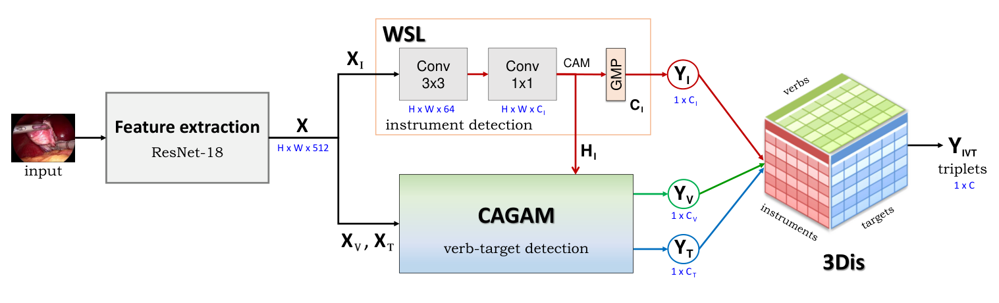
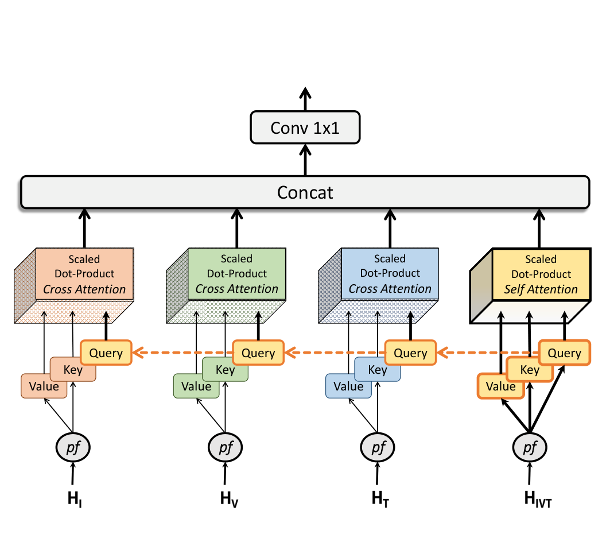
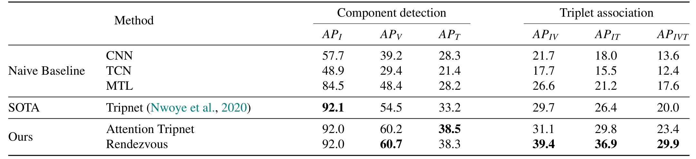
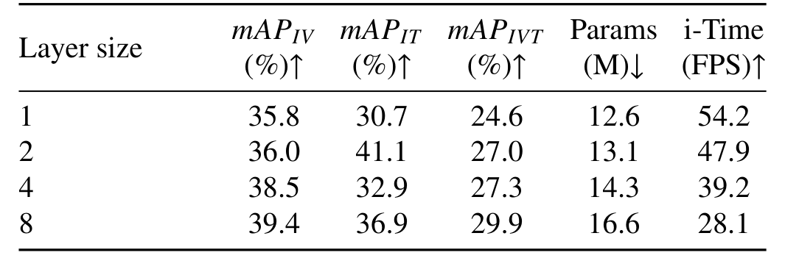
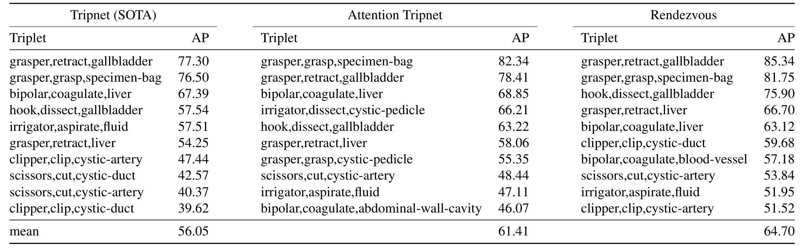
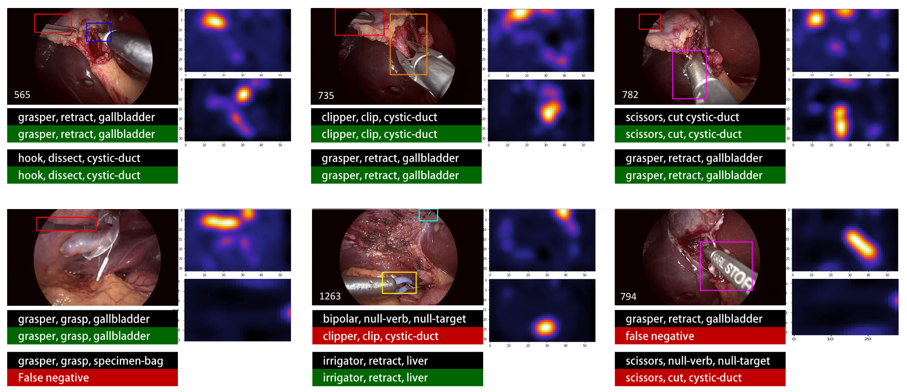

## 1. 背景与动机

**手术视频理解长期停在“阶段”这一层。** 相位识别只能说现在处于“夹闭与切断”阶段，说不出施夹钳夹的是胆囊管还是胆囊动脉，而后者正是安全监控需要的信息。

更细的尝试只做了一半：`EndoVis 2019` 的动作识别只有 4 个动词，不管器械和组织；`SARAS-ESAD` 的 21 类标签不区分器械。

⟨器械, 动作, 目标⟩ 三元组是最细的表述，难点有三：目标要“被器械作用”才算数；同一把抓钳的牵拉、抓持、分离很难分；一帧里有多个三元组时，要把分量正确配对。

作者此前的 `Tripnet` 用拼接引导动作和目标、用外积建模组合。本文要改进这两步，并提供更大的数据集。

## 2. 核心观点速览

- **数据：** CholecT50 有 50 个视频、100 类三元组，由 6 种器械、10 种动作、15 种目标组合而成，1fps 下 100.86K 帧、161K 个实例。
- **编码器：** 动作主要看器械类型，目标主要看器械位置，所以动作用通道注意力、目标用位置注意力，引导图是器械的类激活图。
- **解码器：** 三元组特征作为查询，去看三个分量的类别图（交叉注意力），再加一个自注意力头，共 8 层。
- **结果：** 三元组 mAP 从 `Tripnet` 的 20.0 提到 29.9；器械检测已饱和，增益来自动作、目标和关联。
- **边界：** 只看单帧、只有一次划分、标签没有框和实例数，29.9 的绝对水平说明问题远未解决。

:::highlights
- 三元组识别 = 三个多标签分类 + 一个配对问题
- 器械类激活图是整个模型的空间先验来源
:::

:::data
- 50 个视频，100 类，161K 个实例
- 训练、验证、测试为 35、5、10 个视频
:::

## 3. 数据集怎样构建

**类别表是临床专家筛出来的，不是数据中自然出现的全部组合。** 45 个视频来自 Cholec80，5 个来自院内，两名外科医生在时间轴上标出每个动作的起止。

筛类分两步。先把语义相同的组合归并，例如十二指肠和结肠统一为“肠”；再由三名临床医生按可能性和有用性打 1 到 5 分，结合出现次数取前若干类。理论组合 900 种，观测到约 300 种，最终留 100 类。

分布很不平衡：抓钳牵拉胆囊有 48628 个实例，最少的类只有 8 个；对安全最关键的施夹胆囊管有 1856 个。

| 划分 | 视频 | 帧 | 标签 |
|---|---|---|---|
| 训练 | 35 | 72815 | 113884 |
| 验证 | 5 | 6797 | 10267 |
| 测试 | 10 | 21251 | 36854 |

**论文未说明的三件事：** 两名标注者的一致性、临床评分的截断标准、数据许可条款。前者决定标签噪声上限，后两者决定别人能否复现同样的数据。

所以这个数据集适合帧级识别，不适合直接做检测或计数。下一节看模型如何利用“以器械为中心”。

## 4. 编码器：用器械引导动作和目标

只有帧级标签，模型并不知道器械在哪。**做法是先学器械的类激活图，再拿它去引导另外两个分量。**

骨干是 `ResNet-18`，最后两块步长改为 1，输出 32×56×512 的特征。器械分支经两层卷积得到 6 通道激活图。动作分支在 6×6 的类别维度上做注意力，只携带“哪种器械”的信息；目标分支在 1792×1792 的像素维度上做注意力，携带“器械在哪”的信息。

$$E = \beta (V A) + X_Z$$

增强特征 $E$ 是原特征加上注意力加权后的值，$\beta$ 是可学习系数。

*论文原图编号：Fig. 7。Attention Tripnet：与 RDV 相同的器械分支和动作目标分支，后接被新解码器取代的 3D 交互空间。*

分量识别好以后，还要配对。

## 5. 解码器：混合注意力多头

**旧方法对三个分量做外积，枚举 6×10×15 个组合，其中大多数不可能出现。** 新解码器只在 100 个有效类别上建模。

每层有 4 个头：三元组特征生成查询，分别对器械、动作、目标类别图做交叉注意力，再对自身做一次自注意力，拼接后经 1×1 卷积融合。查询以 0.3 的比例遮蔽，避免 8 层重复。

序列单位是“类别图”而不是图像块。附录中 6 层图像块序列的 AP_IVT 为 24.1，2 层类别图已达 27.0。

*论文原图编号：Fig. 5。三个分量类别图提供键和值，三元组特征提供共享查询，3 个交叉注意力头和 1 个自注意力头拼接融合。*

## 6. 训练与评测协议

三个分量用加权 sigmoid 交叉熵，按不确定性方法自动加权；三元组损失前 18 个 epoch 不参与。优化器为带动量 0.95 的随机梯度下降，学习率 0.001，每 50 个 epoch 乘 0.1，批大小 8，训练 200 个 epoch。

评测同时看分量 AP、组合 AP 和 Top-N 准确率。**mAP 是先在每个视频内逐类算 AP，再对视频平均**，混合全部帧算出的数字不能与论文对比。

:::data
- 单张 GTX 1080 Ti 训练约 118-180 小时
- 8 层 RDV 有 16.61M 参数
:::

## 7. 结果说了什么

先看编码器。表 4 中，通道注意力主要帮动作，位置注意力主要帮目标，两者合用时动作 AP 从 48.4 到 61.1、目标 AP 从 28.2 到 40.2。**这个交叉模式是“动作看类型、目标看位置”唯一的定量证据。**

再看解码器。同样输入四路特征，只做自注意力时 AP_IVT 为 26.1，加入交叉注意力后为 29.9。

*论文原图编号：Table 7。朴素基线、Tripnet 与本文两个模型在分量检测和三元组关联上的 AP。*

主表里，`Attention Tripnet` 只换编码器，AP_IVT 从 20.0 到 23.4；`RDV` 再换解码器，到 29.9。两者分量 AP 几乎相同，差别全在关联：AP_IV 39.4 对 31.1。摘要说的“提高 9% 以上”是 9.9 个百分点的绝对提升。

*论文原图编号：Table 6。解码层数与精度、参数量、帧率的取舍。*

层数加到 8，帧率从 54.2 降到 28.1 FPS，仍高于作者说的实时门槛 25 FPS。前 20 个预测中包含正确答案的比例为 95.9%，而 Top-5 只有 76.3%，说明很多三元组彼此相似。

:::data
- AP_IVT：Tripnet 20.0，Attention Tripnet 23.4，RDV 29.9
- 器械 AP：三者都在 92 左右
:::

## 8. 为什么有效

**最大的增益来自“把分量当辅助任务、把分量类别图喂给解码器”。** 去掉辅助损失，AP_IVT 从 29.9 掉到 21.2；四路输入比单一输入高 7.3；交叉注意力在此之上再加 3.8。

我的判断：三元组标签稀疏且长尾，分量标签更密。先学好 6、10、15 类的分量，再学 100 类的组合，本质是把难问题拆成容易的子问题。交叉注意力那一步有“同样输入、只换注意力”的对照，是几项结论里最干净的。

*论文原图编号：Table 9。三个模型各自 AP 最高的 10 个三元组及均值。*

临床关键类的提升明显：施夹胆囊管从 39.62 到 59.68，剪断胆囊动脉从 40.37 到 53.84。

## 9. 结果没说什么

- **泛化：** 只有一次 35/5/10 划分、10 个测试视频，多次运行的方差论文未说明。
- **注意力的解释：** 位置注意力也可能只是容量更大；论文没有控制参数量，也没有定量比对注意力图与目标区域。
- **论文自身的数字出入：** 正文说双注意力使动作提升 12.4，按表算是 12.7；表 6 中 2 层 AP_IT 为 41.1，而附录中同为 2 层的模型是 34.1，很可能是排版错误；附录辅助损失表中“有辅助损失”一行对应几层，论文未说明。
- **定位：** 弱监督定位只对器械有效，目标无法定位；同类三元组的多个实例无法区分。

## 10. 怎么确认不是巧合

论文对 `Tripnet` 做了符号秩检验：AP_IVT 上 `RDV` 的 p≪0.001，器械 AP 上 p≈0.374 不显著，与“器械已饱和”一致。

但检验单位是 30 批连续帧，**批次可能来自同一视频，彼此并不独立**。我的判断是 p 值偏乐观，以视频为单位的检验论文没有做。基线也都由作者自己实现。

*论文原图编号：Fig. 9。RDV 的预测与热图，绿色为正确，红色为错误或漏检。*

定性图里的错误集中在“器械可见但没有动作”：双极闲置时被判成施夹，剪刀闲置时被判成剪断。

## 11. 复现要注意什么

- 类别权重怎么算、编码器缩放因子取多少，论文未说明。
- 评测必须逐视频逐类算 AP 再平均。
- 超参数在 5 个验证视频上最多搜了 74 组，换数据集时要重新调。
- 代码基于 TensorFlow，作者给出了 GitHub 仓库。

## @takeaways
- CholecT50 是帧级三元组识别的基准，没有框和实例数
- 把组合标签拆成分量辅助任务，是增益最大的一步
- 用一个分量的激活图引导另一个分量，可在无框标注下提供空间先验
- 比较结果时先确认 mAP 是逐视频平均

## @strengths
- 数据集的类别经临床归并、评分和仲裁，逐类计数完整公开
- 消融覆盖编码器、解码器、层数、序列方式和辅助损失
- 同时报告分量、组合、Top-N 和逐类结果，并做了显著性检验

## @weaknesses
- 单一划分、10 个测试视频，没有方差
- 显著性检验以连续帧批次为单位
- 表 4、表 6、附录表中有几处数字对不上
- 标注一致性和数据许可论文未说明

## @questions
- 两名标注医生的一致性有多高？
- 多次划分下 RDV 相对 Tripnet 的优势还剩多少？
- 加入时序建模后，抓持、牵拉、分离这类易混动作能改善多少？
- 如何把二值标签扩展为可检测、可计数的实例标签？
