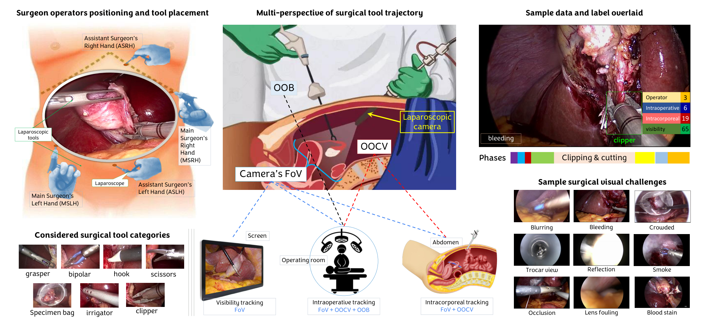
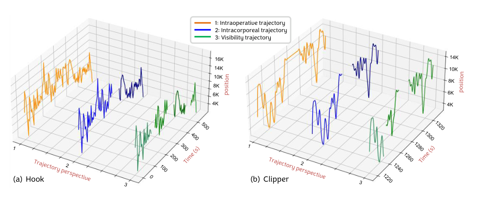
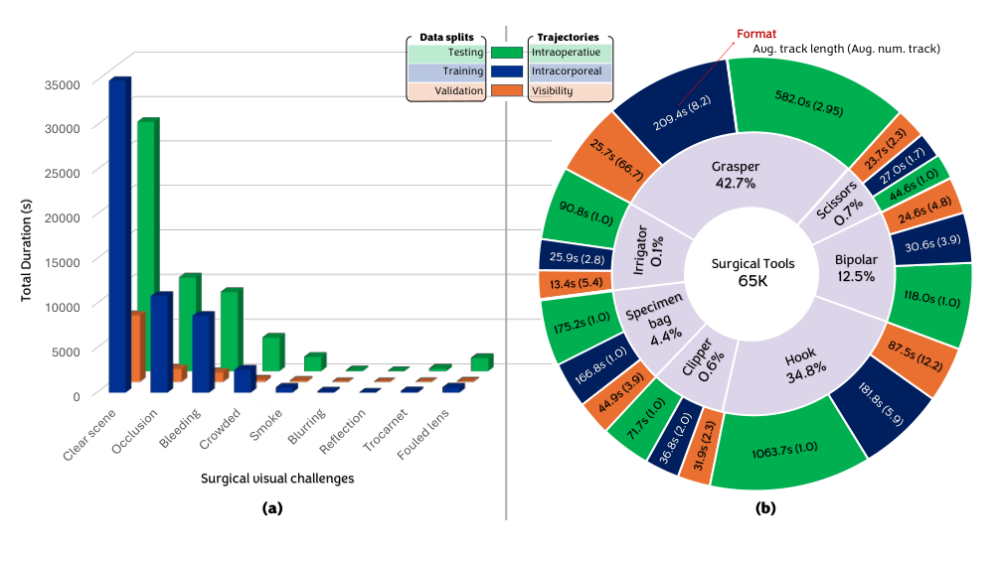
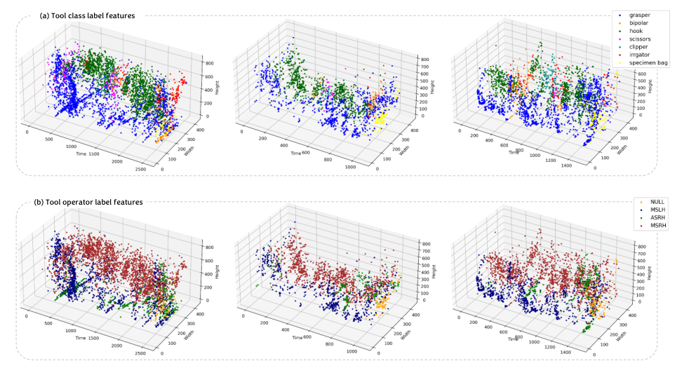
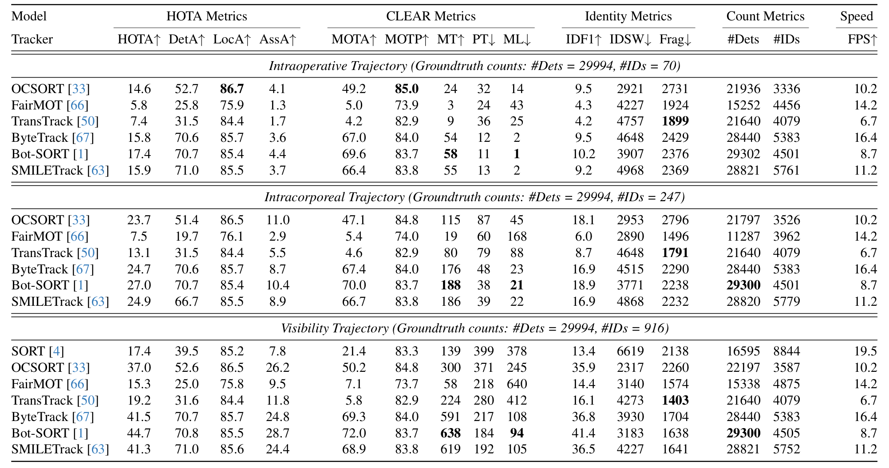
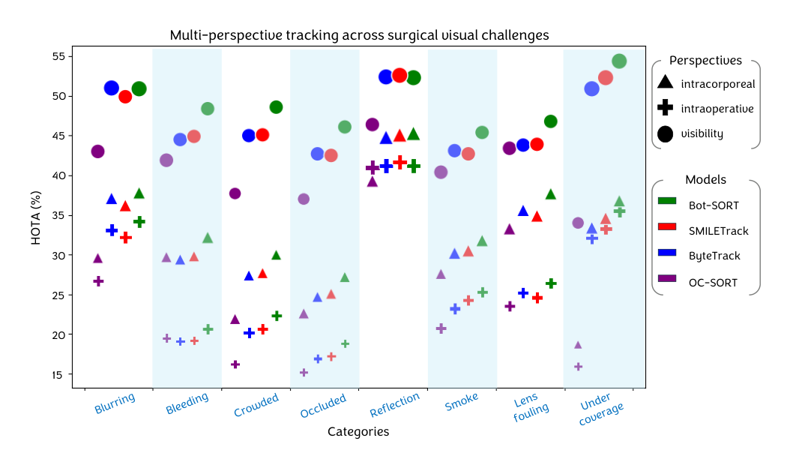

## 1. 背景与动机

**手术器械跟踪的难点不在“找到器械”，而在“认出它还是不是刚才那一把”。** 器械会被遮挡、移出画面、从套管口拔出体外，再插回来；同类器械还可能同时出现。

已有手术跟踪数据集只采用一种轨迹定义：要么器械离开画面轨迹就结束，要么整台手术一个身份。临床用途却各需要不同的时间尺度：统计器械使用要跨越拔出再插入，评估操作步骤要知道画面外的器械是否还在体内，实时反馈只需要画面内的轨迹。

在通用数据集上预训练的模型，在出血、烟雾、反光等手术画面里也表现不佳。作者认为需要一个专门的、带上下文标签的手术跟踪数据集。

## 2. 核心观点速览

**这篇论文的核心贡献是轨迹定义，而不是模型。** 同一个框带三个 ID，区别只在“轨迹何时结束”。

- **数据：** 20 台完整手术，1 FPS 标注，35000 帧、65200 个框。
- **标签：** 7 类器械、4 类操作者、8 类视觉挑战、7 个手术阶段，加三套轨迹 ID。
- **结果：** 最好的 `Bot-SORT` 在可见性、腔内、术中视角的 `HOTA` 分别是 44.7%、27.0%、17.4%。
- **边界：** 跟踪器所用检测器和训练配置论文未说明；正文有三处描述与表格矛盾。

接下来先看三种定义，因为后面所有分数差异都由它决定。

## 3. 三种轨迹视角

*论文原图编号：Figure 1。中间部分说明三种视角：可见性只覆盖画面内（FoV），腔内加上画面外但在体内（OOCV），术中再加上体外（OOB）。*

| 视角 | 轨迹何时结束 | 真值 ID 数（测试集） |
|---|---|---|
| 可见性 | 器械离开画面，两秒内的短暂消失仍算同一条 | 916 |
| 腔内 | 器械经套管口离开体内，即使不在画面中 | 247 |
| 术中 | 器械在本台手术中最后一次出现 | 70 |

**真值 ID 数从 916 降到 70，意味着定义越长，跟踪器越需要在器械不可见时保持身份。** 腔内轨迹最难标注：器械常在画面外退出，论文规定当同一套管口进入另一件器械，或原器械松开夹持的组织时，推断它已出体。

*论文原图编号：Figure 2。同一把 Hook 和 Clipper 的位置曲线，在三种视角下被切成不同数量的轨迹段。*

定义清楚之后，问题变成：这三套 ID 是怎么标出来的，标得可信吗？

## 4. 数据怎么来、怎么标

原始视频来自 `Cholec80` 和 `CholecT50`，在斯特拉斯堡大学医院录制。作者挑选长而清晰、覆盖全部阶段的手术，从 25 FPS 下采样到 1 FPS，并匿名化体外画面。

标注分四步：四名研究者在器械尖端画框并按套管口判断操作者；同时标注阶段、画面外与体外状态、进出事件和视觉挑战；再结合类别、位置、操作者和交互标签分配三套 ID，不确定处回到 25 FPS 复查；最后做一致性评估和外科医生仲裁。整个过程持续两年。

| 验证 | 框重叠（`Jaccard`） | 器械类别一致性 | 操作者一致性 |
|---|---|---|---|
| 组内 | 99.4% | 94.6% | 94.0% |
| 组间（20 个样本） | 91.8% | 95.2% | 92.7% |

外科医生仲裁了 758 个不确定样本，修正 133 个。**这些一致性只覆盖框和类别，最关键的轨迹 ID 一致性论文未说明。**

:::data
- 20 台手术，总时长 50581 秒
- 35000 帧，65200 个框，2,624 条轨迹
- 训练、验证、测试按手术划分，5:1:4
:::

## 5. 数据长什么样

*论文原图编号：Figure 4。(a) 视觉挑战总时长按划分分布；(b) 器械占比及各视角平均轨迹长度。*

**类别极不平衡：** 抓钳 42.7%、电钩 34.8%，两者合计 77.5%；剪刀、施夹器、冲洗器都不到 1%。遮挡是最常见的视觉挑战，累计可达 23,000 秒。抓钳平均每台在体内 27 分 39 秒、重新插入 8.4 次，正是长时重识别问题的来源。

*论文原图编号：Figure 5。器械位置随时间的分布，(a) 按类别着色，(b) 按操作者着色；按操作者着色分区更清楚。*

论文据此指出，不同类别的轨迹大多交织在一起，但操作者与位置强相关，因为套管口位置固定。这一点后面会成为改进方向。

## 6. 和已有数据集比

| 数据集 | 已有视角 | 缺什么 |
|---|---|---|
| 四个检测数据集 | 无轨迹 | 没有身份标签 |
| `EndoVis'15`、`RMIT` | 可见性 | 没有腔内、术中视角 |
| Fathollahi 等 | 术中 | 没有可见性、腔内视角 |
| 以上全部 | — | 没有操作者、视觉挑战、阶段标签 |

`CholecTrack20` 是表中唯一三种视角和三类上下文属性都具备的数据集，帧数 35000 也是表中最多的。

## 7. 检测：现成方法已经不弱

13 个检测器用 `pycocotools` 评测。`YOLOv7` 到 `YOLOv10` 的综合平均精度都在 55.6 到 56.5 之间，比其余模型高十几个点。电钩最容易检测，冲洗器和标本袋最难。

**正文说 `YOLOv7` 以 56.1 最高、全部类别领先，但表 2 中 `YOLOv9` 是 56.5。** 电钩、冲洗器、标本袋三类的最高分也分别属于 `YOLOv8`、`YOLOv10`、`YOLOv9`。引用排名应以表格为准。

检测这层表现尚可，那么跟踪的低分从哪里来？

## 8. 跟踪：分数低在关联

*论文原图编号：Table 3。三种视角下各跟踪器的完整指标。*

| 跟踪器 | 术中 | 腔内 | 可见性 |
|---|---|---|---|
| `FairMOT` | 5.8 | 7.5 | 15.3 |
| `OCSORT` | 14.6 | 23.7 | 37.0 |
| `ByteTrack` | 15.8 | 24.7 | 41.5 |
| `SMILETrack` | 15.9 | 24.9 | 41.3 |
| `Bot-SORT` | 17.4 | 27.0 | 44.7 |

**同一跟踪器在三个视角下检测分几乎不变，`Bot-SORT` 都在 70.7 到 70.8；关联分却从 28.7 跌到 10.4 和 4.4。** 三个视角共用同一组检测，差距来自身份关联。

术中视角真值只有 70 个 ID，`Bot-SORT` 却预测了 4501 个，说明长时重识别基本失效。

**正文说腔内最难、术中居中，与表 3 相反：每个跟踪器的术中分数都低于腔内。** 从定义看也合理：术中要求器械拔出再插入后接上原 ID，对外观相同的同类器械几乎只能靠上下文判断。

*论文原图编号：Figure 9。按八类视觉挑战拆分的跟踪分数。*

按视觉挑战拆分时，跟踪在模糊、反光、覆盖不足下较好，检测却恰好在这几类下最差。论文未解释这一矛盾，所以这部分只能当作描述。

## 9. 结果没证明什么

:::highlights
- 瓶颈在关联：部分成立，缺一个用真值框输入跟踪器的对照实验
- 三视角有临床价值：未经验证，论文没有做任何下游任务
- 不足以临床转化：45% 门槛是作者判断，临床所需精度论文未说明
- 标注质量高：框和类别成立，轨迹 ID 一致性论文未说明
:::

同一跟踪器三视角的检测数、ID 数和速度几乎相同，例如 `TransTrack` 都是 21640 个检测、4079 个 ID。**我的推断是作者用同一份输出对照了三套真值，没有针对视角调整方法。** 所以“低于 45%”只适用于直接套用通用跟踪器的情形。

表 3 标题写“@ 25 FPS”，而标注是 1 FPS，真值检测数 29994 与 1 FPS 的测试集规模相符。评测帧率和真值扩展方式论文未说明。

## 10. 复现要注意什么

- 汇报时写明视角，三个视角的数字不能混比，也不要取平均。
- 检测用 `pycocotools`，不要用 `ultralytics` 自带评测。
- 跟踪评测走 `TrackEval`，确认作者的合并请求是否已合入。
- 按视频划分，不要按帧随机划分；各划分具体包含哪些视频论文未说明，需查项目页。
- 跟踪器的检测器、训练配置论文未说明，复现表 3 需查代码。

## @takeaways
- 同一个框、三套 ID，把“轨迹何时结束”变成可控变量，可以单独研究长时重识别。
- 现有跟踪器的瓶颈在身份关联，术中视角最难，最好只有 17.4%。
- 操作者和套管口位置是最自然的关联先验，数据集已经提供。
- 引用时以表格为准，正文有三处描述与表格矛盾。

## @strengths
- 第一个同时提供三种轨迹视角的手术跟踪数据集，并带操作者、阶段、视觉挑战标签。
- 完整手术视频，长时重识别问题真实存在。
- 检测与跟踪基线覆盖广，按类别、挑战、阶段细分。

## @weaknesses
- 单一医院、单一术式，泛化未讨论。
- 轨迹 ID 一致性、跟踪器设置、评测帧率论文未说明。
- 正文与表格在检测排名、视角难度上矛盾。

## @questions
- 用真值框作为输入时，三个视角的关联分是多少？
- 利用操作者和阶段标签的方法能把术中视角提高多少？
- 三种视角的轨迹用于技能评估等下游任务时，哪种最有用？
