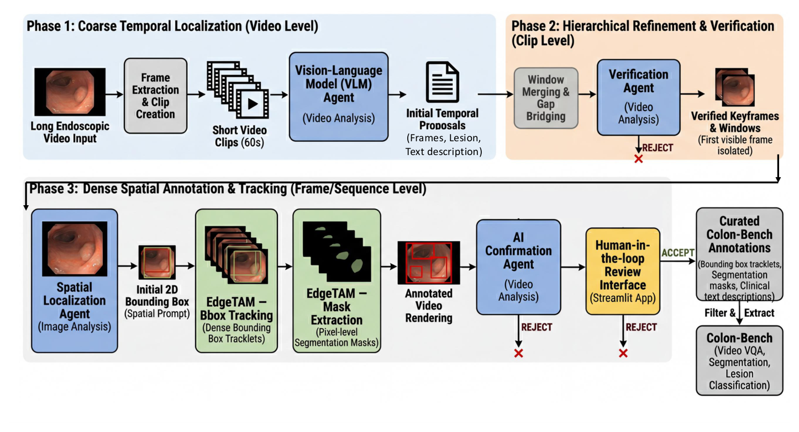
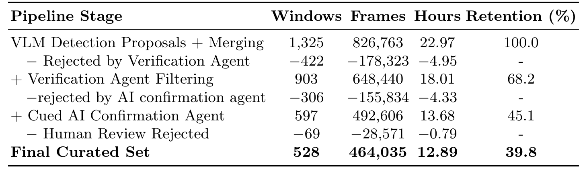
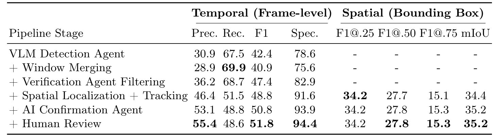
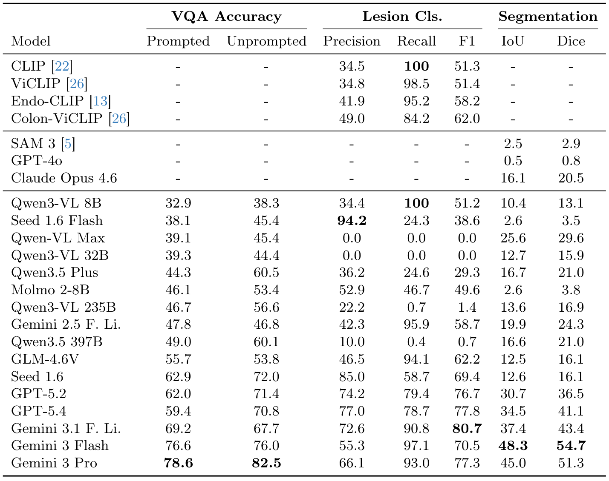
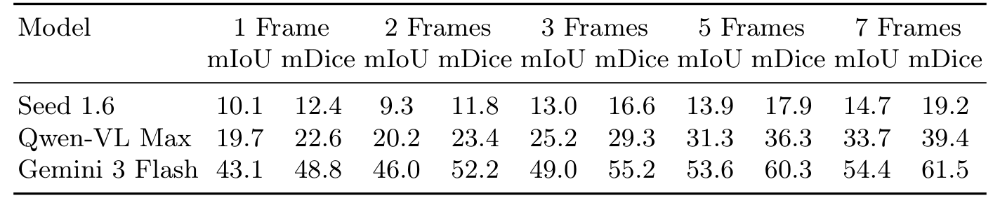
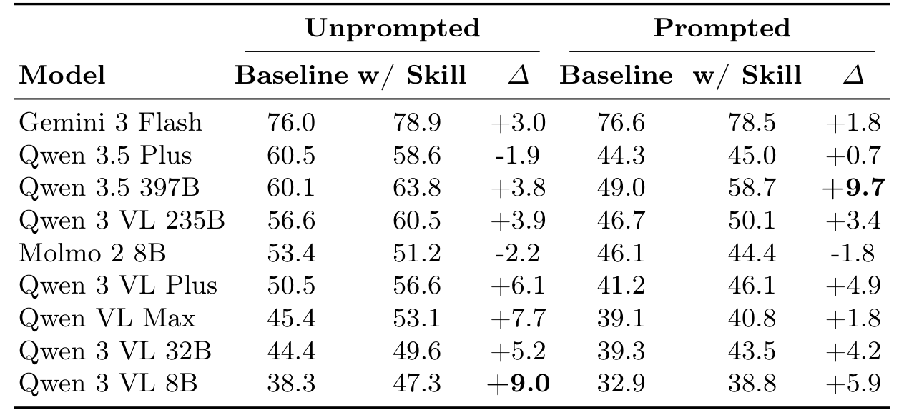

## 1. 背景与动机

结肠镜是结肠癌早筛的主要手段，但一次检查可能长达两小时，病灶稀疏且常被模糊、粪水和贴壁镜头遮住。

**公开数据几乎都只标息肉**。Kvasir-SEG 与 PolypGen 是静态图，REAL-COLON 有 60 段全程视频和 351,264 个息肉框，却没有掩码和文本。多类病灶、带时空真值和临床文本的视频数据还不存在。

人工逐帧标注昂贵又不一致。作者想知道：能否让大模型承担大部分标注，医生只做最后判断。

## 2. 核心观点速览

- **做法**：Gemini 系模型提议时间窗、复看、画框，EdgeTAM 跟踪出掩码，另一个智能体看带框视频复核，最后一名医生接受或拒绝。
- **产物**：528 个窗口、14 类病灶、300,132 个框、213,067 个掩码、133,289 词描述。
- **结果**：Gemini 3 系列在问答和分割上领先，SAM 3 的分割 mIoU 只有 2.5。
- **边界**：质量证据只有息肉替代标签，召回 48.6；真值由 Gemini 生成，Gemini 的领先无法与同源偏差分开。

:::highlights
- 人工只做窗口级接受或拒绝，不改框和掩码
- 规模扩展在类别、掩码和文本，帧数反而少于来源
:::

:::data
- 1,325 → 528 个窗口，保留率 39.8%
- 医生拒绝 69 个，占展示窗口 11.6%
:::

## 3. 标注漏斗怎样运转

*论文原图编号：Fig. 1。三阶段流程：视频级粗定位、片段级验证、帧与序列级标注跟踪，再经 AI 与人工复核。*

四步依次是：轻量 Gemini 把 60 秒短片划成时间窗并标记有无病灶；Gemini 3 Pro 复看每个窗口，给出首次清晰出现的时间和描述；Gemini 3 Flash 在该帧画框，EdgeTAM 向后跟踪出框和掩码；第二个智能体看带框视频，置信度不到 80% 就拒绝。

*论文原图编号：Table 5。各阶段的窗口、帧、时长和保留率。*

**删得最多的是验证这一步**（−422 个窗口）。医生只拒绝 69 个，但他看到的已是两轮过滤后的结果，这个比例不能当作独立的标注一致性。

最终窗口平均 878.9 帧，被拒的只有 414 到 509 帧。流程偏好留下长而描述充分的窗口，短暂一闪的病灶更容易丢。

## 4. 质量证据只覆盖息肉

*论文原图编号：Table 7。以 REAL-COLON 息肉框为替代标签，逐阶段的帧级与框级指标。*

验证让精度加 7.3、召回几乎不变；跟踪再加 10.2 精度，代价是召回降 17.2。最终精度 55.4、**召回只有 48.6**，框级 F1@.50 只有 27.8。

医生复核前后框级指标完全不变，说明医生没有修框。其余 13 类病灶没有任何独立参照，作者也承认这些数字只用于质量控制。

:::data
- 最终帧级 F1 51.8，特异度 94.4
- 框级 mIoU 35.2
:::

## 5. 任务与去偏

评测集由 1,597 个片段组成：分类 790（阴性 518）、检测 272、分割 264、有框问答 1,485 题、无提示问答 2,740 题。

每个片段由 Gemini 3 生成三道五选一题。去偏分两步：用只看题干和正确答案的独立调用重写干扰项，再用纯文本盲测找出新捷径并回退。**去偏后盲答仍有 44.6% 和 37.1%**，随机水平是 20%。作者归因于病灶类型分布偏斜，但没有给出多数类基线。

评测片段如何选取、微调过的 Colon-ViCLIP 训练是否与评测隔离，论文未说明。

## 6. 结果说了什么

*论文原图编号：Table 3。所有模型在问答、分类和分割上的汇总。*

| 模型 | 问答 有框 | 问答 无提示 | 分类 F1 | 分割 mIoU |
|---|---|---|---|---|
| Gemini 3 Pro | 78.6 | 82.5 | 77.3 | 45.0 |
| Gemini 3 Flash | 76.6 | 76.0 | 70.5 | 48.3 |
| GPT-5.4 | 59.4 | 70.8 | 77.8 | 34.5 |
| Seed 1.6 | 62.9 | 72.0 | 69.4 | 12.6 |
| Qwen3.5 397B | 49.0 | 60.1 | 0.7 | 16.6 |
| SAM 3 | 无 | 无 | 无 | 2.5 |

**GPT-5.4 不是标注模型，分割仍比 SAM 3 高 32.0 个点**，说明前沿大模型确有定位能力。但 SAM 3 走文本提示，其他模型是画框后交给同一个 EdgeTAM，两者条件不同。

几个 Qwen 大模型分类召回接近 0，准确率在 64.6% 到 65.6% 之间，与全判阴性（518/790）相同。它们的问答分数不差，所以这是提示与判断习惯不匹配，不是看不见病灶。

有框问答中，6 个模型的准确率低于纯文本盲测的 44.6%。

## 7. 消融说明了什么

*论文原图编号：Table 14。三个模型用 1 到 7 帧检测框时的分割 mIoU 与 mDice。*

检测帧数从 1 加到 7，Gemini 3 Flash 的 mIoU 从 43.1 升到 54.4，作者取 3 帧折中。

视频对单帧只测了 3 到 4 个模型，方向不一致：Seed 1.6 分类掉 22.4 个点，Gemini 3 Flash 反而升 1.6。有框问答中 59% 的题有时间描述，单帧仍能答对大部分。推断：多数题目不需要真正的时间推理。

去掉框提示时，四个代表模型的变化在 −1.8 到 +0.6 之间。

## 8. Colon-Skill 提示

*论文原图编号：Table 18。9 个模型加与不加技能提示的问答准确率。*

作者把多数模型共同答错的题交给大模型，总结成一页判读要点，加在提示前。9 个模型中 7 个两档都提升，最多 +9.7（Qwen3.5 397B，有框）。Molmo 2-8B 两档都下降。

**技能从同一批题蒸馏又在同一批题上评测**，没有留出集。它只说明“写进本基准的常见错误能提高本基准分数”。

## 9. 结果没说什么

- **Gemini 领先的幅度不可全信**：分割真值来自 Gemini 3 Flash 的框加 EdgeTAM，题目来自 Gemini 3，被测的 Gemini 加 EdgeTAM 流程在复现标注过程。论文没有独立人工子集来重算排名。
- **528 个窗口不是病灶全集**：约一半息肉帧缺失，短窗口被系统性删除。
- **非息肉类别的质量未知**：只有一名外科医生做窗口级判断，没有一致性指标。
- **几处数字对不上**：分割是 272 还是 264 个视频；图中出现的 Gemini 3.5 Flash 不在任何表格里；表 14 的 3 帧结果与表 11 相差 0.4 到 0.7 个点。论文都未说明。

## 10. 复现与复用要注意什么

数据在 Hugging Face 门控发布（CC BY 4.0），代码在 GitHub。复用前先看三点：分类结果的准确率是否等于全判阴性；比较 Gemini 与其他模型时，用 REAL-COLON 人工息肉框复核；引用技能提示的提升时说明没有留出集。

## @takeaways
- 大模型提议、复看、跟踪、复核，人工只接受或拒绝，这一漏斗能低成本做出多类视频病灶标注
- 质量只在息肉上验证过，召回 48.6，框级 F1@.50 只有 27.8
- 前沿大模型定位远超 SAM 3，但 Gemini 的领先与标注同源无法分开

## @strengths
- 首个带 14 类病灶、掩码和临床文本的结肠镜视频基准，并公开数据、代码和全部提示词
- 逐阶段消融清楚显示每个过滤器的精度和召回代价
- 问答去偏流程有纯文本盲测结果，便于判断先验大小

## @weaknesses
- 真值、题目和领先模型同属 Gemini 家族，没有独立人工子集
- 只有一名医生，且只做窗口级判断
- 技能提示存在测试集泄漏；评测划分方式论文未说明

## @questions
- 换用非 Gemini 模型做标注，排名会如何变化
- 非息肉类别在独立人工复核下的精度和召回是多少
- 技能提示在新视频或留出题目上是否仍有效
