---
tags:
  - papers/手术数据集
aliases:
  - "D4D"
  - "Dresden Dataset for 4D Reconstruction"
date: 2026-03-03
arxiv_id: "2603.02985"
doi: "10.1038/s41597-026-08289-7"
---

# The Dresden Dataset for 4D Reconstruction of Non-Rigid Abdominal Surgical Scenes

## 核心信息

- 标题: The Dresden Dataset for 4D Reconstruction of Non-Rigid Abdominal Surgical Scenes
- 标题翻译: 面向非刚性腹腔手术场景 4D 重建的德累斯顿数据集（D4D）
- 作者: Reuben Docea, Rayan Younis, Yonghao Long, Maxime Fleury, Jinjing Xu, Chenyang Li, André Schulze, Ann Wierick, Johannes Bender, Micha Pfeiffer, Qi Dou, Martin Wagner, Stefanie Speidel
- 机构: 德国国家肿瘤疾病中心（NCT/UCC Dresden）转化外科肿瘤学系；德累斯顿工业大学附属 Carl Gustav Carus 医院内脏、胸部与血管外科；德累斯顿工业大学 CeTI 卓越集群；香港中文大学计算机科学与工程系
- 发表时间: 2026-03-03（arXiv 第 1 版）
- 发表渠道: arXiv 预印本（cs.CV）；Scientific Data 数据描述论文
- DOI: 10.1038/s41597-026-08289-7
- arXiv: 2603.02985
- 论文链接: https://arxiv.org/abs/2603.02985
- 代码 / 项目: https://github.com/reubendocea/d4d ；https://reubendocea.github.io/d4d/
- 数据 / 资源: https://doi.org/10.25532/OPARA-1033
- 论文类型: benchmark_or_dataset

## 原文摘要翻译

D4D 数据集提供成对的内镜视频与高质量结构光几何，用于在真实手术条件下评测形变腹腔软组织的三维重建。数据来自 6 次猪尸体采集，使用 `da Vinci Xi` 立体内镜和 `Zivid` 结构光相机，借助光学追踪以及人工整理的迭代对齐方法完成配准。

三类序列（整段形变、分步形变、移动相机片段）分别考察算法对非刚性运动、形变幅度和视野外更新的鲁棒性。每个片段提供校正后的立体图像、逐帧器械掩码、立体深度、起止两刻的结构光点云、整理后的相机位姿和相机内参。后处理阶段用迭代最近点（`ICP`）和半自动配准技术对齐数据，并生成器械掩码。

该数据集支持在可见与被遮挡区域进行定量几何评测，同时支持光度视图合成基线。数据包含 98 段整理后的录制、超过 300,000 帧和 369 个点云，可作为开发和评测非刚性 `SLAM`、4D 重建和深度估计方法的综合基准。

## 创新点

1. **把内镜视频和形变前后的结构光几何配成一对。** 每段操作前后各拍一次结构光点云，中间是完整的内镜立体视频。此前的 SCARED、SERV-CT 只有静态场景真值，EndoMapper、StereoMIS 没有高质量几何真值，所以形变组织的 4D 重建此前只能用光度指标打分。
2. **结构光相机与内镜处在不同视点。** 结构光能看到内镜当前看不到的表面，这让评测可以覆盖被遮挡区域和视野外形变，而不只是内镜画面里可见的部分。
3. **按考察目标设计三类序列。** 整段形变测端到端鲁棒性，分步形变把一次操作切成小步、测形变幅度，移动相机序列在两半之间移动内镜、测视野外形变的更新。
4. **公开一条可检查的位姿整理流程和它的质量统计。** 名义追踪位姿先用 LightGlue 加 PnP+RANSAC 纠正，再用 ICP 和区域 ICP 精修，Table 2 给出三组位姿下的点云距离与内点比例。

## 一句话总结

D4D 在 6 头猪尸体上用 da Vinci Xi 立体内镜加 Zivid 结构光采集了 98 段组织操作序列，为每段提供操作前后的几何参照和整理后的位姿（立体深度到结构光点云的中位距离均值 2.37 mm），但论文只验证了位姿质量，没有给出任何重建方法的定量基线。

## 研究问题

手术中的软组织会被推拉、滑动，甚至在视野外继续形变。图像引导系统要把术前 CT 或 MRI 配准到术中三维表面图上，而现有建图方法大多假设场景刚性：组织一动，表面图就得重建，耗时很长。

非刚性建图要能把已经离开视野的区域更新到当前观测上。MIS-SLAM 用嵌入式形变图做过尝试，作者此前的 SeeSaw 用图神经网络预测移出视野的点。但这类方法缺一个评测它们的数据集。

**现有内镜数据都缺形变场景下与视频配对的几何真值。** `SCARED`、`SERV-CT`、`EndoMapper`、`StereoMIS` 都不满足这个条件。

`EndoNeRF` 的作者写道，由于临床法规，不可能采集深度真值做三维数值评测。于是这类方法（`EndoNeRF`、`ForPlane` 与各类高斯泼溅方法）几乎只用光度误差评测。

常用的光度指标是 `PSNR`、`SSIM`、`LPIPS`，而光度好不等于几何对。

D4D 要补的就是这块：在受控的猪尸体组织操作中，同时记录内镜视频和形变前后的结构光几何。

### 核心观点速览

**这是一篇数据描述论文：它发布形变组织的视频加几何参照，并只验证了位姿质量。**

- 采集：6 头猪尸体，开放腹腔后用 `da Vinci Xi` 立体内镜拍操作过程，体外的结构光相机在操作前后各拍一次点云。
- 序列：150 段筛到 98 段，分整段形变 49、分步形变 39、移动相机 10 三类。
- 配准：名义追踪位姿经特征匹配纠正、再经 ICP 与区域 ICP 精修，得到整理后位姿。
- 结果：整理后位姿下，立体深度到结构光点云的中位距离均值为 2.37 mm，名义位姿为 5.63 mm。
- 边界：几何参照只有起止两刻；结构光精度、方法基线论文未说明，所以它目前是一个待用的基准，还不是一个有排行的基准。

下面先看数据怎么采、有多大，再看位姿怎么整理出来，最后看这些位姿到底多准。

## 数据与任务定义

### 数据来源

要在形变中拿到几何，就得同时有视频、深度相机和把两者放进同一坐标系的追踪。数据于 2025 年 2 月到 9 月在德累斯顿 `NCT` 实验手术室采集，共 6 头猪尸体。手术机器人为 `da Vinci Xi`，配 30° 或 0° 镜头的立体内镜，左右图像分辨率 894 × 714。

几何由 `Zivid 2+ M60` 结构光相机采集。内镜和结构光相机都固定了光学标记，由 `Polaris` 光学追踪系统实时跟踪位姿。

三路数据以 `ROS2` 的 `rosbag` 格式同时记录在一台工作站上，用 `ROS2` 系统时钟打时间戳完成同步。

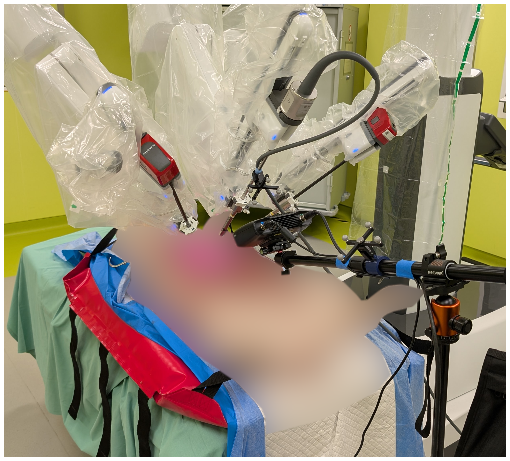
*论文原图编号：Figure 1。仰卧位猪尸体、da Vinci 机械臂与前景中的 Zivid 结构光相机，支架和内镜上都装有光学标记。放在这里是因为它说明腹腔已被打开，结构光相机从体外拍摄。*

需要注意两点。第一，采集前已**转为开放手术**，并关掉室内灯光以提高结构光信噪比、模拟微创手术的光照。第二，部分采集日里，相关解剖结构在之前的手术中已经被操作过。动物在前序手术结束时于深度麻醉下注射氯化钾安乐死，伦理批号 TVV 43/2023。

### 采集循环与三类序列

内镜光源会压低结构光的信噪比，所以几何和视频不能同时采。每个片段（clip）遵循同一结构：

1. 场景静止、内镜灯关闭，结构光相机拍下起始点云。
2. 打开内镜灯，外科医生操作组织，以推和拉为主。
3. 场景再次静止、关灯，拍结束点云。

在此基础上有三类录制：

| 类型 | 做法 | 考察什么 |
|---|---|---|
| 整段形变 | 一次完整推或拉 | 端到端鲁棒性 |
| 分步形变 | 一次操作切成若干小步，每步之间拍点云 | 形变幅度、形变过程的细粒度分析 |
| 移动相机 | 前半段相机静止，移动内镜后再做后半段 | 视野外形变的重建 |

### 规模与筛选

采集共 150 段，人工检查相机漂移、数据流完整性、稳定性、图像质量和帧率后保留 98 段。另有 30 段质量存疑的序列也被发布，但没有做完整后处理；作者建议默认只用 98 段核心序列评测。

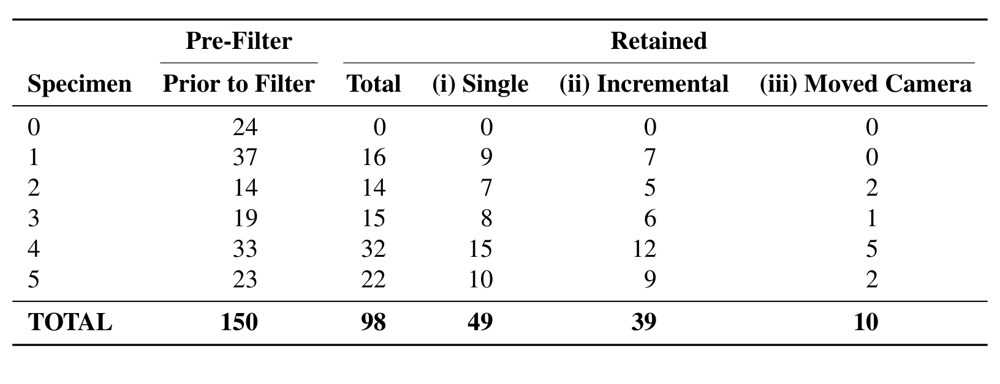
*论文原图编号：Table 1。按标本统计的片段数：过滤前与保留后，保留后再按三类序列拆分。放在这里是因为它给出了规模的分布，标本 0 的 24 段一段都没保留。*

保留后的 98 段中，整段形变 49 段、分步形变 39 段、移动相机 10 段。标本 4 贡献最多（32 段），标本 1 没有移动相机序列。**移动相机只有 10 段，按标本做 5 折时每折只剩一两段**，这类序列上的结论会很不稳定。标本 0 为何全部未保留，论文未说明，这限制了读者判断筛选是否带有系统偏差。

### 发布内容

数据按标本、采集时刻、片段三级组织。每个标本目录含相机标定、结构光 RGB 与深度、原始左右图像、掩码、点云、信噪比图和带时间戳的位姿变换。每个片段目录含：

- 校正后的左右图像与逐帧器械掩码；
- IGEV++ 生成的逐帧立体深度；
- 起止两刻的整理后位姿和结构光侧掩码；
- 适配 640 × 512 的相机内参。

所有校正图像、掩码和深度图都缩放到 640 × 512，原始分辨率数据也一并提供。这些产物里，起止位姿是把重建结果与结构光点云对上的关键，下一节看它是怎么来的。

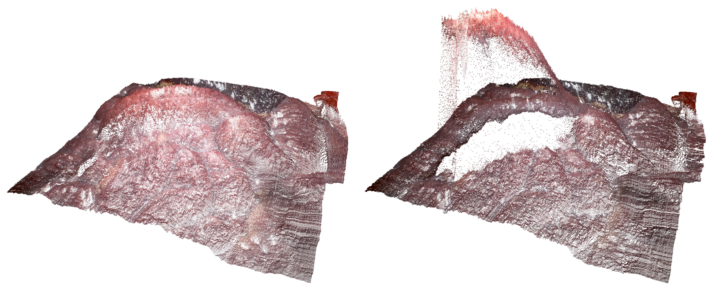
*论文原图编号：Figure 10。在一段序列上用 ForPlane 方法提取的初始状态（左）与结束状态（右）点云。放在这里是因为这是论文里唯一的重建方法示例，而且只是定性展示。*

## 方法主线

### 机制流程

追踪系统给出的位姿只是起点，要让结构光点云和内镜图像真正对上，作者走了四步：

1. **切出形变区间。** 输入：rosbag 解包出的图像流与点云。操作：用自制的序列对齐工具，从内镜图像目测组织开始和停止运动的时刻，标出每个片段的起止点，并与对应点云关联。输出：`clips.json`，送入后续配准。
2. **纠正名义位姿。** 输入：手眼标定加光学追踪给出的名义位姿。操作：把结构光点云重投影到内镜相机，用 LightGlue 做特征匹配，再用 PnP+RANSAC 估计纠正变换；自动匹配失败时人工指定对应点。输出：纠正后的内镜位姿。
3. **精修并整理位姿。** 输入：结构光起止点云和由立体深度反投影得到的点云。操作：两者之间做 ICP；由于相机几乎静止，目检所有对齐结果，选最合适的一个用于整段序列；仍不理想时用带人工输入的半自动区域 ICP。输出：最终保留的整理后位姿。
4. **生成掩码和深度。** 输入：校正后的立体图像。操作：内镜侧用 SAM-Track 与 SAM2 半自动分割器械，结构光侧人工分割；用 IGEV++ 生成立体深度。输出：逐帧掩码、立体深度，统一缩放到 640 × 512。

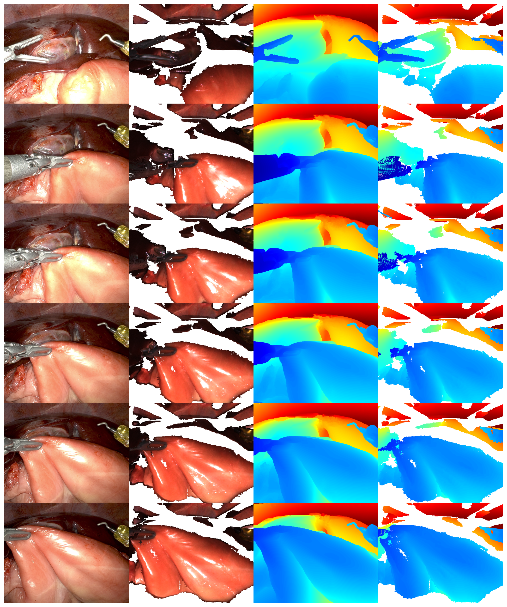
*论文原图编号：Figure 8。标本 5 一段序列中片段 1 的初始状态及其后四个片段的结束状态；每行依次为左内镜图像、按整理后位姿渲染的结构光彩色图、立体深度图、结构光点云深度图。放在这里是因为它把一个样本的全部配套产物并排展示，能直接看出视角差异造成的空洞。*

### 第一步：片段边界由人工目测

器械停下后组织还会因惯性或滑动继续动一会儿，所以片段边界不能直接取器械动作的起止。

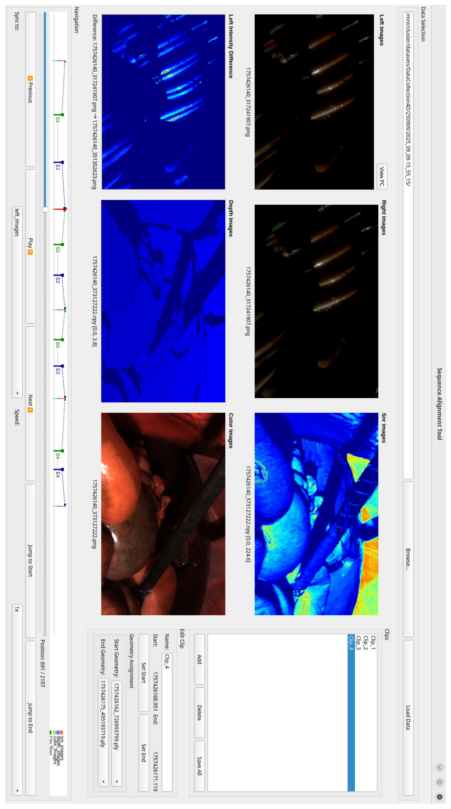
*论文原图编号：Figure 2。用于生成 `clips.json` 的序列对齐工具：人工标出片段起止并关联点云。放在这里是因为片段边界完全靠目测决定。*

这意味着片段起止存在人工判断误差，论文未说明标注者人数或一致性检查。

### 第二步：名义位姿为何要纠正

按追踪位姿渲染的点云与内镜图像不能完全重合，手眼标定残差的具体数值论文未说明。

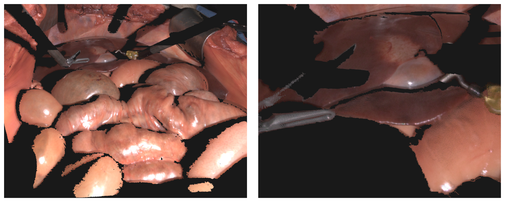
*论文原图编号：Figure 3。结构光点云从 `Zivid` 视角（左）和经 PnP-RANSAC 后的内镜视角（右）渲染。放在这里是因为右图大片黑色空洞就是内镜视角下结构光没覆盖的区域。*

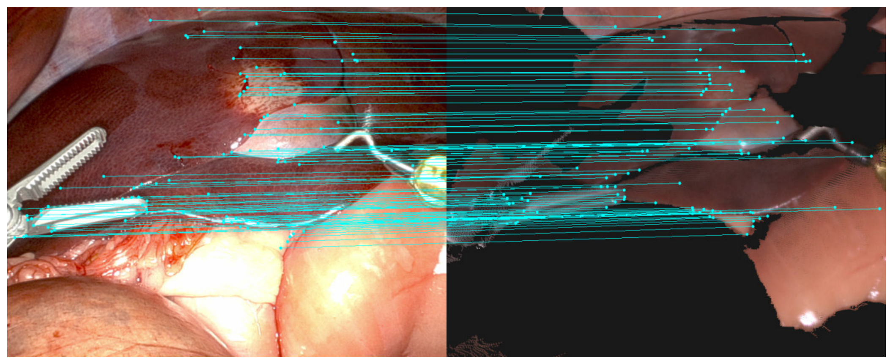
*论文原图编号：Figure 4。LightGlue 特征匹配的可视化。放在这里是因为它说明位姿纠正依赖内镜图像与渲染图之间的特征对应。*

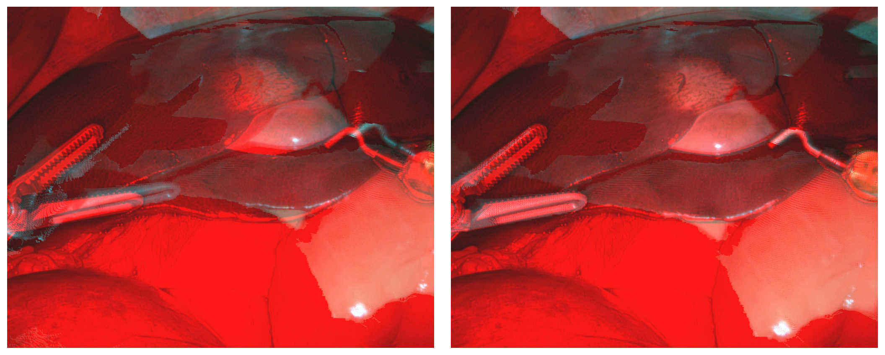
*论文原图编号：Figure 5。名义位姿（左）与 PnP-RANSAC 纠正后（右）的渲染、对齐与红青立体叠加对比。放在这里是因为左图器械边缘的重影说明名义位姿确实有残差。*

### 第三步：ICP 失败时的人工介入

部分 ICP 配准得不到合理结果，作者对每段序列目检后挑一个，仍不行就改用区域 ICP。

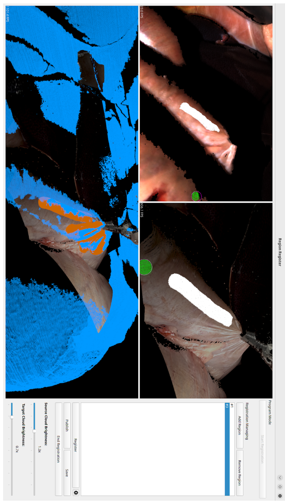
*论文原图编号：Figure 6。标准 ICP 失败时使用的半自动区域 ICP 精修示例。放在这里是因为它说明部分位姿依赖人工选区。*

**整理后位姿是人工参与挑选的结果**，读后面的表 2 时要记住这一点。

### 第四步：掩码

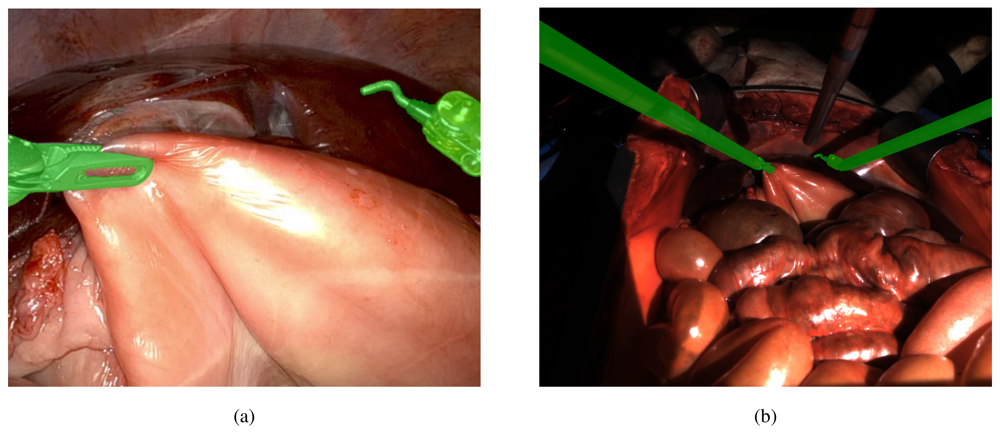
*论文原图编号：Figure 9。标本 5 一段录制中片段 5 起始（即片段 4 结束）的掩码叠加：子图甲为左内镜视角，子图乙为 `Zivid` 视角。放在这里是因为它展示两侧掩码分别覆盖的器械范围。*

掩码让评测可以排除器械像素，也让作者建议的遮挡区评测有了边界。

### 评测协议

作者给出的使用建议：

- 用片段目录中的校正图像、掩码和立体深度，配合 `curated_camera_pose_{start,end}.txt` 把重建结果对齐到起止结构光点云。
- 几何误差通过与结构光点云比较得到，光度质量可在非掩码像素上用 PSNR、SSIM、LPIPS 评估。
- 若要在数据上调参，在标本 1 到 5 的 98 段核心序列上按 4:1 划分，做 5 折留一交叉验证。

视野外形变的理想真值是结构光点与重建点之间的对应关系，作者承认这在实践中很难获得。较容易的做法是评估被器械遮挡、但器械移开前已被观测过的区域。具体的几何误差指标（倒角距离、点到面距离等）论文未说明，不同论文用它时结果可能不可比。

有了位姿，下一个问题就是这些位姿到底多准。

## 关键结果

### 位姿质量

技术验证只测了一件事：立体深度点云中每个点到结构光点云最近邻的距离，在三组位姿下比较。每个点云先取距离中位数，表中报告的是这些中位数在 540 个点云上的统计量。

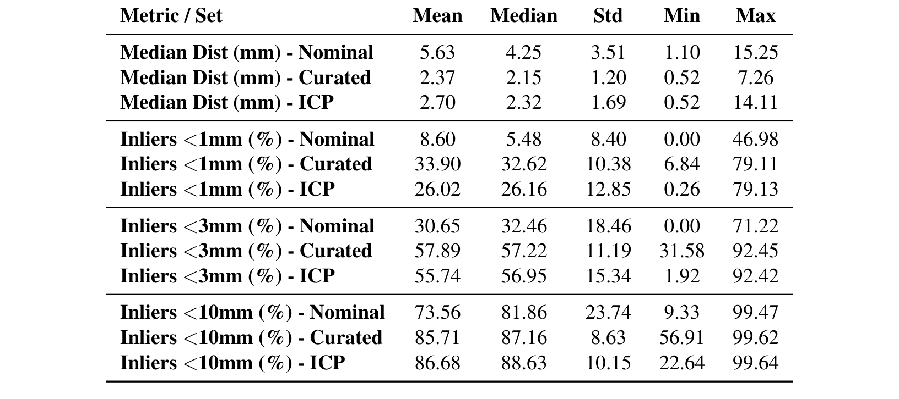
*论文原图编号：Table 2。在 Nominal、Curated、ICP 三组位姿下，立体深度点云到结构光点云的点对点距离统计（N = 540 个点云）。放在这里是因为它是全文唯一的定量结果。*

| 指标（各点云统计量的均值） | 名义位姿 | 整理后位姿 | ICP |
|---|---|---|---|
| 中位距离 (mm) | 5.63 | 2.37 | 2.70 |
| <1 mm 内点 (%) | 8.60 | 33.90 | 26.02 |
| <3 mm 内点 (%) | 30.65 | 57.89 | 55.74 |
| <10 mm 内点 (%) | 73.56 | 85.71 | 86.68 |

**整理后位姿在细阈值下最好。** 它在 1 mm 和 3 mm 阈值下内点最多，中位距离最小，最大值也从名义位姿的 15.25 mm 压到 7.26 mm。这说明纠正和精修确实把配准误差从厘米级降到了毫米级。

到 10 mm 阈值时 ICP 反超（86.68% 对 85.71%）。作者的解释是整理后位姿让对应表面贴得最紧；我的推断是 ICP 倾向把更多点拉进粗容差，但局部会错位。

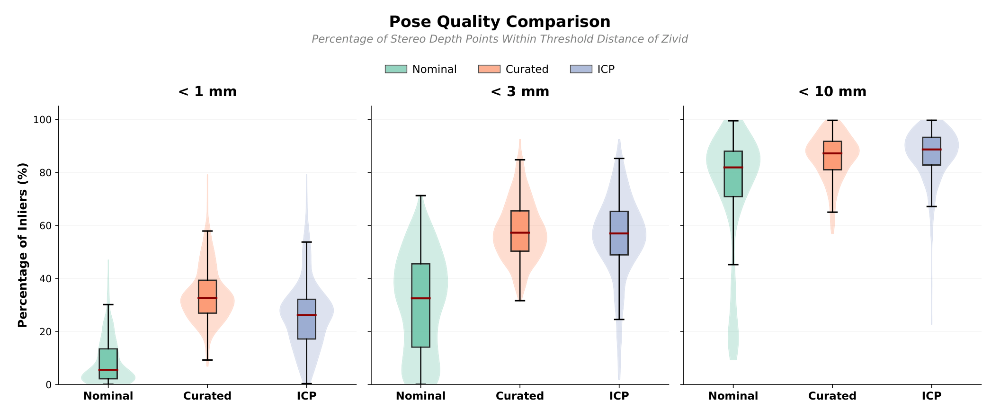
*论文原图编号：Figure 7。三组位姿在三个阈值下的内点比例分布。放在这里是因为它显示整理后位姿的分布在 1 mm 下整体上移，而 ICP 有一条拖到接近 0 的长尾。*

即使用整理后位姿，<1 mm 内点也只有约三分之一，<10 mm 仍有约 14% 的点落在外面。这些点里有多少来自立体深度错误、多少来自位姿，论文未说明。

### 重建方法示例

论文只在一段序列上展示了 ForPlane 提取的起止点云（Figure 10），没有给出任何几何误差数字。摘要提到的光度视图合成基线，正文中也没有对应的表格，所以读者无法知道现有方法在这个数据上处于什么水平。

结果只覆盖位姿这一环，那么这个数据集在评测上到底能撑起什么？

## 深度分析

### 这个数据集真正测到了什么

它能回答的问题是：重建方法在形变结束时刻的几何，是否与真实组织表面一致。它对静止的起止两刻有几何参照，对中间过程只有视频。

由于结构光相机和内镜视角不同，参照覆盖了内镜看不到的区域。这让作者主张的遮挡区和视野外评测在原理上可行，但遮挡区的参照精度是否与可见区相当，论文未单独报告。

### 位姿误差和深度误差混在一起

Table 2 的距离同时来自 IGEV++ 立体深度的误差和位姿误差，论文没有把二者分开。结构光相机本身的测量精度论文也未说明。因此 2.37 mm 不能读作参照几何的误差，只能读作当前配准链条的综合一致性。

### 一个需要警惕的循环

**整理后位姿是人工按目视对齐和距离挑选出来的，Table 2 又用同一类距离来评价它。** 质疑者可以说它的优势部分来自对这个指标的选择。要排除这一点，需要独立的标记点或留出区域来测位姿误差，论文没有提供。

### 与已有数据的定位

| 数据集 | 几何真值 | 场景是否形变 |
|---|---|---|
| SCARED | 结构光关键帧 | 否 |
| SERV-CT | CT 视差 | 否 |
| EndoMapper | 无高质量几何 | 是（真实内镜） |
| StereoMIS | 无高质量几何 | 是 |
| D4D | 结构光起止点云 | 是 |

D4D 的新意是第一次把"形变"和"几何参照"放进同一份数据。它的代价是放弃了真实微创环境：开放腹腔、尸体组织。

### 复现注意点

- 标本 5 的左右图像流在标定和录制中被对调，后处理已纠正，但 `tf/` 中的位姿仍对应右相机。
- 每个会话操作的组织类型记录在 `info.csv`，是否含相机移动记录在 `session_details.txt`，论文正文没有列出。
- 质量存疑的 30 段没有完整后处理，不应与核心 98 段混用。

## 局限

- **几何参照只在两个静止时刻。** 中间形变过程无几何真值，分步序列也只是多拍了几次。
- **开放手术、尸体组织。** 没有气腹、呼吸和灌注；部分解剖结构此前已被操作过。
- **位姿仍有残差，且由人工挑选。** 作者明说可能残留轻微的位姿错位。
- **没有定量方法基线。** 只给了 ForPlane 的定性点云，光度基线论文未说明。
- **规模口径不一致。** 摘要写 369 个点云，Table 2 写 N = 540 个点云，论文未说明二者关系，读者无法确认表 2 是否包含质量存疑序列。
- **移动相机序列太少。** 只有 10 段，按标本分折后每折样本极少。

## 我的笔记

- 用它评测时，几何误差要分可见区和遮挡区分别报，并注明位姿本身有毫米级的综合不一致；小于 2 mm 的方法差距不宜过度解读。
- 如果拿 IGEV++ 深度当监督，它与结构光仍差约 2 mm 量级，不能当真值用。
- 想看形变过程本身，分步形变序列是唯一有中间几何的选择。
- 调参一定按标本分折，避免同一头猪同时进训练和测试。

## 引用

- Docea R, Younis R, Long Y, et al. The Dresden Dataset for 4D Reconstruction of Non-Rigid Abdominal Surgical Scenes. arXiv:2603.02985, 2026. https://arxiv.org/abs/2603.02985
- 数据：https://doi.org/10.25532/OPARA-1033
- 代码：https://github.com/reubendocea/d4d
