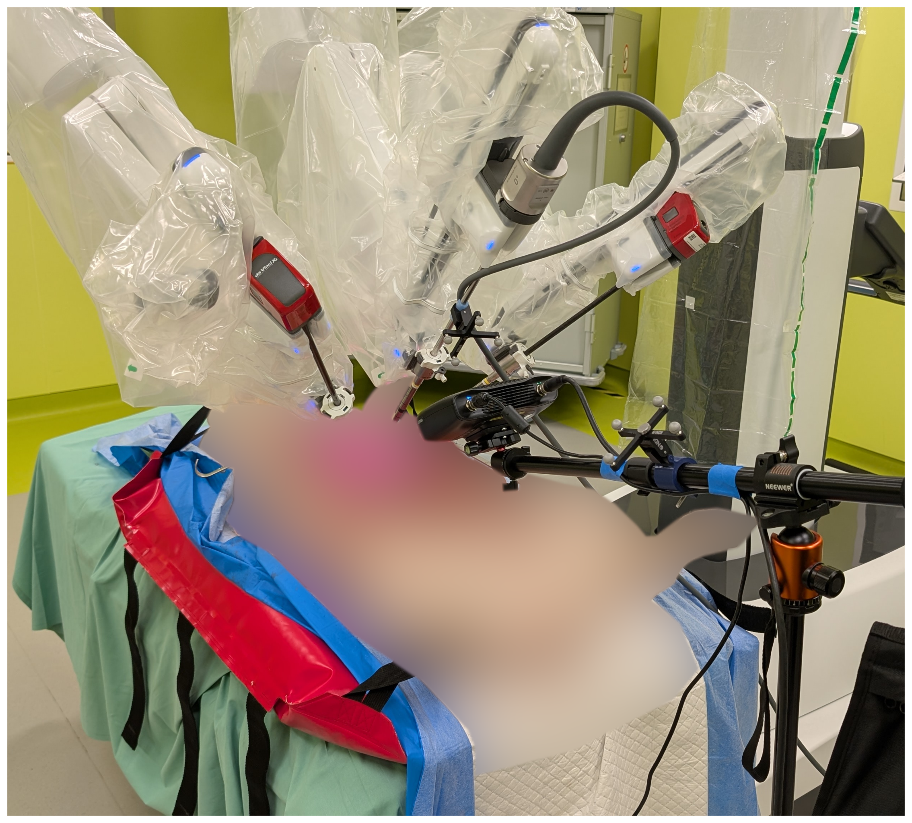
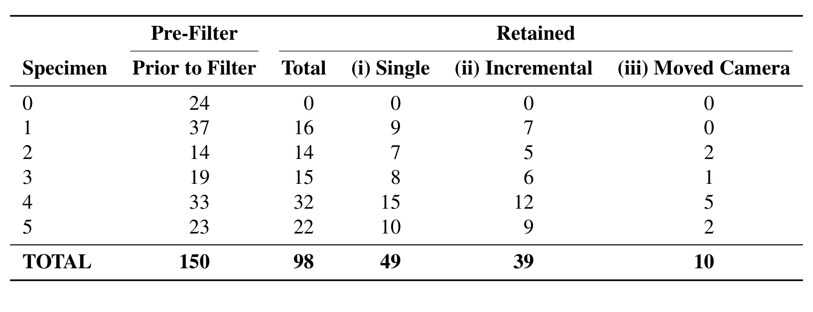
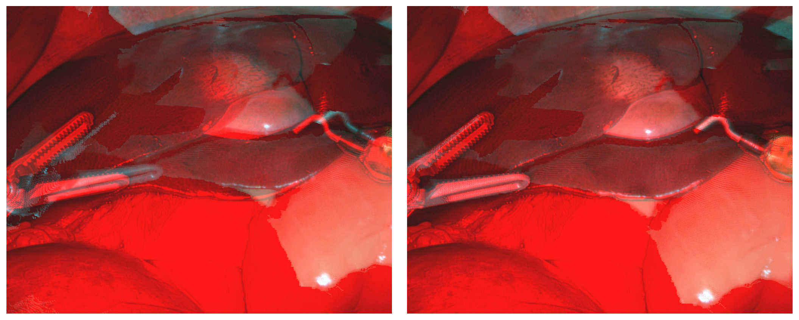
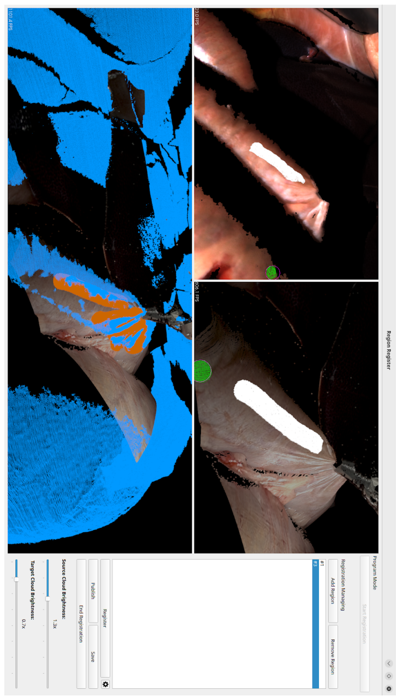
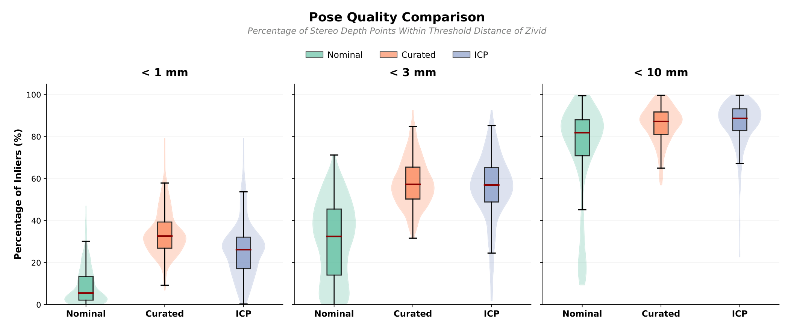
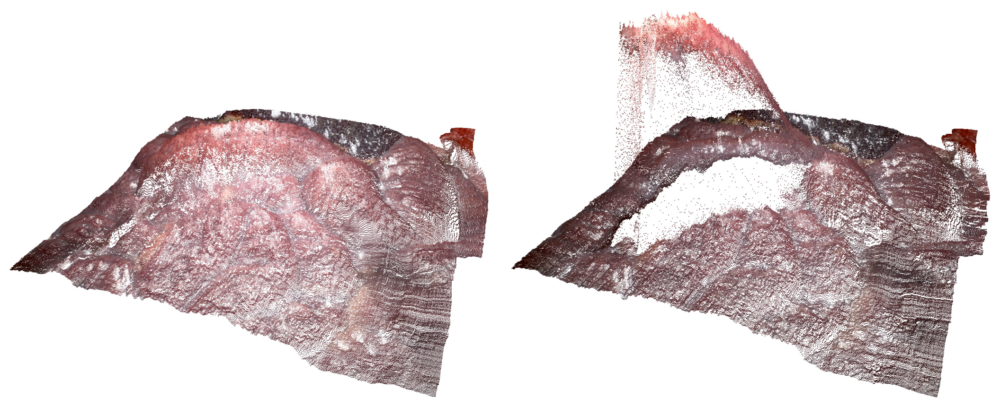

## 1. 背景与动机

**形变组织的 4D 重建一直没有几何真值，只能用光度指标打分。** 图像引导手术要把术前 CT 配到术中三维表面上，而组织一被推拉，按刚性假设建的表面图就失效了。非刚性建图需要把已离开视野的区域也更新到当前状态。

已有内镜数据各缺一块。SCARED 与 SERV-CT 有几何真值但场景静止；EndoMapper 与 StereoMIS 有真实视频但没有高质量几何。EndoNeRF 的作者甚至写道，受临床法规限制，不可能采集深度真值。于是一大批神经渲染与高斯泼溅方法只报告 PSNR、SSIM、LPIPS。

光度好不等于几何对。D4D 要补的是：形变场景下，与视频配对的几何参照。

:::highlights
- 缺口：形变组织没有可配对的几何参照
- 后果：4D 重建只能比光度
:::

## 2. 核心观点速览

论文的答案是一套受控采集。猪尸体开腹后，立体内镜拍组织被推拉的全过程，体外的结构光相机在操作前、后各拍一次点云，光学追踪把两者放进同一坐标系。

**三类序列对应三种考察目标**：整段形变测端到端鲁棒性，分步形变测形变幅度，移动相机测视野外形变。150 段采集筛到 98 段核心序列。

**边界同样清楚**：几何参照只有起止两刻；技术验证只证明了位姿配准的一致性；没有任何重建方法的定量基线。

:::data
- 98 段核心序列，超过 300,000 帧，369 个点云
- 整段 49、分步 39、移动相机 10
:::

## 3. 数据怎么采

数据于 2025 年 2 月到 9 月在 NCT Dresden 实验手术室采集。da Vinci Xi 立体内镜分辨率 894 × 714，几何由 Zivid 2+ M60 结构光相机提供，Polaris 光学追踪跟踪两台相机上的标记，三路数据以 ROS2 时间戳同步。

*论文原图编号：Figure 1。仰卧位猪尸体、da Vinci 机械臂与前景的 Zivid 结构光相机。腹腔已开放，结构光从体外拍摄。*

**每个片段是一个"拍点云、操作、再拍点云"的循环。** 结构光拍摄时内镜灯关闭、场景静止；之后开灯，医生推或拉组织；最后再关灯拍一次。这样设计是为了避免内镜光源压低结构光的信噪比，代价是中间过程没有几何。

采集前已转为开放手术并关掉室内灯光。这让结构光能从体外拍到组织，但也意味着没有气腹，和真实微创手术不同。

:::highlights
- 几何只在静止的起止两刻
- 开放手术、尸体组织
:::

## 4. 规模与筛选

150 段采集经过稳定性、图像质量和帧率检查，保留 98 段。另有 30 段质量存疑序列单独发布，未做完整后处理。

*论文原图编号：Table 1。按标本统计的过滤前与保留后片段数及三类序列分布。标本 0 的 24 段全部未保留。*

**移动相机序列只有 10 段**，作者推荐按标本 5 折交叉验证，每折只剩一两段这类序列。标本 0 为何全部剔除，论文未说明。

所有发布图像、掩码和立体深度统一缩放到 640 × 512，原始分辨率数据也一并提供。

:::data
- 150 段采集，98 段保留，30 段存疑另发
- 标本 4 贡献 32 段，标本 0 为 0 段
:::

## 5. 位姿怎么整理出来

追踪给出的名义位姿并不准：按它渲染的点云与内镜图像对不上。作者的整理分三步。

1. 把结构光点云重投影到内镜视角，用 LightGlue 匹配特征，PnP+RANSAC 估计纠正变换；失败时人工给对应点。
2. 在起止结构光点云与立体深度点云之间做 ICP；相机几乎静止，所以目检后为整段序列挑一个最合适的对齐。
3. ICP 仍不理想时，用带人工选区的半自动区域 ICP。

*论文原图编号：Figure 5。名义位姿（左）与 PnP-RANSAC 纠正后（右）的叠加对比。左图器械边缘的重影就是名义位姿的残差。*

*论文原图编号：Figure 6。标准 ICP 失败时使用的半自动区域 ICP 示例。*

**最终的整理后位姿是人工参与挑选的结果。** 器械掩码由 SAM-Track 与 SAM2 半自动生成，结构光侧人工标注；立体深度由 IGEV++ 生成。

:::highlights
- 名义位姿有残差，需特征匹配纠正
- 整理后位姿含人工判断
:::

## 6. 结果说了什么

技术验证只有一张表：立体深度点云到结构光点云的最近邻距离，比较三组位姿，N = 540 个点云。

| 各点云统计量的均值 | 名义位姿 | 整理后位姿 | ICP |
|---|---|---|---|
| 中位距离 (mm) | 5.63 | 2.37 | 2.70 |
| <1 mm 内点 (%) | 8.60 | 33.90 | 26.02 |
| <3 mm 内点 (%) | 30.65 | 57.89 | 55.74 |
| <10 mm 内点 (%) | 73.56 | 85.71 | 86.68 |

**整理后位姿在细阈值下最好**，中位距离从 5.63 mm 降到 2.37 mm，说明纠正把配准误差从厘米级压到毫米级。到 10 mm 阈值 ICP 略高，作者的解读是整理后位姿让表面贴得最紧；我的推断是 ICP 把更多点拉进粗容差但局部错位。

*论文原图编号：Figure 7。三组位姿在三个阈值下的内点比例分布。ICP 在 1 mm 下有一条拖到接近 0 的长尾。*

即使用整理后位姿，1 mm 内点也只有约三分之一。

:::data
- 中位距离均值：整理后 2.37 mm，名义 5.63 mm
- <1 mm 内点：整理后 33.90%，ICP 26.02%
:::

## 7. 结果没说什么

- **距离里混着两种误差。** IGEV++ 立体深度误差和位姿误差没有分开，结构光本身的精度论文未说明。2.37 mm 只是配准链条的综合一致性。
- **评价可能循环。** 整理后位姿是按目视和距离挑出来的，又用同类距离评价，需要独立标记点才能排除这一点，论文没有提供。
- **没有方法基线。** 只有 ForPlane 在一段序列上的定性点云；摘要提到的光度基线，正文没有表格。
- **口径不一致。** 摘要写 369 个点云，Table 2 写 540 个，论文未说明关系。
- **遮挡区精度未单独报告。** 可见区与遮挡区的参照是否同样可靠，论文未说明。

*论文原图编号：Figure 10。ForPlane 在一段序列上提取的初始与结束状态点云，是全文唯一的方法示例。*

## 8. 和已有数据比新在哪

| 数据集 | 几何真值 | 场景是否形变 |
|---|---|---|
| SCARED | 结构光关键帧 | 否 |
| SERV-CT | CT 视差 | 否 |
| EndoMapper | 无高质量几何 | 是 |
| StereoMIS | 无高质量几何 | 是 |
| D4D | 结构光起止点云 | 是 |

**D4D 第一次把形变和几何参照放进同一份数据。** 代价是开放腹腔与尸体组织，以及中间过程没有几何。结构光与内镜视角不同，这让被遮挡区域在原理上也能评测。

## 9. 复用前要核对什么

- 标本 5 的左右图像流曾被对调，后处理已纠正，但 `tf/` 中的位姿仍对应右相机。
- 用 `curated_camera_pose_{start,end}.txt` 对齐到起止点云；具体几何误差指标论文未说明，需要自己写清楚。
- 调参时在标本 1 到 5 上按 4:1 做 5 折留一，避免同一头猪跨越训练与测试。
- 30 段存疑序列不要与核心 98 段混用。

## @takeaways
- D4D 是目前少有的、形变组织场景下带几何参照的内镜数据
- 几何只有起止两刻，整理后位姿的综合一致性约 2.37 mm
- 论文没有方法基线，用它的人需要自己定义几何指标

## @strengths
- 采集循环和三类序列设计清楚，目标明确
- 位姿整理流程公开，并给出三组位姿的对比
- 数据、加载代码和项目页都公开

## @weaknesses
- 开放手术、尸体组织，缺少气腹与生理运动
- 位姿误差与立体深度误差未分离，结构光精度未报告
- 没有任何重建方法的定量结果
- 移动相机序列只有 10 段

## @questions
- 现有 4D 重建方法在三类序列上的几何误差能否拉开差距
- 用独立标记点测量时，整理后位姿的误差是多少
- 369 与 540 两个点云数量如何对应
