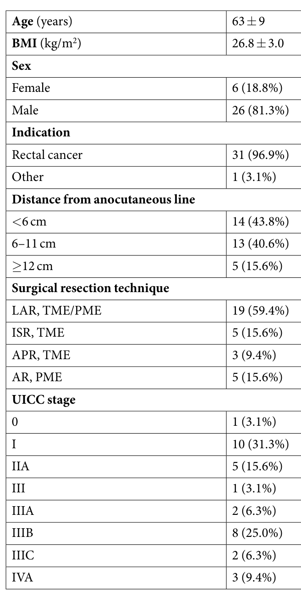
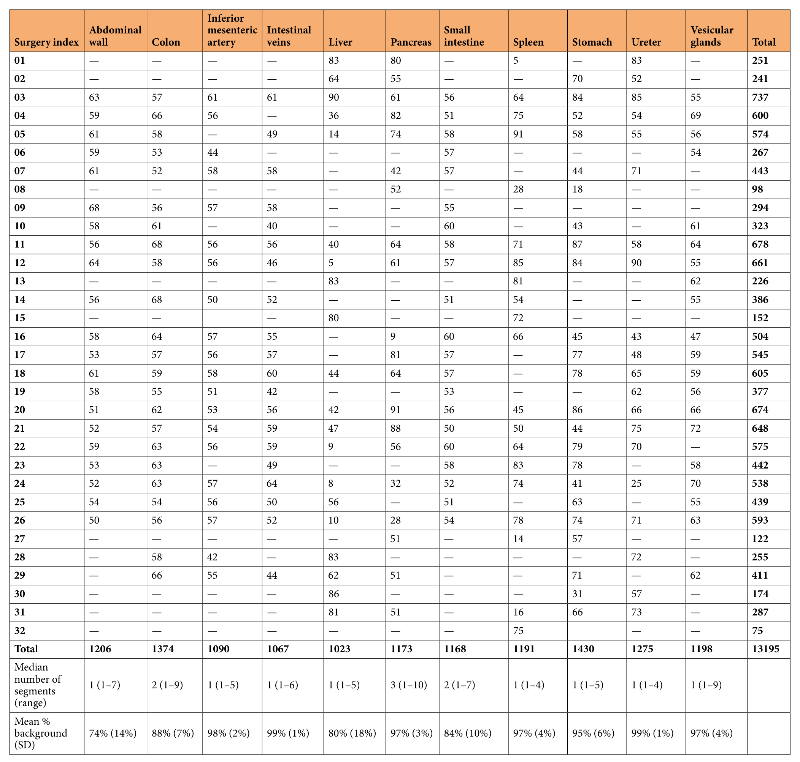
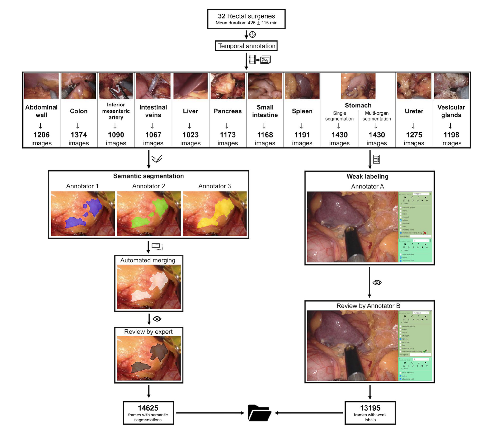
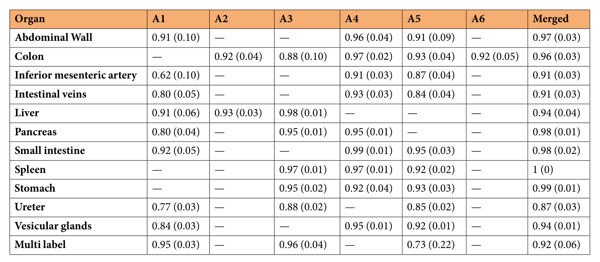
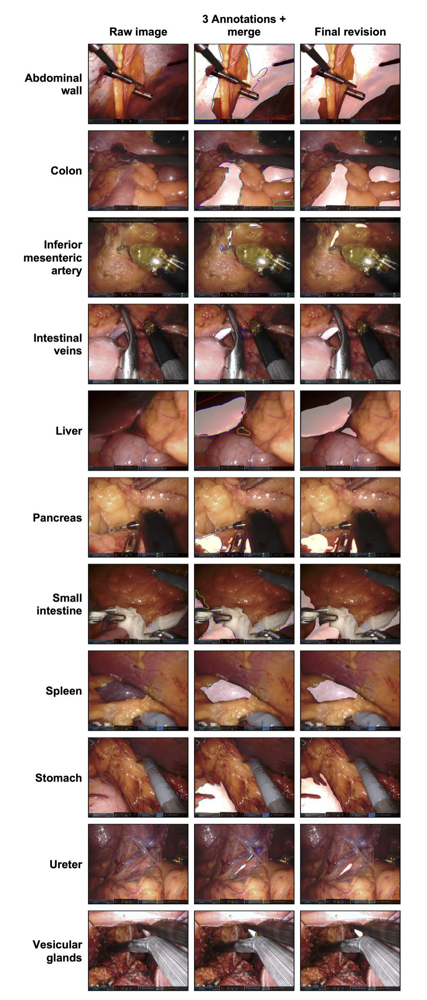

---
tags:
  - papers/手术数据集
aliases:
  - "DSAD"
  - "Dresden Surgical Anatomy Dataset"
date: 2023
doi: "10.1038/s41597-022-01719-2"
---

# The Dresden Surgical Anatomy Dataset for Abdominal Organ Segmentation in Surgical Data Science

## 核心信息

- 标题: The Dresden Surgical Anatomy Dataset for Abdominal Organ Segmentation in Surgical Data Science
- 标题翻译: 面向手术数据科学腹部器官分割的德累斯顿手术解剖数据集
- 作者: Matthias Carstens, Franziska M. Rinner, Sebastian Bodenstedt, Alexander C. Jenke, Jürgen Weitz, Marius Distler, Stefanie Speidel, Fiona R. Kolbinger
- 机构: 德累斯顿工业大学卡尔·古斯塔夫·卡鲁斯大学医院内脏、胸部与血管外科；德累斯顿国家肿瘤疾病中心（NCT/UCC）转化外科肿瘤学部；德累斯顿工业大学 CeTI 卓越集群；Else Kröner Fresenius 数字健康中心（EKFZ）
- 发表时间: 2023
- 发表渠道: Scientific Data 10:3（Data Descriptor）
- DOI: 10.1038/s41597-022-01719-2
- 论文链接: https://www.nature.com/articles/s41597-022-01719-2
- 代码 / 项目: https://gitlab.com/nct_tso_public/dsad
- 数据 / 资源: https://doi.org/10.6084/m9.figshare.21702600
- 论文类型: benchmark_or_dataset

## 原文摘要翻译

腹腔镜是一种成像技术，使腹部外科、妇科和泌尿外科等多个医学领域的微创手术成为可能。迄今为止，公开的腹腔镜图像数据集大多局限于数据的一般分类、手术器械的语义分割，以及少量特定腹部器官的弱标注。德累斯顿手术解剖数据集提供了腹腔镜视野下八个腹部器官（结肠、肝、胰、小肠、脾、胃、输尿管、精囊）、腹壁以及两种血管结构（肠系膜下动脉、肠静脉）的语义分割。该数据集共包含 13195 张腹腔镜图像。对每个解剖结构，我们都提供了一千张以上带像素级分割的图像。

标注包括单器官的语义分割，以及一个包含全部十一种解剖结构分段的多器官分割数据集。此外，我们为每一张图像提供了器官是否出现的弱标注。该数据集显著拓展了计算机视觉在腹腔镜手术中的手术数据科学应用空间，从而可能有助于降低风险，并加快人工智能向外科实践的转化。

## 创新点

1. **解剖结构的像素级分割。** 以往公开的腹腔镜数据（Cholec80、LapGyn4、SurgAI、海德堡结直肠数据集）多为图像级标签，DSAD 为 11 类腹部结构逐像素标出位置和形状，可直接训练分割模型。
2. **每类规模接近、患者分散。** 每类 1023 到 1430 张图像，来自 20 到 23 台手术，每台手术每类最多抽 100 帧，避免某几台手术主导某一类。
3. **三人标注加专家复核的流程。** 每张图由三名医学生独立分割，用 `STAPLE` 等权合并，再由一名有三年微创经验的医生复核修改，并公开三份原始标注与合并结果。
4. **弱标签与多器官子集。** 每张图都有 11 类结构是否可见的弱标签；1430 张胃图像额外标注了全部可见结构，形成多器官分割子集。

## 一句话总结

DSAD 从 32 台机器人直肠手术视频中抽出 13195 张 1920 × 1080 图像，为 11 类腹部解剖结构提供三人标注、`STAPLE` 合并、专家复核的像素级掩码与逐帧弱标签，但论文本身不给划分和模型基线。

## 研究问题

机器人和腹腔镜手术的画面信息量很大，但外科医生无法实时处理全部细节，判断画面中是哪段肠、哪条血管还要靠解剖知识和经验。作者认为，自动识别解剖结构的算法可以在术中提醒易损结构，从而减少并发症。

训练这类算法需要像素级标注，而 2022 年前公开的腹腔镜数据主要是两类：Cholec80、LapGyn4、SurgAI、海德堡结直肠数据集这类图像级或阶段标签，只说明结构是否出现；以及器械分割数据，不标解剖结构。**缺的是一份覆盖多个腹部器官、每类规模足够的解剖分割数据。**

### 核心观点速览

**DSAD 的答案是在 32 台机器人直肠手术视频上，为 11 类腹部结构做三人分割、自动合并、专家复核的像素级标注。**

- **数据从哪来：** 德累斯顿一家医院 32 台达芬奇直肠手术，图像 1920 × 1080，不做预处理。
- **标了什么：** 13195 张单器官图像，每类 1023 到 1430 张、来自 20 到 23 台手术；1430 张胃图像另有多器官分割；每张图都有 11 类可见性弱标签。
- **质量怎么证明：** 三份标注用 `STAPLE` 合并，一名医生复核修改；合并结果与终稿的 F1 多在 0.9 以上，输尿管最低为 0.87。
- **边界：** 单中心、单术式；论文没有模型基线和划分；质量证据以同一专家的终稿为参照，偏向高一致性。

下面先看数据从哪来、长什么样，再看标注流程，最后判断表 3 能证明什么。

## 数据与任务定义

### 数据来源

这一节回答图像出自什么手术、什么患者。数据来自 2019 年 2 月到 2021 年 2 月在德累斯顿卡尔·古斯塔夫·卡鲁斯大学医院完成的 32 台机器人辅助直肠前切除或直肠切除术。手术使用达芬奇 `Xi/X` 内镜（直径 8 mm、30° 角），用 `CAST` 系统录制，视频分辨率 1920 × 1080，单台时长约两到十小时。研究经伦理委员会批准（批准号 `BO-EK-137042018`），在临床试验注册网站登记（`NCT05268432`），所有患者书面知情同意，数据按欧盟通用数据保护条例匿名化。

*论文原图编号：Table 1。32 名患者的年龄、BMI、性别、适应证、肿瘤距肛缘距离、术式与 UICC 分期。放在这里是因为它界定了数据的人群来源。*

患者以男性为主，26 例（81.3%）；平均年龄 63 ± 9 岁，BMI 26.8 ± 3.0；31 例（96.9%）为直肠癌。**这意味着画面以盆腔和下腹部视野为主**，肝、胃、脾等上腹器官只在部分步骤中出现，这也解释了为什么肝在一些手术里只有 5 张图。

### 任务拆分

使用者首先要知道一张图对应哪种标签。11 类结构为腹壁、结肠、肠系膜下动脉、肠静脉、肝、胰、小肠、脾、胃、输尿管和精囊。

| 标签 | 范围 | 含义 |
|---|---|---|
| 单器官分割 | 13195 张，每张只标一个结构 | 二值掩码，白色为目标结构 |
| 多器官分割 | 1430 张胃图像 | 每个可见结构一张掩码 |
| 弱标签 | 全部图像 | 11 类结构是否可见 |

**单器官掩码只标一个结构，其他器官即使在画面中也记为背景。** 所以单器官子集是 11 个独立的二值分割任务，真正的多类分割只有 1430 张图。

### 图像分布

*论文原图编号：Table 2。每台手术每类结构的图像数、各类合计、分段数中位数与平均背景占比。放在这里是因为划分数据时要按手术编号查看分布。*

各类图像数在 1023（肝）到 1430（胃）之间，差距不到一半，**图像数大体均衡，不平衡来自像素面积**：平均背景占比从腹壁的 74% 到肠静脉、输尿管的 99%，即后两类目标平均只占画面约百分之一。分段数中位数多为 1，胰为 3（范围 1 到 10），说明胰常被组织分成多块，对分割连通性要求更高。

同一台手术会出现在多个结构文件夹中，例如手术 03 贡献了 737 张、跨全部 11 类。**这决定了划分必须以手术编号为单位**，否则同一患者的相邻画面会同时落入训练和测试。

### 数据组织

数据存于 `figshare`，免注册下载。第一层 12 个文件夹，对应 11 类结构与多器官子集；第二层是 20 到 23 个手术编号文件夹；每个手术文件夹含 5 到 91 对图像：`imageN.png` 与 `maskN.png`。多器官文件夹中掩码按结构命名，例如 `maskN_stomach.png`。每个手术文件夹还有 `weak_labels.csv`，列按字母顺序排列 11 类结构，并有 `anno_1`、`anno_2`、`anno_3` 和 `merged` 四个子文件夹存放原始与合并掩码。我的判断：公开三份原始标注很有用，使用者可以自己研究标注噪声。

许可写法前后矛盾：正文称“仅限非商业使用”，却标为 CC-BY，而 CC-BY 本身允许商业使用。以哪一条为准论文未说明，商业用途前需要向作者确认。

数据形态清楚之后，下一个问题是这些掩码是怎么做出来的。

## 方法主线

本文没有模型，方法主线是数据构建与质量控制流程。问题在于每一步怎么控制偏差：选哪些帧、谁来标、标完谁来裁定。

### 机制流程

1. **时间标注。** 输入为 32 台手术视频。一名有两年机器人直肠手术经验的医学生按协议标注肝、胰、脾、胃、输尿管出现的时间段；腹壁、结肠、小肠、肠血管和精囊不做时间标注。输出为时间段文本，送入抽帧脚本。
2. **抽帧。** 输入为时间段或手工剪出的片段（后者用 `LossLessCut` 合并）。每类至少选 20 台手术，每台等间隔随机提取最多 100 帧，再人工剔除结构完全被遮挡、满屏烟雾或严重模糊的帧，不做自动筛选或图像预处理。输出为 1920 × 1080 无损图像，送给分割标注者。
3. **三人分割与合并。** 输入为抽出的图像。三名有基础微创经验的医学生按分割协议，在 `3D Slicer` 中用手写笔逐像素分割。三份掩码用 `STAPLE` 等权融合，输出合并掩码。
4. **专家复核与弱标签。** 输入为三份原始掩码与合并掩码。一名有三年微创经验的医生在 `CVAT` 上选出最合适的一份并按需修改，得到终稿掩码。另由一名医学生标注弱标签、第二名医学生复核，输出逐帧可见性表。

*论文原图编号：Fig. 1。从 32 台手术经时间标注抽帧，左支为三人分割、自动合并、专家复核，右支为弱标签标注与复核，最终得到 14625 帧分割与 13195 帧弱标签。放在这里是因为它把四步流程画在一张图上。*

图中 14625 等于 13195 张单器官图像加 1430 张多器官图像。图中还给出平均手术时长 426 ± 115 分钟。

### 抽帧规则的取舍

“每台每类最多 100 帧、至少 20 台手术”这条规则让每类图像来自足够多的患者，**防止某几台手术主导一个类别**。作者刻意保留烟雾、出血、运动伪影和光照不均，只剔除完全不可用的帧，所以数据比精选图像更接近术中真实画面。同一台手术内的帧间隔有多大、是否去除近重复帧，论文未说明，这会影响有效样本量的估计。

时间标注的描述也有矛盾：正文写“由一名医学生完成”，括号里却列出 MC 与 FMR 两人。好在时间标注只决定抽帧范围，不直接进入标签。

### 标注协议

分割协议（补充文件 2）逐类规定纳入标准，`3D Slicer` 的工具设置也写明为“剪刀、内部填充、自由形状、对称切片”。多器官子集选用胃图像，理由是这些画面常同时出现结肠、小肠、脾和腹壁。

表 3 列出 A1 到 A6 六名标注者，而每张图只有三人标注，说明不同结构由不同的三人组完成；具体分工论文未说明。致谢中另有四人协助标注，与六名标注者的对应关系也不清楚。

### 评测协议

技术验证比较每名标注者以及合并结果与终稿的一致性，用两个指标：

- F1：重叠程度，0 为无重叠，1 为完全重叠，等同于 Dice 系数。
- 归一化 Hausdorff 距离：两个分割之间的最大距离除以图像对角线，范围 0 到 1，越小越好。

$$\mathrm{F1}=\frac{2|A\cap B|}{|A|+|B|}$$

其中 $A$ 是被比较的分割，$B$ 是专家终稿。表中数值按图像平均还是按像素汇总，论文未说明。

论文没有训练任何模型。推荐的训练、验证、测试划分与分割实验在 Kolbinger 等人的另一篇预印本中报告。因此下一节能看的只有标注一致性。

## 关键结果

### 标注一致性

核心问题是：三人标注与终稿差多少，哪些结构最难标。

*论文原图编号：Table 3。六名标注者 A1 到 A6 与合并结果相对终稿的 F1 和归一化 Hausdorff 距离（括号内）。放在这里是因为它是论文唯一的质量证据。*

注意括号内是归一化 Hausdorff 距离，不是标准差。下表摘出合并结果与最弱单人：

| 结构 | 合并 F1（距离） | 最低单人 F1（距离） |
|---|---|---|
| 腹壁 | 0.97（0.03） | 0.91（0.10） |
| 结肠 | 0.96（0.03） | 0.88（0.10） |
| 肠系膜下动脉 | 0.91（0.03） | 0.62（0.10） |
| 肠静脉 | 0.91（0.03） | 0.80（0.05） |
| 肝 | 0.94（0.04） | 0.91（0.06） |
| 胰 | 0.98（0.01） | 0.80（0.04） |
| 小肠 | 0.98（0.02） | 0.92（0.05） |
| 脾 | 1（0） | 0.92（0.02） |
| 胃 | 0.99（0.01） | 0.92（0.04） |
| 输尿管 | 0.87（0.03） | 0.77（0.03） |
| 精囊 | 0.94（0.01） | 0.84（0.03） |
| 多器官 | 0.92（0.06） | 0.73（0.22） |

**合并结果在 12 行中有 11 行 F1 达到 0.91 以上，专家多数时候只需小改。** 脾为 1（0），即终稿与合并结果几乎一致。输尿管是例外，合并 F1 为 0.87，三名标注者为 0.77 到 0.88，作者认为专家需要经常介入，但距离仍只有 0.03，差异集中在细长边界上的少量像素。

单人结果的分歧更大。肠系膜下动脉的 A1 只有 0.62，多器官子集的 A5 只有 0.73 且距离达 0.22，说明个别标注者在血管和多结构画面上明显偏离。**作者据此主张合并优于单人，但这个比较本身有偏**，原因放在深度分析中讨论。

### 示例

*论文原图编号：Fig. 2。每类结构一行：原图、三人标注轮廓加合并区域、终审分割。放在这里是因为它显示了细长结构上三人轮廓的分歧。*

图中腹壁、肝的三条轮廓几乎重合，输尿管和肠系膜下动脉的轮廓明显分开，与表 3 的数值规律一致。

数据统计与一致性都看完了，接下来的问题是：这些数字到底证明了什么。

## 深度分析

### 表 3 实际测量的是什么

终稿由同一名专家在三份标注和合并结果上修改得到，而且专家可以直接选用合并结果。**所以表 3 衡量的是专家修改幅度，不是独立标注之间的一致性。** 合并 F1 高可能部分来自锚定效应：从一份现成掩码出发修改，结果自然接近它。单人 F1 低于合并结果，也可能是因为合并结果本就是专家最常选的候选。要区分这两种解释，需要第二位专家从零独立标注，论文没有这项证据。

我的判断：表 3 足以说明终稿没有被大幅重画，但不足以给出标签噪声的上限。用作测试集时，0.9 左右的模型 Dice 可能已接近标注本身的可重复性。

### 单器官掩码的训练含义

单器官子集里，画面中可见但不是目标的器官全部记为背景。若把 11 个文件夹的掩码简单拼成多类标签，会产生大量错误的负样本，例如一张结肠图中的小肠被当作背景。可行的做法是用弱标签屏蔽“可见但未分割”的类别，或只在 1430 张多器官图像上训练多类模型。这是我的推断，论文没有讨论。

### 适用边界

**所有数据来自一家医院、一种术式和一种机器人内镜。** 患者多样性体现在 32 名患者之间，而域偏移（不同中心、腹腔镜而非机器人、胆囊或妇科手术）没有覆盖。弱标签只经一人复核，改动比例论文未说明，用它做图像级分类时同样要考虑噪声。

## 局限

- 单中心、单术式、单一设备，外推到其他手术未被验证。
- 论文本身没有模型基线和划分，可学性要看后续论文。
- 质量评估以同一专家终稿为参照，没有第二位专家，也没有复核者自身一致性。
- 单器官掩码把其他结构记为背景，不能直接拼成多类标签。
- 帧间隔、近重复帧处理、表 3 的聚合方式、六名标注者分工，论文未说明。
- 许可同时写“非商业”和 CC-BY；时间标注人数前后不一致。

## 我的笔记

- 复用时按手术编号划分，同一台手术会出现在多个结构文件夹中。
- 训练多类模型优先用多器官子集，或用弱标签屏蔽未标注的可见类别。
- 输尿管和血管这类细长结构要同时报告 Dice 和边界指标，单看 Dice 会低估模型。
- 对照表 3：模型 Dice 接近 0.9 时，差距可能已在标注噪声之内。
- 待查：后续论文给出的划分与基线；六名标注者的分工；许可以哪条为准。

## 引用

- Carstens et al. (2023). The Dresden Surgical Anatomy Dataset for Abdominal Organ Segmentation in Surgical Data Science. Scientific Data 10:3.
- Warfield, Zou & Wells (2004). Simultaneous truth and performance level estimation (STAPLE). IEEE Transactions on Medical Imaging.
- Twinanda et al. (2017). EndoNet: A Deep Architecture for Recognition Tasks on Laparoscopic Videos. IEEE Transactions on Medical Imaging.
- Kolbinger et al. (2022). Better than humans? Machine learning-based anatomy recognition in minimally-invasive abdominal surgery. medRxiv 预印本.
