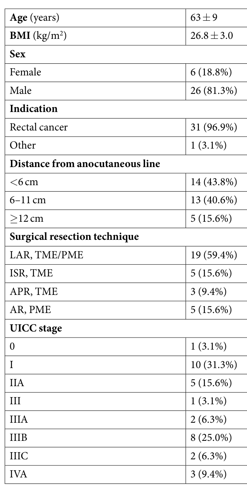
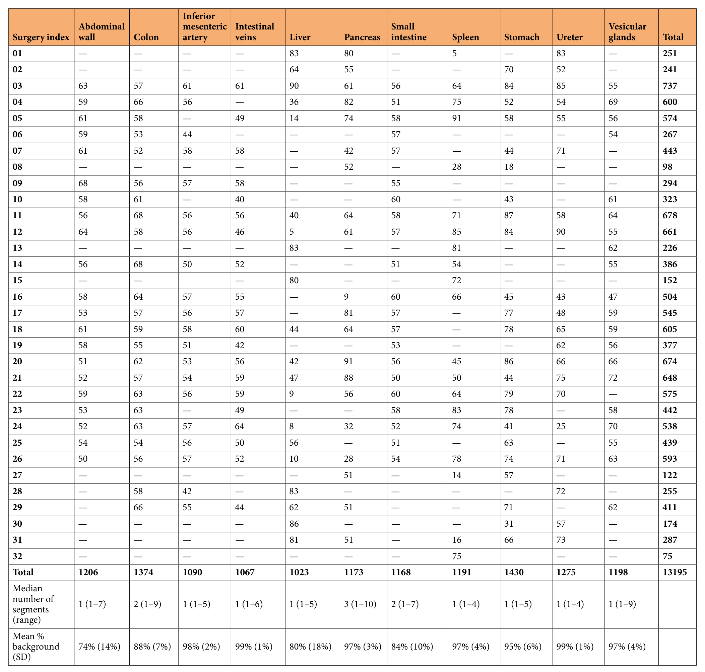
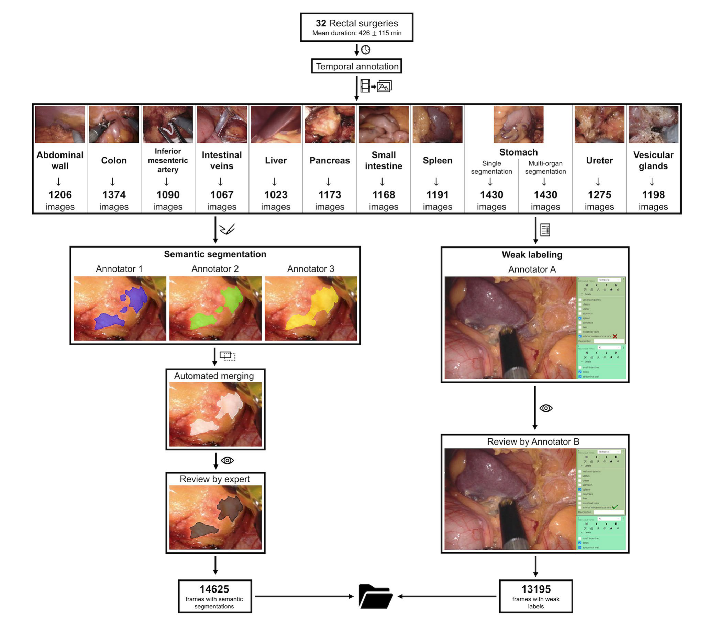
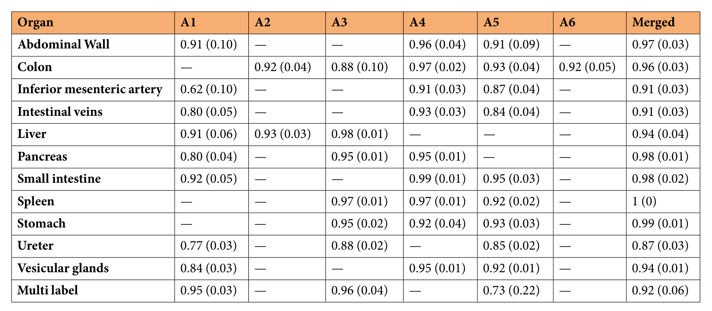
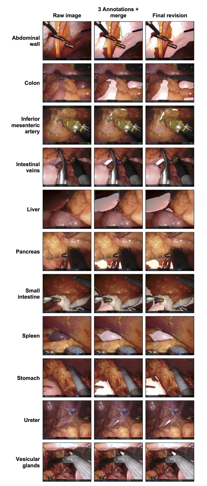

## 1. 背景与动机

**机器人手术画面信息很多，判断画面里是哪段肠、哪条血管却要靠经验。** 作者认为自动识别解剖结构可以在术中提醒易损结构，降低并发症。

训练这类模型需要像素级标签。论文列出的已有公开数据，Cholec80、LapGyn4、SurgAI 和海德堡结直肠数据集，多为图像级标签，只说明结构是否出现；像素级标注又主要集中在器械。**缺的是一份覆盖多个腹部器官、每类规模足够的解剖分割数据。**

## 2. 核心观点速览

DSAD 的答案是：在 32 台达芬奇直肠手术视频上抽帧，为 11 类结构做三人分割，用 `STAPLE` 合并，再由一名医生复核修改。

- 每类 1023 到 1430 张图，来自 20 到 23 台手术，每台每类最多 100 帧。
- 每张单器官图只标一个结构；1430 张胃图像另标全部可见结构。
- 每张图都有 11 类可见性弱标签。
- 合并结果与终稿的 F1 多在 0.9 以上，输尿管最低为 0.87。

**边界同样重要：** 单中心、单术式，没有模型基线和划分，表 3 的参照是同一专家的终稿。

:::highlights
- 图像数大体均衡，类别不平衡来自像素面积
- 公开三份原始标注和合并结果，可直接研究标注噪声
:::

:::data
- 32 台手术，13195 张单器官图像，14625 帧分割
- 图像分辨率 1920 × 1080，不做预处理
:::

## 3. 图像从哪来

所有图像来自德累斯顿一家医院 2019 年 2 月到 2021 年 2 月的 32 台机器人直肠手术，内镜为达芬奇 `Xi/X`（直径 8 mm、30° 角）。患者 26 例（81.3%）为男性，31 例（96.9%）为直肠癌，平均年龄 63 ± 9 岁。

*论文原图编号：Table 1。32 名患者的基本特征、术式与分期。*

**这决定了画面以盆腔和下腹部为主。** 肝、胃、脾等上腹器官只在部分步骤出现，所以表 2 中肝在个别手术里只有 5 张图。

## 4. 标签长什么样

| 标签 | 范围 | 含义 |
|---|---|---|
| 单器官分割 | 13195 张 | 每张只有一个结构为白色 |
| 多器官分割 | 1430 张胃图像 | 每个可见结构一张掩码 |
| 弱标签 | 全部图像 | 11 类结构是否可见 |

**单器官掩码里，别的器官即使在画面中也记为背景。** 所以单器官子集是 11 个独立的二值任务，真正的多类分割只有 1430 张图。

*论文原图编号：Table 2。每台手术每类结构的图像数、分段数中位数与平均背景占比。*

平均背景占比从腹壁的 74% 到肠静脉、输尿管的 99%。图像数相差不大，难度差异主要来自目标面积。

:::data
- 胰分段数中位数为 3（范围 1 到 10），最容易被分成多块
- 每个手术文件夹含 5 到 91 对图像与掩码
:::

## 5. 标注流程

*论文原图编号：Fig. 1。时间标注、抽帧、三人分割、自动合并、专家复核，以及弱标签的标注与复核。*

1. 一名医学生标出肝、胰、脾、胃、输尿管出现的时间段；其他五类手工剪片段。
2. 每类至少 20 台手术，每台等间隔抽最多 100 帧，只剔除完全不可用的帧，保留烟雾和出血。
3. 三名医学生在 `3D Slicer` 中逐像素分割，三份掩码用 `STAPLE` 等权合并。
4. 一名有三年微创经验的医生在 `CVAT` 上选出最合适的一份并修改。

**抽帧规则的作用是防止少数手术主导某一类。** 帧间隔多大、是否去除近重复帧，论文未说明，这会影响有效样本量。

## 6. 表 3 说了什么

*论文原图编号：Table 3。各标注者与合并结果相对终稿的 F1，括号内是归一化 Hausdorff 距离，不是标准差。*

合并结果在 12 行中有 11 行 F1 达到 0.91 以上，脾为 1（0）。输尿管合并 F1 为 0.87，但距离只有 0.03，差异集中在细长边界上。单人分歧更大：肠系膜下动脉 A1 只有 0.62，多器官子集 A5 只有 0.73，距离 0.22。

*论文原图编号：Fig. 2。原图、三人轮廓加合并、终审分割；输尿管和血管的轮廓分歧最明显。*

:::highlights
- 越细的结构，标注越不一致
- 合并结果普遍比单人更接近终稿
:::

## 7. 结果没说什么

- **没有模型基线。** 划分和分割实验在 Kolbinger 等人的另一篇预印本里。
- **没有独立的一致性。** 只有一名专家，没有第二人从零标注。
- **没有跨域证据。** 单中心、单术式、单一机器人内镜。
- **没有说明聚合方式。** 表 3 按图平均还是按像素汇总，论文未说明。

## 8. 一个替代解释

作者用“合并 F1 高于单人”支持 `STAPLE` 融合。**但终稿是专家在合并结果上修改的，还可以直接选用它。** 从现成掩码出发修改，结果自然接近它，这是锚定效应。单人分数低，也可能只是因为合并结果是专家最常选的候选。

要分开这两种解释，需要隐藏合并结果的复核，或第二位专家独立标注。论文没有这项证据，所以表 3 只能说明终稿没有被大幅重画，不能给出标签噪声的上限。

## 9. 复用要注意什么

- 按手术编号划分；手术 03 一台就跨全部 11 类。
- 不要把 11 个文件夹的掩码直接拼成多类标签，会制造错误负样本；用弱标签屏蔽，或只用多器官子集。
- 细长结构同时报告 Dice 和边界指标。
- 许可同时写“非商业”和 CC-BY，商业用途前向作者确认。

## @takeaways
- 按论文的定位，DSAD 补的是多器官腹部解剖的像素级分割数据
- 单器官子集是 11 个二值任务，多类分割只有 1430 张
- 表 3 测的是专家修改幅度，不是独立一致性

## @strengths
- 每类图像来自至少 20 名患者，规模均衡
- 公开三份原始标注、合并结果与处理脚本
- 保留烟雾、出血等真实干扰，不做预处理

## @weaknesses
- 单中心、单术式、单设备
- 无基线、无划分，可学性要看后续论文
- 只有一名复核专家；许可与时间标注人数前后矛盾

## @questions
- 第二位专家独立标注时，一致性会降到多少？
- 在腹腔镜或其他中心的画面上，模型性能会下降多少？
- 六名标注者如何分配到各结构？
