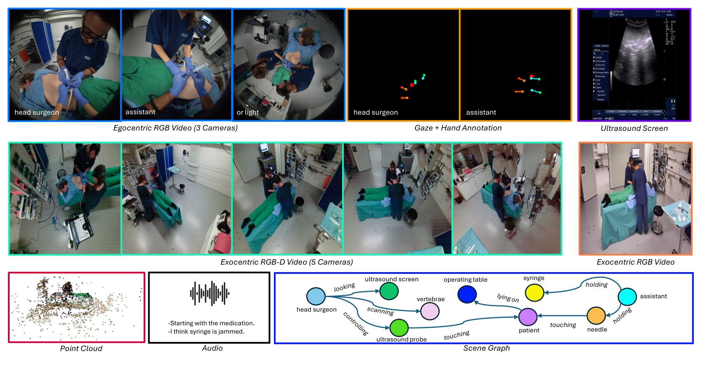
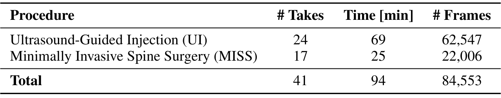
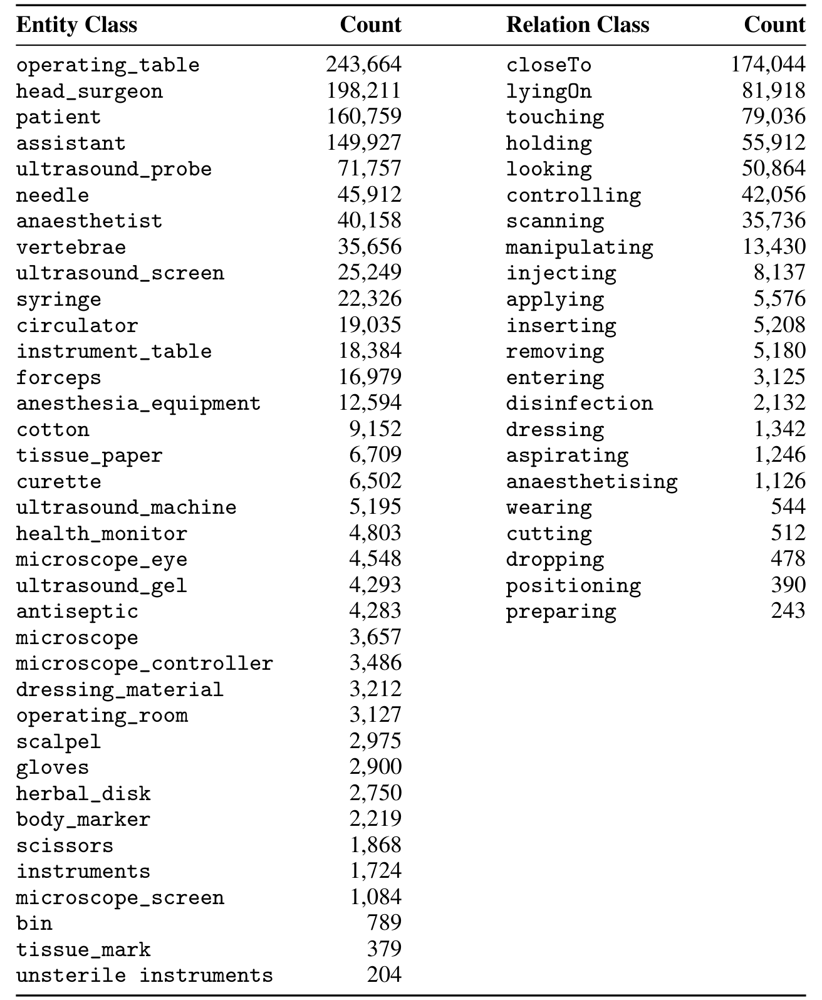
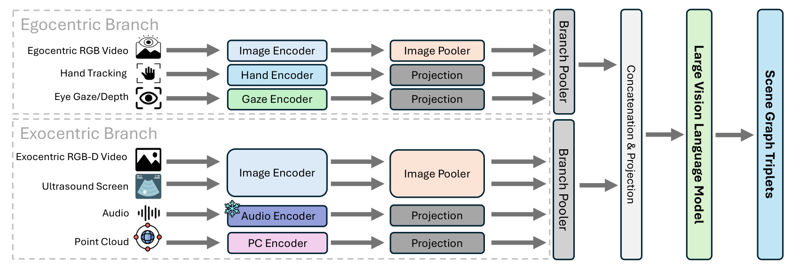
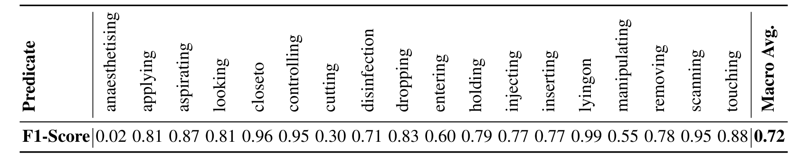
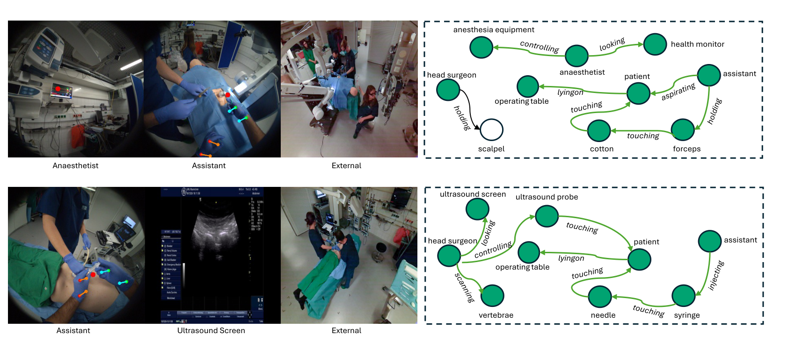
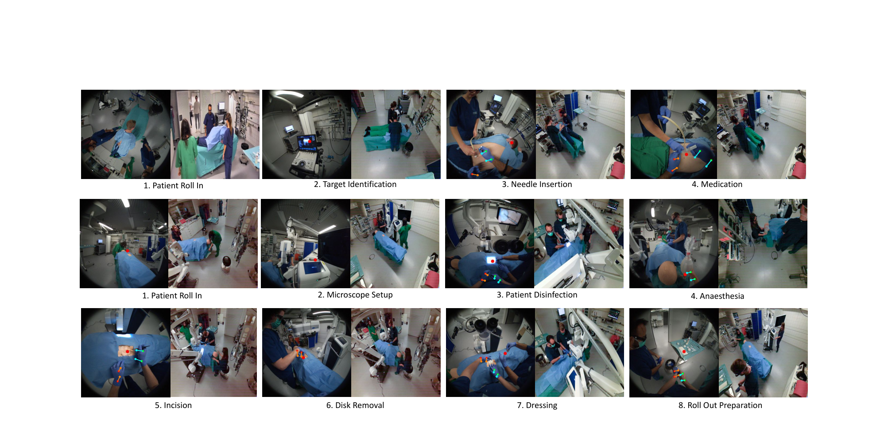

## 1. 背景与动机

**手术室里最关键的动作，天花板相机往往看不见。** 主刀、助手、护士、麻醉师围在手术台边，针头和手常被身体挡住，而且固定相机拿不到"谁在看哪里"。

已有数据集各缺一块。MVOR、4D-OR、MM-OR 只有天花板外部视角；EgoSurgery 只有主刀一路头戴视频，没有场景图；Ego-Exo4D、Assembly101 有自我加外部视角，但不在手术室。

作者的判断是：智能眼镜贴近无菌区、能记录注视与手部，又不需要改造手术室，是补上这块缺口的现实办法。

:::highlights
- 缺口：手术室里没有同时具备多人自我视角、外部视角和密集场景图的数据
- 回答：EgoExOR，模拟手术室里的同步多模态录制
:::

## 2. 核心观点速览

论文的答案有三步：在 4D-OR 的同一模拟中心，让四名角色和显微镜或手术灯都戴上 Project Aria 眼镜，天花板装深度相机；逐帧标注场景图；再用一个把自我视角和外部视角分开处理的双分支模型做基准。

**结果的形状很清楚：** 自我视角是主要信号。只用外部视角总体 0.42，只用自我视角 0.68，合用 0.72。双分支模型相对最强基线 MM2SG 从 0.67 提到 0.72，提升几乎都在超声引导注射上。

**边界同样清楚：** 只有一个模拟中心、41 个 take、7 个测试 take，结果没有方差；只评测了场景图生成一个任务。

:::data
- 94 分钟，84,553 帧，15 fps，41 个 take
- 36 类实体，22 类关系，568,235 个三元组
- 总体宏平均 F1：ORacle 0.63，MM2SG 0.67，EgoExOR 0.72
:::

## 3. 数据从哪里来

*论文原图编号：Figure 1。一个时间点上的全部同步模态：自我视角、注视与手部、超声屏幕、外部 RGB-D、点云、音频和场景图。*

外推范围取决于录制条件。录制地点是一所大学附属的手术模拟中心，没有真实患者。团队由经过训练的生物医学工程师扮演，角色轮换。**参与者人数论文未说明**，所以无法判断角色轮换能覆盖多少种个人习惯。

两种术式都与腰椎间盘突出相关：超声引导注射（UI）和微创脊柱手术（MISS）。所有 take 事先写好脚本并排练，每个阶段还演出了并发症，例如掉落纱布、注射器卡住。这增加了少见动作的样本，但不代表真实意外的频率。

同步靠每个 take 开头的打板和人工对齐。作者称没有观察到漂移，但没有给出对齐误差。

:::highlights
- 单一模拟中心，工程师扮演团队，脚本化流程
- 同步精度只有定性描述
:::

## 4. 每帧有什么

*论文原图编号：Table 2。两种术式的 take 数、时长和帧数。*

**UI 占约四分之三的帧**（62,547 对 22,006），总体分数主要由 UI 决定。按 take 划分为训练 26、验证 8、测试 7；测试集中两种术式各几个，论文未说明。

发布的数据做了大幅压缩：所有图像降到 336×336，点云 2,500 点，手部 16 个关键点，音频提供整段和每帧 1 秒片段，全部存为 HDF5，共 195 GB。眼镜原始画面是 1440×1440，**引言强调的针头细节在发布数据里分辨率已缩小约 4.3 倍**。

缺失值有固定编码：RGB 补零，注视为 (-1, -1)，手部 NaN，点云为空。加载时必须先过滤。

:::data
- 划分 26 / 8 / 7 个 take
- 336×336 图像，2,500 点点云，16 个手部关键点
:::

## 5. 场景图标注

每帧一张场景图，写成（主体，谓词，客体）三元组，每帧平均 6.8 ± 2.5 个。每帧一人标注、一人复核，**标注一致性论文未说明**，标签噪声对低分谓词的影响无法估计。

*论文原图编号：Table 7。全部实体与关系类别的出现次数。*

关系分布是长尾：closeTo 有 174,044 次，约占 31%；preparing 只有 243 次。**高频关系多是空间关系，低频关系多是具体动作**，宏平均 F1 能否提高主要看少见动作。

## 6. 基准怎样评测

任务是给定一个时间点的多模态输入，生成全部三元组。指标按谓词计算 F1 再取宏平均，每个谓词权重相同。主体和客体是否参与匹配，论文未说明。

*论文原图编号：Figure 2。双分支 EgoExOR 模型结构。*

三个模型都以 LLaVA-7B 为底座，语言模型用 LoRA 微调，图像编码器调最后 12 层，训练 4 个 epoch。ORacle 只用图像；MM2SG 加点云、超声和音频；双分支模型再加注视与手部，并把自我视角和外部视角分到两个分支各用 2 层 Transformer 融合。学习率和批大小论文未说明。

## 7. 结果说了什么

| 模型 | UI | MISS | 总体 |
|---|---|---|---|
| ORacle | 0.65 | 0.66 | 0.63 |
| MM2SG | 0.72 | 0.66 | 0.67 |
| EgoExOR | 0.79 | 0.68 | 0.72 |
| 仅自我视角 | 0.71 | 0.67 | 0.68 |
| 仅外部视角 | 0.45 | 0.41 | 0.42 |

**提升几乎全部在 UI 上**：MISS 上三个模型差距不超过 0.02，测试集只有 7 个 take，这样的差距不足以排序。ORacle 总体 0.63 低于两个分项，总体分数的计算口径论文未说明。

*论文原图编号：Table 5。双分支模型在 18 个谓词上的 F1。*

逐谓词看，lyingon 0.99、closeto 0.96，而 anaesthetising 只有 0.02、cutting 0.30。附录文字有几处与表不一致：称最佳模型宏平均 0.79（表中是 0.72），称 injecting 在 0.87 以上（表中 0.77），称 cutting 低于 0.21（表中 0.30）。引用时以表为准。

:::data
- 仅外部视角比仅自我视角低 0.26
- 两种视角合用比仅自我视角高 0.04
:::

## 8. 自我视角的优势能这样归因吗

消融里的两个变体模态不对称：仅自我视角带注视与手部、没有点云；仅外部视角带点云、没有注视与手部。所以 0.68 对 0.42 至少混了三件事：

1. 视角本身：眼镜靠近无菌区，少遮挡。这是作者的解释。
2. 模态：注视和手部本身就是动作的强线索。
3. 分辨率：336×336 下，天花板画面里的针只剩几个像素。

**论文没有"自我 RGB 去掉注视与手部"或高分辨率外部视角的对照，三者分不开。** 双分支相对 MM2SG 的提升同理：结构和新模态是同时加入的。

*论文原图编号：Figure 3。两组定性样例，绿色为预测正确，白色为错误；MISS 样例漏掉了主刀持手术刀。*

## 9. 相对已有数据集新在哪里

| 对比对象 | EgoExOR 新增 | 没有超过的地方 |
|---|---|---|
| 4D-OR | 多路自我视角、注视、手部、超声屏幕、音频 | 同样是模拟中心 |
| MM-OR | 自我视角与注视、手部 | 没有全景分割 |
| EgoSurgery | 多人自我视角、外部视角、场景图 | EgoSurgery 是真实手术 |
| Ego-Exo4D | 手术室场景与手术场景图 | 规模小几个数量级 |

**独有的是在手术室里把多人眼镜视角、注视、手部和场景图放在一起。** 84,553 个时间点比 MM-OR 的 25,277 多，但它们是 15 fps 的连续帧，独立场景只有 41 个 take。

## 10. 复现与比较前要核对什么

- 缺失值编码先过滤，否则模型会把补零帧当信号。
- 分术式报告 UI、MISS 和逐谓词 F1，避免 UI 掩盖 MISS 和低频谓词。
- 写明总体宏平均的计算方式，以及是否检查主体和客体。
- 多次随机种子或多次划分，测试集 7 个 take 的波动未知。

*论文原图编号：Figure 5。两种术式各阶段的代表帧，左为自我视角、右为外部视角。*

## @takeaways
- EgoExOR 是第一个在手术室里同步多人自我视角、外部视角、注视、手部与场景图的数据集
- 自我视角输入让场景图宏平均 F1 从 0.42 升到 0.68，但这个差距混有模态和分辨率因素
- 提升集中在超声引导注射，微创脊柱手术上模型几乎区分不出
- 低频动作（麻醉、切割）仍然失败

## @strengths
- 模态最全，传感器、同步、缺失编码和文件结构交代清楚
- 场景图范式与 4D-OR、MM-OR 一致，已有方法可以直接迁移
- 给出逐谓词结果，难点可见

## @weaknesses
- 单一模拟中心、扮演团队、脚本化流程，与真实手术差距未量化
- 只有一个基准任务，结果无方差，测试集只有 7 个 take
- 消融模态不对称，附录文字与表格数字有多处不一致
- 参与者人数、标注一致性、超参数、总体分数口径均论文未说明

## @questions
- 去掉注视与手部后，自我视角 RGB 还剩多少优势？
- 用原始 1440×1440 画面，外部视角能否追上？
- 在真实手术数据上，从模拟数据学到的表示能迁移多少？
