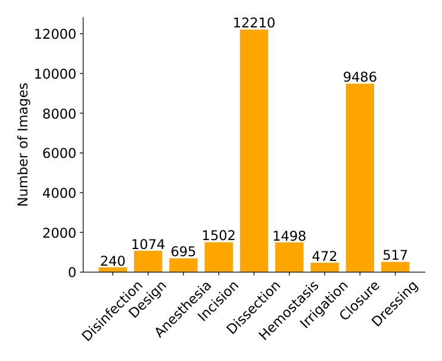
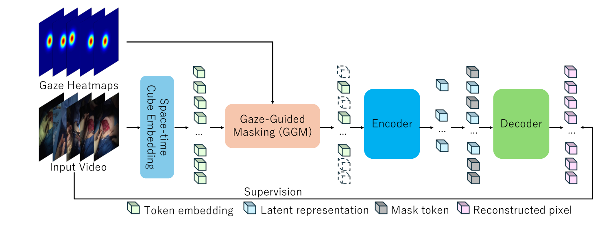
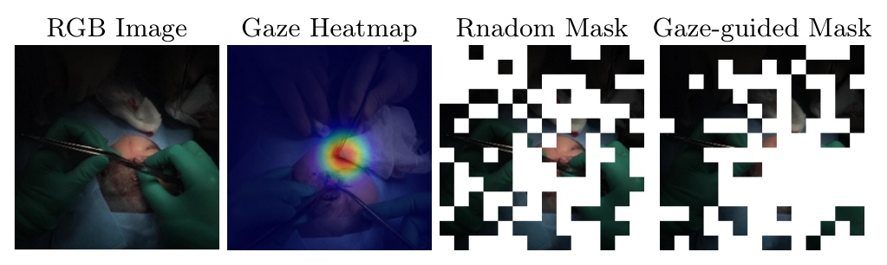
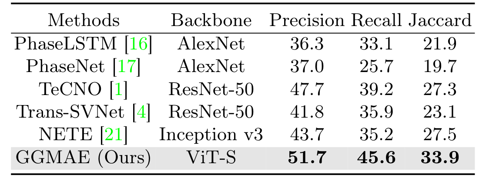
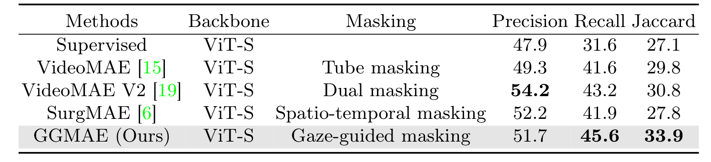
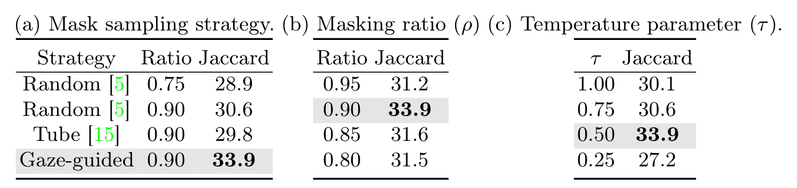
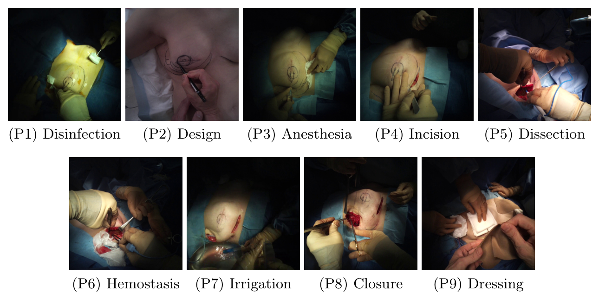

---
tags:
  - papers/手术数据集
aliases:
  - "EgoSurgery-Phase"
  - "GGMAE"
date: 2024-05-30
arxiv_id: 2405.19644
---

# EgoSurgery-Phase: A Dataset of Surgical Phase Recognition from Egocentric Open Surgery Videos

## 核心信息

- 标题: EgoSurgery-Phase: A Dataset of Surgical Phase Recognition from Egocentric Open Surgery Videos
- 标题翻译: EgoSurgery-Phase：基于第一人称开放手术视频的手术阶段识别数据集
- 作者: Ryo Fujii, Masashi Hatano, Hideo Saito, Hiroki Kajita
- 机构: 庆应义塾大学; 庆应义塾大学医学部
- 发表时间: 2024-05-30（arXiv v1）；本文依据 arXiv v3（2024-11-27）
- 发表渠道: MICCAI 2024（据项目 GitHub 说明）；arXiv 预印本（cs.CV）
- arXiv: 2405.19644
- 论文链接: https://arxiv.org/abs/2405.19644
- 代码 / 项目: https://github.com/Fujiry0/EgoSurgery
- 数据 / 资源: 项目页要求填写 Google 表单申请，审核后发送下载链接；许可为 CC BY-NC-SA 4.0，仅限学术研究
- 论文类型: 数据集论文（benchmark_or_dataset），附带一个方法

## 原文摘要翻译

手术阶段识别能回应现代手术室的诸多需求，因此受到广泛关注。然而现有方法大多集中在微创手术（MIS），开放手术的阶段识别研究不足。这种差距主要源于缺少公开的开放手术阶段识别视频数据集。

为解决这一问题，我们提出一个新的第一人称开放手术视频阶段识别数据集 EgoSurgery-Phase。它包含 15 小时的真实开放手术视频，覆盖 9 个手术阶段，全部由固定在外科医生头部的第一人称相机拍摄。除视频外，EgoSurgery-Phase 还提供眼动注视数据。据我们所知，这是第一个公开的真实开放手术阶段识别视频数据集。

此外，受掩码自编码器（MAE）在动作识别等视频理解任务中显著成效的启发，我们提出注视引导掩码自编码器（GGMAE）。外科医生注视的区域（例如术野）往往对阶段识别至关重要，因此在 GGMAE 中，注视信息作为经验性的语义丰富度先验来引导掩码过程，使模型更关注语义丰富的空间区域。在 EgoSurgery-Phase 上，GGMAE 相比此前最好的识别方法 Jaccard 提高 6.4%，相比基于掩码自编码器的方法提高 3.1%。数据集已在项目页发布。

## 创新点

1. 真实开放手术的第一人称阶段数据。20 段视频、10 种术式、8 位外科医生，标注 9 个阶段。此前公开的阶段识别数据集（如 Cholec80、AutoLaparo）都是腹腔镜画面，开放手术缺少同类资源。
2. 随视频提供注视数据。头戴 Tobii 眼动相机记录主刀看向哪里，这是腹腔镜数据集无法提供的信号，也是后面方法的基础。
3. 去标识化流程写明。开放手术画面会拍到患者、助手和护士的面孔，作者下采样到 0.5 fps、模糊患者面部、剔除含其他个人信息的帧，原始 28 小时最终保留 15 小时。
4. 注视引导掩码 GGMAE。把注视热图按视频块累加、经 softmax 转成掩码概率，让 MAE 预训练优先遮住并重建医生关注的区域。同骨干下 Jaccard 33.9，高于随机掩码的 30.6 和管状掩码的 29.8。

## 一句话总结

EgoSurgery-Phase 用头戴眼动相机采集 20 段真实开放手术，去标识化后得到 15 小时、27,694 帧的 9 阶段标注数据，并附注视；作者据此提出用注视引导 MAE 掩码的 GGMAE，宏平均 Jaccard 达到 33.9，超过此前方法，但绝对水平仍低，说明任务远未解决。

## 研究问题

手术阶段识别是把一台手术切分成消毒、切开、缝合这类高层阶段，是实时辅助、教学和疗效评估的基础组件。这一方向的数据和方法几乎都围绕微创手术：Cholec80、AutoLaparo 这类腹腔镜数据集推动了大量模型。

开放手术缺少可比的公开数据集。原因之一是隐私：腹腔镜画面在体内，开放手术画面却会拍到患者、助手、麻醉师和护士的面孔。另一个原因是采集视角：开放手术没有内镜，只能靠外部或头戴相机。

论文要回答两个问题：

- 能否提供一个真实、公开、带阶段标注的开放手术视频数据集；
- 第一人称视频特有的注视信号，能否帮助学到更好的阶段识别表示。

### 核心观点速览

- 数据：20 段真实开放手术、15 小时、27,694 帧、9 个阶段，主刀头戴眼动相机拍摄，附注视。
- 隐私代价：下采样到 0.5 fps 并剔除含个人信息的帧，原始 28 小时只剩 15 小时。
- 难度：分离和缝合约占 78% 的帧，最好的宏平均 Jaccard 只有 33.9，任务远未解决。
- 方法：GGMAE 只改 VideoMAE 的掩码选择，按注视热图优先遮住医生看的区域；同骨干下比随机掩码高 3.3。
- 边界：测试集 5 段视频、单次运行、超参数搜索所用划分未说明；注视的作用和“避开灯光外黑区”的作用没有分开。

下面先看数据从哪来、怎样去标识化，再看 GGMAE 怎么用注视。

## 数据与任务定义

这一节回答：视频从哪来，隐私怎么处理，标签长什么样。**所有视频来自一家日本医院、主刀一个视角**，这决定了后面结果的外推范围。

### 数据来源

采集沿用作者此前开放手术器械检测工作的流程：主刀头戴 Tobii 眼动相机录制 20 台开放手术。录制获庆应义塾大学医学部伦理委员会批准，并取得患者或监护人的书面知情同意。

| 项目 | 数值 |
|---|---|
| 视频数 | 20 |
| 术式种类 | 10 |
| 主刀人数 | 8 |
| 原始帧率与分辨率 | 25 fps，1920 × 1080 |
| 单段原始时长 | 28 至 234 分钟 |
| 原始总时长 | 28 小时 |
| 处理后平均时长 | 46 分钟 |
| 处理后总时长 | 15 小时 |

10 种术式的具体名称，论文未列出。

### 去标识化与下采样

开放手术画面容易出现可识别个人的信息，作者做了三步处理。先把视频下采样到 0.5 fps，再模糊患者面部，最后剔除含其他个人信息的帧。

处理后保留 15 小时。剔除了多少帧、剔除的帧集中在哪些阶段，论文未说明；如果某些阶段（例如消毒时常拍到患者全身）被大量剔除，它在数据中的占比会被人为压低。

### 阶段定义与分布

专家外科医生根据临床经验逐帧标注 9 个阶段，通常按顺序执行：消毒、设计（在皮肤上画切口线）、麻醉、切开、分离、止血、冲洗、缝合、包扎。共标注 27,694 帧，下表保留各阶段的英文原名。

*论文原图编号：Fig 3。9 个阶段的帧数分布。放在这里是因为它直接显示类别极度不均衡，这决定了后面为什么用宏平均指标。*

| 阶段 | 帧数 |
|---|---|
| Disinfection | 240 |
| Design | 1,074 |
| Anesthesia | 695 |
| Incision | 1,502 |
| Dissection | 12,210 |
| Hemostasis | 1,498 |
| Irrigation | 472 |
| Closure | 9,486 |
| Dressing | 517 |

分离和缝合两类合计 21,696 帧，约占 78%；最少的消毒只有 240 帧，与分离相差约 51 倍。**这种分布下，准确率会被两个大类主导，所以论文改用宏平均。**

### 数据划分

论文写的是 14 段训练、2 段验证、5 段测试，合计 21 段，与前文的 20 段视频不一致。哪个数字有误，论文未说明；复现者无法从论文本身还原划分，只能依赖申请到的数据文件。

### 任务与指标

任务是逐帧阶段分类。指标是精确率、召回率和 Jaccard 指数，全部取宏平均，即每个阶段先单独计算再等权平均，让少数类和多数类权重相同。

有了数据和指标，下一节看作者怎样把注视用进模型。

## 方法主线

数据构建部分上一节已经写完，这里讲评测协议和作者提出的 GGMAE。GGMAE 是在 VideoMAE 上只改掩码选择的一步：不再均匀随机地挑要遮住的视频块，而是按注视热图挑。

### 机制流程

*论文原图编号：Fig 4。GGMAE 总体结构：视频经时空立方体嵌入成为视频块，注视引导掩码模块按注视热图选出要遮住的块，编码器只处理可见块，解码器重建被遮住的像素。放在这里是因为它对应下面的四步流程。*

1. 输入是一段视频和对应的注视热图，热图由在真实注视点处放一个高斯得到。时空立方体嵌入按时间 2 帧、空间 16 × 16 像素把视频切成视频块并映射为嵌入。输出是每个时间索引上的一组空间视频块，块数记为 $N_s$。
2. 注视引导掩码：对每个视频块累加其覆盖像素的热图值得到 $d_i$；在每个时间索引上对 $N_s$ 个块的 $d_t$ 做带温度的 softmax，得到掩码概率 $\pi_t$；按 $\pi_t$ 做多项分布无放回采样 $\lfloor \rho N_s\rfloor$ 次，选中的块被遮住。输出是可见块集合和被遮块索引。
3. 可见块加上时空位置编码送入 Transformer 编码器，得到隐表示；与掩码占位符拼接后送入解码器。输出是被遮块的重建像素。
4. 以被遮块的像素均方误差作为预训练损失。预训练结束后去掉解码器，在编码器上接 MLP 分类头，用交叉熵全量微调做阶段分类。输出是每个片段的阶段预测。

### 关键公式

$$d_i = \sum_{j\in\Omega_i} G_j, \qquad \pi_t = \mathrm{Softmax}(d_t/\tau)$$

$\Omega_i$ 是第 $i$ 个视频块覆盖的热图像素，$\tau$ 控制分布的尖锐程度。$\tau$ 越小，掩码越集中在注视区域；$\tau$ 越大，越接近均匀随机掩码。

$$\mathcal{L} = \frac{1}{|\Omega|}\sum_{p\in\Omega}\lVert I(p)-\hat I(p)\rVert^2$$

$\Omega$ 是被遮视频块集合，$I$ 是原始帧，$\hat I$ 是重建帧。损失与 VideoMAE 相同，改动只在 $\Omega$ 怎么选。

*论文原图编号：Fig 2。同一帧的 RGB 图像、注视热图、随机掩码和注视引导掩码。放在这里是因为它直观说明注视引导掩码把遮挡集中到术野，而随机掩码大量落在被手术灯造成的全黑区域。*

### 关键实现细节

| 项目 | 设置 |
|---|---|
| 骨干 | VideoMAE，ViT-S |
| 输入 | 10 帧片段，224 × 224 |
| 视频块 | 2 × 16 × 16 |
| 预训练 | 掩码率 90%，800 轮，批大小 256，AdamW（权重衰减 1e−4，betas 0.9 与 0.95） |
| 预训练学习率 | 前 20 轮线性升到 1e−3，余弦衰减到 1e−4 |
| 温度 | τ = 0.5 |
| 微调 | MLP 分类头，全量微调 100 轮，交叉熵，批大小 64 |
| 微调学习率 | 前 5 轮升到 5e−4，余弦衰减到 5e−5 |
| 类别不均衡 | 微调时重采样 |
| 硬件 | 3 张 NVIDIA TITAN RTX |

注视只在预训练时用来挑掩码，微调和推理不需要注视。

### 评测协议

所有超参数用粗到细的网格搜索或逐步调参确定。搜索在验证集还是测试集上进行，论文未说明；这直接影响下面消融最优点的可信度。对比的阶段识别方法沿用各自原文的骨干；MAE 类方法统一用 ViT-S 和相同训练流程。所有结果都只报单次运行，方差论文未说明。

## 关键结果

这一节回答三个问题：数据集上已有方法能做到多好，同骨干下注视掩码比别的掩码强多少，提升对超参数有多敏感。

### 与阶段识别方法对比

*论文原图编号：Table 1。与阶段识别基线和此前最好方法的对比。放在这里是因为它是数据集上的主基线表。*

| 方法 | 骨干 | 精确率 | 召回率 | Jaccard |
|---|---|---|---|---|
| PhaseLSTM | AlexNet | 36.3 | 33.1 | 21.9 |
| PhaseNet | AlexNet | 37.0 | 25.7 | 19.7 |
| TeCNO | ResNet-50 | 47.7 | 39.2 | 27.3 |
| Trans-SVNet | ResNet-50 | 41.8 | 35.9 | 23.1 |
| NETE | Inception v3 | 43.7 | 35.2 | 27.5 |
| GGMAE | ViT-S | 51.7 | 45.6 | 33.9 |

GGMAE 三项指标都最高，比最强的 NETE 精确率高 8.0、召回率高 10.4、Jaccard 高 6.4。但骨干不同，这张表混合了骨干和方法两个变量。**所有方法的 Jaccard 都不到 34**，说明这个数据集对现有方法仍然很难；要看注视本身的作用，得看下面同骨干的对比表。

### 与 MAE 类方法对比

*论文原图编号：Table 2。同为 ViT-S 骨干的 MAE 类方法对比，监督基线为从零训练的 ViT-S。放在这里是因为这是控制骨干后的公平比较。*

| 方法 | 掩码方式 | 精确率 | 召回率 | Jaccard |
|---|---|---|---|---|
| 监督（从零训练） | 无 | 47.9 | 31.6 | 27.1 |
| VideoMAE | 管状 | 49.3 | 41.6 | 29.8 |
| VideoMAE V2 | 双重 | 54.2 | 43.2 | 30.8 |
| SurgMAE | 时空 | 52.2 | 41.9 | 27.8 |
| GGMAE | 注视引导 | 51.7 | 45.6 | 33.9 |

GGMAE 的 Jaccard 比 VideoMAE 高 4.1，比 VideoMAE V2 高 3.1，比 SurgMAE 高 6.1。

它的精确率却低于两个对手（54.2 和 52.2），优势主要来自召回率。正文说比从零训练高 6%，按表中数字是 27.1 到 33.9。**所以 GGMAE 更擅长少漏判，而不是更少误判。**

### 消融

*论文原图编号：Table 3。掩码策略、掩码率和温度的消融，均用 ViT-S。放在这里是因为它是注视先验是否起作用的直接证据。*

| 消融 | 设置 | Jaccard |
|---|---|---|
| 掩码策略 | 随机，0.75 | 28.9 |
| 掩码策略 | 随机，0.90 | 30.6 |
| 掩码策略 | 管状，0.90 | 29.8 |
| 掩码策略 | 注视引导，0.90 | 33.9 |
| 掩码率 | 0.95 / 0.90 / 0.85 / 0.80 | 31.2 / 33.9 / 31.6 / 31.5 |
| 温度 τ | 1.00 / 0.75 / 0.50 / 0.25 | 30.1 / 30.6 / 33.9 / 27.2 |

同掩码率下注视引导比随机高 3.3。温度降到 0.25 时 Jaccard 跌到 27.2，低于随机掩码，说明掩码过度集中在注视点反而有害。掩码率曲线也在 0.90 处单峰。这些最优点都只基于一次运行和 5 段测试视频，深度分析会讨论它们能说明多少。

## 深度分析

数字背后有两个问题：这个数据集到底在考什么，注视的提升是不是真的来自语义。

### 数据集真正测到了什么

*论文原图编号：Fig 1。9 个阶段的样例帧。放在这里是因为它显示手术灯造成术野外大面积全黑，以及不同阶段画面的相似程度。*

这个数据集测的是：从主刀视角的低帧率画面判断当前处于哪个阶段。0.5 fps 意味着相邻帧间隔 2 秒；按此推断，10 帧输入片段覆盖约 20 秒，短动作的细节已经丢失。宏平均 Jaccard 对少数类非常敏感，消毒只有 240 帧，几段测试视频里可能只有极少帧，单个阶段的误判就会显著拉低整体分数。

### 注视先验为什么有效

样例帧里，手术灯把术野外压成全黑。随机掩码会把很多块落在这些黑色区域，重建它们几乎不需要理解画面。注视热图集中在术野，按注视挑掩码等于让模型多重建信息丰富的块。消融中随机到注视引导的 3.3 提升支持这个解释。

**但注视信号与“术野亮区”高度重合。**我的判断：一个只按亮度或显著性挑掩码的基线就能分开“注视带来的语义”与“避开黑区”两种解释，论文没有做这个对照，所以这两种解释目前无法区分。

### 与已有路线的位置

| 对照 | 关系 |
|---|---|
| Cholec80、AutoLaparo 等腹腔镜阶段数据集 | 规模更大，但没有开放手术、第一人称和注视 |
| 同作者的 EgoSurgery-Tool | 来自同一项目，做器械与手的检测框，不做阶段 |
| VideoMAE、VideoMAE V2 | 掩码与数据无关；GGMAE 只换了掩码选择 |
| 论文引用的 SemMAE 等非均匀掩码工作 | 按视频块信息量调整掩码；GGMAE 的信息量先验来自人类注视 |

这些分析指向几处具体的证据缺口，列在下面。

## 局限

- 规模小：20 段视频，测试集 5 段，所有结果只报单次运行，没有方差或置信区间。
- 划分数字自相矛盾：14、2、5 合计 21，与 20 段视频不一致。
- 超参数通过网格搜索确定，消融也报告在同一测试集上的结果；如果搜索用了测试集，GGMAE 的优势会被高估。
- 单中心采集；10 种术式名称、各术式视频数和各阶段在划分中的分布，论文未说明。
- 0.5 fps 下采样是为了隐私，但也限制了对短动作阶段的识别。
- 论文未说明注视热图的高斯宽度，而它直接影响 $d_i$ 和掩码分布。
- 注视与亮区的作用没有分开，缺少按亮度或显著性挑掩码的对照。
- GGMAE 精确率低于 VideoMAE V2 和 SurgMAE，“全面超过”只在 Jaccard 和召回率上成立。
- 数据需申请获得，许可为非商业用途。

## 我的笔记

- 复现基线时，先确认划分的视频编号，作者正文的数字对不上。
- 应该避免只报宏平均：0.5 fps 下少数阶段在测试集只有很少帧，单个数字波动大。
- 报告结果时同时给出逐阶段 Jaccard，否则少数阶段的表现被宏平均掩盖。
- 想验证注视的价值，应加一个按亮度或显著性挑掩码的对照。
- 注视只用于预训练，部署时不需眼动设备，这是这条路线可复用的地方。

## 引用

- Fujii, R., Hatano, M., Saito, H., & Kajita, H. EgoSurgery-Phase: A Dataset of Surgical Phase Recognition from Egocentric Open Surgery Videos. MICCAI 2024. arXiv:2405.19644.
- arXiv: https://arxiv.org/abs/2405.19644
- 项目与数据申请: https://github.com/Fujiry0/EgoSurgery
