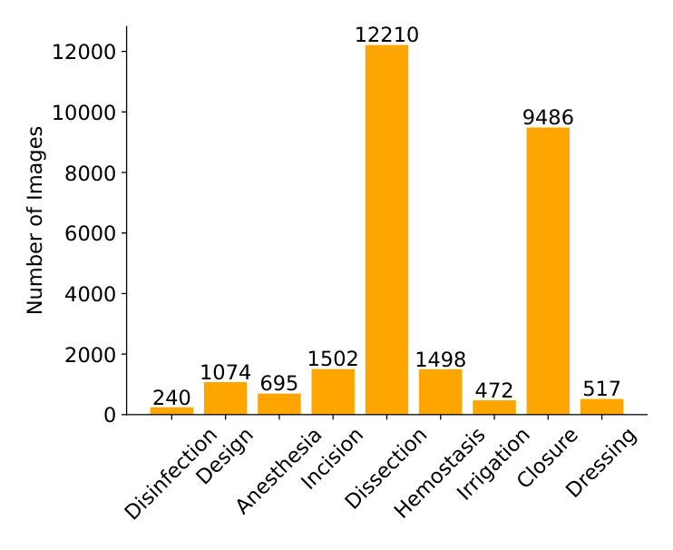
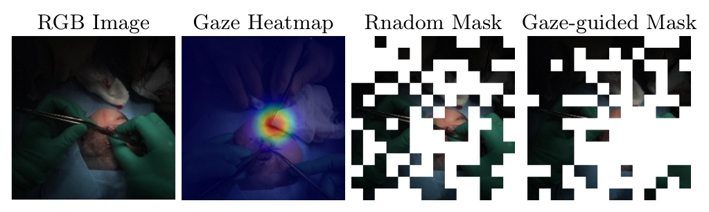
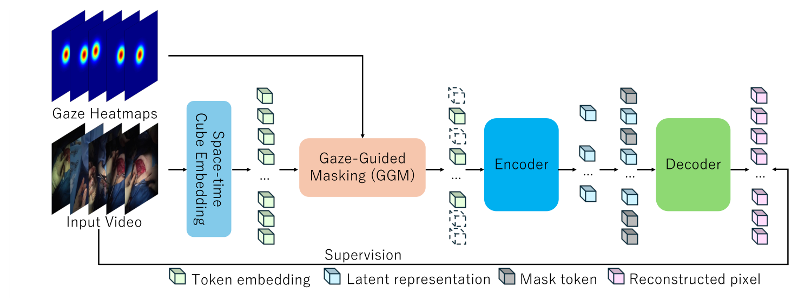
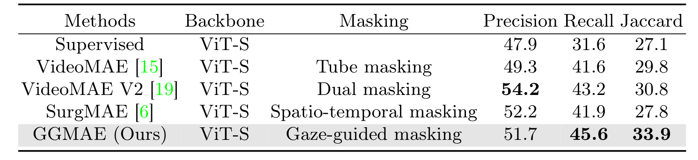
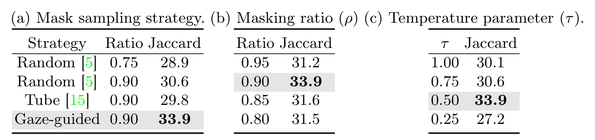

## 1. 背景与动机

手术阶段识别是把一台手术逐帧归入消毒、切开、缝合这类阶段，是实时辅助和教学的基础。**公开数据几乎全是腹腔镜手术**，例如 Cholec80 和 AutoLaparo。

开放手术难在两点。没有内镜，只能用外部或头戴相机；画面还会拍到患者、助手和护士的脸，隐私处理更麻烦。作者想补的就是这个空缺。

下一节先给出全文的答案，再逐项展开。

## 2. 核心观点速览

- 数据：20 段视频、10 种术式、8 位主刀，处理后 15 小时、27,694 帧，9 个阶段，附注视。
- 隐私代价：下采样到 0.5 fps 并剔除含个人信息的帧，原始 28 小时只剩 15 小时。
- 难度：分离和缝合约占 78% 的帧，最好结果的宏平均 Jaccard 只有 33.9。
- 方法：GGMAE 只改 VideoMAE 的掩码选择，按注视热图优先遮住医生看的区域。
- 边界：测试集 5 段视频、单次运行；注视的作用和避开灯光外黑区的作用没有分开。

:::highlights
- 首个公开的真实开放手术阶段识别视频数据集（作者自述）
- 注视只在预训练时使用，推理不需要眼动设备
:::

## 3. 数据从哪里来

**全部视频来自一家日本医院、主刀一个视角。**主刀头戴 Tobii 眼动相机，原始 25 fps、1920 × 1080，单段 28 至 234 分钟，共 28 小时。录制获庆应义塾大学医学部伦理委员会批准，并取得书面知情同意。

去标识化分三步：下采样到 0.5 fps，模糊患者面部，剔除含其他个人信息的帧。处理后平均每段 46 分钟、共 15 小时。剔除了多少帧、集中在哪些阶段，论文未说明。

:::data
- 20 段视频，10 种术式，8 位主刀
- 原始 28 小时，处理后 15 小时
:::

数据规模清楚了，接下来看标签本身有多不均衡。

## 4. 九个阶段与类别分布

*论文原图编号：Fig 3。9 个阶段的帧数分布。*

专家外科医生逐帧标注 9 个阶段，共 27,694 帧。**分离 12,210 帧、缝合 9,486 帧，合计约 78%**；消毒只有 240 帧。所以论文用宏平均：每个阶段等权，少数类不会被淹没。

划分写的是 14 段训练、2 段验证、5 段测试，合计 21 段，与 20 段视频对不上，论文未说明原因。

:::data
- 27,694 帧标注
- 最大类 12,210 帧，最小类 240 帧
:::

标签是这样的，下面看作者如何利用注视。

## 5. 注视引导掩码怎么工作

*论文原图编号：Fig 2。RGB 图像、注视热图、随机掩码与注视引导掩码对比。*

掩码自编码器的做法是遮住大部分视频块再重建。随机掩码会把很多块落在手术灯照不到的全黑区域，重建它们几乎学不到东西。

GGMAE 对每个视频块累加注视热图值，在每个时间索引上做带温度 τ 的 softmax，再按这个概率无放回采样 90% 的块遮住。**τ 越小，掩码越集中在注视点。**损失仍是被遮块的像素均方误差。

*论文原图编号：Fig 4。GGMAE 总体结构。*

预训练 800 轮后接 MLP 头全量微调 100 轮，骨干 ViT-S，输入 10 帧、224 × 224。注视热图的高斯宽度论文未说明。

机制讲完，看它在数据集上的结果。

## 6. 结果说了什么

*论文原图编号：Table 2。同为 ViT-S 骨干的 MAE 类方法对比。*

| 方法 | 精确率 | 召回率 | Jaccard |
|---|---|---|---|
| NETE（此前最好） | 43.7 | 35.2 | 27.5 |
| VideoMAE | 49.3 | 41.6 | 29.8 |
| VideoMAE V2 | 54.2 | 43.2 | 30.8 |
| GGMAE | 51.7 | 45.6 | 33.9 |

GGMAE 的 Jaccard 比 NETE 高 6.4，比 VideoMAE V2 高 3.1。**但它的精确率低于 VideoMAE V2，优势来自召回率。**NETE 与 GGMAE 骨干不同，只有 MAE 类那几行是同骨干比较。

:::data
- GGMAE Jaccard 33.9
- 同骨干随机掩码 30.6，管状掩码 29.8
:::

结果之外，还要问这些提升有多可靠。

## 7. 消融与超参数敏感性

*论文原图编号：Table 3。掩码策略、掩码率与温度消融。*

同掩码率 0.90 下，注视引导比随机高 3.3。掩码率在 0.90 处最好，温度在 0.5 处最好；**τ 降到 0.25 时 Jaccard 跌到 27.2，低于随机掩码**，说明掩码过度集中反而有害。

超参数用网格搜索确定，搜索用的是验证集还是测试集，论文未说明。所有结果都是单次运行，没有方差。

这些缺口引出下一节的核心疑问。

## 8. 提升真的来自注视吗

样例帧里，注视几乎总落在灯光照亮的术野。**我的判断：按亮度或显著性挑掩码可能拿到相近的提升。**论文没有这个对照，所以注视带来的语义和避开黑区两种解释无法区分。

另外，测试集只有 5 段视频，消毒这类小类在测试集里帧数很少，单个阶段的误判会显著改变宏平均。

最后看复现和使用时要核对什么。

## 9. 复现与使用前要核对什么

- 数据需填写项目页的 Google 表单申请，许可为非商业学术用途。
- 先拿到实际划分文件，正文的 14、2、5 与 20 段视频对不上。
- 同时报告逐阶段 Jaccard，避免宏平均掩盖小类。
- 10 种术式的名称与各自视频数论文未说明，跨术式泛化无法评估。

## @takeaways
- 开放手术第一人称阶段识别现在有了可申请的真实数据，但规模只有 20 段视频。
- 注视作为预训练掩码先验有效，部署时不需眼动设备。
- 最好结果 Jaccard 33.9，任务远未解决。

## @strengths
- 真实临床数据，伦理审批与去标识化流程写明。
- 附带注视，这是腹腔镜数据集没有的信号。
- 方法改动小，消融覆盖掩码策略、掩码率和温度。

## @weaknesses
- 划分数字自相矛盾，测试集小，单次运行。
- 缺少按亮度或显著性挑掩码的对照。
- 超参数搜索所用划分、高斯宽度、术式名称均未说明。

## @questions
- 注视引导与亮度引导掩码相比差多少？
- 在验证集上选超参数后，测试集结果是否保持？
- 加入时序模型后 GGMAE 表示能否继续提升？
