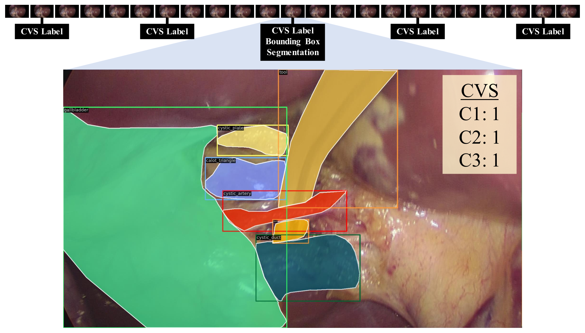
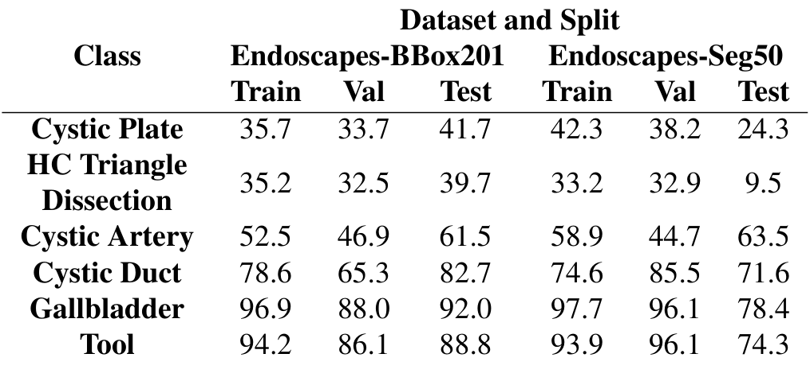
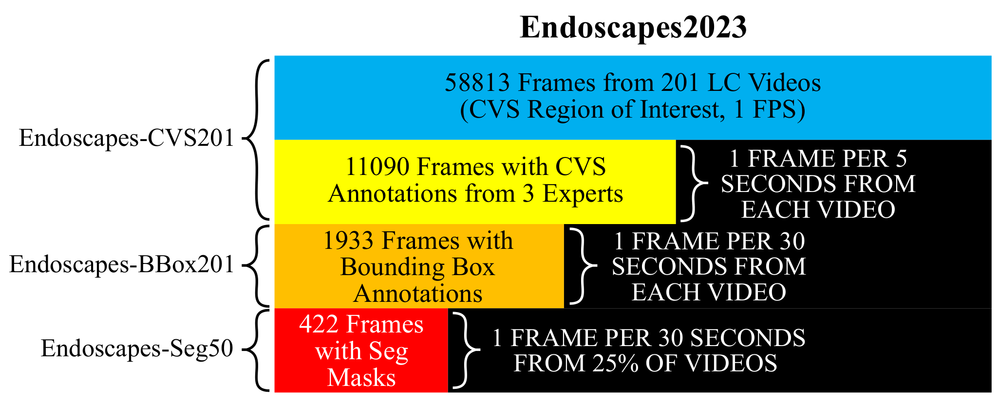
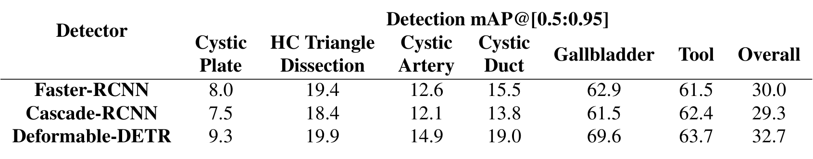
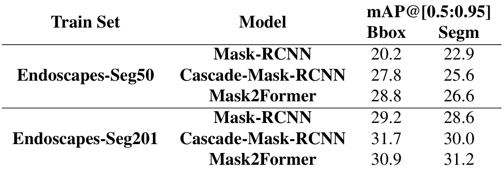
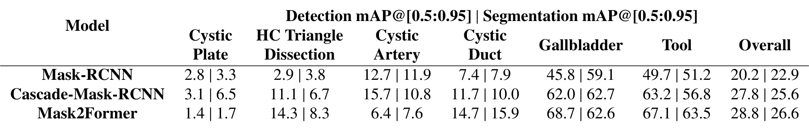
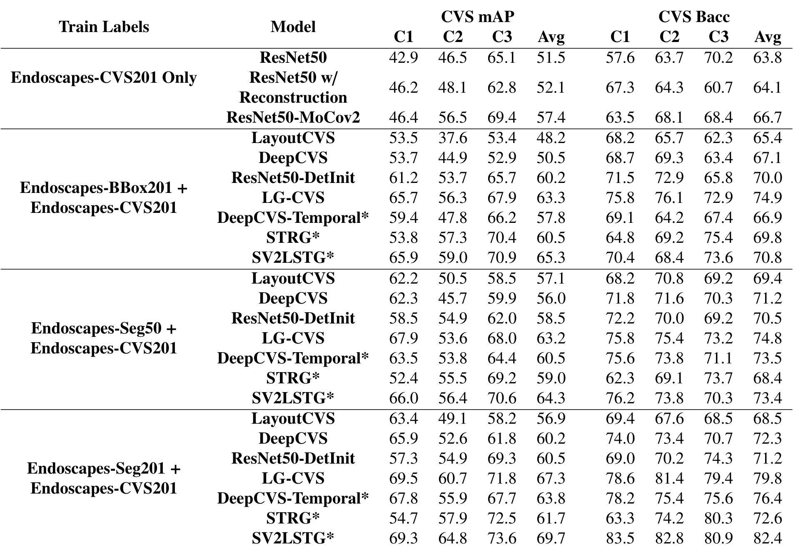
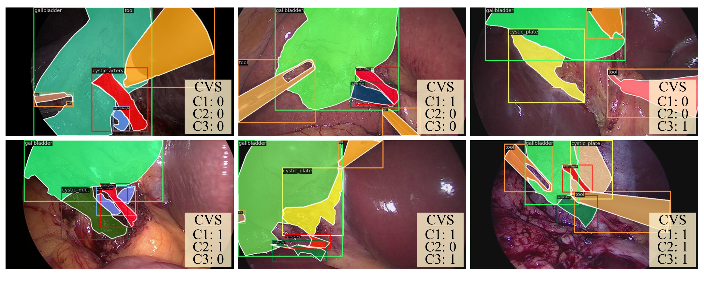

---
tags:
  - papers/手术数据集
aliases:
  - "Endoscapes"
  - "Endoscapes2023"
date: 2023-12-19
doi: 10.1038/s41597-025-04642-4
arxiv_id: 2312.12429
---

# The Endoscapes Dataset for Surgical Scene Segmentation, Object Detection, and Critical View of Safety Assessment: Official Splits and Benchmark

## 核心信息

- 标题: The Endoscapes Dataset for Surgical Scene Segmentation, Object Detection, and Critical View of Safety Assessment: Official Splits and Benchmark
- 标题翻译: Endoscapes 数据集：面向手术场景分割、目标检测与关键安全视野评估的官方划分与基准
- 作者: Aditya Murali, Deepak Alapatt, Pietro Mascagni, Armine Vardazaryan, Alain Garcia, Nariaki Okamoto, Guido Costamagna, Didier Mutter, Jacques Marescaux, Bernard Dallemagne, Nicolas Padoy
- 机构: 斯特拉斯堡大学 ICube(CNRS); IHU Strasbourg; 法国消化道癌症研究所(IRCAD); 罗马 Gemelli 大学医院基金会(IRCCS)
- 发表时间: 2023-12-19(arXiv v1);本笔记依据 arXiv v3,2024-10-25
- 发表渠道: arXiv 技术报告;元数据显示后续发表于 Sci Data 12, 331 (2025)
- DOI: 10.1038/s41597-025-04642-4
- arXiv: 2312.12429
- 论文链接: https://arxiv.org/abs/2312.12429
- 代码 / 项目: https://github.com/CAMMA-public/Endoscapes(含模型权重)
- 数据 / 资源: Endoscapes2023,通过上述仓库公开;Endoscapes-Seg201 为私有,不公开
- 论文类型: 数据集与基准论文(benchmark_or_dataset)

## 原文摘要翻译

本技术报告详细介绍 Endoscapes,这是一个腹腔镜胆囊切除术(LC)视频数据集,带有针对关键安全视野(CVS)自动评估的精细标注。Endoscapes 包含 201 个 LC 视频,其中的帧以稀疏但规律的方式标注了分割掩码、边界框,以及由三位临床专家给出的 CVS 评估。总计有来自 201 个视频的 11090 帧带 CVS 标注、1933 帧带器械与解剖结构边界框,另有来自 201 个视频中 50 个视频的 422 帧带器械与解剖结构分割掩码。本报告给出详细的数据集统计(规模、类别分布、数据划分等),以及实例分割、目标检测和 CVS 预测的全面性能基准。数据集和模型权重公开于 https://github.com/CAMMA-public/Endoscapes。

## 创新点

1. **去除选择偏差的抽帧方式。** 前作 DeepCVS 从 201 个视频中手选了 2854 张“可评估 CVS”的图像。Endoscapes 改为在 CVS 可评估区间内按 1fps 抽帧,再按固定间隔标注,训练和测试分布都不再经过人工挑选。这一点决定了测试分数能否反映真实视频中的表现。
2. **同一批视频上的分层标注。** 58813 帧全部帧、11090 帧 CVS 标签、1933 帧边界框、493 帧分割掩码,彼此按同一视频划分严格嵌套。研究者可以在一个数据集里做混合监督、半监督和时序建模,而不必跨数据集拼接。
3. **三位专家独立标注 CVS,并公开一致性。** 以多数投票作为真值,同时报告各准则与总体的 `Cohen's kappa`(`0.33` 到 `0.53`,总体 `0.38`)。一致性数字让读者能判断这个任务的标签噪声有多大。
4. **官方划分与统一基准。** 固定 120/41/40 的视频划分,给出检测、实例分割、CVS 预测三项任务和 12.5%/25% 低标签设置的基线,并开放低标签划分,后续工作可以直接对比。
5. **指标选择有明确理由。** CVS 是严重不平衡的多标签分类,作者用 mAP 和平衡准确率(bAcc)代替准确率,避免全零分类器得到虚高分数。

## 一句话总结

Endoscapes2023 用 201 个胆囊切除术视频提供分层嵌套的 CVS、边界框和分割标注,并固定官方划分与基线;结果显示细粒度解剖结构识别和 CVS 判定仍然困难,而专家间一致性偏低本身就是这一任务的天花板之一。

## 研究问题

**难点在于 CVS 判断要看清很小、很模糊的解剖结构。** 关键安全视野(CVS)由三项准则组成:C1 两结构、C2 肝胆三角清理、C3 胆囊板,定义沿用 [5] 的形式化协议。

论文认为它比阶段识别、器械检测或分割更难,因为它依赖对细粒度解剖结构和概念的准确识别。论文没有展开各准则的临床含义,只引用一篇关于胆管损伤的分析 [13] 作为背景。

**作者自己的前作卡在数据上。** DeepCVS 证明了这件事可做,但数据集有两个缺陷。第一,2854 张图像是人工挑出的“可评估”帧,训练和评测都带选择偏差。第二,规模太小,CVS 测试集只有 571 张,分割测试集只有 80 张,任何模型差异都难以分辨。

所以这篇报告要回答的是:能否在同样的 201 个视频上,用无人工挑选的抽帧和更严格的标注协议,构建一个规模足够、标注层次丰富的 CVS 数据集,并给出官方划分和可比较的基线。

### 核心观点速览

论文的答案是 Endoscapes2023,它由四个嵌套子集组成。

- 全部帧:201 个视频在 CVS 可评估区间内按 1fps 抽取的 58813 帧。
- CVS 标签:每 5 秒 1 帧,共 11090 帧,三位专家独立标注。
- 边界框:每 30 秒 1 帧,共 1933 帧,6 类(5 类解剖结构和 1 类器械)。
- 分割掩码:公开部分只覆盖 50 个视频,正文和表 1 给出 493 帧,摘要写 422 帧。

**基线给出的边界:** 检测和分割对胆囊板、肝胆三角最难(用公开掩码训练时,这两类的掩码平均精度只有个位数);CVS 预测中借助框的图方法(`SV2LSTG` `65.3`)明显优于只用 CVS 标签的分类器(`ResNet50` `51.5`),但这些增益都没有消融,而且专家之间的一致性本身就不高(总体 kappa `0.38`)。

下面先看数据怎么来的,再看评测协议,最后看结果说明了什么、没说明什么。

## 数据与任务定义

### 数据来源

数据来自 201 个腹腔镜胆囊切除术视频,与 DeepCVS 是同一批视频。抽帧区间是解剖阶段的一个子段:从“三项 CVS 准则中任何一项可评估”开始,到“第一个夹子夹在胆囊管或胆囊动脉上”为止。视频来自几个中心、采集设备、分辨率、患者人口统计和伦理审批细节,论文未说明;这限制了对跨中心泛化的判断。

*论文原图编号：Fig. 2。一段视频中的标注频率示意:每隔若干帧有 CVS 标签,少数帧同时带边界框和分割掩码,其余帧无标注。放在这里是因为它直接说明了“半稀疏 CVS、稀疏框和掩码”的标注节奏。*

另有两处表述需要留意。正文 3 节说 CVS201 的帧取自“解剖阶段(按 [14] 定义)”,而第 2 节和脚注说抽帧区间是解剖阶段内 CVS 可评估的子段。引言说数据集有三个子数据集,第 3 节又说有四个子集(多出私有的 Seg201)。

### 子集与划分

| 子集 | 视频 训练/验证/测试 | 帧 训练/验证/测试(总计) | 标注类型 | 标注帧 训练/验证/测试(总计) | 标注频率 |
|---|---|---|---|---|---|
| Endoscapes-CVS201 | 120/41/40 | 36694/12372/9747(58813) | CVS 二值多标签 | 6960/2331/1799(11090) | 每 5 秒 1 帧 |
| Endoscapes-BBox201 | 120/41/40 | 同上(58813) | 边界框 | 1212/409/312(1933) | 每 30 秒 1 帧 |
| Endoscapes-Seg201(私有) | 120/41/40 | 同上 | 实例与语义分割 | 1212/409/312(1933) | 每 30 秒 1 帧 |
| Endoscapes-Seg50 | 30/10/10 | 10380/2310/2250(14940) | 实例与语义分割 | 343/76/74(493) | 每 30 秒 1 帧 |

视频划分用分层随机抽样,分层变量是视频级 CVS 是否达成,并且按视频(即按患者)切分。BBox201 的每一折都是 CVS201 对应折的严格子集。Seg50 从 120/41/40 中再按同样方式抽出 30/10/10 个视频,所以它可以和另外两个子集一起训练混合监督模型。**这种嵌套是数据集最实用的设计:同一个测试集可以同时评估全监督、混合监督和低标签方法。** 另一个容易漏掉的细节:Seg50 的 30 个训练视频正是低标签实验中 25% 子集的第三折。

> [!figure] Table 1 各子集的视频数、帧数与标注数
> 建议位置：数据与任务定义
> 放置原因：这张表是整个数据集的规模总表,上面的 Markdown 表格已逐项转录。
> 当前状态：保留占位；首次裁剪混入了 Fig. 3 并截断了最右列,一次修复后底部仍残留 Fig. 3 标题,按规则不再重裁。

### 标注定义

CVS 标签是三个图像级二值标签,对应 C1 两结构、C2 肝胆三角清理、C3 胆囊板,定义沿用 Mascagni 等人的形式化协议。总体 CVS 在帧级为 1 当且仅当三项同时达成。三位专家独立标注,真值是每个准则的多数投票。

一致性用 `Cohen's kappa` 衡量,先算每对标注者,再在三对之间取平均:两结构 `0.33`、肝胆三角 `0.53`、胆囊板 `0.44`、总体 `0.38`。kappa 是在全部 11090 帧还是某个子集上算的,论文未说明。

我的判断:按常用的分级,这属于一般到中等的一致性,论文本身没有对数值做定性评价。**所以真值本身带噪声,模型分数的上限会被它压低**,但具体压低多少论文未说明。

检测和分割有 6 类:胆囊板、肝胆三角清理区、胆囊动脉、胆囊管、胆囊,以及器械。边界框不是单独画的,而是从 1933 帧的分割掩码自动导出。

### CVS 达成率

| 准则 | 帧级 Train | 帧级 Val | 帧级 Test | 视频级 Train | 视频级 Val | 视频级 Test |
|---|---|---|---|---|---|---|
| C1 两结构 | 15.6 | 16.3 | 24.0 | 55.8 | 53.7 | 62.5 |
| C2 肝胆三角清理 | 11.2 | 12.5 | 17.1 | 48.3 | 53.7 | 50.0 |
| C3 胆囊板 | 17.9 | 16.7 | 27.1 | 50.0 | 48.8 | 57.5 |
| 总体 | 5.3 | 7.3 | 7.7 | 28.3 | 36.6 | 35.0 |

(单位为 %,来自表 4。)

> [!figure] Table 4 各 CVS 准则在帧级与视频级的达成率
> 建议位置：数据与任务定义
> 放置原因：这张表说明帧级正样本极少,是选择 mAP 和 bAcc 的直接依据,上方已转录全部数值。
> 当前状态：保留占位；未找到该表的独立裁剪候选。

视频级只要求每项准则在任一帧达成过,不要求同时,所以视频级比率远高于帧级。帧级总体达成率只有 `5.3%` 到 `7.7%`,这正是准确率会误导的原因。还要注意测试集帧级比率明显高于训练集,例如 C1 是 `24.0%` 对 `15.6%`。划分只按视频级分层,帧级分布差异对评测的影响论文未说明。

### 类别出现频率

*论文原图编号：Table 5。BBox201 与 Seg50 各划分中含有每一类的帧所占比例。放在这里是因为它给出最难类别的稀缺程度。*

在 BBox201 中,胆囊和器械出现在 `86.1%` 到 `96.9%` 的帧里,胆囊板和肝胆三角只在三到四成的帧中出现。Seg50 的测试集更极端:肝胆三角只出现在 `9.5%` 的帧里,按 74 帧折算只有几帧,这一类的分割分数会很不稳定。这些稀缺类别正是后面检测和分割结果最差的类别。

### 评测任务

论文定义三项任务:用框子集做目标检测;用 `Seg50`(或私有的 `Seg201`)做实例分割;用 CVS 子集加上可选的框或掩码子集做 CVS 预测。

检测和分割报告 COCO 风格的 `mAP@[0.5:0.95]`。CVS 预测报告逐准则的平均精度和平衡准确率,再对三项取平均。数据定义到这里为止,下一节说明这些数据如何构建、如何评测。

## 方法主线

这是一篇数据集论文,方法主线指数据的构建、划分和评测协议,而不是一个新模型。

### 构建流程

数据集是三项前作逐步积累的结果。DeepCVS 先在 201 个视频中手选 2854 张图像标注 CVS,并在其中约 20% 的 402 张上加分割掩码,挑选时平衡了 3/3 达成与 0 到 2 项达成的样本。后续工作 [1] 放弃手选,在 CVS 可评估区间按 1fps 抽帧,每 30 秒标一帧分割(5 类解剖和 1 类器械),[9] 再按每 5 秒一帧标 CVS。

去掉手选之后,标注员会遇到大量难以判断的帧,作者为此制定了更严格的分割和 CVS 标注协议 [6],并经过多轮复核。最终得到 1933 帧掩码和 11090 帧 CVS 标签。

*论文原图编号：Fig. 3。Endoscapes2023 的组成:58813 帧中有 11090 帧带 CVS、1933 帧带框、Seg50 带掩码,右侧注明各自的标注频率。放在这里是因为它把四个子集的嵌套关系画成了一张图。*

注意这张图里 Seg50 写的是 422 帧,和摘要一致,但正文和表 1 都是 493 帧(343/76/74)。论文没有解释这个差别。

### 机制流程

1. 输入 201 个 LC 视频。截取 CVS 可评估区间(首个准则可评估到首次上夹),按 1fps 提取帧,得到 58813 帧,作为 CVS201 的全部帧。
2. 在这些帧上按每 5 秒 1 帧交给三位专家独立标 C1、C2、C3,多数投票作为真值,得到 11090 帧 CVS 标签;同时按每 30 秒 1 帧标 6 类分割掩码,得到 1933 帧,并从掩码自动导出边界框。
3. 以视频级 CVS 达成为分层变量,按视频随机划分为 120/41/40;再从三折中分层抽 30/10/10 个视频组成可公开的 Seg50,完整的 1933 帧掩码作为私有的 Seg201 保留。
4. 在固定划分上运行检测、实例分割和 CVS 预测基线,并在 CVS201 训练集中各抽 3 组 15 个或 30 个视频作为 12.5% 和 25% 低标签设置,所有结果写入 表 2 到表 8。

### 评测协议

**检测。** 三个检测器为 `Faster-RCNN`、`Cascade-RCNN` 和 `Deformable-DETR`,都用 COCO 预训练权重初始化。前两者训练 20 轮,后者训练 30 轮,学习率调度沿用 COCO 设置。结果来自 [9]。

**实例分割。** 三个模型为 `Mask-RCNN`、`Cascade-Mask-RCNN` 和 `Mask2Former`,分别在两个掩码子集上训练,都在公开子集的测试集上评测。

用私有 `Seg201` 训练的结果作为“天花板”,用来衡量标签效率方法还能追多少。

**CVS 预测。** 分三种训练标签设置:只用 CVS 标签;CVS 标签加边界框;CVS 标签加公开掩码。前两种结果引自 [9][8]。

第三种由作者用公开掩码训练底层 `Mask-RCNN` 后重跑。私有掩码加 CVS 标签的原始结果也列出,作为天花板。带星号的是时空方法。

**指标。** 对每个准则在测试集全部帧上计算平均精度和平衡准确率,再在 C1、C2、C3 上取平均:

$$\mathrm{mAP}_{\mathrm{CVS}}=\frac{1}{3}\sum_{c\in\{C1,C2,C3\}}\mathrm{AP}_c,\qquad \mathrm{bAcc}_c=\frac{1}{2}\left(\frac{TP_c}{TP_c+FN_c}+\frac{TN_c}{TN_c+FP_c}\right)$$

bAcc 的展开式是常规定义,论文只写了“平衡准确率”而没有给公式;判定正负的阈值论文未说明,这会影响 bAcc 的复现。

**为什么不用准确率:** 帧级总体达成率只有 `5.3%` 到 `7.7%`,全输出 0 的分类器准确率会很高,而它在 bAcc 上每个准则只能拿到一半。

### Baseline 设置

| 训练标签 | 方法 | 机制要点 |
|---|---|---|
| 仅 CVS201 | ResNet50 | 最后全连接层改为 3 个输出 |
| 仅 CVS201 | ResNet50 w/ Reconstruction | 加图像重建辅助目标 |
| 仅 CVS201 | ResNet50-MoCov2 | 用 MoCov2 自监督预训练初始化 |
| CVS201 + 框或掩码 | LayoutCVS | 冻结检测器输出 6 通道逐像素布局,送入 ResNet18 |
| CVS201 + 框或掩码 | DeepCVS | 布局与原图拼接后分类 |
| CVS201 + 框或掩码 | ResNet50-DetInit | 用检测器骨干初始化 ResNet50 |
| CVS201 + 框或掩码 | LG-CVS | 基于检测对象构建潜在图,含语义、视觉属性与对象关系 |
| CVS201 + 框或掩码 | DeepCVS-Temporal* | 10 帧 ResNet18 特征送入 Transformer |
| CVS201 + 框或掩码 | STRG* | 时空区域图,片段长度 10 |
| CVS201 + 框或掩码 | SV2LSTG* | 把 LG-CVS 单帧图在时间上连接,用图神经网络预测 |

训练细节:所有方法基于 `mmdetection`,沿用 [9][2] 的实现。CVS 模型用加权二值交叉熵,每个准则的权重按逆频率计算;检测和分割模型从 COCO 预训练权重微调。学习率、批大小、输入分辨率等超参数论文未说明,复现需要查前作或仓库。

协议清楚之后,下面按任务看基线结果。

## 关键结果

### 目标检测

*论文原图编号：Table 2。三种检测器在 BBox201 测试集上的逐类与总体 mAP@[0.5:0.95]。放在这里是因为它是检测任务的全部结果。*

`Deformable-DETR` 总体 `32.7` 最高,`Faster-RCNN` 为 `30.0`,`Cascade-RCNN` 为 `29.3`。差距主要在类别之间,而不在模型之间:胆囊和器械在 `61.5` 到 `69.6`,胆囊板只有 `7.5` 到 `9.3`,肝胆三角 `18.4` 到 `19.9`。胆囊动脉和胆囊管居中。最难的两类正是 CVS 判断最依赖的区域,而且它们是边界模糊的“区域”而非有清晰轮廓的器官。**所以检测总分主要由容易的大目标撑起,不能代表对 CVS 关键结构的识别能力。**

### 实例分割

*论文原图编号：Table 6。三种实例分割模型分别在 Seg50 和私有 Seg201 上训练后的框 mAP 与掩码 mAP。放在这里是因为它直接给出掩码数量减少带来的差距。*

| 模型 | 公开掩码训练 框 | 公开掩码训练 掩码 | 私有掩码训练 框 | 私有掩码训练 掩码 |
|---|---|---|---|---|
| Mask-RCNN | 20.2 | 22.9 | 29.2 | 28.6 |
| Cascade-Mask-RCNN | 27.8 | 25.6 | 31.7 | 30.0 |
| Mask2Former | 28.8 | 26.6 | 30.9 | 31.2 |

训练掩码从 1212 帧降到 343 帧后,掩码平均精度下降 `4.4` 到 `5.7` 个点(本笔记自算),`Mask-RCNN` 受影响最大。这个差距是标签效率方法可以追的空间,但它只来自单次运行,方差论文未说明。

*论文原图编号：Table 3。在 Seg50 上训练和测试时三种模型的逐类框 mAP 与掩码 mAP。放在这里是因为它显示了最难类别的具体数值。*

逐类看,胆囊板的掩码 mAP 只有 `1.7` 到 `6.5`,肝胆三角 `3.8` 到 `8.3`。`Mask2Former` 的胆囊动脉掩码平均精度只有 `7.6`,低于 `Mask-RCNN` 的 `11.9`,总体最好的模型并不是每类都最好。在测试集只有几帧含肝胆三角的情况下,这些逐类差异很可能落在噪声内。

### CVS 预测

*论文原图编号：Table 7。四种训练标签设置下各方法在 CVS201 测试集上的逐准则与平均 mAP、bAcc。放在这里是因为它是 CVS 预测基准的全部结果。*

平均 mAP 和平均 bAcc 的摘要:

| 方法 | 仅 CVS201 | +BBox201 | +Seg50 | +Seg201(天花板) |
|---|---|---|---|---|
| ResNet50 | 51.5 / 63.8 | — | — | — |
| ResNet50-MoCov2 | 57.4 / 66.7 | — | — | — |
| LayoutCVS | — | 48.2 / 65.4 | 57.1 / 69.4 | 56.9 / 68.5 |
| DeepCVS | — | 50.5 / 67.1 | 56.0 / 71.2 | 60.2 / 72.3 |
| ResNet50-DetInit | — | 60.2 / 70.0 | 58.5 / 70.5 | 60.5 / 71.2 |
| LG-CVS | — | 63.3 / 74.9 | 63.2 / 74.8 | 67.3 / 79.8 |
| DeepCVS-Temporal* | — | 57.8 / 66.9 | 60.5 / 73.5 | 63.8 / 76.4 |
| STRG* | — | 60.5 / 69.8 | 59.0 / 68.4 | 61.7 / 72.6 |
| SV2LSTG* | — | 65.3 / 70.8 | 64.3 / 73.4 | 69.7 / 82.4 |

(每格为平均精度 / 平衡准确率。)

表中有四个值得注意的模式。

第一,只用 CVS 标签时,自监督初始化把平均精度从 `51.5` 提到 `57.4`,幅度超过加入重建目标的 `52.1`。

第二,有框可用时,显式建模对象及其关系的 `LG-CVS` 和 `SV2LSTG` 达到 `63.3` 和 `65.3`。只把布局图交给卷积网络的 `LayoutCVS`(`48.2`)和 `DeepCVS`(`50.5`)在平均精度上反而低于纯 `ResNet50`,但平衡准确率更高。

第三,用公开掩码替代框时,`LayoutCVS` 和 `DeepCVS` 明显提升,`LG-CVS` 和 `SV2LSTG` 基本持平或略降,`ResNet50-DetInit` 下降。

第四,用私有掩码训练时 `SV2LSTG` 达到平均精度 `69.7`、平衡准确率 `82.4`,作者据此认为掩码数量仍是瓶颈。

第三点里掩码为何能帮助布局类方法、却帮不了图方法,论文未说明。这些都是单次结果,方差同样论文未说明。

### 低标签设置

| 训练标签比例 | 方法 | CVS mAP | CVS bAcc |
|---|---|---|---|
| 12.5%(15 个视频) | ResNet50 | 33.8 ± 4.1 | 51.2 ± 2.7 |
| 12.5% | ResNet50-MoCov2 | 38.9 ± 5.6 | 55.5 ± 4.3 |
| 25%(30 个视频) | ResNet50 | 40.5 ± 7.0 | 56.1 ± 6.2 |
| 25% | ResNet50-MoCov2 | 48.8 ± 3.2 | 63.6 ± 3.3 |

> [!figure] Table 8 低标签预算下的 CVS 预测结果
> 建议位置：关键结果
> 放置原因：这张表给出 12.5% 与 25% 训练数据下的均值和标准差,上方已逐项转录。
> 当前状态：保留占位；未找到该表的独立裁剪候选。

标准差在三组不同视频抽样上计算。这些抽样是否分层,论文未说明,但三组划分已随数据集公开。25% 时 ResNet50 的 mAP 标准差达到 `7.0`,说明在这个规模下选哪 30 个视频对结果影响很大。**这是论文里唯一带方差的结果,也说明小规模下选哪些视频很重要。** MoCov2 初始化在两个预算上均值都更高;25% 时它的标准差(`3.2`)也小于 `ResNet50`(`7.0`),但 12.5% 时反而更大(`5.6` 对 `4.1`)。

## 深度分析

### 这个数据集真正测到了什么

*论文原图编号：Fig. 1。六个示例帧,带分割掩码、边界框和 CVS 三项标签,覆盖从 0/3 到 3/3 的不同达成状态。放在这里是因为它让读者直观看到 CVS 判断依赖的结构有多小、多模糊。*

**CVS 预测测的是模型能否在高度不平衡的帧上,复现三位专家多数投票的判断。** 这有两层含义。第一,标签本身噪声不小:总体 kappa `0.38`,两结构只有 `0.33`,专家之间都常不一致。第二,这个判断依赖少数细粒度区域,也就是胆囊板和肝胆三角,而这两类恰恰是检测和分割最差的类别(掩码 mAP 个位数)。所以 CVS 预测的瓶颈可以拆成“看不准结构”和“标签本身模糊”两部分,论文的基线没有把二者分开。

### 挑战:三个主张各自缺什么证据

**无选择偏差。** 抽帧不再人工挑选,但区间的起止点(首个准则可评估、首次上夹)仍由人判定,偏差可能只是从挑帧移到了挑区间。区间判定的一致性,以及同一模型在新旧测试集上的对比,论文都未说明。我的判断:这条主张部分成立。

**对象级图表示有效。** 同样有框,`LG-CVS` 比只用布局图的 `LayoutCVS` 高 `15.1` 个平均精度点(本笔记自算)。但用检测器骨干初始化的 `ResNet50-DetInit` 已有 `60.2`,增益可能主要来自更好的视觉特征,而不是关系建模。去掉图中边的消融论文未说明,所以只能说部分成立。

**私有掩码是天花板。** 私有与公开掩码的差距可能部分来自单次运行的方差和小测试集,而不只是掩码数量。多次运行或同等帧数对照论文未说明,这条无法与替代解释分开。

### 论文定位

**相对 DeepCVS:** 同样的 201 个视频,CVS 帧从 2854 张手选图像变为 11090 帧定频标注,掩码从 402 张变为 1933 帧(公开 493 帧),并去掉了手选。

**相对其他 CVS 数据集:** 引用中列出了 Cholec80-CVS [12] 和概念图神经网络 [3] 等同领域工作,但正文没有和它们比较规模、标注方式或结果。与它们相比的优劣,论文未说明。

**相对阶段识别、器械检测数据集:** 论文只在引言里说明 CVS 比这些任务更依赖细粒度解剖识别,没有给出数据层面的对比。

### 哪些地方容易被误读

**422 与 493。** 摘要和 Fig. 3 说 Seg50 有 422 帧掩码,正文和表 1 说 493 帧(343/76/74)。用 Seg50 做实验前应以仓库实际文件为准。

**天花板不可复现。** 表 6 和表 7 中的 Seg201 结果依赖私有数据,外部研究者只能引用,不能重跑。

**基线大多是引用。** 只用 CVS 标签与加框两种设置下的结果都引自作者自己的 [9][8],只有公开掩码设置是重跑的。所有基线都来自同一团队,多次运行的方差论文未说明(表 8 除外)。

**帧级分布偏移。** 测试集帧级达成率普遍高于训练集,模型阈值若在训练集上校准,bAcc 会受影响(我的判断)。

### 适用边界

我的判断:这个数据集适合研究 CVS 评估、细粒度解剖结构检测与分割、混合监督和低标签学习,以及在稀疏标签下的时序建模。它不适合直接作为跨中心泛化的证据,因为论文没有给出采集中心信息;也不适合评估“CVS 达成时刻”这类时序定位任务,因为标注只到帧级二值。

### 复现注意点

- 用官方 120/41/40 划分,并确认 Seg50 的 30/10/10 视频列表;低标签实验要用作者发布的三组划分。
- CVS 指标按逐准则在测试集全部帧上计算再平均,不要按视频平均。
- 训练时按逆频率给每个准则加权,否则模型会偏向全零输出。
- 论文没有写明检测和分割的总体分数如何汇总;按表 2 数值核算,它等于 6 类的算术平均(本笔记自算)。胆囊和器械会抬高总分,汇报时最好同时给出逐类结果。

## 局限

- Seg201 不公开,分割与 CVS 的天花板结果无法被外部复现。
- CVS 标注一致性偏低(kappa `0.33` 到 `0.53`),kappa 的计算帧范围、单个专家标签训练的结果、噪声对评测的影响,论文均未说明。
- 摘要与 Fig. 3 的 422 帧和正文、Table 1 的 493 帧不一致,论文未说明原因。
- 论文未说明视频的采集中心数量、设备、时间范围、患者信息和伦理审批细节。
- 基线几乎全部来自作者团队的前作,缺少外部方法和多次运行的方差。
- 论文强调分层标注模拟真实标注成本,但标注时长或成本数字论文未说明。
- 划分只按视频级 CVS 分层,测试集帧级达成率高于训练集,其影响论文未说明。
- 抽帧区间的起止点仍由人判定,区间判定的一致性论文未说明。
- 图方法和掩码带来的增益都没有消融,除低标签实验外所有结果都没有方差。
- bAcc 的判定阈值和训练超参数论文未说明。

## 我的笔记

这篇报告的价值主要在“定义”:把前三篇工作散落的数据整理成一个有固定划分、嵌套子集和统一指标的公开数据集。论文称同一划分已被 [1][9][8][2] 使用,所以和这些工作对比时不必重新划分。

可复用的做法:

- 不平衡多标签任务用 mAP 和 bAcc,并说明全零分类器的风险。
- 子集严格嵌套、共用视频划分,一个数据集同时服务全监督、混合监督和低标签实验。
- 边界框从掩码自动导出,框和掩码天然一致。

后续问题:

- 用单个专家标签或软标签(三人投票比例)训练,CVS 结果会变好还是变差?
- Seg50 测试集里肝胆三角只出现在约 `9.5%` 的帧中,该类分割 mAP 的置信区间有多宽?
- 在 Cholec80-CVS 上测试 Endoscapes 训练的模型,跨数据集差距有多大?
- 422 帧与 493 帧的差异来自哪里,发布版本实际是多少?

## 引用

- Mascagni et al. (2021). Artificial intelligence for surgical safety: automatic assessment of the critical view of safety in laparoscopic cholecystectomy using deep learning. Annals of Surgery.
- Murali et al. (2023). Latent graph representations for critical view of safety assessment. IEEE Transactions on Medical Imaging.
- Murali et al. (2023). Encoding surgical videos as latent spatiotemporal graphs for object and anatomy-driven reasoning. MICCAI.
- Alapatt et al. (2023). Jumpstarting surgical computer vision. arXiv:2312.05968.
- Alapatt et al. (2021). Temporally constrained neural networks (TCNN): A framework for semi-supervised video semantic segmentation. arXiv:2112.13815.
- Mascagni et al. (2021). Surgical data science for safe cholecystectomy: a protocol for segmentation of hepatocystic anatomy and assessment of the critical view of safety. arXiv:2106.10916.
- Mascagni et al. (2020). Formalizing video documentation of the critical view of safety in laparoscopic cholecystectomy. Surgical Endoscopy 34(6).
- Ríos et al. (2023). Cholec80-CVS: An open dataset with an evaluation of Strasberg's critical view of safety for AI. Scientific Data 10(1):194.
