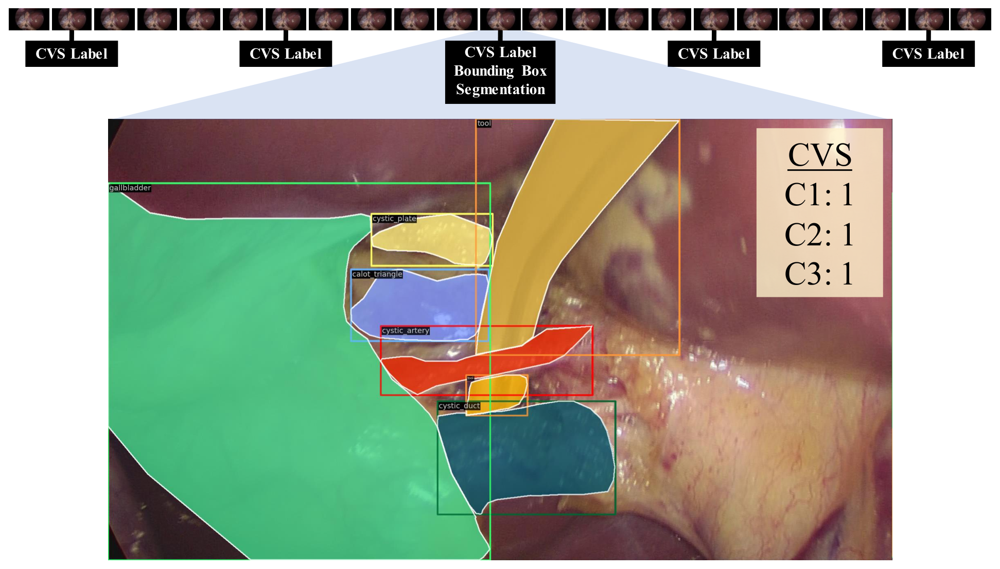
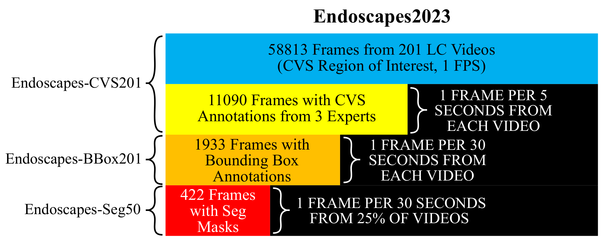
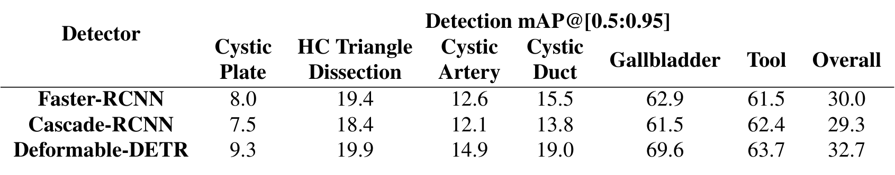
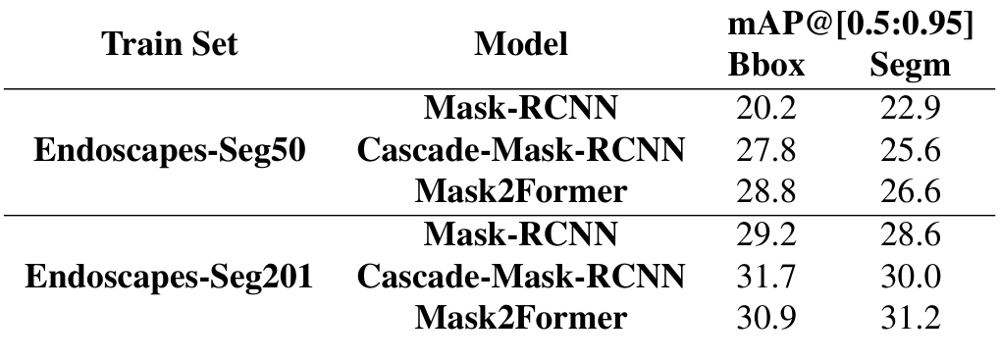
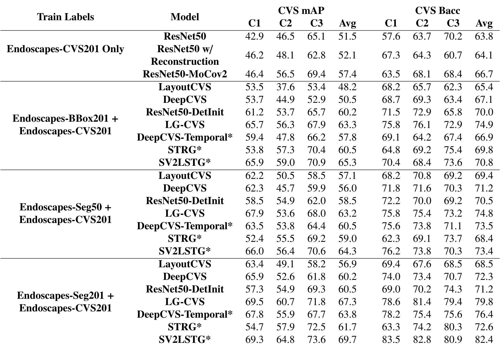

## 1. 背景与动机

**关键安全视野(CVS)的自动判断难在要看清很小、很模糊的解剖结构。** CVS 由三项准则组成:C1 两结构、C2 肝胆三角清理、C3 胆囊板。论文认为它比阶段识别、器械检测更难,因为它依赖对细粒度解剖结构的准确识别。

**作者的前作 DeepCVS 卡在数据上。** 它从 201 个视频里手选了 2854 张“可评估”图像,带有选择偏差;CVS 测试集只有 571 张,分割测试集只有 80 张,模型之间的差异很难分辨。

所以这份技术报告要解决的是:在同一批视频上,不经人工挑帧,构建一个规模足够、标注层次丰富的数据集,并给出固定划分和可比较的基线。

## 2. 核心观点速览

论文的答案是 Endoscapes2023,四个子集按同一视频划分严格嵌套:

| 子集 | 视频 | 标注帧 | 标注频率 |
|---|---|---|---|
| CVS201 | 201 | 11090 帧 CVS(三位专家) | 每 5 秒 1 帧 |
| BBox201 | 201 | 1933 帧边界框 | 每 30 秒 1 帧 |
| Seg201(私有) | 201 | 1933 帧掩码 | 每 30 秒 1 帧 |
| Seg50(公开) | 50 | 493 帧掩码(摘要写 422) | 每 30 秒 1 帧 |

全部 58813 帧来自 CVS 可评估区间,按 1fps 抽取。**基线的结论是:胆囊板和肝胆三角最难识别,借助框的图方法明显优于只用 CVS 标签的分类器,但专家之间的一致性本身就不高。**

:::highlights
- 子集嵌套共用划分,一个测试集同时服务全监督、混合监督和低标签实验
- 422 帧与 493 帧的矛盾论文未解释
:::

:::data
- 201 个视频,120/41/40 划分
- 58813 帧,11090 帧 CVS,1933 帧框
:::

接下来先看数据怎么来的,再看评测协议。

## 3. 数据怎么来的

**关键改动是把“挑帧”换成“定频抽帧”。** 抽帧区间从任一准则可评估开始,到第一次上夹结束,区间内按 1fps 抽帧。CVS 每 5 秒标 1 帧,分割每 30 秒标 1 帧,边界框从掩码自动导出,所以框和掩码天然一致。

*论文原图编号：Fig. 2。一段视频中的标注频率示意:每隔若干帧有 CVS 标签,少数帧同时带框和掩码,其余帧无标注。*

去掉手选后,标注员会遇到大量难判断的帧,作者为此制定了更严格的标注协议并多轮复核。视频划分以视频级 CVS 达成为分层变量,按患者切分。Seg50 再从三折中分层抽出 30/10/10 个视频。

*论文原图编号：Fig. 3。Endoscapes2023 的组成与各子集的标注频率。注意图中 Seg50 写的是 422 帧。*

视频来自几个中心、什么设备、患者信息和伦理审批,论文未说明,这限制了对跨中心泛化的判断。

## 4. 标签有多可靠

**三位专家独立标注 CVS,真值是多数投票,但他们之间的一致性只有一般到中等。** 各准则的 `Cohen's kappa` 为两结构 `0.33`、肝胆三角 `0.53`、胆囊板 `0.44`,总体 `0.38`。kappa 是在全部帧还是子集上算的,论文未说明。

我的判断:真值本身带噪声,模型分数的上限会被压低,但压低多少论文未说明,也没有用单个专家标签训练的对照。

**正样本极少。** 帧级总体 CVS 达成率在训练、验证、测试集上只有 `5.3%`、`7.3%`、`7.7%`,视频级则是 `28.3%`、`36.6%`、`35.0%`。视频级只要求每项在某一帧达成过,所以高得多。测试集帧级比率普遍高于训练集,例如两结构 `24.0%` 对 `15.6%`,其影响论文未说明。

:::data
- kappa 总体 0.38
- 帧级总体达成率 5.3% 到 7.7%
:::

这么不平衡的标签决定了评测协议的选择。

## 5. 评测协议

**CVS 预测用平均精度和平衡准确率,不用准确率。** 全输出 0 的分类器在这种不平衡下准确率会很高,在平衡准确率上每个准则只能拿到一半。指标在测试集全部帧上逐准则计算,再对三项取平均。

$$\mathrm{mAP}_{\mathrm{CVS}}=\frac{1}{3}\sum_{c\in\{C1,C2,C3\}}\mathrm{AP}_c$$

检测和分割用 COCO 风格的 `mAP@[0.5:0.95]`。CVS 预测分三种训练标签:只用 CVS、加框、加公开掩码,另列私有掩码结果作为天花板。前两种结果引自作者前作 [9][8],第三种由作者重跑。

训练用 `mmdetection`,CVS 模型用按逆频率加权的二值交叉熵。判定阈值、学习率、批大小、输入分辨率,论文未说明。

## 6. 检测与分割结果

*论文原图编号：Table 2。三种检测器在 BBox201 测试集上的逐类与总体 mAP@[0.5:0.95]。*

**差距在类别之间,而不在模型之间。** 总体最好的 `Deformable-DETR` 为 `32.7`。胆囊和器械在 `61.5` 到 `69.6`,胆囊板只有 `7.5` 到 `9.3`,肝胆三角 `18.4` 到 `19.9`。所以总分主要由容易的大目标撑起,不能代表对 CVS 关键结构的识别能力。

*论文原图编号：Table 6。实例分割模型分别用公开掩码与私有掩码训练后的框与掩码 mAP。*

训练掩码从 1212 帧降到 343 帧后,掩码平均精度下降 `4.4` 到 `5.7` 个点(自算)。逐类看,胆囊板掩码平均精度只有 `1.7` 到 `6.5`。Seg50 测试集里肝胆三角只出现在 `9.5%` 的帧中,这类分数很可能落在噪声内。

:::highlights
- 胆囊板、肝胆三角是最难的两类,也是 CVS 最依赖的结构
:::

## 7. CVS 预测结果

*论文原图编号：Table 7。四种训练标签设置下各方法的逐准则与平均 mAP、bAcc。*

| 方法 | 仅 CVS | 加框 | 加公开掩码 | 加私有掩码 |
|---|---|---|---|---|
| ResNet50 | 51.5 | — | — | — |
| ResNet50-MoCov2 | 57.4 | — | — | — |
| LayoutCVS | — | 48.2 | 57.1 | 56.9 |
| LG-CVS | — | 63.3 | 63.2 | 67.3 |
| SV2LSTG* | — | 65.3 | 64.3 | 69.7 |

(平均 mAP,星号为时空方法。)

**对象级图方法领先。** 有框时 `LG-CVS` 和 `SV2LSTG` 达到 `63.3` 和 `65.3`,只把布局图交给卷积网络的 `LayoutCVS` 反而低于纯 `ResNet50`。换成公开掩码后,布局类方法明显提升,图方法基本持平,原因论文未说明。用私有掩码时 `SV2LSTG` 平均精度 `69.7`、平衡准确率 `82.4`。

**低标签时选哪些视频很重要。** 只用 25% 训练视频时,`ResNet50` 平均精度 `40.5 ± 7.0`,`MoCov2` 初始化为 `48.8 ± 3.2`;12.5% 时分别为 `33.8 ± 4.1` 与 `38.9 ± 5.6`。这是全文唯一带方差的结果。

:::data
- SV2LSTG 加框 65.3,加私有掩码 69.7
- 25% 标签 MoCov2 48.8 ± 3.2
:::

这些数字看起来支持论文的主张,下一节检查它们没有证明什么。

## 8. 结果没有证明什么

**无选择偏差只部分成立。** 抽帧不再人工挑选,但区间的起止点仍由人判定,偏差可能只是从挑帧移到了挑区间。区间判定的一致性和新旧测试集上的对比,论文未说明。

**图方法的增益来源没有分开。** `LG-CVS` 比 `LayoutCVS` 高 `15.1` 个点(自算),但用检测器骨干初始化的 `ResNet50-DetInit` 已有 `60.2`,增益可能主要来自更好的视觉特征。去掉图中边的消融论文未说明。

**天花板差距没有排除方差。** 私有掩码与公开掩码的差距可能部分来自单次运行和小测试集。除低标签外,所有结果的方差论文未说明。

**分层标注模拟真实成本只是定性说法。** 标注时长或成本数字论文未说明。

## 9. 和其他数据集的关系

相对 DeepCVS,同样的 201 个视频,CVS 帧从 2854 张变为 11090 帧,掩码从 402 张变为 1933 帧(公开 493 帧),并去掉了手选。引用中列出了 Cholec80-CVS 等同领域工作,但正文没有比较规模或结果,优劣论文未说明。

## 10. 复现要注意什么

- 用官方 120/41/40 划分和公开的低标签三组划分;Seg50 的 30 个训练视频等于 25% 子集的第三折。
- 以仓库实际文件确认 Seg50 是 422 帧还是 493 帧。
- CVS 指标按逐准则在全部测试帧上计算再平均,训练时按逆频率加权。
- 检测和分割的总体分数按表 2 核算是 6 类算术平均(自算),汇报时同时给逐类结果。

## @takeaways
- Endoscapes2023 是有固定划分、嵌套子集和统一指标的 CVS 基准,四个子集共用 120/41/40 视频划分
- 不平衡多标签任务用平均精度和平衡准确率,不用准确率
- 关键解剖结构(胆囊板、肝胆三角)的识别是主要瓶颈

## @strengths
- 定频抽帧去掉了手选帧,标注节奏清楚
- 三位专家独立标注并公开一致性
- 框从掩码导出,子集严格嵌套,低标签划分随数据集公开

## @weaknesses
- 摘要与正文的掩码帧数不一致(422 对 493),论文未解释
- 私有 Seg201 的天花板结果外部无法复现
- 基线几乎都来自作者团队前作,没有消融,除低标签外没有方差
- 采集中心、设备、患者信息论文未说明

## @questions
- 用单个专家标签或投票比例作软标签训练,结果会怎样?
- 去掉 LG-CVS 中的关系边,增益还剩多少?
- 在 Cholec80-CVS 上测试 Endoscapes 训练的模型,差距有多大?
