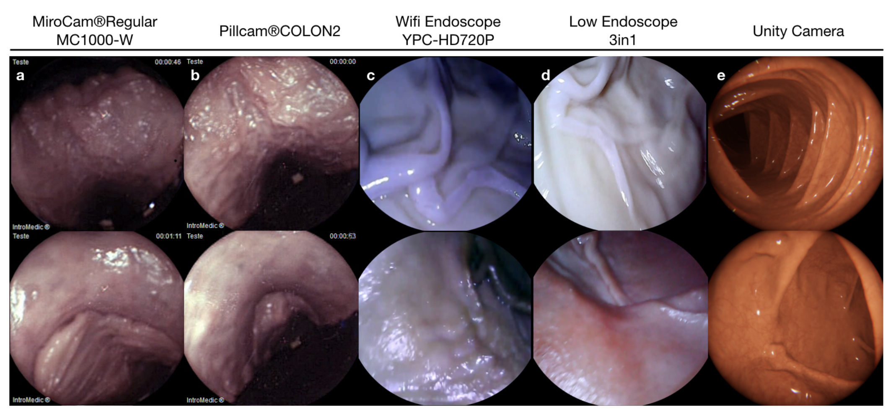
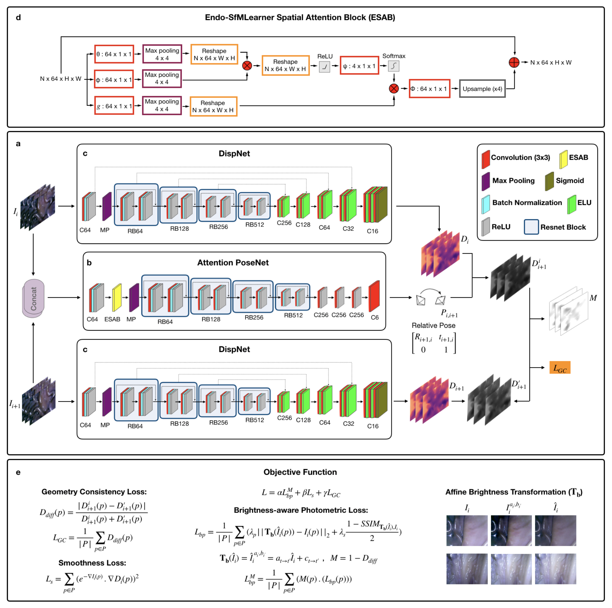
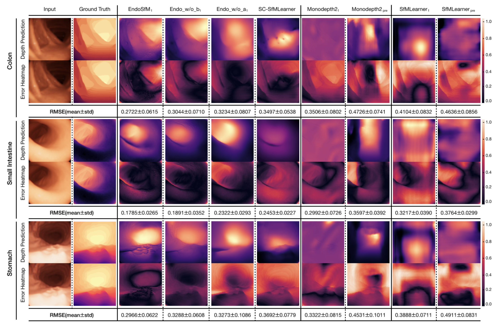

## 1. 背景与动机

胶囊内镜是小肠检查的首选手段。医生在胶囊画面里看到病灶后，第一个问题是“它在哪里”。射频、电磁、X 射线定位都要额外硬件，**只靠胶囊自己的视频做定位和建图**，是更轻的路线，也是未来能活检、给药的主动胶囊所需要的。

这条路卡在两处。一是没有能打分的公开数据：作者整理的既有内镜数据集几乎都面向分割和分类，没有相机轨迹和器官形状真值。二是通用自监督方法假设相邻帧亮度不变，而内镜光源随相机移动，这个假设在内镜里经常不成立。

所以论文要先造一个考场，再给出一个考生。

## 2. 核心观点速览

- **数据**：机械臂夹持四种相机，在八个离体猪器官上录制 35 个子数据集、共 42,700 帧，每帧有 6D 位姿；六个器官有三维扫描；另有 Unity 合成帧带逐像素深度。
- **协议**：相机内参、手眼变换和时间同步三步，把 1kHz 的机器人位姿对到图像帧上。
- **方法**：Endo-SfMLearner 在 SC-SfMLearner 上加一个注意力块和一个亮度对齐，只用 2,039 张合成结肠图训练。
- **结果**：真实轨迹上旋转误差相对 SC-SfMLearner 全部降到一半以下；合成深度和三例三维重建误差也最低。
- **边界**：器官固定在泡沫上，没有蠕动；方法结果是单次训练；深度只在合成域评测。

:::highlights
- 这个数据集的新东西是真值类型：连续相机轨迹加器官三维形状。
- 方法上最大的差距来自几何一致性损失，两项新改动主要改善旋转。
:::

## 3. 数据是怎么采的

器官清洗后缝在高密度泡沫上：结肠用 L 形、小肠用 Z 形、胃用 O 形支架，在暗室录制。**相机装在机械臂末端，但轨迹由人手推动**，所以每条轨迹的速度和加速度都不同。

四台相机特性差别很大：MiroCam 是 320×320、3 fps 的胶囊；PillCam 是双头胶囊；两台常规内镜相机分别是 1280×720 和 640×480，都是 20 fps。形状真值来自两台扫描仪，点精度为 ±0.1 mm 和 ±0.05 mm。

*论文原图编号：Figure 2。四种真实相机与 Unity 虚拟相机的样例帧，色调、畸变和亮度差异一目了然。*

合成部分来自 VRCaps：结肠 21,887 帧、小肠 12,558 帧、胃 1,548 帧，每帧有深度真值。

:::data
- 离体 42,700 帧：HighCam 21,428、LowCam 17,978、MiroCam 3,055、PillCam 239
- 子数据集：结肠 18、胃 12、小肠 5
- 三维扫描文件共 23.2 GB
:::

**数据有了，下一个问题是真值靠不靠得住。**

## 4. 真值怎么对齐到图像

机器人记录的是末端位姿，图像是另一个坐标系、另一个时钟。论文用三步解决：

1. **内参**：棋盘标定，拟合带径向畸变的针孔模型，附录还给了鱼眼模型。
2. **手眼变换**：Tsai-Lenz 方法求末端到相机的刚体变换。
3. **时间同步**：相机大体沿光轴前进，图像光流的散度与前进速度相关；把它和机器人速度做相关，找到每条序列的起始对应。

**论文给了每一步的过程和结果，但没有给出位姿真值在图像帧上的综合误差。** 机械臂 0.1mm 的精度只是下限。

## 5. 考生：Endo-SfMLearner

它联合训练一个深度网络和一个位姿网络，不用任何标签。核心是两处改动：

- **亮度对齐**：比较合成图和目标帧之前，先用 $a\hat I + c$ 把亮度调一致，再算 L2 和 SSIM。
- **注意力块 ESAB**：位姿网络第一层后加一个非局部注意力，让它关注纹理丰富的区域。

尺度一致靠沿用的几何一致性损失：把一帧深度投影到相邻帧再比较。

*论文原图编号：Figure 4。两个深度网络、中间的注意力位姿网络和三项损失的完整数据流。*

有两处细节需要留意。正文说不一致像素会“加权”，但公式 $M = 1 - D_{diff}$ 实际是降权。五个损失权重和仿射参数由谁预测，论文未说明。

训练只用 2,039 张合成结肠图，200 个 epoch，学习率 10−4。**所有方法都只见过合成结肠，真实轨迹上的结果同时混入了方法能力和域差。**

## 6. 结果说了什么

位姿实验覆盖五条轨迹、两台常规相机，共十个单元：

| 对比 | 结果 |
|---|---|
| 旋转 RPE vs SC-SfMLearner | 十个单元全部降到一半以下 |
| ATE vs SC-SfMLearner | 八个单元更低 |
| ATE vs Monodepth2 | 十个单元全部更低 |

例如 Colon-IV 第一条轨迹（高分辨率相机），完整模型 ATE 0.0878 m、旋转 0.488 度；SC-SfMLearner 是 0.1545 m 和 1.3532 度。

**旋转改善稳定，ATE 优势只是多数成立。**

深度在合成域：完整模型结肠、小肠、胃的 RMSE 为 0.2722、0.1785、0.2966，三个器官都最低。三维重建三例中，完整模型 RMSE 为 0.51、0.40、0.41 cm，低于 SC-SfMLearner 和规则方法。

*论文原图编号：Figure 6。合成三器官的深度预测与误差热图；KITTI 预训练模型带着道路场景的先验。*

:::data
- Stomach-III 高分辨率相机：SC-SfMLearner ATE 0.0898 低于完整模型 0.1177
- 三维重建 Colon-IV：0.51 / 0.86 / 0.65 cm
:::

## 7. 为什么有效，哪里存疑

**这个基准上最大的差距来自尺度约束。** 没有几何一致性损失的 SfMLearner 和 Monodepth2 几乎跟不住轨迹，带这项损失的两种方法都能跟住形状。两项新改动是在此之上的增量。

旋转改善的幅度足够大，单次训练下也有说服力。ATE 差距多在几厘米内，而且部分单元里消融变体反而更好；作者也承认消融解释不了 Stomach-III。

我的判断：这些结论能说明“亮度对齐加注意力对旋转有帮助”，还不能说明两者各自的稳定贡献。

## 8. 结果没说什么

- **在体表现。** 器官固定在泡沫上，没有蠕动和呼吸，相机在摊开的表面上方移动，而不是在闭合管腔中前进。
- **真实域深度。** 深度只在合成帧上评测；三个合成器官共用同一渲染器，测到的是渲染内泛化。
- **稳定性。** 没有多次训练、方差或显著性检验。
- **重建一般性。** 每个器官只有一例，对齐依赖手工标注线段。

区分这些解释的实验都不难：用扫描点云按位姿渲染每帧深度、在真实帧上评测，或用多随机种子重跑表 2。论文没有做。

## 9. 复现与使用要注意什么

- 没有官方划分，按器官划分可以避免同一器官泄漏到训练和测试。
- 两台常规相机的“同名轨迹”长度不同，并不是同一路径。
- PillCam 只有 239 帧，论文没有用它做任何位姿实验。
- 图 5 的胶囊列，表头写小肠、图注写第三段结肠；扫描结肠的编号在不同图表中不一致。
- 报告时同时给 ATE 和旋转 RPE，并检查预测是否退化成直线。

## @takeaways
- EndoSLAM 是少有的带胶囊内镜位姿和器官三维真值的数据，但它是刚性离体基准。
- Endo-SfMLearner 的可靠收益在旋转误差；ATE 优势不是全胜。
- 只看旋转 RPE 会被“几乎不转”的预测骗到。

## @strengths
- 四种相机、八个器官、三维扫描和合成数据放在同一套坐标里，标定与同步过程写得完整。
- 亮度仿射对齐成本很低，容易迁移到其他光源随相机移动的场景。
- 作者如实报告了 SC-SfMLearner 更好的单元和无法解释的消融。

## @weaknesses
- 离体、无形变、手引导轨迹，难度与在体差距大。
- 方法实验为单次训练，超参数缺失，掩码的文字与公式矛盾。
- 深度只在合成域评测，三维重建只有三例。

## @questions
- 位姿真值在图像帧上的综合误差是多少？
- 仿射亮度参数由网络哪一部分预测，损失权重取多少？
- 在真实离体帧上用扫描渲染的深度评测，完整模型的优势是否还在？
