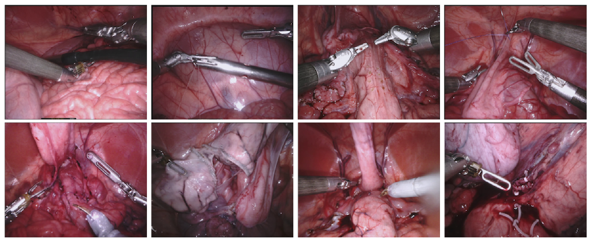
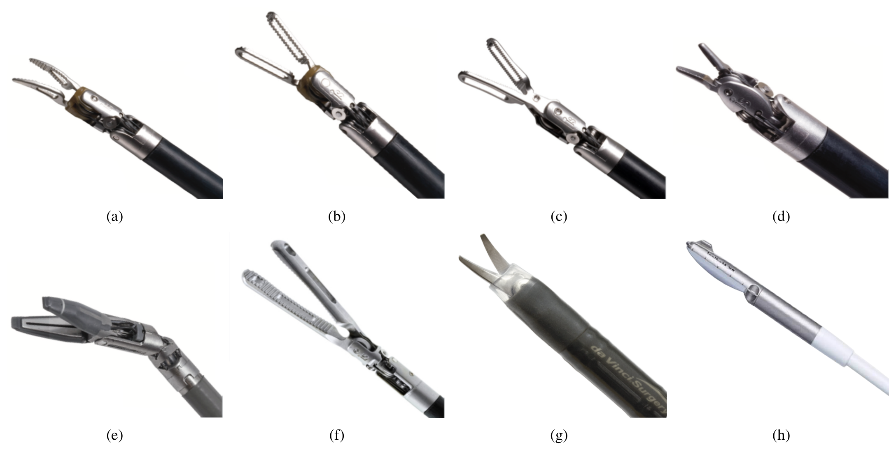
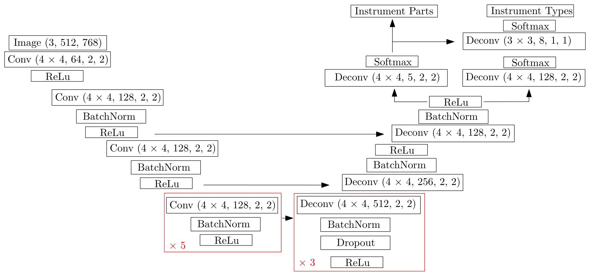
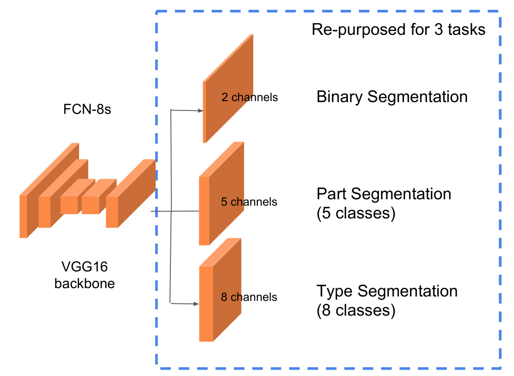
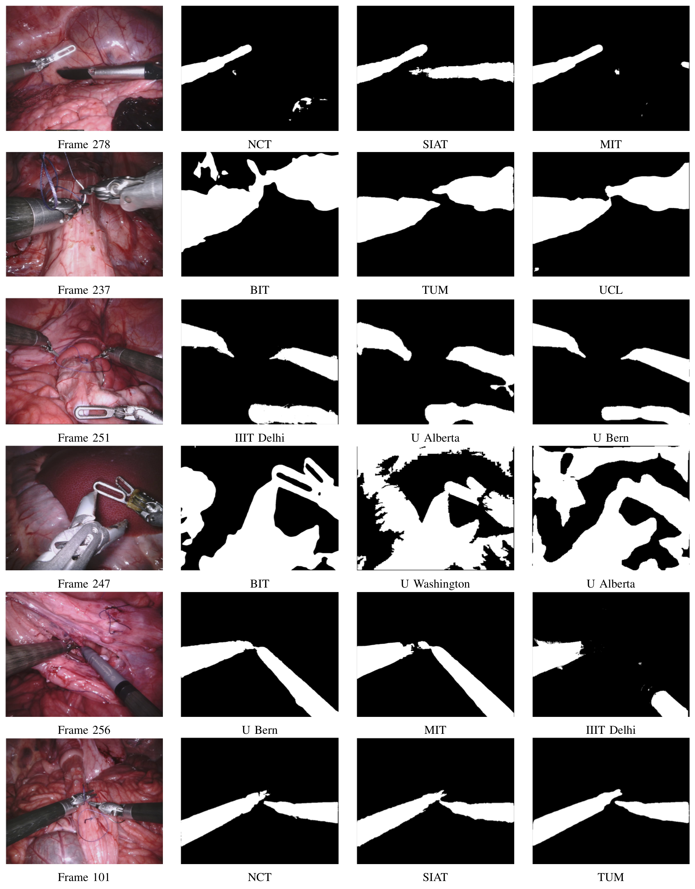
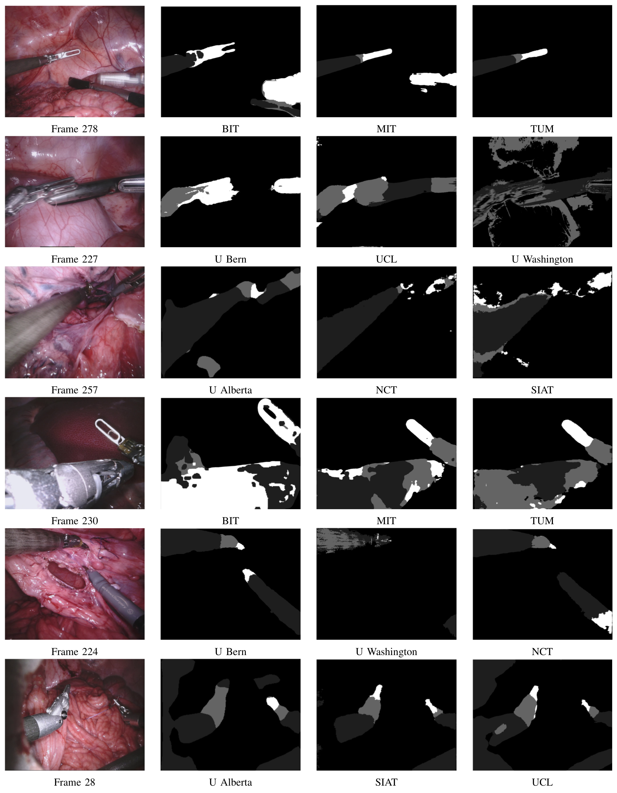
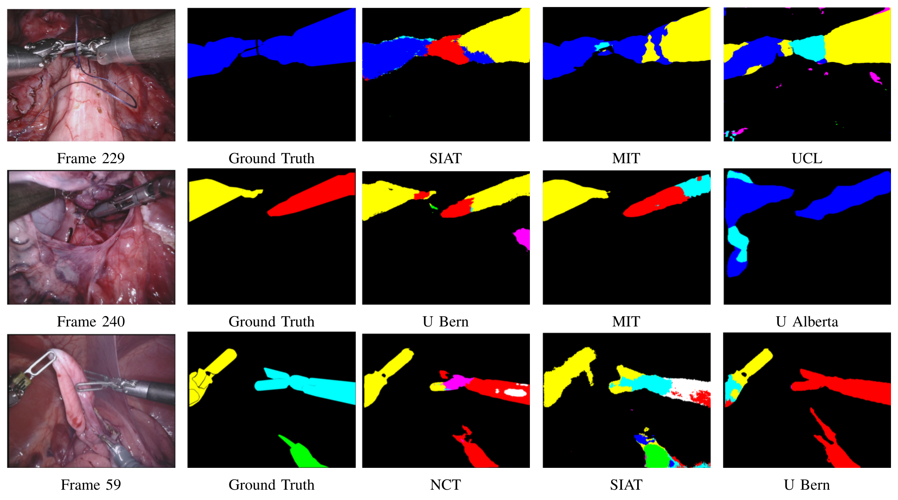
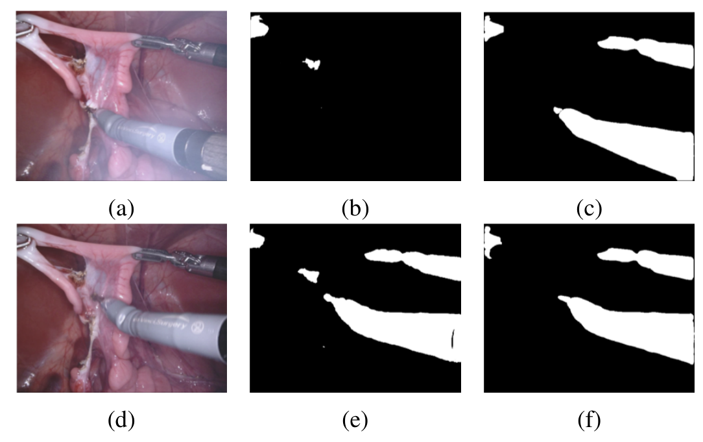

---
tags:
  - papers/手术数据集
aliases:
  - "EndoVis 2017"
  - "EndoVis17 Robotic Instrument Segmentation"
date: 2019-02-18
arxiv_id: "1902.06426"
---

# 2017 Robotic Instrument Segmentation Challenge

## 核心信息

- 标题: 2017 Robotic Instrument Segmentation Challenge
- 标题翻译: 2017 年机器人手术器械分割挑战赛
- 作者: M. Allan, A. Shvets, T. Kurmann, Z. Zhang, R. Duggal, Y.H. Su, N. Rieke, I. Laina, N. Kalavakonda, S. Bodenstedt, L.C. Garcia-Peraza-Herrera, W. Li, V. Iglovikov, H. Luo, J. Yang, D. Stoyanov, L. Maier-Hein, S. Speidel, M. Azizian
- 机构: Intuitive Surgical；MIT；伯尔尼大学；阿尔伯塔大学；佐治亚理工学院；华盛顿大学；NVIDIA；德累斯顿国家肿瘤疾病中心（NCT）；伦敦大学学院（UCL）；Lyft；中科院深圳先进技术研究院；北京理工大学；慕尼黑工业大学；德国癌症研究中心；伦敦国王学院
- 发表时间: 2019-02-18（arXiv 第 2 版 2019-02-21）
- 发表渠道: arXiv 预印本（cs.CV），挑战赛结果于 MICCAI 2017 公布
- arXiv: 1902.06426
- 论文链接: https://arxiv.org/abs/1902.06426
- 代码 / 项目: 参赛队伍公开代码 https://github.com/tkurmann/endovis2017_unibe （UB）；https://github.com/ternaus/robot-surgery-segmentation （MIT）；https://github.com/duggalrahul/MICCAI17_EndoVis_RoboSeg （IIIT Delhi）
- 数据 / 资源: https://endovissub2017-roboticinstrumentsegmentation.grand-challenge.org
- 论文类型: benchmark_or_dataset

## 原文摘要翻译

在主流计算机视觉和机器学习中，`ImageNet`、`COCO` 和 `KITTI` 等公开数据集让研究者能通过性能比较理解不同算法的优势和局限，从而推动了巨大的进步。然而，这种做法在机器人辅助手术问题上的转化有限，因为该领域从未建立起同等水平的公共数据集和基准方法。2015 年，`EndoVis` 研讨会引入了一个子挑战，提供一组机器人图像，其标注由机器人正向运动学自动生成。但该数据集存在背景变化有限、缺少复杂运动以及标注不准确等问题。本文报告 2017 年机器人器械分割挑战赛的结果，共有 10 支队伍参加，任务是对铰接式 da Vinci 机器人器械做二值分割、部件分割和类型分割。

## 创新点

1. **把标注从运动学自动生成换成人工逐帧多边形。** 2015 年的数据靠 `dVRK` 正向运动学投影出掩码，线缆驱动关节带来明显偏移。2017 年改由 Intuitive Surgical 的专门团队用 `Viame` 逐帧画多边形，标签与图像中的器械轮廓直接对齐。
2. **背景来自 10 段独立的猪腹腔手术。** 每段是一次 da Vinci Xi 猪肾切除类腹部手术，比 2015 年的单一背景更多样，并同时提供双目图像和相机标定。
3. **同一套数据上设三级任务。** 二值分割（器械/背景）、部件分割（轴、腕、夹钳）、类型分割（区分器械型号），难度逐级上升，可以分别观察分割能力和识别能力。
4. **公开了 10 支队伍逐数据集的完整结果。** 表 I 到表 VI 给出每支队伍在每段测试数据上的 mean IoU，部件任务还按轴、腕、夹钳拆开，并附数据增强对照表和失效案例。这些细粒度结果比单一排行榜更能看出方法差异。

## 一句话总结

`EndoVis 2017` 用 10 段猪腹腔 da Vinci Xi 手术、共 3000 帧的人工标注建立了器械二值、部件、类型三级分割基准；二值任务最佳 mean IoU 为 0.888，部件为 0.751，类型只有 0.542，但数据规模小、测试帧与训练帧部分来自同一序列，排名对这种切分和加权方式敏感。

## 研究问题

**机器人手术里的器械分割一直缺一个可信的公共考场。** 在 da Vinci 这类平台上，很多辅助功能依赖对场景的理解，器械分割是其中的基础部件。论文给出两个用途：器械跟踪算法常以分割为起点，进而支撑自动化和引导；把 3D 影像叠加成增强现实画面时，需要知道哪些像素是器械，才能避免叠加层盖住器械（图 1）。

方法已经从朴素贝叶斯、`SVM` 等经典学习转向深度 `CNN`，性能提升明显。但领域缺少公共的数据和验证集，方法之间难以比较，也限制了训练更大的网络。2015 年的 `EndoVis` 器械分割子挑战包含一个机器人器械部分，被后续工作大量使用，却有两个问题：背景变化少；真值由 `dVRK` 正向运动学投影生成，线缆驱动关节带来明显偏移，掩码与图像错位。

所以 2015 年数据上的高分，既可能来自模型，也可能来自背景单一和标签偏移。2017 年的挑战针对这些问题做了三点改进：用人工标注替代自动标注以提高标签质量；用 10 段不同手术增加背景变化；提供器械部件和类型标签。论文的核心问题因此是：在一个人工标注、背景更多样的机器人手术数据集上，当时的方法在二值、部件、类型三级任务上能做到什么程度，以及这个数据集和评测设计本身有哪些缺陷。

### 核心观点速览

- **数据换了做法。** 10 段猪腹腔 da Vinci Xi 手术，每段 300 帧、1 Hz 采样，共 3000 帧，其中 1800 帧训练；标签由人工逐帧画多边形，只标左眼。
- **任务分三级。** 二值分割已较成熟：MIT 总分 0.888，5 支队伍超过 0.8。部件分割 TUM 总分最高（0.751）。类型分割最难，最佳 MIT 只有 0.542，仅 6 支队伍参加。
- **排名受评测口径影响。** 部件任务 MIT 赢下 7 段数据，TUM 却因数据集 9、10 权重大而总分第一。正文写二值最佳为 0.854，表 I 是 0.888，两处矛盾。
- **边界作者大多承认了。** 数据小、器械出现频率不代表真实分布、单人标注、夹钳孔洞没标、8 段测试数据与训练数据同序列。论文没有给出排名的置信区间，也没有任何消融。

下一节先看数据从哪来、怎么切分，因为后面所有分数的含义都取决于这一点。

## 数据与任务定义

这一节回答：考场里有什么，考生能看到什么。

### 数据来源

数据来自 10 段用 da Vinci Xi 系统录制的猪腹腔手术。作者从每段手术中挑选器械运动明显、可见度高的活跃片段，以 1 Hz 采样 300 帧；若器械连续几帧不动，就手动删掉这些帧并向后延长片段，保证恰好 300 帧。每帧提供 Xi 双目相机的左右眼图像和相机标定，便于参赛者把立体重建当作特征。

数据中有 7 种机器人器械，下表给出英文原名和本笔记使用的中文名。其中超声探头是插入式（drop-in）器械，通常夹在 Prograsp 抓钳的钳口中。

| 原名 | 本笔记用名 |
|---|---|
| Large Needle Driver | 大号持针器 |
| Prograsp Forceps | Prograsp 抓钳 |
| Monopolar Curved Scissors | 单极弯剪 |
| Cadiere Forceps | Cadiere 抓钳 |
| Bipolar Forceps | 双极镊 |
| 血管闭合器 | 血管闭合器 |
| drop-in ultrasound probe | 超声探头 |

*论文原图编号：Fig. 2。数据集 1 到 8 的训练样例帧。放在这里是因为它展示了 10 段手术之间的背景差异：组织形态、出血、缝线、超声探头和白色夹子在不同段中出现，这正是 2017 年相对 2015 年想补足的背景变化。*

### 任务拆分

| 子任务 | 定义 | 参赛队伍数 |
|---|---|---|
| 二值分割 | 每帧分成 da Vinci Xi 器械与背景；背景包括超声探头、手术夹和猪组织 | 10 |
| 部件分割 | 把器械进一步分成轴（shaft）、腕（wrist）、夹钳（clasper/jaws） | 9（IIIT Delhi 未参加） |
| 类型分割 | 分割并识别器械型号 | 6 |

部件标注有一个约定：单极弯剪带绝缘护套，看不到腕部，作者把整个护套都标成轴。

类型任务把外观相近的 Maryland 双极镊和开窗双极镊合并为一个双极镊标签；超声探头出现在数据中，但不作为器械标注。

结果部分列出的类型是大号持针器、Prograsp 抓钳、单极弯剪、血管闭合器、开窗双极镊和抓持牵开器（Grasping Retractor）。它与数据收集部分列出的器械不完全一致：前者有抓持牵开器而没有 Cadiere 抓钳。两处差异论文未说明。

*论文原图编号：Fig. 4。类型任务涉及的器械，按子图顺序依次为 Maryland 双极镊、开窗双极镊、Prograsp 抓钳、大号持针器、血管闭合器、抓持牵开器，以及第七、第八幅。原图题称第八幅是单极弯剪、第七幅是超声探头，但从画面看第七幅是剪刀、第八幅是探头，图题标号疑似写反。放在这里是因为前三幅的钳口外观非常接近，直观说明了类型任务为什么远难于分割。*

### 训练与测试切分

| 部分 | 内容 | 帧数 |
|---|---|---|
| 训练 | 数据集 1 到 8 各取前 225 帧 | 1800 |
| 测试（同序列） | 数据集 1 到 8 各取后 75 帧 | 600 |
| 测试（独立序列） | 数据集 9、10 全部 300 帧 | 600 |

**测试帧有一半与训练帧来自同一段手术。** 测试标签对参赛者隐藏。因为 8 段测试数据与训练数据来自同一序列，规则要求：评测第 $k$ 段测试数据时，不能用第 $k$ 段的训练数据。这样每支队伍至少要训练 9 个模型（8 个留一段模型加 1 个用于数据集 9、10 的模型）。为避免拥有私有手术数据的队伍占优，禁止加入额外数据；唯一例外是允许使用在公开非手术数据上预训练的 `CNN`。

### 标注协议

标注由 Intuitive Surgical 的专门分割团队完成，使用开源软件 `Viame` 逐帧画多边形。为节省时间只标双目中的左眼。标签按实例给出，每个对象一张单独的标注图。每个样本由一名受过训练的标注者完成，再由一名专家复核；论文解释这是因为标注启动延误、发布截止前时间有限。标注者间一致性、复核修改比例，论文未说明。

## 方法主线

本文没有提出自己的分割方法。它的“方法”分两层：挑战赛自身的数据构建与评测协议，以及 10 支参赛队伍各自的分割方法。前者决定了 benchmark 测什么，后者是基线。

### 机制流程

1. **选片段**：输入为 10 段 da Vinci Xi 猪腹腔手术录像；从中提取器械运动明显、可见度高的片段，以 1 Hz 采 300 帧，删除器械静止帧并顺延，输出每段恰好 300 帧的双目图像与相机标定。
2. **人工标注**：输入为每段的左眼图像；标注团队在 `Viame` 中逐帧画实例多边形，一名专家复核，输出每个对象一张实例标注图，再把实例标签编码成二值、部件、类型三套标签。
3. **切分与发布**：输入为 10 段带标签数据；数据集 1 到 8 的前 225 帧连同全部训练标签公开，后 75 帧与数据集 9、10 的标签保密，输出训练集和隐藏测试集。
4. **单次提交评测**：输入为各队对测试帧的分割结果；组织方逐帧计算 mean IoU、按数据集大小加权汇总，并在 MICCAI 2017 挑战日当天公开，输出排行榜。

### 评测协议

单类 IoU 定义为：

$$
\mathrm{IoU}=\frac{TP}{TP+FP+FN}
$$

其中 $TP$、$FP$、$FN$ 是该类的真阳性、假阳性和假阴性像素数。汇总规则如下：

- 对每一帧，取该帧中出现的所有类别 IoU 的算术平均；如果所考虑的类别在该帧一个都没有出现，这一帧不计入。
- 对每段数据，把逐帧分数平均，得到该数据集分数。
- 计算总分时，按数据集大小加权。数据集 9、10 各有 300 帧测试，是数据集 1 到 8（各 75 帧）的 4 倍，因此在总分中占很大比重。

测试标签不发给队伍，每队只提交一次，挑战日当天公布结果，所以队伍无法在测试集上反复调参。但训练集在挑战日前已完整公开，“评测第 $k$ 段时不使用第 $k$ 段训练数据”这条规则只能依赖队伍自觉遵守。

类型任务中 mean IoU 是否也对背景类取平均、预测了数据中不存在的类别时如何计分，论文未说明。

### Baseline 设置

10 支参赛方法如下（按论文编号）：

| 编号 | 队伍 | 核心结构 | 关键细节 |
|---|---|---|---|
| 1 | NCT | 残差 `CNN`，部件与类型双输出头 | 裁黑边到 (1536, 1024)，再降采样到 (768, 512)；Adam，交叉熵，200 epoch |
| 2 | UB | 级联 `FCN`，类 U-Net 编解码各 6 层 | 先做二值，再把二值掩码用于部件和类型；输入 384x384；不做外部预训练 |
| 3 | BIT | 3 个 U-Net 集成，输出融合 | 其他细节论文未说明 |
| 4 | MIT | TernausNet，U-Net 加 ImageNet 预训练 VGG11/VGG16 编码器 | 编码器与解码器块拼接跳连 |
| 5 | SIAT | SegNet，VGG16 编解码，ImageNet 预训练 | 保持长宽比补边后缩放到 (480, 270)；输出层加类别权重；SGD 学习率 0.001、动量 0.9，批大小 4，P100 上训练 12 小时 |
| 6 | UCL | ToolNet，受 HED 启发的多尺度网络 | 把原论文的 Dice 损失换成多尺度 IoU 损失，6 个尺度；实时推理 |
| 7 | TUM | CSL 的仅分割版本，ResNet-50 编码器的 `FCRN` 加长跳连 | 输入 (480, 480)；镜面高光增强；保留与图像边界相连的连通域，形态学补洞；TITAN X 上接近实时 |
| 8 | IIIT Delhi | VGG-19 前景块分类器加 `CRF` 后处理 | 在 51x51 图块上训练，只参加二值任务 |
| 9 | UA | 改造的 FCN-8s，三任务共用 | PASCAL 预训练；输入缩放到 320x256；删除小于 15000 像素的连通域；共训练 24 个模型 |
| 10 | UW | 不用机器学习：颜色阈值加 GrabCut | 按拉普拉斯响应方差估计模糊度，调整特征权重；最后用边界先验去除孤岛 |

*论文原图编号：Fig. 5。NCT 的网络：输入 (3, 512, 768)，编码端是 4x4 卷积加批归一化和激活，含一个重复 5 次的块；解码端反卷积含一个重复 3 次的块，最后分出部件（5 通道）和类型（8 通道）两个输出头。放在这里是因为它是唯一画出“部件和类型共享主干、双头输出”设计的结构图。*

两个公式值得记下。SIAT 为缓解腕部和探头类别不平衡，在 softmax 中加类别权重 $k_i$：

$$
\sigma_i(z)=k_i\,\frac{\exp(z_i)}{\sum_{j=1}^{m}\exp(z_j)},\quad i=1,\dots,m
$$

UCL 的多尺度 IoU 损失把 $M$ 个尺度的预测加权求和得到融合输出，再对融合输出和每个尺度分别算 IoU 损失：

$$
\hat y^{(\bar s)}=\sum_{j=1}^{M} w_j\,\hat y^{(s_j)},\qquad L_{\mathrm{MSIoU}}=\bar\lambda\,L_{\mathrm{IoU}}\big(\hat y^{(\bar s)},y\big)+\sum_{j=1}^{M}\lambda_j\,L_{\mathrm{IoU}}\big(\hat y^{(s_j)},y\big)
$$

其中 $w_j$ 可学习且初始化相等，$\bar\lambda$ 与 $\lambda_j$ 都设为 1，ToolNet 中 $M=6$。

*论文原图编号：Fig. 9。UA 的方案：VGG16 主干的 FCN-8s，改造出 2、5、8 通道三个输出头，分别对应二值、部件（5 类）和类型（8 类）。放在这里是因为它和图 5 一起说明，“部件 5 类、类型 8 类”的输出规模是各队共用的任务定义。*

10 支队伍里 8 支用编解码类 `CNN`，差别集中在是否预训练、输入分辨率和后处理。下一节看这些差别在分数上留下了什么。

## 关键结果

这一节回答：三级任务的难度差多少，名次有多稳。

### 基线表现

三项任务的总分（按数据集大小加权的 mean IoU，取自表 I、II、VI）：

| 队伍 | 二值 | 部件 | 类型 |
|---|---|---|---|
| NCT | 0.843 | 0.699 | 0.409 |
| UB | 0.875 | 0.700 | 0.453 |
| BIT | 0.326 | 0.289 | 未参加 |
| MIT | **0.888** | 0.737 | **0.542** |
| SIAT | 0.803 | 0.667 | 0.371 |
| UCL | 0.785 | 0.623 | 0.337 |
| TUM | 0.873 | **0.751** | 未参加 |
| IIIT Delhi | 0.612 | 未参加 | 未参加 |
| UA | 0.591 | 0.578 | 0.346 |
| UW | 0.461 | 0.357 | 未参加 |

二值任务中 5 支队伍（NCT、UB、MIT、SIAT、TUM）总分超过 0.8。

总分前三名之间只差 0.015。**一次提交、没有方差，这么小的差距不足以排出可靠名次。**

逐数据集最高分由 MIT 拿下 6 段、UB 拿下 3 段、TUM 拿下 1 段。最难的是数据集 1，所有队伍的平均只有 0.589，但 UB 和 MIT 仍在 0.8 以上。作者指出难点在于超声探头和缝针的外观、颜色与器械接近。

正文写“最高均值是 MIT 的 0.854”，但表 I 中 MIT 的总分是 0.888，0.854 是 MIT 在数据集 1 上的分数。我按表中逐数据集分数和 75、300 帧的权重重算，MIT 约为 0.888，与表一致，正文的 0.854 应是笔误。

*论文原图编号：Fig. 10。二值任务的定性结果，6 行依次来自数据集 1、3、4、7、8、10，每行是原图加随机抽取的 3 个方法输出。放在这里是因为第一行（数据集 1 第 278 帧）显示：三个总分都超过 0.8 的方法对超声探头的处理差别很大，其中 SIAT 在画面中右部多分出一条长形前景，NCT 和 MIT 没有；第四行（数据集 7，血管闭合器与复杂光照）各方法差异最明显。*

### 部件分割：加权方式改变了名次

部件任务中 TUM 总分最高（0.751），但 MIT 在 10 段数据中赢了 7 段。原因是总分按数据集大小加权，数据集 9、10 的测试帧是其他段的 4 倍，而 TUM 在这两段分别得到 0.736 和 0.807，均为最高。我按表 II 对 10 段等权平均重算，MIT 约为 0.756，TUM 约为 0.738，名次会反过来。**这说明总分更奖励在两段独立测试序列上的表现，逐段获胜次数更奖励在同序列测试段上的表现。**

部件任务按类别拆开的总分（表 III 到表 V）：

| 队伍 | 轴 shaft | 腕 wrist | 夹钳 clasper |
|---|---|---|---|
| NCT | 0.727 | 0.578 | 0.503 |
| UB | 0.751 | 0.551 | 0.507 |
| BIT | 0.188 | 0.005 | 0.034 |
| MIT | 0.786 | 0.625 | 0.542 |
| SIAT | 0.729 | 0.495 | 0.460 |
| UCL | 0.676 | 0.449 | 0.384 |
| TUM | **0.822** | **0.634** | **0.556** |
| UA | 0.660 | 0.396 | 0.288 |
| UW | 0.373 | 0.074 | 0.060 |

三个部件的难度依次上升：轴最大、最容易，夹钳最小、最难。即便是 TUM，夹钳也只有 0.556。夹钳正是抓持、缝合时与组织接触的部位，对下游跟踪和姿态估计最有用，也是当时最不可靠的部分。数据集 8 的夹钳分数整体极低，所有队伍平均只有 0.134，最高的 MIT 也只有 0.314；数据集 5 次之，平均 0.195。论文未说明这两段为什么难。

一个口径问题：TUM 三个部件的分项总分是 0.822、0.634、0.556，三者平均约 0.671，低于部件总分 0.751。如果总分只是三个部件 IoU 的逐帧平均，两者应当接近，说明总分可能还计入了背景类，或采用了不同的帧筛选方式，论文未说明。

另外，表 III 到表 V 的图题都写着“对所有类别取平均的 mean IoU”，与它们只报告单个部件的内容不符，像是沿用了表 II 的图题。

*论文原图编号：Fig. 11。部件任务的定性结果，6 行依次来自数据集 1、2、5、7、8、10，灰度深浅对应轴、腕、夹钳。放在这里是因为第四行（数据集 7 第 230 帧）显示了作者提到的血管闭合器问题：三个方法在整根轴上都出现了混乱的部件标签；第二行华盛顿大学的输出把大片组织纹理也标成器械。*

### 类型分割：形状对了，类别错了

类型任务只有 6 支队伍参加，作者认为原因是区分多种 da Vinci 器械的难度大幅上升。

MIT 总分最高（0.542），赢下 7 段；SIAT、NCT、UB 各赢 1 段。

逐数据集波动极大：数据集 1 上最高只有 MIT 的 0.177，数据集 3 上 NCT 达到 0.926；数据集 7 所有队伍平均 0.215，TUM 未参加，UA 为 0.000。**同一方法在不同段之间的波动，比不同方法之间的差距还大**，类型任务的总分因此很难代表方法的稳定能力。

*论文原图编号：Fig. 12（原图题误写为 Quantitative Results，实为定性结果）。3 行依次来自数据集 3、5、9，每行是原图、真值和 3 个方法输出，颜色代表器械类型。放在这里是因为它说明类型任务的主要失败方式：掩码轮廓大多准确，但同一根器械常被整段或分段标成错误类型，例如第三行真值中一青一绿两把器械，被 U Bern 都标成了红色。*

### 失败或不稳定设置

- **非学习方法差距明显。** UW 的颜色阈值加 GrabCut 方案二值总分 0.461，部件的腕和夹钳分别只有 0.074 和 0.060。作者没有把它当作失败，它本来就是为了测试“不用学习能走多远”。
- **BIT 的结果反常。** BIT 用 3 个 U-Net 集成，但二值总分只有 0.326、腕 0.005，远低于同类结构的其他队伍。原因论文未说明，表 VII 中这支队伍的数据增强也是问号；我的推断是，这更像提交或实现问题，而不是该结构路线本身的上限。
- **薄烟雾导致整体失效。** 图 13 显示，在单极弯剪产生的一层薄烟中，UB 的二值分割几乎全部失败，TUM 基本正常；烟雾散去后的下一帧两者都正常。UB 和 TUM 二值总分接近（0.875 对 0.873），但鲁棒性差距在排行榜上完全看不出来。

这些失败模式说明排行榜只覆盖了数据里有的场景。下一节讨论排行榜背后的原因和它测不到的东西。

## 深度分析

这一节回答：分数差异能归因到什么，这个考场测到了什么、漏了什么。

### 设计选择与结果模式

| 设计选择 | 对应的结果模式 | 证据强度 |
|---|---|---|
| ImageNet 预训练 VGG 编码器的 U-Net（MIT） | 二值和类型总分第一，类型赢 7 段 | 只有相关；没有同网络无预训练的对照 |
| 镜面高光增强、保留与边界相连的连通域（TUM） | 部件总分第一，数据集 9、10 最高 | 作者称增强有改善，但没有给出提升幅度 |
| 先二值再部件的级联（UB） | 二值总分 0.875，但在薄烟帧上整体失效 | 单帧定性证据（图 13） |
| 颜色阈值加 GrabCut（UW） | 二值 0.461，腕和夹钳接近 0 | 与学习方法差距大，方向明确 |

**这张表里没有一行有消融支撑**，参赛队伍的配置同时在骨干、预训练、增强和后处理上不同，挑战赛本身无法把分数差异归因到单一设计。另一种解释是：领先主要来自 ImageNet 预训练这一外部先验，加上一次提交的偶然性。

### 为什么二值任务分数高而类型任务低

二值任务只需区分金属器械和粉红色组织，颜色和纹理差异明显，主要难点集中在外观相似的超声探头、缝针和血管闭合器上。

ImageNet 预训练的编码器（MIT、SIAT）或从头训练的类 U-Net（UB）都能得到 0.8 以上。

类型任务要求识别型号。从图 4 看，Prograsp 抓钳、双极镊、大号持针器的轴和腕非常相似，差别主要在钳口细节。

训练数据中器械出现也不均衡：作者举例说，da Vinci 手术中很常用的单极弯剪只出现在 2 段训练序列中。对于留一段训练的模型，某段测试数据里的器械可能在其余 7 段训练数据中很少出现，这能部分解释逐数据集分数为什么在 0.000 到 0.926 之间剧烈波动。作者把难度归因于外观相近；器械分布不均是另一种解释，论文没有给出按器械统计的出现次数和逐类 IoU，两者无法区分。

### 数据增强选择

| 增强 | 采用的队伍（表 VII） |
|---|---|
| 水平翻转 | NCT、UB、MIT、SIAT、TUM、IIT |
| 垂直翻转 | NCT、UB、MIT、SIAT |
| 缩放 / 裁剪 | NCT、TUM |
| 平移 | UB、TUM |
| 旋转 | NCT、UB、TUM |
| 颜色 | NCT、MIT、TUM |
| 归一化 | UB、MIT、TUM |
| 对比度 | TUM |
| 镜面高光 | TUM |

UW 没有用学习方法，UA 和 UCL 因时间不够没有做增强，BIT 的信息缺失。

作者的解读是：Xi 内镜是出厂标定的相机，色彩设置有限，只有一个氙灯光源，图像色彩比较一致，所以多数队伍偏向空间增强；机器人手术中器械通常从画面侧边进入、指向中心，水平和垂直翻转符合这种几何分布。作者觉得意外的是缩放类增强用得很少，而缩放是手术中最常见的画面变化。成绩最好的几支队伍都在空间增强之外做了一些光度增强，TUM 的随机镜面高光增强被作者认为改善了分割。

这些结论只是观察，没有消融支撑：没有任何队伍报告“去掉某项增强后分数下降多少”，所以表 VII 只能说明“好成绩的队伍用了光度增强”，不能说明光度增强导致了好成绩。另外，SIAT 的方法描述写了颜色、对比度和锐度增强，表 VII 中 SIAT 却只有两种翻转，两处不一致，论文未说明。

*论文原图编号：Fig. 13。上排依次是带薄烟的帧、UB 的二值结果、TUM 的二值结果；下排是烟雾散去后的下一帧和对应结果。放在这里是因为它是论文中唯一直接展示总分接近的两个方法鲁棒性差异的证据，也说明当前数据缺少烟雾样本。*

### 与其他数据集的位置

| 对象 | 标注方式 | 规模与范围（论文所述） | 本文相对它的变化 |
|---|---|---|---|
| 2015 EndoVis 机器人器械子挑战 | `dVRK` 正向运动学自动生成 | 背景变化少，运动不复杂 | 改为人工多边形标注，扩到 10 段手术，加部件和类型标签 |
| `COCO` | 人工标注 | 328k 张图像 | 本文只有 3000 帧，规模小两个数量级以上 |
| 2018 EndoVis 场景分割数据集 | 论文未说明 | 标注多种组织以及夹子、缝线、吸引冲洗器等第三方器械 | 本文只标器械，2018 年扩展到全场景 |

### benchmark 真正测到了什么

它测的是：在同一型号机器人（da Vinci Xi）、同一相机和光源、猪腹腔组织背景下，对器械做像素级二值、部件和类型标注的能力。它没有测：人体组织、其他手术平台、严重烟雾或光照歧义（作者明确说这类情况不在数据中）、视频时序一致性（只按 1 Hz 抽帧单独评测）。

8 段测试数据是训练序列的后 75 帧，背景和器械与该段前 225 帧几乎相同。规则禁止使用对应训练段，但只能依赖自觉，作者也承认这一点。即使规则被遵守，每段测试数据的器械和场景也可能在其余几段中有相似样本。数据集 9、10 是唯一真正独立的测试段，又在总分中权重最大，所以总分更接近“对新手术的泛化”，逐数据集获胜次数更接近“对已见过类型场景的拟合”。

### 适用边界

- 适合：da Vinci 器械二值和部件分割的基线比较。
- 使用时应注意：若复用者不再遵守“训练 9 个模型”的规则，直接把 1 到 8 段前 225 帧合并训练、在后 75 帧上测试，会引入同序列泄漏，分数不能与挑战赛原始结果直接比较。
- 不适合直接回答：真实临床场景、多平台泛化、实时性能（只有 UCL 和 TUM 提到实时或接近实时，没有统一计时）。

下面把作者承认的和论文没交代的局限分开列出。

## 局限

论文自己承认的：

- 数据规模小：只有 3000 帧，其中 1800 帧训练，远小于 `COCO` 的 328k 张图像。手术数量少会让排名偏向能过拟合的模型，作者建议以后减少每段贡献的帧数、增加手术数量。
- 器械出现频率不反映真实使用分布，单极弯剪 只出现在 2 段训练序列中。
- 标注错误：除了标注者粗心，快速运动造成的模糊会让边界难以确定（图 14）；每个样本只有一名标注者和一名专家复核，没有多人重复标注或投票。
- 标注工具不支持多边形中的孔洞，许多 da Vinci 抓钳的夹钳上有孔，标签中这些孔被填满；为保持训练测试一致，所有帧都没有重新标注。
- 需要训练 9 个模型，很多队伍觉得计算量太大，难以充分实验；作者计划以后使用完全独立的训练集和测试集。

论文未说明或没有给出的：

- 没有标注者间一致性、复核修改比例，也没有与 2015 年运动学标注的定量误差对比。
- 没有排名的置信区间、显著性检验或 bootstrap 稳定性分析，而部件任务的名次已经被加权方式改变。
- 部件总分高于各部件分项总分，计算口径论文未说明；类型任务中背景类和缺失类别如何计分，论文未说明。
- BIT 的异常低分、数据集 8 夹钳分数极低，原因论文未说明。
- 数据增强只列选择、没有消融，任何“某项增强有效”的结论都缺少直接证据。
- 类型标签列表与数据收集列出的器械不一致，论文未说明。
- 正文二值最佳分 0.854 与表 I 的 0.888 不一致；图 4 子图标号与图题、图 12 图题、表 III 到表 V 图题也有笔误。

## 我的笔记

**可以照抄的做法：**

- 隐藏测试标签、只允许一次提交，避免在测试集上调参。
- 部件任务按轴、腕、夹钳分别报告，比单一总分更能看出模型在哪里失败。

**使用前要核查的：**

- 自己的评测是否按序列划分。优先只用数据集 9、10 做测试，或做 8 折留一段交叉验证，避免同序列泄漏。
- 指标口径。同时给按帧数加权和按数据集等权两种均值，部件任务上这两种口径会给出不同名次；写明是否计入背景类。
- 类型任务中每种器械在训练集出现的次数，否则难以区分“方法差”和“该器械没见过”。

**应避免的：**

- 用挑战赛表中的小差距（例如二值前三名相差 0.015）下结论。
- 在夹钳细边界上过度优化。孔洞没有标注，模型“正确地”把孔分成背景反而会被扣分。

待查问题：BIT 为什么腕部 IoU 几乎为 0；部件总分是否包含背景类；类型任务 8 个输出通道与 6 种器械标签如何对应；图 13 那样的烟雾帧在 10 段数据中共有多少。

## 引用

- Deng et al. (2009). ImageNet: A Large-Scale Hierarchical Image Database.
- Lin et al. (2015). Microsoft COCO: Common Objects in Context.
- Kazanzides et al. (2014). An open-source research kit for the da Vinci surgical system.（dVRK）
- Ronneberger et al. (2015). U-Net: Convolutional networks for biomedical image segmentation.
- Iglovikov and Shvets (2018). TernausNet: U-Net with VGG11 encoder pre-trained on ImageNet for image segmentation.（MIT 方法）
- Shvets et al. (2018). Automatic instrument segmentation in robot-assisted surgery using deep learning.（MIT 方法）
- Badrinarayanan et al. (2015). SegNet: A deep convolutional encoder-decoder architecture for image segmentation.（SIAT 方法）
- García-Peraza-Herrera et al. (2017). ToolNet: Holistically-nested real-time segmentation of robotic surgical tools.（UCL 方法）
- Laina et al. (2017). Concurrent segmentation and localization for tracking of surgical instruments.（TUM 方法 CSL）
- Long et al. (2015). Fully convolutional networks for semantic segmentation.（UA 方法 FCN-8s）
- Rother et al. (2004). GrabCut: Interactive foreground extraction using iterated graph cuts.（UW 方法）
- Maier-Hein et al. (2014). Can masses of non-experts train highly accurate image classifiers?
