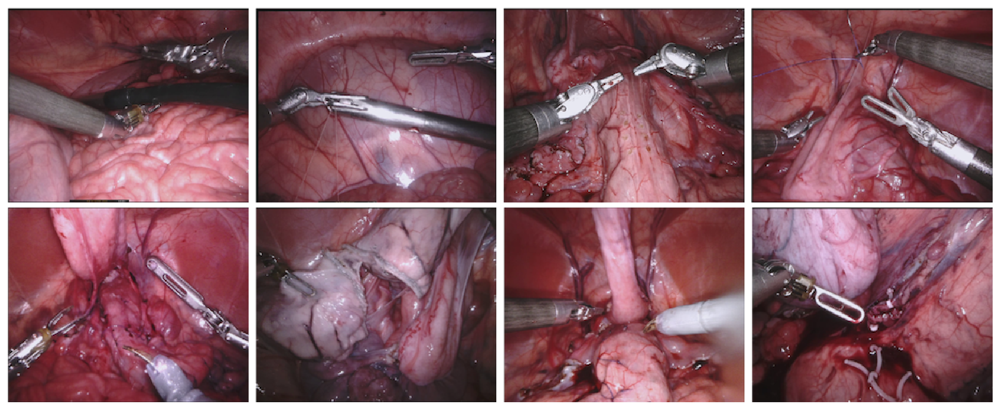
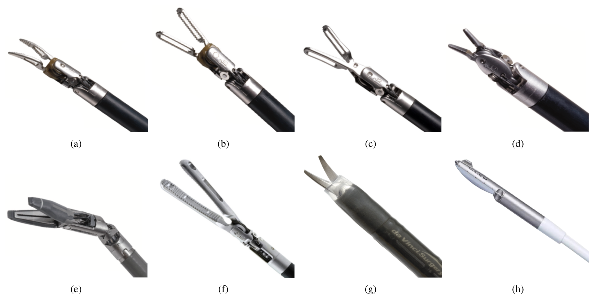
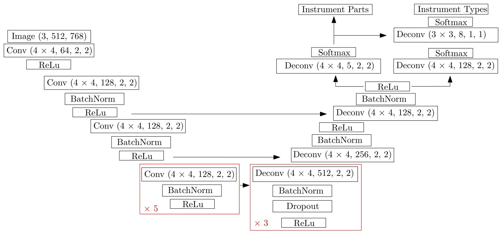
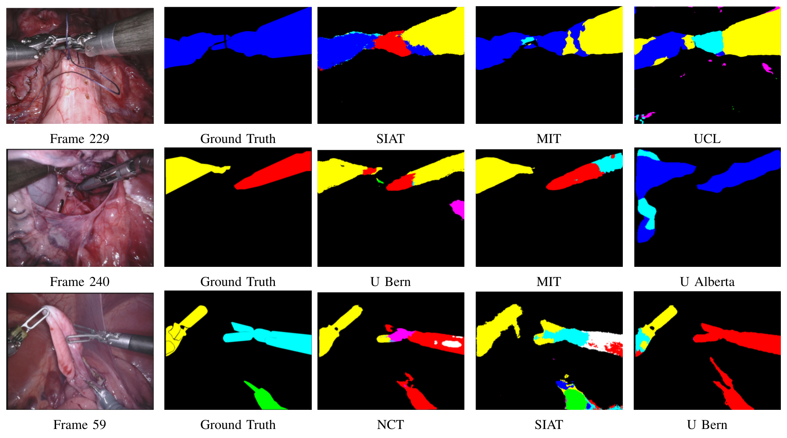
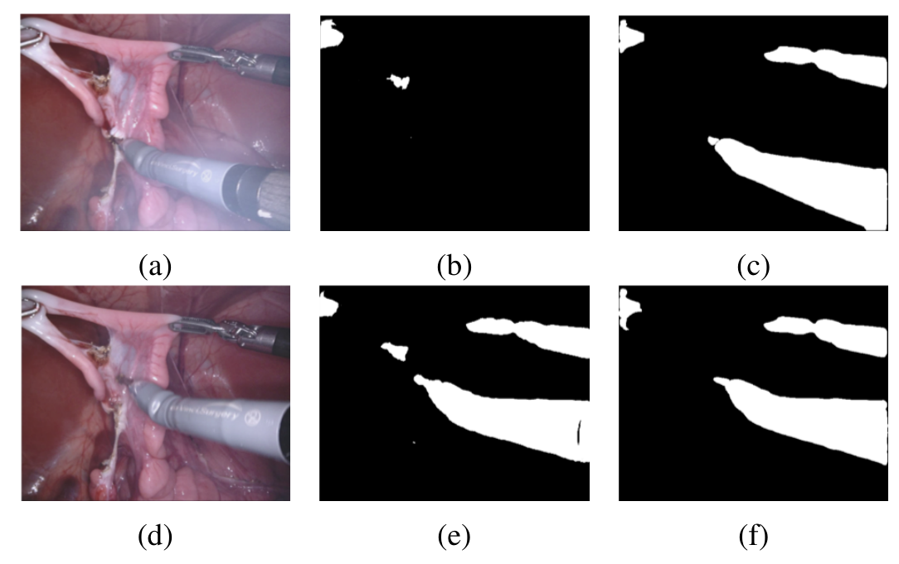

## 1. 背景与动机

**机器人手术里的器械分割一直缺一个可信的公共考场。** 器械跟踪和增强现实叠加都要先知道哪些像素是器械，而领域里没有像 `COCO` 那样的公共数据和验证集。

2015 年 `EndoVis` 子挑战提供过机器人器械数据，但真值由 `dVRK` 正向运动学投影生成。正向运动学就是用关节读数推算器械位置，线缆驱动关节会让投影偏离真实轮廓；背景也很单一。**在这样的数据上拿高分，说明不了模型真的会分割。**

2017 年的挑战针对这两点做了改进：人工逐帧标注、10 段不同手术、增加部件和类型标签。

## 2. 核心观点速览

**这是一份挑战赛总结，作者没有提出自己的方法。**

- 数据：10 段猪腹腔 da Vinci Xi 手术，每段 300 帧、1 Hz 采样，共 3000 帧，其中 1800 帧训练。
- 任务：二值分割、部件分割（轴、腕、夹钳）、类型分割，难度逐级上升。
- 结果：二值 MIT 总分 0.888，5 支队伍超过 0.8；部件 TUM 0.751 最高；类型 MIT 只有 0.542。
- 边界：一次提交、无方差、无消融；一半测试帧与训练帧来自同一段手术。

:::highlights
- 二值分割已较成熟，类型识别远未解决
- 名次会随加权方式改变
:::

:::data
- 10 支队伍参赛，部件 9 支、类型 6 支
- 3000 帧，1800 帧训练
:::

接下来先看考场怎么搭，因为分数的含义取决于它。

## 3. 数据怎么采、怎么切

**测试帧有一半与训练帧来自同一段手术。** 数据集 1 到 8 各取前 225 帧训练、后 75 帧测试；数据集 9、10 的全部 300 帧只用于测试。

为防止用同段训练数据作弊，规则要求评测第 $k$ 段测试数据时不能用第 $k$ 段训练数据，于是每队至少要训练 9 个模型。额外手术数据被禁止，只允许用公开非手术数据预训练。作者承认这条规则只能依赖队伍自觉。

*论文原图编号：Fig. 2。数据集 1 到 8 的训练样例帧，可以看到不同段之间的组织、缝线、超声探头和夹子差异。*

标注由 Intuitive Surgical 团队用 `Viame` 逐帧画多边形，只标左眼，每个样本由一名标注者完成、一名专家复核。**标注者间一致性论文未说明。**

:::highlights
- 只标左眼，但提供双目图像和相机标定
- 实例级标签，派生出三级任务标签
:::

## 4. 三级任务和评测口径

二值任务把器械与背景分开，超声探头、夹子和组织都算背景。部件任务把器械分为轴、腕、夹钳；单极弯剪看不到腕，整根护套算轴。类型任务要识别器械型号，两种双极镊因外观相近合并成一类。

*论文原图编号：Fig. 4。类型任务涉及的器械；前三幅钳口非常相似，原图题对第七、第八幅的标号疑似写反。*

评测用单类 IoU：

$$
\mathrm{IoU}=\frac{TP}{TP+FP+FN}
$$

每帧对出现的类别取平均，再对帧平均得到每段分数，最后**按数据集大小加权**。数据集 9、10 的测试帧是其余段的 4 倍，所以它们主导总分。

部件总分是否计入背景类、类型任务的背景和缺失类如何计分，论文未说明。

## 5. 参赛方法的共同点

10 支队伍中 8 支用编解码类 `CNN`，主要差别在预训练、输入尺寸和后处理：

| 队伍 | 核心做法 |
|---|---|
| MIT | U-Net 加 ImageNet 预训练 VGG 编码器（TernausNet） |
| TUM | ResNet-50 编码器的残差编解码网络，镜面高光增强，保留与图像边界相连的连通域 |
| UB | 先二值后部件与类型的级联网络，不做外部预训练 |
| NCT | 共享主干、部件与类型双输出头 |
| UW | 不用机器学习，颜色阈值加 GrabCut |

*论文原图编号：Fig. 5。NCT 的网络，部件（5 通道）和类型（8 通道）两个输出头共享同一主干。*

下一节看这些差别在分数上留下了什么。

## 6. 结果说了什么

| 队伍 | 二值 | 部件 | 类型 |
|---|---|---|---|
| MIT | **0.888** | 0.737 | **0.542** |
| UB | 0.875 | 0.700 | 0.453 |
| TUM | 0.873 | **0.751** | 未参加 |
| NCT | 0.843 | 0.699 | 0.409 |
| SIAT | 0.803 | 0.667 | 0.371 |
| UCL | 0.785 | 0.623 | 0.337 |

**正文写二值最佳为 0.854，表 I 是 0.888。** 0.854 是 MIT 在数据集 1 上的分数；我按表中逐段分数加权重算约为 0.888，正文应是笔误。

部件任务拆开后，轴最容易、夹钳最难：TUM 的轴 0.822，夹钳只有 0.556。**夹钳恰是与组织接触、对跟踪最有用的部位。**

*论文原图编号：Fig. 12。类型分割的定性结果：掩码轮廓大多准确，但器械常被整段标成错误类型。*

:::data
- 二值：MIT 0.888，前三名相差 0.015
- 部件：TUM 0.751，MIT 赢 7 段
- 类型：MIT 0.542，单段最低 0.000
:::

## 7. 为什么名次不稳

**部件任务 MIT 赢下 7 段，总分却输给 TUM。** TUM 在两段独立测试序列上最高（0.736 和 0.807），而这两段权重大。我按 10 段等权重算，MIT 约 0.756、TUM 约 0.738，名次反过来。

所以总分更奖励对新手术的泛化，逐段获胜次数更奖励同序列测试段上的拟合。论文没有给出排名的置信区间或显著性检验。

类型任务的波动更大：数据集 1 上最高只有 0.177，数据集 3 上达到 0.926。作者归因于器械外观相近；训练集器械分布不均是另一种解释，例如单极弯剪只出现在 2 段训练序列中。论文没有给出逐类出现次数，两种解释无法区分。

## 8. 结果没说什么

- **没有任何消融。** 表 VII 只列各队的数据增强选择，不能说明哪项增强导致了好成绩。
- **没有覆盖烟雾和严重光照歧义。** 图 13 中 UB 在薄烟帧上整体失效，而它的二值总分与 TUM 只差 0.002。
- **只有猪组织和 da Vinci Xi。** 对人体组织、其他平台的泛化无法判断。
- BIT 的异常低分（二值 0.326）、数据集 8 夹钳分数极低，原因论文未说明。

*论文原图编号：Fig. 13。上排是薄烟帧及 UB、TUM 的二值结果，下排是烟雾散去后的下一帧；UB 在烟雾帧上几乎全部漏检。*

## 9. 它在已有数据集中的位置

| 对象 | 标注 | 本文相对它的变化 |
|---|---|---|
| 2015 EndoVis 子挑战 | 正向运动学自动生成 | 改为人工标注，扩到 10 段手术，加部件和类型 |
| `COCO` | 人工，328k 张图像 | 本文只有 3000 帧 |
| 2018 EndoVis 场景分割 | 论文未说明 | 2018 年扩展到组织与第三方器械 |

作者自己也承认，规模小会让排名偏向能过拟合的模型，并计划以后用完全独立的训练集和测试集。

## 10. 复用时要注意什么

- **可以照抄：** 隐藏测试标签、只允许一次提交；部件任务按轴、腕、夹钳分别报告。
- **需要核查：** 自己是否按序列划分，优先只用数据集 9、10 测试；同时报告加权和等权两种均值；写明是否计入背景类。
- **应该避免：** 用表中 0.015 这样的小差距排名次；在夹钳细边界上过度优化，因为孔洞没有标注。

## @takeaways
- 二值器械分割在 da Vinci 猪手术数据上已达到 0.8 以上，类型识别最佳只有 0.542
- 总分按帧数加权，名次会因此改变
- 一半测试帧与训练帧同序列，复用时要按序列划分

## @strengths
- 人工逐帧标注替代了有偏移的运动学标注
- 公开了每支队伍在每段数据上的分数和部件拆分结果
- 作者如实列出了标注、规模和设计上的局限

## @weaknesses
- 只有 3000 帧、10 段猪手术，没有人体数据
- 单人标注，夹钳孔洞未标，无一致性统计
- 没有方差、显著性检验或消融；正文与表格有数字矛盾

## @questions
- 部件总分是否计入背景类？
- 类型任务的标签列表为何与数据收集部分不一致？
- 训练集器械分布不均对类型分数的影响有多大？
