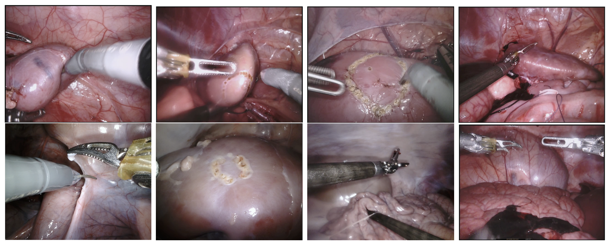
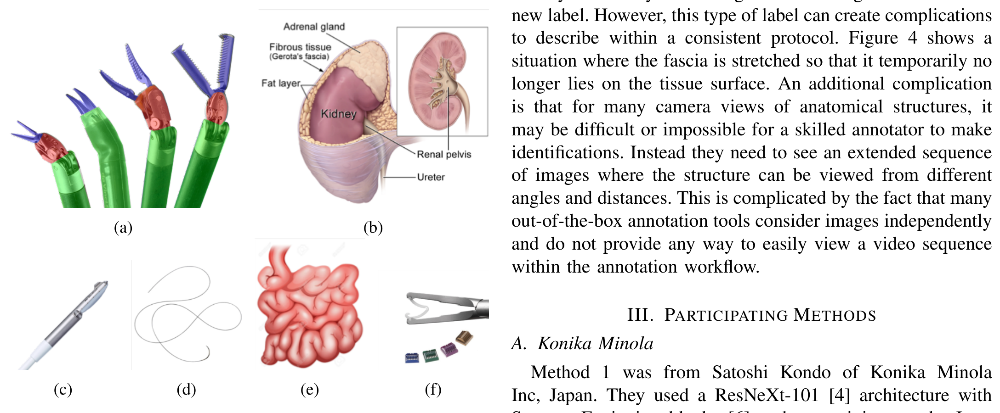
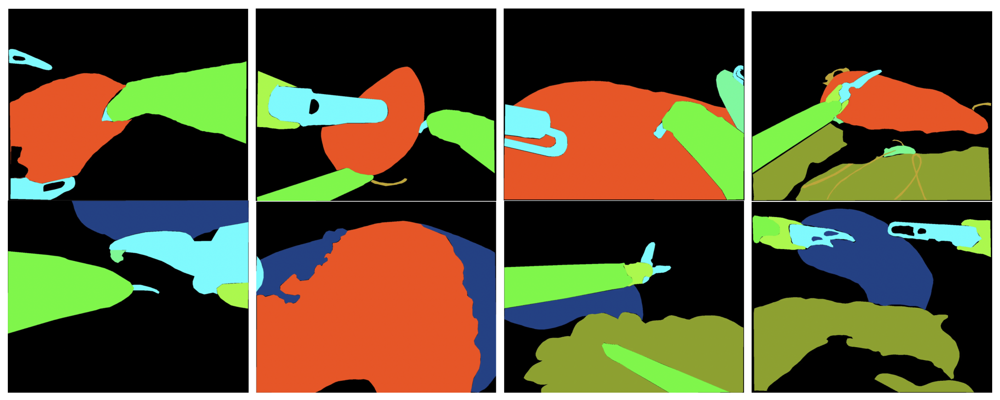
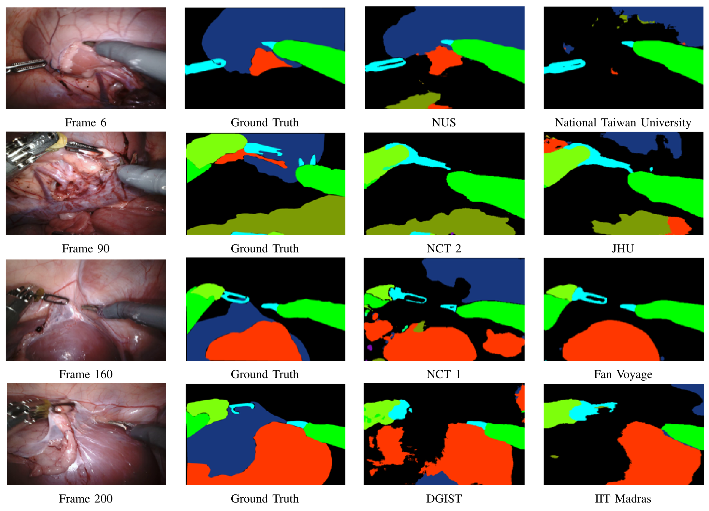
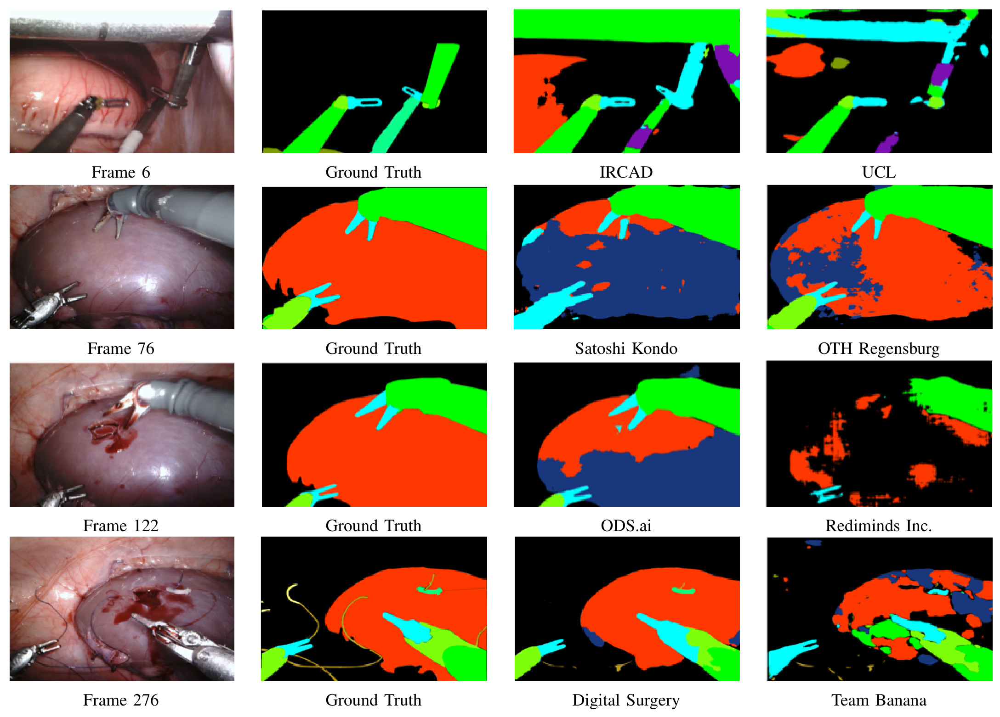
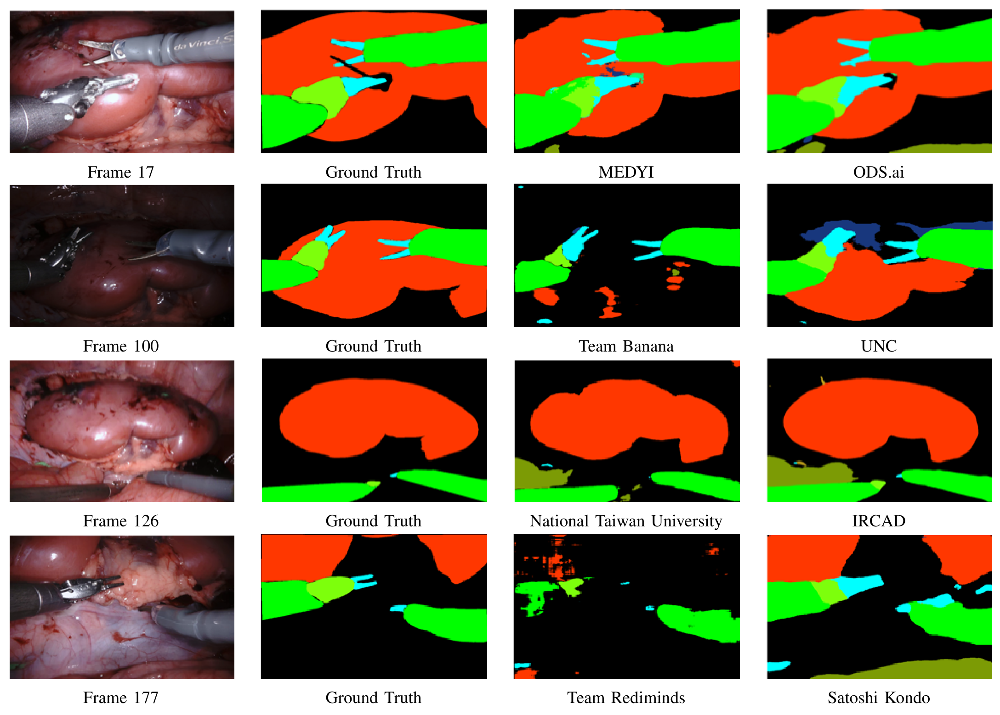

## 1. 背景与动机

**机器人手术想把术前影像叠加到内镜画面上,前提是知道画面里每个像素是什么。** 论文的出发点是增强外科医生的感知:比如把术前 CT 里分割出的血管叠加到视野中,只在有用时显示。这需要像素级语义分割,而手术领域缺少高质量标注。

组织方此前办过两届。2015 年用离体组织和运动学自动标注,背景单一,说明不了真实手术。2017 年改用真实猪手术视频,10 支队伍参加,多数队伍的器械二值和部件分割超过 0.7 mIoU。

作者据此判断器械分割已有基础,可以扩展类别。下一节说 2018 年给出的答案。

## 2. 核心观点速览

**整场景分割可以做,但只有大面积、边界清楚的目标做得好。**

- 数据:19 段猪手术序列,15 段训练、4 段测试,每段 300 帧,只标左目。
- 类别:器械杆部、腕部、钳口,超声探头、缝针、缝线、吸引冲洗器、夹子,肾实质、被覆盖肾脏、小肠,其余为背景。
- 结果:总表杆部平均 0.738,缝针 0.003,被覆盖肾脏 0.224。
- 排名:OTH Regensburg 总分 0.621,UNC 0.607,NCT 2 0.585。
- 边界:猪数据、4 个测试序列、无显著性检验、无标注一致性。

:::highlights
- 2018 年把分割对象从器械扩展到整场景
- 难度主要由目标大小和是否被遮挡决定
:::

:::data
- 19 段序列,15 训练 4 测试
- 总榜第一 0.621,全体平均 0.478
:::

接下来逐项看数据、标签和评测口径。

## 3. 数据从哪里来

**第一个问题是场景够不够真实。** 数据来自猪训练手术,在 da Vinci X 或 Xi 上录制。组织方挑出相机运动明显或有组织交互的片段,1 Hz 抽帧,手工删相似帧到每段 300 帧。

每帧是 1280×1024 的双目图像对,附带出厂内外参标定,但只标注左目。作者选猪是因为猪缺少遮挡器官的脂肪,比人体简单得多,这同时也是外推到人体的最大限制。

*论文原图编号：Fig 3。训练集第 1、4、5、7、9、12、13、14 段的示例帧,视角、器械和组织覆盖程度差别很大。*

## 4. 标了哪些类别,怎么标

**类别设计决定了挑战能测什么。** 器械沿用 2017 年的杆部、腕部、钳口划分;新增超声探头之外的全部非生物物体,以及肾实质、被覆盖肾脏、小肠。被覆盖肾脏指肾筋膜与肾周脂肪连同其下的肾,是一个复合标签。

*论文原图编号：Fig 2。待分割类别示意,包括器械、肾脏解剖、探头、缝线、小肠和夹子。*

标注由 Intuitive 的受训技术员画多边形,兽医质控。作者坦白了解剖标注的难点:筋膜被拉起时被覆盖肾脏的边界很难统一描述;很多结构单看一帧认不出,需要看序列,而常用标注工具逐帧处理。

标注者间一致性和训练集类别像素占比,论文未说明。因此后面任何类别的低分,都无法区分是模型问题还是标签问题。

*论文原图编号：Fig 5。与 Fig 3 对应的标注。橙色为肾实质,深蓝为被覆盖肾脏,橄榄绿为小肠(颜色含义为本页推断,论文未给图例)。*

## 5. 分数怎么算

**评测口径要先讲清楚,否则稀有类分数没法读。** 单类交并比为

$$
\mathrm{IoU} = \frac{TP}{TP + FP + FN}
$$

每帧只对出现的类别取平均,类别都不出现的帧剔除;再对帧平均得到测试集分数,最后按数据集大小加权得到总分。

两处细节论文未说明:类别“出现”按真值还是预测判断;四个测试集各有多少帧。本页核对发现,表 V 与四段的等权平均一致。

下面看参赛者拿什么方法来比。

## 6. 参赛方法

**方法高度同质,差异主要在训练细节。** 多数队伍用 ImageNet 预训练的编码器-解码器:U-Net、DeepLab V3+、PSPNet、全局卷积网络,外加集成、焦点损失、条件随机场后处理等。

| 队伍 | 关键设计 |
|---|---|
| OTH Regensburg | DeepLab V3+,先用 2017 数据训练 40 轮,再在 2018 数据训练 |
| Digital Surgery | DeepLab V3+,同时预测 10 类与 5 个合并类,边界加权损失,1 FPS |
| NTNU | 双编码器,输入左右两帧,是唯一的双目方法 |
| NCT(方法 8) | 每个类别一个 U-Net |
| JHU | 用生成对抗式图像翻译做分割,测试时增强投票 |

表中第二名 UNC 和 Fan Voyage 在方法章节里没有条目,论文未说明其方法;两个 NCT 提交对应哪个方法也论文未说明。没有任何队伍利用时间信息。

## 7. 结果说了什么

**总榜前几名差距很小,而类别之间差距很大。**

| 队伍 | 肾实质 | 被覆盖肾脏 | 杆部 | 缝针 | 探头 | 夹子 | 总分 |
|---|---|---|---|---|---|---|---|
| OTH Regensburg | 0.654 | 0.282 | 0.845 | 0.014 | 0.282 | 0.849 | 0.621 |
| UNC | 0.614 | 0.363 | 0.839 | 0.000 | 0.305 | 0.771 | 0.607 |
| NCT 2 | 0.618 | 0.293 | 0.777 | 0.019 | 0.335 | 0.729 | 0.585 |
| 平均 | 0.479 | 0.224 | 0.738 | 0.003 | 0.128 | 0.536 | 0.478 |

OTH 赢下 6 个类别,和它先用 2017 器械数据预训练一致,但没有消融,无法确认因果。第一与第三只差 0.036,没有显著性检验,先后不能当结论。

:::data
- 杆部平均 0.738,缝针平均 0.003
- 被覆盖肾脏平均 0.224,探头平均 0.128
:::

## 8. 场景比方法更能决定分数

**同一批方法在四个测试集上的平均总分从 0.279 到 0.658。**

| 测试集 | 场景 | 平均总分 | 平均肾实质 |
|---|---|---|---|
| 1 | 远景到暴露的肾实质,切除并缝合 | 0.500 | 0.674 |
| 2 | 近景,肾被筋膜和脂肪覆盖并逐渐剥离 | 0.478 | 0.449 |
| 3 | 近景,已暴露的肾实质 | 0.658 | 0.698 |
| 4 | 远景,肾被覆盖,大量小肠,超声探头扫描 | 0.279 | 0.091 |

测试集 2 中肾实质平均是被覆盖肾脏的两倍多,定性图显示被覆盖肾脏常被判为背景。

*论文原图编号：Fig 7。测试集 2 的第 6、90、160、200 帧,依次为原图、真值和两支队伍的预测,被覆盖肾脏(深蓝)在预测中大面积缺失。*

测试集 1 的定性图还显示反向错误:暴露的肾实质被判为被覆盖肾脏。

*论文原图编号：Fig 6。测试集 1 的第 6、76、122、276 帧,第 76 和 122 帧可见肾实质被误判为被覆盖肾脏。*

*论文原图编号：Fig 8。测试集 3 的第 17、100、126、177 帧,暴露肾实质多数队伍分得较好。*

## 9. 结果没说什么

**低分有三种解释,论文都没有分开。**

- 缝针几乎零分:可能是目标太细,也可能是训练集太少或标注不稳。训练集类别分布论文未说明。
- 被覆盖肾脏低分:可能是标签歧义,也可能是模型不够强。需要人类重标的分数上限来区分,论文未提供。
- OTH 第一:0.621 对 0.607 的差距可能在抽样噪声内,论文没有置信区间。

另外,吸引冲洗器列在类别里却没有任何结果,原因论文未说明。

## 10. 表格自身的问题

**用这些表做逐类排名前,要知道表格本身有错。**

- 表 I 图注说 NCT 赢 2 类,按加粗值 NCT 2 赢了 3 类。
- 表 III 加粗的杆部 0.922 低于 IRCAD 的 0.927;加粗的肾实质 0.888 低于 Fan Voyage 的 0.912;加粗的小肠 0.763 低于 Kondo 的 0.828。
- 测试集 3 正文说分数差、肾被严重覆盖,表 III 却是四段中最高,且没有被覆盖肾脏一列。
- Fig 6 图注写第 176 帧,图中是第 276 帧。

这些错误不改变“器械易、细小类和遮挡解剖难”的结论,但引用逐类冠军时要以数字为准。

## 11. 复现与使用要注意什么

**先补齐论文没给的统计,再报告结果。**

- 自己统计训练集各类像素占比和出现帧数。
- 单独报告缝针、缝线、探头,不要只给平均分。
- 写清楚类别出现按真值还是预测判断,测试集等权还是按帧数加权。
- 被覆盖肾脏适合尝试时序或多视角方法,2018 年没有队伍这样做。

## @takeaways
- EndoVis 2018 把机器人手术分割从器械扩展到整场景,数据是 19 段猪肾手术双目序列
- 杆部容易(平均 0.738),缝针和被覆盖肾脏很难(0.003、0.224)
- 测试场景对分数的影响大于方法差异
- 表格加粗、图注和正文有多处错误,使用前自行核对

## @strengths
- 公开双目、带标定的真实机器人手术序列,支持双目和时序方法
- 第一次在机器人手术公开挑战中同时标注器械部件、其他器械和解剖结构
- 坦白记录了被覆盖肾脏的标注难题
- 给出逐测试集、逐类别的完整结果表

## @weaknesses
- 只有猪数据,作者承认比人体简单得多
- 测试只有 4 段,都围绕肾脏
- 没有显著性检验、标注一致性和类别分布
- 第二名 UNC 等队伍没有方法描述,吸引冲洗器类没有结果
- 表格与正文多处矛盾

## @questions
- 四个测试集各有多少帧,总分到底如何加权
- 被覆盖肾脏的人类重标一致性是多少
- 利用时序或双目信息能否显著改善被覆盖肾脏
- 吸引冲洗器类为何没有进入评测
