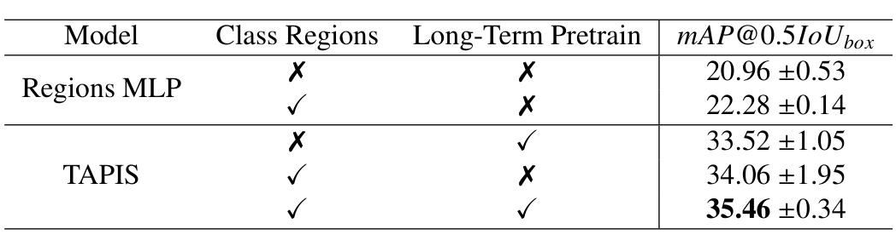

## 1. 背景与动机

**要理解一台手术，模型既要知道“进行到哪一步”，也要知道“每件器械在画面哪里、此刻在做什么”。** 机器人能记录器械的使用信号和运动学，却不能把它们对应到画面中的位置。

**现有基准把这两件事分开做。** 阶段识别数据集没有空间标注；分割数据集没有流程标签；`SAR-RARP50` 有真人机器人手术分割，但只是语义分割。没有同一批视频上的多层标注，就无法检验一层的信号能否帮助另一层。

GraSP 是作者在 PSI-AVA 上的扩展：新增 5 台手术，把器械框升级为实例掩码，数据与标注量增加超过 55%。

## 2. 核心观点速览

论文给出两样东西：一个四层标注的数据集，一个把分割区域与视频特征结合的基线 TAPIS。

- **四层任务：** 阶段 11 类、步骤 21 类（长时），器械 7 类实例分割、原子动作 14 类多标签检测（短时）。
- **标注质控：** 动作三人独立标注取多数，再用专家共现矩阵检查逻辑；分割两轮专家复查；两类标注用二部匹配合成同一套实例。
- **基线：** 分割模型给出区域，视频编码器给出时间上下文，交叉注意力把两者合起来。
- **结论边界：** 测试集动作 mAP 39.26、步骤 mAP 52.01，远未饱和；互补性的提升多在 1 到 2 个点。

:::highlights
- 首个同时含阶段、步骤、器械实例分割、原子动作的公开真人机器人手术数据集（按表 1）
- 分割提议与长时预训练都提升动作检测，但幅度小
:::

:::data
- 13 台手术，32.37 小时，30 fps
- 两折交叉验证 8 台，测试 5 台
:::

下面依次看数据、标注、评测，再看结果。

## 3. 数据从哪来

**基准能否用，先看采集条件和有没有捷径。** 13 台手术都在一家医院，由 3 名资深术者用 `da Vinci Si 3000` 完成，取内窥镜左目的 2D 画面。

原始画面带有器械名称和使用状态指示，模型可能直接读这些字。作者裁掉黑边、把帧从 1024x1280 改为 800x1280，并遮盖指示区，两版都会公开。

平均每台 2.49 小时。阶段段落常超过 20 分钟，步骤最长约 10 分钟。每个关键帧有 1 到 5 个器械，平均 2.23 个；超过 10% 的器械实例面积不到画面的 2%，细小器械是分割的主要难点。

:::data
- 器械相对面积 0.02% 到 40.4%，平均 7.5%
- 约 80% 的关键帧含 2 到 3 个器械
:::

所有任务都有长尾：`Idle` 在阶段和步骤中最多，动作以静止、握持、移动为主。这决定了下一节质控的重点。

## 4. 四层标注怎么做

**难点在于让不同团队、不同粒度的标签彼此一致。**

**长时：** 两名泌尿外科住院医师独立标注起止时间，再协商。两人不一致的帧在阶段上占 21%，步骤上占 37%，步骤更细，分歧更多。

**分割：** 17 名标注员经培训后手绘掩码，可参考前作的框和 `MATIS` 的预测。专家首轮复查发现 9% 的实例有错，其中勾画问题 8.2%；返工后终审又修正 2%。

**动作：** 每个器械框由 3 人看 3 秒片段独立标注最多 3 个动作，保留至少两人一致的标签。三组交并比低于 0.3 的 2.18% 实例、违反共现矩阵的 5.4% 实例由团队复核。

**对齐：** 用二部匹配把动作框与掩码导出框配对，补上动作侧漏标的 2% 和分割侧漏标的 1.2%，最后统一用掩码导出框。

:::highlights
- 共现矩阵把专家知识变成可自动检查的规则
- 掩码导出框让两类标注共享同一套实例
:::

这些质控说明了错误比例，但动作标注者间的一致系数论文未说明。

## 5. 怎么评测

**指标决定哪些错误会被惩罚。** 阶段与步骤在 1 fps 帧上算逐帧 mAP 和视频级 F1。分割以实例级掩码 mAP（交并比阈值 0.5）为主，另报 mIoU、IoU、mcIoU。

动作检测沿用 AVA 的框级 mAP，对每个实例的每个动作类别单独计分。**这比要求整组动作全对宽松，动作 mAP 不能读成“完整描述器械行为”的能力。**

调参只在两折上做，测试前在两折合并数据上重训。

## 6. 基线 TAPIS 怎么工作

TAPIS 把“看清器械”和“看懂时间”分给两个模块。

1. `Mask2Former` 在关键帧上输出最多 5 个置信度大于 0.1 的器械掩码及其嵌入。
2. `MViT` 读入以关键帧为中心的 16 帧时间窗，输出类别标记和时空特征。
3. 类别标记经线性层预测阶段或步骤。
4. 区域嵌入作查询、时空特征作键和值，交叉注意力后分类器械或动作。

训练分三阶段：先多任务训练长时识别，损失为

$$\mathcal{L}_{longterm}=\lambda_{phases}\mathcal{L}_{CE}^{phases}+\lambda_{steps}\mathcal{L}_{CE}^{steps}$$

取 $\lambda_{phases}=1$、$\lambda_{steps}=0.5$；再单独训练分割；最后冻结分割、用预计算区域微调短时任务。

## 7. 结果说了什么

**测试集主结果（表 4）：** TAPIS 在阶段、步骤、动作上都最高。

| Method | Phase mAP | Step mAP | Action mAP | Seg mAP (mask) |
|---|---|---|---|---|
| SlowFast | 68.77 | 46.35 | 22.01 | 71.32 |
| TAPIR | 72.59 | 50.24 | 25.57 | – |
| TAPIS-VST | 76.24 | 50.74 | 33.10 | 89.58 |
| TAPIS | 76.72 | 52.01 | 39.26 | 89.10 |

动作检测比前作 TAPIR 高 53%，但绝对值只有 39.26。分割上 TAPIS-VST 略好，参数却是 96M 对 44M。

*论文原图编号：Table 14。原子动作微调消融：是否用带类别的区域、是否做长时预训练。*

表 14 是“任务互补”的直接证据：两者都用得 35.46，去掉器械类别得 33.52，去掉长时预训练得 34.06。

**分割提议的作用（表 12）：** R50 分割提议的动作 mAP 为 31.24，与 SwinL 的 `DINO` 的 31.37 持平；SwinL 分割提议达 35.46。

**外部基准：** RARP-45 手势识别 TAPIS 最好（mAP 57.25）；`MISAW` 上 `SAHC` 在阶段 F1 和两项步骤指标上超过 TAPIS。

:::data
- 测试集动作 mAP：39.26 对 TAPIR 25.57
- 多任务训练：步骤 mAP 49.72 到 50.74，阶段 mAP 72.31 到 71.36
:::

## 8. 结果没说什么

**互补性方向一致，强度有限。** 35.46 对 34.06 的差距小于后者 1.95 的标准差；多任务训练还让阶段 mAP 下降。只有两折，显著性检验论文未说明。

**分割的收益未与模型结构分开。** 另一种解释是收益来自 `Mask2Former` 的结构或预训练，论文没有“同一模型只换框监督或掩码监督”的实验。

**排序一致不等于标注可靠。** 外部基准上方法排序与 GraSP 一致，说明 GraSP 能区分强弱方法；标注质量要靠一致性数据证明，而动作的一致系数论文未说明。

**相对干净的证据是交叉注意力头。** 它比 Time MLP 参数少，在四种提议下仍更好，不能用参数量解释。

## 9. 复现与使用要注意什么

- 测试集成绩来自合并两折重训的模型，自己报告时应同样处理。
- 短时任务用的是预计算区域，在线计算更好但更贵。
- 长时损失权重对结果敏感，搜索范围论文未说明。
- 图 1 的实例数与关键帧数之比和正文每帧 2.23 个实例口径不同，原因论文未说明，统计前应核对。
- 数据单中心、单机型，跨中心泛化论文未说明。

## @takeaways
- GraSP 是目前少见的四层标注真人机器人手术数据集，步骤与动作层远未饱和
- 三人投票加共现矩阵校验、掩码导出检测框，是可复用的标注设计
- 任务互补的证据方向一致但幅度小，需更多运行或更多数据确认

## @strengths
- 标注流程透明，给出了各类错误比例和处理办法
- 固定划分与指标，并开放数据、代码和模型
- 消融覆盖区域提议、分类头设计、类别信息和长时预训练

## @weaknesses
- 单中心 13 台、测试仅 5 台
- 多数消融差异与标准差同量级，没有显著性检验的报告
- 动作标注一致系数缺失；分割收益与模型结构未分离
- TAPIS 为离线模型，不能实时

## @questions
- 在其他医院的前列腺手术视频上，GraSP 训练的模型表现如何？
- 同一模型用框监督与掩码监督训练，动作检测差多少？
- 因果在线版本的 TAPIS 会损失多少精度？
