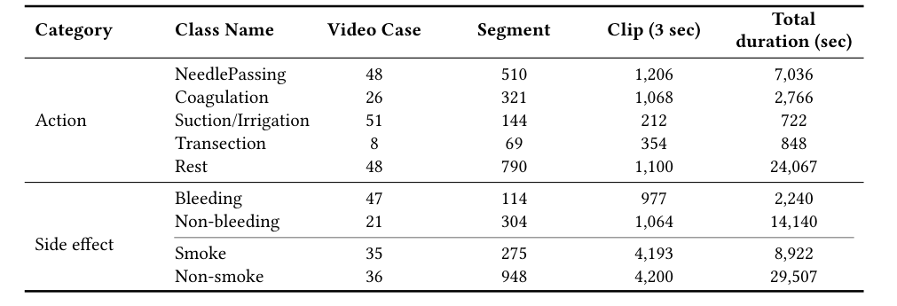
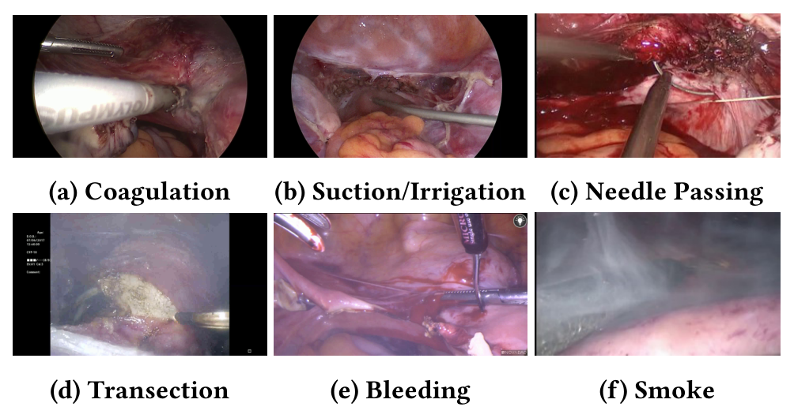
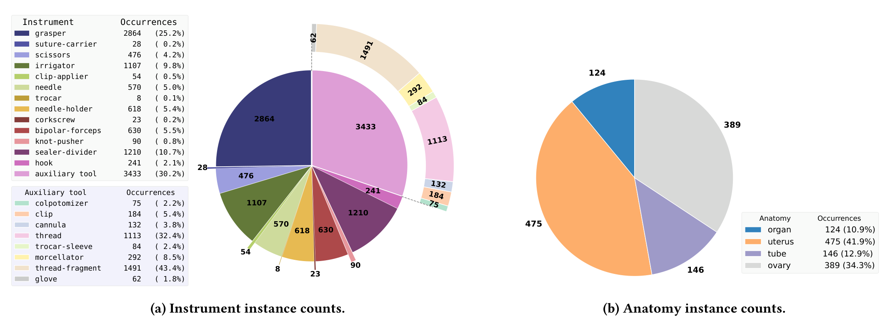
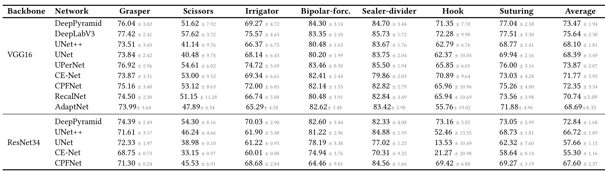
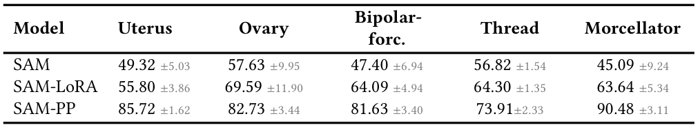

## 1. 背景与动机

妇科腹腔镜录像用于术中导航，也用于术后记录、教学和复盘，但录像量远超人工回看的能力。已有研究分别做过器械检测、解剖分割、动作识别，用的公开数据却各管一块。

同组早先的 GLENDA、GynLap4、SurgicalActions160 主要做分类或检测；SurgAI 系列只标 2 类解剖结构；AutoLaparo 任务多，但只有 21 个视频。**缺的是一份把动作、术中副作用、器械和解剖放在一起、规模足够的妇科数据。**

GynSurg 想填的就是这个空缺。接下来先给出它的整体答案。

## 2. 核心观点速览

**做法是把两家医院的录像分成三个子集：时间标注、像素标注、不标注。**

- 动作子集：152 个视频，四类动作加 Rest，另有出血、烟雾两个二分类。
- 分割子集：15 个子宫切除视频、12,362 帧，21 类器械、4 类解剖结构。
- 未标注子集：75 个子宫切除视频。
- 基线：动作识别 ResNet-LSTM 平均 76.99；器械分割 DeepLabV3 平均 Dice 75.64；解剖约 52，输卵管不到 23。

**边界：** 标注者与一致性没有报告，划分单位没写明，四类标签没有联合实验。

:::highlights
- 唯一同时含动作识别与器械加解剖分割的妇科数据
- “多任务”目前只是标签齐全，没有联合实验
:::

:::data
- 152 个动作视频，选自 600 多台手术
- 12,362 帧分割掩码 = 11,352 器械帧 + 1,010 解剖帧
:::

下面逐个子集看数据从哪来、每类有多少。

## 3. 数据从哪来

动作子集选自维也纳医科大学和多伦多医科大学的 600 多台手术，30 fps、1920 × 1080。分割子集与未标注子集全部来自多伦多，分割帧分辨率 750 × 480。

两家医院各贡献多少、选片标准、伦理审批，论文未说明。许可为 CC BY-NC-ND，禁止商业使用。**分割子集只有一家医院，跨中心结论无从验证。**

| 数据集 | 任务 | 规模 |
|---|---|---|
| AutoLaparo | 阶段、运动、分割 | 21 个视频 |
| GLENDA | 检测 | 25,682 帧 |
| GynLap4 | 分类 | 30,682 帧等四个子集 |
| GynSurg | 动作、分割 | 152 个视频；12,362 帧 |

按帧数，GynLap4 和 GLENDA 都比 GynSurg 的分割子集大。**“最大”只在视频数加任务覆盖上成立。**

来源清楚了，下一个问题是类别有多不平衡。

## 4. 动作与副作用：类别极不均衡

*论文原图编号：Table 2。各类动作与副作用的病例数、片段数、3 秒切片数与总时长。*

视频被切成 3 秒、重叠 1 秒的切片作为样本。切断只出现在 8 个病例中；Rest 总时长 24,067 秒，却只有 1,100 个切片，采样规则论文未说明。

正文称穿针“在病例数上占优”（48 例），但表中吸引冲洗有 51 例，穿针只在总时长上占优。**切断只有 8 例，后面关于切断的结论都只靠这几个病例。**

*论文原图编号：Figure 1。六类时间标签的示例帧。*

:::data
- 穿针总时长 7,036 秒，吸引冲洗只有 722 秒
- 副作用子集的视频数论文未说明
:::

时间标签之外，另一半数据是像素掩码。

## 5. 分割子集：长尾很重

*论文原图编号：Figure 2。器械与解剖结构的实例数。*

抓钳 2,864 次，trocar 只有 8 次；辅助工具中线头碎片与缝线占大半。解剖结构中子宫 475 次、输卵管 146 次。

评测前作者剔除稀有类、合并近似类：器械留 7 类（四种缝合器械并成一类），辅助工具留 4 类，解剖剔除泛指器官留 3 类。合并规则里出现的 `in-cannula` 不在图 2 中，来源论文未说明。

标注者是谁、几人、一致性如何，论文未说明。**没有一致性，就分不清低分来自模型还是标签。**

接下来看两套训练协议。

## 6. 训练协议

动作识别比较四个网络：VGG16 加 Transformer、VGG16 加 LSTM、ResNet50 加 LSTM、ResNet3D-18。小批量做类均衡采样，SGD 学习率 0.005、多项式衰减，批大小 16。轮数一处写 40、一处写 30，以哪个为准论文未说明。

分割比较十个网络加 SAM，输入 256 × 256，80 轮、批大小 4。损失是交叉熵与对数 Dice 的加权：

$$\mathcal{L}=\lambda\, CE - (1-\lambda)\log\frac{2\sum X_{true}\odot X_{pred}+\sigma}{\sum X_{true}+\sum X_{pred}+\sigma}$$

其中 $\lambda=0.8$，$\sigma=1$。两套协议都用四折交叉验证，但划分单位正文没写，只说编号在 GitHub。

SAM 有两种提示：网格撒点，或用**真值掩码的质心**作单点提示（SAM-PP）。后者推理时需要已知目标位置。

协议讲清了，下面看分数。

## 7. 结果说了什么

| 模型 | 电凝 | 穿针 | 吸引冲洗 | 切断 | Rest | 平均 |
|---|---|---|---|---|---|---|
| VGG-LSTM | 51.72 | 93.10 | 61.38 | 68.36 | 48.76 | 68.40 |
| ResNet-LSTM | 56.14 | 92.74 | 74.81 | 84.28 | 56.82 | 76.99 |
| VGG-Transformer | 49.13 | 94.68 | 62.79 | 75.64 | 24.33 | 69.29 |
| ResNet3D | 45.11 | 99.54 | 91.51 | 12.27 | 57.15 | 58.46 |

穿针全部超过 90，电凝与切断常互相混淆，因为器械相似且都产生烟雾。**平均列不是五类算术平均**，算法论文未说明。

正文说 ResNet-LSTM 出血准确率 92.65%，表中没有这个数；它等于出血 88.26 与非出血 97.04 的平均，是类平均准确率。

*论文原图编号：Table 7。器械分割 Dice。*

器械分割 DeepLabV3 平均 75.64，双极钳与闭合切割器超过 80，剪刀最高 57.62。辅助工具里 trocar 套管全部低于 20。解剖分割整体只有约 50，输卵管 16.04 到 22.31。

*论文原图编号：Table 9。三种 SAM 变体的 Dice。*

SAM-PP 粉碎器达 90.48，子宫 85.72，高出最好的全自动 CNN 二十多个点。**这个差距来自真值位置提示，不说明 SAM 的分割能力更强。**

:::data
- 动作：ResNet-LSTM 平均 76.99，ResNet3D 切断 12.27
- 器械：DeepLabV3 平均 75.64；解剖：UPerNet 平均 52.08
:::

分数读完了，问题是这些分数能支持哪些结论。

## 8. 结果没说什么

- **ResNet-LSTM 最好未经检验。** 它的吸引冲洗标准差 29.01，模型间差距可能落在折间波动内。
- **穿针高分可能有泄漏。** 切片重叠 1 秒，若按切片划分，相邻切片同时进入训练与测试；论文没有按视频划分的结果来排除。
- **多任务价值没有实验。** 分割视频全来自多伦多，与动作视频是否同一批手术论文未说明，也没有联合训练。
- **统一超参数。** 所有网络共用一套设置，排名只在这套设置下成立。
- **分辨率影响未测。** 输入都缩到 256 × 256，细长的输卵管和小目标在这个尺度上像素很少。

:::highlights
- 动作识别更像“认器械”，器械独特的类容易，共用器械的类难
- SAM-PP 只能当作给定位置时的参考
:::

这些疑点决定了复用时要先核对什么。

## 9. 复现要注意什么

1. 从 GitHub 取四折编号，确认同一视频不跨折。
2. 按论文的类别合并规则重建掩码，先弄清 `in-cannula`。
3. 动作识别同时报告逐类准确率与 F1，不只看平均列。
4. 切断只有 8 例，任何关于切断的结论都要标出样本量。

## @takeaways
- 器械分割子集类别多、合并规则清楚，可直接作为妇科器械分割的测试集
- 动作子集极不均衡，切断只有 8 例
- 正文的副作用“准确率”是两类准确率平均
- SAM-PP 用了真值位置，不能与全自动模型直接比

## @strengths
- 首次把动作、出血烟雾、器械、解剖四类标签放进一份妇科数据
- 统一协议下给出十余个网络的基线，划分编号与掩码代码公开
- 附带 75 个未标注视频，可做自监督

## @weaknesses
- 标注者人数、资历与一致性全部缺失
- 四折划分单位、表 4 平均列算法、训练轮数在正文中不清楚或矛盾
- 分割子集只有一家医院、15 个视频
- 多任务卖点没有任何联合实验

## @questions
- 动作视频与分割视频是否来自同一批手术
- 按视频划分后，穿针与 Rest 的分数会下降多少
- 两家医院之间的跨中心泛化表现如何
