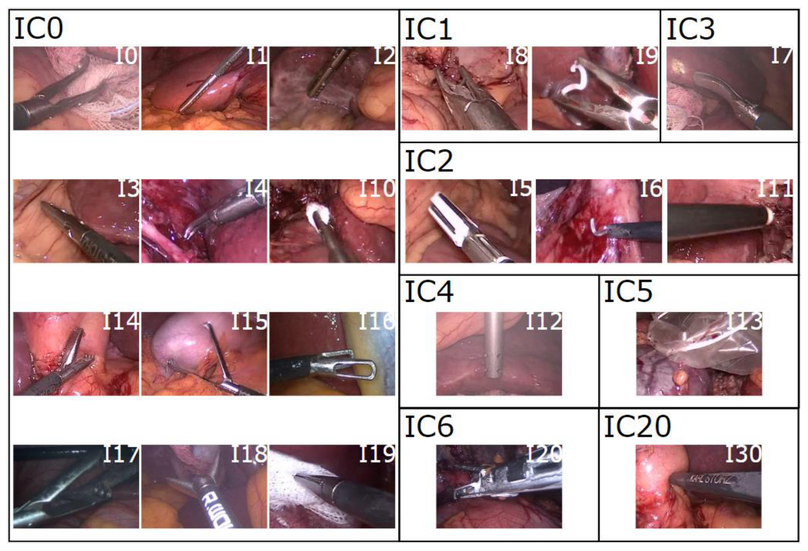
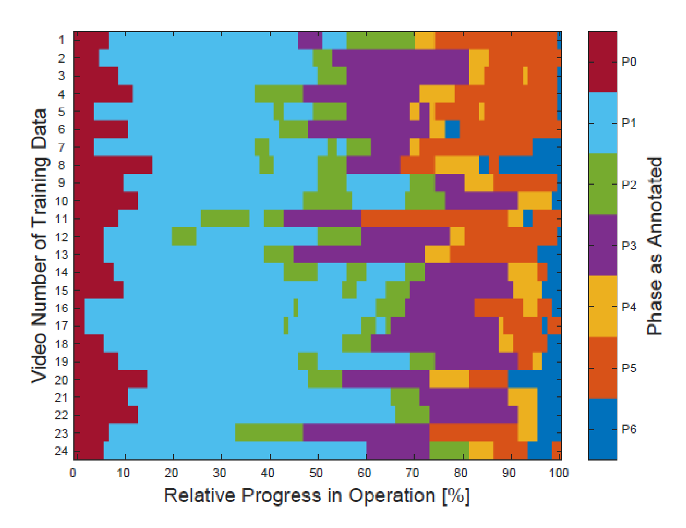
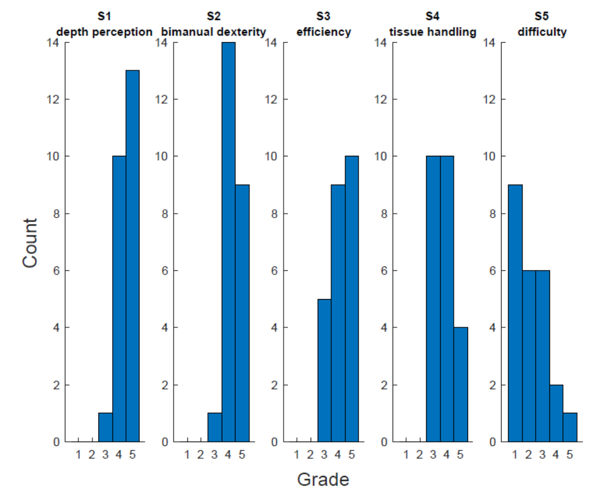
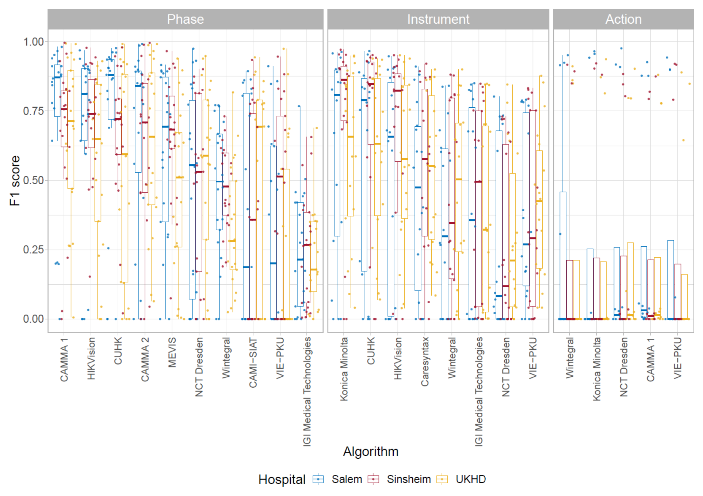
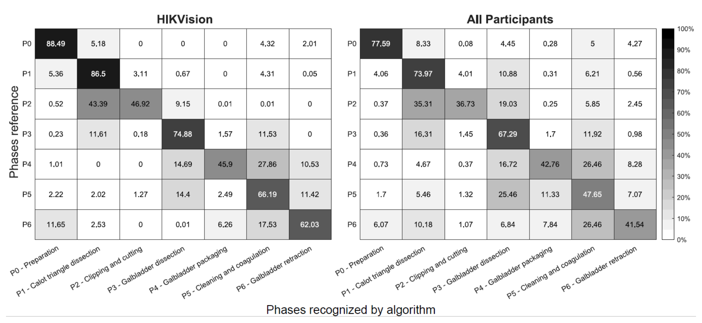
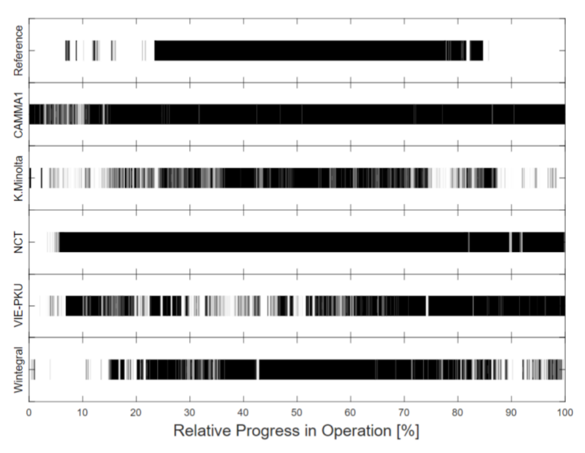
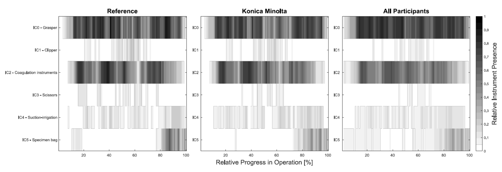
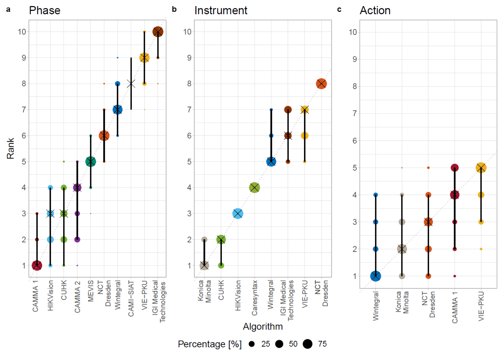

---
tags:
  - papers/手术数据集
aliases:
  - "HeiChole"
  - "HeiChole benchmark"
date: 2021-09-30
arxiv_id: "2109.14956"
---

# Comparative Validation of Machine Learning Algorithms for Surgical Workflow and Skill Analysis with the HeiChole Benchmark

## 核心信息

- 标题: Comparative Validation of Machine Learning Algorithms for Surgical Workflow and Skill Analysis with the HeiChole Benchmark
- 标题翻译: 用 HeiChole 基准对手术工作流与技能分析的机器学习算法进行比较验证
- 作者: Martin Wagner, Beat-Peter Müller-Stich, Anna Kisilenko, Duc Tran, Patrick Heger, Lars Mündermann, David M Lubotsky, Benjamin Müller, Tornike Davitashvili, Manuela Capek, Annika Reinke, Tong Yu, Armine Vardazaryan, Chinedu Innocent Nwoye, Nicolas Padoy, Xinyang Liu, Eung-Joo Lee, Constantin Disch, Hans Meine, Tong Xia, Fucang Jia, Satoshi Kondo, Wolfgang Reiter, Yueming Jin, Yonghao Long, Meirui Jiang, Qi Dou, Pheng Ann Heng, Isabell Twick, Kadir Kirtac, Enes Hosgor, Jon Lindström Bolmgren, Michael Stenzel, Björn von Siemens, Hannes G. Kenngott, Felix Nickel, Moritz von Frankenberg, Franziska Mathis-Ullrich, Lena Maier-Hein, Stefanie Speidel, Sebastian Bodenstedt
- 机构: 海德堡大学医院、海德堡国家肿瘤疾病中心、德国癌症研究中心、卡尔史托斯公司、斯特拉斯堡大学、香港中文大学、中国科学院深圳先进技术研究院、柯尼卡美能达、弗劳恩霍夫数字医学研究所、德累斯顿国家肿瘤疾病中心等
- 发表时间: 2021-09-30
- 发表渠道: arXiv 预印本
- arXiv: 2109.14956
- 论文链接: https://arxiv.org/abs/2109.14956
- 数据 / 资源: 训练集以知识共享署名-非商业性使用-相同方式共享许可在 Synapse 发布（syn18824884），测试集不公开
- 论文类型: benchmark_or_dataset

## 原文摘要翻译

**目的：** 手术工作流与技能分析是下一代认知型手术辅助系统的关键技术。这类系统可以通过情境相关的预警和半自主机器人辅助提高手术安全性，或通过数据驱动的反馈改进外科医生培训。在手术工作流分析中，已有研究在一个公开的单中心视频数据集上报告了高达 91% 的阶段识别平均精度。本研究考察阶段识别算法在多中心场景下的泛化能力，并纳入更难的识别任务，如手术动作和手术技能。

**方法：** 为此，我们构建了一个数据集，包含来自三个手术中心的 33 个腹腔镜胆囊切除术视频，总手术时长 22 小时。标注包括逐帧标注的七个手术阶段（共 250 次阶段转换）、四种手术动作的 5514 次出现、七个器械类别下 21 种手术器械的 6980 次出现，以及五个技能维度上的 495 个技能评分。该数据集用于 2019 年国际内镜视觉挑战赛中的手术工作流与技能分析子挑战。12 个研究团队训练并提交了机器学习算法，用于识别阶段、动作、器械和（或）评估技能。

**结果：** 阶段识别的 F1 分数在 23.9% 到 67.7% 之间（9 个团队），器械存在检测在 38.5% 到 63.8% 之间（8 个团队），而动作识别只有 21.8% 到 23.3%（5 个团队）。技能评估的平均绝对误差为 0.78（1 个团队）。

**结论：** 我们对机器学习算法的比较表明，手术工作流与技能分析是支持手术团队的有前景的技术，但尚未解决。这一新的 HeiChole 基准可用于未来工作的可比评估与验证。今后的研究中，构建更多开放、高质量的数据集至关重要，这样才能推动手术中人工智能和认知机器人的发展。

## 创新点

1. **多中心临床数据。** 33 个视频来自三家德国医院，两种摄像系统、三种分辨率和两种帧率并存，器械品牌也不同。此前公开的 Cholec80 只来自单一中心。
2. **四类标注同在一套视频上。** 阶段、动作、器械、技能同时标注，论文称这是第一个在临床视频上逐帧标注手术动作的数据集；技能用改良的腹腔镜技能整体操作评估量表（GOALS）。
3. **附带挑战赛验证的基准。** 12 支队伍在相同训练集和隐藏测试集上提交 Docker 容器，排名配有 bootstrap 稳定性和成对显著性检验，后来者可继续提交并上排行榜。
4. **把失败结果写清楚。** 动作识别几乎只会预测“持握”，技能评估唯一提交输出常数，这些负面结果给出了任务难度的真实位置。

## 一句话总结

HeiChole 用三个中心的 33 台腹腔镜胆囊切除视频建立了阶段、动作、器械、技能四任务基准，挑战赛显示阶段识别最佳 F1 约 65%，远低于单中心报告，动作识别和技能评估基本没有解决。

## 研究问题

### 背景与动机

手术工作流分析要回答“手术进行到哪一步、医生在做什么、用了什么器械”，技能分析要回答“这台手术做得好不好”。论文把两者看作认知型手术辅助系统和半自主手术机器人的前提：情境预警、手术时长预测、教学反馈都依赖它们。

腹腔镜胆囊切除术是合适的切入点。它是常规手术，在美国每年约 300,000 例，全程有腹腔镜视频，但解剖变异大：一篇综述发现 8.9% 的病例有不止一条胆囊动脉，18.5% 的病例动脉不在胆囊三角内。

**瓶颈在公开的高质量标注数据。** 论文梳理了已有数据集的短板：

- `Cholec80` 有 80 台单中心胆囊切除视频，阶段识别平均精度可达 91%，但只有阶段和器械标注。
- 一个 1243 台的多中心数据集结果相近，但数据不公开。
- `Heidelberg Colorectal` 与白内障挑战赛 `CATARACTS` 同样来自单一中心，标注种类有限。
- `JIGSAWS` 有动作和技能标注，但来自实验室模拟任务，不是真实病人。
- 胆囊切除的阶段定义缺乏统一标准，挑战赛若公开测试集，后来者可以针对测试集调参。

论文提出两个研究问题：

1. 独立团队能否在新的多中心数据上复现此前报告的阶段识别和器械识别性能？
2. 对于比阶段识别更难的任务，即短暂细微的手术动作和需要整体判断的手术技能，能达到什么水平？

### 核心观点速览

**答案。** 不能复现。先说指标：F1 是精确率和召回率的调和平均，这里先在每个视频内对所有类别求 F1 再平均。三家医院 33 台视频组成的 HeiChole 上，2019 年内镜视觉挑战赛参赛方法的阶段识别 F1 最高约 65%（赛后提交为 68.78%），器械检测最高 63.82%，动作识别最高只有 23.28%，技能评估唯一提交的平均绝对误差为 0.78。

**四个关键做法。**

1. 多中心采集：海德堡大学医院、`Salem` 医院各 15 台，`Sinsheim` 医院 3 台；后者只出现在测试集。
2. 四类标注：七个阶段、四种动作、21 种器械（七类）、五维技能评分，配有书面标注规则。
3. 挑战赛评测：参赛者提交 Docker 容器，测试集与参考标注始终不公开，只允许在线推断。
4. 统计分析：逐视频平均 F1 排名；用 1000 次 bootstrap（对测试视频有放回重采样后重算排名）检验排名稳定性；用 `Holm` 校正的成对 `Wilcoxon` 检验判断显著差异。

**头条结果。** 阶段和器械任务的排名稳定（`Kendall` 相关系数衡量两个排名的一致度，1 为完全相同，两项任务的均值都是 0.93），但绝对分数离临床可用还远；动作识别中所有方法几乎只预测“持握”，各方法之间没有显著差异。

**边界。** 测试集只有 9 个视频，每个中心 3 个；技能任务只有 1 支队伍；论文中有几处数字前后不一致（见深度分析）。

这些数字是否可信，先取决于数据和标注是怎么做出来的。

## 数据与任务定义

### 数据来源

这一节回答：数据有多“多中心”，划分是否让测试真的考到泛化。

| 中心 | 视频数 | 摄像系统 | 分辨率 | 帧率 |
|---|---|---|---|---|
| 海德堡大学医院（`UKHD`） | 15 | 卡尔史托斯 2D 腹腔镜，30° 镜 | 960×540 | 25 |
| `Salem` 医院 | 15 | `ENDOCAM Logic HD`，30° 镜 | 1920×1080（其中 3 台为 720×576） | 多数 50（720×576 的为 25） |
| `Sinsheim` 医院 | 3 | `ENDOCAM Logic HD`，30° 镜 | 1920×1080 | 多数 50 |

每段视频从腹腔镜第一次插入腹腔开始，到最后一次取出结束，总长 22 小时，平均每台 40.04 ± 18.06 分钟。腹腔外的画面（例如取出镜头清洁）被替换成白帧，文件按 `HeiChole-1`、`HeiChole-2` 匿名命名。病例数按标注能力确定。

**划分。** 训练集 24 台（海德堡和 `Salem` 各 12 台），测试集 9 台（三中心各 3 台），用分层随机分配。`Sinsheim` 的 3 台全部在测试集，所以它在测试中相当于一个未见过的中心；论文没有说明这是刻意设计还是三中心各取 3 台的自然结果。

**所以，“多中心”在测试端只有每中心 3 个视频，**后文所有中心对比都要按这个样本量来读。三家医院的分辨率和帧率也不同，中心差异里混着画质差异。

### 任务拆分与标注协议

四个任务的标签粒度差别很大，这直接决定了后面各任务的难度。

标注使用视频标注工具 `Anvil`，所有标注至少两帧长。论文参照 `Neumuth` 的手术活动五视角框架，标注了除空间视角以外的四个：做什么（动作）、谁做（左手、右手、助手）、用什么（器械）、何时做（逐帧）。

| 任务 | 标签形式 | 类别 | 标注者 |
|---|---|---|---|
| 阶段 | 每帧一个值 | 七个阶段，编号 P0 到 P6（见下文） | 3 名医学生独立标注，分歧协商一致 |
| 动作 | 每帧 4 维二值向量 | A0 抓取、A1 持握、A2 剪切、A3 夹闭 | 论文未说明人数 |
| 器械 | 每帧 21 维类别向量与 31 维器械向量 | 21 种器械归入七类，编号 IC0 到 IC6（见下文） | 论文未说明人数 |
| 技能 | 整台手术、胆囊三角解剖片段、胆囊剥离片段各一组 1 到 5 分 | 深度感知、双手灵巧、效率、组织处理、手术难度，编号 S1 到 S5 | 2 名医学生，分歧协商一致 |

阶段编号：P0 准备、P1 胆囊三角解剖、P2 夹闭与切断、P3 胆囊剥离。

后三个阶段：P4 胆囊装袋、P5 清洗与止血、P6 胆囊取出。

器械类别：IC0 抓钳、IC1 施夹器、IC2 电凝器械、IC3 剪刀。

其余类别：IC4 吸引冲洗、IC5 标本袋、IC6 吻合器。

几条关键规则来自附录：

- 阶段沿用 `Cholec80` 的七阶段定义，但**不要求固定顺序**，P1 与 P2 可以来回切换。第一件器械出现即进入 P1，施夹器为夹闭主胆囊动脉或胆囊管出现才进入 P2。每台手术只认一条主动脉和一条胆囊管。
- 抓取从钳口开始闭合算到完全闭合，不管有没有夹到组织；只有成功夹住组织后才转为持握，持握一直标到松开或组织滑脱，即使器械已移出视野或被烟雾遮挡。
- 器械尖端出现才算该器械可见；只看到杆身而之前没见过尖端时记为“未定义器械杆”。吸引冲洗、吻合器、施夹器例外，因为它们的杆身有辨识度。
- 技能用改良的腹腔镜技能整体操作评估量表（`GOALS`），去掉“自主性”一项，因为仅凭腹腔内视频无法判断上级医生给了多少帮助；另加 `Chang` 改编的手术难度项，依据炎症、粘连和解剖条件打分。

挑战赛并没有用到全部标注：动作任务不要求识别执行者，器械任务不含“未定义器械杆”。执行者标注虽然做了，但没有随数据集发布，原因论文未说明。标注者间一致性论文未说明，动作和器械由几人标注论文也未说明，因此无法量化参考标注本身的噪声。

*论文原图编号：Figure 1。数据集中的 21 种器械和未定义器械杆按类别排列的示例。放在这里是因为它说明了器械类别的划分和不同厂商器械的外观差异。*

### 样本统计

统计数字要回答的是：各类别是否平衡，模型有没有足够的样本可学。全数据集包含 250 次阶段转换、5514 次动作、6980 次器械出现和 495 个技能评分。495 正好等于 33 台 × 3 段视频 × 5 个维度（我的推算）。

**阶段。** 28 台（84.8%）出现了全部七个阶段，所有手术以 P0 开始，以 P6（84.8%）或 P5（15.2%）结束，5 台没有 P5。每台平均 7.6 ± 1.8 次阶段转换。平均阶段长度从 P6 的 1.4 ± 1.2 分钟到 17.2 ± 9.6 分钟不等；后者原文写作“胆囊三角解剖，P3”，编号与名称对不上。

*论文原图编号：Figure 2。训练集 24 台手术按相对进度归一后的阶段分布。放在这里是因为它直观显示了阶段长度差异和 P1、P2 来回切换的非固定顺序。*

**动作。** 动作极度不平衡：

| 动作 | 总次数 | 每台总时长 | 执行者 |
|---|---|---|---|
| A0 抓取 | 2830 | 9.9 ± 11.3 秒 | 左手、助手；右手是否抓取论文未说明 |
| A1 持握 | 2124 | 974.2 ± 879.0 秒 | 左手、右手、助手 |
| A2 剪切 | 315 | 7.7 ± 10.6 秒 | 仅右手 |
| A3 夹闭 | 245 | 9.6 ± 5.4 秒 | 仅右手 |

抓取次数最多，但每次很短；持握次数少一些，却占据大部分时间。**这种时长上的不平衡，是后面动作识别几乎只预测持握的直接原因。**论文给出的“每台次数”有口径问题：全部动作每台 167.1 次，与 5514 除以 33 台一致；但抓取每台 28.6 次、持握每台 21.5 次，与除以 33 台不符，反而与除以 99 段视频吻合；剪切 9.6 次、夹闭 7.4 次又接近除以 33。论文没有说明分母。

**器械。** 每台平均 211.5 ± 134.0 次器械出现。按类别的每台平均出现时长依次为抓钳 25.1 分钟、电凝器械 18.1 分钟、标本袋 4.2 分钟、吸引冲洗 3.8 分钟、施夹器 1.5 分钟、剪刀 1.1 分钟、吻合器 0.03 分钟。吻合器不在测试集中出现。

**技能。** 四个技能维度只用到 3 到 5 分，1 分和 2 分从未出现；难度项覆盖了 1 到 5 各级。标签范围窄，意味着一个总预测 4 分左右的模型也能得到不差的误差。

*论文原图编号：Figure 3。训练集中五个技能维度的评分分布。放在这里是因为它显示技能评分集中在高分段，这直接限制了技能任务的可学习性。*

**中心差异。** 所有阶段和动作在三个中心都出现过，但器械不同：氩气刀只在海德堡使用，鳄鱼钳只在 `Salem` 和 `Sinsheim` 使用。海德堡病例更难：15 台中有 2 台难度为 5 级、2 台为 4 级，只有 3 台为最易的 1 级；`Salem` 的 15 台中 8 台为 1 级、只有 1 台为 4 级，`Sinsheim` 的 3 台都是 1 级，两家都没有 5 级病例。

数据讲清楚之后，下一个问题是挑战赛怎么保证各队在相同条件下比较。

## 方法主线

这是一篇基准论文，方法主线是数据构建和挑战赛评测协议，参赛方法只作为基线。这一节回答：评测流程能不能防止对测试集调参，指标是否公平。

### 机制流程

这里的机制是数据构建与评测流程，不是模型结构。

1. **采集与匿名化。** 输入是三家医院的常规手术录像；操作是提取镜头入腹到出腹的片段，把腹腔外画面替换为白帧并重命名；输出是 33 段匿名视频。
2. **按规则标注。** 输入是匿名视频；操作是医学生依据附录规则在 `Anvil` 中逐帧标注阶段、动作、器械，并对整台手术和 P1、P3 片段打技能分；输出是四类参考标注。
3. **分层划分。** 输入是带标注的视频；操作是按中心分层随机分配，测试集三中心各 3 台；输出是 24 台训练集和 9 台隐藏测试集。
4. **挑战赛与排行榜。** 输入是训练集和参赛容器；操作是组织方在测试集上运行容器，并按逐视频 F1 与平均绝对误差计算排名；输出是排名、稳定性分析和之后持续开放的排行榜。

### 评测协议

挑战赛是 2019 年 `MICCAI` 内镜视觉挑战赛的子挑战，协议经过同行评审。时间线如下：第一批 12 个训练视频于 2019 年 5 月 31 日发布，第二批 12 个于 8 月 15 日发布并附评测脚本，容器提交窗口为 10 月 1 日到 7 日，10 月 13 日在深圳公布结果。

约束条件：

- 参赛者提交 Docker 容器，输入一段视频，输出 CSV；组织方不公开容器，源码由各队自愿公开。
- 只接受全自动方法，且**只能在线推断**，即不能使用未来帧；技能评估例外，可以看完整视频。
- 可以用第三方公开数据扩充训练；多支队伍因此用了 `Cholec80` 预训练，起点并不相同。
- 每个任务至少 3 支队伍参赛才颁奖；组织方所在机构可以参赛但不能获奖。

**指标。** 阶段、动作、器械任务对所有类别计算 F1，

$$F_1 = \frac{2 \cdot \text{precision} \cdot \text{recall}}{\text{precision} + \text{recall}}$$

再对每个视频求平均作为排名依据，这样每个类别、每个视频权重相同，不受出现频率和视频长度影响。**代价是罕见类别的失败会被放大**，动作任务正是这样。技能任务对所有维度计算平均绝对误差

$$\mathrm{MAE} = \frac{1}{n}\sum_{i=1}^{n} \left|\hat{Y}_i - Y_i\right|$$

原文抽取出的公式排版残缺，这里按标准定义写出。

**统计分析。** 在测试集上做 1000 次 bootstrap 重采样并重算排名，用 `Kendall` 相关系数衡量重采样排名与原排名的一致性（1 表示不变，-1 表示完全反转）；算法两两之间做 `Wilcoxon` 符号秩检验，显著性水平 5%，用 `Holm` 方法校正多重比较。分析工具是 `challengeR` 1.0.1 版。

### 基线设置

12 支队伍共提交了阶段、动作、器械、技能四类方法。论文表 1 汇总了它们的结构，主要模式如下：

| 团队 | 任务 | 主干 | 时序部分 | 后处理或特别做法 | 预训练 |
|---|---|---|---|---|---|
| `CAMI-SIAT` | 阶段 | 伪三维残差网络 | 三维卷积 | 与各时刻阶段先验概率融合 | 无 |
| `CAMMA` | 阶段、动作 | 阶段用并行的三维与二维卷积网络；动作用 `ResNet-50` | 阶段用 3 个循环单元；动作用卷积循环单元 | 多数投票，训练时用器械标签辅助 | `ImageNet`、`Kinetics` |
| `CareSyntax` | 器械、技能 | `ResNet-18`；技能用三维残差网络 | 器械无；技能分段输入 | 定位图加空间池化；技能输出取整 | `ImageNet`、`Cholec80`、`Kinetics` |
| `CUHK` | 阶段、器械 | `ResNet-50` | `LSTM` 加归一化已用时间 | 中值滤波与先验知识推断（`PKI`，按阶段顺序纠正不可能的跳转） | `ImageNet`、`Cholec80` |
| `HIKVision` | 阶段、器械 | `ResNet-50` | `LSTM` | `PKI` | `ImageNet` |
| `IGITech` | 阶段、器械 | `ResNet-50` | 无 | 支持向量机判断阶段 | 论文未说明 |
| `Konica Minolta` | 动作、器械 | `ResNeXt-101` 加挤压激励模块 | 无 | 额外学习器械共现超类 | `ImageNet` |
| `MEVIS` | 阶段 | `ResNet-50` | `LSTM` | 片段开头帧权重为零，加入 16 个 `Cholec80` 视频 | `ImageNet`、`Cholec80` |
| `NCT` | 阶段、动作、器械 | `ResNet-50` | `LSTM` | 多任务共享 | `ImageNet`、`Cholec80` |
| `VIE-PKU` | 阶段、动作、器械 | 并行 `ResNet-101` 与 `I3D` | 三维卷积 | 阶段分支融合动作与器械预测，`PKI` | `ImageNet`、`Kinetics` |
| `Wintegral` | 阶段、动作、器械 | `ResNet-50` | 无 | 单任务、多任务和一对多模型聚合 | `ImageNet` |

`CAMMA 1` 和 `CAMMA 2` 在截止日期后提交，进入排行榜但不参与评奖。各队的超参数和训练轮数论文未说明；各队如何对 25 与 50 帧率的视频采样论文也未说明。所以排行榜比较的是“整套方案”，不是控制变量下的结构对比。

> [!figure] Table 1 参赛算法概览
> 建议位置：方法主线
> 放置原因：它是各队方法组成的原始汇总表，上面的 Markdown 表已转写主要列。
> 当前状态：保留占位；原表跨越多页，自动裁剪只得到最后一页的三行，表头和前序团队缺失，未通过视觉检查。

## 关键结果

### 基线表现

这一节回答两个研究问题：阶段识别能否复现单中心水平，更难的任务能做到什么程度。

排行榜（论文图 9）如下，带星号的为赛后提交：

| 排名 | 阶段识别 | F1（%） | 动作识别 | F1（%） | 器械检测 | F1（%） |
|---|---|---|---|---|---|---|
| 1 | `CAMMA 1`* | 68.78 | `Wintegral` | 23.28 | `Konica Minolta` | 63.82 |
| 2 | `HIKVision` | 65.38 | `Konica Minolta` | 22.83 | `CUHK` | 62.95 |
| 3 | `CUHK` | 64.98 | `NCT Dresden` | 22.62 | `HIKVision` | 58.20 |
| 4 | `CAMMA 2`* | 63.60 | `CAMMA 1`* | 22.10 | `Caresyntax` | 50.13 |
| 5 | `MEVIS` | 57.30 | `VIE-PKU` | 21.75 | `Wintegral` | 41.59 |
| 6 | `NCT Dresden` | 49.00 | | | `IGI Medical Technologies` | 38.86 |
| 7 | `Wintegral` | 42.47 | | | `VIE-PKU` | 38.47 |
| 8 | `CAMI-SIAT` | 38.65 | | | `NCT Dresden` | 27.45 |
| 9 | `VIE-PKU` | 33.29 | | | | |
| 10 | `IGI Medical Technologies` | 23.93 | | | | |

技能评估只有 `CareSyntax` 一队，平均绝对误差 0.78。

**三项任务的分数分成两档：阶段和器械的最好成绩在 63.82% 到 68.78% 之间，动作最好只有 23.28%。**阶段前四名相差不到 6 个百分点，动作五个方法相差不到 2 个百分点。

**阶段任务看三件事。** 赛内冠军由 `HIKVision` 和 `CUHK` 并列获得，两者差距很小，而后者在多数视频上更好。

统计检验显示，排名第 1 和第 2 的方法显著优于第 5 到第 10 名，但与第 3、第 4 名没有显著差异。1000 次 bootstrap 的 `Kendall` 相关系数均值为 0.93（中位数 0.91，四分位距 0.91 到 0.96），排名较稳定。

*论文原图编号：Figure 4。各算法在阶段、器械、动作任务上的逐视频 F1，按医院着色。放在这里是因为它同时显示了方法间差距、视频间方差和中心差异。*

### 难度分布

**阶段：P2 和 P4 最难。** 论文正文称识别率最高的是 P0（79.4%）和 P1（82.8%），最低的是 P4（50.2%）和 P5（54.8%）。

混淆矩阵显示，`HIKVision` 把 43.39% 的 P2 帧判为 P1，只有 46.92% 判对；所有参赛者平均来看，P2 判对 36.73%、判为 P1 的有 35.31%。原因在于剪刀、施夹器、标本袋等“标志性”器械也会在相邻阶段短暂出现。

*论文原图编号：Figure 6。`HIKVision` 与全部参赛者的阶段混淆矩阵（%）。放在这里是因为它定位了阶段识别错在哪里：P2 与 P1、P4 与 P5 的混淆。*

**动作：几乎只会预测持握。** 五支队伍的 F1 都在 21.75% 到 23.28% 之间，任何两者之间都没有显著差异，`Kendall` 相关系数均值降到 0.66（中位数 0.60，四分位距 0.60 到 0.80）。按时长看：

| 动作 | 参考标注中占手术时长 | 参赛方法平均预测占比 |
|---|---|---|
| A0 抓取 | 1.2% | 1.1% |
| A1 持握 | 73.3% | 83.2% |
| A2 剪切 | 0.4% | 1.0% |
| A3 夹闭 | 0.4% | 0.3% |

讨论部分补充：所有方法对持握的 F1 在 0.84 到 0.91 之间，其余三类动作的平均 F1 都远低于 0.03。四类平均后，总分自然落在 23% 左右。**所以动作排行榜的差异基本只反映持握识别的微小差别，**不是方法对短暂动作的识别能力。

*论文原图编号：Figure 7。测试视频 `HeiChole-25` 中各队对持握动作的逐帧识别与参考标注。放在这里是因为它直接显示了 `CAMMA1` 和 `NCT` 几乎全程预测持握的失败模式。*

**器械：剪刀与标本袋误差最大。** `Konica Minolta` 在测试集识别出 51872 次器械出现，平均每台 5763.56 ± 4310.01 次。它在手术进度 10% 到 35% 段漏检剪刀和标本袋；所有参赛者平均来看，标本袋被持续误检，剪刀被漏检。器械任务的 `Kendall` 相关系数均值为 0.93（中位数 0.93，四分位距 0.93 到 1.00），前两名显著优于其余所有方法。

*论文原图编号：Figure 8。测试集上参考标注、`Konica Minolta` 与全部参赛者平均的器械类别随手术进度的出现强度。放在这里是因为它显示器械与阶段的对应关系，以及标本袋被全程误检的问题。*

**技能：常数输出。** 唯一提交对每个视频都给出 S1 到 S3 为 4 分、S4 为 3 分、难度 S5 为 2 分。0.78 的误差来自参考评分本身集中在 3 到 5 分，不说明模型学到了视频之间的差异。

结果的绝对水平看完，还要看排名在多大程度上可信。

### 覆盖与偏差

*论文原图编号：Figure 5。1000 次 bootstrap 下各算法排名的频率分布，黑叉为中位排名，黑线为 95% 区间。放在这里是因为它说明阶段与器械排名可信、动作排名不可信。*

**中心差异。** 阶段识别的头部方法在 `Salem` 数据上最好、在海德堡数据上最差，未见过的 `Sinsheim` 居中。论文的解释是海德堡病例更复杂、手术流程变化更大。器械检测则相反，多数方法在 `Sinsheim` 上表现最好，`Salem` 紧随其后：两家使用同一厂商的器械，海德堡器械种类更多。

这些结果到底说明了什么、不能说明什么，放到下一节分析。

> [!figure] Figure 9 排行榜
> 建议位置：关键结果
> 放置原因：它是三项任务的最终排名表，上面的“基线表现”表已完整转写。
> 当前状态：保留占位；自动裁剪只得到表格最后两行，视觉质量检查未通过。

## 深度分析

### 基准真正测到了什么

**阶段任务测的是在线、非固定顺序、跨中心的阶段识别。** 与 `Cholec80` 相比，这里同时改变了中心数、阶段顺序约束、训练集规模（只有 24 台训练视频）和指标（逐视频 F1 对比平均精度）。所以“91% 降到 65%”只说明任务整体更难，不能归因到任何单一因素。我的判断：论文摘要把这一差距放在“多中心泛化”的框架下，但论文里没有单中心与多中心训练的对照，这个归因没有被分离出来。论文自己给了两个解释：没有固定阶段顺序，以及标志性器械跨阶段出现；这两点都和混淆矩阵中 P2/P1、P4/P5 的混淆吻合。

**动作任务实际测的是类别不平衡下的类平均 F1。** 持握占手术时长 73.3%，其余三类合计不到 2%，而 9 个测试视频里短暂动作的帧数极少。逐帧二值、类平均的指标设计让“全部预测持握”成为局部最优，五种结构差异很大的方法（前馈网络、三维卷积、循环网络）分数却几乎相同，这本身就说明指标此时测不出方法差异。论文的结论“训练集没有充分反映其他动作的变化”是合理的，但它没有尝试按事件计的检测指标或重采样，无法区分这是数据问题还是指标问题。

**器械任务更接近单帧识别。** 最好的 `Konica Minolta` 完全不用时序信息，只显式学习器械共现；前 5 名都用了数据增强，后 3 名没有。论文据此认为器械检测对时序的依赖不如阶段识别。这是观察性结论：各队还在主干、预训练和损失上同时不同，没有控制实验。

### 方法设计与结果的对应

| 观察 | 对应的设计因素 | 证据强度 |
|---|---|---|
| 阶段前三名（`CAMMA`、`CUHK`、`HIKVision`）都用卷积网络加 `LSTM` | 循环网络理论上能记住所有历史帧，三维卷积只看局部窗口 | 弱到中：排名一致，但前三名还在预训练和后处理上不同，没有消融 |
| `CAMMA` 合并了二维与三维特征 | 同时利用全局与局部时间范围 | 弱：只有一个例子 |
| `CUHK`、`HIKVision`、`VIE-PKU` 用 `PKI` 后处理 | 纠正不可能的阶段跳转 | 弱：`VIE-PKU` 也用了却排第 9 |
| 器械检测在 `Sinsheim` 好、在海德堡差 | 器械品牌与训练集 `Salem` 相同；海德堡器械种类多 | 中：每中心只有 3 个测试视频 |
| 阶段识别在海德堡最差 | 论文归因于病例更难；海德堡的分辨率和帧率也与另两家不同 | 弱：难度与画质没有分开 |

### 论文内部的数字不一致

读原文时发现几处对不上的地方，使用这篇论文的数字前值得核对：

- **摘要的阶段 F1 区间。** 摘要写 23.9% 到 67.7%（9 个团队），排行榜最高为 68.78%（`CAMMA 1`），共 10 个条目；67.7% 在正文和排行榜中都找不到。
- **摘要的器械 F1 区间。** 摘要写 38.5% 到 63.8%（8 个团队），排行榜 8 个条目中最低的是 `NCT Dresden` 的 27.45%，38.5% 对应的是第 7 名 `VIE-PKU`（38.47%）。
- **阶段识别率。** 正文说 P0 为 79.4%、P1 为 82.8%，但混淆矩阵中 `HIKVision` 是 88.49 和 86.5，全部参赛者平均是 77.59 和 73.97，两组都对不上。这些百分比的计算口径论文未说明。
- **图 4 的颜色。** 图注写 `Salem` 蓝、海德堡红、`Sinsheim` 黄，但图中图例是 `Sinsheim` 红、海德堡（`UKHD`）黄。按图例读，阶段识别在海德堡最差的说法与图一致。
- **阶段编号。** “17.2 分钟（胆囊三角解剖，P3）”中名称与编号冲突。
- **动作每台次数的分母**，见数据统计部分。

这些问题大多不改变结论方向，但会影响复现时的对照数字。

### 与已有数据集的定位

| 对照 | 对方有什么 | HeiChole 新增了什么 | 没有超过的地方 |
|---|---|---|---|
| `Cholec80` | 80 台单中心视频，阶段与器械 | 三个中心、动作与技能标注、隐藏测试集 | 规模只有 33 台 |
| 1243 台多中心数据集 | 规模大，结果与 `Cholec80` 相近 | 数据公开（训练集） | 规模小得多 |
| `JIGSAWS` | 实验室任务的动作与技能 | 真实病人视频上的逐帧动作 | 没有运动学数据 |
| `Heidelberg Colorectal`、`CATARACTS` | 同为挑战赛数据 | 多中心、四类任务 | 没有像素级分割 |

### 适用边界

- 结论只适用于德国三家医院的腹腔镜胆囊切除术，其中两家使用同一厂商设备。
- 测试集 9 个视频，bootstrap 只在这 9 个视频上重采样，衡量的是对测试视频扰动的稳定性，不是对新中心的泛化。
- 测试集不公开，新方法只能提交给组织方评测，这保证公平，也意味着无法在本地分析错误。
- 参赛方法属于 2019 年的技术水平，训练配置各不相同，排行榜不是控制变量下的方法对比。

分析之外，论文自己也列出了一些局限，下面和论文没有处理的问题放在一起看。

## 局限

**论文自述的局限：**

- 标注规则难以覆盖解剖变异。每台只认一条主胆囊动脉和一条胆囊管，所以基准没有反映血管解剖的多样性。
- 器械被移出视野或被电凝烟雾遮挡时，动作和器械标注难以保持一致；论文建议补充医疗设备传感器数据。
- 分辨率和帧率在中心之间不同，对算法的影响难以预判，还可能成为混杂因素，因此不应在参数不同的数据集之间直接比较性能。
- 技能评分只用到 3 到 5 分，可能是病例选择所致，也可能是评分者的集中趋势误差。
- 图中按相对进度展示时需要取整，每台末尾有不到 1% 的帧未被画出。

**论文没有处理的问题：**

- 标注者间一致性论文未说明，只说分歧由同一批学生协商解决；动作和器械的标注者人数论文未说明。这限制了对参考标注噪声的估计。
- 参赛方法如何处理不同帧率论文未说明，帧率差异对结果的影响无法评估。
- 技能任务只有 1 支队伍，且输出常数，这一任务实际上没有形成可用基线。
- 没有按中心留一法的实验，`Sinsheim` 只有 3 个测试视频，“未见中心”的泛化结论样本很小。
- 动作执行者做了标注却没有发布，原因论文未说明。
- 阶段识别率 79.4% 等正文数字的计算口径论文未说明，每台动作次数的分母论文未说明。
- 参赛方法的超参数、训练时长和计算资源论文未说明。

## 我的笔记

**可以照搬：**

- 这篇论文最有价值的是评测协议和负面结果：隐藏测试集、容器提交、逐视频平均 F1 加 bootstrap 稳定性分析，是手术视频基准可以直接照搬的模板。
**使用前要核对：**

- 动作任务的结果提醒：对极不平衡的逐帧多标签任务，类平均 F1 会让所有方法收敛到“只预测多数类”。如果复用这份数据做动作识别，应同时报告各类 F1 和按事件计的指标。
- 用 HeiChole 做阶段识别时，要把它和 `Cholec80` 的数字分开看：没有固定阶段顺序，训练集只有 24 台，指标是逐视频平均 F1。
- 引用摘要数字前，先对照排行榜：阶段最高应以 68.78%（赛后）或 65.38%（赛内）为准，67.7% 来源不明；器械下限应是 27.45% 而不是 38.5%。
**避免：** 不要把 91% 对 65% 的差距直接写成“多中心导致性能下降”。

- 后续可以做的实验：按中心留一重划分训练测试；对动作任务改用事件级检测指标；用公开训练集测算标注者间一致性（需要原始多份标注，论文未说明是否提供）。

## 引用

- Wagner 等（2021）. Comparative Validation of Machine Learning Algorithms for Surgical Workflow and Skill Analysis with the HeiChole Benchmark. arXiv:2109.14956.
- Twinanda 等（2017）. EndoNet: A deep architecture for recognition tasks on laparoscopic videos（`Cholec80`）. IEEE Transactions on Medical Imaging.
- Ahmidi 等（2017）. A dataset and benchmarks for segmentation and recognition of gestures in robotic surgery（`JIGSAWS`）. IEEE Transactions on Biomedical Engineering.
- Maier-Hein 等（2021）. Heidelberg colorectal data set for surgical data science in the sensor operating room. Scientific Data.
- Vassiliou 等（2005）. A global assessment tool for evaluation of intraoperative laparoscopic skills（`GOALS`）. American Journal of Surgery.
- Maier-Hein 等（2018）. Why rankings of biomedical image analysis competitions should be interpreted with care. Nature Communications.
- Wiesenfarth 等（2021）. Methods and open-source toolkit for analyzing and visualizing challenge results（`challengeR`）. Scientific Reports.
- Jin 等（2018）. SV-RCNet: Workflow recognition from surgical videos using recurrent convolutional network（`PKI`）. IEEE Transactions on Medical Imaging.
