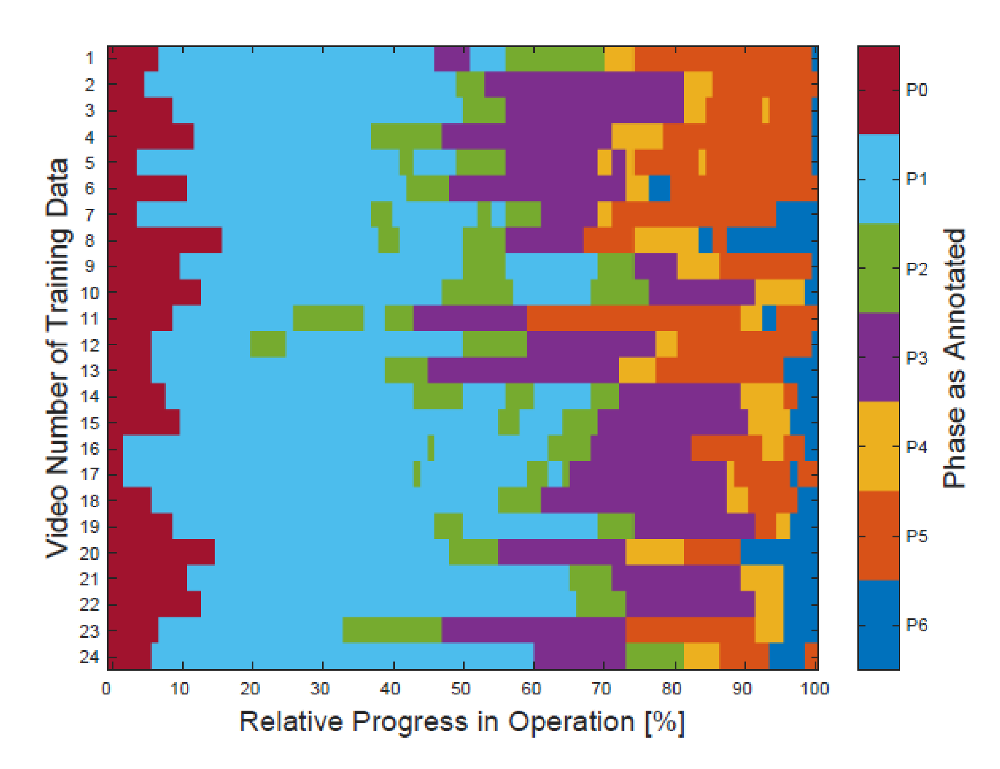
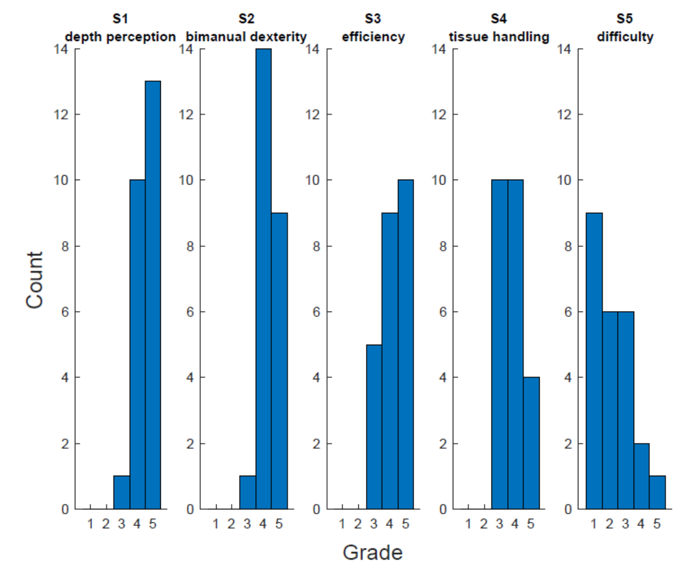
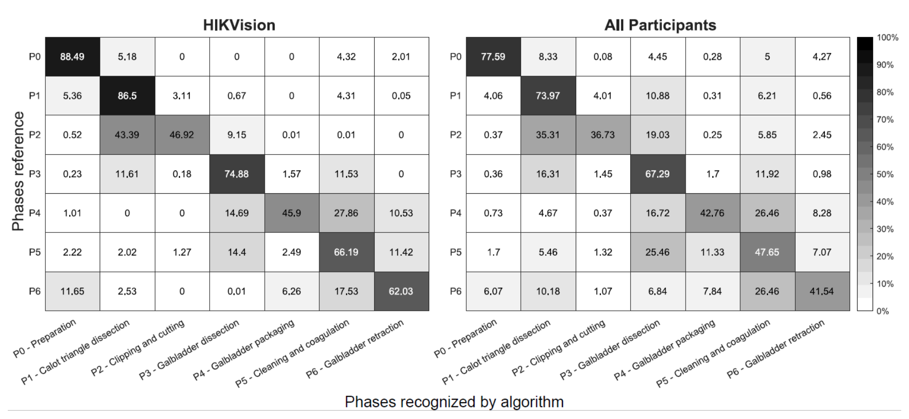
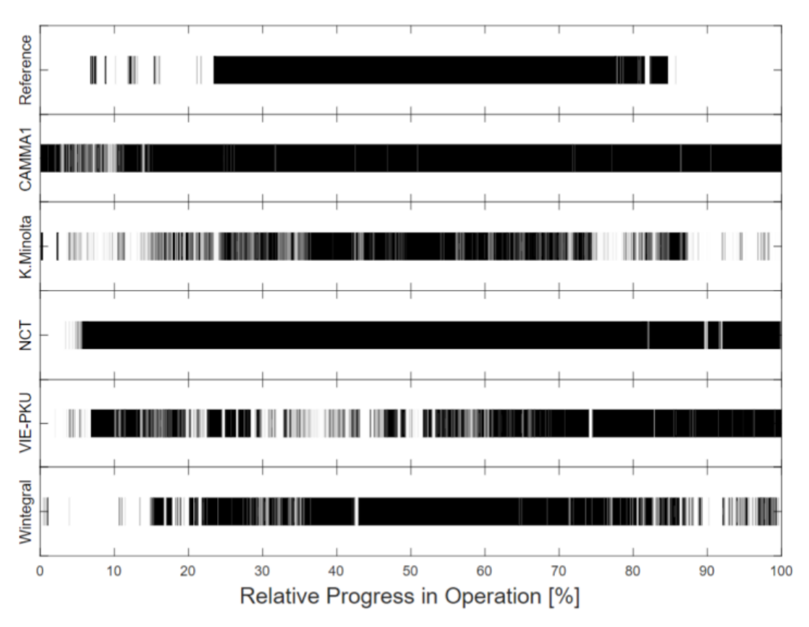
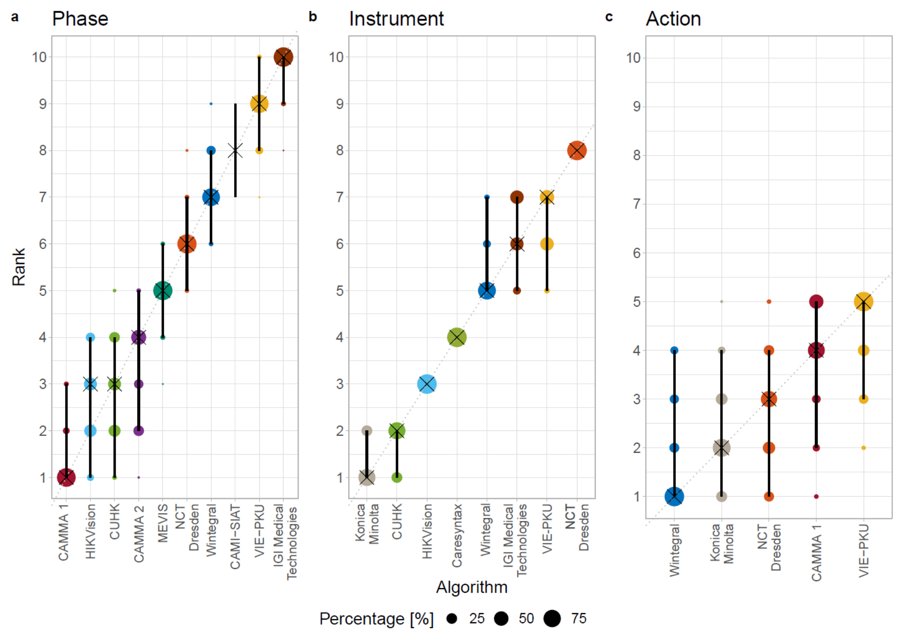
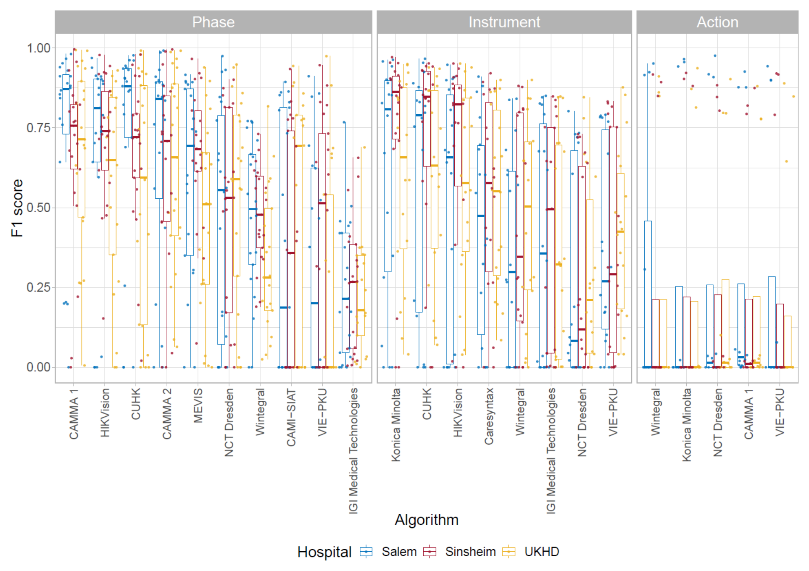

## 1. 背景与动机

手术工作流分析要判断手术进行到哪一步、医生在做什么、用了什么器械；技能分析要判断手术做得好不好。论文认为两者是手术辅助系统和半自主手术机器人的前提。

**问题在数据。** 公开的 `Cholec80` 有 80 台单中心胆囊切除视频，阶段识别平均精度可达 91%，但只有阶段和器械标注。一个 1243 台的多中心数据集结果相近，却不公开。`JIGSAWS` 有动作和技能标注，但来自实验室模拟任务。

论文因此问两件事：单中心报告的阶段识别性能能否在多中心数据上由独立团队复现；比阶段更难的动作识别和技能评估能做到什么程度。

## 2. 核心观点速览

**答案是不能复现，而且更难的任务基本没解决。** 在 HeiChole 上，2019 年内镜视觉挑战赛参赛方法的阶段识别 F1 赛内最高 65.38%，器械检测最高 63.82%，动作识别最高 23.28%，技能评估唯一提交的平均绝对误差为 0.78。

F1 是精确率和召回率的调和平均；这里先在每个视频内对所有类别求 F1，再对视频平均。

四个关键做法：

1. 三家德国医院采集 33 台手术，共 22 小时，测试集每个中心 3 台。
2. 同一套视频上标注阶段、动作、器械、技能四类标签。
3. 参赛者提交容器，测试集不公开，只允许在线推断。
4. 用 1000 次 bootstrap 和成对 `Wilcoxon` 检验评估排名是否可信。

**边界：** 测试集只有 9 个视频，技能任务只有 1 支队伍，摘要和正文有几处数字对不上。

:::highlights
- 阶段识别最好约 65%，远低于单中心报告的 91% 平均精度，但两者指标不同
- 动作识别五个方法都在 23% 左右，几乎只会预测“持握”
:::

:::data
- 33 台视频，22 小时，三个中心
- 训练 24 台，测试 9 台
- 12 支参赛队伍
:::

## 3. 数据：多中心有多“多”

这一节回答：测试集能不能真正考到跨中心泛化。

| 中心 | 视频数 | 分辨率 | 帧率 |
|---|---|---|---|
| 海德堡大学医院 | 15 | 960×540 | 25 |
| `Salem` 医院 | 15 | 1920×1080，3 台为 720×576 | 多数 50 |
| `Sinsheim` 医院 | 3 | 1920×1080 | 多数 50 |

训练集只有海德堡和 `Salem` 各 12 台，`Sinsheim` 的 3 台全部在测试集。**所以测试时有一个中心是模型完全没见过的，但它只有 3 个视频。**

中心之间不只病人不同：分辨率、帧率、器械品牌都不同。海德堡病例更难，15 台里有 2 台评为最难的 5 级；另两家没有 5 级病例。

*论文原图编号：Figure 2。训练集 24 台手术的阶段分布，横轴为相对手术进度。阶段长度差异大，P1 与 P2 会来回切换。*

## 4. 标注：四类任务的粒度

阶段沿用 `Cholec80` 的七阶段定义，但不要求固定顺序。动作只有抓取、持握、剪切、夹闭四种，每帧一个四维二值向量。器械有 21 种，归为七类。技能用改良的腹腔镜技能整体操作评估量表，五个维度各打 1 到 5 分。

**动作的时长极不平衡。** 持握每台累计 974.2 秒，抓取、剪切、夹闭每台累计都在 10 秒以内。这一点直接决定了后面的动作识别结果。

技能评分只用到 3 到 5 分，1 分和 2 分从未出现。阶段由 3 名医学生、技能由 2 名医学生独立标注后协商一致；标注者间一致性论文未说明，动作和器械由几人标注论文也未说明。

*论文原图编号：Figure 3。训练集五个技能维度的评分分布，四个技能维度都集中在 3 到 5 分。*

## 5. 评测协议：怎么防止对测试集调参

参赛者提交 Docker 容器，输入一段视频，输出 CSV。测试集和参考标注从不公开，赛后新方法也只能提交给组织方运行。阶段、动作、器械只能用过去和当前帧，技能评估可以看完整视频。

排名先按逐视频平均 F1；技能按平均绝对误差。**逐视频、逐类别平均让每类权重相同，代价是罕见类别的失败会被放大。**

排名可信度用两种方法检查：对 9 个测试视频重采样 1000 次看排名变化，用 `Kendall` 相关系数衡量变化大小（1 为完全不变）；再用 `Holm` 校正的成对 `Wilcoxon` 检验看谁显著领先。

各队可以用外部公开数据，多支队伍用了 `Cholec80` 预训练；超参数和帧采样方式论文未说明。

## 6. 结果说了什么

| 排名 | 阶段 | F1（%） | 动作 | F1（%） | 器械 | F1（%） |
|---|---|---|---|---|---|---|
| 1 | `CAMMA 1`（赛后） | 68.78 | `Wintegral` | 23.28 | `Konica Minolta` | 63.82 |
| 2 | `HIKVision` | 65.38 | `Konica Minolta` | 22.83 | `CUHK` | 62.95 |
| 3 | `CUHK` | 64.98 | `NCT Dresden` | 22.62 | `HIKVision` | 58.20 |
| 末位 | `IGI Medical Technologies` | 23.93 | `VIE-PKU` | 21.75 | `NCT Dresden` | 27.45 |

**阶段：** 赛内冠军由 `HIKVision` 和 `CUHK` 并列获得。最难的是夹闭与切断（P2）：`HIKVision` 只判对 46.92%，有 43.39% 被判成前一阶段 P1。原因是剪刀、施夹器等标志性器械在相邻阶段也会出现。

*论文原图编号：Figure 6。`HIKVision` 与全部参赛者的阶段混淆矩阵（%），P2 与 P1、P4 与 P5 混淆最多。*

**动作：** 持握占手术时长 73.3%，参赛方法把 83.2% 的时间都判为持握。各方法持握的 F1 在 0.84 到 0.91，其余三类平均 F1 都低于 0.03，四类平均后就落在 23% 左右。**所以动作排行榜几乎只反映持握识别的微小差别。**

*论文原图编号：Figure 7。测试视频 `HeiChole-25` 上各队的逐帧持握预测与参考标注，多数方法几乎全程预测持握。*

**器械：** 最好的 `Konica Minolta` 不用任何时序信息，只额外学习器械的共现。所有参赛者平均来看，标本袋被全程误检，剪刀被漏检。

**技能：** 唯一提交对每个视频都给出同样的分数，0.78 的误差主要来自参考评分本身集中在高分段。

## 7. 排名可信吗

阶段和器械排名的 `Kendall` 相关系数均值都是 0.93，动作只有 0.66。动作任务的五个方法之间没有任何显著差异。

*论文原图编号：Figure 5。1000 次 bootstrap 下的排名分布，黑叉为中位排名，黑线为 95% 区间。动作任务的区间明显更宽。*

**但这里的稳定只针对这 9 个测试视频。** 重采样不会引入新中心或新病例，它说明的是排名对测试视频扰动不敏感，不是对新医院的泛化。

## 8. 为什么是这些结果

论文给出的解释，以及我的判断：

| 现象 | 论文的解释 | 我的判断 |
|---|---|---|
| 阶段识别前三名都用卷积网络加循环网络 | 循环网络可记住所有历史帧 | 前三名在预训练和后处理上也不同，没有消融，只能算一致的迹象 |
| 阶段识别在海德堡最差 | 海德堡病例更难 | 海德堡的分辨率和帧率也不同，难度和画质没有分开 |
| 器械检测在未见过的 `Sinsheim` 上最好 | 与 `Salem` 器械品牌相同 | 合理，但只有 3 个视频 |
| 动作识别失败 | 训练集没有反映其他动作的变化 | 逐帧类平均 F1 同样会压平方法差异，论文没有尝试其他指标 |

*论文原图编号：Figure 4。各算法逐视频 F1，按医院着色。注意图注与图例对医院颜色的说法不一致，以图例为准。*

## 9. 结果没说什么

- **91% 对 65% 不能直接归因于多中心。** 指标不同（平均精度对 F1），训练集只有 24 台，阶段也不再有固定顺序。论文没有单中心与多中心训练的对照。
- **动作识别低分不等于短暂动作不可学。** 论文没有按事件计的指标或按类召回。
- **技能评估没有形成可用基线。** 只有 1 支队伍，且输出常数。
- **参考标注的噪声大小未知。** 标注者间一致性论文未说明。

## 10. 复现与使用要注意什么

论文中有几处数字对不上，引用前要核对：

- 摘要阶段 F1 上限写 67.7%，排行榜最高 68.78%，赛内最高 65.38%。
- 摘要器械 F1 下限写 38.5%，排行榜最低是 27.45%。
- 正文 P0、P1 识别率 79.4% 和 82.8%，与图 6 两个混淆矩阵都对不上，口径论文未说明。
- 图 4 的图注与图例对医院颜色的描述不一致。
- 抓取和持握的“每台次数”与总数除以 33 台不符，分母论文未说明。

动作执行者（左手、右手、助手）做了标注却没有发布，原因论文未说明。

数据使用条件：训练集以非商业、相同方式共享的许可在 `Synapse` 发布，测试集只能通过提交容器评测。

## @takeaways
- HeiChole 的价值在评测协议和负面结果，而不在规模：33 台视频、9 台隐藏测试集
- 阶段与器械识别最好都在 63.82% 到 68.78% 之间，排名稳定
- 动作识别所有方法几乎只预测持握，排行榜不能区分方法
- 技能任务只有一个常数输出的提交，不能作为基线

## @strengths
- 测试集不公开加容器提交，避免对测试集调参
- 同一批视频上有四类标注，附书面标注规则
- 用 bootstrap 和显著性检验报告排名不确定性，而不只给一张排行榜
- 如实报告了动作和技能任务的失败

## @weaknesses
- 测试集只有 9 个视频，每中心 3 个，中心对比的样本量很小
- 难度、器械品牌、分辨率、帧率随中心一起变化，没有分离
- 标注者间一致性、动作与器械标注人数论文未说明
- 摘要与正文、图注与图例存在多处数字和描述不一致

## @questions
- 按中心留一重新划分后，阶段识别的排名是否保持
- 动作任务改用事件级指标后，各方法之间是否出现差异
- 摘要中的 67.7% 和 38.5% 分别对应哪个结果
