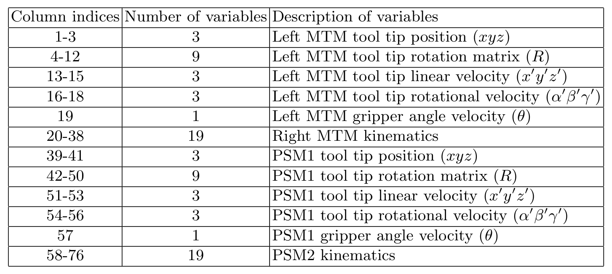
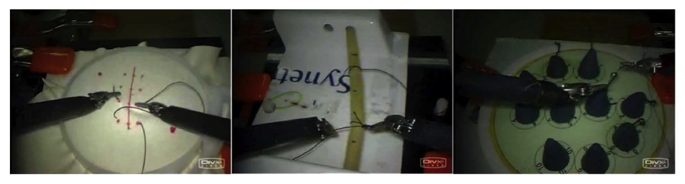
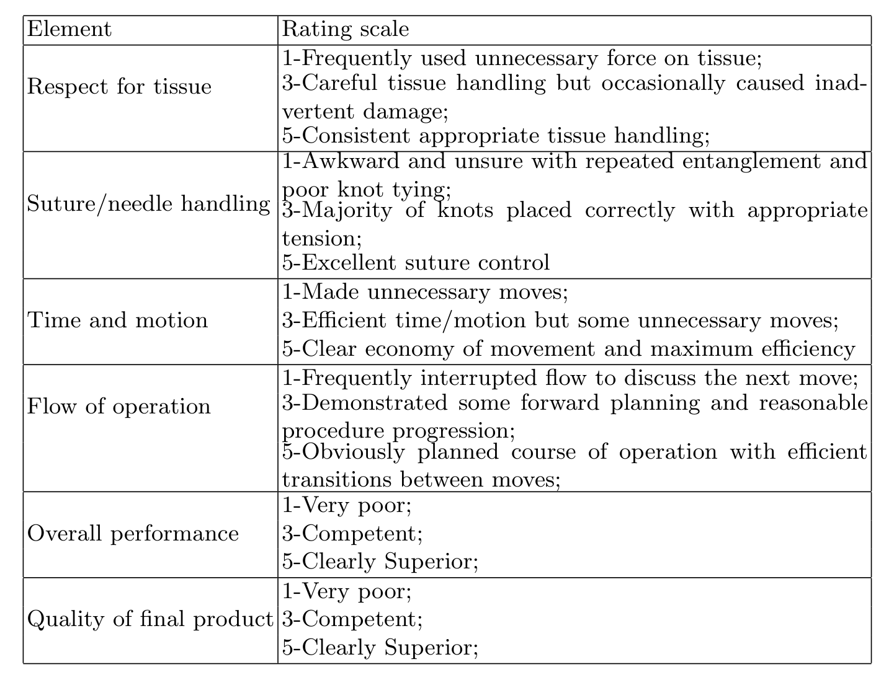

## 1. 背景与动机

**手术技术欠佳与术后并发症有关，而评价技术长期靠专家目测。** 论文引用的研究显示，技术失误是再手术和再入院最常见的原因，所以让外科医生更快、更客观地掌握技术能直接影响患者安全。

约翰斯·霍普金斯大学的 Language of Surgery 项目把手术动作看作一种语言：基本动作按约束依次组合，于是可以借用语音识别的方法来切分和评价。**做这类研究需要同一时间轴上的工具轨迹、视频和人工标注，当时没有公开的这类数据。**本文就是把项目内部一次台架实验整理后公开。

## 2. 核心观点速览

**这是一份数据说明书，不含任何模型的数值结果。**

- 数据：8 名外科医生在达芬奇机器人上把缝合、打结、穿针各做 5 遍，可用试次共 103 个；每个试次有 76 维运动学和左右两路视频，逐帧同步。
- 标注：15 个手势的起止帧（单人标注），以及改良 `OSATS` 的 6 要素技能评分（单名外科医生，设盲）。
- 协议：`LOSO`（5 折）和 `LOUO`（8 折）两种交叉验证划分，加三种 `HMM` 与视频分析工具。
- 边界：没有基线、没有指标定义、没有标注一致性；技能分档是自报时长，每档 2 到 4 人。

:::highlights
- 运动学直接来自机器人，不需要从视频估计
- 手势起止帧可同时索引运动学和视频
:::

:::data
- 8 名受试者，3 个任务，每任务 5 遍
- 可用试次：缝合 39、打结 36、穿针 28
:::

## 3. 信号从哪来

**这一节回答：数据能不能直接拿来建模。** 达芬奇系统由医生端的两个主操作手（`MTM`）、患者端的从操作臂（`PSM`）和带立体内镜的相机臂组成。作者经研究接口以 30 Hz 记录左右 `MTM` 和两个 `PSM`。

每个操作臂 19 个变量：3 个位置、9 个旋转矩阵元素、3 个线速度、3 个角速度、1 个夹爪变量，4 个操作臂共 76 维，全部在同一坐标系下。

*论文原图编号：Table 1。76 列运动学变量的列索引与含义。*

视频是左右两路，30 Hz、640 x 480，与运动学逐帧对齐。**数据不含相机标定参数**，想做三维重建要自己标定。夹爪变量在正文是角度、在表 1 是角速度，论文未说明以哪个为准。

信号清楚了，下一个问题是任务和人。

## 4. 任务与受试者

三个台架任务是外科培训课程的常见内容：缝合要沿切口进出针四次；打结是打一个单环结；穿针是从右到左穿过四个小金属环。做任务时不许移动相机，也不许用离合。

*论文原图编号：Fig. 1。从左到右为缝合、打结、穿针。*

受试者的经验是自报的：D、E 超过 100 小时，C、F 在 10 到 100 小时，其余四人少于 10 小时，全部右利手。**每档只有 2 到 4 人**，“专家对新手”的比较其实是几个人之间的比较。

每人每任务 5 遍，每遍平均约两分钟。损坏试次为缝合 1、打结 4、穿针 12，**穿针可用样本比缝合少约三成**。损坏的试次属于谁论文未说明。

:::data
- 30 Hz，76 维运动学
- 640 x 480 立体视频
:::

## 5. 标签怎么定

**手势标签**来自 15 个手势的共享词表，例如推针穿过组织、把针从左手交到右手、双手拉线。词表与一名心外科医生商定，由一名标注员看视频记下每段手势的起止帧；除试次末尾少量帧外，每帧都有标签。

**技能标签**是改良 `OSATS` 的全局评分：6 个要素各 1 到 5 分求和，由一名妇科外科医生对受试者身份设盲后逐试次打分。

*论文原图编号：Table 3。6 个评分要素及 1、3、5 分的锚点描述。*

**两类标签都只来自一个人，论文未报告一致性。**这意味着模型之间几帧的边界差异或一两分的评分差异，可能落在标注噪声之内。

## 6. 划分与工具

- `LOSO`：超试次 $i$ 是某任务所有人的第 $i$ 遍，5 折，每折留一个超试次。
- `LOUO`：8 折，每折留出一名受试者，测对新医生的泛化。

**论文只统一了切分，没有统一指标。**不同论文即使用同一套折，也可能在“分类”（已知边界）或“识别”（同时切分）设置下用不同指标报告。

工具包提供三种方法：手势子 `HMM` 拼接成复合 `HMM` 并用语法约束解码；稀疏字典观测的 `HMM`；视频上的 `LDS`、视觉词袋和多核学习组合。

## 7. 结果没说什么

- 没有任何基线数值，不知道哪种方法在哪个划分上更好。
- 自报分档与 `GRS` 是否一致，`GRS` 的分布如何，论文未说明。
- 只有台架任务，不能代表真实手术里的视野变化、组织形变和遮挡。
- 受试者列表正文漏写了 G，与 8 人的说法不一致。

## 8. 一个替代解释

**用自报分档训练的技能分类器，可能只是记住了某个人的动作风格。**每档 2 到 4 人，`LOSO` 下同一受试者的其他 4 遍都在训练集里，模型可以借个人风格得分（推断）。

能区分两种解释的是 `LOUO` 下的技能结果和 `GRS` 与分档的相关性，本文都没给。所以评估技能时应以 `LOUO` 为主，并写明标签来源。

## 9. 复现与复用要注意什么

- 按表 1 列索引切分各操作臂，注意 `PSM1` 是右侧、`PSM2` 是左侧。
- 同时报告 `LOSO` 与 `LOUO`，写明分类还是识别设置、用什么指标。
- 先看夹爪变量的数值范围再决定把它当角度还是角速度。
- 穿针只有 28 个试次，跨任务比较时要考虑样本量差异。

## @takeaways
- JIGSAWS 是同步运动学加视频的台架手术数据，标签有手势起止帧和技能评分两层
- 论文只给数据和切分，不给基线和指标
- 技能评估优先看 `LOUO`，并区分自报分档与 `GRS`

## @strengths
- 运动学直接来自机器人，与视频逐帧同步
- 手势词表、评分量表和划分定义写得清楚，可直接复现读取
- 评分医生对受试者身份设盲

## @weaknesses
- 8 名受试者，每个技能档 2 到 4 人
- 手势和技能标签都只来自一个人，没有一致性统计
- 只有台架任务，没有相机标定，没有基线
- 文本存在受试者列表和夹爪变量两处不一致

## @questions
- 第二名标注员会改变多少手势边界？
- 自报分档与 `GRS` 的相关性有多高？
- 损坏的 17 个试次集中在哪些受试者？
