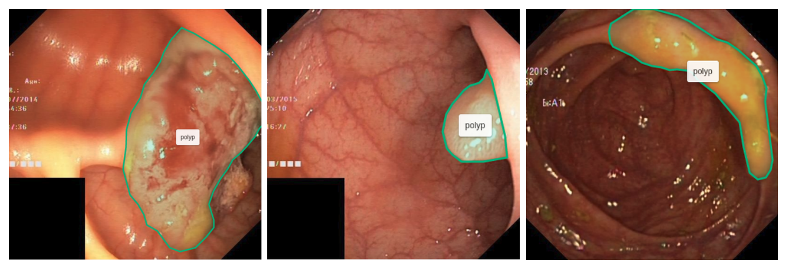
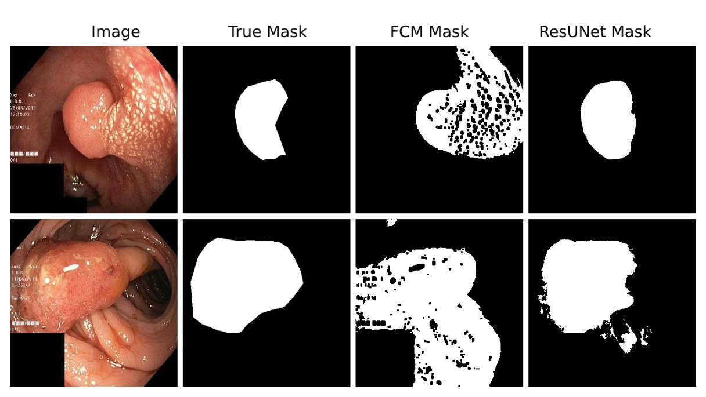
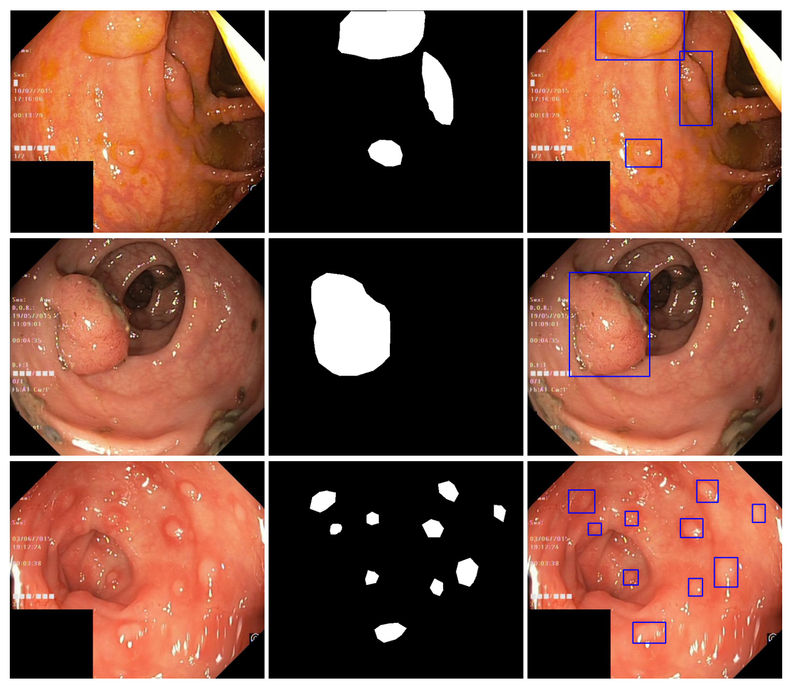
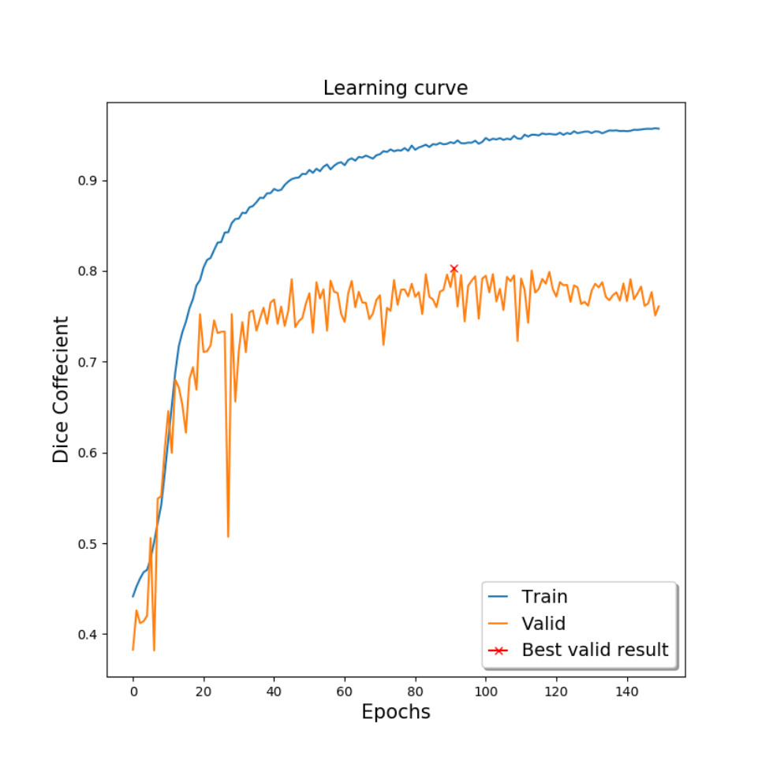

---
tags:
  - papers/手术数据集
aliases:
  - "Kvasir-SEG"
date: 2019-11-16
arxiv_id: "1911.07069"
---

# Kvasir-SEG: A Segmented Polyp Dataset

## 核心信息

- 标题: Kvasir-SEG: A Segmented Polyp Dataset
- 标题翻译: Kvasir-SEG：一个带分割标注的息肉数据集
- 作者: Debesh Jha, Pia H. Smedsrud, Michael A. Riegler, Pål Halvorsen, Thomas de Lange, Dag Johansen, Håvard D. Johansen
- 机构: SimulaMet；挪威北极大学（UiT）；Augere Medical AS；奥斯陆大学；奥斯陆大学医院；奥斯陆城市大学；Kristiania 大学学院
- 发表时间: 2019-11-16
- 发表渠道: arXiv 预印本（eess.IV），本笔记依据第 1 版
- arXiv: 1911.07069
- 论文链接: https://arxiv.org/abs/1911.07069
- 数据 / 资源: https://datasets.simula.no/kvasir-seg/
- 论文类型: benchmark_or_dataset

## 原文摘要翻译

像素级图像分割是医学图像分析中要求很高的任务。在实践中，很难找到带有对应分割掩码的医学标注图像。本文提出 `Kvasir-SEG`：一个开放获取的胃肠道息肉图像数据集，附带对应的分割掩码，由一名医生手工标注，再由一名经验丰富的消化科医生核验。此外，我们还借助分割掩码生成了息肉区域的边界框。我们用一种传统分割方法和一种基于深度学习的现代卷积神经网络（`CNN`）方法演示了该数据集的用法。该数据集将有助于研究者复现结果并比较方法。

`Kvasir` 数据集原本只提供帧级标注，通过为它补充分割掩码，我们让多媒体与计算机视觉研究者能够参与息肉分割和结肠镜图像自动分析领域的研究。

## 创新点

1. **把 Kvasir 的息肉类扩展成像素级分割数据。** 原始 `Kvasir` 只有帧级类别标签，本文对息肉类的 1000 张图像逐张勾画息肉轮廓，生成二值掩码，并由掩码导出边界框。这让同一批图像可以同时用于分割和定位研究。
2. **标注流程写明了人员分工和复核。** 一名工程师与一名医生在 `Labelbox` 中勾画边界，再由一名经验丰富的消化科医生复核。这比只给掩码不说来源的数据集更便于判断标签可信度。
3. **开放获取，直接下载。** 与需要注册或联系管理员的 `CVC-ColonDB`、`ETIS-Larib`、`ASU-Mayo` 不同，`Kvasir-SEG` 可直接下载用于研究。
4. **给出一组基线和推荐指标。** 论文用无监督的 `FCM` 聚类和有监督的 `ResUNet` 跑通了数据集，并建议后续工作统一用 `Dice` 和 `IoU` 报告结果。

## 一句话总结

`Kvasir-SEG` 给 `Kvasir` 息肉类的 1000 张结肠镜图像补上了医生标注、专家复核的二值掩码和边界框，并用单次 80/10/10 划分上的 `ResUNet`（测试 `Dice` `0.787763`）作为基线，但论文没有给出患者数、标注一致性和公开划分。

## 研究问题

结直肠癌是女性第二、男性第三常见的癌症，息肉是它的前驱病变。50 岁接受结肠镜筛查的人中近一半能发现息肉，而结肠镜中的息肉漏检率按类型和大小在 14 到 30% 之间。论文据此认为，自动检出更多息肉有助于结直肠癌的预防。

像素级分割是计算机辅助干预的基础，但人工分割费时、依赖医生且有观察者间差异。训练自动分割模型又需要大量高质量标注，息肉标注要消化科医生参与，成本高；医疗图像还受隐私和安全限制。作者综述了现有息肉分割数据集，认为缺少一个可直接获取、可用于公平比较的开放数据集。

**论文要补的是数据缺口，而不是方法缺口**：在已有 `Kvasir` 图像上补充分割掩码，并给出可复用的指标和基线，让不同方法可以在同一数据上比较。

### 核心观点速览

- 数据：1000 张息肉图像，每张配一个 1-bit 二值掩码，边界框存于 JSON 文件。
- 标注：工程师和医生在 `Labelbox` 中勾画，消化科专家复核；一致性指标论文未说明。
- 基线：`ResUNet` 测试 `Dice` `0.787763`、`mIoU` `0.777771`；`FCM` 测试 `Dice` `0.239002`。
- 边界：只有一次随机划分，没有方差；与外部工作的数值比较来自不同数据集，作者也承认没有直接可比的论文。

要判断这份数据能不能用，先要看清图从哪来、标签怎么定义。

## 数据与任务定义

### 数据来源

这一节回答一个问题：1000 张图的来源有多可信、多宽。图像来自 `Kvasir` 数据集。原始 `Kvasir` 有 8,000 张胃肠道图像，分 8 类，每类 1000 张，类别包括解剖标志、病理发现和内镜操作。本文只取息肉类，并用新图替换了其中 13 张以提升质量；替换图像由挪威 Vestre Viken 医疗信托的消化科医生采集和核验。

`Kvasir` 曾用于 2017 和 2018 年 MediaEval 的 Medico 任务，但只能做帧分类。论文提到 Pozdeev 等人曾在 `CVC-ClinicDB` 上训练、去预测 `Kvasir` 的掩码，因为没有真值而无法报告分数，这正是补充掩码的直接动机。

*论文原图编号：Fig. 1。三帧 `Kvasir` 原图，绿色轮廓标出息肉组织。放在这里是因为它直观展示了“前景 = 息肉像素”的任务定义；画面左侧可见检查信息文字和左下角黑色遮挡块。*

### 任务定义与文件组织

任务是二分类的像素级分割：每个像素属于息肉或非息肉。掩码中白色前景是息肉像素，黑色背景不含阳性像素。部分原图里能看到 `ScopeGuide`（Olympus）内镜位置标记探头的图像。

数据集由三部分组成：图像文件夹、掩码文件夹各 1000 张，同名对应；边界框坐标存放在一个 JSON 文件中。图像用 JPEG 压缩。原图分辨率、患者数量、息肉大小或形态分布都论文未说明，所以无法判断数据覆盖面，也无法按患者划分。

### 标注协议

全部息肉类图像上传到 `Labelbox`。一名工程师和一名医生组成的小组手工勾画全部 1000 张图像中的息肉边缘，随后由一名经验丰富的消化科医生复核。复核修改了多少掩码、是否有多人独立标注和一致性统计，论文未说明。**这意味着标签误差有多大无从估计**，而模型之间几个百分点的差距可能落在标签误差之内。

标签来源清楚之后，接下来看掩码是怎么从标注生成的，以及作者如何评测。

## 方法主线

本文的“方法”是数据构建流程和评测协议，两个基线只是示范用法。读这一节要问的是：掩码和指标的定义是否足够精确，能让别人复现同样的数字。

### 机制流程

这里的机制是数据构建流程，不是模型。

1. **选图**：输入为 `Kvasir` 息肉类 1000 张图像（其中 13 张为新替换图），全部上传到 `Labelbox`。
2. **勾画与复核**：工程师和医生勾画息肉边缘，消化科专家复核；随后导出 JSON 文件，从中提取每张图的 ROI 坐标点。
3. **生成掩码**：在全黑图像上按 ROI 坐标画出轮廓，再把轮廓内填充为白色，得到 1-bit 色深的二值掩码，存入掩码文件夹。
4. **导出边界框**：由分割掩码计算包住每个息肉区域的坐标集合，写入 JSON 文件；一张图有多个息肉时会有多个框（见下文图 2）。

### 评测协议

论文建议用 `Dice` 系数和 `IoU` 评测，理由是它们是医学图像分割和多个医学类 `Kaggle` 竞赛中最常用的指标。公式中第一个集合是预测像素集合，第二个集合是真值像素集合：

$$
\mathrm{Dice}(A,B)=\frac{2|A\cap B|}{|A|+|B|}=\frac{2\,TP}{2\,TP+FP+FN}
$$

$$
\mathrm{IoU}(A,B)=\frac{|A\cap B|}{|A\cup B|}=\frac{TP(t)}{TP(t)+FP(t)+FN(t)}
$$

论文说 $t$ 是阈值，在每个阈值上把预测目标与所有真值目标比较算出一个精度值。但 `mIoU` 具体在哪些阈值上取平均、是逐图平均还是全数据集累计，论文未说明。实际实验中 `ResUNet` 只用了阈值 $t=0.5$ 把预测概率二值化。**指标口径不清，是后文 `FCM` 数字反常的根源。**

### Baseline 设置

**FCM 基线。** 无监督、没有可学习参数，也不使用数据增强。预处理链路为：转灰度并做中值模糊去噪；用基于中值的 Otsu 方法得到 ROI；把像素归一化到 0 到 1，减去模糊版本，按阈值得到边缘图；膨胀扩大前景；从图像中减去边缘并截断到 0 到 1；展平成 1D 送入 `FCM`；把输出重排回 2D 二值掩码。聚类中心数、边缘阈值和膨胀核大小都论文未说明，因此这个基线无法精确复现。

**ResUNet 基线。** 关键配置如下：

| 项目 | 设置 |
|---|---|
| 数据增强 | 翻转、随机裁剪、缩放、旋转、亮度、cutout、随机擦除 |
| 输入尺寸 | 320×320 |
| 划分 | 训练 80%、验证 10%、测试 10% |
| 结构 | 编码器和解码器各 5 个卷积块，含残差块；每块通道数论文未说明 |
| 训练 | batch size 8，训练 150 个 epoch，第 91 个 epoch 收敛 |
| 优化器 | Nadam，学习率 0.0001，β1 = 0.9，β2 = 0.999 |
| 损失 / 激活 | `Dice` 损失，ReLU |
| 二值化阈值 | 0.5 |
| 框架与硬件 | Keras + TensorFlow，Nvidia DGX-2 上单块 Volta 100 GPU |

划分是否按患者进行、随机种子、划分文件是否公开，论文未说明。有了这些设置，就可以看两个基线到底跑出了什么。

## 关键结果

### 基线表现

结果部分要回答：这份数据能否把好方法和差方法分开。`ResUNet` 在三个划分上的表现（表 1）：

| 划分 | 损失 | Dice | mIoU |
|---|---|---|---|
| 训练 | 0.059389 | 0.940609 | 0.920957 |
| 验证 | 0.196520 | 0.803479 | 0.792339 |
| 测试 | 0.212236 | 0.787763 | 0.777771 |

> [!figure] Table 1 ResUNet 在 Kvasir-SEG 上的定量结果
> 建议位置：关键结果
> 放置原因：这是论文唯一的定量结果表，给出训练、验证、测试三档的损失、Dice 和 mIoU。
> 当前状态：保留占位；自动裁剪只得到页眉，没有表格主体，表中数字已在上方 Markdown 表格中完整转写。

测试集上两种基线的对比：

| 方法 | Dice | mIoU |
|---|---|---|
| FCM | 0.239002 | 0.314187 |
| ResUNet | 0.787763 | 0.777771 |

表 1 中每一行的损失与 `Dice` 之和都约等于 1，与“用 `Dice` 作损失”一致。**两个基线差距很大，说明数据集至少能区分“学到形状”和“只看颜色”的方法**，但单次划分不足以区分两个接近的深度模型。

### 定性对比

*论文原图编号：Fig. 3。四列依次为原图、真值掩码、`FCM` 结果、`ResUNet` 结果。放在这里是因为它直接解释了两个基线数值差距：`FCM` 把大片黏膜和图像边角都分成前景，`ResUNet` 的掩码形状接近真值，但第二行仍有边界外的零碎误检。*

作者把 `FCM` 表现差归因于它依赖颜色特征区分正常组织和息肉，而息肉与胃肠道内其他组织外观相近，颜色难以区分。

### 与外部工作的比较

作者承认没有直接可比的论文。他们把 `ResUNet` 结果和 Kang 等人报告的 `IoU` 0.6607、Pozdeev 等人报告的 `Dice` 0.6200 到 0.8600 并列，认为本文结果“相当或更好”。这些数字来自不同数据集和协议，只能说明量级，不能说明方法优劣。数字本身说完了，下一节讨论它们能支撑什么、不能支撑什么。

## 深度分析

### 它在已有息肉数据集中的位置

第一个问题是：既然已有四个息肉分割数据集，为什么还需要它。

| 数据集 | 规模（论文所述） | 获取方式 |
|---|---|---|
| CVC-ColonDB | 15 段视频抽 1200 帧，其中 300 帧有标注 | 需注册 |
| ASU-Mayo | 训练集 18,781 帧来自 20 段视频，3,500 余帧有掩码；另 18 段测试视频无真值 | 联系亚利桑那州立大学管理员 |
| ETIS-Larib | 196 帧 | 需注册 |
| CVC-ClinicDB | 29 段序列抽 612 帧 | 公开 |
| Kvasir-SEG | 1000 张 | 公开下载 |

在开放获取的息肉分割数据中，`Kvasir-SEG` 的 1000 张多于 `CVC-ClinicDB` 的 612 帧。论文提到 `ASU-Mayo` 的帧间相似性高，容易过拟合；而 `Kvasir-SEG` 的 1000 张图是否抽自同一段视频、来自多少次检查和多少名患者，论文未说明，所以帧间独立性也无法核实。我的判断：如果同一患者的多张图被随机分进训练和测试，测试分数会偏高；论文没有给出能排除这种情况的信息。

*论文原图编号：Fig. 2。每行依次为原图、二值掩码、由 JSON 边界框叠加的原图。放在这里是因为它显示了数据的形态差异：第一行有多个息肉、第三行有许多散在的小息肉，掩码可以有多个连通域，边界框也是一图多框。*

### benchmark 真正测到了什么

它测的是单张静态图像中息肉像素的二分类能力。数据里只有息肉阳性图像，没有不含息肉的帧，因此它不能评估误报率，也不能代表结肠镜视频中绝大多数无息肉画面的真实分布。边界框来自掩码而非独立标注，所以用它做检测评测，本质上仍是在复用同一套分割标签。

### 基线说明了什么

`ResUNet` 与 `FCM` 的差距（测试 `Dice` 0.787763 对 0.239002）说明数据集有足够的可学习信号，颜色聚类远远不够。但它只来自一次 80/10/10 划分、没有重复运行和方差，测试集只占 10% 的图像，无法判断 0.787763 的波动范围。

训练 `Dice` 0.940609 和测试 0.787763 之间差距明显，说明在 80% 的训练数据上存在过拟合；作者也认为加入更多样的息肉图像可提升性能。

*论文原图编号：Fig. 4。`ResUNet` 训练与验证 `Dice` 随 epoch 的变化，红色叉号标出最佳验证结果。放在这里是因为它展示了模型选择方式：训练曲线持续上升，验证曲线在最佳点下方上下抖动，并在训练前期出现过一次明显骤降。*

模型是按验证 `Dice` 挑选的第 91 个 epoch 的权重，再在测试集上评估一次，因此测试分数略低于验证分数是正常的。验证曲线抖动幅度不小，说明只用一次划分、只挑一个最佳点得到的测试分数并不稳定。

### 指标上的一个反常

`FCM` 的 `mIoU`（0.314187）高于 `Dice`（0.239002）。对同一组预测按单张图计算时，`Dice` 不会低于 `IoU`；两者若都在同一口径下逐图平均，也应保持这一关系。论文结果与这个关系相反，说明两个指标的计算口径可能不同（例如 `mIoU` 对前景和背景两类取平均），但论文没有交代，论文未说明。这正是复用时必须自己写清指标定义的原因。

### 适用边界

- 适合：单张息肉图像的二值分割和定位基线、跨数据集泛化测试的一端。
- 不适合直接回答：视频中的实时检出、无息肉画面的误报、息肉类型或良恶性判断、跨医院泛化。

## 局限

- 图像只来自 `Kvasir` 这一个数据集；本文只说替换的 13 张来自挪威 Vestre Viken 医疗信托，其余图像的采集机构、患者数、设备型号和分辨率分布论文未说明（原始采集细节需查 `Kvasir` 原论文）。
- 只有息肉阳性图像，没有阴性帧，也没有息肉类型、大小或病理标签。
- 摘要写“由一名医生手工标注”，正文写“由一名工程师和一名医生组成的小组”勾画，两处表述不一致；标注者间一致性和复核修改比例论文未说明。
- 部分图像带有 `ScopeGuide` 探头标记，画面中还有检查信息文字和黑色遮挡块，它们可能成为模型学到的捷径特征，论文没有讨论。
- 基线只做一次随机划分，划分文件、随机种子、是否按患者划分论文未说明；没有方差。
- `FCM` 的聚类数与阈值、`ResUNet` 的通道数论文未说明，基线无法精确复现。
- `mIoU` 的计算口径不明确，`FCM` 的 `mIoU` 高于 `Dice` 未作解释。
- 与外部工作的数值比较不在同一数据集上，作者自己也说没有直接可比的论文。
- 作者承认距离临床可用的性能还需要更多研究。

## 我的笔记

- 复用时把它当作“1000 张静态图的二值分割集”，固定并公开自己的划分，报告多次运行的均值和标准差。
- 指标要写明是逐图平均还是全局累计，`IoU` 是只算前景还是前景背景取平均；否则和其他论文的数字没法对齐。
- 更有说服力的用法是跨数据集评测，例如在 `CVC-ClinicDB` 上训练、在 `Kvasir-SEG` 上测试，或反过来，这比单集内随机划分更能反映泛化。
- 训练前可考虑遮掉左下角黑块和检查信息文字区域，或至少检查模型是否在这些区域产生响应。
- 待查问题：1000 张图来自多少名患者，同一患者的多张图是否会落到不同划分；被替换的 13 张图是哪些；`Labelbox` 复核阶段修改了多少掩码。

## 引用

- Pogorelov et al. (2017). Kvasir: A Multi-Class Image Dataset for Computer Aided Gastrointestinal Disease Detection.
- Tajbakhsh et al. (2015). Automated polyp detection in colonoscopy videos using shape and context information.（CVC-ColonDB）
- Bernal et al. (2012). Towards automatic polyp detection with a polyp appearance model.（ASU-Mayo）
- Silva et al. (2014). Toward embedded detection of polyps in WCE images for early diagnosis of colorectal cancer.（ETIS-Larib）
- Bernal et al. (2015). WM-DOVA maps for accurate polyp highlighting in colonoscopy.（CVC-ClinicDB）
- Zhang et al. (2018). Road Extraction by Deep Residual U-Net.（ResUNet）
- Cai et al. (2007). Fast and robust fuzzy c-means clustering algorithms incorporating local information for image segmentation.（FCM）
- Kang and Gwak (2019). Ensemble of instance segmentation models for polyp segmentation in colonoscopy images.
- Pozdeev et al. (2019). Automatic Analysis of Endoscopic Images for Polyps Detection and Segmentation.
