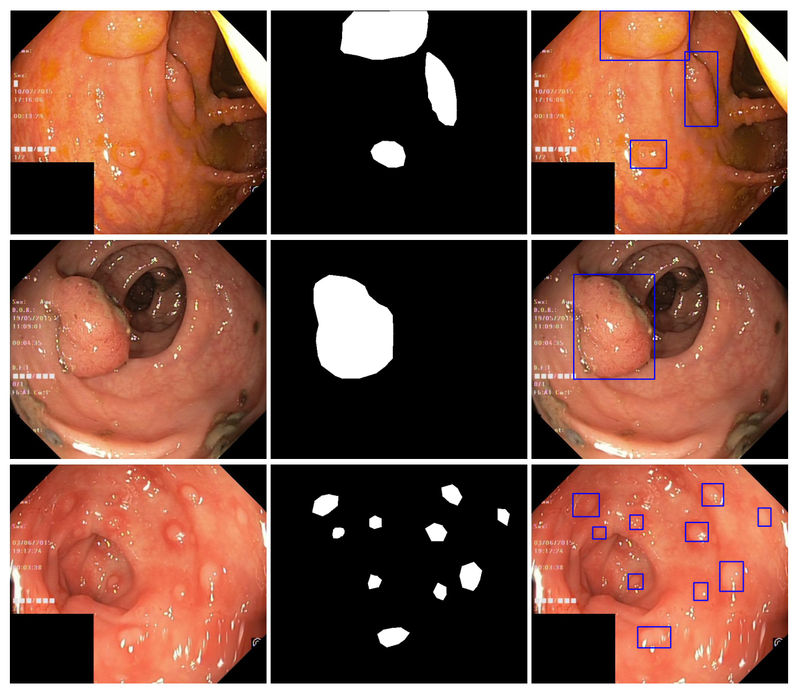
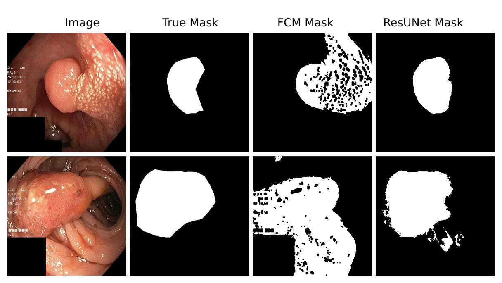
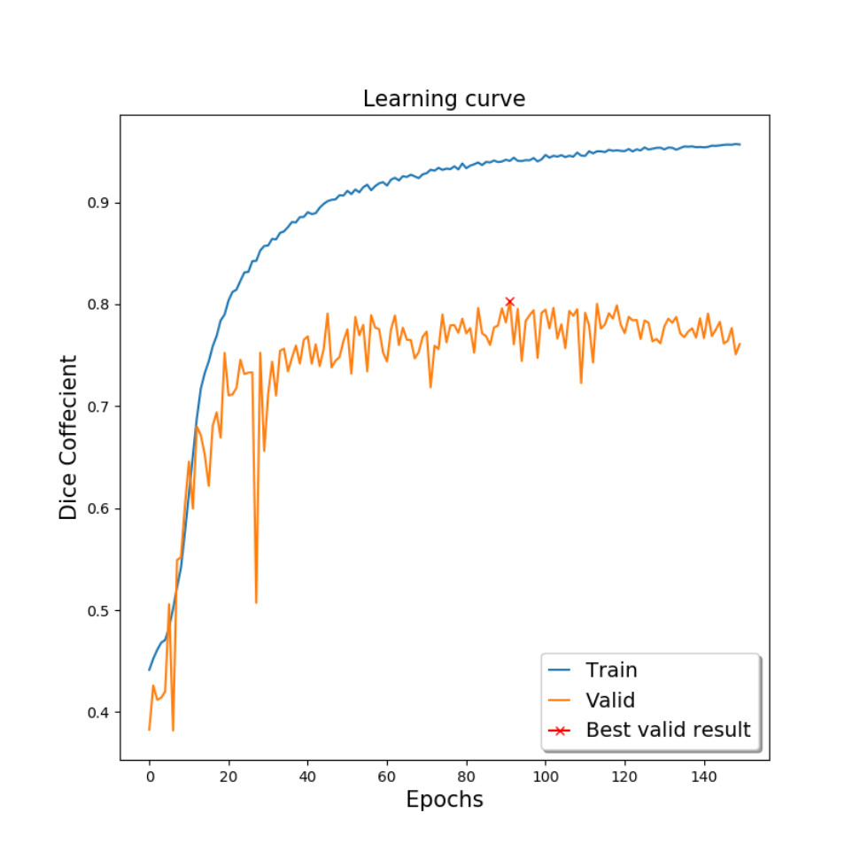

## 1. 背景与动机

**息肉会被漏掉，而训练自动分割模型又缺少开放的标注数据。** 论文引用的研究显示，结肠镜检查中息肉漏检率按类型和大小在 14 到 30% 之间，而息肉是结直肠癌的前驱病变。

人工逐像素勾画费时，需要消化科医生参与，还存在观察者间差异；医疗图像又受隐私限制。作者梳理了已有的四个息肉分割数据集，认为它们要么需要注册或联系管理员，要么规模小，**缺少一个可以直接下载、用于公平比较的开放数据集**。

`Kvasir` 本身是 8 类各 1000 张的胃肠道图像分类数据集，只有帧级标签。Pozdeev 等人曾想在它上面评测分割，却因为没有真值而无法报告分数。这就是本文的直接起点。

## 2. 核心观点速览

**这是一份数据发布说明，基线只是示范用法。**

- 数据：`Kvasir` 息肉类的 1000 张图像（替换了其中 13 张），每张配一个 1-bit 二值掩码，边界框写在 JSON 文件里。
- 标注：工程师和医生在 `Labelbox` 中勾画，消化科专家复核。
- 基线：`ResUNet` 测试 `Dice` 0.787763、`mIoU` 0.777771；`FCM` 聚类测试 `Dice` 只有 0.239002。
- 边界：一次随机划分、无方差；患者数、标注一致性、划分文件论文未说明。

:::highlights
- 只有息肉阳性图像，没有无息肉画面
- 边界框由掩码导出，不是独立标注
:::

:::data
- 1000 张图像 / 1000 个掩码
- ResUNet 测试 Dice 0.787763
:::

接下来先看数据怎么构建，再看基线说明了什么。

## 3. 数据从哪来、怎么标

**图像全部来自 `Kvasir` 的息肉类。** 作者为提升质量替换了其中 13 张，替换图由挪威 Vestre Viken 医疗信托的消化科医生采集和核验；其余图像的采集细节本文未交代，指向 `Kvasir` 原论文。

标注流程分四步：

1. 把 1000 张图上传到 `Labelbox`。
2. 一名工程师和一名医生组成的小组勾画息肉边缘，经验丰富的消化科医生复核。
3. 导出 JSON 中的 ROI 坐标点，在全黑图上画轮廓并填白，生成二值掩码。
4. 由掩码计算外接框，写入 JSON。

*论文原图编号：Fig. 2。每行依次为原图、二值掩码、由 JSON 边界框叠加的原图；一张图可以有多个息肉和多个框。*

**标注质量无法量化。** 摘要说由“一名医生”标注，正文说由“工程师加医生”的小组勾画，两处不一致；标注者间一致性和复核修改比例论文未说明。原图分辨率、患者数量和息肉大小分布也论文未说明。

:::highlights
- 掩码是二值的：白色前景是息肉，黑色背景
- 部分原图带有 ScopeGuide 内镜位置探头的图像
:::

数据形态清楚之后，下一个问题是怎么评测。

## 4. 指标和基线怎么设

论文推荐两个指标。设预测像素集合与真值像素集合分别为 $A$、$B$：

$$
\mathrm{Dice}=\frac{2|A\cap B|}{|A|+|B|},\qquad \mathrm{IoU}=\frac{|A\cap B|}{|A\cup B|}
$$

**`mIoU` 的口径没有交代清楚。** 公式里出现了阈值 $t$，但取哪些阈值、逐图还是全局平均、是否包含背景类，论文未说明；实验中只用 $t=0.5$ 把预测二值化。

两个基线的设置：

| 项目 | FCM | ResUNet |
|---|---|---|
| 学习方式 | 无监督聚类，无参数 | 有监督，编码器和解码器各 5 个卷积块 |
| 预处理 / 增强 | 灰度、中值模糊、Otsu、边缘与膨胀 | 翻转、裁剪、缩放、旋转、亮度、cutout、随机擦除 |
| 输入 | 展平成 1D 的像素 | 320×320 |
| 训练 | 无 | batch 8，150 个 epoch，Nadam，学习率 0.0001 |
| 未给出的设置 | 聚类数、阈值、膨胀核 | 每块通道数、随机种子 |

划分是 80/10/10 的随机划分，是否按患者划分论文未说明。

## 5. 结果说了什么

| 划分 | 损失 | Dice | mIoU |
|---|---|---|---|
| 训练 | 0.059389 | 0.940609 | 0.920957 |
| 验证 | 0.196520 | 0.803479 | 0.792339 |
| 测试 | 0.212236 | 0.787763 | 0.777771 |

测试集上 `FCM` 的 `Dice` 为 0.239002、`mIoU` 为 0.314187。**两种方法差距很大，说明这份数据能区分“学到形状”和“只看颜色”的方法。**

*论文原图编号：Fig. 3。四列依次为原图、真值、FCM 结果、ResUNet 结果。FCM 把大片黏膜和图像边角都分成前景。*

作者把 `FCM` 的失败归因于颜色特征难以区分息肉和其他胃肠道组织。表 1 中损失与 `Dice` 之和约为 1，和“用 `Dice` 作损失”一致。

:::data
- 训练 Dice 0.940609，测试 0.787763
- FCM Dice 0.239002，mIoU 0.314187
:::

## 6. 为什么要小心这些数字

**训练和测试的 `Dice` 差距明显，说明存在过拟合。** 作者也认为加入更多样的息肉图像能提升性能。

*论文原图编号：Fig. 4。训练与验证 Dice 随 epoch 的变化，红色叉号是最佳验证点，对应第 91 个 epoch。*

验证曲线抖动明显，模型是挑出验证最高点后在测试集上只评一次。只有一次划分、没有方差，0.787763 的波动范围无法估计。

**`FCM` 的 `mIoU` 高于 `Dice`，这在同一口径下不会发生。** 同一组预测逐图计算时 `Dice` 不低于 `IoU`。我的判断：两个指标的计算口径可能不同，例如 `mIoU` 对前景和背景取了平均；论文未解释。

## 7. 结果没说什么

- **没有证明方法优于已有工作。** 作者把结果与 Kang 等人的 `IoU` 0.6607、Pozdeev 等人的 `Dice` 0.6200 到 0.8600 并列，但数据集不同，作者自己也承认没有直接可比的论文。
- **没有评估误报。** 数据只有息肉阳性图像，无法测量在无息肉画面上的误检。
- **没有排除划分泄漏。** 推断：若同一患者的多张图被随机分进训练和测试，分数会偏高；论文未给出患者信息，无法排除。
- **没有说明跨医院泛化。** 图像只来自 `Kvasir` 一个数据集，采集机构和设备分布论文未说明。

## 8. 它在已有数据集中的位置

| 数据集 | 规模 | 获取方式 |
|---|---|---|
| CVC-ColonDB | 1200 帧中 300 帧有标注 | 需注册 |
| ASU-Mayo | 18,781 帧训练，3,500 余帧有掩码 | 联系管理员 |
| ETIS-Larib | 196 帧 | 需注册 |
| CVC-ClinicDB | 612 帧 | 公开 |
| Kvasir-SEG | 1000 张 | 公开下载 |

**它的优势是开放和规模**：在可直接获取的息肉分割数据里，1000 张多于 `CVC-ClinicDB` 的 612 帧。论文提到 `ASU-Mayo` 帧间高度相似、容易过拟合，而 `Kvasir-SEG` 的帧间独立性因为缺少视频和患者信息同样无法核实。

## 9. 复现与复用要注意什么

- 固定并公开自己的划分，最好按患者划分；报告多次运行的均值和标准差。
- 写清 `Dice` 和 `IoU` 是逐图平均还是全局累计，`IoU` 是否含背景类。
- 跨数据集评测（如 `CVC-ClinicDB` 训练、`Kvasir-SEG` 测试）比单集内随机划分更能反映泛化。
- 检查模型是否依赖左下角黑块、检查信息文字或 `ScopeGuide` 探头这类捷径。

## @takeaways
- Kvasir-SEG 是 1000 张静态息肉图的二值分割集，掩码和边界框同源
- ResUNet 测试 Dice 0.787763 只来自一次随机划分，适合作量级参考
- 患者数、标注一致性、mIoU 口径都论文未说明，复用时要自己补齐协议

## @strengths
- 开放下载，文件组织简单，图像与掩码同名对应
- 标注流程写明了工具、人员分工和专家复核
- 给出两种差异很大的基线，证明数据有可学习信号

## @weaknesses
- 单一机构来源，只有阳性图像
- 无标注一致性、无患者信息、无公开划分
- 指标口径不清，FCM 结果反常未解释；外部比较不可比

## @questions
- 1000 张图来自多少名患者，同一患者的图是否会跨越划分？
- 复核阶段修改了多少掩码，标注者之间一致性如何？
- mIoU 具体怎么算，为什么 FCM 的 mIoU 高于 Dice？
