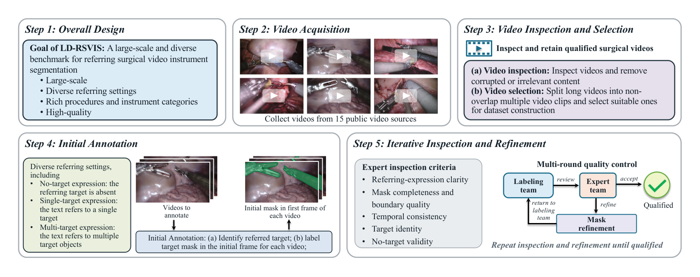
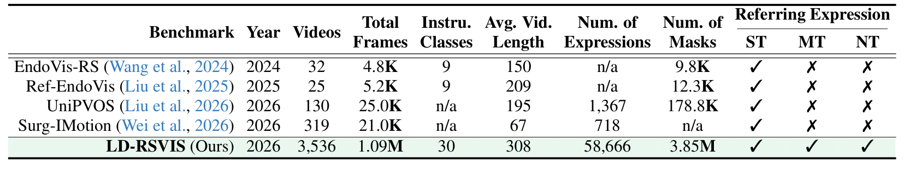
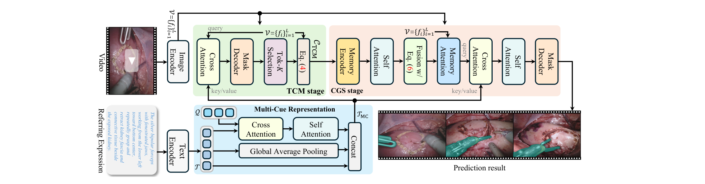
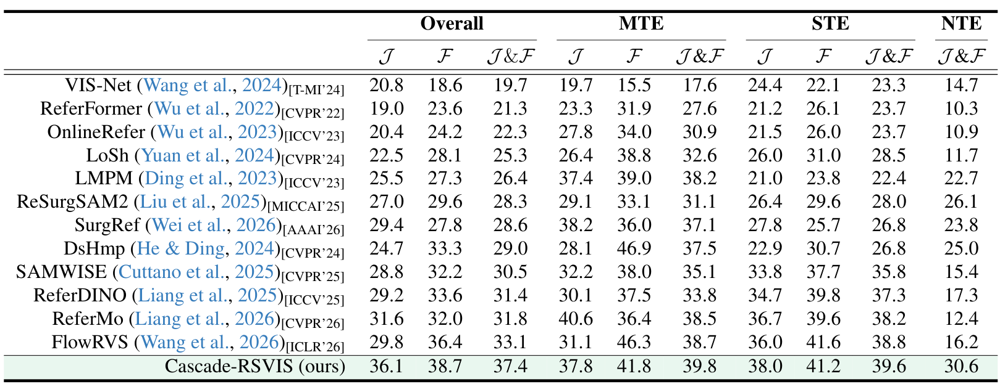

## 1. 背景与动机

**手术机器人要能听懂“左下方那把双极钳的尖端”，并在视频里把它分割出来。** 这就是指代式手术视频器械分割：输入视频和一句描述，输出每帧中被描述器械的掩码。

已有基准都太小，视频少于 350 段，测试集少于 100 段。它们还只有单目标表达，默认画面里必定有且只有一个目标。真实指令可能同时指两件器械，也可能指一件不在画面里的器械。

## 2. 核心观点速览

论文的回答是一个大一个数量级、三种指代设定齐全的新基准，外加一个参考方法。

- 从 15 个公开数据集挑选并切片，得到 3,536 段、1.09M 帧（1 fps），30 类器械、25 类术式。
- 专家写描述并标首帧，志愿者扩展成整段掩码，专家全体一致才通过。
- 58,666 条表达分为单目标、多目标、无目标三类；训练 2,853 段，测试 683 段。
- 12 个方法重训后总体 J&F 在 19.7 到 33.1 之间；Cascade-RSVIS 为 37.4。

**边界：** 数据未发布；无目标表达如何构造论文未说明；没有按来源或术式拆分的结果。

:::highlights
- 首个在手术领域同时考无目标、单目标、多目标的指代分割基准
- 已有方法在单目标与无目标之间此消彼长
:::

:::data
- 3,536 段视频，1.09M 帧，58,666 条表达，3.85M 掩码
- 测试表达：多目标 2,732，单目标 6,573，无目标 1,861
:::

## 3. 数据从哪来

**视频全部来自已有公开数据集，来源比以往的手术指代基准宽得多。** 除了 EndoVis 这类分割数据，还有 Cholec80、HeiChole 等工作流数据，SurgVU 等活动识别数据，以及 SurgeYoutube 网络视频。

帧数最多的是 MultiBypass140（202,350 帧）和 SurgeYoutube（153,307 帧）；两个 EndoVis 合计只有几千帧。术式几乎都是腹部手术。

长视频不整段使用，而是切成互不重叠的代表性片段，平均 307.5 帧，按 1 fps 约 5 分钟。切片的具体规则论文未说明。

## 4. 标注怎样做

*论文原图编号：Figure 5。数据构建五步流程与多轮质控循环。*

专家（相关方向的学生）为每段视频写描述，并标出首帧掩码。志愿者小队把首帧掩码扩展成整段时空掩码，再交专家检查完整性、边界、时间一致性和目标身份。任何一位专家不同意就退回重标。

**质量证据只有一项：** 外部专家重标 50 段，与原掩码 IoU 0.93。它说明掩码几何一致，但没有检查描述是否唯一指向、无目标是否真的不存在。

描述平均 25.7 词，常常同时写颜色、部件、位置、运动和操作对象。目标平均只占画面 6.4%。

## 5. 三种表达与评分

- **单目标：** 描述指向一个目标。
- **多目标：** 描述指向多于一个目标。
- **无目标：** 描述的器械不在视频里，正确输出是全程为空。

指标是 J（掩码 IoU）、F（轮廓精度）和二者平均 J&F。无目标表达只有整段输出全空才记 1 分，否则记 0。

**这条规则非常严苛：一帧误检，整条清零。** 它会偏向那些先做整段存在判断的模型，这一点在第 9 节再展开。

## 6. 与已有基准对比

*论文原图编号：Table 1。四个已有基准与 LD-RSVIS 的规模与支持设定对比。*

| 已有基准 | 它的特点 | 本基准新增 |
|---|---|---|
| EndoVis-RS | 32 段，取自 EndoVis | 来源扩到 15 个，器械 9 类到 30 类 |
| Ref-EndoVis | 25 段，修正掩码，含组织 | 只做器械与部件，规模大两个数量级 |
| UniPVOS | 扩展 Ref-EndoVis，含组织 | 加入多目标与无目标 |
| Surg-IMotion | 319 段，平均 67 帧，侧重运动 | 视频更长，设定更全 |

论文正文称后者为 Ref-IMotion，表 1 写作 Surg-IMotion，是同一工作。

## 7. 参考方法 Cascade-RSVIS

*论文原图编号：Figure 4。Cascade-RSVIS 的两阶段结构与多线索文本表示。*

**思路是先找出最有把握的几帧，再把它们当作示例去分割其余帧。** 方法建在 SAM 2 上。

1. 文本经 RoBERTa 编码，词特征、句子特征和 3 个可学习查询特征拼成多线索表示。
2. 第一阶段逐帧预测掩码、IoU 分数和存在分数；若最大存在分数小于 0，整段输出为空；否则按 IoU 取前 3 帧。
3. 第二阶段把这 3 帧编码成记忆，按 IoU 分数的 softmax 加权融合，再注入每帧特征并结合文本解码。

训练分两段：先训第一阶段 18 轮，冻结后训第二阶段 24 轮。推理时切成 8 帧片段，25 fps，峰值显存 16 GB，总参数 292M。

## 8. 结果说了什么

*论文原图编号：Table 3。13 个方法在测试集四个子集上的结果。*

| 方法 | 总体 | 多目标 | 单目标 | 无目标 |
|---|---|---|---|---|
| ReSurgSAM2 | 28.3 | 31.1 | 28.0 | 26.1 |
| ReferMo | 31.8 | 38.5 | 38.2 | 12.4 |
| FlowRVS | 33.1 | 38.7 | 38.8 | 16.2 |
| Cascade-RSVIS | 37.4 | 39.8 | 39.6 | 30.6 |

**单目标最强的通用方法，在无目标上最弱。** FlowRVS、ReferMo 无目标只有 16.2 和 12.4；ReSurgSAM2 单目标只有 28.0，无目标却有 26.1。擅长“必定找出一个”的模型，往往在目标不存在时也硬找一个。

Cascade-RSVIS 每个子集的 J&F 都最高，但多目标 J 37.8 低于 ReferMo 的 40.6，多目标 F 41.8 低于 DsHmp 的 46.9。它的总体领先很大一部分来自无目标子集。

消融中贡献最大的是级联：只用第一阶段 30.7，加上第二阶段 37.4。上下文帧数与查询数都在 3 时最好，IoU 加权融合比等权相加高 1.4。

在两个已有基准上它也领先：Ref-EndoVis 两个子集 J&F 80.6 和 82.6。

:::data
- 已有方法总体 J&F 最高 33.1，Cascade-RSVIS 37.4
- 无目标：Cascade-RSVIS 30.6，已有方法最高 26.1
- 级联消融：30.7 到 37.4
:::

## 9. 结果没说什么

**低分可能有三种来源，论文没有把它们分开：** 15 个来源之间的域差、部件级小目标、无目标的二值判分。要区分它们，需要按来源、目标大小、部件与整件分层的结果，论文未说明。

**无目标领先可能部分来自规则契合。** Cascade-RSVIS 在存在分数小于 0 时整段置空，正好对应“整段全空才得分”。如果给基线加上同样的置空规则，差距会缩小多少，论文没有实验。

**级联的收益没有控制训练量。** 完整模型在第一阶段 18 轮之后又训了 24 轮，没有等训练量的单阶段对照。所有结果也都是单次运行。

多目标分数普遍高于单目标，例如 LMPM 38.2 对 22.4。论文未说明原因。我的判断是多目标常指多件大器械、掩码大，IoU 更容易拿分，这需要验证。

## 10. 复现要注意什么

- 数据和代码未发布，论文只说将托管在 GitHub 和/或 Hugging Face。
- 无目标判分要按“整条表达全程为空”实现，按片段判断会得到不同数字。
- 推理切成 8 帧片段，片段间如何合并、身份如何保持论文未说明。
- 视频许可受 15 个来源各自约束，网络视频来源能否再分发要单独确认。

## @takeaways
- 这是首个在手术领域同时考三种指代设定的基准，规模约为已有基准的 10 倍。
- 比较方法时把无目标子集单独看，总体 J&F 会被二值判分放大。
- “先挑高置信帧再当记忆”的思路可以直接迁移到其他基于 SAM 2 的视频分割任务。

## @strengths
- 规模与设定的扩展实在，测试集 683 段，评测不再取决于少数视频。
- 12 个基线在同一训练集上重训，对比口径统一。
- 有外部重标的一致性检查，并在两个旧基准上验证了参考方法。

## @weaknesses
- 数据未发布，无法复现任何数字。
- 无目标表达的构造方式、片段切分规则论文未说明。
- 没有按来源、术式、器械类别拆分的结果，难度来源不清。
- 标注者是学生而非外科医生，描述未经临床审核。

## @questions
- 无目标描述与真实器械的相似度如何控制？
- 部件级表达与整件表达的比例和性能差距各是多少？
- 用本基准训练的模型迁移到旧基准，能比在旧基准上训练提升多少？
