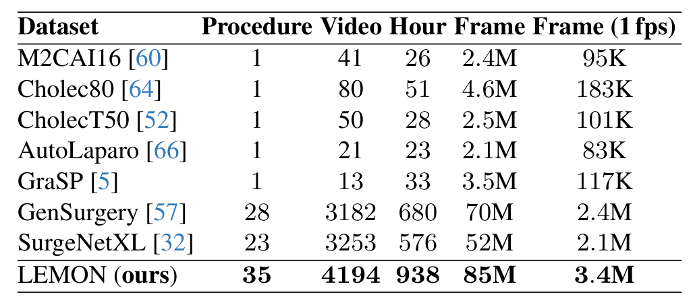
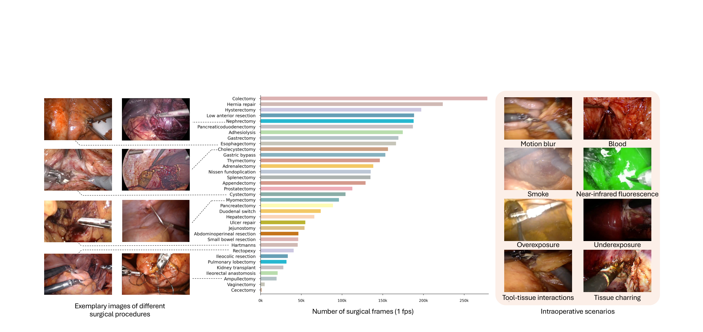
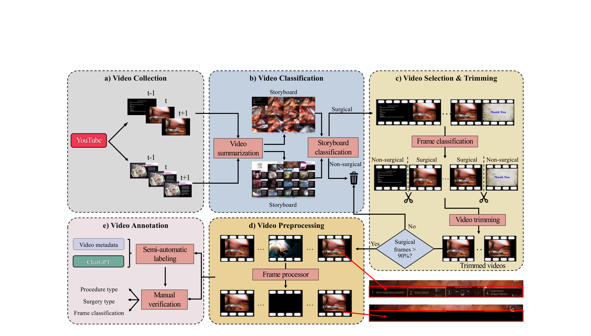
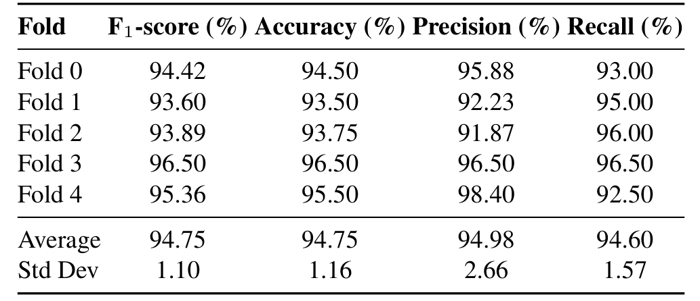
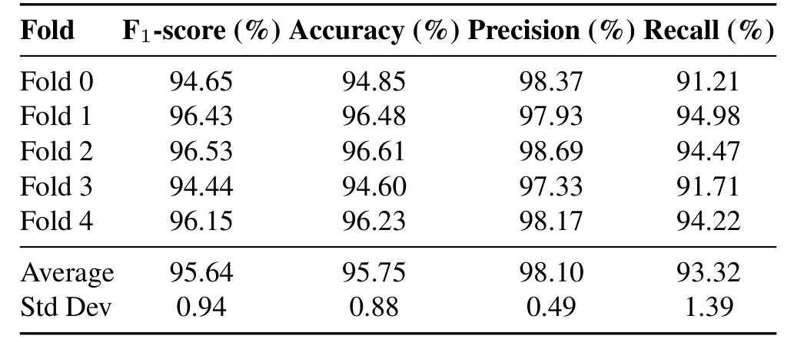
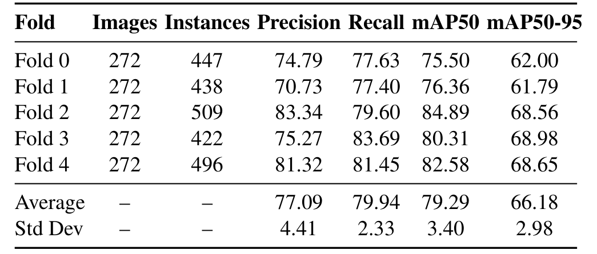
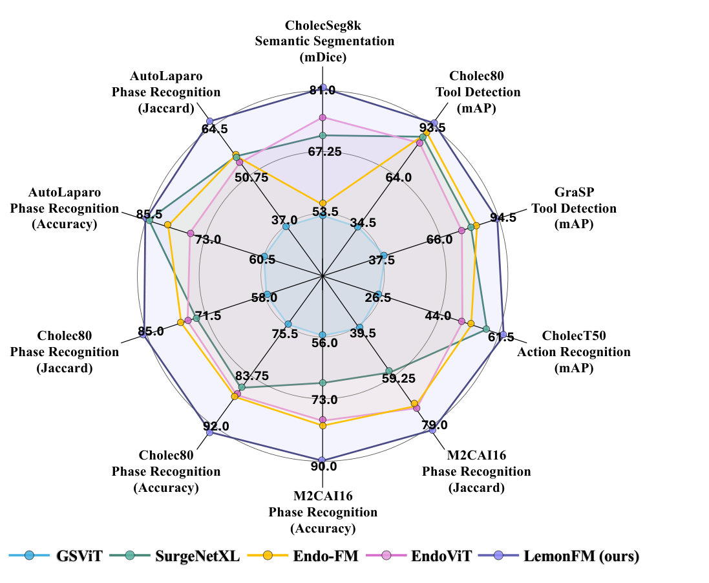
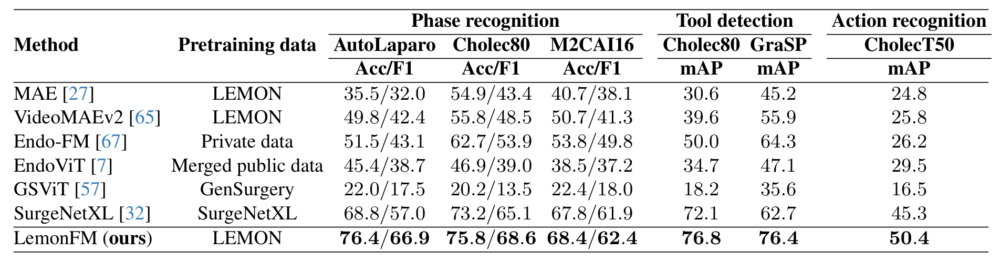
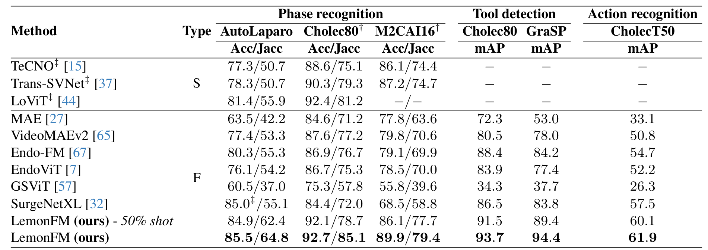
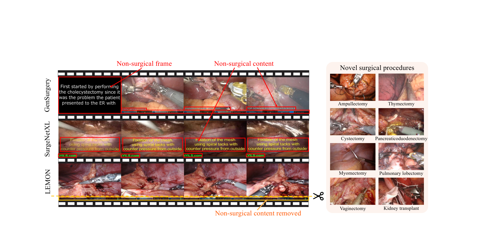

---
tags:
  - papers/手术数据集
aliases:
  - "LEMON"
  - "LemonFM"
  - "Surg-3M"
date: 2025-03-25
arxiv_id: 2503.19740
---

# LEMON: A Large Endoscopic MONocular Dataset and Foundation Model for Perception in Surgical Settings

## 核心信息

- 标题: LEMON: A Large Endoscopic MONocular Dataset and Foundation Model for Perception in Surgical Settings
- 标题翻译: LEMON：面向手术场景感知的大规模内镜单目数据集与基础模型
- 作者: Chengan Che, Chao Wang, Tom Vercauteren, Sophia Tsoka, Luis C. Garcia-Peraza-Herrera
- 机构: 伦敦国王学院信息学系
- 发表时间: 2025-03-25（arXiv v1，早期版本题为 Surg-3M）；本笔记依据 2026-03-20 的 v4
- 发表渠道: arXiv 预印本（cs.CV）
- arXiv: 2503.19740
- 论文链接: https://arxiv.org/abs/2503.19740
- 代码 / 项目: https://github.com/visurg-ai/LEMON
- 数据 / 资源: 同一 GitHub 仓库提供 YouTube 链接、下载与生成代码和标注；1 fps 的 LMDB 版本供学术机构申请，CC BY 4.0 许可
- 论文类型: 数据集论文（benchmark_or_dataset），附带一个预训练基础模型

## 原文摘要翻译

传统的开放获取手术数据集通常规模很小，一般少于 100 个视频、不足 30 小时，导致模型泛化能力差。

为解决这一数据限制，我们用一个新的聚合流程从在线来源收集高分辨率视频，构建了名为 LEMON 的新数据集。LEMON 包含超过 4K 个手术视频，总计 938 小时（8,500 万帧）高质量画面，覆盖多种术式，在规模和范围上超过现有资源，并提供两个新的下游任务。

为展示这个多样化数据集的有效性，我们提出 LemonFM，这是一个在 LEMON 上用新的自监督增广知识蒸馏方法预训练的基础模型。

LemonFM 在四个下游任务、六个数据集上一致优于已有的手术基础模型，并取得显著增益。在手术阶段识别上，AutoLaparo、M2CAI16 和 Cholec80 的 Jaccard 分别提升 9.5、9.4 和 8.4 个百分点。

在手术动作识别上，CholecT50 的 mAP 提升 4.4 个百分点。在手术器械存在检测上，Cholec80 和 GraSP 的 mAP 分别提升 5.3 和 10.2 个百分点。

在手术语义分割上，CholecSeg8k 的 mDice 提升 10.3 个百分点。

LEMON 和 LemonFM 将成为研究界和工业界的基础资源，加速自主机器人手术系统的发展，最终让手术更安全、更可及。数据集、代码和模型已公开于 https://github.com/visurg-ai/LEMON。

## 创新点

1. 针对网络手术视频的多阶段整理流程。故事板分类器筛掉非手术视频，帧分类器裁掉片头片尾并丢弃非手术帧超过 10% 的视频，YOLOv8 检测器遮挡界面文字和水印，最后全部人工复核。此前的 GenSurgery 和 SurgeNetXL 直接使用网络视频，保留了字幕、片头和体外画面。
2. LEMON 数据集：4,194 个视频、938 小时、8,500 万帧、35 个微创术式，包含机器人辅助和传统腹腔镜两类。按表 1，它在视频数、时长和术式数上都超过 GenSurgery 和 SurgeNetXL，其中 8 个术式此前没有公开数据集覆盖。
3. 两个视频级新任务：35 类多标签术式分类和机器人与否的二分类，并给出排行榜。术式分类最好的 mAP 只有 57.8，留出了改进空间。
4. LemonFM 的增广蒸馏：在 DINO 的学生教师框架上，把同术式其他视频中的近邻帧和相邻帧作为额外视图，目的是让表征对帧间小运动和跨病人外观差异不变。
5. 系统的下游验证：四类任务、六个数据集、线性探测与全量微调两种协议，加上 50% 标注、五折交叉验证和逐项消融。

## 一句话总结

LEMON 用一个三模型加人工复核的整理流程，把约 18K 个 YouTube 视频清洗成 4,194 个、938 小时的微创手术视频；在它上面用增广 DINO 训练的 ConvNeXt-L 模型 LemonFM，在六个下游数据集上都超过已有手术基础模型，消融显示数据整理和增广蒸馏各自带来几个点的收益。

## 研究问题

手术感知模型需要大量数据，但手术视频受隐私和法规约束，难以收集和标注。公开的手术视觉数据集通常少于 100 个视频、不足 30 小时，很多只有不到 1 万张图像。它们足以验证某个任务，却不足以训练能跨术式、跨医院泛化的模型。

自监督学习降低了对标注的依赖，手术领域已有几条路线。Endo-FM 在公私混合数据上训练学生教师模型；Hirsch 等人在私有数据上训练掩码孪生网络；EndoViT 合并九个公开数据集训练掩码自编码器。

另一类工作直接从网络收集视频：GenSurgery 有 3,182 个视频、680 小时，SurgeNetXL 有 3,253 个视频、576 小时。

论文指出这两类做法各有缺陷。私有数据无法复现。网络视频数据集没有去除非手术内容，片头幻灯片、字幕、器械名称界面和水印都留在帧里，可能成为让判别模型走捷径的伪特征。

因此论文要回答两个问题：公开的网络手术视频是否足以构建一个全面的数据集；在这样的数据上训练的自监督模型能否在下游任务上达到最好水平。论文的回答是三步：先清洗网络视频，再用清洗后的数据做增广自蒸馏，最后在六个公开数据集上验证。

### 核心观点速览

- LEMON 有 4,194 个视频、938 小时、35 个术式，是表 1 中最大的；但它只有视频级的术式和手术类型标签，没有帧级任务标注。
- 整理流程的价值有直接消融支撑：同骨干无增广时，整理把 AutoLaparo F1 从 61.4 提到 65.9。
- LemonFM 在所有下游列上都最高，全量微调下 Cholec80 Jaccard 85.1，SurgeNetXL 为 72.0；但基线的骨干和预训练数据都不同，优势不能全部归给数据集。
- 增广蒸馏对分割帮助较大（mDice +3.2），对阶段识别只有 F1 +1.0，且没有方差。
- 读后文时要记住：**数据集本身的价值只有消融表前四行能单独证明**，其余比较都混有骨干和目标函数的差异。

## 数据与任务定义

这一节回答 LEMON 里有什么、标签是什么、怎么拿到。**它是一个用于预训练的无帧级标注视频库**，两个分类任务只是附带的视频级标签。

### 数据来源

作者先根据 Mayo Clinic 的微创手术列表定下 35 个术式，再为每个术式在 YouTube 搜索 "robotic <术式>" 和 "laparoscopic <术式>" 两个查询，直到每个术式收集到 500 个视频，共约 18K 个原始视频。下载的内容包括患者访谈、会议报告等大量非手术视频，需要后续整理。

论文选择的上传者主要是医疗机构和外科医生，以尽量符合职业知情同意规范。两位手术干预方向的博士研究者共花 106 小时标注和复核，去除体外画面、患者标识和其他非手术内容。数据集只保留匿名的术中内镜画面，作者认为按现有方法无法识别患者。

### 规模统计

整理后保留 4,194 个视频、938 小时、8,500 万帧，按 1 fps 抽帧为 340 万帧。94% 的视频是 1280×720，其余分辨率不一，最小为 640×480。

*论文原图编号：Table 1。与已有公开手术数据集的规模对比。*

| 数据集 | 术式 | 视频 | 小时 | 1 fps 帧数 |
|---|---|---|---|---|
| Cholec80 | 1 | 80 | 51 | 183K |
| AutoLaparo | 1 | 21 | 23 | 83K |
| GenSurgery | 28 | 3182 | 680 | 2.4M |
| SurgeNetXL | 23 | 3253 | 576 | 2.1M |
| LEMON | 35 | 4194 | 938 | 3.4M |

相对 GenSurgery，LEMON 的视频多约 32%，时长多 258 小时。**差距是倍数以内的，不是数量级的。** 真正与下游数据集拉开的是 1 fps 帧数：LEMON 的 340 万帧约为 Cholec80 的 18.6 倍。

术式分布并不均衡。Figure 5 的条形图中，结肠切除超过 25 万帧，疝修补约 22 万帧，而阴道切除和盲肠切除都不到 1 万帧。按帧数加权的预训练，会让高频术式主导表征。

*论文原图编号：Figure 5。术式示例、各术式帧数分布和术中场景示例。*

### 任务定义

每个视频有两个标签：

- 多标签术式分类：从 35 个术式中识别视频里做了哪些手术，指标为 mAP 和 F1。
- 手术类型二分类：判断是机器人辅助还是传统腹腔镜，指标为 Acc 和 F1。

作者给这两个标签的理由是：一是检验数据集确实覆盖了广泛术式；二是为需要术式信息的方法提供输入，包括 LemonFM 的近邻挖掘、视频检索和按术式估计剩余手术时间。

排行榜的划分按视频进行：3,369 个训练，825 个测试。由于原始 LemonFM 用了全部视频的帧做预训练，作者只用 3,369 个训练视频重新从头训练了一个 LemonFM，再用于视频分类评测，避免测试泄漏。

### 发布与许可

发布内容是下载和生成 LEMON 的代码、YouTube 原始链接列表和标注；被遮挡的非手术区域坐标以 JSON 文件提供。

学术机构可以申请每秒 1 帧版本的 LMDB 文件，仅限非商业用途。许可为知识共享署名 4.0 协议。视频作者可以通过在线表单申请移除，YouTube 上删除的视频也会自动从数据集中消失。

**这意味着可复现的规模会随时间缩小。** 视频的下架率是多少、LMDB 版本是否同步删除，论文未说明，所以复现时实际可得的视频数无法预先估计。

数据内容讲清之后，下一节看这些视频是怎样从 18K 个原始视频筛出来的，以及在它上面怎样预训练。

## 方法主线

论文有两条主线：一是把网络视频整理成 LEMON 的流程，二是在 LEMON 上预训练 LemonFM 并做下游评测。这一节先讲整理，再讲预训练和评测协议，因为**消融显示两者各自贡献了收益**。

### 机制流程

*论文原图编号：Figure 2。五阶段数据整理流程。*

1. 视频分类。输入是约 18K 个原始视频。每个视频用 VideoSum 提取 16 个关键帧，拼成 4×4 的故事板。作者标注了 2,160 张手术故事板和 1,910 张非手术故事板，判为手术的标准是至少 50% 的关键帧来自手术相机，开放手术也算非手术。用这些数据训练 ResNet18 二分类器，筛出判为手术的视频后人工复核。输出 6,617 个候选视频。
2. 选择与裁剪。输入是候选视频，按 1 fps 抽帧。作者标注 7,967 帧（5,481 手术，2,486 非手术）训练 ResNet18 帧分类器。从首尾各找连续三个手术帧作为起止点裁掉片头片尾；裁剪后非手术帧仍超过 10% 的视频被丢弃。输出裁剪后的视频。
3. 预处理。输入是裁剪后的视频。帧分类器检测出的术中非手术帧（例如体外画面）被抹黑。作者另在 2,719 帧上标注 4,584 个非手术区域框，训练 YOLOv8 Nano，检测并抹掉界面文字、器械名称栏和标志等区域。之后人工复核全部视频。输出 4,194 个视频，共去除 66 小时非手术内容。
4. 标注。输入是视频标题。标题含机器人相关关键词（9 个，包括 Robotic、Hugo、da Vinci 等，不区分大小写）的判为机器人手术，其余人工确认是否为传统腹腔镜。术式先与 35 个术式名称做字符串匹配，匹配不上时用 ChatGPT-4 API 加定制提示判断。全部标签人工复核。输出两个视频级标签，进入数据集发布。

> [!figure] Figure 6 ChatGPT 术式匹配提示词
> 建议位置：机制流程
> 放置原因：它给出 35 个术式名单和匹配指令，决定了术式标签的来源。
> 当前状态：保留占位；候选资产缺失，没有生成裁图。

三个整理模型都用五折交叉验证（每折 0.8/0.1/0.1）训练，推理时五个模型集成，置信度阈值 70%，分类用多数投票，检测用非极大值抑制。

### 整理模型的可靠性

| 模型 | 训练数据 | 五折平均 | 标准差 |
|---|---|---|---|
| 故事板分类（ResNet18） | 4,070 张故事板 | F1 94.75 | 1.10 |
| 帧分类（ResNet18） | 7,967 帧 | F1 95.64 | 0.94 |
| 非手术区域检测（YOLOv8 Nano） | 2,719 帧、4,584 个框 | mAP50 79.29 | 3.40 |

*论文原图编号：Table 8。故事板分类器五折结果。*

*论文原图编号：Table 9。帧分类器五折结果。*

*论文原图编号：Table 10。非手术区域检测器五折结果。*

故事板分类器的平均 F1 是 94.75，帧分类器是 95.64。单模型的 F1 只有约 95%，但作者报告整个流程在视频级达到 100% 精度、帧级超过 99.9% 精度。**高精度来自三层叠加：集成、70% 阈值和全量人工复核**，单个分类器本身并不可靠。精度高意味着留下的基本是手术内容；有多少合格视频被误删，召回率是多少，论文未说明，所以无法判断整理是否系统性地丢掉了某些术式或画质的视频。

标签质量方面，自动生成的术式标签准确率 95.2%，手术类型 97.6%，错误由专家全部修正。两位作者独立复核了按术式分层抽取的 500 个视频（超过 10%），术式 Cohen's Kappa 为 0.97，手术类型超过 0.99。复核者就是论文作者，不是独立的外科医生。

人工投入共约 106 小时：故事板 3 小时，帧标注 3 小时，区域框 10 小时，视频复核 72 小时，标签复核 18 小时。**这个数字说明流程可以低成本复用到其他术式。**

### 增广蒸馏

> [!figure] Figure 4 增广蒸馏的增广池构建
> 建议位置：方法主线
> 放置原因：它说明随机、近邻和相邻帧三种来源如何填充容量为 4 的增广池。
> 当前状态：保留占位；该图在图表计划中优先级较低，未生成候选裁图。

LemonFM 以 DINO 为框架，学生和教师都是 ConvNeXt-L。学生 $f_{\theta_s}$ 学习拟合教师 $f_{\theta_t}$ 的 softmax 输出，输出维度 $C=2^{16}$；学生用梯度下降更新，教师是学生参数的指数滑动平均。损失为

$$
\mathcal{L} = -\sum_{i=1}^{I}\sum_{u\in U_i}\sum_{\substack{v\in V_i\cup W_i\\ u\neq v}}\sum_{z=1}^{C} P_t(z\mid u)\,\log P_s(z\mid v)
$$

其中 $U_i$ 是图像 $x_i$ 的两个全局增广，$V_i$ 是两个全局增广加四个局部裁剪，这部分与 DINO 相同。新增的 $W_i$ 是两张额外图像及它们的四个增广裁剪。

$W_i$ 的两张图从一个容量为 4 的增广池中随机抽取。增广池的填充规则是：

- 先在嵌入空间中检索同一术式、其他视频里的最近邻帧。
- 只有当近邻与输入帧的余弦距离小于输入帧与其前一帧距离的 3 倍时，才放入池中。
- 近邻不够时，用相邻帧 $t\pm1$、$t\pm2$ 补足。

**这个阈值把"跨病人的外观变化"限制在"相邻帧变化"的 3 倍以内**，避免把不同解剖位置的帧当作正样本。近邻提供跨病人的外观不变性，相邻帧提供对器械和组织小运动的不变性。

论文解释了两个设计选择。距离用余弦而非欧氏距离：在原始 DINO 的 ConvNeXt-L 上做 20 近邻投票，余弦在 AutoLaparo 上准确率 75.3，欧氏距离为 71.3。

阈值取 3 倍：用 ConvNeXt-S 线性探测，AutoLaparo 准确率/F1 在 1.5 倍、3 倍、6 倍下分别为 72.9/63.2、73.4/63.7、72.6/63.0，差距在 1 个点以内。

预训练设置：8 张 V100（32GB），每卡批量 24，AdamW，教师温度 0.04，fp16，学习率 5e-4（预热后）降到 1e-6，共 60 轮，其中 10 轮预热，种子 30，取训练损失最低的模型。所有帧按 1 fps 从 4,194 个视频中抽取。

### 下游评测协议

下游统一用 LemonFM 的教师网络作骨干，输入缩放到 224×224。作者对所有基础模型使用相同训练协议，以隔离预训练权重的影响；有官方结果时则直接引用。

| 任务 | 数据集与划分 | 头 | 指标 |
|---|---|---|---|
| 阶段识别 | AutoLaparo 10/4/7；M2CAI16 27/14；Cholec80 40/8/32 | 线性头；微调时用两阶段时序卷积头 | 探测用帧级准确率与 F1；微调用视频级准确率与 Jaccard |
| 器械存在检测 | Cholec80 同上；GraSP 4/4/5 | 线性头 | mAP |
| 动作识别 | CholecT50 官方划分 | 线性头 | mAP |
| 语义分割 | CholecSeg8k 75% 训练，测试为第 12、20、48、55 号视频 | FPN 解码器 | mDice |

线性探测冻结骨干，批量 512，学习率 1e-3。全量微调批量 112，学习率 1e-4，都用 AdamW，验证损失 10 轮不降则早停。

阶段识别的全量微调按 TeCNO 的两阶段做法：先用线性头逐帧训练骨干，再在冻结特征上训练两阶段、每阶段 9 层的 TCN，Adam 优化，学习率 5e-3，训练 70 轮。10 秒宽松边界（阶段切换前后 10 秒内的错误不计）只用于 Cholec80 和 M2CAI16 的全量微调结果，AutoLaparo 不用。50% 标注实验用五折交叉验证。

视频级 Jaccard 先在每个视频内按类别计算再平均，然后跨类别平均。视频级准确率是每个视频中预测正确的帧占比，再对视频取平均。

### LemonFM-Vid

作者假设每个术式对应特定身体部位，因此有可辨识的典型场景。LemonFM-Vid 把视频中 $J$ 帧的 LemonFM 嵌入 $\phi_j$ 加权求和：

$$
v_e=\sum_{j=0}^{J-1}\omega_j\phi_j,\qquad \omega_j=\frac{t(\phi_j)}{\epsilon+\sum_{m=0}^{J-1}t(\phi_m)},\qquad t(\phi)=\Big(\frac{1}{K}\sum_{\eta\in K\text{-NN}(\phi)} d(\phi,\eta)\Big)^{-1}
$$

$t(\phi)$ 称为典型性：一帧与其 $K=20$ 个近邻的平均余弦距离越小，典型性越高，权重越大；$\epsilon=10^{-8}$。$v_e$ 再经单层 MLP 分类。**典型性加权会压低模糊、过曝等离群帧的权重**，让视频表示偏向最具代表性的场景。

协议讲完，下一节看 LemonFM 在这些协议下的表现，以及消融能把多少收益归给数据本身。

## 关键结果

这一节回答三个问题：LemonFM 比其他手术基础模型强多少；强在哪种协议下更明显；消融能把多少收益归给 LEMON 本身。

*论文原图编号：Figure 1。与其他手术基础模型的十项指标雷达图。*

### 线性探测

线性探测冻结骨干，最能直接反映预训练特征的质量。

*论文原图编号：Table 2。线性探测结果。*

下表的三项阶段识别为准确率/F1，器械检测与动作识别为 mAP。

| 方法 | 预训练数据 | 阶段 AutoLaparo | 阶段 Cholec80 | 器械 Cholec80 | 器械 GraSP | 动作 CholecT50 |
|---|---|---|---|---|---|---|
| MAE | LEMON | 35.5/32.0 | 54.9/43.4 | 30.6 | 45.2 | 24.8 |
| VideoMAEv2 | LEMON | 49.8/42.4 | 55.8/48.5 | 39.6 | 55.9 | 25.8 |
| Endo-FM | 私有数据 | 51.5/43.1 | 62.7/53.9 | 50.0 | 64.3 | 26.2 |
| EndoViT | 合并公开数据 | 45.4/38.7 | 46.9/39.0 | 34.7 | 47.1 | 29.5 |
| GSViT | GenSurgery | 22.0/17.5 | 20.2/13.5 | 18.2 | 35.6 | 16.5 |
| SurgeNetXL | SurgeNetXL | 68.8/57.0 | 73.2/65.1 | 72.1 | 62.7 | 45.3 |
| LemonFM | LEMON | 76.4/66.9 | 75.8/68.6 | 76.8 | 76.4 | 50.4 |

LemonFM 在每一列都最高。与次优的 SurgeNetXL 相比，AutoLaparo 的 F1 高 9.9，GraSP 的 mAP 高 13.7。

在 M2CAI16 上，LemonFM 为 68.4/62.4，SurgeNetXL 为 67.8/61.9，差距不到 1 个点。

**同样在 LEMON 上预训练的两个掩码自编码模型远低于 LemonFM**：MAE 与 VideoMAEv2 在 AutoLaparo 上的 F1 分别为 32.0 和 42.4。

数据相同、目标不同，与 LemonFM 的差距达 34.9 和 24.5 个点。这说明 LemonFM 的大部分优势来自判别式目标和 ConvNeXt 骨干，而不是 LEMON 数据本身。

### 全量微调

*论文原图编号：Table 3。全量微调结果。*

下表的阶段识别三列为准确率/Jaccard，其余三列为 mAP。

| 方法 | 类型 | 阶段 AutoLaparo | 阶段 Cholec80 | 阶段 M2CAI16 | 器械 Cholec80 | 器械 GraSP | 动作 CholecT50 |
|---|---|---|---|---|---|---|---|
| LoViT | 专科 | 81.4/55.9 | 92.4/81.2 | 无 | 不适用 | 不适用 | 不适用 |
| Endo-FM | 基础 | 80.3/55.3 | 86.9/76.7 | 79.1/69.9 | 88.4 | 84.2 | 54.7 |
| SurgeNetXL | 基础 | 85.0/55.1 | 84.4/72.0 | 68.5/58.8 | 86.5 | 83.8 | 57.5 |
| LemonFM 50% | 基础 | 84.9/62.4 | 92.1/78.7 | 86.1/77.7 | 91.5 | 89.4 | 60.1 |
| LemonFM | 基础 | 85.5/64.8 | 92.7/85.1 | 89.9/79.4 | 93.7 | 94.4 | 61.9 |

全量微调下 LemonFM 仍然每列最高。按摘要的口径，它相对最好的已有基础模型，阶段识别 Jaccard 在三个数据集上分别高 9.5、9.4、8.4 个点。

器械检测在 Cholec80 和 GraSP 上分别高 5.3 和 10.2，动作识别高 4.4。

视频级 Jaccard 先在每个视频内按阶段算交并比再平均，短阶段与长阶段权重相同。**准确率的差距远小于 Jaccard 的差距。**

在 AutoLaparo 上，LemonFM 的准确率只比 SurgeNetXL 高 0.5；在 Cholec80 上，只比专科模型 LoViT 高 0.3。

因此 LemonFM 的优势主要在短阶段和阶段边界上。

只用 50% 标注时，LemonFM 几乎在全部列上仍超过用 100% 标注的其他基础模型。唯一的例外是 AutoLaparo 准确率：84.9 略低于 SurgeNetXL 的 85.0，而后者取自原论文。论文正文说 50% 版本超过全部基础模型，这一处与表格不符。

### 语义分割

| 方法 | 预训练数据 | CholecSeg8k mDice |
|---|---|---|
| MAE | LEMON | 68.5 |
| VideoMAEv2 | LEMON | 65.7 |
| Endo-FM（原论文） | 私有数据 | 56.0 |
| EndoViT（原论文） | 合并公开数据 | 71.0 |
| SurgeNetXL（原论文） | SurgeNetXL | 69.0 |
| LemonFM 冻结骨干 | LEMON | 71.9 |
| LemonFM 50% | LEMON | 78.2 |
| LemonFM | LEMON | 81.3 |

> [!figure] Table 4 CholecSeg8k 语义分割结果
> 建议位置：关键结果
> 放置原因：这张表是分割结论的唯一证据，数值已在上表转录。
> 当前状态：保留占位；候选资产缺失，没有生成裁图。

LemonFM 全量微调的 81.3 比最好的已有基础模型 EndoViT 高 10.3。

注意，四个已有基础模型的分割数字都取自各自原论文，训练协议与 LemonFM 不完全一致。冻结骨干的 LemonFM 达到 71.9，已经超过所有微调过的已有模型。

### 稳健性

为检验单一划分的偶然性，作者保留官方训练测试比例做五折交叉验证，均在线性探测下：

| 任务 | 数据集 | 指标 | 均值 ± 标准差 |
|---|---|---|---|
| 阶段识别 | AutoLaparo | Acc | 77.9 ± 2.6 |
| 器械检测 | GraSP | mAP | 70.8 ± 2.8 |
| 动作识别 | CholecT50 | mAP | 51.3 ± 1.4 |
| 分割 | CholecSeg8k | mDice | 72.7 ± 3.3 |

> [!figure] Table 5 五折交叉验证结果
> 建议位置：关键结果
> 放置原因：这是论文唯一的方差证据，数值已在上表转录。
> 当前状态：保留占位；自动视觉质量检查拒绝了该候选裁图。

标准差在 1.4 到 3.3 之间。**这与表 6 中多数消融的增益同一量级**：例如增广蒸馏在阶段识别上只带来 F1 +1.0，小于 AutoLaparo 准确率的五折标准差 2.6。但交叉验证只针对 LemonFM，基线和消融变体都没有给出方差，所以无法判断单个消融差值是否显著。

视频级线性探测见表 11。三个阶段数据集上，LemonFM 的准确率/F1 为 76.9/53.8、75.1/52.7、66.7/44.1。

SurgeNetXL 对应为 74.0/50.7、73.4/51.9、64.5/42.9。差距在 0.8 到 3.1 个点之间，比帧级线性探测的差距小得多。

> [!figure] Table 11 视频级线性探测结果
> 建议位置：关键结果
> 放置原因：这张表显示视频级协议下与 SurgeNetXL 的差距缩小，数值已在正文转录。
> 当前状态：保留占位；自动视觉质量检查拒绝了该候选裁图。

### 消融

消融都冻结骨干，阶段识别用线性头，分割用 FPN 头。

| 行 | 预训练数据 | 整理 | 增广 | 骨干 | AutoLaparo Acc/F1 | CholecSeg8k mDice |
|---|---|---|---|---|---|---|
| 1 | ImageNet-1K | 不适用 | 否 | ConvNeXt-L | 63.6/53.0 | 64.4 |
| 2 | Cholec80 | 不适用 | 否 | ConvNeXt-L | 54.0/46.9 | 64.1 |
| 3 | LEMON | 否 | 否 | ConvNeXt-L | 71.7/61.4 | 67.4 |
| 4 | LEMON | 是 | 否 | ConvNeXt-L | 75.3/65.9 | 68.7 |
| 5 | LEMON | 是 | 是 | ViT-L | 75.6/66.1 | 61.2 |
| 6 | LEMON | 是 | 是 | ConvNeXt-B | 74.7/64.5 | 68.5 |
| 7 | LEMON | 是 | 是 | ConvNeXt-L | 76.4/66.9 | 71.9 |

> [!figure] Table 6 消融实验
> 建议位置：关键结果
> 放置原因：它是拆分数据、整理、增广和骨干贡献的唯一证据，数值已在上表转录。
> 当前状态：保留占位；自动视觉质量检查拒绝了该候选裁图。

逐项读这张表：

- 数据：整理后的 LEMON（行 4）比 ImageNet 高 12.9 个点 F1，比 Cholec80 高 19.0。单术式的 Cholec80 预训练甚至不如 ImageNet。
- 整理：行 3 到行 4，F1 +4.5，mDice +1.3。
- 增广：行 4 到行 7，F1 +1.0，mDice +3.2。
- 骨干：ViT-L（行 5）在阶段识别上与 ConvNeXt-L 相当，但分割 mDice 低 10.7。作者的解释是 ConvNeXt 的分层卷积保留了器械尖端等细节，而 ViT 早期把图像切成块会把细节合并。另一种解释是 ViT-L 的超参数是否单独调优，论文未说明；如果沿用卷积网络的设置，差距可能部分来自调参。

**数据规模和多样性的贡献最大**，整理次之，增广最小但对分割明显。

### 效率

在单张 A100、224×224、半精度下，LemonFM 的 B 版本每张图推理 7.8 毫秒，L 版本 8.9 毫秒。EndoViT 为 6.7 毫秒，GSViT 为 22.4 毫秒。

图像编码器加时序卷积头约每帧 10 毫秒，VideoMAEv2 约每帧 65 毫秒；作者把每帧 40 毫秒作为实时门槛。

> [!figure] Table 12 计算成本比较
> 建议位置：关键结果
> 放置原因：它给出推理与训练时间和显存，数值已在正文转录。
> 当前状态：保留占位；自动视觉质量检查拒绝了该候选裁图。

### 视频分类排行榜

| 模型 | 术式 mAP/F1 | 手术类型 Acc/F1 |
|---|---|---|
| SlowFast | 22.0/23.9 | 88.5/87.5 |
| TimeSformer | 42.1/37.5 | 93.2/92.7 |
| MViTv2 | 49.5/41.8 | 95.8/94.6 |
| Video Swin Transformer | 51.4/47.9 | 98.8/98.7 |
| LemonFM-Vid | 57.8/49.3 | 98.9/98.9 |

LemonFM-Vid 在术式分类上比 Video Swin 高 6.4 个点 mAP，手术类型上与之持平。手术类型二分类已接近饱和，说明这个任务区分度不高；术式分类最好只有 57.8，混淆主要发生在解剖位置相邻或共用器械的术式之间，例如子宫肌瘤切除与子宫切除。

> [!figure] Table 7 LEMON 视频分类排行榜
> 建议位置：关键结果
> 放置原因：这是两个新任务的全部基线，数值已在上表转录。
> 当前状态：保留占位；该表在图表计划中优先级较低，未生成候选裁图。

## 深度分析

### 数据集真正测到了什么

LEMON 没有帧级任务标注，它的价值只能通过"用它预训练的模型在别的数据集上表现如何"间接测出。所以论文的主结果其实是对 **数据集、目标函数、骨干三者组合** 的评估，而不是对数据集单独的评估。

能干净归给数据集的证据只有表 6 的前四行：骨干、目标、训练轮数都固定，只换预训练数据或是否整理。在这组对照里，LEMON 相对 ImageNet 带来 12.9 个点 F1，整理再带来 4.5 个点。

表 2、3、4 中与其他基础模型的比较则混杂了多个变量。几个已有模型的骨干和预训练方法各不相同。

在同为 LEMON 预训练的模型中，两个掩码自编码模型也远落后于 LemonFM。**论文没有做"同一方法、同一骨干，换用 GenSurgery 或 SurgeNetXL 数据预训练"的对照**，这是判断 LEMON 是否优于其他网络视频数据集最直接的实验。

### 整理为什么有效

*论文原图编号：Figure 3。与两个网络视频数据集的整理差异，以及新增术式示例。*

Figure 3 展示了 GenSurgery 片段中的黑底字幕帧和器械名称栏，以及 SurgeNetXL 片段中的大段字幕和网址水印。这类内容在同一视频的帧间几乎不变，在自监督学习中很容易成为区分不同视频的捷径：模型可以靠识别字幕位置把同一视频的帧拉近，而不必理解解剖结构。

整理把这些内容抹黑后，模型只能依靠画面中的组织和器械。**这与整理在阶段识别上的增益（+4.5）大于分割（+1.3）一致**：阶段识别更依赖全局语义，伪特征对它的干扰更大。不过未整理版本的帧数比整理版本多，论文没有对齐数据量，所以这 4.5 个点同时包含了去除伪特征和数据分布变化两种效应。

### 增广蒸馏的边界

增广蒸馏的核心假设是：同术式、不同病人的近邻帧语义相同。这个假设靠 3 倍相邻帧距离的阈值来保证。

它的收益在分割上较大（+3.2 mDice），在阶段识别上只有 +1.0 F1。可能的解释是，跨病人近邻帮助模型忽略器官颜色等外观差异，从而在像素级任务上更稳；但阶段识别依赖时间进程，近邻帧未必来自同一阶段，额外正样本对它帮助有限。这是推断，论文未做按阶段分析的实验。

阈值敏感性实验中 1.5 倍、3 倍、6 倍的差距都在 1 个点以内，与五折交叉验证的标准差同一量级。**所以 3 倍"接近最优"的结论证据较弱**，更准确的说法是这个超参数不敏感。

### 与其他网络视频数据集的定位

| 对比对象 | 对方特点 | LEMON 新增 | 没有超过的地方 |
|---|---|---|---|
| GenSurgery | 3,182 视频，28 术式，未去除非手术内容 | 三模型过滤加人工复核，多 7 个术式 | 同样只发布链接，同样依赖 YouTube |
| SurgeNetXL | 3,253 视频，23 术式，同类网络数据 | 术式更多，时长多 362 小时 | 下游 M2CAI16 线性探测几乎持平 |
| Endo-FM 数据 | 公私混合 | 全部公开可复现 | 无 |
| Cholec80 等下游集 | 帧级阶段、器械标注 | 规模大一个数量级 | 没有任何帧级标注 |

### 适用边界

- 适合：腹腔镜与机器人微创手术的自监督预训练；网络手术视频的清洗流程参考；视频级术式检索与分类研究。
- 不适合直接用作：开放手术、眼科、消化内镜等其他模态的预训练（数据中不含）；帧级任务的基准（没有帧级标签）。
- 下游验证几乎都在胆囊切除和子宫切除上：前者有四个数据集，后者是 AutoLaparo；GraSP 是前列腺切除。LEMON 覆盖的另外 30 多个术式是否同样受益，没有帧级证据。

这些边界在下一节逐条列出。

## 局限

- 数据以 YouTube 链接发布，视频下架后自动移除，长期可复现的规模会缩小；下架率论文未说明。
- 只有视频级的术式和手术类型标签，没有阶段、器械或分割标注。
- 标签依赖视频标题，标题不准确时由人工修正；复核和一致性检验都由作者本人完成，不是独立外科医生。
- 整理流程只报告精度，没有报告召回率；被误删的合格视频比例论文未说明。
- 消融和主结果只有单次运行，只有 LemonFM 自己做了五折交叉验证，基线没有方差。
- 未整理与整理版本的数据量不同，整理的收益没有与数据量变化分离。
- 主比较中的基础模型骨干和预训练方法各不相同，部分分割数字取自原论文，不完全在统一协议下。
- 术式帧数分布不均，最多的结肠切除超过 25 万帧，阴道切除和盲肠切除不到 1 万帧；预训练是否做了术式平衡采样，论文未说明。
- 各术式中机器人与非机器人视频的比例，论文未说明；若某些术式几乎全是机器人手术，术式分类可能部分依赖器械外观。
- 上传者的地域与机构分布，论文未说明；网络视频偏向教学示范病例，难例和并发症可能偏少。
- 50% 标注版本的说法与表格有一处不符：正文称它超过全部基础模型，但 AutoLaparo 准确率 84.9 低于 SurgeNetXL 的 85.0。

## 我的笔记

- 想用 LEMON 预训练时，先确认能拿到 LMDB 版本；只靠 YouTube 链接重新下载，得到的数据会比论文少，结果不一定可复现。
- 整理流程可直接借用：故事板分类筛视频、帧分类定起止、区域检测遮挡界面。人工投入约 106 小时，换到别的网络视频源成本可控。
- 读基础模型的对比表时，先看 MAE 和 VideoMAEv2 这两行：它们与 LemonFM 用同一份数据，可以把"数据的作用"和"方法与骨干的作用"拆开。
- 用 Jaccard 而非准确率比较阶段识别，差距会被放大；引用“+9.5 Jaccard”时最好同时写出准确率只差 0.5。
- 要避免的做法：把 LemonFM 对其他基础模型的领先直接写成“LEMON 优于 GenSurgery 或 SurgeNetXL”，论文没有同方法跨数据集的对照。
- 后续值得问的问题：用同一方法和骨干在 GenSurgery 或 SurgeNetXL 上预训练，差距还有多少；按帧数对齐后整理的收益剩多少；LemonFM 在胆囊切除以外术式上的帧级表现如何。

## 引用

- Che, C., Wang, C., Vercauteren, T., Tsoka, S., & Garcia-Peraza-Herrera, L. C. LEMON: A Large Endoscopic MONocular Dataset and Foundation Model for Perception in Surgical Settings. arXiv:2503.19740 (2025). https://arxiv.org/abs/2503.19740
- 代码与数据: https://github.com/visurg-ai/LEMON
