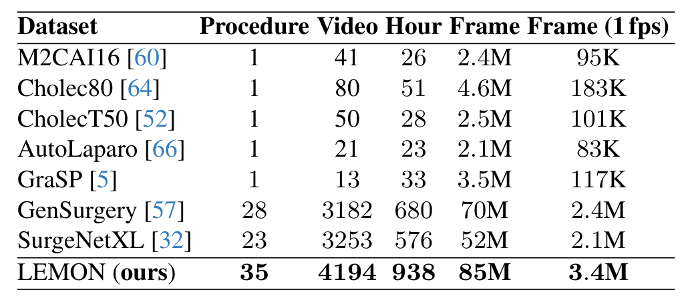
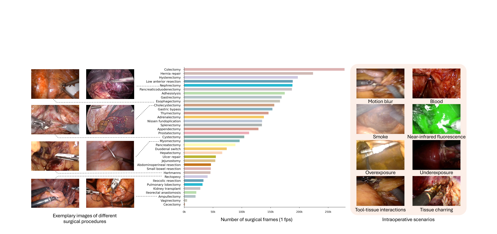
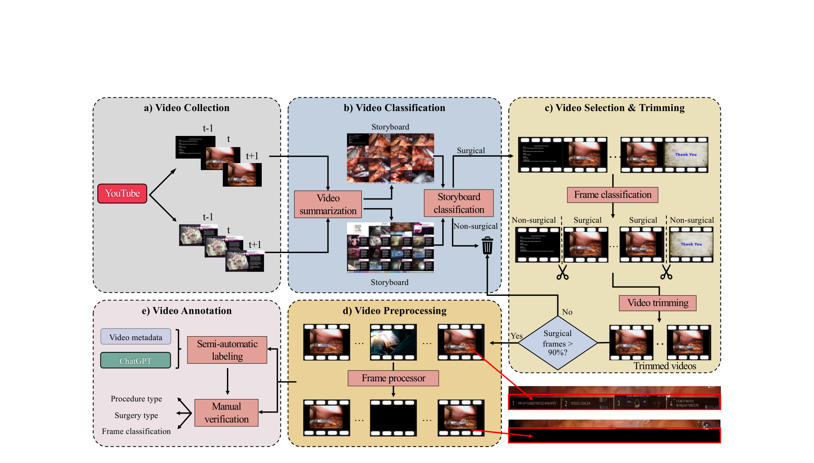
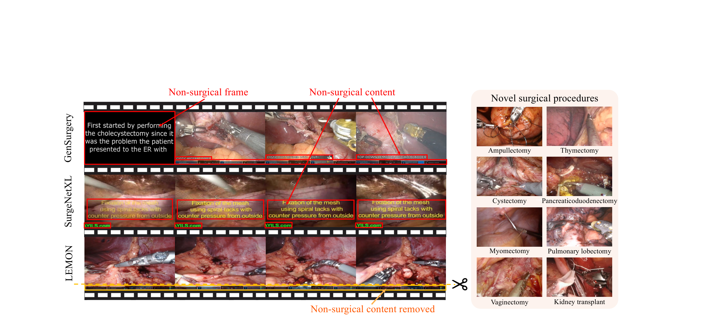
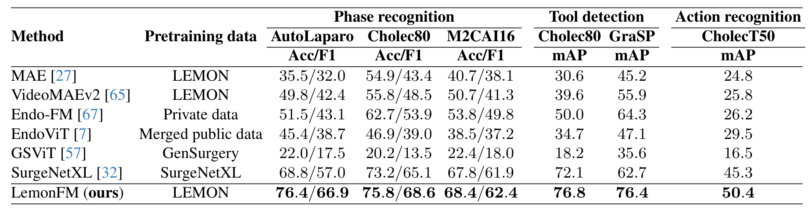
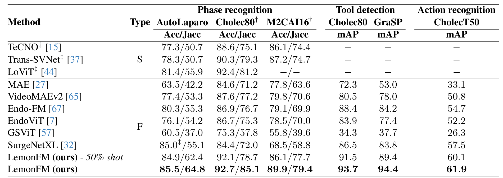
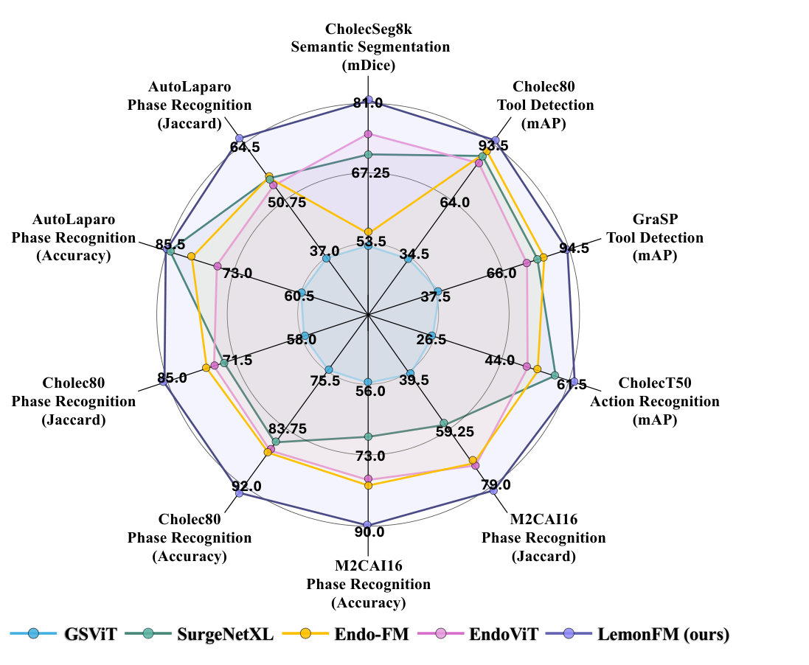

## 1. 背景与动机

**手术模型缺数据，而公开手术数据集普遍很小。** 典型数据集少于 100 个视频、不足 30 小时，隐私和法规又让新数据难以收集。

自监督预训练可以绕开标注，但需要大量无标签视频。已有路线有两个问题：Endo-FM 等依赖私有数据，无法复现；GenSurgery 和 SurgeNetXL 直接用网络视频，片头幻灯片、字幕、器械名称栏和水印都留在帧里。

这些非手术内容在同一视频内几乎不变，**自监督模型可能靠它们区分视频，而不去学解剖结构**。论文因此问：公开网络视频经过清洗后，能否支撑一个最好的手术基础模型。

:::highlights
- 缺口一：公开手术数据集小
- 缺口二：网络视频数据集没有清洗
:::

## 2. 核心观点速览

论文分三步回答。

1. 清洗：故事板分类筛视频，帧分类裁片头片尾，区域检测抹掉界面文字，再全部人工复核。
2. 预训练：在 DINO 上加一组额外视图，取同术式其他视频的近邻帧和相邻帧，用 ConvNeXt-L 训练 LemonFM。
3. 验证：四类任务、六个公开数据集、线性探测和全量微调两种协议。

**结果：** LemonFM 在所有下游列都最高，全量微调 Cholec80 Jaccard 85.1，次优的 SurgeNetXL 为 72.0。

**边界：** 能单独归给数据的证据只有消融表前四行；与其他基础模型的比较同时改变了数据、骨干和目标函数。

:::data
- 4194 个视频，938 小时，35 个术式
- 线性探测 AutoLaparo F1：LemonFM 66.9，SurgeNetXL 57.0
- CholecSeg8k mDice：LemonFM 81.3，EndoViT 71.0
:::

## 3. 数据从哪里来

作者按 Mayo Clinic 的微创手术列表定下 35 个术式，每个术式在 YouTube 搜索机器人与腹腔镜两种查询，直到各收集 500 个视频，共约 18K 个。

清洗后留下 4194 个视频、938 小时、8,500 万帧，94% 是 1280×720。按 Table 1，它比 GenSurgery 多约 32% 的视频、多 258 小时，术式多 7 个。**差距在倍数以内，与下游数据集比才是数量级的差距**：1 fps 下 340 万帧约为 Cholec80 的 18.6 倍。

*论文原图编号：Table 1。与已有公开手术数据集的规模对比。*

术式分布不均：结肠切除超过 25 万帧，阴道切除和盲肠切除不到 1 万帧。预训练是否做了术式平衡采样，论文未说明，所以高频术式可能主导表征。

*论文原图编号：Figure 5。术式示例、各术式帧数分布和术中场景示例。*

:::data
- 约 18K 原始视频，分类后 6617 个
- 去除 66 小时非手术内容
:::

## 4. 清洗流程怎样运作

*论文原图编号：Figure 2。五阶段数据整理流程。*

三个过滤模型各有分工：

| 模型 | 作用 | 五折平均 |
|---|---|---|
| 故事板分类器 | 判断视频是否以手术画面为主 | F1 94.75 |
| 帧分类器 | 找首尾连续三个手术帧作起止点，丢弃非手术帧超过 10% 的视频 | F1 95.64 |
| 区域检测器 | 遮挡字幕、器械名称栏、标志 | mAP50 79.29 |

单模型只有约 95% 的 F1，但五模型集成、70% 置信阈值和全量人工复核叠加后，作者报告视频级 100%、帧级超过 99.9% 的精度。**召回率论文未说明**，所以无法判断清洗是否系统性地丢掉了某些术式。

术式标签来自标题匹配，匹配不上时用 ChatGPT-4 判断，再人工复核。两位作者独立复核 500 个视频，术式 Kappa 0.97。人工投入共约 106 小时，**这个流程换到别的视频源成本可控**。

*论文原图编号：Figure 3。与两个网络视频数据集的整理差异，以及新增术式示例。*

## 5. 增广蒸馏加了什么

LemonFM 沿用 DINO：学生网络拟合教师网络在不同增广视图上的输出分布，教师是学生的指数滑动平均。新增的是一组额外视图 $W_i$。

$W_i$ 来自一个容量为 4 的池子：先找同术式、其他视频里的近邻帧，只有距离小于输入帧与前一帧距离的 3 倍时才放入；不够时用相邻帧补。**3 倍阈值把跨病人的外观差异限制在相邻帧变化的量级内**，避免把不同解剖位置当作正样本。

阈值在 1.5、3、6 倍下的 AutoLaparo 准确率为 72.9、73.4、72.6，差距不到 1 个点，更准确的说法是这个超参数不敏感。

:::highlights
- 近邻帧提供跨病人外观不变性
- 相邻帧提供对小运动的不变性
:::

## 6. 结果说了什么

*论文原图编号：Table 2。线性探测结果。*

线性探测下 LemonFM 每列都最高，AutoLaparo F1 比 SurgeNetXL 高 9.9。**但同在 LEMON 上预训练的 MAE 只有 32.0**，比 LemonFM 低 34.9，说明大部分优势来自判别式目标和骨干。

*论文原图编号：Table 3。全量微调结果。*

全量微调下 Jaccard 领先 8 到 10 个点，准确率却在 AutoLaparo 上只比 SurgeNetXL 高 0.5。Jaccard 让短阶段与长阶段权重相同，**所以 LemonFM 的优势集中在短阶段和阶段边界上**。

50% 标注版本几乎全面超过其他基础模型，唯一例外是 AutoLaparo 准确率 84.9 低于 SurgeNetXL 的 85.0，与正文的说法不符。

*论文原图编号：Figure 1。与其他手术基础模型的十项指标雷达图。*

## 7. 消融能把多少归给数据

| 对照 | AutoLaparo F1 变化 | CholecSeg8k mDice 变化 |
|---|---|---|
| ImageNet 换成 LEMON（无增广） | +12.9 | +4.3 |
| 未整理换成整理 | +4.5 | +1.3 |
| 加增广蒸馏 | +1.0 | +3.2 |
| ViT-L 换成 ConvNeXt-L | +0.8 | +10.7 |

**数据规模和多样性贡献最大，整理次之。** 单术式的 Cholec80 预训练（F1 46.9）甚至不如 ImageNet（53.0），说明术式多样性比领域内数据更重要。

增广在阶段识别上只有 +1.0，小于五折交叉验证的标准差 2.6，是否显著无法判断。

## 8. 结果没说什么

- 没有同一方法、同一骨干在 GenSurgery 或 SurgeNetXL 上预训练的对照，所以不能说 LEMON 优于这两个数据集。
- 未整理版本的帧数没有对齐，整理收益里混有数据量变化。
- 下游几乎都是胆囊切除和子宫切除，其余 30 多个术式没有帧级验证。
- 视频下架率论文未说明，长期可得的规模无法预估。
- ViT-L 是否单独调参论文未说明，ConvNeXt 的 10.7 点优势可能部分来自调参。

## 9. 复现与比较前要核对什么

- 优先申请 LMDB 版本；只用 YouTube 链接重下，得到的视频会少于 4194 个。
- 引用阶段识别结果时同时写准确率和 Jaccard。
- 比较基础模型时先看 MAE 和 VideoMAEv2 两行，它们与 LemonFM 用同一份数据。
- 分割表中四个已有基础模型的数字取自原论文，不在统一协议下。

## @takeaways
- 网络手术视频必须先去除字幕、片头和界面区域，清洗带来 +4.5 F1
- LemonFM 的领先主要来自数据、判别式目标和 ConvNeXt 骨干的组合
- 数据本身的价值只有消融表前四行能单独证明

## @strengths
- 清洗流程每一步都有模型性能和人工投入数字，容易复用
- 下游验证同时有线性探测、全量微调、50% 标注和五折交叉验证
- 数据和模型以知识共享署名 4.0 协议公开

## @weaknesses
- 缺少同方法跨数据集的预训练对照
- 消融和基线都只有单次运行
- 清洗流程只报告精度，没有召回率
- 标签复核由作者本人完成

## @questions
- 按帧数对齐后整理的收益还剩多少？
- LemonFM 在胆囊切除以外术式上的帧级表现如何？
- 预训练若按术式平衡采样，低频术式的表征会不会更好？
